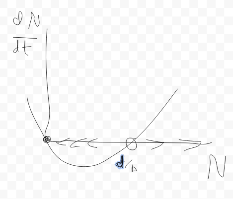
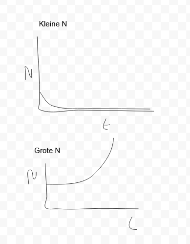
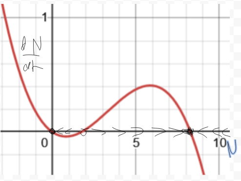
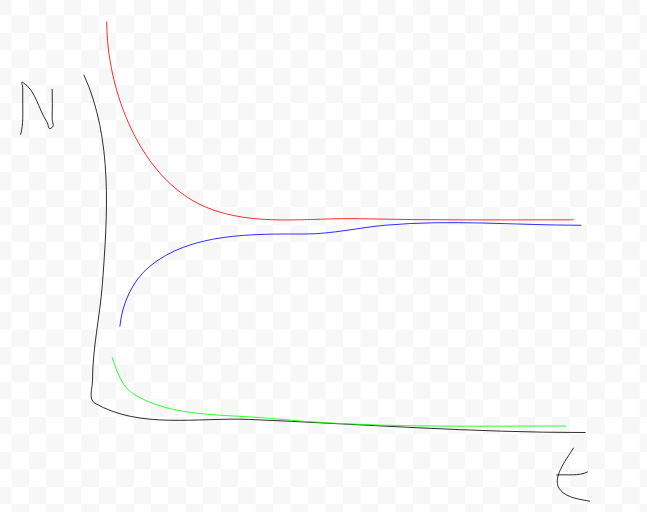

::: {.content-visible when-format="html"}

:::

# Antwoorden modelleren {.unnumbered}

## Antwoorden @sec-tbintro {.unnumbered}

@exr-variabelen-en-parameters

**a.** De dingen die veranderen (bijvoorbeeld over de tijd) noemen we variabelen. De dingen die veranderen zijn hier je bloedsuikerspiegel (a) en de hoeveelheid eiwit (c), dus dit zijn de variabelen.

**b.** De snelheden (b en d) waarmee de variabelen veranderen, staan volgens de omschrijving vast, en zijn dus parameters.

@exr-modeluitkomsten

**a.** Eén van de aannames van een ODE-model is dat het systeem goed gemengd is (@fig-modeltypes B). Naast de groeisnelheid is de ruimtelijke structuur bij een biofilm ook relevant, we voldoen dus niet aan de aanname van een goed gemengd systeem. Hierom is het beter om een ruimtelijk model te gebruiken voor het modelleren van een biofilm.

**b.** Door goed te mengen zijn posities niet belangrijk, dus het modelleren van posities is niet inzichtelijk. Het is beter om dit systeem met bijvoorbeeld een ODE te beschrijven.

**c.** De vorming van korstmossen is een proces waarbij ruimte belangrijk is, het is geen goed gemengd systeem. Een ruimtelijk model is dus het meest geschikt.

## Antwoorden @sec-exp {.unnumbered}

@exr-exponentiele-groei-langzaam

**a.** Ja, het percentage is klein maar de groei is alsnog exponentieel! Dit kun je zien doordat de hoeveelheid rijst per vakje met een rechte lijn toeneemt op een log-lineaire schaal. Daarnaast hebben we aan de vorm van de formule niks veranderd, we hebben alleen de groeisnelheid kleiner gemaakt.

```{r}
#| eval: true
#| echo: true
#| code-fold: false
#| label: fig-exponential

# beginaantal rijst
R <- 1

# herhaal iets 63 keer met een for-loop
for (i in 1:63) {
  R[i+1] <- R[i]*1.05 # R in volgende stap is 2*R in deze stap
}

plot(R , type='l', col="seagreen", log="y", lwd=2) 
```

**b.** Door de rijstkorrels in elke vakje bij elkaar op te tellen kunnen we uitrekenen hoeveel rijstkorrels je in totaal hebt:

```{r}
sum(R)
```
Zoals je ziet hebben we nu een stuk minder rijstkorrels dan bij het voorbeeld met verdubbeling. We hebben er nu maar 434.

@exr-rabbits-map

**a.**

```{r}
# definieren van beginaantal konijnen K en parameter r
K <- 24
r <- 2
# verdubbel het aantal konijnen 20 keer
for (i in 1:20){ 
  K <- r*K
}
# er zijn verschillende opties om "Het aantal konijnen na 20 tijdstappen is gelijk aan 25165824” te printen:
  # met cat:
  cat("Het aantal konijnen na 20 tijdstappen is gelijk aan ", K)
  # met paste:
  paste("Het aantal konijnen na 20 tijdstappen is gelijk aan ", K)
```

**b.**

```{r}
# Stap 1: Stel begin-aantal konijnen in
K <- 24

# Stap 2: Verdubbel het aantal konijnen 30 keer
for (t in 1:30){
  K[t+1] <- 2*K[t]
}

# Stap 3: Plot het resultaat
plot(K, type='l', col="seagreen")
```

De toename van het aantal konijnen lijkt exponentieel te zijn. Door de y-as log-lineair te maken kunnen we dit zeker weten:

```{r}
# Stap 1: Stel begin -aantal konijnen in
K <- 24
# Stap 2: Verdubbel het aantal konijnen 30 keer
for (t in 1:30){
K[t+1] <- 2*K[t]
}
# Stap 3: Plot het resultaat met een logaritmische y as, net zoals in de code van figuur 3
plot(K , type='l', col="seagreen", log="y")
```

Met een logaritmische schaal op de y-as krijgen we een rechte lijn en weten we nu zeker dat we met exponentiële groei te maken hebben.

**c.**
```{r}
#| eval: true
# Stap 1: Stel begin-aantal konijnen in
K <- 24
b <- 2
d <- 0.1

# Stap 2: Verdubbel het aantal konijnen 30 keer
for (t in 1:30){
  K[t+1] <- b*K[t] - d*K[t]
}

# Stap 3: Plot het resultaat
plot(K, type='l', log="y", col="seagreen")
```

We zien dat er nog steeds sprake is van exponentiële groei, omdat we met een logaritmische y-as een rechte lijn krijgen.  

**d.** 
```{r}
#| eval: false
# Stap 1: Stel begin-aantal konijnen in
K <- 24
b <- 2
d <- 1.1

# Stap 2: Verdubbel het aantal konijnen 30 keer
for (t in 1:30){
  K[t+1] <- b*K[t] - d*K[t]
}

# Stap 3: Plot het resultaat
plot(K, type='l', col="seagreen")
```

Bij $d=1.1$ neemt de populatiegrootte af, totdat ze uiteindelijk uitsterven. De konijnen gaan dan sneller dood dan dat ze zich voort kunnen planten.

::: {.callout-important}
### Extra: Waarom is de evenwichtswaarde niet gelijk aan K?
Misschien is dit voor nu nog te lastig, kijk hier dan later in de cursus nog eens naar! (Als we ook ODE-modellen hebben behandeld). In het bovenstaande voorbeeld is de populatiegrootte in evenwichtstoestand niet gelijk aan K. Later in de cursus zal je voorbeelden voorkomen van ODE-modellen van logistische groei waarbij de populatiegrootte in evenwicht wél gelijk is aan K. Hoe kan het dat dit wel het geval is bij ODE-modellen en niet bij MAP-modellen?

Dit komt door een verschil in de manier waarop deze modelformalismen het nieuwe aantal konijnen uitrekenen. Een ODE beschrijft de **verandering** van een variabele over tijd. Als de verandering over tijd ($N'(t)$) gelijk is aan nul, verandert de variabele niet meer. Bij logistische groei is dat wanneer de functionele response gelijk is aan nul ($f(N) = 0$). $$N'(t) = r \cdot N \cdot f(N)$$ Uit de bovenstaande vergelijking kunnen we zien dat de verandering van N over tijd gelijk wordt aan nul wanneer $f(N) = 0$ (vermenigvuldigen met 0 geeft altijd 0 als uitkomst). Zoals je in opdracht c hebt gezien, geldt dat $f(N) = 0$ wanneer $N = K$. Dit laat zien dat $N'(t) = r \cdot N \cdot f(N) = 0$ voor $N = K$. Dus, een ODE voor logistische groei is in evenwicht wanneer $N = K$.

Dit is anders voor een MAP, omdat dit niet de verandering van de variabele $N$ beschrijft, maar de exacte waarde uitrekent aan de hand van de vorige waarde voor $N$: $$N(t+1) = r \cdot N(t) \cdot f(N)$$ Zo'n vergelijking heeft een evenwicht bereikt wanneer $N(t+1) = N(t)$. Dit kan alleen op het moment dat $r \cdot f(N) = 1$. In het bovenstaande voorbeeld geldt $r = 2$. Dus $2 \cdot f(N) = 1 \Rightarrow f(N) = \frac{1}{2}$. Oftewel, als $f(N)$ gelijk is aan 0.5, zal de populatiegrootte al stabiliseren. Dit klopt: we zien hierboven dat de populatiegrootte stabiliseert wanneer deze 500 miljoen konijnen bevat (dit is de helft van $10^9$, of $f(0.5\cdot10^9) = 1 - \frac{0.5\cdot10^9}{10^9} = \frac{1}{2}$). 
:::

**e.**
Invullen van $K(t)=24$, $b=2$ en $d=0.001$ geeft:

\begin{align*}
K(t+1) &= b \cdot K(t) - d \cdot K(t)^2
K(t+1) &= 2 \cdot 24 - 0.001 \cdot 24^2
K(t+1) &= 48 - 0.001 \cdot 576
K(t+1) &= 48 - 0.576
K(t+1) &= 47.424
\end{align*}
Er worden dus wel veel nieuwe konijnen geboren, maar er gaan er maar weinig (een half konijn) dood. De populatie groeit.

**f.**
Invullen van $K(t)=1000$, $b=2$ en $d=0.001$ geeft:

\begin{align*}
K(t+1) &= b \cdot K(t) - d \cdot K(t)^2
K(t+1) &= 2 \cdot 1000 - 0.001 \cdot 1000^2
K(t+1) &= 2000 - 0.001 \cdot 10^6
K(t+1) &= 2000 - 1000
K(t+1) &= 1000
\end{align*}
Ook nu worden er veel nieuwe konijnen geboren ($b$ is nog steeds dezelfde waarde), maar er gaan ook veel meer konijnen dood. 

**g.**
Bij een populatie van 1000 konijnen gaan er net zo veel konijnen dood als dat er bij komen: de populatie is in evenwicht. We zouden de uitkomst van $K(t+1) = 1000$ opnieuw kunnen gebruiken in de formule en dan krijgen we weer een populatie van 1000 konijnen als uitkomst.

**h.**
```{r}
# Stap 1: Stel begin-aantal konijnen in
K <- 24
b <- 2
d <- 2e-9

# Stap 2: Verdubbel het aantal konijnen 30 keer
for (t in 1:30){
  K[t+1] <- b*K[t] - d*K[t]^2
}

# Stap 3: Plot het resultaat
plot(K, type='l', log="y", col="seagreen")
```
In de eerste jaren neemt het aantal konijnen in een rechte lijn toe: de populatie groeit dus (bij benadering) exponentieel. Later vlakt de groei af.

**i.**
Doordat `K[1]` het aantal konijnen van tijdstap 0 bevat, moeten we dus kijken naar het 11e element uit de vector om het aantal konijnen na 10 jaar te weten.
```{r}
K[11]
```
Het is vreemd dat het aantal konijnen geen geheel getal is, blijkbaar bestaan er ook halve konijnen?

**j.**
```{r}
# Stap 1: Stel begin-aantal konijnen in
K <- 24
b <- 3 # de birthrate is nu verhoogd naar 3
d <- 2e-9

# Stap 2: Verdubbel het aantal konijnen 30 keer
for (t in 1:30){
  K[t+1] <- b*K[t] - d*K[t]^2
}

# Stap 3: Plot het resultaat
plot(K, type='l', log="y", col="seagreen")
```
We zien dat de konijnenpopulatie wel naar hetzelfde evenwicht gaat, maar de exacte populatiegrootte lijkt een beetje te schommelen.
De groei gaat nu wel wat sneller, maar het lijkt erop dat we nog steeds geen 100 miljoen konijnen hebben na 10 jaar. Laten we dat even checken:
```{r}
K[11]
```
Nope, na 10 jaar hebben we nu ongeveer 1.4 miljoen konijnen. 

**k.**
```{r}
# Stap 1: Stel begin-aantal konijnen in
K <- 24
b <- 3.7 # de birthrate is nu verhoogd naar 3.7
d <- 2e-9

# Stap 2: Verdubbel het aantal konijnen 30 keer
for (t in 1:30){
  K[t+1] <- b*K[t] - d*K[t]^2
}

# Stap 3: Plot het resultaat
plot(K, type='l', log="y", col="seagreen")
```

```{r}
K[11]
```
Het aantal koniijnen komt inderdaad dichter in de buurt: na 10 jaar hebben we 11.5 miljoen konijnen.
<br>
Met $b=3.7$ zien we dat de populatiegrootte blijft schommelen zo gauw hij in de buurt komt van de evenwichtswaarde. Het lukt niet meer om exact op de evenwichtswaarde te blijven, zoals wel het geval was in vraag h. Het lijkt wel of de populatiegrootte continu een beetje boven of onder de evenwichtswaarde uitkomt (hierover leer je in @sec-odes meer!).

@exr-rabbits-in-space

**a.** Er kunnen meerdere antwoorden goed zijn, want het gaat om je **verwachting**. Het belangrijkste van deze opdracht is dat je erover nadenkt wat je verwacht en waarom. Gebaseerd op de waarden van de parameters zou je verwachting kunnen zijn dat er wel exponentiële groei zal zijn, want b \> d.

**b.** Er kunnen meerdere antwoorden goed zijn, want het gaat om je **verwachting**. Het belangrijkste van deze opdracht is dat je erover nadenkt wat je verwacht en waarom. De kans op een geboorte is voor elk individu 80%, en deze verandert niet met de populatiegrootte, dus je verwachting zou kunnen zijn dat er geen draagvermogen is. Een ander antwoord kan zijn dat je wel verwacht dat er een draagvermogen is, omdat er een eindig aantal vakjes is in het model.

**c.** In de simulatie kun je zien dat de populatie eerst erg snel groeit, en vervolgens stabiliseert. Er is dus wel een draagvermogen in dit model, ondanks dat we dit niet expliciet hebben gespecificeerd. Dat komt (zoals hierboven ook staat) doordat er in het model een beperkt aantal vakjes is waar konijnen in kunnen repliceren. Er kan in elk vakje maar één konijn zitten, dus als (bijna) alle vakjes al een konijn bevatten, kunnen er niet meer bij komen.

**d.** De toename is niet exponentieel.

```{r}
plot(c(13,100,292,619,1081,1695,2458,3191), log="y", type = "b")
```

Bij een exponentiële toename zouden we een rechte lijn moeten zien wanneer we de y-as op logaritmische schaal plotten. Dat is hier niet het geval.

**e.** Als één hokje een populatie konijnen voorstelt, zou dit niet meer de geboorte- en sterftekans zijn van een individu, maar de kans op uitbreiding of uitsterven van lokale populaties.

## Antwoorden @sec-odes {.unnumbered}

@exr-diffvsdiff

B

@exr-eenheden-tussen

**a.** De term $k$ beschrijft het dumpen van plastic in de oceaan. $k$ is een positieve term, het geeft dus een toename van de hoeveelheid plastic in de oceaan aan. Ook is het niet afhankelijk van de hoeveelheid plastic dat zich al in de oceaan bevindt. De term $\delta P$ beschrijft de afbraak van plastic in de oceaan. Dit is een negatieve term, dus hierdoor neemt de hoeveelheid plastic in de oceaan af.

**b.** De eenheid van $k$ is kilo's plastic per jaar, want dit is ook de eenheid van $\dt{P}$.

**c.** De eenheid van $\delta$ is per jaar, want de term $\delta P$ heeft de eenheid $P \over t$ en $\delta P = P \over t$ geeft $\delta = {1 \over t}$.

**d.** De afbraak van plastic gaat erg langzaam, dus waarschijnlijk is $k$ groter.

@exr-eenheden-tussen2

**a.** Bij $P = {k \over \delta}$. Bij een evenwichtssituatie is $\dt{P}$ gelijk aan nul. Dus:


\begin{align*}
    \dt{P} = k - \delta P = 0 \quad \text{ als...}\\
    \delta P &= k & \\
    P &= \frac{k}{\delta} &
\end{align*}

**b.** Nee, want het oplossen van $\dt{P} = 0$ geeft geen triviale oplossing ($P = 0$).

**c.** Zelfs als er geen plastic meer in de oceaan is, komt er altijd plastic bij ($k$), ook als $P$ gelijk is aan nul. De hoeveelheid plastic in de oceaan zal dus gewoon weer toenemen. In het begin zal deze toename lineair zijn, want als er nog geen plastic in de oceaan is kan er ook niks afgebroken worden. {width="50%"}

@exr-rodebloedcellen

**a.** $$\dt{B} = p - dB$$

**b.** De productiesnelheid $p$ is al in de eenheid cellen per dag (net als $\dt{B}$) en hangt niet af van het aantal rode bloedcellen. Het aantal rode bloedcellen dat doodgaat hangt wel af van het aantal rode bloedcellen, dus dit is $dB$. Dus $d$ is geen snelheid (aantal cellen per dag), maar een kans (per dag).

**c.** Bij een evenwichtssituatie is $\dt{B}$ gelijk aan nul. Dus:


\begin{align*}
    \dt{B} = p - d B = 0 \quad \text{ als...}\\
    \delta B &= p & \\
    B &= \frac{p}{d} &
\end{align*}

**d.** {width="50%"}

**e.** {width="50%"}

**f.** Het gaat hier om een verwachting, er zijn dus geen goede of foute antwoorden! Intuïtief zou je kunnen verwachten dat $p$ bepaalt hoe snel je herstelt, omdat dit aangeeft hoeveel rode bloedcellen erbij komen. Anderzijds zou je ook kunnen stellen dat er meer rode bloedcellen overbljven als er minder dood gaan.

**g.** In dit script kiezen we eerst waarden voor de parameters $p$ en $d$, en een beginwaarde voor $B$. Daarna maken we een functie die $\dt{B}$ uit kan rekenen voor verschillende waarden van $B$, $p$ en $d$. Vervolgens maken we in stap 5 een vector $B$ met de gewenste beginwaarde voor $B$. In stap 6 rekenen we 500 keer uit wat de volgende waarde van $B$ is. Dit is gelijk aan de vorige waarde van $B$ plus de verandering $\dt{B}$ voor die waarde van $B$. Tot slot plotten we al deze waarden van $B$ over de tijd, net zoals we in opdracht d en e deden. Let op dat minimale waarde op de y-as hier niet nul is, waardoor de plot er net iets anders uit ziet dan in d en e.

**h.** Doordat $B$ hier gelijk is aan de evenwichtswaarde is er geen verandering ($\dt{B} = 0$).

**i.** Te grote tijdstappen kunnen soms problemen geven, zoals we eerder in dit hoofdstuk al hebben gelezen. Dat komt doordat je de verandering per tijdstap uitrekent op basis van de huidige populatiegrootte. Dus als je net bloed hebt gedoneerd en op basis van het aantal rode bloedcellen nu wilt uitrekenen hoeveel rode bloedcellen je over één jaar hebt, dan zal dat veel te hoog uitvallen. Dat komt doordat het aantal rode bloedcellen meteen na een bloedtransfusie stijgt. Zoals je in de grafieken hierboven hebt gezien vlakt deze stijging na een tijdje echter af. Bij een te grote tijdstap kan het zo zijn dat deze stijging "te lang doorgaat". Hierdoor kan je een situatie krijgen zoals in @sec-exp waarbij er chaos ontstaat, doordat de populatiegrootte na één tijdstip boven of onder het evenwicht uitkomt. {width="50%"}

**j.** Als je de code van g runt krijg je een grafiek te zien die helpt bij het beantwoorden van deze vraag.

```{r}
# Stap 1: stel parameters in
p <- 2e11    
d <- 1/120   

# Stap 2: stel het beginaantal B in
B <- p/d

# Stap 3: maak functie die B, p, en d gebruikt om de verandering uit te rekenen
verandering <- function (B, p, d){
  delta <- p - d*B
  return(delta)
}

# Stap 4: een test of de functie werkt
verandering(B=p/d, p=p, d=d) 

# Stap 5: maak een lege lijst met begin-aantal erin
B <- c(0.9*p/d)

# Stap 6: reken 500 keer de volgende hoeveelheid B uit
for (t in 1:500) {
  B[t+1] <- B[t] + verandering(B=B[t], p=p, d=d)
}

# Stap 7: plot de tijdserie
plot(B, xlab="Tijd in dagen", ylab="Aantal rode bloedcellen", type="l", col="seagreen", lwd=2)
```

Hieruit kunnen we aflezen dat de helft van het bloedverlies na ongeveer 100 dagen weer hersteld is. Hierom moet je tussen donaties altijd 3 tot 4 maanden wachten.

**k.**

```{r}
# Stap 1: stel parameters in
p <- 2e11    
d <- 1/120   

# Stap 2: stel het beginaantal B in
B <- p/d

# Stap 3: maak functie die B, p, en d gebruikt om de verandering uit te rekenen
verandering <- function (B, p, d){
  delta <- p - d*B
  return(delta)
}

# Stap 4: een test of de functie werkt
# verandering(B=p/d, p=p, d=d) 

# Stap 5: maak een lege lijst met begin-aantal erin
B <- c(0.99*p/d)

# Stap 6: reken 500 keer de volgende hoeveelheid B uit
for (t in 1:500) {
  B[t+1] <- B[t] + verandering(B=B[t], p=p, d=d)
}

# Stap 7: plot de tijdserie
plot(B, xlab="Tijd in dagen", ylab="Aantal rode bloedcellen", type="l", col="seagreen", lwd=2)
```

Het duurt nog steeds even lang! De helft is nu wel veel minder, maar het herstel gaat nog steeds even snel.

**l.** Het gaat hier wederom om een verwachting, dus er zijn geen foute antwoorden! Intuïtief zou je kunnen verwachten dat $p$ bepaalt hoe snel je herstelt, omdat dit aangeeft hoeveel rode bloedcellen erbij komen. Anderzijds zou je ook kunnen stellen dat er meer rode bloedcellen overbljven als er minder dood gaan, dus als $d$ kleiner is.

**m.** Je kunt het script uit de opdracht gebruiken en de waarden voor $p$ en $d$ aanpassen om te kijken hoe dit de snelheid van het herstel beïnvloedt.

```{r}
#| label: fig-rodebloedcellen-m
#| fig-cap: "Snelheid van herstel voor verschillende parameters."
#| fig-subcap: 
#|   - "Originele parameterwaarden."
#|   - "Grotere waarde voor p (snellere productie)."
#|   - "Kleinere waarde voor d (minder sterfte)."
#| layout-ncol: 3

# Originele parameterwaarden

# Stap 1: stel parameters in
p <- 2e11    
d <- 1/120   

# Stap 2: stel het beginaantal B in
B <- p/d

# Stap 3: maak functie die B, p, en d gebruikt om de verandering uit te rekenen
verandering <- function (B, p, d){
  delta <- p - d*B
  return(delta)
}

# Stap 4: een test of de functie werkt
# verandering(B=p/d, p=p, d=d) 

# Stap 5: maak een lege lijst met begin-aantal erin
B <- c(0.9*p/d)

# Stap 6: reken 500 keer de volgende hoeveelheid B uit
for (t in 1:500) {
  B[t+1] <- B[t] + verandering(B=B[t], p=p, d=d)
}

# Stap 7: plot de tijdserie
plot(B, xlab="Tijd in dagen", ylab="Aantal rode bloedcellen", type="l", col="seagreen", lwd=2)

# Grotere waarde voor p (snellere productie)

# Stap 1: stel parameters in
p <- 2e12    # verhoog p
d <- 1/120   # houdt d op de oude waarde

# Stap 2-4 blijft hetzelfde en kunnen we overslaan

# Stap 5: maak een lege lijst met begin-aantal erin
B <- c(0.9*p/d)

# Stap 6: reken 500 keer de volgende hoeveelheid B uit
for (t in 1:500) {
  B[t+1] <- B[t] + verandering(B=B[t], p=p, d=d)
}

# Stap 7: plot de tijdserie
plot(B, xlab="Tijd in dagen", ylab="Aantal rode bloedcellen", type="l", col="seagreen", lwd=2)


# Kleinere waarde voor d (minder sterfte)

# Stap 1: stel parameters in
p <- 2e11 # zet p terug naar de oude waarde    
d <- 1/240   # verlaag d

# Stap 2-4 blijft hetzelfde en kunnen we overslaan

# Stap 5: maak een lege lijst met begin-aantal erin
B <- c(0.9*p/d)

# Stap 6: reken 500 keer de volgende hoeveelheid B uit
for (t in 1:500) {
  B[t+1] <- B[t] + verandering(B=B[t], p=p, d=d)
}

# Stap 7: plot de tijdserie
plot(B, xlab="Tijd in dagen", ylab="Aantal rode bloedcellen", type="l", col="seagreen", lwd=2)
```

De snelheid van het herstel verandert niet als we $p$ veranderen. Deze verandert echter wel als we $d$ veranderen. Waarschijnlijk tegen je verwachting in, bepaalt $d$ dus de snelheid van het herstel!

@exr-diffvsdiffinR

**a.** Met $r < 1$ gaat de populatie uiteindelijk altijd naar nul. 

Vanaf $r > 3$ ontstaan er fluctuaties rondom het evenwicht. 

Met $r > 3.7$ ontstaat er chaos.

```{r}
#| fig-cap: "Differentievergelijking"
#| fig-subcap: 
#|   - "r = 0.8"
#|   - "r = 2"
#|   - "r = 3"
#|   - "r = 4"
#| layout-ncol: 2
#| code-fold: true

# R = 0.8
# Stap 1, definieer beginaantal konijnen en parameters
N <- 24    # aantal konijnen
r <- 0.8     # intrinsieke groeisnelheid
K <- 10^9  # schaalt de dichtheidsafhankelijkheid

# Stap 2: bereken het aantal konijnen in [t+1] 40 keer
for (t in 1:40){
  N[t+1] <- r*N[t]*(1-(N[t]/K))
}

# Stap 3: bekijk resultaten
plot(N,type="o",xlab="Tijd (jaren)", ylab="Aantal konijnen")

# R = 2
# Stap 1, definieer beginaantal konijnen en parameters
N <- 24    # aantal konijnen
r <- 2     # intrinsieke groeisnelheid
K <- 10^9  # schaalt de dichtheidsafhankelijkheid

# Stap 2: bereken het aantal konijnen in [t+1] 40 keer
for (t in 1:40){
  N[t+1] <- r*N[t]*(1-(N[t]/K))
}

# Stap 3: bekijk resultaten
plot(N,type="o",xlab="Tijd (jaren)", ylab="Aantal konijnen")

# R = 3
# Stap 1, definieer beginaantal konijnen en parameters
N <- 24    # aantal konijnen
r <- 3     # intrinsieke groeisnelheid
K <- 10^9  # schaalt de dichtheidsafhankelijkheid

# Stap 2: bereken het aantal konijnen in [t+1] 40 keer
for (t in 1:40){
  N[t+1] <- r*N[t]*(1-(N[t]/K))
}

# Stap 3: bekijk resultaten
plot(N,type="o",xlab="Tijd (jaren)", ylab="Aantal konijnen")

# R = 4
# Stap 1, definieer beginaantal konijnen en parameters
N <- 24    # aantal konijnen
r <- 4     # intrinsieke groeisnelheid
K <- 10^9  # schaalt de dichtheidsafhankelijkheid

# Stap 2: bereken het aantal konijnen in [t+1] 40 keer
for (t in 1:40){
  N[t+1] <- r*N[t]*(1-(N[t]/K))
}

# Stap 3: bekijk resultaten
plot(N,type="o",xlab="Tijd (jaren)", ylab="Aantal konijnen")
```

**b.** In tegenstelling tot de differentievergelijking, geeft de differentiaalvergelijking ook groei wanneer $r < 1$. Daarnaast geeft $r > 3.7$ geen chaos, waar dat bij de differentievergelijking wel was. Om chaos te krijgen in dit model moet je $r$ heel erg groot maken, bijvoorbeeld bij $r = 250$ krijg je wel fluctuaties.

```{r}
#| label: fig-diffvsdiffing-b
#| fig-cap: "Differentiaalvergelijking."
#| fig-subcap: 
#|   - "r = 0.8"
#|   - "r = 2"
#|   - "r = 4"
#|   - "r = 250"
#| layout-ncol: 2
#| code-fold: true


# r = 0.8
# SIMPEL SCRIPT VOOR DIFFERENTIAALVERGELIJKING
# Stap 1, definieer beginaantal konijnen en parameters
N <- 24 
r <- 0.8
K <- 10^9

# Stap 2, definieer tijdstappen en maak een dataframe aan
delta_t <- 0.01 # grootte van de tijdstap
tijdstapjes <- seq(0,20,by=delta_t)
tijdserie <- data.frame(t=tijdstapjes,konijnen=N)

# Stap 3: Reken in kleine stapjes de volgende N uit
for (t in 1:length(tijdstapjes)-1){
  groeiN <- delta_t * r*N*(1-N/K)  
  N <- N + groeiN 
  tijdserie[t+1,"konijnen"] <- N
}

# Stap 3: bekijk resultaten
plot(tijdserie$t, tijdserie$konijnen, type="l",xlab="Tijd (jaren)", ylab="Aantal konijnen")

# r = 2
# SIMPEL SCRIPT VOOR DIFFERENTIAALVERGELIJKING
# Stap 1, definieer beginaantal konijnen en parameters
N <- 24 
r <- 2
K <- 10^9

# Stap 2, definieer tijdstappen en maak een dataframe aan
delta_t <- 0.01 # grootte van de tijdstap
tijdstapjes <- seq(0,20,by=delta_t)
tijdserie <- data.frame(t=tijdstapjes,konijnen=N)

# Stap 3: Reken in kleine stapjes de volgende N uit
for (t in 1:length(tijdstapjes)-1){
  groeiN <- delta_t * r*N*(1-N/K)  
  N <- N + groeiN 
  tijdserie[t+1,"konijnen"] <- N
}

# Stap 3: bekijk resultaten
plot(tijdserie$t, tijdserie$konijnen, type="l",xlab="Tijd (jaren)", ylab="Aantal konijnen")

# r = 4
# SIMPEL SCRIPT VOOR DIFFERENTIAALVERGELIJKING
# Stap 1, definieer beginaantal konijnen en parameters
N <- 24 
r <- 4
K <- 10^9

# Stap 2, definieer tijdstappen en maak een dataframe aan
delta_t <- 0.01 # grootte van de tijdstap
tijdstapjes <- seq(0,20,by=delta_t)
tijdserie <- data.frame(t=tijdstapjes,konijnen=N)

# Stap 3: Reken in kleine stapjes de volgende N uit
for (t in 1:length(tijdstapjes)-1){
  groeiN <- delta_t * r*N*(1-N/K)  
  N <- N + groeiN 
  tijdserie[t+1,"konijnen"] <- N
}

# Stap 3: bekijk resultaten
plot(tijdserie$t, tijdserie$konijnen, type="l",xlab="Tijd (jaren)", ylab="Aantal konijnen")

# r = 250
# SIMPEL SCRIPT VOOR DIFFERENTIAALVERGELIJKING
# Stap 1, definieer beginaantal konijnen en parameters
N <- 24 
r <- 250
K <- 10^9

# Stap 2, definieer tijdstappen en maak een dataframe aan
delta_t <- 0.01 # grootte van de tijdstap
tijdstapjes <- seq(0,20,by=delta_t)
tijdserie <- data.frame(t=tijdstapjes,konijnen=N)

# Stap 3: Reken in kleine stapjes de volgende N uit
for (t in 1:length(tijdstapjes)-1){
  groeiN <- delta_t * r*N*(1-N/K)  
  N <- N + groeiN 
  tijdserie[t+1,"konijnen"] <- N
}

# Stap 3: bekijk resultaten
plot(tijdserie$t, tijdserie$konijnen, type="l",xlab="Tijd (jaren)", ylab="Aantal konijnen")
```

**c.** Het script wordt dan heel erg langzaam. ODEs zijn dus precieser, maar dat wordt ook steeds moeilijker voor je computer. Dit is waarom je meestal betere tools gebruikt om ODEs te integreren, zoals Grind (dit zul je later in de cursus zien).

```{r}
#| eval: false 
# SIMPEL SCRIPT VOOR DIFFERENTIAALVERGELIJKING
# Stap 1, definieer beginaantal konijnen en parameters
N <- 24 
r <- 2
K <- 10^9

# Stap 2, definieer tijdstappen en maak een dataframe aan
delta_t <- 0.0001 # grootte van de tijdstap
tijdstapjes <- seq(0,20,by=delta_t)
tijdserie <- data.frame(t=tijdstapjes,konijnen=N)

# Stap 3: Reken in kleine stapjes de volgende N uit
for (t in 1:length(tijdstapjes)-1){
  groeiN <- delta_t * r*N*(1-N/K)  
  N <- N + groeiN 
  tijdserie[t+1,"konijnen"] <- N
}

# Stap 3: bekijk resultaten
tijdserie[20,] # Aantal na 0.19 jaar
plot(tijdserie$t, tijdserie$konijnen, type="l",xlab="Tijd (jaren)", ylab="Aantal konijnen")
```

## Antwoorden @sec-dichtheid {.unnumbered}

@exr-functioneleresponses

**a.** $\frac NK + 1$ zal niet een vergelijkbaar effect hebben, omdat de term met $N$ erin nu positief is. Als de populatie groter wordt, zal de birthrate dus ook groter worden in plaats van afnemen.

**b.** $1-cN$ zal wel een vergelijkbaar effect hebben. Deze functie heeft dezelfde vorm als $f(N)=1-\frac NK$, maar nu is $\frac 1K$ vervangen door de constante $c$.

**c.** $1-cN^2$ zal niet een vergelijkbaar effect hebben. De $N^2$ terms zorgt er voor dat dat de birthrate nog sneller af neemt door de kwadratische term. De birthrate zal echter nog steeds af blijven nemen!

@exr-dddportrait

**a.** Er is een evenwicht als: $\frac{dN}{dt}=0$. $$\Rightarrow \frac{dN}{dt}=0=bN-d\left(1+\frac NK \right)N$$ 
$$ \Rightarrow N = 0 \quad \text{(oplossing 1)}$$ 
$$b-d\left(1+\frac NK \right) =0$$ 
$$\Rightarrow b=d\left(1+\frac NK \right)$$ 
$$\Rightarrow\frac bd = 1+\frac NK$$ 
$$\Rightarrow \frac bd - 1 = \frac NK$$ 
$$\Rightarrow  K\left( \frac bd - 1 \right) = N \quad \text{(oplossing 2)}$$

**b.** Net zoals in @fig-faseportret hebben we weer een bergparabool vanwege de term $-d\left(1+\frac NK \right)N = -dN - \frac{d}{K} N^2$

We hebben de twee evenwichten berekend in *a*: $N=0$ en $N=K\left( \frac bd - 1 \right)$. Het triviale evenwicht N=0 is geen attractor, het andere evenwicht wel.

::: todo
Bram: juiste tekening maken en dichtheid_ant_exr_draw_14.2b.jpg vervangen
:::


@exr-bacterienbloed

**a.** $rB$ is de exponentiële groei van de bacteriën, $-kNB$ is de hoeveelheid bacteriën die door neutrofielen wordt doodgemaakt. De eenheden zijn allemaal in bacteriën per uur.

**b.** rB en kNB moeten allebei de eenheid aantal bacteriën/uur hebben.

B heeft de eenheid bacteriën, dus r moet de eenheid per uur = $uur^{-1}$

N heeft de eenheid hoeveelheid neutrofielen in je bloed, dus k moet dit wegdelen. We hebben dus: $$\frac{aantal \, \, bacterien\,\, in \,\,het\,\, bloed}{uur} = k*aantal \, \, neutrofielen\,\, in \,\,het\,\, bloed * aantal \, \, bacterien\,\, in \,\,het\,\, bloed$$ Dus $$k=\frac{1}{uur*aantal \, \, neutrofielen\,\, in \,\,het\,\, bloed}$$

Als je dit nog lastig vindt kan je @sec-odes-eenheden nog een keer doorlezen!

**c.**

$$\frac{dB}{dt}=0=rB-kNB$$ 
$$B = 0 \quad \text{(oplossing 1)}$$
$$r-kN=0$$ 
$$N=\frac{k}{r}  \quad \text{(oplossing 2)}$$

Maar hier is geen populatie B aan verbonden, dus nee.

**d.** :::{.todo} Bram: Juiste tekening maken en dichtheid_ant_exr_draw_14.3d.png vervangen ::: {#fig-143d}

**e.**

$$\frac{dB}{dt}=0=rB-kNB$$ 

$$B = 0 \quad \text{(oplossing 1)}$$

$$r-kN=0$$ 

$$ N=\frac{k}{r} \quad \text{(oplossing 2)}$$

Je hebt dus $k/r$ neutrofielen nodig om de groei van de bacteriën te stoppen. Dit punt is ook het snijpunt tussen de lijnen van @fig-143d.

**f.** We moeten het aantal dode bacteriën delen door het aantal neutrofielen. Dus $kNB/N = kB$

**g.** Als er 0 bacteriën zijn, worden er 0 bacteriën per neutrofiel doodgemaakt.

Als er oneindig veel bacteriën zijn worden er oneindig veel bacteriën per neutrofiel doodgemaakt.

Dit is niet een logische aanname, want elke neutrofiel kan maar een gelimiteerd aantal bacteriën doodmaken.


**h.** Als $B$ heel groot is, dan maakt de kleine toevoeging van $h$ onderin de breuk niet heel veel meer uit. $h$ wordt dus voor grote $B$ "verwaarloosbaar".

**i.** Als B heel groot is ten opzichte van h, dan kan je de breuk vereenvoudigen tot $\frac{kNB}{B}$ en de B's wegstrepen en houd je alleen kN over. Per neutrofiel worden er dan *k* bacteriën doodgemaakt.

**j.**

$$\frac{dB}{dt}=0=rB-\frac{kNB}{h+B}$$ 
$$ B\left(r-\frac{kN}{h+B}\right)=0$$
$$B=0 \quad \text{(oplossing 1)}$$
$$r-\frac{kN}{h+B}=0$$
$$r=\frac{kN}{h+B}$$
$$rh+rB=kN$$ 
$$N=\frac{r(h+B)}{k} \quad \text{(oplossing 2)}$$

@exr-heck

**a.** Ik verwacht een aantal heckrunderen waar de death en birth rate even groot zijn in @fig-heck, want dan veranderd de populatie niet meer. Dit zijn ongeveer 340 tot 350 runderen.

**b.** Als N heel klein is, is de term $1-\frac{N}{K_b}$ ongeveer gelijk aan 1. b is dus 0.4.

Ook weten we dat we met 400 runderen maar de helft van de deze maximale geboorte hebben. Dus: $$\frac{1}{2}*0.4 = 0.4*\left(1-\frac{400}{K_b}\right)$$ $$\frac12= 1-\frac{400}{K_b}$$ $$-\frac{1}{2} = -\frac{400}{K_b}$$ $$\frac{2}{1}=\frac{K_b}{400}$$ $$K_b = 400\cdot 2 = 800$$

**c.** Op dezelfde manier als bij **b** krijgen we hier $d=0.03$.

Daarna kunnen we $K_d$ uitrekenen: $$0.33 = 0.03\left(1+\frac{500}{K_d}\right)$$ $$\frac{0.33}{0.03} = 11 = 1+\frac{500}{K_d}$$ $$ 10 = \frac{500}{K_d}$$ $$\frac{10}{500} = \frac 1{K_d}$$ $$\frac{500}{10} = 50 = K_d$$

**d.** Als we al onze gevonden parameters invullen krijgen we de volgende ODE: $$\frac{dN}{dt} = 0.4\left(1-\frac{N}{800} \right) N - 0.03 \left(1+\frac{N}{50}\right)N$$ 
Deze stellen we gelijk aan 0 om het evenwicht te bepalen: 
$$0= 0.4\left(1-\frac{N}{800} \right) N - 0.03 \left(1+\frac{N}{50}\right)N$$
$$N=0 \vee 0.4\left(1-\frac{N}{800} \right)  = 0.03 \left(1+\frac{N}{50}\right)$$ 
We negeren de triviale oplossing: 
$$0.4-\frac{0.4N}{800} = 0.03+\frac{0.03N}{50}$$ 
$$0.4-0.03 = \left(\frac{0.4}{800}+\frac{0.03}{50} \right)N$$ 
$$0.37 = 0.0011N$$ 
$$N\approx 336$$

**e.** Het aantal dieren die elk jaar dood gaan is gelijk aan $d\left(1-\frac N{K_d}\right)N$ waarin we onze waardes in kunnen vullen: 
$$0.03*\left(1+\frac{336}{50}\right)*336\approx 78$$

**f.** Na 300 tijdstappen wordt er begonnen met afschieten (`if(t>300) k <- 0.05`), dit komt overeen met 30 jaar omdat de tijdstap 0.1 jaar is (`delta_t <- 0.1 # grootte van de tijdstap`). 

Er wordt telkens 5% van de populatie afgeschoten omdat k gelijk gesteld wordt aan 0.05.

**g.** De sterfte neemt met minder dan 5% toe (ongeveer 2.3 procent), terwijl er wel 5% extra wordt afgeschoten. Er gaan dus \~2.7% van de populatie minder dood van de honger.

**h.** De dieren leven iets minder lang, maar gaan wel relatief minder vaak dood van de honger. Daarom zou het aangemoedigd kunnen worden.

**i.** Vooral oude dieren afschieten. Hierdoor veranderd de deathrate nouwelijks, en gaan er ook minder jonge dieren dood omdat de oude dieren minder "voedsel verspillen".

@exr-samenwerkenallee 

**a.** Soms sterft iedereen uit omdat ze van elkaar gescheiden zijn en elkaar niet kunnen helpen.

**b.** Het lukte de populaties ongeveer 5 keer om uit te groeien.

**c.** Het lukt de populatie nu veel vaker om succesvol uit te groeien.

**d.** Ja ik heb een verschil gevonden, maar het zou toeval kunnen zijn.

@exr-desimpelstecoop

**a.** $$\frac{dN}{dt}=0=bN^2-dN$$ $$N(bN-d)=0$$ $$N=0\vee bN-d=0$$ $$N=0\vee N=\frac{d}{b}$$

**b.**



$N=0$ is stabiel, $\frac db$ is instabiel.

::: todo
Bram: juiste tekening maken en dichtheid_ant_exr_draw_17.2b.png vervangen
:::

**c.**

 

Er ontstaat geen evenwicht. Of de populatie sterft uit, of hij blijft exponentieel groeien.

::: todo
Bram: juiste tekening maken en dichtheid_ant_exr_draw_17.2c.jpg vervangen
:::

**d.** In het individual-based model gingen we er van uit dat er maar 1 individu in een hokje past. Hierdoor kan de populatie niet exponentieel toe blijven nemen, want na een tijdje zitten alle hokjes vol en kunnen er pas weer nieuwe indviduen komen als er eerst weer een paar dood zijn gegaan.

@exr-loggroeisex 

**a.** 


**b.**



::: todo
Bram: juiste tekening maken en dichtheid_ant_exr_draw_17.3b.png vervangen
:::

**c.**



Er zijn drie mogelijke opties: 1: We beginnen met een hele grote N, die exponentieel afneemt tot aan de stabliele evenwichtsstand 2: We beginnen met een N die boven het instabiele evenwicht ligt, maar onder het stabiele evenwicht. Deze gaat ook naar de evenwichtsstand. 3: We beginnen met een waarde van N onder het instabiele evenwicht. Deze populatie neemt af naar 0.

::: todo
Bram: juiste tekening maken en dichtheid_ant_exr_draw_17.3c.png vervangen
:::

@exr-kreislauf 
**a.** In dit systeem hebben alle drie de soorten er wat aan als er meer gemengd wordt. Ze hebben namelijk allemaal iemand anders nodig om zich voort te planten. Er is hier ook geen mogelijkheid voor 1 soort om de anderen uit te roeien, omdat er altijd een andere is die deze groei weer tegen kan gaan.

**b.** Spiralen/Golven

**c.** Mengen+ zorgt voor te grote fluctuaties, waardoor 1 soort volledig uit kan sterven. Hierdoor valt de hele cyclus uit elkaar en gaat uiteindelijk iedereen dood.

## Antwoorden @sec-meerdere {.unnumbered}

@exr-ziekezeehonden

**a.** De infectiesnelheid-parameter noemen we $\beta$, en de sterfte van zieke zeehonden noemen we $\delta$. De term is dus een infectie-term.

**b.** Ja, wel gegeven de modelomschrijving, want daar staat dat de zeehonden die ziek zijn snel dood gaan.

**c.** Het is dan een 1D systeem: $$\dt{Z} = bZ\left(1-\frac{Z}{k}\right)-dZ$$ Deze vergelijking gelijkstellen aan 0 geeft $Z = k\left(1-\frac{d}{b}\right)$. Dit is het evenwicht van de gezonde populatie in afwezigheid van de infectieziekte.

**d.** Ja, de populatiegrootte zonder infectieziekte wordt bepaald door $k(1-d/b)$ met kleinere b, dus grotere d/b, dus kleiner totaal. Dus de populatie zal afnamen als b kleiner wordt. Tip: als je het moeilijk vindt om dit voor te stellen vul dan waarden in voor d en b.

**e.** Stel beide vergelijkingen gelijk aan 0. 

Nullcline van Z: 
\begin{align*}
    bZ\left(1-\frac Zk\right) - dZ - \beta ZI &= 0 \\
    Z\left(b\left(1-\frac Zk\right) - d - \beta I\right) &= 0 \\
    Z &= 0 \quad \text{(oplossing 1)} \\
    b\left(1-\frac Zk\right) - d - \beta I &= 0 \\
    \beta I &= b\left(1-\frac Zk \right) - d \\
    I &= \frac{b\left(1-\frac Zk \right) - d}{\beta} \\
    I &= -Z\frac{b}{k\beta} + \frac{b - d}{\beta} \quad \text{(oplossing 2)}
\end{align*}

Nullcline van I: 
\begin{align*}
    \beta ZI - \delta I &= 0 \\
    I(\beta Z - \delta) &= 0 \\
    I &= 0 \quad \text{(oplossing 1)} \\
    \beta Z - \delta &= 0 \\
    \beta Z &= \delta \\
    Z &= \frac \delta\beta  \quad \text{(oplossing 2)}
\end{align*}

Er zijn twee kwalitatief verschillende situaties: één waarbij de twee nullclines elkaar snijden, en één waarbij er geen snijpunt is.
```{r}
#| fig.width: 7
#| fig.height: 4
#| code-fold: true

I <- 1:100
Z <- 1:100

par(pty="s",mfrow=c(1,1),mar=c(4,4,1,1.5))
plot(I,Z,  col.axis="#f2790f",type='n',xaxt='n',xlab="",ylab="",axes=FALSE, frame.plot=TRUE)

mtext("Z", side=1, line=2, col="blue", cex=1.5, at=90)
mtext("I", side=2, line=2, col="#f2790f", cex=1.5,adj=1,las=2, at=90)
mtext("0", side=2, line=1, col="black", cex=1,adj=1,las=2, at=0)
mtext("0", side=1, line=1, col="black", cex=1,adj=0,las=1, at=-1)

Axis(side=1, labels=FALSE)
Axis(side=2, labels=FALSE)

abline(h=0, lwd=2, col="#f2790f")
abline(v=40, lwd=2, col="#f2790f")
abline(v=0, lwd=2, col="blue",)
abline(a=80,b=-1, lwd=2,col="blue")

par(pty="s",mfrow=c(1,1),mar=c(4,4,1,1.5))

plot(I,Z,  col.axis="#f2790f",type='n',xaxt='n',xlab="",ylab="",axes=FALSE, frame.plot=TRUE)


mtext("Z", side=1, line=2, col="blue", cex=1.5, at=90)
mtext("I", side=2, line=2, col="#f2790f", cex=1.5,adj=1,las=2, at=90)
mtext("0", side=2, line=1, col="black", cex=1,adj=1,las=2, at=0)
mtext("0", side=1, line=1, col="black", cex=1,adj=0,las=1, at=-1)

Axis(side=1, labels=FALSE)
Axis(side=2, labels=FALSE)

abline(h=0, lwd=2, col="#f2790f")
abline(v=80, lwd=2, col="#f2790f")
abline(v=0, lwd=2, col="blue",)
abline(a=80,b=-1.25, lwd=2,col="blue")
```

**f.**
Er is een evenwicht op een plek waar de oranje en blauwe lijn elkaar kruizen. 
Er zijn meerdere evenwichten. Evenwicht 1 is (0 ; 0): als er geen zeehonden zijn.
De schuine nullcline (van $Z$) kan op twee punten de oranje lijnen snijden. 
We weten echter nog niet de precieze coördinaten van deze snijpunten, hier kunnen we achter komen door de waarde die we wel weten in te vullen in de formule van de $Z$-nullcline. \br
Evenwicht 2: \br
$I = 0$ invullen in de $Z$-nullcline $I = -Z\frac{b}{k\beta} + \frac{b - d}{\beta}$.
\begin{align*}
-Z\frac{b}{k\beta} + \frac{b - d}{\beta} &= 0 \\
Z\frac{b}{k\beta} &= \frac{b - d}{\beta} \\
Z &= \frac{b - d}{\beta} \cdot \frac{k\beta}{b} \\
Z &= \frac{k\beta(b - d)}{\beta b} \\
Z &= \frac{k(b - d)}{b} \\
Z &= \frac{kb - kd}{b} \\
Z &= k - \frac{kd}{b} 
\end{align*}
Dus hier is een evenwicht voor $I=0$ en $Z = k - \frac{kd}{b}$. \br
Evenwicht 3: \br
$Z = \delta / \beta$ invullen in de $Z$-nullcline $I = -Z\frac{b}{k\beta} + \frac{b - d}{\beta}$.
\begin{align*}
I &= -Z\frac{b}{k\beta} + \frac{b - d}{\beta} \\
I &= -\frac{\delta}{\beta} \cdot \frac{b}{k\beta} + \frac{b - d}{\beta} \\
I &= -\frac{\delta b}{k \beta^2} + \frac{b - d}{\beta} 
\end{align*}

**f.**
```{r}
#| fig.width: 7
#| fig.height: 4
#| code-fold: true

vectorfield <- function(x,y,dx,dy){
  arrows(x, y, x+0, y+dy, length = 0.07, angle = 20, col="#f2790f",lwd=2)
  arrows(x, y, x+dx, y+0, length = 0.07, angle = 20, col="blue",lwd=2)
}

I <- 1:100
Z <- 1:100

par(pty="s",mfrow=c(1,1),mar=c(4,4,1,1.5))

plot(I,Z,  col.axis="#f2790f",type='n',xaxt='n',xlab="",ylab="",axes=FALSE, frame.plot=TRUE)


mtext("Z", side=1, line=2, col="blue", cex=1.5, at=90)
mtext("I", side=2, line=2, col="#f2790f", cex=1.5,adj=1,las=2, at=90)
mtext("0", side=2, line=1, col="black", cex=1,adj=1,las=2, at=0)
mtext("0", side=1, line=1, col="black", cex=1,adj=0,las=1, at=-1)

Axis(side=1, labels=FALSE)
Axis(side=2, labels=FALSE)

abline(h=0, lwd=2, col="#f2790f")
abline(v=40, lwd=2, col="#f2790f")
abline(v=0, lwd=2, col="blue",)
abline(a=80,b=-1, lwd=2,col="blue")

vectorfield(15,95,-10,-10)
vectorfield(95,12,-10,10)
vectorfield(50,12,10,10)
vectorfield(15,12,10,-10)

points(40,40,cex=1.3,pch=19)
text(55,40,"Evenwicht 3", cex=0.7)
points(0,0,cex=1.3)
text(12,5,"Evenwicht 1", cex=0.7)
points(80,0,cex=1.3)
text(90,5,"Evenwicht 2", cex=0.7)

par(pty="s",mfrow=c(1,1),mar=c(4,4,1,1.5))

plot(I,Z,  col.axis="#f2790f",type='n',xaxt='n',xlab="",ylab="",axes=FALSE, frame.plot=TRUE)


mtext("Z", side=1, line=2, col="blue", cex=1.5, at=90)
mtext("I", side=2, line=2, col="#f2790f", cex=1.5,adj=1,las=2, at=90)
mtext("0", side=2, line=1, col="black", cex=1,adj=1,las=2, at=0)
mtext("0", side=1, line=1, col="black", cex=1,adj=0,las=1, at=-1)

Axis(side=1, labels=FALSE)
Axis(side=2, labels=FALSE)

abline(h=0, lwd=2, col="#f2790f")
abline(v=80, lwd=2, col="#f2790f")
abline(v=0, lwd=2, col="blue",)
abline(a=80,b=-1.25, lwd=2,col="blue")

vectorfield(50,60,-10,-10)
vectorfield(95,50,-10,10)
vectorfield(20,30,10,-10)

points(0,0,cex=1.3)
text(12,5,"Evenwicht 1", cex=0.7)
points(64,0,cex=1.3,pch=19)
text(74,5,"Evenwicht 2", cex=0.7)

```
Het aantal geïnfecteerde zeehonden $I$ stijgt als we aan de rechterkant van de $I$-nullcline zitten. Er zijn dan genoeg zeehonden om te infecteren. Links van de $I$-nullcline daalt het aantal geïnfecteerde zeehonden. \br
Het aantal zeehonden stijgt als we ons onder de $Z$-nullcline bevinden. In de figuur hierboven zijn deze vectoren getekend in beide situaties.
Nu kunnen we bekijken welke van de evenwichten stabiel zijn. Evenwicht 1 is niet stabiel, want zo gauw er kleine populatie zeehondenn is, zal deze populatie gaan groeien. \br
De stabiliteit van evenwicht 2 hangt af van de specifieke situatie. In het geval dat de $I$-nullcline zich rechts van dit evenwicht bevindt (tweede plot hierboven), is het een stabiel evenwicht. De infectieziekte verdwijnt dan uit de populatie, en er is een evenwicht met alleen gezonde zeehonden.
Als de $I$-nullcline zich links van dit evenwicht bevindt, is dit evenwicht niet meer stabiel. De infectieziekte blijft dan wel aanwezig in de populatie. \br
Dit geeft dan een derde evenwichtssituatie, die ook stabiel is. In dit evenwicht zijn er zowel gezonde als zieke zeehonden.

**g.**
De locatie van de $I$-nullcline wordt bepaald door $\beta$ en $\delta$. Als de ziekte niet infectieus genoeg is ($\beta$ is te klein) of als de geïnfecteerde zeehonden te snel dood gaan ($\delta$ is te groot) zal de ziekte te snel weer uit de populatie verdwijnen. 

**h.**
Alleen de nullcline van de gezonde zeehonden wordt beïnvloed door de hoeveelheid zeehonden die geboren wordt: 
$$Z=k\left(1-\frac{d+\beta I}{b} \right)$$
Als b gehalveerd wordt krijgen we: 
$$Z=k\left(1-\frac{d+\beta I}{0.5 b}\right)=k\left(1-2\frac{d+\beta I}{ b}\right)$$
De richtingscoëfficiënt van deze lijn is twee keer so stijl. 
```{r}
#| fig.width: 7
#| fig.height: 4
#| code-fold: true

vectorfield <- function(x,y,dx,dy){
  arrows(x, y, x+0, y+dy, length = 0.07, angle = 20, col="#f2790f",lwd=2)
  arrows(x, y, x+dx, y+0, length = 0.07, angle = 20, col="blue",lwd=2)
}

I <- 1:100
Z <- 1:100

par(pty="s",mfrow=c(1,1),mar=c(4,4,1,1.5))

plot(I,Z,  col.axis="#f2790f",type='n',xaxt='n',xlab="",ylab="",axes=FALSE, frame.plot=TRUE)

mtext("Z", side=1, line=2, col="blue", cex=1.5, at=90)
mtext("I", side=2, line=2, col="#f2790f", cex=1.5,adj=1,las=2, at=90)
mtext("0", side=2, line=1, col="black", cex=1,adj=1,las=2, at=0)
mtext("0", side=1, line=1, col="black", cex=1,adj=0,las=1, at=-1)

Axis(side=1, labels=FALSE)
Axis(side=2, labels=FALSE)

abline(h=0, lwd=2, col="#f2790f")
abline(v=25, lwd=2, col="#f2790f")
abline(v=0, lwd=2, col="blue",)
abline(a=100,b=-0.8, lwd=2,col="blue")
abline(a=50,b=-1.6, lwd=2,col="blue", lty=2)
```

**i.**
Het aantal gezonde zeehonden is helemaal niet kleiner geworden! De hoeveelheid gezonde zeehonden is onafhankelijk van hun geboortekans geworden. Er zijn kennelijk vooral minder zieke zeehonden (dit is hetzelfde als konijnen die minder eten krijgen, en dat je vooral minder predatoren krijgt). Dit geldt dus alleen als er een infectieziekte (of predator zoals bij de konijnen) aanwezig is, de mogelijke populatiegrootte (draagkracht) zonder ziekte is wel lager als we $b$ halveren.

@exr-virusuitbraak

**a.** Alleen susceptible individuen planten zich voort. Zoals je ziet bevat alleen $\dt{S}$ een birth rate.

**b.**
De eenheid van $\dt{I}$ is $I$ per tijdseenheid. Dus: $\delta I = \frac It$ en $\delta = \frac {1}{It} \cdot I = \frac 1t$.
Dit kunnen we interpreteren als 'per tijdseenheid'. Dus het geeft een verhoogde kans aan om dood te gaan als je bent geïnfecteerd met het virus.

**c.**
De eerste piek van geïnfecteerden is het hoogst, omdat de pool susceptibles dan nog het grootst is.
Dan is het relatief makkelijk om vatbare individuen te vinden die geïnfecteerd kunnen worden.

**d.**
Onder gemengde omstandigheden gedraagd het ruimtelijke model zich heel vergelijkbaar met het ODE model.

**e.**
Het is meer vergelijkbaar met *contactbeperkingen*, want de pixels houden dezelfde afstand tot elkaar, maar zonder mengen heeft elke pixel alleen contact met de aangrenzende pixels. 

**f.**
In het ongemengde systeem zie je dat het virus uitsterft, omdat het zich te snel verspreidt en daardoor alle vatbare individuen op consumeert. Kleine populaties vatbare individuen blijven echter achter en groeien uiteindelijk weer terug; maar het virus is al weg! In het gemengde systeem daarentegen sterft de gehele populatie uit: het agressieve virus kan altijd een nieuw slachtoffer vinden, waardoor er geen overlevenden zijn.

@exr-lvinspace

**a.**
De parameter $c$ (zoals genoemd in @eq-vossen-konijnen) is gelijk aan 1. Dit betekent dat we aannemen dat de biomassaconversie perfect is. 
Als er één prooihokje wordt opgegeten leidt dit tot de geboorte van één predatorhokje.

::: todo 
eq-vossen-konijnen referentie doet het niet 
:::

**b.**
Ja, de resultaten van de simulatie lijken heel erg op @fig-faseruimteoplossingenlv. Eerst schommelen de populaties een beetje, maar de schommelingen worden steeds kleiner. Echter blijven hier de fluctuaties wel meer aanwezig dan in het ODE-model.

**c.**
Het systeem stabiliseert bij ~2300 prooi en ~11000 predator (bij de default 0.04 death rate predators). Er zijn dus meer predatoren dan prooi. Het voorbeeld van konijnen en vossen is hierbij niet geschikt, want er zullen (bij een systeem in evenwicht) altijd meer konijnen dan vossen zijn.
Een situatie waarbij dit wel zou kunnen is bijvoorbeeld bij parasieten of virussen en hun gastheren. Of bij wolven of leeuwen die in groepen op groot wild jagen.

**d.**
Het systeem stabiliseert nu rond ~15000 predatoren en ~2000 prooi. Er zijn dus nóg meer predatoren dan prooi.

**e.**
Bij mengen nemen de predatoren een stuk meer toe dan de prooi. Een predator kan makkelijker prooi vangen, omdat bij mengen de prooi waarschijnlijk veelal omringd is door predatoren. Daarnaast kan prooi ook makkelijker geboren worden (grotere kans op een leeg vakje naast je, omdat er geen structuur ontstaat). Maar in de opdrachten hiervoor hebben we al gezien dat het verhogen van de geboortesnelheid van prooi juist zorgt voor een toename van de hoeveelheid predatoren, en niet van de prooi.

**f.**
Het aantal predatoren neemt niet per se toe, maar er zijn wel sterkere schommelingen in het aantal predatoren. Het aantal prooien lijkt wel af te nemen. Je ziet nu ook duidelijk dat er een soort golven van prooi ontstaan die worden opgegeten door predatoren. 

**g.**
Met een hele lage death rate hebben de predatoren een hele kleine kans om dood te gaan. Je ziet eerst dat er daardoor bijna geen ruimte meer over is voor de prooi om zich te voort te planten. Hierdoor sterft de prooi na een tijdje uit. Als alle prooi dood is, sterven ook de predatoren langzaam uit (omdat ze geen eten meer hebben). 
Dit zou niet voor komen in een ODE, omdat daar niet met losse individuen gewerkt wordt. Er zou altijd nog 0.00001 prooi in leven kunnen zijn die daarna weer voort kan planten. 


@exr-3dsysteem

**a.**
Dit betekent dat de biomassaconversie perfect is: elke A die opgegeten wordt levert 1 B op. 

Dit geldt overigens ook voor conversie van B naar C. 

Dit is een modelaanname, een mogelijk alternatief zou zijn om een extra term toe te voegen. Het eten van 1 A zou dan bijvoorbeeld kunnen zorgen voor een toename van 0.5 B. Met zo'n term nemen we dus aan dat conversie niet perfect is.

**b.**
Alle drie de populaties zijn in evenwicht, dus $\dt{A} = \dt{B} = \dt{C} = 0$.
Als we kijken naar de vergelijkingen zien we dat het gelijkstellen van $\dt{C}$ aan nul meteen een oplossing geeft voor $B$. Namelijk: 
\begin{align*}
eBC - fC &= 0 \quad \text{We weten dat $C \neq 0$, dus mogen delen door $C$} \\
eB - f &= 0 \\
eB &= f \\
B &= \frac fe
\end{align*}
We zien dus dat we of een triviale oplossing hebben waarbij we niet meer 3 populaties hebben (C=0), die in dit geval niet van toepassing is, of een oplossing voor een populatie van $B$ waarbij er een evenwicht is. De populatie van $B$ moet dus $\frac fe$ zijn als de populaties in evenwicht zijn. 

## Antwoorden @sec-grind {.unnumbered}

@exr-hillfuncties

**a.** De macht in de Hill-functie `n` (die tot nu toe alleen 1 en 2 was) kunnen we veel hoger maken. Dit geeft bij hoge waarden (van bijvoorbeeld 30) een zeer plotselinge overgang van 0 (geen expressie) naar 1 (volledige expressie):

```{r}
#| eval: true

h=1
n=30

func <- function(x){
  return(x^n/(x^n+h^n))
}

curve(func,0,3,lwd=2.5,ylim=c(0,1.), 
      ylab="f(x)",xlab="x",col="seagreen")
```

**b.** We kunnen de Hill functie omkeren door 1-de Hill functie te doen: $$f(x)=1-\frac{x^n}{x^n+h^n}$$

```{r}
#| eval: true
h=1
n=30

func <- function(x){
  return(1-x^n/(x^n+h^n))
}

curve(func,0,3,lwd=2.5,ylim=c(0,1.), 
      ylab="f(x)",xlab="x",col="seagreen")

```

**c.**

```{=tex}
\begin{align}
&\text{start:}\\
&f(x)=1-\frac{x^n}{x^n+h^n} \\
&\text{1 herschrijven als breuk van zodat je gelijke noemers krijgt:} \\
&=\frac{x^n+h^n}{x^n+h^n} - \frac{x^n}{x^n+h^n} \\
&\text{nu kun je de breuk aftrekken:} \\
&=\frac{x^n+h^n-x^n}{x^n+h^n} = \frac{h^n}{x^n+h^n} \\
& \text{als laatste kunnen we alles delen door $h^n$:} \\
&=\frac{1}{x^n/h^n+1}
& \end{align}
```
**d.** Om toch de maximale expressie gelijk te stellen aan *a* in plaats van 1 kan je de volledige functie vermedigvuldigen met *a*. Dit werkt voor de normale Hill-functie en voor de omgekeerde Hill functie.

@exr-paraboollv
**a.** We hebben nu deze functie die de verandering in de prooi populatie beschrijft:

$$\dt{\textcolor{blue}{R}} = b\left(1-\frac{\textcolor{blue}{R}}{K}\right)\textcolor{blue}{R} - d\textcolor{blue}{R} - \frac{a\textcolor{blue}{R}\textcolor{orange}{N}}{h+\textcolor{blue}{R}}$$ 

Deze gaan we gelijk stellen aan 0 om de nullclines te bepalen:

$$0=b\left(1-\frac RK \right) R - dR - \frac{aRN}{h+R}$$

$$R=0 \quad \text{oplossing 1}$$

$$b\left(1-\frac RK \right) - d - \frac{aN}{h+R}=0$$ Alles vermedigvuldigen met $h+R$: $$b(h+R)\left(1-\frac RK \right) - d(h+R) - aN=0$$

We schrijven het op als $N=f(R)$, omdat we $N$ meestal op de y-as zetten en het hierdoor makkelijker te visualiseren is.

$$(h+R)\left(b\left(1-\frac{R}{K}\right)-d\right)=aN$$ We kunnen nu al zien dat het een bergparabool zal vormen, omdat we een negatieve $R^2$ term hebben. We delen nu nog door a en dan krijgen we:\
$$\frac 1a(h+R)\left(b\left(1-\frac{R}{K}\right)-d\right)=N$$

**b.** K beinvloed de breedte van de parabool. De breedte van de parabool hangt af met de snijpunten met de R-as waar $N=0$. Dit snijpunt komt overeen met de stabiele populatie prooidieren zonder roofdieren. Het eerste snijpunt heeft een negatieve R ($h+R=0\Rightarrow R=-h$) dus daar kunnen we geen nuttige biologische informatie uit halen. Het andere snijpunt is: $$b\left(1-\frac RK \right) -d = 0$$ $$1-\frac RK = \frac db$$ $$1-\frac db = \frac RK$$ $$K \left(1-\frac db\right)=R$$ Zoals je kan zien heeft $K$ een directe invloed op het snijpunt en dus op de stabiele populatie prooidieren, wat ook logisch is want K wordt meestal gebruikt als de carrying capacity.

**c.**
```{r, results='hide',warning=FALSE,echo=FALSE,message=FALSE}

source("https://tbb.bio.uu.nl/rdb/grindR/grind.R")

```

```{r}
#| eval: true
source("https://tbb.bio.uu.nl/rdb/grindR/grind.R")
model <- function(t, state, parms) {
  with(as.list(c(state,parms)), {
    dR <- r*R*(1 - R/K) - a*R*N/(R+h)
    dN <- c*a*R*N/(R+h) - delta*N
    return(list(c(dR, dN)))  
  }) 
}  

#Pas in de regel hieronder K aan: 
p <- c(r=1,K=4,a=1,c=1,delta=0.3,c=1,h=1)  #parameters
s <- c(R=1,N=0.01) #begin-dichtheden van R en N  

colors[1] = "blue" #optioneel, default = 'red'
colors[2] = "#FF7F50" #optioneel, default = 'blue'
par(mfrow=c(1,2)) # optioneel, maakt 2 plotjes naast elkaar

plane(xmax=3,ymax=2)
run(tstep=0.5, legend=F)
```

Zoals verwacht verschuift het snijpunt met de x as. Hiermee verschuift natuurlijk ook de top van de parabool.

Ook bereikt de populatie geen stabiele stand meer en blijft deze enorme schommelingen maken! De volgende paragraaf gaat hier dieper op in.


## Antwoorden @sec-comp {.unnumbered}

@exr-compofexcl

**a.**
$c_{21}$ zal groter worden. Dit kan je hier terugzien: 

\begin{align*}
  \dt{\textcolor{blue}{N_1}} = r\textcolor{blue}{N_1} (1 - c_{11}\textcolor{blue}{N_1} - c_{12}\textcolor{orange}{N_2})
\end{align*}

$$\dt{\textcolor{orange}{N_2}} = r\textcolor{orange}{N_2}\left(1 - c_{22}\textcolor{N_2} - c_{21}\textcolor{blue}{N_1}\right)$$ 

Als er meer competitie is, dan zal $N_2$ steeds meer "last krijgen" van $N_1$, dus dan neemt de populatie van $N_2$ sterker af als de populatie van $N_1$ toeneemt. $c_{21}$ bepaalt hoeveel de populatiegroei van $N_2$ verminderd, en deze zal dus groter worden. 

**b.**
De oranje lijn gaat verschuiven, omdat dit de nullcline van $N_2$ is. De formule van deze nullcline is: 
$$\textcolor{orange}{N_2} = \frac{1 - c_{21}\textcolor{blue}{N_1}}{c_{22}}$$
Als $c_{21}$ toeneemt, zal de lijn stijler worden en het snijpunt met de x-as naar links verschuiven. 

**c.**
De twee lijnen zullen elkaar niet meer snijden als $c_{21}$ groter of gelijk is aan $c_{11}$. Want op dat moment is de oranje nullcline stijler dan de blauwe en kunnen ze elkaar niet meer snijden. 

**d.**
Voor grote $N_1$ en $N_2$ hebben we nog steeds afname voor beide populaties. Als we nu over de blauwe nullcline heen gaan begint de $N_1$ populatie juist weer toe te nemen terwijl de $N_2$ populatie blijft dalen. We komen dan op het evenwichtspunt uit waar de $N_2$ populatie 0 is. 


:::todo
Bram: Plaatje vervangen en deze competitie_ant_exr_draw_20.1d.png noemen
:::

@exr-vectorveld
**a.**
Je kan zien dat er een evenwicht is in het midden, waar er geen pijltjes zijn (de populaties veranderen niet meer). Als er een evenwicht ontstaat met beide populaties hebben we sterkere intraspecifieke competie.

**b.**
Nee dat kan niet, want voor elke waarde van X en Y krijg je een specifieke hoeveelheid groei van X en Y. Je gaat dus altijd dezelfde kant op. Dit zou in het vectorveld eruit zien als 1 punt waar 2 pijltjes uit komen, maar deze zijn er natuurlijk dus niet. 

**c.**
Als twee lijnen elkaar snijden zou dit betekenen dat ze op het snijpunt daarna twee verschillende kanten op gaan. Maar in **b** zeiden we dat op elk punt maar 1 mogelijke richting is waarin de populatie zich kan bewegen. 

*LET OP: je kan wel een aantal snijdende vectoren zien, maar dit zijn niet snijpunten van de trajectories. De vectoren geven alleen aan hoe "snel" de populatie verandert in dat punt.*

**d.**
Mogelijkheid 1: Er is geen ruis in het model, maar in werkelijkheid wel. 

Mogelijkheid 2: Er zijn mogelijk nog meer processen die een rol spelen in de verandering van de populaties. Hierdoor kan het lijken alsof de populaties weer op hetzelfde punt zijn beland, maar eigenlijk is de situatie toch anders waardoor ze anders kunnen reageren. Twee populaties met allebei te weinig eten zullen waarschijnlijk afnemen, maar als er meer eten wordt toegevoegd kunnen ze met dezelfde populatiegroottes mogelijk toenemen. Hier kunnen we in ons 2D systeem nog geen rekening mee houden. 

Mogelijkheid 3: De tijdstap is niet continu. Zoals we in @sec-exp zagen zorgt een te grote tijdstap er voor dat er chaotisch gedrag kan ontstaan. Mogelijk schiet de populatie te verder over een nullcline heen dan verwacht. Dit kan bijvoorbeeld gebeuren in een populatie die niet continu voortplanten, maar bijvoorbeeld maar 1 keer per jaar. 

**e.**
Ze gaan altijd horizontaal door de nullcline van de verticale as en verticaal door de nullcline van de verticale as. Dit is zo omdat de verandering in de populatie op de verticale as 0 is als deze door de nullcline heen gaat. Hierdoor veranderd alleen de horizontale waarde en is de beweging dus horizontaal. En andersom natuurlijk voor de andere as. 


@exr-vectorveld
**a.**
Je kan zien dat er een evenwicht is in het midden, waar er geen pijltjes zijn (de populaties veranderen niet meer). Als er een evenwicht ontstaat met beide populaties hebben we sterkere intraspecifieke competie.

**b.**
Nee dat kan niet, want voor elke waarde van X en Y krijg je een specifieke hoeveelheid groei van X en Y. Je gaat dus altijd dezelfde kant op. Dit zou in het vectorveld eruit zien als 1 punt waar 2 pijltjes uit komen, maar deze zijn er natuurlijk dus niet. 


**c.**
Als twee lijnen elkaar snijden zou dit betekenen dat ze op het snijpunt daarna twee verschillende kanten op gaan. Maar in **b** zeiden we dat op elk punt maar 1 mogelijke richting is waarin de populatie zich kan bewegen. 

*LET OP: je kan wel een aantal snijdende vectoren zien, maar dit zijn niet snijpunten van de trajectories. De vectoren geven alleen aan hoe "snel" de populatie veranderd in dat punt.*

**d.**
Mogelijkheid 1: Er is geen ruis in het model, maar in werkelijkheid wel. 

Mogelijkheid 2: Er zijn mogelijk nog meer processen die een rol spelen in de verandering van de populaties. Hierdoor kan het lijken alsof de populaties weer op hetzelfde punt zijn beland, maar eigenlijk is de situatie toch anders waardoor ze anders kunnen reageren. Twee populaties met allebei te weinig eten zullen waarschijnlijk afnemen, maar als er meer eten wordt toegevoegd kunnen ze met dezelfde populatiegroottes mogelijk toenemen. Hier kunnen we in ons 2D systeem nog geen rekening mee houden. 

Mogelijkheid 3: De tijdstap is niet continu. Zoals we in @sec-exp zagen zorgt een te grote tijdstap er voor dat er chaotisch gedrag kan ontstaan. Mogelijk schiet de populatie te verder over een nullcline heen dan verwacht. Dit kan bijvoorbeeld gebeuren in een populatie die niet continu voortplanten, maar bijvoorbeeld maar 1 keer per jaar. 


**e.**
Ze gaan altijd horizontaal door de nullcline van de verticale as en verticaal door de nullcline van de verticale as. Dit is zo omdat de verandering in de populatie op de verticale as 0 is als deze door de nullcline heen gaat. Hierdoor veranderd alleen de horizontale waarde en is de beweging dus horizontaal. En andersom natuurlijk voor de andere as. 

@exr-evenwichtentraj
**a.**


Het eerste evenwicht is stabiel, het tweede evenwicht is instabiel en het derde punt is een zadelpunt. 

**b.**


Omdat het eerste punt stabiel is gaat de trajectorie direct righting het evenwicht. Punt 2 is instabiel en de trajectorie gaat naar de oorsprong. Punt 3 is een zadelpunt, dus de trajectorie gaat eerst richting het zadelpunt en daarna Y=2 en X=0, zoals getekend, of naar Y=0 en X=2. 

**c.**


@exr-cheatandcoop
**a.**
$C_2$ is de cheater, omdat zijn populatie toeneemt als de populatie van $C_1$ toeneemt. $C_2$ heeft dus iets aan $C_1$ terwijl $C_1$ niks aan $C_2$ heeft. 

**b.**
Dit is de dichtheidsafhankelijkheid, hoe meer individuen hoe minder ze kunnen groeien. Dit is eigenlijk hoeveel individuen van beide populaites samen de omgeving kan ondersteunen. Omdat ze allebei even veel ruimte in beslag nemen hebben ze allebei even veel invloed op deze factor. 

Deze term zorgt dus voor competitie tussen de twee soorten. Door ze een gedeelde carrying capacity te geven kunnen we onderzoeken wanneer ze kunnen samenleven.

**c.*** 
Als we een grid van 100x100 hokjes hebben, dan zijn er in totaal 10,000 hokjes. Als deze allemaal gevuld zijn en $C_1+C_2$ dus 10,000 is, dan moet $1-\frac{C_1+C_2}{K}$ gelijk zijn aan 0. Want op het moment dat alle hokjes gevuld zijn moet de populatiegroei volledig gestopt zijn: 
$$1-\frac{C_1+C_2}{K}=0$$
$$1=\frac{C_1+C_2}{K}$$
$$K=C_1+C_2=10000$$
K is dus gelijk aan 10,000. (Dit is niet helemaal exact omdat we de death rate $d$ nu niet hebben meegenomen) 

**d.**
Het evenwicht bij (0,0) is stabiel, omdat de "pijltjes" naar dit punt wijzen. Een kleine verandering in de populaties zal er dus voor zorgen dat ze weer terugkeren naar (0,0). 

**e.**
Als je met heel veel van beide soorten begint zullen beide soorten eerst afnemen en daarna zal weer alleen C1 overleven. 


**f.**
Als je met heel weinig van beide soorten begint zullen beide sterven.

(De oranje nullcline moet namelijk verticaal omhoog doorkruist worden en dit is niet mogelijk als het vectorveld naar rechtsonder wijst.)

**g.**
Het evenwicht is nu instabiel. 

**h.**
In alle gevallen zullen beide populaties uitsterven. De cheaters groeien namelijk sneller dan de cooperators, waardoor ze de cooperators tot uitsterven drijven. Echter hebben ze de cooperators wel nodig en zullen ze daarna dus ook zelf uitsterven. 

**i.** 
De enige mogelijkheid waarin beide populaties overleven is als hun groeisnelheden even groot zijn. Dan blijft de populatie ergens op de nullcline hangen. Dit is echter niet heel aannemelijk en een kleine verandering in de groeisnelheid zal dit evenwicht al verbreken. 

**j.**
Omdat in het individual-based  model er een limiterende factor van ruimte was. Hier kunnen de populaties zo groot worden dat ze de andere verdringen, maar in het individual-based model zijn er altijd gaten van gestorven individuals die gevuld kunnen worden. 

We zagen dat bij gemengde condities geen coexistentie was, dit komt meer overeen met de ODE, want 1 van de aannames van een ODE is dat de populaties goed gemengd zijn. 

@exr-parfitting
**a.** 
Het experiment duurde maar 18 dagen zoals te zien is in @fig-gause

**b.**
De waardes die Gause (r=0.794 en K=64) had gevonden werken erg goed. 

**c.**
Ook met weinig decimalen kom je al erg ver, maar je weet dan niet per se hoe goed de fit is. 


**d.**
Dit zijn de parameters waarop R "trial and error" op uit gaat proberen, de *vrije parameters*. Deze zullen dus aangepast worden totdat de beste fit is gevonden. 

**e.**
De resultaten zijn nagenoeg hetzelfde met slechts kleine verschillen als je in **b.** een beetje goede waardes had gevonden. Dit hoeft echter niet altijd zo te zijn, omdat het regelmatig voor komt dat meerdere zeer verschillende fits mogelijk zijn op dezelfde dataset. 


## Antwoorden @sec-evolutie {.unnumbered}

## Antwoorden @sec-zwermen {.unnumbered}

@exr-pseudo

**a.**
Er zijn verschillende antwoorden mogelijk.
Bijvoorbeeld: <br>
1. Kijk voor elke predator met coördinaten (x = i, y = j) of er een prooi in de omgeving is. 
2. Ga langs alle mogelijke coördinaten rondom de predator op (i, j) door telkens i$\pm 1$ en/of j$\pm 1$ te doen en kijk in elk vakje of er een prooi aanwezig is.
<br>
Of iets technischer:
1. Voor elke predator neem de coördinaten (x = i, y = j)
2. Voor dx in c(-1, 0, 1):
    - Voor dy in c(-1, 0, 1):
      - Check status van hokje met coördinaten (i + dx, j + dy), behalve als dx = dy = 0 (want dan heb je het vakje van de predator te pakken)
<br>
Of een oplossing waarbij je niet diagonaal kijkt kan ook:
1. Voor elke predator neem de coördinaten (x = i, y = j)
2. Check de status van de hokjes met coördinaten (i, j $\pm 1$)
3. Check de status van de hokjes met coördinaten (i $\pm 1$, j)

**b.**
Welke vakjes check jij allemaal? Welke vakjes bekijken je medestudenten?

{width="70%" fig-align="center"}

Het is belangrijk om na te denken welke hokjes je als buren beschouwt. Zijn bij jou de diagonale vakjes ook buren? 

**c.**
1. Voor elke predator neem de coördinaten (x = i, y = j).
2. Reken de afstand tot elke prooi (x, y) uit door:
  - eerst de afstanden op de x- en y-as apart uit te rekenen: $dx = \abs{i - x}$ en $dy = \abs{j - y}$
  - vervolgens met behulp van de stelling van Pythogaros de totale afstand uit te rekenen.
3. Als de afstand kleiner is dan 1, kan de predator de prooi aanvallen.
  
{width="90%" fig-align="center"}

**d.**
De grid is sneller, omdat je dan alleen maar de punten rondom de predator hoeft te bekijken om te zien of er een prooi dichtbij genoeg is. Bij continue ruimte (in de bovenstaande pseudocode in ieder geval) rekenen we voor elke prooi uit of deze dichtbij genoeg is. Daarnaast gaat het uitrekenen in meerdere stappen, waardoor het ook langzamer is.

@exr-gol

**a.**
Het gaat hierbij om een verwachting dus er zijn meerdere goede antwoorden mogelijk.

**b.**
Dan zou je voor elk hokje apart moeten bepalen of het dood gaat of blijft leven, of dat er een geboorte plaatsvindt. Dit moet je dan herhalen voor elke tijdstap (heel veel werk dus, vooral voor een grotere grid).

**c.**
Hierbij gaat het om een verwachting dus er zijn meerdere goede antwoorden.

**d.**
Kun je nog steeds niet altijd precies voorspellen wat er gaat gebeuren. 
De game of life is gebaseerd op drie eenvoudige regels en nog steeds is de enige manier om erachter te komen wat er gaat gebeuren het uitspelen van de simulatie. Het is dus niet altijd makkelijk om één oplossing te maken voor een systeem, ook als je de regels kent.

@exr-aapjes

**a.**
Na een tijdje is al het eten dichtbij de groep op en dan rennen de aapjes telkens terug naar het midden van de groep, waar geen eten meer is. Het wordt dan steeds moeilijker voor de appjes om eten te vinden. Als je lang genoeg wacht zie je vaak dat de aapjes toch wel weer nieuw eten vinden doordat de groep soms toevallig in de richting van het eten beweegt.

**b.**
-

**c.**
-

**d.**
Bij een maximale eetsnelheid maakt de groep een soort pulserende bewegingen. 
Het lijkt erop dat ze minder fruit vinden dan de aapjes uit de eerste simulatie.
Bij een minimale eetsnelheid lijkt het erop dat de aapjes meer fruit vinden. 
Doordat de aapjes langer aan het eten zijn beweegt de groep zich meer in één richting (de kant waar de meeste aapjes aan het eten zijn). Hierdoor kan de groep verder bewegen over het veld en meer fruit vinden.

**e.**
-

## Antwoorden @sec-diffusie {.unnumbered}

@exr-reactievergelijkingen

**a.**
De reactieproducten zijn de variabelen, dat zijn dus $E$, $S$, $C_{ES}$ en $P$. Deze veranderen over de tijd.
De parameters zijn de evenwichtsconstantes $k_1$, $k_2$ en $k_{cat}$. Deze zijn constant.

**b.**
Er wijst maar één pijltje naar $c_{ES}$, dus dit wordt alleen gemaakt door de combinatie van $E$ en $S$. 
Er zijn echter ook twee pijltjes die van $c_{ES}$ afwijzen:
1. Het complex valt uit elkaar en het substraat is omgezet naar product: $- c_{ES} \cdot k_{cat}$
2. Het complex valt uit elkaar zonder dat er product is gevormd: $- c_{ES} \cdot k_2$

**c.**
\begin{align*}
  \dt{C_{ES}} &= E \cdot S \cdot k_1 - c_{ES} \cdot k_2 - c_{ES} \cdot k_{cat}
  \dt{E} &= c_{ES} \cdot k_2 + c_{ES} \cdot k_{cat} - E \cdot S \cdot k_1
  \dt{S} &= c_{ES} \cdot k_2 - E \cdot S \cdot k_1
  \dt{P} &= c_{ES} \cdot k_{cat}
\end{align*}

**d.**
Als er meer substraat ($S$) is, kan er meer complex ($C_{ES}$) ontstaan, waardoor er uiteindelijk meer product gevormd wordt. Toch zijn er ook grenzen aan de hoeveelheid product die in één tijdstap gevormd kan worden. De hoeveelheid enzym verandert namelijk niet, en die is ook nodig om de vorming van het product te katalyseren. Als alle enzymen al "bezet" zijn, heeft het geen zin dat er meer substraat beschikbaar is.

```{r}
#| fig-cap: "De hoeveelheid product die in één tijdstap gevormd wordt, verzadigd met substraatconcentratie."

source("https://tbb.bio.uu.nl/rdb/grindR/grind.R")

model <- function(t, state, parms) {
  with(as.list(c(state,parms)), { 
    
    dE <- k2*C - k1*E*S + kcat*C
    dS <- k2*C - k1*E*S
    dC <- k1*E*S - kcat*C
    dP <- kcat*C
    
    return(list(c(dE, dS, dC, dP)))  
  }) 
}
prod <- c()

for(conc in seq(100)){
  p <- c(k1=1,k2=0.2,kcat=1) #Parameters
  s <- c(E=1,S=conc,C=0,P=0) #Starting population sizes
  stapje <- run(tmax=1,ymax=3,tstep=1,timeplot=F) 
  prod[conc] <- stapje["P"]
}

plot(y = prod, x = seq(100), col = colors[4], xlab = "Beginconcentratie substraat", ylab = "Product na 1 stap")
```

@exr-diffusievraag

**a.**


[Een diffusieconstante van 0.3. Hierbij gaat het mis: er diffundeert meer dan 100% uit het midden, waardoor er een negatieve concentratie overblijft. Oftewel: er komt op magische wijze iets van de stof bij. Dit kan natuurlijk niet!](figuren/dif_ant_exr_diffusie_a2.png)

**b.**
Per stap kan de stof maximaal één hokje opschuiven. 
Daarnaast is er een maximum op het percentage dat in één stap kan diffunderen, zoals we in vraag a hebben gezien.
De beste oplossing zou daarom zijn om meerdere diffusiestappen in één minuut te doen.

**c.**
Dit probleem hebben we eerder gezien in het begin van het onderdeel Modelleren, bij differentievergelijkingen.
Destijds zagen we dat de discrete tijdstappen van differentievergelijkingen soms voor problemen kunnen zorgen.
Dit kon worden opgelost door het gebruiken van ODEs, met continue tijd (=oneindig kleine tijdstapjes).
Nu zien we eenzelfde soort probleem, maar dan in de ruimte in plaats van met tijd. Doordat we de de ruimte opdelen in hokjes kunnen we voorbij een evenwicht schieten, zoals je in vraag a hebt gezien.
Dit probleem kan opgelost worden met behulp van PDEs. PDEs hebben niet alleen continue tijd, maar ook continue ruimte. Dit betekent dat ze de ruimte opdelen in oneindig kleine hokjes. Hierdoor kunnen ze nooit voorbij een evenwicht schieten, ook als we de diffusieconstante heel hoog maken. 
PDEs zijn dus voor diffusie in hokjes wat ODEs zijn voor differentievergelijkingen.

@exr-bijproducten

::: todo
Misschien moet hier iets meer informatie over het model bij komen? En hoe de begrippen van het hoofdstuk terug moeten komen?
:::

**a.**
De bacteriën bevinden zich eerst in één enkele kolonie, waarna ze zich opsplitsen in kleinere groepen. De schadelijke metabolieten diffunderen rondom de bacteriën (afhankelijk van de gekozen radius). Het is ongunstig voor de bacteriën om in hele grote groepen te leven, omdat er dan heel veel bacteriën in de groep last hebben van de toxiciteit. 
Dit lijkt erg op het systeem van Turing-patronen. Er is één stof die zichzelf activeert: bacteriën kunnen zorgen voor meer bacteriën door zich te delen. En er is één stof die de andere stof inhibeert: de toxinen zorgen ervoor dat er minder bacteriën zijn. Met gemiddelde parameters (toxiciteit = 0,002 en radius = 40) zorgt dit ervoor dat er patronen ontstaan (verschillende groepjes bacteriën).

**b.**
Doordat er meerdere groepjes bacteriën zijn ontstaan, kan een virus niet gemakkelijk overspringen naar de andere groepen. Hierdoor is het onwaarschijnlijk dat alle individuen besmet worden.

**c.**
De andere groepjes kunnen zich uitbreiden in de richting van het weggehaalde groepje. Soms splitsen ze zich weer op. Voor de virusuitbraak kon dit niet, omdat er giftige stoffen op de plekken van de andere groepen zaten.

@exr-modelkeuzes

**a.**
ODE:
De bacteriepopulaties kunnen praktisch gezien als continu worden beschouwd, omdat er zo
veel individuen zijn. Er is ook geen ruimtelijk patroon omdat de erlenmeyer gemixt is.

**b.**
PDE:
Er zijn ruimtelijke patronen, dus we moeten zeker voor een ruimtelijk model gaan.
Een PDE zorgt er ook voor (in tegenstelling tot een model met discrete hokjes) dat we nooit voorbij een evenwicht kunnen schieten (zie @exr-diffusievraag d) door te hoge diffusiesnelheden.

**c.**
Individual based model:
Er is een ruimtelijk patroon met individuen (planten).

**d.**
ODE:
De populatie is goed gemengd, dus we hoeven geen ruimtelijk model te gebruiken. Zoöplankton deelt zich snel, dus het is belangrijk om continue tijd te gebruiken.

**e.**
PDE:
We willen hier een ruimtelijk patroon bestuderen. Als het gaat om individuele cellen zouden we ook een grid kunnen gebruiken. Als de stoffen echter door de celmembranen kunnen diffunderen zou een PDE wellicht meer geschikt zijn.

**f.**
ODE of individual based model:
We zouden een ODE kunnen gebruiken met verschillende vergelijkingen voor elke kleur konijnen. Er kan echter een probleem ontstaan op het moment dat de konijnen- en/of havikkenpopulatie(s) erg klein worden (zie @nte-atto). Een individual based model is computationeel waarschijnlijk langzamer, maar kan wel voorkomen dat we hele gekke (en onwaarschijnlijke) resultaten krijgen als er hele kleine populaties zijn.

**g.**
Individual based model:
De bacteriën groeien op een agarplaat, dus om het systeem goed weer te geven zou een ruimtelijk model het meest geschikt zijn. Gemuteerde bacteriën delen dan lokaal en kunnen zo zorgen voor een lokaal groepje gemuteerde bacteriën. Daarnaast hebben we te maken met discrete individuen, wat een PDE minder geschikt maakt.

**h.**
PDE:
Het morfogen diffundeert, dus die zou het best met continue ruimte gemodelleerd kunnen worden. De individuele cellen zouden eventueel wel discreet gemodelleerd kunnen worden.

**i.**
ODE:
De paracetamol bevindt zich in het bloed, dus we kunnen aannemen dat het goed gemengd is. Hierom gebruiken we continue tijd en ruimte.

**j.**
PDE:
We hebben een ruimtelijk model nodig, en we hebben te maken met concentraties, dus een PDE is het meest geschikt.

**k.**
Individual based model:
Het is belangrijk om de zeehonden en orca's als individuen weer te geven, omdat ze elk een andere kant op zullen bewegen. Daarnaast is er een ruimtelijk patroon, doordat de zeehonden vanuit verschillende hoeken worden belaagd.


## Antwoorden @sec-excit {.unnumbered}

@exr-drempelwaardefh

**a.**
In @sec-evolutie zagen we in @fig-coopphase dat de coöperators pas konden groeien als ze een bepaalde minimale dichtheid hadden overschreden.

**b.**
```{r}
a=-0.2

func <- function(V){
 return(-V * (V-a) * (V-1))
}
curve(func,-0.3,1.15,lwd=2,ylim=c(-0.1,0.2), 
     ylab="",xlab="V",col="seagreen")
axis(1, labels = FALSE,lwd=2) # x-axis
axis(2, labels = FALSE,lwd=2) # x-axis
abline(h=0,lty=1,col="black")
abline(v=1,lty=3,col="grey")
abline(v=a,lty=3,col="grey")
```
Nu is de functie positief vanaf $V=0$, dus vanaf die waarde verwachten we activatie van een actiepotentiaal.

**c.**
\begin{align*}
\dt{V} = -V(V-a)(V-1) - W &= 0 \quad \text{ als...}\\
W &=  -V(V-a)(V-1)\\
\end{align*}

**d.**
Het is dezelfde curve als in vraag b! Als we oplossen voor $W$ hoeven we deze alleen maar aan de andere kant van het = teken te zetten.

```{r}
a=-0.2

func <- function(V){
 return(-V * (V-a) * (V-1))
}
curve(func,-0.3,1.15,lwd=2,ylim=c(-0.1,0.2), 
     ylab="W",xlab="V",col="seagreen")
axis(1, labels = FALSE,lwd=2) # x-axis
axis(2, labels = FALSE,lwd=2) # x-axis
abline(h=0,lty=1,col="black")
abline(v=1,lty=3,col="grey")
abline(v=a,lty=3,col="grey")
```

**e.**
\begin{align*}
\dt{W} = \epsilon(V-bW) &= 0 \quad \text{ als...}\\
V - bW &= 0\\
bW &= V\\
W &= \frac{V}{b}\\
\end{align*}

```{r}
# source the grind script
source("https://tbb.bio.uu.nl/rdb/grindR/grind.R")

# define the model-function so grind can use it
model <- function(t, state, parms) {
  with(as.list(c(state,parms)), {
    dV <- -V*(V-a)*(V-1) - W  # dV/dt
    dW <- e*(V- b*W)         # dW/dt 
    return(list(c(dV,dW)))  
  }) 
}

# initial values of V and W (a bit above rest potential)
s <- c(V=0.2,W=0)         
p <- c(e=0.001,b=1,a=-0.2)
plane(xmin=-0.3,ymin=-0.05,ymax=0.2,xmax=1.05,portrait=F,vector=T,grid=3)
newton(plot=T)
```

**f.**
Er is nu nog maar één evenwicht, en de pijlen wijzen er niet meer naar toe, dus het is een instabiel evenwicht. Er is dus ook geen 'drempelwaarde' meer, omdat er geen stabiel evenwicht (rustpotentiaal) is. In plaats daarvan blijft dit systeem oscilleren.

**g.**
De sinusknoop van het hart zou een voorbeeld kunnen zijn. De sinusknoop genereert continu actiepotentialen.

@exr-clear

**a.**
Elke 250 tijdstappen ontstaat er een nieuwe golf in de 'sinusknoop' (hokje linksboven). Er is dus elke 250e tijdstap een hartslag.

**b.**
Als we op de 'boe-knop' drukken zien we dat er ruis ontstaat: er vormt zich een actiepotentiaal tussen twee golven in. Hierdoor zijn er soms twee hartslagen kort na elkaar, of is de tijd tussen twee hartslagen juist wat langer. Er is echter geen blijvend effect: na een korte tijd is het hartritme weer stabiel.

**c.**
Het tekenen van een lijn door een golf heen zorgt ervoor dat de golf een spiraal vormt (zoals we in @sec-spiral zagen). Hierdoor wordt het hartritme verstoord en in de simulatie leidt dit tot een blijvend effect.

**d.**
Het herstellen van het ritme door delen van de golf weg te halen met de muis is erg moeilijk en zorgt voor alleen maar meer chaos in het hartritme.
De 'Clear!' knop daarentegen werkt een stuk beter, omdat hiermee het hele hart in één keer geactiveerd wordt. Dit zorgt ervoor dat het hele hart refractair is (dat betekent dat er dus tijdelijk geen actiepotentiaal gevormd kan worden). Na deze refractaire periode kan het hart weer normaal gaan kloppen met actiepotentialen die beginnen in de sinusknoop (linksboven).

@exr-epidemievraag

**a.**
Er gebeurt niks, omdat iedereen in het dorp nog immuun is. Ze zijn tenslotte kortgeleden nog geïnfecteerd!

**b.**
Als we alle vatbare individuen tegelijkertijd infecteren, zijn er hierna geen vatbare individuen meer over, waardoor de ziekte zich niet verder kan verspreiden. Het zou dus inderdaad een succesvolle methode kunnen zijn. Aan de andere kant is het natuurlijk niet heel ethisch verantwoord om allemaal mensen moedwillig te infecteren met dit virus.

**c.**
Als er genoeg mensen gevaccineerd zijn (80% of meer) kan de infectie zich niet snel genoeg verspreiden om (veel) ongevaccineerde mensen te bereiken. Er zijn dan namelijk maar weinig vatbare individuen in de buurt. Oftewel: de de infectiegolf gaat zo langzaam door de populatie dat deze door de immunisatie-golf wordt ingehaald en uitdooft.
Als minder dan 80% gevaccineerd is, kan er nog wel een infectiegolf ontstaan, blijkbaar zijn er dan nog net genoeg vatbare individuen.

**d.**
Als de vaccinatiegraad hoog genoeg is (80% of hoger) zal de ongevaccineerde toerist waarschijnlijk niet geïnfecteerd worden. Bij een lagere vaccinatiegraad is er echter wel een risico voor de ongevaccineerde toerist.

@exr-bosbranden

**a.**
Er zit veel variatie in de fractie afgebrande bomen. Meestal is het ergens tussen de 1 en 20%. Als je de simulatie vaak genoeg afspeelt zul je ook gevallen tegenkomen waarbij een veel groter deel van de bomen afbrandt. Dit kan gebeuren doordat bomen rondom de brandhaard toevallig allemaal dicht bij elkaar staan.

**b.**
Bij een dichtheid van 0.2 en 0.3 brandt er telkens maar een hele kleine fractie van de bomen af. Er is weinig variatie. Bij een bomen-dichtheid van 0.5 branden bijna alle bomen af, al blijven er vaak een paar kleine eilandjes van bomen ongedeerd. Bij een bomen-dichtheid van 0.6 zie je deze eilandjes van overlevende bomen ook, maar zijn ze nog kleiner en het zijn er minder.

**c.**
```{r}
#| code-fold: true
a=0.4
n=8

func <- function(V){
 return(V^n / (a^n + V^n))
}
curve(func,0,1,lwd=2,ylim=0:1,
     ylab="afgebrande fractie",xlab="V",col="seagreen")
```
De fractie afgebrand bos zou er per bomen-dichtheid ongeveer zo uit kunnen zien. Voor lage dichtheden brandt er bijna geen bos af, dan is er een punt (in dit geval rond de 0.4) waarbij de fractie afgebrand bos heel variabel is, en voor hogere dichtheden brandt bijna het gehele bos af.

**d.**
Het is een goed idee om de bomen-dichtheid niet te hoog te laten worden. Een klein verschil in dichtheid (0.4 en 0.5 bijvoorbeeld) kan al een heel groot verschil maken voor de fractie afgebrand bos. Daarnaast zou je bijvoorbeeld een strook met wat minder bomen kunnen gebruiken om het verspreiden van de bosbrand te voorkomen (waar in het hoofdstuk hebben we eerder zoiets gezien?).

**e.**
Dan kan er in dat gebied weer een nieuwe 'golf' van bosbranden ontstaan, zo is het bos dus eigenlijk ook een exciteerbaar medium.

**f.**
Juist als bomen zich snel voortplanten, is brand een groter probleem. Er komen dan telkens nieuwe bomen bij, die weer in de brand kunnen vliegen doordat de brand nog niet weg is uit dat gebied. Als de bomen zich heel langzaam voortplanten is de brand al uit dat gebied verdwenen (er waren immers geen bomen meer over) voordat er nieuwe bomen ontstaan. Zo heeft de bosbrand niet genoeg 'vatbaar' weefsel meer om te 'infecteren' (lees: geen bomen om te verbranden). Op die manier kan de brand zelfs helemaal weg gaan als bomen zich langzaam genoeg voortplanten!
