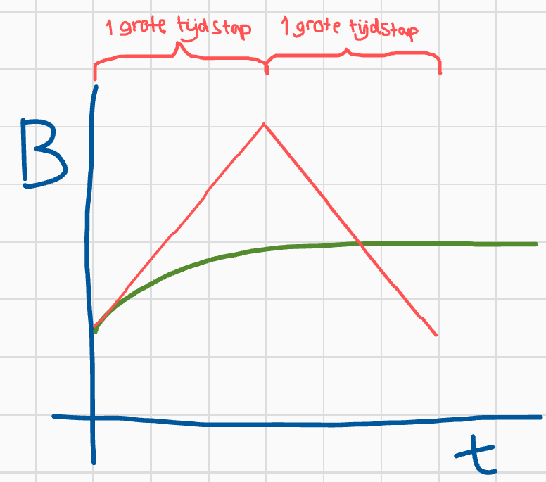
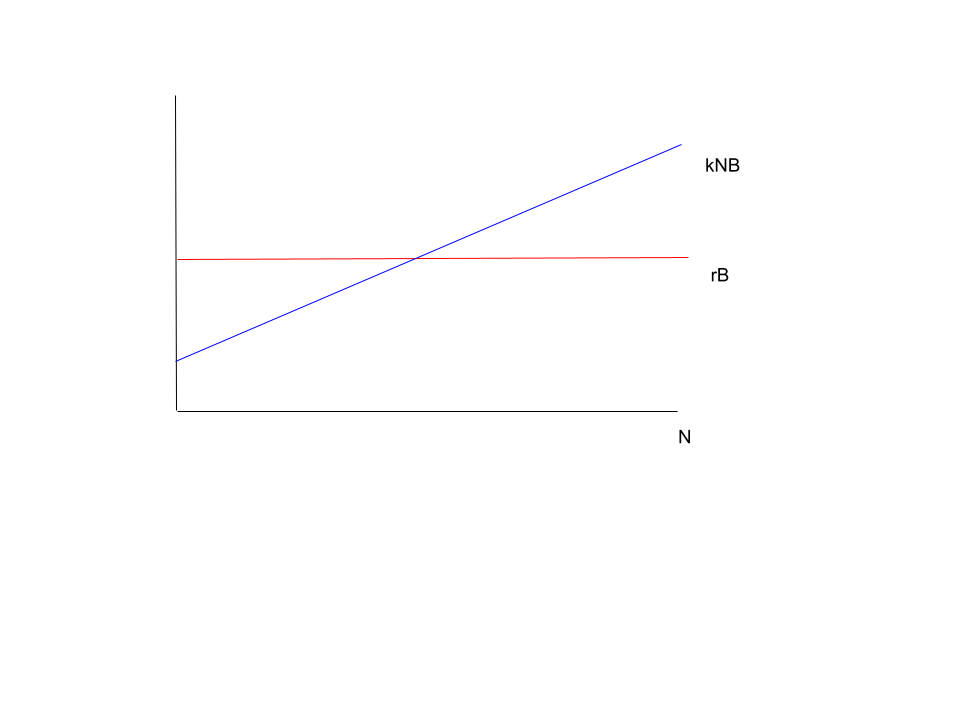

# Antwoorden modelleren {.unnumbered}

## Antwoorden @sec-tbintro {.unnumbered}

@exr-variabelen-en-parameters

**a.** De dingen die veranderen (bijvoorbeeld over de tijd) noemen we variabelen. De dingen die veranderen zijn hier je bloedsuikerspiegel (a) en de hoeveelheid eiwit (c), dus dit zou je de variabelen kunnen noemen.

**b.** De snelheden (b en d) waarmee de variabelen veranderen, staan volgens de omschrijving vast, en zijn daarom parameters.

@exr-modeluitkomsten

**a.** Eén van de aannames van een ODE-model is dat het systeem goed gemengd is (@fig-modeltypes B). Naast de groeisnelheid is de ruimtelijke structuur bij een biofilm ook relevant. Hierom is het beter om een ruimtelijk model te gebruiken voor het modelleren van een biofilm.

**b.** Door goed te mengen zijn posities niet belangrijk, dus het modelleren van posities is niet inzichtelijk. Het is beter om dit systeem met bijvoorbeeld een ODE te beschrijven.

**c.** De vorming van korstmossen is een proces waarbij posities/ruimte belangrijk is, dus een ruimtelijk model is het meest geschikt.

## Antwoorden @sec-exp {.unnumbered}

@exr-exponentiele-groei-langzaam

**a.** Ja, het percentage is klein maar is alsnog exponentieel!! Dit kun je ook zien doordat de hoeveelheid rijst per vakje met een rechte lijn toeneemt op een log-lineaire schaal.

```{r}
#| eval: true
#| echo: true
#| code-fold: false
#| label: fig-exponential

# beginaantal rijst
R <- 1

# herhaal iets 63 keer met een for-loop
for (i in 1:63) {
  R[i+1] <- R[i]*1.05 # R in volgende stap is 2*R in deze stap
}

plot(R , type='l', col="seagreen", log="y", lwd=2) 
```

**b.** Door de rijstkorrels in elke vakje bij elkaar op te tellen kunnen we uitrekenen hoeveel rijstkorrels je in totaal hebt:

```{r}
sum(R)
```

@exr-rabbits-map

**a.**

```{r}
# definieren van begin aantal konijnen
konijnen <- 24
# verdubbel het aantal konijnen 20 keer
for (i in 1:20){ 
konijnen <- konijnen * 2
}
# er zijn verschillende opties om "Het aantal konijnen na 20 tijdstappen is gelijk aan 25165824” te printen:
# met cat:
cat("Het aantal konijnen na 20 tijdstappen is gelijk aan ", konijnen)
# met paste:
paste("Het aantal konijnen na 20 tijdstappen is gelijk aan ", konijnen)
```

**b.**

```{r}
# Stap 1: Stel begin-aantal konijnen in
konijnen <- 24

# Stap 2: Verdubbel het aantal konijnen 30 keer
for (t in 1:30){
  konijnen[t+1] <- 2*konijnen[t]
}

# Stap 3: Plot het resultaat
plot(konijnen, type='l', col="seagreen")
```

De toename van het aantal konijnen lijkt exponentieel te zijn. Door de y-as log-lineair te maken kunnen we dit zeker weten:

```{r}
# Stap 1: Stel begin -aantal konijnen in
konijnen <- 24
# Stap 2: Verdubbel het aantal konijnen 30 keer
for (t in 1:30){
konijnen [t+1] <- 2* konijnen [t]
}
# Stap 3: Plot het resultaat met een logaritmische y as, net zoals in de code van figuur 3
plot(konijnen , type='l', col="seagreen", log="y")
```

Met een logaritmische schaal op de y-as krijgen we een rechte lijnen en weten we nu zeker dat we met exponentiële groei te maken hebben.

**c.** :::{.todo} Yannick: LaTex code antwoorden invoegen. :::

**d.** Het aantal konijnen stabiliseert wanneer de populatie 500 miljoen konijnen bevat.

```{r}
# Stap 1: Stel begin-aantal konijnen in
konijnen <- 24

# We maken een variabele voor K
K <- 10^9

# Stap 2: Verdubbel het aantal konijnen 30 keer
for (t in 1:30){
  # Reken eerst de waarde van f uit voor het aantal konijnen dat de populatie in de vorige tijdstap bevatte:
  f <- 1 - konijnen[t]/K
  # Gebruik dit vervolgens in de formule om het nieuwe aantal konijnen uit te rekenen
  konijnen[t+1] <- 2*konijnen[t]*f
}

# Stap 3: Plot het resultaat
plot(konijnen, type='l', col="seagreen", main = "Het aantal konijn per jaar")
paste("Het uiteindelijke aantal konijnen is gelijk aan", 
      konijnen[length(konijnen)]) # Dit is een manier om de laatste waarde van de vector konijnen te bekijken
```

:::{.callout-note, collapse="true", title="Extra: Waarom is de evenwichtswaarde niet gelijk aan K?"} Misschien is dit voor nu nog te lastig, kijk hier dan later in de cursus nog eens naar! (Als we ook ODE-modellen hebben behandeld). In het bovenstaande voorbeeld is de populatiegrootte in evenwichtstoestand niet gelijk aan K. Later in de cursus zal je voorbeelden voorkomen van ODE-modellen van logistische groei waarbij de populatiegrootte in evenwicht wél gelijk is aan K. Hoe kan het dat dit wel het geval is bij ODE-modellen en niet bij MAP-modellen?

Dit komt door een verschil in de manier waarop deze modelformalismen het nieuwe aantal konijnen uitrekenen. Een ODE beschrijft de **verandering** van een variabele over tijd. Als de verandering over tijd ($N'(t)$) gelijk is aan nul, verandert de variabele niet meer. Bij logistische groei is dat wanneer de functionele response gelijk is aan nul ($f(N) = 0$). $$N'(t) = r \cdot N \cdot f(N)$$ Uit de bovenstaande vergelijking kunnen we zien dat de verandering van N over tijd gelijk wordt aan nul wanneer $f(N) = 0$ (vermenigvuldigen met 0 geeft altijd 0 als uitkomst). Zoals je in opdracht c hebt gezien, geldt dat $f(N) = 0$ wanneer $N = K$. Dit laat zien dat $N'(t) = r \cdot N \cdot f(N) = 0$ voor $N = K$. Dus, een ODE voor logistische groei is in evenwicht wanneer $N = K$.

Dit is anders voor een MAP, omdat dit niet de verandering van de variabele $N$ beschrijft, maar de exacte waarde uitrekent aan de hand van de vorige waarde voor $N$: $$N(t+1) = r \cdot N(t) \cdot f(N)$$ Zo'n vergelijking heeft een evenwicht bereikt wanneer $N(t+1) = N(t)$. Dit kan alleen op het moment dat $r \cdot f(N) = 1$. In het bovenstaande voorbeeld geldt $r = 2$. Dus $2 \cdot f(N) = 1 \Rightarrow f(N) = \frac{1}{2}$. Oftewel, als $f(N)$ gelijk is aan 0.5, zal de populatiegrootte al stabiliseren. Dit klopt: we zien hierboven dat de populatiegrootte stabiliseert wanneer deze 500 miljoen konijnen bevat (dit is de helft van $10^9$, of $f(0.5\cdot10^9) = 1 - \frac{0.5\cdot10^9}{10^9} = \frac{1}{2}$). :::

**e.**

```{r}
plot(konijnen, type='l', col="seagreen", log="y", main = "Het aantal konijnen per jaar (logaritmische schaal y-as")
```

De eerste jaren lijken de konijnen exponentieel te groeien, want we zien dat de populatie een rechte lijn vormt in de grafiek met een logaritmische y-as. De laatste jaren groeit hij echter niet meer exponentieel, want de groei stopt bijna volledig. Dit kunnen we zien in de grafieken, omdat de grafiek na \~25 jaar af begint te vlakken.

**f.**

```{r}
paste("Na 10 jaar zijn er", konijnen[11], "konijnen")
```

Deze hoeveelheid is vreemd omdat dit geen geheel getal is en er dus blijkbaar halve konijnen zijn.

**g.**

```{r}
# Stap 1: Stel begin-aantal konijnen in
konijnen <- 24

# Stap 2: Bepaal waardes voor de parameters van het model
K <- 10^9
r <- 3

# Stap 3: Verdubbel het aantal konijnen 30 keer
for (t in 1:30){
  konijnen[t+1] <- r*konijnen[t]*(1 - konijnen[t]/K)
}

# Stap 4: Plot het resultaat
plot(konijnen, type='l', col="seagreen", main = "Het aantal konijn per jaar")
# plot op logaritmische schaal
plot(konijnen, type='l', col="seagreen", log="y", main = "Het aantal konijnen per jaar (logaritmische schaal y-as")
paste("Het uiteindelijke aantal konijnen is gelijk aan", 
      konijnen[length(konijnen)]) # Dit is een manier om de laatste waarde van de vector konijnen te bekijken
paste("Het aantal konijnen na 10 jaar is gelijk aan", 
      konijnen[11])
```

De populatie gaat niet naar een stabiel evenwicht, maar blijft schommelen rond de 700 miljoen. De populatie groeit nog steeds niet snel genoeg, want na 10 jaar hebben we zeker nog geen populatie van 100 miljoen konijnen.

**h.**

```{r}
# Stap 1: Stel begin-aantal konijnen in
konijnen <- 24

# Stap 2: Bepaal waardes voor de parameters van het model
K <- 10^9
r <- 4

# Stap 3: Verdubbel het aantal konijnen 30 keer
for (t in 1:30){
  konijnen[t+1] <- r*konijnen[t]*(1 - konijnen[t]/K)
}

# Stap 4: Plot het resultaat
plot(konijnen, type='l', col="seagreen", main = "Het aantal konijn per jaar")
# plot op logaritmische schaal
plot(konijnen, type='l', col="seagreen", log="y", main = "Het aantal konijnen per jaar (logaritmische schaal y-as")
paste("Het uiteindelijke aantal konijnen is gelijk aan", 
      konijnen[length(konijnen)]) # Dit is een manier om de laatste waarde van de vector konijnen te bekijken
paste("Het aantal konijnen na 10 jaar is gelijk aan", 
      konijnen[11])
```

Het aantal konijnen fluctueert nu heel erg per jaar (chaos), maar blijft nog steeds schommelen rond de 500 miljoen. Nog steeds hebben we geen 100 miljoen konijnen in 10 jaar.

@exr-rabbits-in-space

**a.** Er kunnen meerdere antwoorden goed zijn, want het gaat om je **verwachting**. Het belangrijkste van deze opdracht is dat je erover nadenkt wat je verwacht en waarom. Gebaseerd op de waarden van de parameters zou je verwachting kunnen zijn dat er wel exponentiële groei zal zijn, want b \> d.

**b.** Er kunnen meerdere antwoorden goed zijn, want het gaat om je **verwachting**. Het belangrijkste van deze opdracht is dat je erover nadenkt wat je verwacht en waarom. De kans op een geboorte is voor elk individu 80%, en deze verandert niet met de populatiegrootte, dus je verwachting zou kunnen zijn dat er geen draagvermogen is. Een ander antwoord kan zijn dat je wel verwacht dat er een draagvermogen is, omdat er een eindig aantal vakjes is in het model.

**c.** In de simulatie kun je zien dat de populatie eerst erg snel groeit, en vervolgens stabiliseert. Er is dus wel een draagvermogen in dit model, ondanks dat we dit niet expliciet hebben gespecificeerd. Dat komt (zoals hierboven ook staat) doordat er in het model een beperkt aantal vakjes is waar konijnen in kunnen repliceren. Er kan in elk vakje maar één konijn zitten, dus als (bijna) alle vakjes al een konijn bevatten, kunnen er niet meer bij komen.

**d.** De toename is niet exponentieel.

```{r}
plot(c(13,100,292,619,1081,1695,2458,3191), log="y", type = "b")
```

Bij een exponentiële toename zouden we een rechte lijn moeten zien wanneer we de y-as op logaritmische schaal plotten. Dat is hier niet het geval.

**e.** Als één hokje een populatie konijnen voorstelt, zou dit niet meer de geboorte- en sterftekans zijn van een individu, maar de kans op uitbreiding of uitsterven van lokale populaties.

## Antwoorden @sec-odes {.unnumbered}

@exr-diffvsdiff

B

@exr-eenheden-tussen

**a.** De term $k$ beschrijft het dumpen van plastic in de oceaan. $k$ is een positieve term, het geeft dus een toename van de hoeveelheid plastic in de oceaan aan. Ook is het niet afhankelijk van de hoeveelheid plastic dat zich al in de oceaan bevindt. De term $\delta P$ beschrijft de afbraak van plastic in de oceaan. Dit is een negatieve term, dus hierdoor neemt de hoeveelheid plastic in de oceaan af.

**b.** De eenheid van $k$ is kilo's plastic per jaar, want dit is ook de eenheid van $\dt{P}$.

**c.** De eenheid van $\delta$ is per jaar, want de term $\delta P$ heeft de eenheid $P \over t$ en $\delta P = P \over t$ geeft $\delta = {1 \over t}$.

**d.** De afbraak van plastic gaat erg langzaam, dus waarschijnlijk is $k$ groter.

@exr-eenheden-tussen2

**a.** Bij $P = {k \over \delta}$. Bij een evenwichtssituatie is $\dt{P}$ gelijk aan nul. Dus:


\begin{align*}
    \dt{P} = k - \delta P = 0 \quad \text{ als...}\\
    \delta P &= k & \\
    P &= \frac{k}{\delta} &
\end{align*}

**b.** Nee, want het oplossen van $\dt{P} = 0$ geeft geen triviale oplossing ($P = 0$).

**c.** Zelfs als er geen plastic meer in de oceaan is, komt er altijd plastic bij ($k$), ook als $P$ gelijk is aan nul. De hoeveelheid plastic in de oceaan zal dus gewoon weer toenemen. In het begin zal deze toename lineair zijn, want als er nog geen plastic in de oceaan is kan er ook niks afgebroken worden. {width="50%"}

@exr-rodebloedcellen

**a.** $$\dt{B} = p - dB$$

**b.** De productiesnelheid $p$ is al in de eenheid cellen per dag (net als $\dt{B}$) en hangt niet af van het aantal rode bloedcellen. Het aantal rode bloedcellen dat doodgaat hangt wel af van het aantal rode bloedcellen, dus dit is $dB$. Dus $d$ is geen snelheid (aantal cellen per dag), maar een kans (per dag).

**c.** Bij een evenwichtssituatie is $\dt{B}$ gelijk aan nul. Dus:


\begin{align*}
    \dt{B} = p - d B = 0 \quad \text{ als...}\\
    \delta B &= p & \\
    B &= \frac{p}{d} &
\end{align*}

**d.** {width="50%"}

**e.** {width="50%"}

**f.** Het gaat hier om een verwachting, er zijn dus geen goede of foute antwoorden! Intuïtief zou je kunnen verwachten dat $p$ bepaalt hoe snel je herstelt, omdat dit aangeeft hoeveel rode bloedcellen erbij komen. Anderzijds zou je ook kunnen stellen dat er meer rode bloedcellen overbljven als er minder dood gaan.

**g.** In dit script kiezen we eerst waarden voor de parameters $p$ en $d$, en een beginwaarde voor $B$. Daarna maken we een functie die $\dt{B}$ uit kan rekenen voor verschillende waarden van $B$, $p$ en $d$. Vervolgens maken we in stap 5 een vector $B$ met de gewenste beginwaarde voor $B$. In stap 6 rekenen we 500 keer uit wat de volgende waarde van $B$ is. Dit is gelijk aan de vorige waarde van $B$ plus de verandering $\dt{B}$ voor die waarde van $B$. Tot slot plotten we al deze waarden van $B$ over de tijd, net zoals we in opdracht d en e deden. Let op dat minimale waarde op de y-as hier niet nul is, waardoor de plot er net iets anders uit ziet dan in d en e.

**h.** Doordat $B$ hier gelijk is aan de evenwichtswaarde is er geen verandering ($\dt{B} = 0$).

**i.** Te grote tijdstappen kunnen soms problemen geven, zoals we eerder in dit hoofdstuk al hebben gelezen. Dat komt doordat je de verandering per tijdstap uitrekent op basis van de huidige populatiegrootte. Dus als je net bloed hebt gedoneerd en op basis van het aantal rode bloedcellen nu wilt uitrekenen hoeveel rode bloedcellen je over één jaar hebt, dan zal dat veel te hoog uitvallen. Dat komt doordat het aantal rode bloedcellen meteen na een bloedtransfusie stijgt. Zoals je in de grafieken hierboven hebt gezien vlakt deze stijging na een tijdje echter af. Bij een te grote tijdstap kan het zo zijn dat deze stijging "te lang doorgaat". Hierdoor kan je een situatie krijgen zoals in @sec-exp waarbij er chaos ontstaat, doordat de populatiegrootte na één tijdstip boven of onder het evenwicht uitkomt. {width="50%"}

**j.** Als je de code van g runt krijg je een grafiek te zien die helpt bij het beantwoorden van deze vraag.

```{r}
# Stap 1: stel parameters in
p <- 2e11    
d <- 1/120   

# Stap 2: stel het beginaantal B in
B <- p/d

# Stap 3: maak functie die B, p, en d gebruikt om de verandering uit te rekenen
verandering <- function (B, p, d){
  delta <- p - d*B
  return(delta)
}

# Stap 4: een test of de functie werkt
verandering(B=p/d, p=p, d=d) 

# Stap 5: maak een lege lijst met begin-aantal erin
B <- c(0.9*p/d)

# Stap 6: reken 500 keer de volgende hoeveelheid B uit
for (t in 1:500) {
  B[t+1] <- B[t] + verandering(B=B[t], p=p, d=d)
}

# Stap 7: plot de tijdserie
plot(B, xlab="Tijd in dagen", ylab="Aantal rode bloedcellen", type="l", col="seagreen", lwd=2)
```

Hieruit kunnen we aflezen dat de helft van het bloedverlies na ongeveer 100 dagen weer hersteld is. Hierom moet je tussen donaties altijd 3 tot 4 maanden wachten.

**k.**

```{r}
# Stap 1: stel parameters in
p <- 2e11    
d <- 1/120   

# Stap 2: stel het beginaantal B in
B <- p/d

# Stap 3: maak functie die B, p, en d gebruikt om de verandering uit te rekenen
verandering <- function (B, p, d){
  delta <- p - d*B
  return(delta)
}

# Stap 4: een test of de functie werkt
# verandering(B=p/d, p=p, d=d) 

# Stap 5: maak een lege lijst met begin-aantal erin
B <- c(0.99*p/d)

# Stap 6: reken 500 keer de volgende hoeveelheid B uit
for (t in 1:500) {
  B[t+1] <- B[t] + verandering(B=B[t], p=p, d=d)
}

# Stap 7: plot de tijdserie
plot(B, xlab="Tijd in dagen", ylab="Aantal rode bloedcellen", type="l", col="seagreen", lwd=2)
```

Het duurt nog steeds even lang! De helft is nu wel veel minder, maar het herstel gaat nog steeds even snel.

**l.** Het gaat hier wederom om een verwachting, dus er zijn geen foute antwoorden! Intuïtief zou je kunnen verwachten dat $p$ bepaalt hoe snel je herstelt, omdat dit aangeeft hoeveel rode bloedcellen erbij komen. Anderzijds zou je ook kunnen stellen dat er meer rode bloedcellen overbljven als er minder dood gaan, dus als $d$ kleiner is.

**m.** Je kunt het script uit de opdracht gebruiken en de waarden voor $p$ en $d$ aanpassen om te kijken hoe dit de snelheid van het herstel beïnvloedt.

```{r}
#| label: fig-rodebloedcellen-m
#| fig-cap: "Snelheid van herstel voor verschillende parameters."
#| fig-subcap: 
#|   - "Originele parameterwaarden."
#|   - "Grotere waarde voor p (snellere productie)."
#|   - "Kleinere waarde voor d (minder sterfte)."
#| layout-ncol: 3

# Originele parameterwaarden

# Stap 1: stel parameters in
p <- 2e11    
d <- 1/120   

# Stap 2: stel het beginaantal B in
B <- p/d

# Stap 3: maak functie die B, p, en d gebruikt om de verandering uit te rekenen
verandering <- function (B, p, d){
  delta <- p - d*B
  return(delta)
}

# Stap 4: een test of de functie werkt
# verandering(B=p/d, p=p, d=d) 

# Stap 5: maak een lege lijst met begin-aantal erin
B <- c(0.9*p/d)

# Stap 6: reken 500 keer de volgende hoeveelheid B uit
for (t in 1:500) {
  B[t+1] <- B[t] + verandering(B=B[t], p=p, d=d)
}

# Stap 7: plot de tijdserie
plot(B, xlab="Tijd in dagen", ylab="Aantal rode bloedcellen", type="l", col="seagreen", lwd=2)

# Grotere waarde voor p (snellere productie)

# Stap 1: stel parameters in
p <- 2e12    # verhoog p
d <- 1/120   # houdt d op de oude waarde

# Stap 2-4 blijft hetzelfde en kunnen we overslaan

# Stap 5: maak een lege lijst met begin-aantal erin
B <- c(0.9*p/d)

# Stap 6: reken 500 keer de volgende hoeveelheid B uit
for (t in 1:500) {
  B[t+1] <- B[t] + verandering(B=B[t], p=p, d=d)
}

# Stap 7: plot de tijdserie
plot(B, xlab="Tijd in dagen", ylab="Aantal rode bloedcellen", type="l", col="seagreen", lwd=2)


# Kleinere waarde voor d (minder sterfte)

# Stap 1: stel parameters in
p <- 2e11 # zet p terug naar de oude waarde    
d <- 1/240   # verlaag d

# Stap 2-4 blijft hetzelfde en kunnen we overslaan

# Stap 5: maak een lege lijst met begin-aantal erin
B <- c(0.9*p/d)

# Stap 6: reken 500 keer de volgende hoeveelheid B uit
for (t in 1:500) {
  B[t+1] <- B[t] + verandering(B=B[t], p=p, d=d)
}

# Stap 7: plot de tijdserie
plot(B, xlab="Tijd in dagen", ylab="Aantal rode bloedcellen", type="l", col="seagreen", lwd=2)
```
De snelheid van het herstel verandert niet als we $p$ veranderen.
Deze verandert echter wel als we $d$ veranderen. 
Waarschijnlijk tegen je verwachting in, bepaalt $d$ dus de snelheid van het herstel!

@exr-diffvsdiffinR

**a.**
Met $r < 1$ gaat de populatie uiteindelijk altijd naar nul.
Vanaf $r > 3$ ontstaan er fluctuaties rondom het evenwicht. 
Met $r > 3.7$ ontstaat er chaos.

```{r}
#| fig-cap: "Differentievergelijking"
#| fig-subcap: 
#|   - "r = 0.8"
#|   - "r = 2"
#|   - "r = 3"
#|   - "r = 4"
#| layout-ncol: 2

# R = 0.8
# Stap 1, definieer beginaantal konijnen en parameters
N <- 24    # aantal konijnen
r <- 0.8     # intrinsieke groeisnelheid
K <- 10^9  # schaalt de dichtheidsafhankelijkheid

# Stap 2: bereken het aantal konijnen in [t+1] 40 keer
for (t in 1:40){
  N[t+1] <- r*N[t]*(1-(N[t]/K))
}

# Stap 3: bekijk resultaten
plot(N,type="o",xlab="Tijd (jaren)", ylab="Aantal konijnen")

# R = 2
# Stap 1, definieer beginaantal konijnen en parameters
N <- 24    # aantal konijnen
r <- 2     # intrinsieke groeisnelheid
K <- 10^9  # schaalt de dichtheidsafhankelijkheid

# Stap 2: bereken het aantal konijnen in [t+1] 40 keer
for (t in 1:40){
  N[t+1] <- r*N[t]*(1-(N[t]/K))
}

# Stap 3: bekijk resultaten
plot(N,type="o",xlab="Tijd (jaren)", ylab="Aantal konijnen")

# R = 3
# Stap 1, definieer beginaantal konijnen en parameters
N <- 24    # aantal konijnen
r <- 3     # intrinsieke groeisnelheid
K <- 10^9  # schaalt de dichtheidsafhankelijkheid

# Stap 2: bereken het aantal konijnen in [t+1] 40 keer
for (t in 1:40){
  N[t+1] <- r*N[t]*(1-(N[t]/K))
}

# Stap 3: bekijk resultaten
plot(N,type="o",xlab="Tijd (jaren)", ylab="Aantal konijnen")

# R = 4
# Stap 1, definieer beginaantal konijnen en parameters
N <- 24    # aantal konijnen
r <- 4     # intrinsieke groeisnelheid
K <- 10^9  # schaalt de dichtheidsafhankelijkheid

# Stap 2: bereken het aantal konijnen in [t+1] 40 keer
for (t in 1:40){
  N[t+1] <- r*N[t]*(1-(N[t]/K))
}

# Stap 3: bekijk resultaten
plot(N,type="o",xlab="Tijd (jaren)", ylab="Aantal konijnen")
```

**b.**
In tegenstelling tot de differentievergelijking, geeft de differentiaalvergelijking ook groei wanneer $r < 1$. 
Daarnaast geeft $r > 3.7$ geen chaos, waar dat bij de differentievergelijking wel was. Om chaos te krijgen in dit model moet je $r$ heel erg groot maken, bijvoorbeeld bij $r = 250$ krijg je wel fluctuaties.

```{r}
#| label: fig-diffvsdiffing-b
#| fig-cap: "Differentiaalvergelijking."
#| fig-subcap: 
#|   - "r = 0.8"
#|   - "r = 2"
#|   - "r = 4"
#|   - "r = 250"
#| layout-ncol: 2

# r = 0.8
# SIMPEL SCRIPT VOOR DIFFERENTIAALVERGELIJKING
# Stap 1, definieer beginaantal konijnen en parameters
N <- 24 
r <- 0.8
K <- 10^9

# Stap 2, definieer tijdstappen en maak een dataframe aan
delta_t <- 0.01 # grootte van de tijdstap
tijdstapjes <- seq(0,20,by=delta_t)
tijdserie <- data.frame(t=tijdstapjes,konijnen=N)

# Stap 3: Reken in kleine stapjes de volgende N uit
for (t in 1:length(tijdstapjes)-1){
  groeiN <- delta_t * r*N*(1-N/K)  
  N <- N + groeiN 
  tijdserie[t+1,"konijnen"] <- N
}

# Stap 3: bekijk resultaten
plot(tijdserie$t, tijdserie$konijnen, type="l",xlab="Tijd (jaren)", ylab="Aantal konijnen")

# r = 2
# SIMPEL SCRIPT VOOR DIFFERENTIAALVERGELIJKING
# Stap 1, definieer beginaantal konijnen en parameters
N <- 24 
r <- 2
K <- 10^9

# Stap 2, definieer tijdstappen en maak een dataframe aan
delta_t <- 0.01 # grootte van de tijdstap
tijdstapjes <- seq(0,20,by=delta_t)
tijdserie <- data.frame(t=tijdstapjes,konijnen=N)

# Stap 3: Reken in kleine stapjes de volgende N uit
for (t in 1:length(tijdstapjes)-1){
  groeiN <- delta_t * r*N*(1-N/K)  
  N <- N + groeiN 
  tijdserie[t+1,"konijnen"] <- N
}

# Stap 3: bekijk resultaten
plot(tijdserie$t, tijdserie$konijnen, type="l",xlab="Tijd (jaren)", ylab="Aantal konijnen")

# r = 4
# SIMPEL SCRIPT VOOR DIFFERENTIAALVERGELIJKING
# Stap 1, definieer beginaantal konijnen en parameters
N <- 24 
r <- 4
K <- 10^9

# Stap 2, definieer tijdstappen en maak een dataframe aan
delta_t <- 0.01 # grootte van de tijdstap
tijdstapjes <- seq(0,20,by=delta_t)
tijdserie <- data.frame(t=tijdstapjes,konijnen=N)

# Stap 3: Reken in kleine stapjes de volgende N uit
for (t in 1:length(tijdstapjes)-1){
  groeiN <- delta_t * r*N*(1-N/K)  
  N <- N + groeiN 
  tijdserie[t+1,"konijnen"] <- N
}

# Stap 3: bekijk resultaten
plot(tijdserie$t, tijdserie$konijnen, type="l",xlab="Tijd (jaren)", ylab="Aantal konijnen")

# r = 250
# SIMPEL SCRIPT VOOR DIFFERENTIAALVERGELIJKING
# Stap 1, definieer beginaantal konijnen en parameters
N <- 24 
r <- 250
K <- 10^9

# Stap 2, definieer tijdstappen en maak een dataframe aan
delta_t <- 0.01 # grootte van de tijdstap
tijdstapjes <- seq(0,20,by=delta_t)
tijdserie <- data.frame(t=tijdstapjes,konijnen=N)

# Stap 3: Reken in kleine stapjes de volgende N uit
for (t in 1:length(tijdstapjes)-1){
  groeiN <- delta_t * r*N*(1-N/K)  
  N <- N + groeiN 
  tijdserie[t+1,"konijnen"] <- N
}

# Stap 3: bekijk resultaten
plot(tijdserie$t, tijdserie$konijnen, type="l",xlab="Tijd (jaren)", ylab="Aantal konijnen")
```

**c.**
Het script wordt dan heel erg langzaam. ODEs zijn dus precieser, maar dat wordt ook steeds moeilijker voor je computer. Dit is waarom je meestal betere tools gebruikt om ODEs te integreren, zoals Grind (dit zul je later in de cursus zien).
```{r}
#| eval: false 
# SIMPEL SCRIPT VOOR DIFFERENTIAALVERGELIJKING
# Stap 1, definieer beginaantal konijnen en parameters
N <- 24 
r <- 2
K <- 10^9

# Stap 2, definieer tijdstappen en maak een dataframe aan
delta_t <- 0.0001 # grootte van de tijdstap
tijdstapjes <- seq(0,20,by=delta_t)
tijdserie <- data.frame(t=tijdstapjes,konijnen=N)

# Stap 3: Reken in kleine stapjes de volgende N uit
for (t in 1:length(tijdstapjes)-1){
  groeiN <- delta_t * r*N*(1-N/K)  
  N <- N + groeiN 
  tijdserie[t+1,"konijnen"] <- N
}

# Stap 3: bekijk resultaten
tijdserie[20,] # Aantal na 0.19 jaar
plot(tijdserie$t, tijdserie$konijnen, type="l",xlab="Tijd (jaren)", ylab="Aantal konijnen")
```

## Antwoorden @sec-dichtheid {.unnumbered}

@exr-functioneleresponses

**a.** $\frac NK + 1$ zal niet een vergelijkbaar effect hebben, omdat de term met $N$ erin nu positief is. Als de populatie groter wordt, zal de birthrate dus ook groter worden in plaats van afnemen.

**b.** $1-cN$ zal wel een vergelijkbaar effect hebben. Deze functie heeft dezelfde vorm als $f(N)=1-\frac NK$, maar nu is $\frac 1K$ vervangen door de constante $c$.

**c.** $1-cN^2$ zal niet een vergelijkbaar effect hebben. De $N^2$ terms zorgt er voor dat dat de birthrate nog sneller af neemt door de kwadratische term. De birthrate zal echter nog steeds af blijven nemen!

@exr-dddportrait 

**a.** Er is een evenwicht als: $\frac{dN}{dt}=0$. $$\Rightarrow \frac{dN}{dt}=0=bN-d\left(1+\frac NK \right)N$$ $$ \Rightarrow N = 0 \vee b-d\left(1+\frac NK \right) =0$$ $$\Rightarrow N=0 \vee b=d\left(1+\frac NK \right)$$ $$\Rightarrow N=0 \vee \frac bd = 1+\frac NK$$ $$\Rightarrow N=0 \vee \frac bd - 1 = \frac NK$$ $$\Rightarrow N=0 \vee K\left( \frac bd - 1 \right) = N$$

**b.** Net zoals in @fig-faseportret hebben we weer een bergparabool vanwege de term $-d\left(1+\frac NK \right)N = -dN - \frac{d}{K} N^2$

We hebben de twee evenwichten berekend in *a*: $N=0$ en $N=K\left( \frac bd - 1 \right)$. Het triviale evenwicht N=0 is geen attractor, het andere evenwicht wel.

::: todo
Bram: juiste tekening maken en dichtheid_ant_exr_draw_14.2b.png vervangen
:::


@exr-bacterienbloed 

**a.** $rB$ is de exponentiële groei van de bacteriën, $-kNB$ is de hoeveelheid bacteriën die door neutrofielen wordt doodgemaakt. De eenheden zijn allemaal in bacteriën per uur.

**b.** rB en kNB moeten allebei de eenheid aantal bacteriën/uur hebben.

B heeft de eenheid bacteriën, dus r moet de eenheid per uur = $uur^{-1}$

N heeft de eenheid hoeveelheid neutrofielen in je bloed, dus k moet dit wegdelen. We hebben dus: $$\frac{aantal \, \, bacterien\,\, in \,\,het\,\, bloed}{uur} = k*aantal \, \, neutrofielen\,\, in \,\,het\,\, bloed * aantal \, \, bacterien\,\, in \,\,het\,\, bloed$$ Dus $$k=\frac{1}{uur*aantal \, \, neutrofielen\,\, in \,\,het\,\, bloed}$$

Als je dit nog lastig vindt kan je @sec-odes-eenheden nog een keer doorlezen!

**c.**

$$\frac{dB}{dt}=0=rB-kNB$$ $$B=0 \vee r-kN=0$$ $$B=0\vee N=\frac{k}{r}$$

Maar hier is geen populatie B aan verbonden, dus nee.

**d.** :::{.todo} Bram: Juiste tekening maken en dichtheid_ant_exr_draw_14.3d.png vervangen ::: {#fig-14.3d}

**e.**

$$\frac{dB}{dt}=0=rB-kNB$$ $$B=0 \vee r-kN=0$$ $$B=0\vee N=\frac{k}{r}$$ Je hebbt dus $k/r$ neutrofielen nodig om de groei van de bacteriën te stoppen. Dit punt is ook het snijpunt tussen de lijnen van @fig-14.3d.

**f.** We moeten het aantal dode bacteriën delen door het aantal neutrofielen. Dus $kNB/N = kB$

**g.** Als er 0 bacteriën zijn, worden er 0 bacteriën per neutrofiel doodgemaakt.

Als er oneindig veel bacteriën zijn worden er oneindig veel bacteriën per neutrofiel doodgemaakt.

Dit is niet een logische aanname, want elke neutrofiel kan maar een gelimiteerd aantal bacteriën doodmaken.

::: todo
Je kan niet weten hoeveel er met 1000 worden dood gemaakt als je k niet weet
:::

**h.** Als $B$ heel groot is, dan maakt de kleine toevoeging van $h$ onderin de breuk niet heel veel meer uit. $h$ wordt dus voor grote $B$ "verwaarloosbaar".

**i.** Als B heel groot is ten opzichte van h, dan kan je de breuk vereenvoudigen tot $\frac{kNB}{B}$ en de B's wegstrepen en houd je alleen kN over. Per neutrofiel worden er dan *k* bacteriën doodgemaakt.

**j.**

$$\frac{dB}{dt}=0=rB-\frac{kNB}{h+B}$$ $$ B\left(r-\frac{kN}{h+B}\right)=0$$ $$B=0 \vee r-\frac{kN}{h+B}=0$$ $$B=0 \vee r=\frac{kN}{h+B}$$ $$B=0\vee rh+rB=kN$$ $$B=0\vee N=\frac{r(h+B)}{k}$$

@exr-heck

**a.** Ik verwacht een aantal heckrunderen waar de death en birth rate even groot zijn in @fig-heck, want dan veranderd de populatie niet meer. Dit zijn ongeveer 340/350 runderen.

**b.** Als N heel klein is, is de term $1-\frac{N}{K_b} \approx 1$. b is dus 0.4.

Ook weten we dat we met 400 runderen maar de helft van de deze maximale geboorte hebben. Dus: $$\frac{1}{2}*0.4 = 0.4*\left(1-\frac{400}{K_b}\right)$$ $$\frac12= 1-\frac{400}{K_b}$$ $$-\frac{1}{2} = -\frac{400}{K_b}$$ $$\frac{2}{1}=\frac{K_b}{400}$$ $$K_b = 400\cdot 2 = 800$$

**c.** Op dezelfde manier als bij **b** krijgen we hier $d=0.03$.

Daarna kunnen we $K_d$ uitrekenen: $$0.33 = 0.03\left(1+\frac{500}{K_d}\right)$$ $$\frac{0.33}{0.03} = 11 = 1+\frac{500}{K_d}$$ $$ 10 = \frac{500}{K_d}$$ $$\frac{10}{500} = \frac 1{K_d}$$ $$\frac{500}{10} = 50 = K_d$$

**d.** Als we al onze gevonden parameters invullen krijgen we de volgende ODE: $$\frac{dN}{dt} = 0.4\left(1-\frac{N}{800} \right) N - 0.03 \left(1+\frac{N}{50}\right)N$$ Deze stellen we gelijk aan 0 om het evenwicht te bepalen: $$0= 0.4\left(1-\frac{N}{800} \right) N - 0.03 \left(1+\frac{N}{50}\right)N$$ $$N=0 \vee 0.4\left(1-\frac{N}{800} \right)  = 0.03 \left(1+\frac{N}{50}\right)$$ We negeren de triviale oplossing: $$0.4-\frac{0.4N}{800} = 0.03+\frac{0.03N}{50}$$ $$0.4-0.03 = \left(\frac{0.4}{800}+\frac{0.03}{50} \right)N$$ $$0.37 = 0.0011N$$ $$N\approx 336$$

**e.** Het aantal dieren die elk jaar dood gaan is gelijk aan $d\left(1-\frac N{K_d}\right)N$ waarin we onze waardes in kunnen vullen: $$0.03*\left(1+\frac{336}{50}\right)*336\approx 78$$

**f.** Na 300 tijdstappen wordt er begonnen met afschieten (`if(t>300) k <- 0.05`), dit komt overeen met 30 jaar omdat de tijdstap 0.1 jaar is (`delta_t <- 0.1 # grootte van de tijdstap`). Er wordt telkens 5% van de populatie afgeschoten omdat k gelijk gesteld wordt aan 0.05.

**g.** De sterfte neemt met minder dan 5% toe (ongeveer 2.3 procent), terwijl er wel 5% extra wordt afgeschoten. Er gaan dus \~2.7% van de populatie minder dood van de honger.

**h.** De dieren leven iets minder lang, maar gaan wel relatief minder vaak dood van de honger. Daarom zou het aangemoedigd kunnen worden.

**i.** Vooral oude dieren afschieten. Hierdoor veranderd de deathrate nouwelijks, en gaan er ook minder jonge dieren dood omdat de oude dieren minder "voedsel verspillen".
