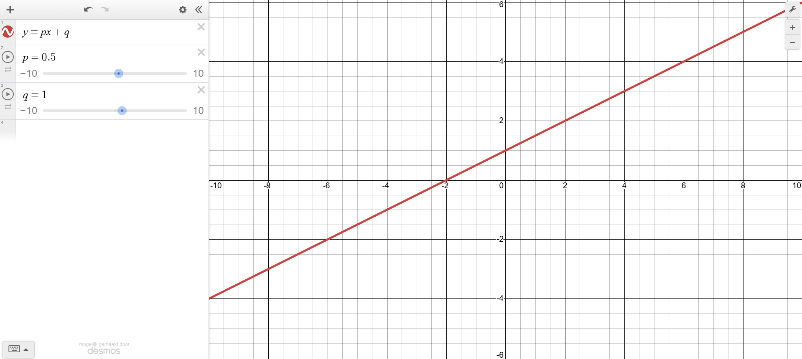
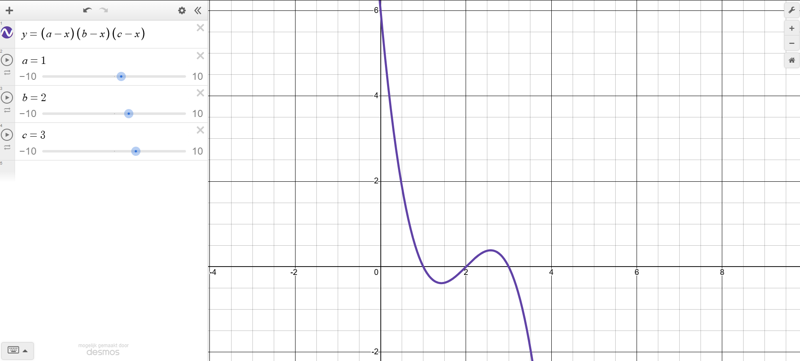

# Antwoorden wiskunde {.unnumbered}

## Antwoorden @sec-algebra {.unnumbered}

@exr-algebra-1

**a.**

| $3x + 5 = 11$
| $3x = 6$
| $x = 6/3 = 2$

**b.**

| $x^2 + 2x - 8 = 0$
| $(x + 4)(x - 2) = 0$
| $x = -4$ of $x = 2$
| 
| Alternatieve methode: $abc$-formule:
| $a=1$, $b=2$, $c=-8$
| $x_{1,2} = \frac{-2 \pm \sqrt{2^2 - 4\cdot-8}}{2}$
| $x_{1,2} = \frac{-2 \pm \sqrt{4 -- 32}}{2}$
| $x_{1,2} = \frac{-2 \pm \sqrt{36}}{2}$
| $x_{1,2} = \frac{-2 \pm 6}{2}$
| $x_{1} = \frac{-2 + 6}{2} = \frac{4}{2} = 2$
| $x_{2} = \frac{-2 - 6}{2} = \frac{-8}{2} = -4$

**c.**

| $x^2 - 9 = 0$
| $x^2 = 9$
| $x = \sqrt{9} = 3$

@exr-algebra-2

| $(ax-2by)(3y-4bx)+2b(2ax^2+3y^2)-8xyb^2 =$
| $ax\cdot3y - ax\cdot4bx - 2by\cdot3y + 2by\cdot4bx + 2b\cdot2ax^2 + 2b\cdot3y^2 -8xyb^2 =$
| $3axy - 4abx^2 - 6by^2 + 8xyb^2 + 4abx^2 + 6by^2 - 8xyb^2 =$
| $3axy$

@exr-algebra-3

**a.**

| $3r + 2 -5r-5 = 6r+4$
| $-2r-3=6r+4$
| $-7=8r$
| $r=-{7 \over 8}$

**b.**

| $x + {4 \over x} =4$
| $x^2+4=4x$ en $x\neq0$
| $x^2-4x+4=0$
| $x_{1,2}={4 \pm \sqrt{4^2-4*1*4} \over 2}$
| $x_{1,2}=2 \pm \sqrt{0}=2$

**c.**

| $(b-{N \over k})N=0$
| $N=0$, of $b - {N \over k} =0$
| $N=bk$

**d.**

| $N=0$, of $b-d(1+{N \over k})=0$
| $d(1+{N \over k})=b$
| $(1+{N \over k})={b\over d}$
| ${N \over k}={b \over d}-1$
| $N=k({b\over d} -1)$

**e.**

| $N=0$, of ${b \over 1+N/h}-d=0$
| ${b \over 1+N/h}=d$
| $b=d(1+N/h)$
| $b=d+(d/h)N$
| $b-d=(d/h)N$
| $N={(b-d)h \over d}$
| $N=h{b-d \over d}$
| $N=h({b \over d}-1)$

## Antwoorden @sec-breuken

@exr-breuken-1

**a.** $\frac{1}{7}\cdot\frac{2}{4} = \frac{2}{28} = \frac{1}{14}$

**b.** $\frac{1}{6}-\frac{2}{3}=\frac{3}{18}-\frac{12}{18}=-\frac{9}{18}=-\frac{1}{2}$

**c.** $\frac{2}{3}:\frac{4}{5}=\frac{2}{3}\cdot\frac{5}{4}=\frac{10}{12}=\frac{5}{6}$

**d.** $\frac{4}{12}+\frac{5}{36}=\frac{12}{36}+\frac{5}{36}=\frac{17}{36}$

@exr-breuken-2

| $2400-(\frac{1}{3}+\frac{1}{7}+\frac{1}{4})2400+\frac{1}{3}\cdot\frac{1}{3}\cdot2400=$
| $2400-(\frac{1\cdot7\cdot4}{3\cdot7\cdot4}+\frac{1\cdot3\cdot4}{7\cdot3\cdot4}+\frac{1\cdot3\cdot7}{4\cdot3\cdot7})2400+\frac{1}{9}\cdot2400=$
| $2400-(\frac{28}{84}+\frac{12}{84}+\frac{21}{84})2400+\frac{1}{9}\cdot2400=$
| $2400-\frac{61}{84}\cdot2400+\frac{2400}{9}=$
| $2400-\frac{146400}{84}+\frac{2400}{9}=$
| $2400-1742,85+266,67=$
| $2400-1476,18=923,81$

@exr-breuken-3

| $\frac{6}{r} - \frac{5r}{30r+5} =$
| $\frac{6(30r + 5)}{r(30r + 5)} - \frac{5r\cdot r}{r(30r+5)} =$
| $\frac{180r + 30}{30r^2 + 5r} - \frac{5r^2}{30r^2+5r} =$
| $\frac{-5r^2 + 180r + 30}{30r^2 + 5r} =$
| $\frac{-r^2 + 36r + 6}{6r^2 + r}$

@exr-breuken-4

| $\frac{a}{b}x - \frac{c}{d} = \frac{e}{f}$
| $\frac{a}{b}x=\frac{e}{f}+\frac{c}{d}$
| $\frac{a}{b}x=\frac{ed+cf}{df}$
| $x=\frac{(ed+cf)b}{afd}$

@exr-breuken-5

| $25A\div\frac{3}{7} = 12 - \frac{1}{3}A$
| $25 A \cdot\frac{7}{3}=12-\frac{1}{3}A$
| $\frac{175}{3}A=12-\frac{1}{3}A$
| $\frac{176}{3}A=12$
| $A=12\frac{3}{176}=\frac{36}{176}=\frac{18}{88}=\frac{9}{44}$

@exr-breuken-6

**a.**

| $(b-\frac{N}{k})N = 0$
| $N=0$ of $b-{N \over k}=0$
| ${N \over k}=b$
| $N=bk$

**b.**

| $(b-d(1+\frac{N}{k}))N = 0$
| $N=0$ of $b-d(1+{N \over k})=0$
| $d+{d\over k}N=b$
| ${d\over k}N=b-d$
| $N=\frac{(b-d)k}{d}$

**c.**

| $(\frac{b}{1+N/h}-d)N = 0$
| $N=0$ of $\frac{b}{1+N/h}-d=0$
| $\frac{b}{1+N/h}=d$
| $b=d(1+N/h)$
| $b=d+(d/h)N$
| $b-d=(d/h)N$
| $N=\frac{(b-d)h}{d}$

## Antwoorden @sec-exponenten

@exr-exp-1

**a.** $7^{345} \cdot 7^5 = 7^{345 + 5} = 7^{350}$

**b.** $32^{20} \cdot 32^{18} = 32^{20 + 18} = 32^{38}$

**c.** $2^5 \cdot 2^2 \cdot 2^3 = 2^{5 + 2 + 3} = 2^{10}$

**d.** $3^{25} \cdot 3^{25} \cdot 3^{25} = (3^{25})^3 = 3^{3 \cdot 25} = 3^{75}$

| Of: $3^{25} \cdot 3^{25} \cdot 3^{25} = 3^{25+25+25} = 3^{75}$

@exr-exp-2

**a.** $\log{100} = 2$, want $10^2 = 100$

**b.** $^2\log{64} = 6$, want $2^6 = 64$

**c.** $^8\log{512} = 3$, want $8^3 = 512$

**d.** $^5\log{125} = 3$, want $5^3 = 125$

@exr-exp-3

| Het aantal bacteriën na $n$ generaties wordt beschreven in @eq-bact-groei .
| In 3 uur deelt Bacillus cereus $3 / 0,5 = 6$ keer. Dus, $n=6$.
| Het aantal bacteriën waarmee we starten, $s$, is gelijk aan 100.
| Invullen in de formule geeft:
| $B = 100 \cdot 2^6 = 100 \cdot 64 = 6400$ bacteriën na 3 uur.

@exr-exp-4

| Eerst bepalen we de delingssnelheid van de kolonie:
| In twee uur tijd ($5 - 3 = 2$) is het aantal bacteriën gegroeid van 10.000 naar 40.000. Het aantal bacteriën is dus verviervoudigd ($40.000/10.000=4$). Dit betekent dat elke bacterie $^2\log{4} = 2$ delingen heeft gedaan in 2 uur tijd. Gemiddeld is dat dus één deling per uur.
| 
| Nu kunnen we @eq-bact-groei gebruiken om te berekenen hoeveel bacteriën er waren op tijdstip 0:
| $B = s\cdot2^n$
| Het aantal bacteriën $B$ weten we, net als het aantal delingen $n$.
| Na 3 uur geldt $B = 10.000$ en $n = 3$.
| $10.000 = s\cdot2^3$
| $10.000 = s\cdot8$
| $s = 10.000 / 8 = 1250$ bacteriën op tijdstip 0.

@exr-exp-5

**a.**

| als $\log (2x) = 3$ dan $10^3 = 2x$
| $2x = 1000$
| $x = 1000/2 = 500$

**b.**

| $5e^x=11$
| $e^x=11/5$
| $x = \ln{11 \over 5} = 0.788$

**c.**

| als $\log_2(64^x)=36$ dan $2^{36} = 64^x$
| aangezien $64=2^6$ kunnen we dit ook schrijven als $2^{36} = (2^6)^x$
| $2^{36} = 2^{6x}$
| $36 = 6x$
| $x = 36/6 = 6$

@exr-exp-6

$\frac{(n^{-3})^4}{(n^{4}p^{-3})^{-3}}=\frac{n^{-3\cdot4}}{n^{4\cdot-3}p^{-3\cdot-3}}=\frac{n^{-12}}{n^{-12}p^{9}}=p^{-9}$

## Antwoorden @sec-limieten

@exr-asymp-1

**a.** Focus op de hoogste macht van $x$ in de functie: $3x^2$. Dit is een positieve term, dus de hele functie gaat naar $+ \infty$ als $x\to\infty$.

**b.** We benaderen de asymptoot $x=0$ vanaf de positieve kant. $1\over x$ voor een hele kleine $x$-waarde resulteert in een grote positieve waarde, dus de functie gaat naar $+ \infty$.

**c.** We benaderen de asymptoot $x=0$ vanaf de negatieve kant. $1\over x$ voor een hele kleine negatieve $x$-waarde resulteert in een grote negatieve waarde, dus de functie gaat naar $- \infty$.

**d.** Dit is een rationale functie, dus we kunnen het stappenplan gebruiken (VERWIJZEN NAAR STAPPENPLAN). 

| 1. De grootste macht van $x$ is $x^3$. 
| 2. Delen door $x^3$ geeft ${{x^2\over x^3}+{3\over x^3} \over {x^3 \over x^3}} = {{1\over x}+{3\over x^3} \over 1} = {1\over x}+{3\over x^3}$. 
| 3. De limiet wordt dan: $0+0 = 0$

**e.** Dit is een rationale functie, dus we kunnen het stappenplan gebruiken (VERWIJZEN NAAR STAPPENPLAN).

| 1. De grootste macht van $x$ is $x^2$.
| 2. Delen door $x^2$ geeft ${{ax^2 \over x^2} \over {bx^2 \over x^2} + {x \over x^2}} = {a \over b + {1 \over x}}$.
| 3. De limiet wordt dan: ${a \over b + 0} = {a \over b}$

**f.** Dit is een rationale functie, dus we kunnen het stappenplan gebruiken (VERWIJZEN NAAR STAPPENPLAN).

| 1. De grootste macht van $x$ is $x^3$.
| 2. Delen door $x^3$ geeft ${{ax^2 \over x^3}+{b \over x^3} \over {cx^3 \over x^3}}+d = {{a \over x}+{b \over x^3} \over c}+d$.

::: callout-caution
$d$ wordt niet gedeeld door $x^3$, omdat deze niet in de breuk staat. \| We mogen elke term in de breuk delen door dezelfde waarde, omdat we daarmee niet de uitkomst van de breuk veranderen. Als we echter een enkele waarde delen door een factor, dan krijgen we een hele andere uitkomst.
:::

| 3. De limiet wordt dan: ${0+0 \over c}+d = d$

@exr-asymp-2

**a.**

*Horizontale asymptoot:* $y=2$

| $\lim_{x\to\pm\infty} \frac{x}{x-2}+1=2$, want
| 1. De grootste macht van $x$ is $x$.
| 2.  Delen door $x$ geeft ${{x \over x} \over {x \over x}-{2 \over x}} + 1 = {1 \over 1-{2 \over x}} + 1$

| 3.  De limiet wordt dan: ${1 \over 1 + 0} + 1 = 2$

*Verticale asymptoot:* $x=2$

| We hebben een verticale asymptoot als er een waarde voor $x$ is waarbij we door 0 moeten delen (de noemer is gelijk aan 0). Dit is het geval als $x-2=0$ dus voor $x=2$.

**b.**

*Horizontale asymptoot:* $y={a \over b+0} - d$

| 1. De grootste macht van $x$ is $x$.

| 2.  Delen door $x$ geeft ${{ax \over x} \over {bx \over x}+{c \over x}} - d = {a \over b+{c \over x}} - d$

| 3.  De limiet wordt dan: ${a \over b+0} - d$ 

| Omdat $d > a/b$, bevindt de asymptoot zich in het negatieve domein.

*Verticale asymptoot:* $x=-{c \over b}$

| We hebben een verticale asymptoot als er een waarde voor $x$ is waarbij we door 0 moeten delen (de noemer is gelijk aan 0). Dit is het geval als $bx+c=0$ dus voor $x=-{c \over b}$.

## Antwoorden @sec-afgeleiden

@exr-afg-1

**a.** $f'(x)=2x+15$

**b.** $f'(x)=5\cdot12x^4=60x^4$

**c.** $f'(x)=-4\cdot7x^{-5}=-\frac{28}{x^5}$

**d.** $f'(x)=3\cdot ax^2-5\cdot bx^4$

@exr-afg-2

Zoals je in de tabel kunt zien, is de afgeleide van $f(x)=e^x$ gelijk aan $f'(x)=e^x$. Het is nuttig om exponentiële groei op te schrijven met het grondtal $e$ (het getal van Euler, ongeveer gelijk aan 2,718), omdat dit het berekenen en differentiëren van exponentiële functies aanzienlijk vereenvoudigt, vooral in natuurwetenschappen, economie en wiskunde.

Wanneer we een exponentiële functie hebben van de vorm $f(x)=ae^{bx}$, dan is de afgeleide van deze functie simpelweg $f'(x)=b \cdot ae^{bx}$. Dit komt doordat de afgeleide van $f(x)=ae^{bx}$ direct een vermenigvuldiging van de originele functie met de constante $b$ oplevert. Dit maakt het rekenen met groeifactoren veel eenvoudiger en overzichtelijker dan wanneer een ander grondtal zou worden gebruikt.

Daarnaast wordt $e$ vaak beschouwd als de natuurlijke groeifactor, omdat processen in de natuur, zoals populatiegroei en radioactief verval, vaak op een manier groeien of afnemen die goed beschreven kan worden door een functie met grondtal $e$. Hierdoor wordt het gebruik van $e$ niet alleen wiskundig handig, maar ook intuïtief passend bij de manier waarop veel natuurlijke processen zich gedragen.

## Antwoorden @sec-schetsen

@exr-draw-1

**a.** $y=3-6x$

| 1. Snijpunten met de x-as:
| $y = 0 \quad \Rightarrow \quad 3 - 6x = 0 \quad \Rightarrow \quad x = \frac{1}{2}$
| 2. Snijpunten met de y-as:
| $y = 3 - 6 \cdot 0 = 3$
| 3. Horizontale asymptoten:
| Geen.
| 4. Verticale asymptoten:
| Geen.
| 5: Minima en maxima:
| Geen.

```{r, echo=FALSE}
#| label: fig-draw-1a
#| fig-cap: "Oefening 1a"
library(ggplot2)
ggplot() + 
  stat_function(fun = function(x) 3 - 6*x, n=1000, colour = "seagreen", linewidth = 1.2) +
  xlim(-1, 6) +
  theme_minimal() +
  geom_hline(yintercept = 0) +
  geom_vline(xintercept = 0) +
  ggtitle("y = 3 - 6x")
```

**b.** $y=px+q$

| 1. Snijpunten met de x-as:
| $y = 0 \quad \Rightarrow \quad px + q = 0 \quad \Rightarrow \quad x = -\frac{q}{p}$
| 2. Snijpunten met de y-as:
| $y = f(0) = p \cdot 0 + q = q$
| 3. Horizontale asymptoten:
| Geen.
| 4. Verticale asymptoten:
| Geen.
| 5: Minima en maxima:
| Geen.

:::{.content-visible when-format="html"}
::: {#fig-desmos-draw-1b}
<iframe src="https://www.desmos.com/calculator/qogqwu8ugj"         
        width="133%" height="667" 
        style="border: 1px solid #ccc; 
               transform: scale(0.75); 
               transform-origin: 0 0;" 
        frameborder="0">
</iframe>

Oefening 1b
:::

:::

:::{.content-visible when-format="pdf"}
[](https://www.desmos.com/calculator/qogqwu8ugj)

:::

**c.** $y=x-3x^2$

| 1. Snijpunten met de x-as:
| $y = 0 \quad \Rightarrow \quad x(1 - 3x) = 0 \quad \Rightarrow \quad x = 0 \text{ of } x = \frac{1}{3}$
| 2. Snijpunten met de y-as:
| $y = f(0) = 0 - 2\cdot 0^2 = 0$
| 3. Horizontale asymptoten:
| Geen.
| 4. Verticale asymptoten:
| Geen.
| 5: Minima en maxima:
| De afgeleide is $f'(x) = 1 - 6x$.
| Gelijkstellen aan 0 om de minima en maxima te bepalen:
| $f'(x) = 1 - 6x = 0$
| $x = 1/6$
| De y-waarde op $x = 1/6$ is:
| $f(1/6) = \frac{1}{6} - 3 \left( \frac{1}{6} \right)^2 = \frac{1}{6} - \frac{1}{12} = \frac{1}{12}$

```{r, echo=FALSE}
#| label: fig-draw-1c
#| fig-cap: "Oefening 1c"
library(ggplot2)
ggplot() + 
  stat_function(fun = function(x) x-3*x^2, n=1000, colour = "seagreen", linewidth = 1.2) +
  xlim(-4, 4) +
  theme_minimal() +
  geom_hline(yintercept = 0) +
  geom_vline(xintercept = 0) +
  ggtitle("y = x - 3x^2")
```

**d.** $y=(a-x) \cdot (b-x) \cdot (c-x)$

| 1. Snijpunten met de x-as:
| $y = 0 \quad \Rightarrow \quad (a - x)(b - x)(c - x) = 0$
| Snijpunten op de x-as op: $x=a$, $x=b$ en $x=c$.
| 2. Snijpunten met de y-as:
| $y = f(0) = (a-0) \cdot (b-0 \cdot (c-0) = abc$
| 3. Horizontale asymptoten:
| Geen.
| 4. Verticale asymptoten:
| Geen.
| 5: Minima en maxima:
| Tussen de snijpunten met de x-as, afhankelijk van de waarden van $a$, $b$ en $c$.

:::{.content-visible when-format="html"}
::: {#fig-desmos-draw-1d}
<iframe src="https://www.desmos.com/calculator/fegtbefznv"         
        width="133%" height="667" 
        style="border: 1px solid #ccc; 
               transform: scale(0.75); 
               transform-origin: 0 0;" 
        frameborder="0">
</iframe>

Oefening 1d
:::

:::

:::{.content-visible when-format="pdf"}

[](https://www.desmos.com/calculator/fegtbefznv)

:::

**e.** $y=x^3-5x^2$

| 1. Snijpunten met de x-as:
| $y = 0 \quad \Rightarrow \quad x^2(x - 5) = 0 \quad \Rightarrow \quad x = 0 \text{ of } x = 5$
| 2. Snijpunten met de y-as:
| $y = f(0) = 0^3 - 5 \cdot 0^2 = 0$
| 3. Horizontale asymptoten:
| Voor $y = \lim x \to + \infty$ geldt dat $y \to + \infty$.
| Voor $y = \lim x \to - \infty$ geldt dat $y \to - \infty$.
| 4. Verticale asymptoten:
| Geen.
| 5: Minima en maxima:
| De afgeleide is $f'(x) = 3x^2 - 10x$.
| Gelijkstellen aan 0 om de minima en maxima te bepalen:
| $f'(x) = 3x^2 - 10x = 0$
| $x(3x - 10) = 0$
| $x = 0$ of $3x = 10 \quad \Rightarrow \quad x = 10/3$
| De y-waarde op $x = 0$ is:
| $f(0) = 0$
| De y-waarde op $x = 10/3$ is:
| $f(\frac{10}{3}) = (\frac{10}{3})^3-5\cdot(\frac{10}{3})^2 = - \frac{500}{27}$

```{r, echo=FALSE}
#| label: fig-draw-1e
#| fig-cap: "Oefening 1e"
library(ggplot2)
ggplot() + 
  stat_function(fun = function(x) x^3 - 5*x^2, n=1000, colour = "seagreen", linewidth = 1.2) +
  xlim(-4, 6) +
  theme_minimal() +
  geom_hline(yintercept = 0) +
  geom_vline(xintercept = 0) +
  ggtitle("y = x^3 - 5x^2")
```

**f.** $y=\frac{4x}{x+2}+4$

| 1. Snijpunten met de x-as:
| $y = 0 \quad \Rightarrow \quad \frac{4x}{x+2} + 4 = 0 \quad \Rightarrow \quad \frac{4x}{x+2} = -4$
| 2. Snijpunten met de y-as:
| $y = f(0) = \frac{4\cdot0}{0+2}+4 = 4$
| 3. Horizontale asymptoten:
| Dit is een rationale functie, dus we kunnen het stappenplan daarvoor gebruiken:
|   i) De hoogste macht van $x$ is $x$.
|   ii) Delen door $x$ geeft $\frac{\frac{4x}{x}}{\frac{x}{x}+\frac{2}{x}}+4 = \frac{4}{1+\frac{2}{x}}+4$.
|   iii) De limiet wordt dan: $\frac{4}{1+0} + 4 = 8$
| 4. Verticale asymptoten:
| Er is sprake van een verticale asymptoot als er een waarde voor $x$ is waarbij de noemer 0 is, dus $x+2 = 0 \Rightarrow x = -2$
| 5: Minima en maxima:
| De afgeleide is $f'(x) = \frac{8}{(x+2)^2}$. Dit kan nooit gelijk zijn aan 0, dus deze functie heeft geen minima of maxima.

```{r, echo=FALSE}
#| label: fig-draw-1f
#| fig-cap: "Oefening 1f"
library(ggplot2)
x_values_left <- seq(-4, -2.1, by = 0.001)
data_left <- data.frame(x = x_values_left, y = 4*x_values_left/(x_values_left+2) + 4)

x_values_right <- seq(-1.9, 2, by = 0.001)
data_right <- data.frame(x = x_values_right, y = 4*x_values_right/(x_values_right+2) + 4)

ggplot() + 
  geom_line(data = data_left, aes(x=x, y=y), colour = "seagreen", linewidth = 1.2) +
  geom_line(data = data_right, aes(x=x, y=y), colour = "seagreen", linewidth = 1.2) +
  xlim(-4, 2) +
  ylim(-50, 50) +
  theme_minimal() +
  geom_hline(yintercept = 0) +
  geom_vline(xintercept = 0) +
  ggtitle("y = 4x/(x+2) + 4")
```

@exr-draw-2

**a.**

Als er geen vossen zijn, geldt $V=0$, dus:

| $K=a-b\cdot0$
| $K=a$
| Het aantal konijnen $K$ is dan gelijk aan $a$. Als er wel vossen zouden zijn, wordt de negatieve term $b\cdot V$ groter. Het aantal konijnen neemt dan af en zal in aanwezigheid van vossen dus altijd kleiner zijn dan $a$.

**b.**

```{r, echo=FALSE}
#| label: fig-draw-2b
#| fig-cap: "Oefening 2b"
library(ggplot2)
a <- 100
b <- 10
x_min <- 0
x_max <- 100

ggplot() + 
  stat_function(fun = function(x) (a - x)/b, n=1000, colour = "seagreen", linewidth = 1.2) +
  xlim(x_min, x_max) +
  theme_minimal() +
  xlab("K") +
  ylab("V") +
  geom_hline(yintercept = 0) +
  geom_vline(xintercept = 0) +
  ggtitle("De relatie tussen het aantal vossen en het aantal konijnen") +
  labs(subtitle = paste("met a =", a, ", b =", b))
```

**c.**

| $K = a - b\cdot V$
| $K + b\cdot V =a$
| $b\cdot V = a - K$
| $V = \frac{a-K}{b}$
| Het schetsen van deze functie geeft precies dezelfde grafiek als in b. 

**d.**

| Het maakt niet uit of je de functie herschrijft, de grafiek ziet er precies hetzelfde uit als de assen hetzelfde bijven. Vaak is het echter wel het makkelijkste om de grafiek te tekenen als je de variabele die je op de y-as wilt zetten (dus de vossen in dit geval) aan de linkerkant in de formule hebt staan, zoals het geval is in opdracht c. Het kan daarom nuttig zijn om een functie te herschrijven, maar het verandert niks aan de uitkomst.
