::: {.content-visible when-format="html"}

:::

## Coexistentie en exclusie

De predator-prooi relaties uit de vorige hoofdstukken zijn natuurlijk een hele specifieke interacties tussen soorten. Maar soorten hebben vaak op een veel meer subtiele manier competitie: ze strijden om een beperkte hoeveelheid voedselbronnen of nestplekken. Sterker nog, dergelijke competitie is veel algemener: transcriptiefactoren hebben competitie om bindingsplekken op het DNA, eiwitten hebben competitie om substraat, cellen in een weefsel hebben competitie om nutrienten (denk hierbij bijvoorbeeld ook aan kanker!). Om dergelijke interacties te begrijpen, maken we kennis met inter- en intraspecifieke competitie.

{fig-align="center" width="70%"}

## Leerdoelen

De leerdoelen voor dit hoofdstuk zijn:

-   Begrijpen hoe intra- en interspecifieke interacties gemodelleerd kunnen worden
-   Mogelijke evenwichten in faseruimtes van competitie kunnen benoemen, en uitleggen wat de biologische intepretaties van deze evenwichten zijn
-   Een gegeven vectorveld afmaken en daarbij horende oplossingen schetsen

## Competitie binnen en tussen soorten

**Inter-specifieke competitie** is competitie tussen soorten, en **intra-specifieke competitie** staat voor competitie binnen een soort[^ecoevo_competitie-1]. Als twee soorten bijvoorbeeld voornamelijk hetzelfde voedsel eten (we blijven nog even bij ecologie), zullen ze veel competitie om dat voedsel hebben. Formeel zeggen we dan dat de niches van de soorten overlappen, wat we bijvoorbeeld kunnen bepalen door precies te meten welk zaadjes verschillende soorten vogels eten (@fig-zaadoverlap). Hoe meer de niches overlappen, hoe sterker de **inter-specifieke** competitie.

[^ecoevo_competitie-1]: Als je net als ik dit slecht kan onthouden, kun je de **Intratuin** als ezelsbruggetje gebruiken: "in de tuin" klinkt kloppend, maar "tussen de tuin" klinkt toch een beetje vreemd

```{r}
#| code-fold: true
#| eval: true
#| code-line-numbers: false
#| fig.width: 4
#| fig.height: 2
#| label: "fig-zaadoverlap"
#| fig-cap: "Als twee vogelsoorten verschillende voorkeur voor zaadgrootte hebben, zullen we competitie hebben om de zaadjes waar ze overlappen."
#| 
n <- 1
plot_niche_overlap <- function(mean1=-1, sd1=1, mean2=1, sd2=1){
  # Define the range for the x-axis
  x_range <- seq(-5, 5, length.out = 1000)
  
  # Calculate the densities
  density1 <- dnorm(x_range, mean = mean1, sd = sd1)
  density2 <- dnorm(x_range, mean = mean2, sd = sd2)
  
  # Scale the densities to the same maximum height
  max_height <- 0.4
  density1_scaled <- density1 / max(density1) * max_height
  density2_scaled <- density2 / max(density2) * max_height
  overlap <- pmin(density1_scaled,density2_scaled)
  # Plot the first normal distribution
  
  plot(x_range, density1_scaled, type = "l", 
       axes=F, xaxt='n', yaxt='n',yaxs="i",
       col = "blue", lwd = 2, ylim = c(0, max_height*1.1), 
       xlab = "", ylab = "", main = "")
  polygon(x_range,overlap,col="#FF000033",border = NA)
  lines(x_range, density1_scaled, col = "blue", lwd = 2)
  lines(x_range, density2_scaled, col = "orange", lwd = 2)
  
  arrows(0,0,7.5,0,xpd=NA,lwd=3,length = 0.1)
  arrows(0,0,-7.5,0,xpd=NA,lwd=3,length = 0.1)
  mtext("Kleine zaadjes",1,at=-5.5,cex=0.6)
  mtext("Grote zaadjes",1,at=4.8,cex=0.6)
  text(-10,0.6,paste0(LETTERS[n],')'),font=2,xpd=NA)
  
  overlap_pc <- round(sum(overlap)/sum(density1_scaled),digits=2)*100
#   title(main=paste0("N1 heeft ", 
#                     round(sum(overlap)/sum(density1_scaled),2)*100,"%",
#                     " overlap met N2\n",
#                     "N2 heeft ", 
#                     round(sum(overlap)/sum(density2_scaled),2)*100,"%",
#                     " overlap met N1"),line = 0.5,cex.main=0.7)
#   n <<- n + 1
}
par(mfrow=c(1,1),mar=c(4,4,0,4))
plot_niche_overlap()
```

De niche overlap binnen een soort is eigenlijk per definitie 100%. Het is daarom redelijk om aan te nemen dat de competitie om voedsel binnen een soort (intra-specifieke competitie) sterker dan de inter-specifieke competitie om voedsel. Echter kan **intra-specifieke competitie** ook door andere biologische processen teweeg gebracht worden. Zo kunnen bijvoorbeeld haviken uilen aanvallen om hen uit de beste jachtgebieden te verdrijven, of produceren veel schimmels toxines om bacteriën te onderdrukken. Zodoende kan het toch zijn dat de intra-specifieke competitie de overhand speelt, afhankelijk van de situatie. Hoe hebben de twee bovengenoemde processen precies invloed om het wel/niet kunnen samenleven van soorten? Dit gaan we bestuderen met het **Lotka-Volterra competitie** model (vergelijkbaar maar niet hetzelfde als het Lotka-Volterra predator-prooi model).

## Lotka-Volterra competitie

Laten we aannemen dat er twee populaties bestaan die beide logistisch groeien, genaamd $N_1$ en $N_2$:

\begin{align*}
\dt{N_1} &= rN_1(1-\frac{N_1}{K}) \\
\dt{N_2} &= rN_2(1-\frac{N_2}{K})
\end{align*}

Let op! De bovenstaande ODEs beschrijven géén interacties tussen de soorten: $N_1$ bevat alleen $N_1$, en $N_2$ bevat alleen $N_2$. Biologisch betekent dat dus dat de groei van $N_1$ niet beïnvloed wordt door de aanwezigheid van $N_2$, en *vice versa*. Er is dus wel sprake van **intra**specifieke competitie (de soorten hebben competitie met zichzelf), maar niet van **inter**specifieke competitie. Om ook interspecifieke comptitie te modelleren, kunnen we aannemen dat de dichtheid van beide soorten ($N_1$ + $N_2$) bepaalt of het draagvlak is bereikt (en of er dus nog groei mogelijk is):

\begin{align*}
\dt{N_1} &= rN_1(1-\frac{N_1+N_2}{K}) \\
\dt{N_2} &= rN_2(1-\frac{N_1+N_2}{K})
\end{align*}

Beide populaties hebben nu een gedeeld draagvlak ($K$). Dit is biologisch goed te verdedigen: deze wordt bepaald door de hoeveelheid voedsel of ruimte. Echter ondervinden beide populaties precies dezelfde dichtheidseffecten. Maar wellicht heeft soort 1 sterkere competitie met "zichzelf" (intra), en soort 2 sterke competitie met "de ander" (inter). Om dit te kunnen bestuderen, introduceren we een set van vier nieuwe parameters toe die de intra- en interspecifieke competitie schalen:

\begin{align*}
\dt{N_1} &= rN_1(1-\frac{c_{11}N_1+c_{12}N_2}{K}) \\
\dt{N_2} &= rN_2(1-\frac{c_{22}N_2+c_{21}N_1}{K})
\end{align*}

Hierbij schalen $c_{11}$ en $c_{22}$ de intraspecifieke competitie voor respectievelijk soort 1 en 2, $c_{12}$ de competitie die soort 1 van soort 2 ondervindt, en $c_{21}$ de competitie die soort 2 van soort 1 ondervindt. Laten we het aantal parameters beperken door aan te nemen dat $K=1$, waardoor we deze kunnen weglaten uit de vergelijking. Als we $N1$ blauw kleuren, en $N2$ oranje, dan wordt ons systeem:

\begin{align*}
\color{blue} \dt{N_1} &= r\textcolor{blue}{N_1}(1 - c_{11}\textcolor{blue}{N_1} - c_{12}\textcolor{orange}{N_2})\\
\color{orange}\dt{N_2} &= r\textcolor{orange}{N_2}(1 - c_{22}\textcolor{orange}{N_2} - c_{21}\textcolor{blue}{N_1})
\end{align*}

Om te kunnen onderzoeken of twee soorten kunnen samenleven, en onder welke voorwaarden, kunnen we weer de faseruimte analyseren. In het vorige hoofdstuk heb je geleerd hoe je dit eenvoudig met R zou kunnen doen. Echter is er ook een belangrijk voordeel aan het zelf schetsen van de faseruimte: we weten dan precies welke parameters bepalen hoe de nullclines liggen. Bovendien ontwikkel je door hiermee te oefenen een beter gevoel voor deze dynamische systemen. Daarom staat in @tip-odesschetsen een uitgebreid stappenplan voor het zelf tekenen van een faseruimte.

::: {.callout-tip #tip-odesschetsen collapse="true"}
## Algemeen stappenplan voor het schetsen van faseruimtes.

Stel, we analyseren een 2D ODE systeem bestaande uit variable $A$ en $B$:

1.  Teken een assenstelsen met één populatie op de x-as, en de ander op de y-as. We zetten bijvoorbeeld A op de y-as en B op de x-as.
2.  Vind de nullcline(s) voor A. Hiervoor los je $\dt{A}=0$ op. Je kan een aantal verschillende typen nullclines vinden:
    -   $A=0$, wat gebeurt als elke term $A$ bevat. Voor groeimodellen komt deze nullcline vaak (maar niet altijd!) voor.
    -   $A=C$, een *horizontale* lijn bij een niet-triviale hoeveelheid $A$.
    -   $B=C$, een *verticale* lijn bij een niet-triviale hoeveelheid $B$.
    -   $A=f(B)$ of $B=f(A)$, wat gebeurt als je beide onbekenden ($A$ en $B$) overhoudt. In dit geval is het vaak makkelijk om de zoeken naar een functie die in je assenstelsel een functie y=f(x) geeft. In dit geval is dus $A=f(B)$ prettiger, want we hadden ervoor gekozen $A$ op de y-as te zetten.
3.  Vind ook de nullclines voor B. Als je wederom twee onbekenden overhoudt, zoek dan $A=f(B)$ zodat je die makkelijk kan schetsen.
4.  Teken de nullclines. Zorg dat je weet waar de nullclines (eventueel) de x- en y-as snijden, want dit kan belangrijk zijn om te bepalen of de nullclines elkaar snijden.
    -   Snijpunten met de y-as vind je door $x=0$ in de vullen.
    -   Snijpunten met de x-as vindt je door $f(x)=0$ op te lossen.
5.  Neem een extreme waarde in de faseruimte, en ga in de oorspronkelijke ODEs op zoek naar termen met hoge machten (kwadratische termen zoals ($A^2$, $B^2$, of $AB$, of misschien zelfs $A^3$, $B^4$, *etc.*). De termen met de hoogste macht hebben altijd de overhand bij extreme waarden. Dat wil zeggen: deze termen zijn extra klein als de variabelen klein zijn, en extra groot als de variabelen groot zijn. Zo kun je bepalen wie zal groeien/krimpen.
6.  Teken pijltjes in deze hoek van de faseruimte om te richting van verandering aan te geven.
7.  Vul de rest van het vectorveld in. De $A$ en $B$ nullclines geven aan waar het pijltje van richting verandert (respectievelijk voor $A$ en $B$)
8.  Kies de begintoetsand waarin je geïnteresseerd bent. Schets een trajectory die de richtingen van het vectorveld volgt. Dit hoeft niet precies te kloppen.
9.  Schets eventueel de oplossing die hierbij hoort.
:::

## Faseruimte van het competitiemodel

We volgen het hierboven genoemde stappenplan voor de analyse van ODEs, en gaan een faseruimte maken van het competitiemodel zoals eerder besproken:

$$
\color{blue} \dt{N_1} = r\textcolor{blue}{N_1}(1 - c_{11}\textcolor{blue}{N_1} - c_{12}\textcolor{orange}{N_2})\\
\color{orange}\dt{N_2} = r\textcolor{orange}{N_2}(1 - c_{22}\textcolor{orange}{N_2} - c_{21}\textcolor{blue}{N_1})
$$ {#eq-soorten}

Zoals gezegd is het handig om eerst te kiezen wat we op straks op de x- en y-as gaan zetten (deze keuze heeft geen invloed op het model zelf, alleen op de visualisatie). Laten we ervoor kiezen om $N_1$ op de x-as te zetten, en $N_2$ op de y-as. We stellen beide ODEs gelijk aan 0, en gaan nullclines bepalen:


\begin{align*}
\color{blue} \dt{N_1} &= r\textcolor{blue}{N_1}(1 - c_{11}\textcolor{blue}{N_1} - c_{12}\textcolor{orange}{N_2}) = 0  \quad \text{als...} \\
\textcolor{blue}{N_1} &= 0 \quad \text{of...} \\
1 - c_{11}\textcolor{blue}{N_1} - c_{12}\textcolor{orange}{N_2} &= 0 \\
 \textcolor{orange}{N_2} &= \frac{1 - c_{11}\textcolor{blue}{N_1}}{c_{12}}
\end{align*}

Let op dat dit beide nullclines zijn voor [N1]{style="color: blue; font-weight:bold"}. Met andere woorden: hoewel de tweede nullcline uitgedrukt is als $N_2=f(N_1)$, wordt dit straks een [blauwe]{style="color: blue; font-weight:bold"} nullcline. We hadden deze nullcline ook kunnen uitdrukken als $N_1=f(N_2)$, maar omdat $N_2$ op de y-as staat, is die laatste keuze wat minder fijn schetsen.

Op dezelfde manier kunnen we ook de $N_2$ ([oranje]{style="color: #FF7F50; font-weight:bold"}) nullclines vinden:

\begin{align*}
\textcolor{orange}{N_2} &= 0 \quad \text{of...} \\
\textcolor{orange}{N_2} &= \frac{1 - c_{21}\textcolor{blue}{N_1}}{c_{22}}
\end{align*}

We vinden dus ook twee nullclines voor $N_2$. We vinden wederom een nullcline voor een populatiegrootte van 0 (een populatie die niet bestaat kan ook niet groeien), en een nullcline die we uitdrukken als $N_2=f(N_1)$, zodat we dit kunnen schetsen in de vorm $y=f(x)$.

De twee "triviale" nullclines (dus $N_1=0$ en $N_2=0$) zijn simpelweg lijnen die op de assen liggen. De andere twee nullclines zijn functies die lineair afnemen met $N_1$, maar let op, er staan andere parameters in de vergelijkingen. Om precies te bepalen hoe deze rechte lijnen lopen, moeten we hun snijpunten met de x- en de y-as bepalen. [De nullcline van $N_1$]{style="color: blue; font-weight:bold"} snijdt de y-as wanneer $N_1=0$, dus bij $N_2=\frac{1}{c_{12}}$, en de x-as bij $\frac{1 - c_{11}N_1}{c_{12}}=0$, wat alleen 0 is als de teller 0 is, dus als $N1=\frac{1}{c_{11}}$. Vergelijkbaar, snijdt [de nullcline van $N_2$]{style="color: #FF7F50; font-weight:bold"} de y-as bij $N_2=\frac{1}{c_{22}}$ en de x-as bij $N_1=\frac{1}{c_{21}}$.

Om precies te weten hoe deze lijnen in de faseruimte liggen, moeten we keuzes maken over de parameters. Als we bijvoorbeeld aannemen dat interspecifieke competitie zwakker is dan intraspecifieke competitie ($c_{12}$ en $c_{21}$ zijn kleiner dan $c_{11}$ en $c_{22}$), dan liggen de nullclines zoals weergegeven in  (@fig-competition_nullclines-1). Om ook het vectorveld te bepalen, kijken we altijd naar extreme waarden (heel veel of weinig van beide populaties). Voor deze vergelijkingen komen we heel ver met alleen intuïtie: als beide soorten heel abundant zijn, kunnen ze alleen maar afnemen. Ook in de vergelijkingen zie je dit terug: als je de ODEs uitvermenigvuldigd zijn er kwadratische termen voor de competitie, terwijl de groei lineair toeneemt. Als de populaties dus heel groot zijn, zal competitie de overhand spelen, en de populaties dus afnemen. Beide manieren tonen dus aan dat het vectorveld rechtsbovenin naar links/onder wijst. De andere punten van het vectorveld kunnen we simpelweg afmaken door de pijltjes om te laten klappen als je over een nullcline gaat. Gaan we over een $N_1$ nullcline dan klapt de x-as om (want $N_1$ staat op de x-as), en gaan we over een $N_2$ nullcline dan klapt de y-as om. Omdat alle pijltjes naar het snijpunt wijzen (@fig-competition_nullclines-2), weten we dat het evenwicht op dit punt stabiel is.

::: {#fig-competition_nullclines layout-ncol=2}
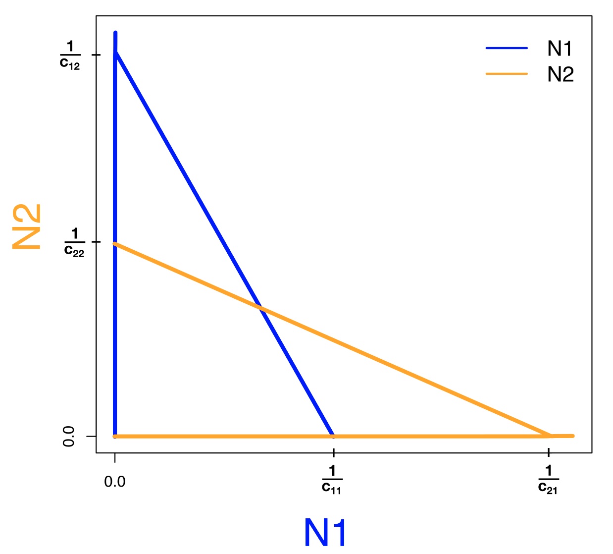{#fig-competition_nullclines-1}

{#fig-competition_nullclines-2}

Faseruimte voor het Lotka-Volterra competitie model, aangenomen dat competitie binnen soorten sterker is dan competitie tussen soorten ($c_{12}$ en $c_{21}$ zijn kleiner dan $c_{11}$ en $c_{22}$). 
::: 

::: {#exr-compofexcl}

## Sterkere intraspecifieke competitie

Hierboven hebben we nullclines geschetst van het competitiemodel, onder de aannamen dat interspecifieke competitie sterker is dan intraspecifieke competitie ($c_{12}$ en $c_{21}$ zijn kleiner dan $c_{11}$ en $c_{22}$). Beginnende vanuit deze opstellen: stel dat $N_2$ steeds sterkere competitie krijgt met $N_1$.

  a. Welke parameter gaat er veranderen? *c21 wordt groter*
  b. Welke nullcline in deze faseruimte zal verschuiven?  *ANTWOORD: de oranje lijn: het snijpunt van de oranje lijn met de x-as schuift naar links*.
Als deze verschuiving doorzet, zullen de parameters op een gegeven moment niet meer snijden. 
  c. Vanaf wel punt gebeurt dit? *als c21 groter is dan c11*
  d. Schets het vectorveld in de situatie dat de nullclines niet snijden, en teken een trajectorie om aan te geven wat er zal gebeuren als je met veel van beide soorten begint. *N1 gaat winnen*
:::

## Coexistentie of exclusie?

Afhankelijk van de parameters zien we dat de nullclines van het Lotka-Volterra competitie model anders kunnen liggen. Laten we `Grind` gebruiken om het bovenstaande model verder te analyseren. We nemen eerst aan dat interspecifieke competitie sterker is dan intraspecifieke competitie. 

```{r results='hide'}
#| fig.width: 7
#| fig.height: 4
#| code-fold: true
#Laad het grind.R-script in
source("https://tbb.bio.uu.nl/rdb/grindR/grind.R")

# Definitie van model. 
model <- function(t, state, parms) {
  with(as.list(c(state,parms)), {
    dN1 <- r*N1*(1-c11*N1-c12*N2)
    dN2 <- r*N2*(1-c22*N2-c21*N1)
    return(list(c(dN1, dN2)))  
  }) 
}  


p <- c(r=1,c11=2,c22=2,c12=1,c21=1)  #parameters
s <- c(N1=0.01,N2=0.001) # kleine begin-dichtheden

colors[1] = "blue"
colors[2] = "orange"
par(mfrow=c(1,2)) # maak twee plot-ruimtes
plane(vector=T,grid=3) # faseruimte 
run(traject=F,tstep=0.1,col="black",tmax=50) # numerieke oplossing
mtext("LV competitie met sterke intraspecifieke competitie", cex=1.2,font=2,side = 3, line = -3, outer = TRUE)
```

Het bovenstaande Grind-script bevestigt wat we net met pen-en-papier al hebben aangetoond: twee soorten kunnen samenleven wanneer er sterke intraspecifieke competitie is. Het evenwicht waar beide soorten voorkomen is dus een \textbf{attractor} van het systeem. Je zou je deze attractor kunnen voorstellen als een kuil waar een balletje door de zwaartekracht heen zal rollen (zie linkerzijde van @fig-attractorlandscapes). Tenzij één van de soorten vanaf het begin afwezig is, krijgen we dus altijd coexistentie (*coexistence*).

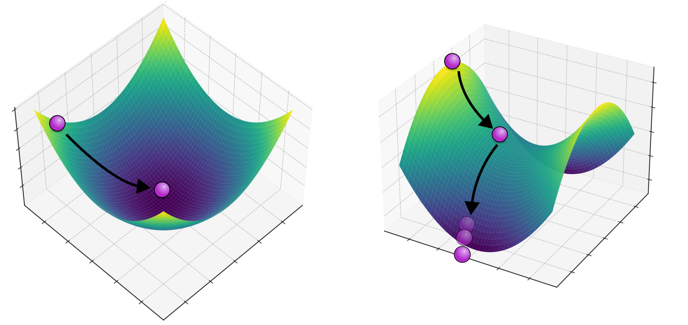{#fig-attractorlandscapes}

Omdat we nu ons R-script klaar hebben liggen, is het triviaal om deze aan te passen voor een scenario waar de twee soorten juist hele sterke \textbf{inter}specifieke competitie hebben, bijvoorbeeld wanneer twee bacterien toxines produceren om elkaar te inhiberen: 

```{r results='hide'}
#| fig.width: 7
#| fig.height: 4
#| code-fold: true
# Laad het grind.R-script in
source("https://tbb.bio.uu.nl/rdb/grindR/grind.R")

# Definitie van model. 
model <- function(t, state, parms) {
  with(as.list(c(state,parms)), {
    dN1 <- r*N1*(1-c11*N1-c12*N2)
    dN2 <- r*N2*(1-c22*N2-c21*N1)
    return(list(c(dN1, dN2)))  
  }) 
}  


p <- c(r=1,c11=1,c22=1,c12=2,c21=2)  #parameters
s <- c(N1=0.01,N2=0.001) # kleine begin-dichtheden

colors[1] = "blue"
colors[2] = "orange"
par(mfrow=c(1,2)) # maak twee plot-ruimtes
plane(vector=T,grid=3) # faseruimte 
run(traject=F,tstep=0.1,col="black",tmax=50) # numerieke oplossing
mtext("LV competitie met sterke interspecifieke competitie", cex=1.2,font=2,side = 3, line = -3, outer = TRUE)
```

Zoals je ziet heeft deze parameterverandering het vectorveld verandert: waar eerst \textbf{alle} pijltjes naar het evenwicht in het midden wezen, wijzen nu slechts twee van de vier pijltjes naar het evenwicht. De andere twee wijzen er juist van weg. Dit type evenwicht heet een zadelpunt (*saddle point*). 

Als we ons weer een balletje voorstellen dat naar beneden rolt, zal dit er uitzien zoals de rechterzijde van @fig-attractorlandscapes. Of het balletje naar links of naar rechts rolt, wordt eigenlijk uitsluitend bepaald door waar het balletje begon. Sterker nog, als het *precies* in het midden was begonnen, was het precies op het midden van het "zadel" blijven liggen (een dergelijke situatie is natuurlijk biologisch gezien niet heel reëel). Als we dit terug vertalen naar de samenleving van de twee soorten, kunnen we concluderen dat er geen coexistentie zal zijn, maar competitieve exclusie (*competitive exclusion*): één soort blijft over en de ander sterft uit. De soort die aanvankelijk meer voorkomt zal winnen. Dit betekent dus ook dat als de andere soort invasief is (een nieuwe mutant of geïntroduceerd vanuit een ander continent), dat deze *niet* zal kunnen verspreiden. 

Met het bovenstaande model zien we dat, afhankelijk van de parameters, we hele andere voorspellingen kunnen doen. Bovendien zien we dat evenwichtspunten (daar waar twee nullclines snijden) er heel anders uit kunnen zien. We zagen in het Lotka-Volterra model zonder verzadigbare predator een stabiele spiraal, met verzadigbare predator dat de populaties prooi- en predator blijven oscilleren, met zwakke competitie tussen soorten samenleving, en met sterke competitie tussen soorten competetieve exclusie. Al deze verschillende evenwichtsituaties (zie @tip-typeevenwichten) kunnen we aflezen aan de gegeven faseruimtes, en dit vertalen naar hoe het systeem zich over de tijd zal ontwikkelen. 

::: {.callout-tip #tip-typeevenwichten collapse="false"}

## Type evenwichten 

| Evenwicht                | Equilibrium                | Beschrijving     | Illustratie                                                                                                                                |
|----------------|---------------|------------------------------|---------------|
| Stabiel punt | Stable point | Alle pijltjes wijzen naar het evenwicht toe | 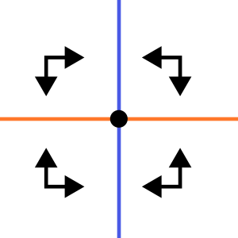
| Instabiel punt  | Unstable point | Alle pijltjes wijzen van het evenwicht weg. | 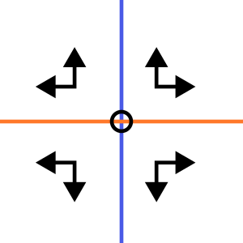
| Zadelpunt | Saddle point | Sommige pijltjes wijzen naar het evenwicht toe, en anderen ervan weg. | 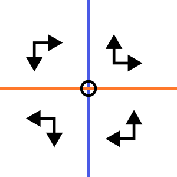
| Stabiele spiraal  | Stable spiral | Het vectorveld draait om het evenwicht heen, maar uiteindelijk beweegt het systeem naar het evenwicht toe.| 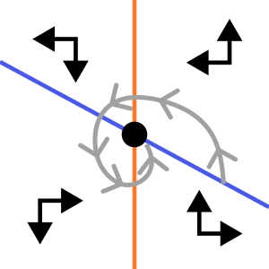
| Instabiele spiraal  | Unstable spiral | Het vectorveld draait om het evenwicht heen, en het systeem beweegt weg van het evenwicht.| 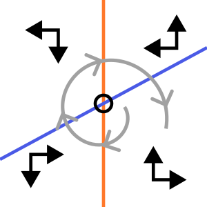
:::

## Opgaven 
:::{#exr-vectorveld}

## Het "werkelijke" vectorveld

Het vectorveld hebben we tot nu toe versimpeld door slechts voor enkele punten aan te geven of de variabelen langs de x- en y-as zullen afnemen of toenemen. In werkelijkheid is dit vectorveld veel gedetailleerder: het geeft voor elk punt in de ruimte de *unieke richting* aan waarin het systeem zich beweegt (zie onderstaande figuur). 

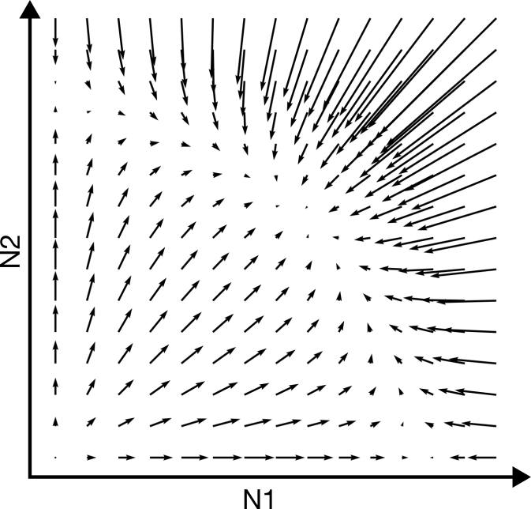{width="50%" fig-align="center"}

Het bovenstaande vectorveld hoort bij het Lotka-Volterra competitie model zoals besproken in dit hoofdstuk (let op: dit is weergegeven **zonder** de nullclines). 

  a. Is in bovenstaande vectorveld de inter- of intraspecifieke competitie sterker? *er is een evenwicht in het midden, dus intra is sterker*
  b. Kan je in een ODE met dezelfde begincondities verschillende richtingen op gaan? Waarom wel/niet? *nee dat kan niet, want voor elke waarde van X en Y krijg je een specifieke hoeveelheid groei van X en Y. Je gaat dus altijd dezelfde kant op. *
  c. Leg met je antwoord op b uit waarom een trajectorie zichzelf nooit zal kunnen snijden.  *Hetzelfde als a. Je kan niet met dezelfde waarde meerdere kanten op gaan, wat bij snijden wel zo zou zijn!*
 d. In werkelijkheid kan het weldegelijk zo zijn dat je een experiment onder dezelfde begincondities hebt gestart, en toch andere uitkomsten hebt. Geef twee verschillende redenen waarom dit in het experiment wel kan, en in je model niet. 
 *rede 1: er is geen ruis in het model, maar in werkelijkheid wel, rede 2 kunnen ze op veel manieren uitdrukken: er is geen hidden (derde of vierde) variabele / iets anders intefereert, etc.*
e. Als een trajectorie een nullcline snijdt, gaat dat altijd onder een hele specifieke hoek. Druk in woorden uit waarom dat is, en in welke hoek je door de nullclines kan gaan. *op de nullcline is de richting van een van de variabelen 0, dus je kan er alleen precies horizontaal of precies verticaal doorheen gaan.*

:::

:::{.pepexr #exr-evenwichtentraj}

## Evenwichten en trajectories

::: {#fig-competition_nullclines layout-ncol=3}
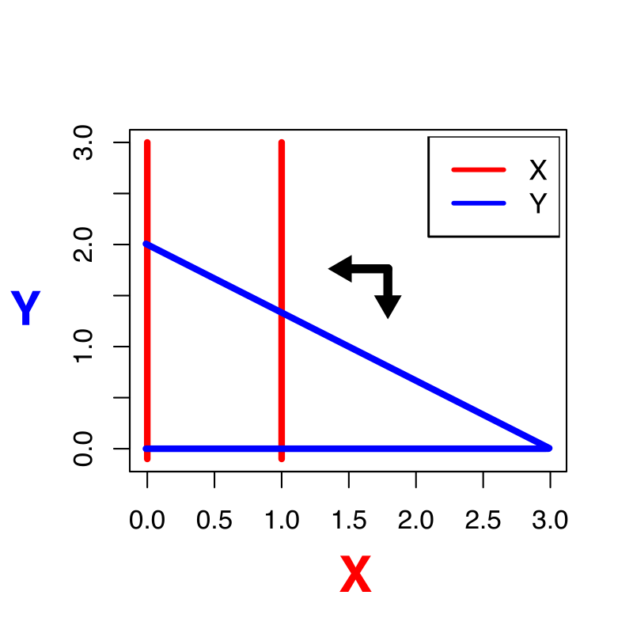{#fig-vraag_nullclines-1}

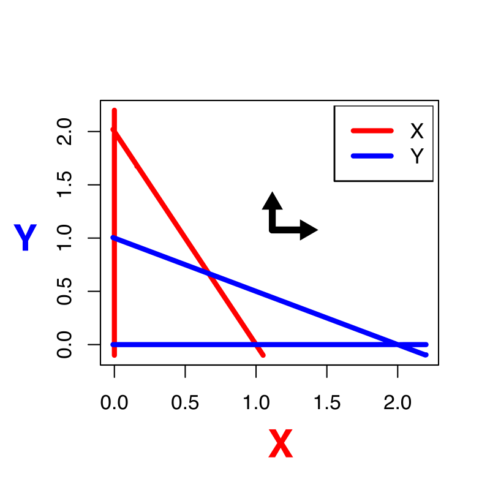{#fig-vraag_nullclines-2}

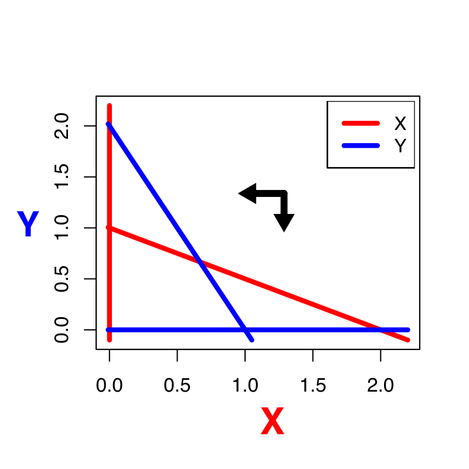{#fig-vraag_nullclines-3}

Verschillende faseruimtes met nullclines, waarbij slechts in 1 hoek het vectorveld is gegeven. 

::: 

In de bovenstaande faseruimtes zijn al nullclines getekend, en het vectorveld is aangegeven voor 1 hoek. 

a. Schets de faseruimtes na. Vul de rest van het vectorveld in en benoem de evenwichten (zie @tip-typeevenwichten voor de namen voor de verschillende typen evenwichten) *de eerste is een beetje een instinker: lijkt op LV, maar is stabiel. midden is instabiel, rechts is zadelpunt.*
b. Stel we beginnen met X=0.1 en Y=0.2. Schets in elke faseruimte een geldige trajectorie
*schets 1: direct naar het evenwicht (mag wel krom maar je kan niet over nullclines heen! schets 2: naar oorsprong (0,0), schets 3: eerst nemen beide soorten toe, maar dan gaat het naar x,y = 0,0.2 *
c. Schets voor elke trajectory uit de vorige vraag een geldige oplossing (dat zijn dus twee "grafiekjes door de tijd"). *schets 1: asymptotisch naar evenwicht. schets 2: asymptotisch naar 0, schets 3: eerst nemen beide soorten toe, maar dan neemt x af en blijft y toenemen tot een evenwichtswaarde.*

:::

:::{.mixedexr #exr-cheatandcoop}

## Cheaters en cooperators

In hoofdstuk @sec-ruimtelijk heb je kennis gemaakt met *individual based modelling*, en heb je gezien hoe cooperators en cheaters kunnen samenleven. Echter zagen we ook dat hoe meer we het systeem mengde, hoe slechter dat ging. Sterker nog, onder goed gemengde condities ging het eigenlijk nooit goed, omdat de cheaters teveel toenamen en daarna het hele systeem uitstierf. Laten we kijken hoe dit uitpakt in een ODE die vergelijkbare aannames doet. Bekijk het volgende ODE model: 

\begin{align*}
\dt{C_1} &= b_1C_1^2(1-\frac{C_1+C_2}{K}) - dC_1\\
\dt{C_2} &= b_2C_1C_2(1-\frac{C_1+C_2}{K}) - dC_2
\end{align*}

Anders dan in het individual-based model, waar we twee cooperators en één cheater hadden, beschrijven we nu alleen een populatie van cooperators en een populatie van cheaters. De parameters $b_1$ en $b_2$ kunnen onderling verschillen, maar beide soorten hebben dezelfde death rate $d$. 

  a. Welk van de twee populaties is de cooperator, en welke de cheater? Waar zie je dit aan? *C1 cooperator want de groeisnelheid is alleen van C1 afhankelijk. C2 is van C1 en C2 afhankelijk, en is dus de cheater.*
  b. Waarom bevat de functionele response $(1-\frac{C_1+C_2}{K})$ zowel $C_1$ als $C_2$? *Dit genereert competitie tussen de twee soorten. We zijn geintresseerd in het samenleven van cooperator en cheater. Door ze een gedeelde carrying capacity te geven kunnen we onderzoeken wanneer ze kunnen samenleven.*
  c. Als we een in de IBM een grid van 100x100 hadden, hoe groot zou $K$ dan zijn? *K is dan ongeveer 100x100 (min een beetje death), want het grid bepaalde in de IBM de maximale populatiegrootte.*

Neem de volgende Grind code over, waar de cooperators iets sneller groeien dan de cheaters:
```{r}
#| eval: false
source("https://tbb.bio.uu.nl/rdb/grindR/grind.R")

model <- function(t, state, parms){
  with(as.list(c(state,parms)),{
    dC1 <- b1*C1*C1*(1-C1-C2) - d*C1
    dC2 <- b2*C1*C2*(1-C1-C2) - d*C2
    return(list(c(dC1,dC2)))
  })
}  

colors[1] = "orange"
colors[2] = "blue"

p <- c(b1=2.0,b2=1,d=0.1)
s <- c(C1=0.2,C2=0.1)
plane(vector=T,grid=7)
```
  d. Bestudeer de faseruimte en het vectorveld. Is het evenwicht met alleen cooperators en géén cheaters stabiel, of instabiel? Controlleer je antwoord met `newton(c(C1=1,C2=0),plot=T)` *stabiel*
  e. Voorspel wie er overleeft wanneer je begint met veel van beide soorten. *alleen cooperators*
  f. Voorspel wie er overleeft wanneer je begint met weinig van beide soorten. *niemand*

We gaan nu aannemen dat de cheaters sneller groeien dan de cooperators (draai hiervoor de waarde van $b_1$ en $b_2$ om). 

  g. Bestudeer opnieuw de faseruimte en het vectorveld. Is het evenwicht met alleen cooperators stabiel of instabiel? *instabiel*
  h. Voorspel opnieuw wie er overleeft, en hoe dat afhangt van de begin-dichtheden. Leg in biologische termen uit wat er gebeurt. *maakt niet uit hoe je begint, alles gaat altijd dood*
  i. Bestudeer andere waarden van $b_1$ en $b_2$. Bij welke parameters kunnen zowel $C_1$ als $C_2$ blijven leven? Vind je de gevonden voorwaarde biologisch relevant? *als b1 en b2 gelijk zijn. Niet heel relevant dus.*
  
In de simulatie hieronder is de birth rate van cooperators iets lager gemaakt dan die van de cheaters.

```{=html}
<iframe width="100%" height="460" src="//jsfiddle.net/bramvandijk88/dL1sb4ap/embedded/result/" frameborder="0" loading="lazy" allowtransparency="true" allowfullscreen="true"></iframe>
```

  j. Hoe kan het dat het individual-based model coexistentie van de soorten laat zien, terwijl dit in de ODE niet kan? *het samenleven werkt alleen als je niet mengt. met mengen sterft alles uit, dus kennelijk is de ruimtelijke structuur belangrijk. dit kan je ook wel zien, want lokaal (in een klein stukje van de simulatie) is er WEL steeds sprake van uitsterven. maar dan is het niet onmiddelelijk einde verhaal!*


:::

:::{.Rexr #exr-parfitting}

## Parameter fitting} 

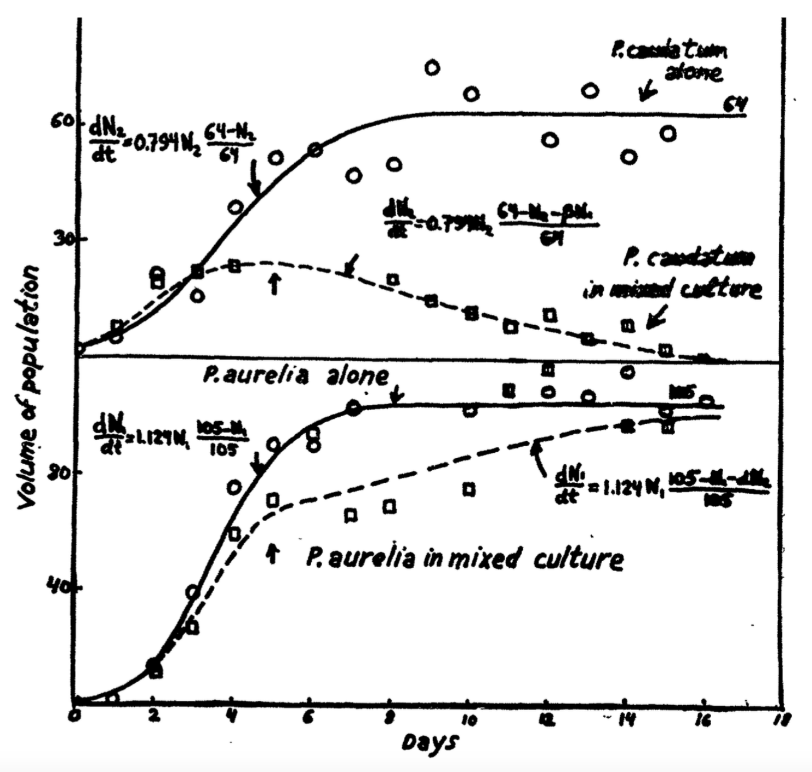{width="80%" fig-align="center"}

In klassieke experimenten groeide Gause (1934) twee soorten *Paramecium*, zowel in isolatie als samen. De doorgetrokken lijnen in de figuur hierboven suggereren dat de groeicurve van *P. aurelia* en *P. caudatum* in isolatie redelijk goed beschreven worden door een logistische groeivergelijking. In Gause's eigen handschrift zijn de geschatte parameterwaarden te lezen ($r$ = 0,794 per dag met $K$ = 64 voor *P. caudatum* en $r = 1,129$ per dag met $K = 105$ voor *P. aurelia*). We gaan deze parameter-waarden bestuderen met Grind. Neem het volgende script over: 

```{r}
#| eval: false
source("https://tbb.bio.uu.nl/rdb/grindR/grind.R")

model <- function(t, state, parms) {
  with(as.list(c(state,parms)), {
    dtN <- r*N*(1 - N/K)
    return(list(c(dtN)))  
  }) 
} 

p <- c(r=1,K=100)    # Een ruwe gok van de parameters
s <- c(N=2)
run(18)              # Run het model 18 tijdstappen
```

  a. Waarom denk je dat we het model voor slechts 18 tijdstappen doorrekenen? *het experiment is 18 dagen*
  b. De ruwe data voor de soorten in isolatie (dus de rondjes in de figuur hierboven) staan op de website. Deze kan je zelf plotten, maar Grind heeft ook hier een ingebouwde functie voor (zie onderstaande code):
```{r}
#| eval: false
  caudatum <- read.table("https://tbb.bio.uu.nl/bvd/bms/caudatum.txt", header=TRUE)
  timePlot(caudatum,draw=points)
  p <- c(r=2,K=50)   
  s <- c(N=3)
  run(18,add=T)
```
In de laatste regel code wordt het Grind-model over de data heen geplot. 

  c. Probeer door *trial-and-error* een betere fit te krijgen aan de data (let op: je kunt zowel de parameters $r$ en $K$, als de initiele conditie van $N$ aanpassen). 
  d. Tot hoeveel decimalen heb je $r$, $K$, en $N$ geschat? Vertrouw je de uitkomst, en wellicht belangrijker, kun je dit vertrouwen objectief onderbouwen? *eigenlijk kan je met 0 decimalen al wel een aardige fit krijgen, maar je weet dan niet per se hoe goed die is*
  
*Trial-and-error* is niet reproduceerbaar voor andere wetenschappers, en is bovendien een enorm gepruts als je nog meer parameters hebt! Grind kan daarom ook parameters-fitting doen: automatisch veel mogelijke parameters uitproberen om zo tot een goede (hopelijk de beste) "fit" te komen:
```{r}
#| eval: false
    caudatum <- read.table("https://tbb.bio.uu.nl/bvd/bms/caudatum.txt", header=TRUE)
    timePlot(caudatum,draw=points)
    p <- c(r=1,K=10)   
    s <- c(N=2)
    run(18,add=T)
    free <- c("r","K","N")
    fC <- fit(caudatum,free=free,main="Caudatum",legend=FALSE)
```
    e. Wat denk je dat er in deze code wordt bedoeld met 'free'? *dit zijn de vrije parameters, als je bijv. N weghaald kan deze niet varieren tijdens het fitten*
    f. Voer de bovenstaande code uit voor zowel de gegeven waarden ($r=1$, $K=10$, $N=2$), als de waarden die je met \textit{trial-and-error} gevonden hebt. Is het eind-resultaat (de parameter-schattingen) vergelijkbaar? *nagenoeg hetzelfde, kleine verschillen, let op voor verdiepend antwoordenmodel: hoeft niet zo te zijn. soms zijn er meerdere fits mogelijk afh van de initial conditie.*

Om de betrouwbaarheid van de fit te bestuderen, kunnen we de functie 'summary' in R gebruiken om de fit samen te vatten:
```{r}
#| eval: false
fC <- fit(caudatum,free=free,main="Caudatum",legend=FALSE)
summary(fC)
```
  
```
   Estimate Std. Error t value Pr(>|t|)    
r   0.7623     0.2221   3.433  0.00496 ** 
K  60.9539     3.2774  18.598 3.25e-10 ***
N   3.7722     2.8796   1.310  0.21473 
--
Signif. codes:  0 ‘***’ 0.001 ‘**’ 0.01 ‘*’ 0.05 ‘.’ 0.1 ‘ ’ 1

Residual standard error: 8.195 on 12 degrees of freedom

Parameter correlation:
        r       K       N
r  1.0000 -0.4381 -0.9272
K -0.4381  1.0000  0.3023
N -0.9272  0.3023  1.0000
```

Deze samenvatting geeft naast de parameter-waarden ook een boel andere statistiek (standaard error, P-waarden, correlaties). Wat deze termen betekenen, en hoe je ze moet interpreteren, leer je bij het onderdeel statistiek. 

:::

## Terminologie

| Nederlands                | Engels                | Beschrijving                                                                                                                                    |
|------------------|--------------------|----------------------------------|
| Intraspecifieke competitie | Intraspecific competition | Competitie binnen een soort (tussen soortgenoten) |
| Interspecifieke competitie | Interspecific competition | Competitie tussen soort |
| Coexistentie | Coexistence | De samenleving van twee of meerdere soorten. |
| Competitieve exclusie | Competitive exclusion | Twee soorten die niet duurzaam kunnen samenleven; de ene zal de andere verdringen. |
| Parameter fitting | Parameter fitting | Het zoeken naar de parameters waarmee een model (bijvoorbeeld een ODE) overeenkomt met de data. Let op: er is niet altijd één set parameters die de data goed kan beschrijven! |