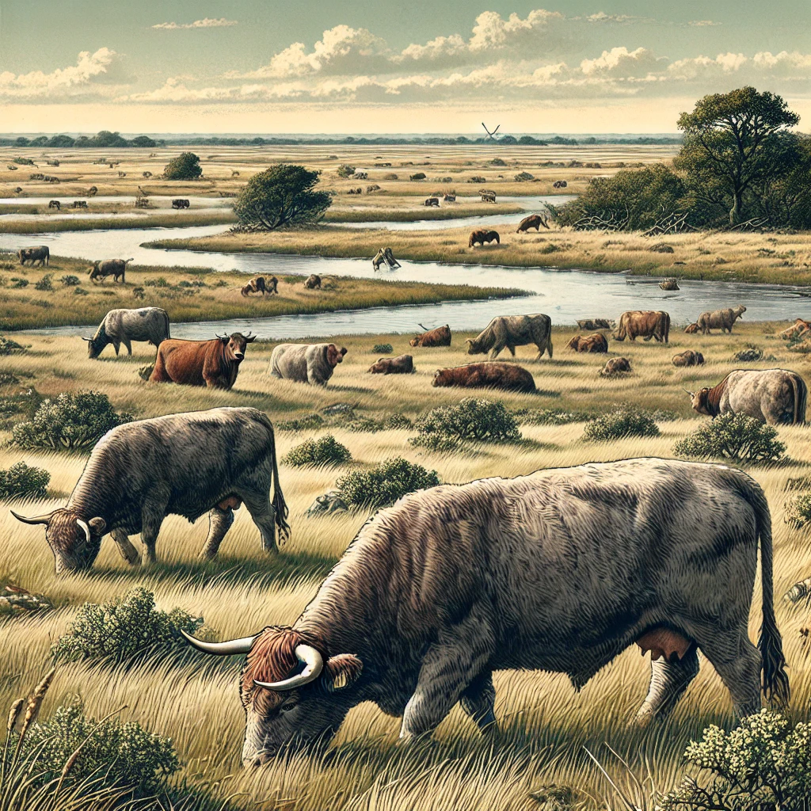
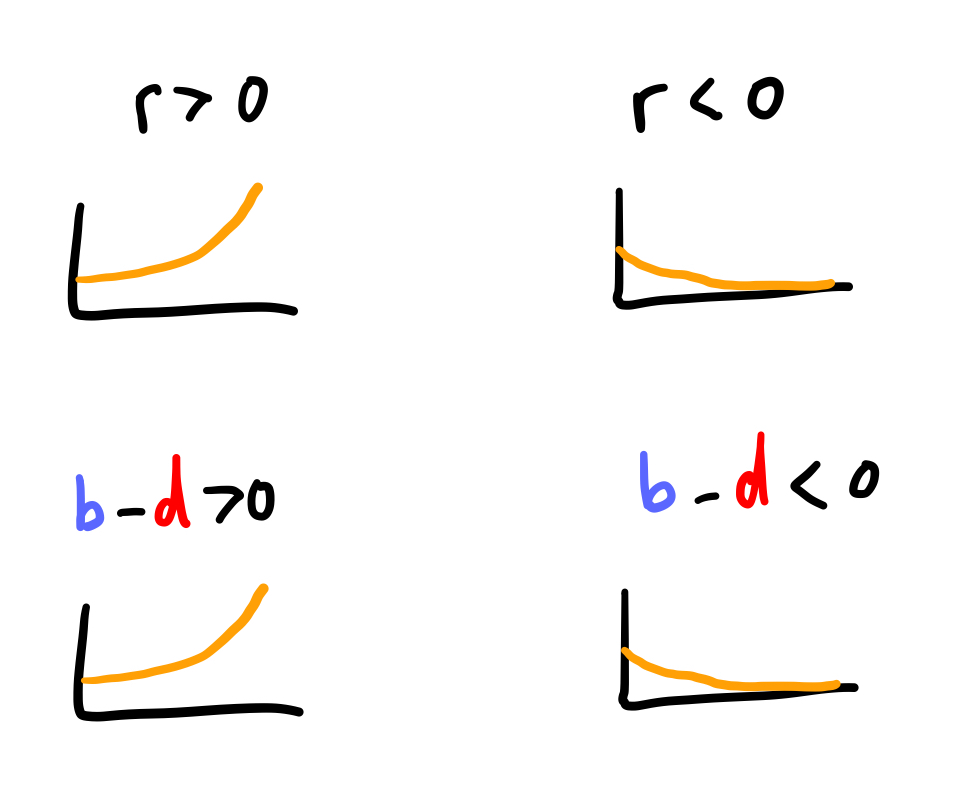
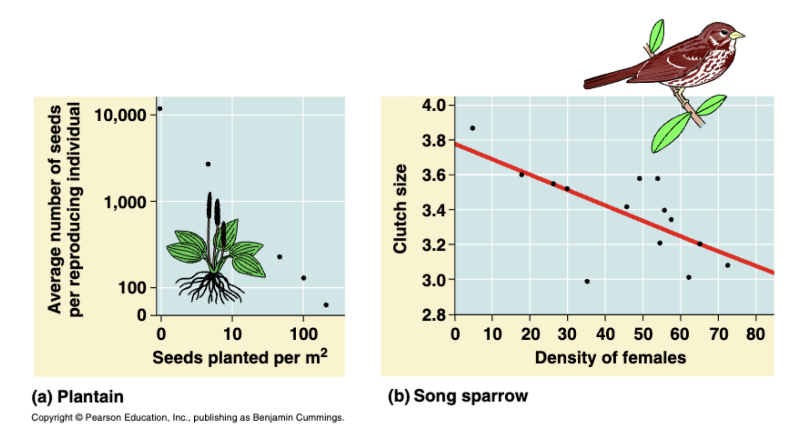
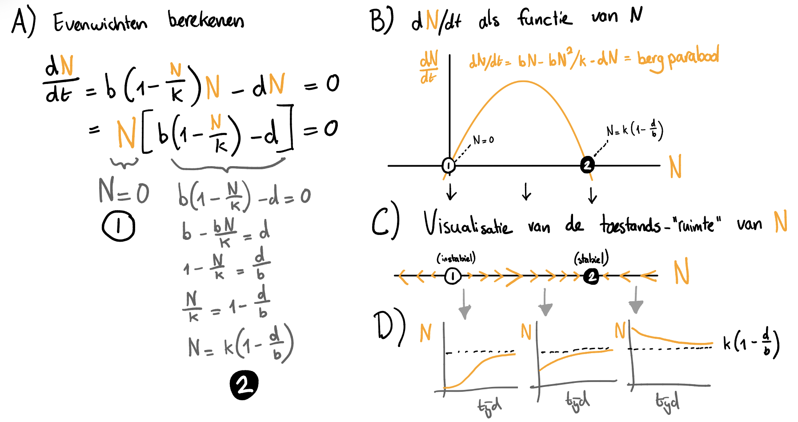
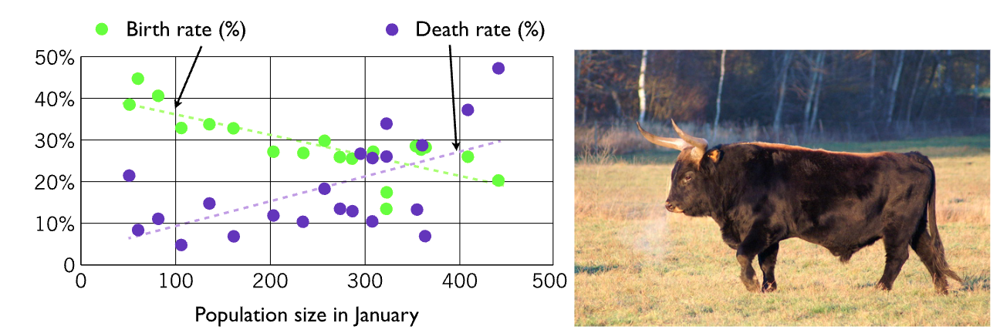





# Dichtheidseffecten {#sec-dichtheid}

In het vorige onderdeel heb je geleerd dat een populatie in evenwicht is als de snelheid van verandering gelijk is aan 0. Door een parameter $K$ te introduceren voor het draagvermogen (de **carrying capacity**), zorgen we dat de populatie niet oneindig door kan groeien. Echter hadden we in een eerder werkcollege juist expliciet geboorte- en sterfteprocessen gemodelleerd. Is dat niet een meer natuurlijke manier om na te denken over gelimiteerde groei? In dit hoofdstuk, gaan we dichtheidsafhankelijke geboorte en sterfte bestuderen.

## Leerdoelen

Na dit hoofdstuk, moet je het volgende kunnen:

- Uitleggen wat dichtheidsafhankelijke geboorte (*density dependent birth*) en dichtheidsafhankelijke sterfte (*density dependent death*) zijn, en deze herkennen in een ODE.
- Een faseportret kunnen lezen, en corresponderende oplossing schetsen.
- Bediscussiëren wat de voor- en nadelen zijn van het afschieten van dieren in termen van welzijn op populatieniveau.

{fig-align="center" width="80%"}

## Geboorte en sterfte

In het vorige hoofdstuk hebben we dichtheidsafhankelijkheid ingebouwd zodat de populatie langzamer gaat groeien bij grote dichtheden:

$$
\frac{\dd N}{\dd t} = rN\left(1-\frac{N}{K}\right)
$$
Deze ODE voor logistische groei kom je veel tegen in biologische modellen. De parameter $r$ in deze vergelijking staat bekend als de **intrinsieke groeisnelheid** (*intrinsic growth rate*) van de populatie. Als $r$ positief is, is er groei (ook als $r=0.1$!). Als $r$ negatief is, is de groei negatief. Maar biologisch gezien is "negatieve groei" natuurlijk een beetje vreemd. Bedoelen we niet eigenlijk dat de hoeveelheid sterfte (hierna: *death*) hoger is dan geboorte (hierna: *birth*)? Een gebrek aan voedsel kan bijvoorbeeld een verhoogde death rate opleveren (zoals we eerder modelleerden d.m.v. een kwadratische death rate in de vorm $-dN^2$), terwijl birth rate per individu gelijk blijft ($bN$ is per individu één en dezelfde birth rate van $b$). Het zou ook zo kunnen zijn dat individuen met minder voedsel minder reproduceren (dus een verlaagde birth rate krijgen). Om deze verbale begrippen in onze ODE te verwerken, moeten we weer afstappen van de parameter $r$, en deze toch weer uitsplitsen in birth ($b$) en death ($d$), zoals we bij het eerste werkcollege ook hebben gedaan. Neem bijvoorbeeld weer ons model van exponentiële groei:

$$
    \frac{\dd N}{\dd t} = rN 
$$

Nogmaals: in dit model is er exponentiele groei wanneer $r>0$, en exponentiele afname wanneer $r<0$. Als we r vervangen door het verschil in birth ($b$) en death ($d$), dan krijgen we:

$$
    \frac{\dd N}{\dd t} = ( {\color{#2a53f7}b} - {\color{red}d} )N
$${#eq-rbd}

::: {.callout-caution}
## Let op! @eq-rbd geeft ook gewoon exponentiele groei (of afname)!

Hoewel we de birth en death parameters hebben geintroduceerd, is er vooralsnog weinig veranderd aan ons model. Net als dat $r>0$ en $r<0$ respectievelijk leidde tot groei en afname, is er bij $b>d$ en $b<d$ ook sprake van exponentiële groei of afname: 

{fig-align="center" width="50%"}
:::

## Dichtheidsafhankelijke geboorte

Hoewel onze nieuwe vergelijking voor groei zich nog niet anders gedraagt, kunnen we met deze aanpassing wel na gaan denken over *birth* en *death* processen. Stel je voor dat we experimenteel hebben bepaald dat een soort dichtheidsafhankelijke geboorte heeft (*density dependent birth*), zie bijvoorbeeld @fig-ddbpears.

{#fig-ddbpears}

Waar we deze afname eerder in het algehele groei-process hadden verwerkt, gaan we nu een nieuw model bekijken waar alleen de birth verandert bij grotere dichtheden. Hiervoor is het handig om eerst de birth en death termen op te splitsen:

\begin{align}
    \frac{\dd N}{\dd t} &= ({\color{#2a53f7}b}-{\color{red}d})N\\
    \frac{\dd N}{\dd t} &= {\color{#2a53f7}b}N - {\color{red}d}N
\end{align}

Nu kunnen we ervoor kiezen om de geboorteterm te vermenigvuldigen met een nieuwe functie die afhangt van de populatiedichtheid ($f(N)$):

\begin{align}
    {\color{#2a53f7}b} & \rightarrow {\color{#2a53f7}b} \cdot f(N)
\end{align}

Bijvoorbeeld dezelfde functie die we eerder hebben gebruikt:

\begin{align}
    {\color{#2a53f7}b} & \rightarrow {\color{#2a53f7}b}\left(1-\frac{N}{K}\right) 
\end{align}

Dat wil zeggen, de constante parameter $b$ wordt vervangen door een term die afneemt met $N$. De parameter $b$ staat nu niet meer voor de birth rate, maar voor de *maximale birth rate* die alleen bereikt wordt bij kleine populatiegroottes. Als we dit in de gehele ODE invullen, krijgen we nu:

\begin{align}
    \frac{\dd N}{\dd t} &= {\color{#2a53f7}b}\left(1-\frac{N}{K}\right)N - {\color{red}d}N
\end{align}

::: {#exr-functioneleresponses}
## Andere functies voor dichtheidseffecten
<br>

Hierboven vermenigvuldigen we de birth rate met een functie $f(N)=1-\frac{N}{K}$, zodat de birth rate afneemt bij hogere populatiegroottes. Stel je in plaats daarvan voor dat we de birth met één van de onderstaande functies hadden aangepast. Beschrijf wat er dan met de birth zou gebeuren bij toenemende populatiegroottes. 

\begin{align}
    {\color{#2a53f7}b} & \rightarrow {\color{#2a53f7}b} \cdot f(N)
\end{align}

a. $b \rightarrow b \cdot f(N) \quad \textrm{met} \quad f(N)=\frac{N}{K} + 1$
a. $b \rightarrow b \cdot f(N) \quad \textrm{met} \quad f(N)= 1 - cN$
a. $b \rightarrow b \cdot f(N) \quad \textrm{met} \quad f(N)= 1 - cN^2$

:::

## Het faseportret

Zoals je in het vorige hoofdstuk geleerd hebt, kunnen we ODEs eenvoudig analyseren door ons af te vragen: wanneer is er geen groei meer? Wanneer is $\dt{N}$ gelijk aan $0$? Deze relatief eenvoudige berekening wordt weergegeven in @{fig-faseportret}A. De rechterzijde van dit figuur geeft aan dat je ook zonder berekeningen inzicht kunt krijgen in een ODE. Dit doen we door eerst een de groeifunctie (dus $dN/dt$) te schetsen als functie van $N$. In @{fig-faseportret}B zie je hoe onze ODE met dichtheidsafhankelijke geboorte een bergparabool oplevert^[Als je functies schetsen toch nog lastig vindt, kijk dan nog even naar [hoofdstuk 10](#section-schetsen). Je kan het ook altijd even controleren met de website [Desmos.com](https://www.desmos.com)], een functie die op twee punten gelijk is aan $0$. Dit zijn diezelfde punten die we met berekeningen hebben bepaald. Op deze punten is de populatie in evenwicht: deze kan niet groeien of krimpen. In @{fig-faseportret}C visualiseren we wanneer de populatie zal groeien of krimpen in een zogeheten toestands-"ruimte"^[ruimte staat hier even tussen aanhalingsrekens, want het is slechts een ruimte van 1 dimensie, dus eigenlijk zouden we het ook een lijn kunnen noemen]. Als de bergparabool boven 0 komt is er groei mogelijk, en zal $N$ groter worden. Dit geven we weer met pijltjes naar rechts (meer $N$). Als de bergparabool onder 0 komt, is er afname, en zal $N$ kleiner worden (pijltjes naar links). Op de evenwichtspunten is er geen verandering, en tekenen we een cirkel om aan te geven dat hier een evenwicht zit. Een figuur zoals die in @{fig-faseportret}C, waar we de zogeheten toestandsruimte opdelen en annoteren met pijltjes, wordt ook wel een **faseportret** genoemd. 

{#fig-faseportret width="90%"}

Een faseportret is erg handig om snel inzicht te krijgen in het gedrag van een ODE. Als de pijltjes naar een evenwicht toewijzen, dan zal het systeem daar op ten duur naartoe gaan. Dit **stabiele evenwicht** (in de figuur aangegeven met een ingevulde cirkel) vormt een zogeheten **attractor** voor het systeem: als je lang genoeg wacht zal de populatie hier uit komen. Het evenwicht bij $N=0$ heeft alleen pijltjes die ervan wegwijzen, en is dus een **instabiel evenwicht** (en is dus geen attractor). Deze worden vaak aangegeven met een open cirkel. Dankzij deze visualisatie is het relatief eenvoudig om te bedenken hoe het systeem zich over de tijd zal ontwikkelen. We kunnen nu uit de losse pols schetsen maken van mogelijk oplossingen (zoals in @{fig-faseportret}D). 

:::{.callout-warning}

## Negatieve populaties zijn biologisch niet interessant.

Hoewel er links van het instabiele evenwicht in @fig-faseportret (voor negatieve $N$) sprake is van "afname naar min-oneindig", is dat biologisch gezien natuurlijk niet relevant. Dit kunnen we als bioloog daarom met een gerust hart negeren.
:::

## Dichtheidsafhankelijke sterfte     

Op een vergelijkbare manier als hierboven, zouden we ook een populatie kunnen modelleren die dichtheidsafhankelijke sterfte (*density dependent death*) ondergaat: 

\begin{align}
    \frac{\dd N}{\dd t} &= {\color{#2a53f7}b}N-{\color{red}d}N, \quad \text{met } \quad {\color{red}d} \rightarrow {\color{red}d}\left(1+\frac{N}{K}\right) \\
    \frac{\dd N}{\dd t} &= {\color{#2a53f7}b}N - {\color{red}d}\left(1+\frac{N}{K}\right)N
\end{align}

Let op dat we hier de sterfte laten *toenemen* met de dichtheid (er staat een $+$ in plaats van een $-$). 

::: {#exr-dddportrait}
## Rekenen aan dichtheidsafhankelijke sterfte
<br>

Hierboven hebben we een ODE opgesteld voor dichtheidsafhankelijke sterfte, namelijk:
$$
\frac{\dd N}{\dd t} = {\color{#2a53f7}b}N - {\color{red}d} \left( 1+\frac{N}{K}\right)N
$$
Bekijk nog eens @fig-faseportret, waar de evenwichten voor dichtheidsafhankelijke geboorte worden berekend en gevisualiseerd. 

a. Bereken zelf waar de evenwichten liggen met de dichtheidsafhankelijke sterfte.
a. In plaats van @{fig-faseportret}B en @{fig-faseportret}C apart te tekenen, kunnen we deze twee schetsen ook combineren. Schets $dN/dt$ als een functie van $N$ (zoals in @{fig-faseportret}B). Geef op de x-as aan waar de evenwichten liggen, en teken pijltjes om aan te geven wanneer de populatie zal groeien of krimpen.
:::

## Andere dichtheidseffecten 

In de natuur zal het vaak zo zijn dat zowel geboorte als sterfte door de populatiegrootte worden beïnvloed, dus moeten we ook beide in ons model opnemen. Dan krijgen we: 

\begin{align}
    \frac{\dd N}{\dd t} &= {\color{#2a53f7}b}\left(1-\frac{N}{K_b}\right)N - {\color{red}d}\left(1+\frac{N}{K_d}\right)N\\
\end{align}

Hier schaalt $K_b$ de dichtheidsafhankelijke geboorte, en $K_d$ de dichtheidsafhankelijke sterfte. In het werkcollege zullen jullie zien dat dit simpele model inzicht kan geven in belangrijke beleidsbeslissingen met betrekking tot dierenwelzijn. 

Er zijn vele andere mogelijke dichtheidseffecten mogelijk (teveel om te benoemen). Als we het over ecosystemen hebben, zullen er ook effecten zijn die afhangen van de dichtheid van een *andere* soort. We kunnen ons bijvoorbeeld voorstellen dat de konijnen ($N$) door vossen ($V$) worden opgegeten. Hoe meer konijnen en vossen, hoe waarschijnlijker het wordt dat konijnen worden weggegeten: 

\begin{align}
    \frac{\dd N}{\dd t} &= {\color{#2a53f7}b}\left(1-\frac{N}{K_b}\right)N - {\color{red}d}\left(1+\frac{N}{K_d}\right)N - cNV\\
\end{align}

Deze vergelijking begint er aardig ingewikkeld uit te zien, maar doordat we het stapje voor stapje hebben opgebouwd, zie je wellicht goed in wat elke term betekent. In de laatste (nieuwe term), staat  $c$ voor de predatiesnelheid is en $V$ de hoeveelheid vossen. Maar vossen zouden zelf dan toch ook van populatiegrootte moeten veranderen? In @sec-meerdere ga je zien hoe we ons model kunnen uitbreiden om zowel konijnen (prooi) als vossen (predator) te kunnen beschrijven.

## Opgaven

::: {.pepexr #exr-bacterienbloed}

## Bacteriën in het bloed 
<br>

{width="80%"}

Elke keer dat je je tanden poetst, komt er een kleine hoeveelheid bacteriën in je bloed. Omdat bloed een erg voedselrijke omgeving is voor bacteriën, zouden ze hier onmiddelijk exponentieel kunnen groeien. Gelukkig hebben we neutrofielen in ons bloed die de bacteriën snel opruimen. Hier zouden we een simpel ODE model voor kunnen opstellen:

$$\dt{B}=rB-kNB $$

Hier is B de hoeveelheid bacterien in je bloed is, N de hoeveelheid neutrofielen in je bloed, $r$ de groeisnelheid van de bacteriën (per uur), en k de snelheid waarmee neutrofielen bacteriën opruimen. 

a. Leg uit waar je denkt dat iedere term in de ODE voor staat ($rB$ en $kNB$), en welke eenheden deze termen hebben. 
b. Wat zijn de eenheden voor $r$ en $k$? 

Als er geen bacteriën zijn ($B=0$) is er geen groei. Dit wordt een triviaal (irrelevant) evenwicht genoemd, omdat we voor dit inzicht het hele model niet hadden hoeven maken.

  c. Neem aan dat er een constante hoeveelheid neutrofielen in je bloed is ($N$ is constant). Bij welke hoeveelheid neutrofielen is er een niet-triviaal evenwicht?

d.  Chemotherapie kan een groot effect hebben op het aantal neutrofielen in het bloed, waardoor de tweede term steeds kleiner wordt. Schets de termen $rB$ en $kNB$ als een functie van $N$ (dat wil zeggen, met $N$ op de x-as, en deze termen op de y-as. 
e. Bepaal hoeveel neutrofielen je minimaal nodig hebt om de groei van de bacteriën te stoppen. 
f. De $kNB$ term heet een *mass-action* term omdat de snelheid direct proportioneel is aan de dichtheden van $N$ en $B$. Wat moeten we doen als we willen weten hoeveel bacteriën er "per neutrofiel" opgeruimd worden? 
g. Hoeveel bacteriën worden er per neutrofiel opgeruimd als er 0 bacteriën zijn? En als er oneindig veel bacteriën zijn? Is dit een redelijke aanname? 

Bekijk de volgende uitbreiding van ons model $$\dt{B}=rB-\frac{kNB}{h+B}  $$
De vernieuwde (tweede) term ziet er misschien wat ingewikkeld uit. Om te begrijpen wat er gebeurt is het wederom handig om even na te gaan wat er gebeurt met 0 of heel veel bacterien. Als er 0 bacterien zijn is deze term 0, omdat boven de breuk een $B$ staat. 

  h. Als $B$ heel groot is, hoe belangrijk is $h$ dan nog in deze vergelijking? 

i. Als er dus heel veel bacterien zijn, hoeveel bacterien kunnen er dan per neutrofiel opgeruimd worden in dit nieuwe model? 
j. Bepaal opnieuw hoeveel neutrofielen je minimaal nodig hebt om de groei van bacteriën te stoppen. 
:::

::: {.mixedexr #exr-heck}

## Heckrunderen 
<br>

Heckrunderen zijn in de Oostvaardersplassen geintroduceerd als "semi-natuurlijke" grazers. Ze voorkomen dat het hele gebied begroeid raakt met bomen en struikgewas, wat belangrijk is voor het broeden van vogels in dit gebied. In 1983 is een kleine populatie heckrunderen vrijgelaten, en de populatie is na 20 jaar gestabiliseerd op 300-400 runderen. 

{#fig-heck}

Omdat er veel dieren van de honger doodgaan, zijn er veel debatten geweest over dierenwelzijn. Een mogelijke oplossen is het afschieten van dieren. Dit zou hun populatiegrootte kunnen verkleinen en daardoor de overgebleven individuen een prettiger leven geven. 

a. Bekijk bovenstaande metingen van de geboorte- en sterfte van heckrunderen. Hoeveel heckrunderen zou je op basis van deze data verwachten in evenwicht? 

De data laat zien dat zowel geboorte als sterfte dichtheidsafhankelijk zijn. In het hoofdstuk hebben we hier al een model voor besproken:

$$
\frac{\dd N}{\dd t} = {\color{#2a53f7}b}\left(1-\frac{N}{K_b}\right)N - {\color{red}d}\left(1+\frac{N}{K_d}\right)N
$$ {#eq-modeldd}

Uit het figuur kunnen we zien dat geboorte per rund hoogstens 0.4 per jaar is (als de populatie klein is), en dat deze bij 400 runderen gehalveerd is. 
  
  b. Bepaal met deze informatie wat de waarden van de parameters $b$ en $K_b$ is. 
c.  In de figuur zien we ook dat sterfte minimaal 0.03 is, en dat deze 0.33 is bij een populatiegrootte van 500. Wat zijn dan de parameters $d$ en $K_d$? 
d.  Vul de parameterwaarden die hebt gevonden in, en bepaal bij welke populatiegrootte er een evenwicht is. 
e.  Hoeveel dieren gaan er in dit evenwicht per jaar dood?

Om het afschieten van runderen in dit model te betrekken, kunnen we een extra term aan de ODE toevoegen:
  $$
      \frac{\dd N}{\dd t} = {\color{#2a53f7}b}(1-\frac{N}{K_b})N - {\color{red}d}(1+\frac{N}{K_b})N - kN
  $$
Waarbij $k$ de fractie runderen is die we afschieten. Bekijk het volgende R-script:

```{r}
#| eval: false
#| code-fold: false
# Stap 1: Een functie die verandering uitrekent
verandering <- function (N){
  delta <- b*(1-(N/Kb))*N - d*(1+(N/Kd))*N - k*N
  return(delta)
}

# Stap 2: stel begin-aantal / parameters in
N <- 10
b <- 0.4    
d <- 0.03
Kb <- 800
Kd <- 50
k <- 0.0

# Stap 3, definieer tijdstappen en maak een dataframe aan
delta_t <- 0.1 # grootte van de tijdstap
tijdstapjes <- seq(0,50,by=delta_t)
tijdserie <- data.frame(t=tijdstapjes,runderen=N,sterfte=NA)

for (t in 1:length(tijdstapjes)-1) {
  if(t>300) k <- 0.05
  sterfte <- N*d*(1+N/Kd) + k*N
  N <- N + delta_t*verandering(N)
  tijdserie[t+1,] <- c(t=t*delta_t, runderen=N, sterfte=sterfte)
}

# Plot het totaal aantal heckrunderen door de tijd
plot(tijdserie$t, tijdserie$runderen, xlab="Tijd in jaren", ylab="Aantal heckrunderen", type="l", col="brown", lwd=2)
# Plot het aantal stervende heckrunderen
lines(tijdserie$t, tijdserie$sterfte, col="red", lty=2)
# Voeg legenda toe
legend(40, 270, legend=c("Totaal", "Sterfte"), col=c("brown", "red"), lty=1:2)
```

  f. Na hoeveel jaar wordt er begonnen met schieten? Welk percentage van de heckrunderen wordt afgeschoten? 

Met `tijdserie$runderen/tijdserie$sterfte` kunnen we de sterfte-kolom delen door de kolom met het totaal aantal runderen om uit te rekenen welk percentage van de populatie op elk tijdstap sterft (let op: sterfte is inclusief afschieten!). Deze zouden we ook kunnen toevoegen aan ons dataframe, en apart kunnen plotten:
```{r}
#| eval: false
#| code-fold: false
tijdserie$percentage_sterfte = tijdserie$sterfte/tijdserie$runderen
plot(tijdserie$t, tijdserie$percentage_sterfte, type="l")
```

  g. Bekijk het nieuwe dataframe met `View(tijdserie)`, en vergelijk het percentage sterfte in jaar 30 en 50. Wat valt je op? 
  
h. Met het percentage stervende dieren kunnen we inschatten hoe lang de dieren gemiddeld leven. Als 10% van de dieren jaarlijks overlijdt, dan leeft een dier gemiddeld 10 jaar. Als je dit combineert met je antwoord op de vorige vraag, zou je het afschieten van dieren dan aanmoedigen of afraden?

i. Als je de verwachte levensduur zo min mogelijk wil beinvloeden, wat voor beleid zou je dan nog meer kunnen bedenken? 

:::


## Terminologie

| Nederlands                | Engels                | Beschrijving                                                                                                                                    |
|------------------|--------------------|----------------------------------|
| Intrinsieke groeisnelheid | Intrinsic growth rate | De netto snelheid waarmee een populatie groeit (bijvoorbeeld alle birth minus alle death). Voor deze parameter wordt meestal de letter $r$ gebruikt. Door groei te versimpelen als intrinsieke (netto) groei, is meestal niet gedefiniëerd wat de precieze geboorte- en sterftesnelheden zijn. |
| Dichtheidsafhankelijk | Density dependent | Wanneer een process sneller of langzamer gaat als de dichtheid van de populatie verandert. In latere hoofdstukken gaan we ook modellen bestuderen waarbij de dichtheid van andere populaties ook een rol speelt.  |
| Faseportret | Phase portrait | Een visuele manier om van een ODE weer te geven waar de eventuele evenwichten liggen, en of deze instabiel/stabiel zijn |
| Evenwicht | Steady state | Een conditie waarbij een systeem niet verandert. Bijvoorbeeld, een populatiegrootte waarbij er geen groei/afname is. |
| Stabiel evenwicht | Stable steady state | Een evenwicht waar het systeem naartoe beweegt, bijvoorbeeld wanneer de groeisnelheid toeneemt bij afname, en afneemt bij toename.  |
| Instabiel evenwicht | Unstable steady state | Een evenwicht waar het systeem van weg beweegt, bijvoorbeeld wanneer de groeisnelheid toeneemt bij toename, en afneemt bij afname. Dit zijn dus weliswaar evenwichten, maar elk mogelijke verstoring zal het systeem ervandaan bewegen! |
| Attractor | Attractor | Waar het systeem naartoe gaat als je lang genoeg wacht. Vaak is dit een stabiel evenwichtspunt, maar er zijn ook andere soorten attractoren mogelijk. |
| Massawerking | Mass action | Mass action (het Nederlandse begrip is ongebruikelijk) is een aanname dat interacties tussen individuen/moleculen direct proportioneel is aan de dichtheden/concentraties. |
:  {.striped .hover}