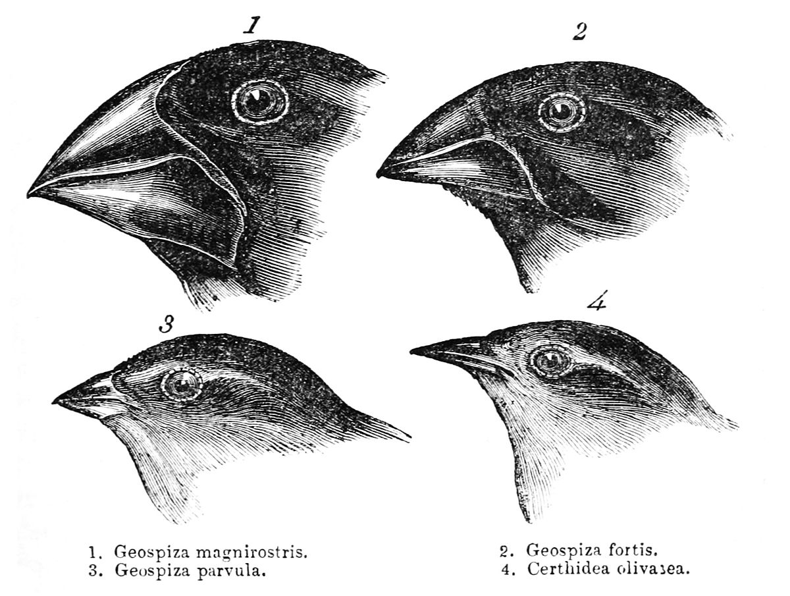
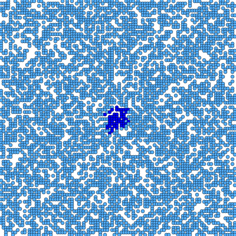
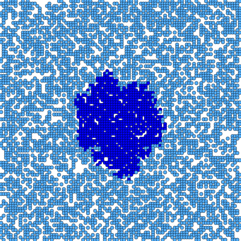
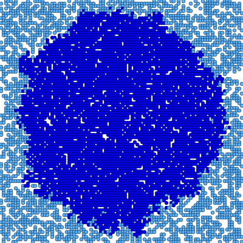

::: {.content-visible when-format="html"}

:::

# Evolutie en biodiversiteit {#sec-evolutie}

Tot nu toe heb je veel geleerd over essentiële ecologische processen zoals groei, interacties tussen individuen, concurrentie en co-existentie. De individuen waar het in deze modellen om gaat, kunnen niet alleen konijnen en vossen zijn, maar ook bacteriën, immuuncellen of tumorcellen. Met deze modellen kunnen we dus niet alleen fundamenteel onderzoek uitvoeren, maar ook een belangrijke bijdrage leveren aan het verbeteren van de menselijke gezondheid. Waarom is antimicrobiële resistentie zo sterk toegenomen? Waarom reageert de ene tumor beter op behandeling dan de andere? Waarom beginnen nieuwe virusen (zoals Covid-19) zeer schadelijk, maar worden ze uiteindelijk vaak milder? Om deze vragen te beantwoorden gaan we in dit hoofdstuk leren hoe 2D ODEs zich vertalen naar evolutionaire vraagstukken.

Naast het ontstaan van diversiteit, kunnen we ook vragen stellen over het behoud van biodiversiteit. Het behoud van biodiversiteit is natuurlijk erg belangrijk: niet alleen is de natuur erg mooi, maar ook zijn we als maatschappij zeer afhankelijk van gezonde en veerkrachtige ecosystemen. Zo beschermen deze ons tegen overstromingen en zandstormen, en bevordert diversiteit de nutriëntenkringloop (en dus vruchtbaarheid) in de landbouw. Maar welke factoren spelen hierbij eigenlijk een belangrijke rol? Is een ecosysteem robuust als er veel coöperatie is, of juist als er veel competitie is? Om deze vragen te kunnen beantwoorden moeten we naar systemen van meer dan twee soorten gaan kijken.

{width="70%" fig-align="center"}

## Leerdoelen

De leerdoelen van dit hoofdstuk zijn:

* Begrijpen hoe je met ODEs evolutionaire vragen kan stellen
* Kunnen omschrijven hoe niche-overlap zich vertaalt in specifieke competitie-parameters
* Omschrijven hoe een ecosysteem zich vertaalt in vele ODEs, en hoe interactie-matrices gebruikt kunnen worden om deze te modelleren
* Aan een faseruimte kunnen herkennen of er sprake is van *founder control*
* Begrijpen hoe *founder control* in ruimtelijke modellen overwonnen kan worden

## Invasie bestuderen met ODEs

Laten we beginnen met het intussen welbekende model van logistische groei met dichtheidsafhankelijke geboorte:

\begin{align*}
\dt{N} &= bN(1-\frac{N}{K}) - dN
\end{align*}

Waarbij $b$ de maximale birth rate is, $d$ de vaste death rate, en $K$ de schalingsfactor voor dichtheidsafhankelijke afname van reproductie. Hoewel $K$ vooral bepaald wordt door eigenschappen in de omgeving (de hoeveelheid eten bijvoorbeeld), kan je misschien wel jezelf wel voorstellen dat $b$ en $d$ eigenschappen zijn die uniek zijn voor elke soort, of misschien zelfs voor elk individu binnen deze soort. In een evolutionaire context kunnen we deze parameters "evolueerbaar" (*evolvable*) noemen: er kunnen op elk moment mutanten ontstaan met een andere birth/death rate. Maar zullen deze mutanten zich dan verspreiden? Hiervoor kunnen we ons 1D ODE model weer uitbreiden naar een 2D ODE systeem:

\begin{align*}
\dt{N} &= b_NN(1-\frac{N+M}{K}) - d_NN\\
\dt{M} &= b_MM(1-\frac{N+M}{K}) - d_MM
\end{align*}

Hier is $N$ de oorspronkelijke soort (het zogeheten wildtype), en is $M$ de mutant met andere birth en/of death rates. Laten we bestuderen wat er gebeurt als er een mutant ontstaat met een verlaagde death rate, door de faseruimte te bestuderen. Hiervoor kunnen we de nullclines bepalen door beide vergelijkinen gelijk te stellen aan $0$, of we plotten de nullclines met Grind (@fig-wildtypeandmutant).

```{r results="hide"}
#| eval: true
#| code-fold: true
#| code-summary: "Laat het Grind-script zien"
#| fig-width: 7
#| fig-height: 4
#| label: fig-wildtypeandmutant
#| fig-cap: "CAPTION TODO"

source("https://tbb.bio.uu.nl/rdb/grindR/grind.R")

model <- function(t, state, parms){
  with(as.list(c(state,parms)),{
    dN <- bn*N*(1-(N+M)/K) - dn*N
    dM <- bm*M*(1-(N+M)/K) - dm*M
    return(list(c(dN,dM)))
  })
}  

colors[1] = "orange"
colors[2] = "blue"

p <- c(bn=1,dn=0.2,K=1, dm=0.01, bm=1)
s <- c(N=0.8,M=0.0001)
par(mfrow=c(1,2))
plane(vector=T,grid=6,ymax=1.1,xmax=1.1)

run(tmax=100,traject=F)
```

Het scenario hierboven kunnen we zien als een **invasie-experiment**. Als een mutant (of een invasieve soort) zich bevind in een gevestigde populatie, zal deze dan verspreiden? In dit geval is het antwoord heel simpel: de soort met een lagere death rate zal zich verspreiden, en de gevestigde soort volledig verdringen. 

## Niche ruimte en diversiteit

In 1859 schreef Charles Darwin het boek *"the origin of species"*, waarin hij voor het eerst het proces van evolutie door natuurlijke selectie omschreef. Een belangrijke observatie was dat de verschillende vinken op de Galápagos eilanden hele verschillende snavels hadden:

{width="70%" fig-align="center"}

De snavels van deze vinken geven direct inzicht in de competitie om voedsel: in een kleine snavel passen geen walnoten, maar met een grote snavel kun je erg moeilijk kleine zaadjes oppikken. Deze verschillende adaptaties in vinken vertalen zich direct naar niches zoals we die al kort in hoofdstuk @sec-dichtheid hebben besproken.  We kunnen ons bijvoorbeeld voorstellen dat twee vogels voorkeuren hebben voor zaadjes met verschillende groottes. Dit zouden we als een normaalverdeling kunnen weergeven (@fig-nicheoverlaps-1), die voorstellen welke zaadjes de verschillende vogelsoorten eten. 

```{r}
#| echo: false
#| fig-height: 3
#| fig-cap: "Niche-overlap voor twee vogelsoorten met een andere voorkeur voor de grootte van zaadjes, maar met dezelfde spreiding"
#| fig-width: 4
#| fig-subcap:
#|   - "Niche-overlap weergegeven als normaalverdelingen"
#|   - "Niche-overlap weergegeven als een interactiematrix"
#| label: "fig-nicheoverlaps"
#| layout-ncol: 2

n <- 1
plot_niche_overlap <- function(mean1=-1, sd1=1, mean2=1, sd2=1){
  # Define the range for the x-axis
  x_range <- seq(-5, 5, length.out = 1000)
  
  # Calculate the densities
  density1 <- dnorm(x_range, mean = mean1, sd = sd1)
  density2 <- dnorm(x_range, mean = mean2, sd = sd2)
  
  # Scale the densities to the same maximum height
  max_height <- 0.4
  density1_scaled <- density1 / max(density1) * max_height
  density2_scaled <- density2 / max(density2) * max_height
  overlap <- pmin(density1_scaled,density2_scaled)
  # Plot the first normal distribution
  
  plot(x_range, density1_scaled, type = "l", 
       axes=F, xaxt='n', yaxt='n',yaxs="i",
       col = "blue", lwd = 3, ylim = c(0, max_height*1.1), 
       xlab = "", ylab = "", main = "")
  polygon(x_range,overlap,col="#FF000033",border = NA)
  lines(x_range, density1_scaled, col = "blue", lwd = 2)
  lines(x_range, density2_scaled, col = "orange", lwd = 2)
  
  arrows(0,0,8.5,0,xpd=NA,lwd=3,length = 0.1)
  arrows(0,0,-9.5,0,xpd=NA,lwd=3,length = 0.1)
  mtext("Kleine zaadjes",1,at=-5.5,cex=0.8)
  mtext("Grote zaadjes",1,at=4.8,cex=0.8)
  #text(-10,0.6,paste0(LETTERS[n],')'),font=2,xpd=NA)
  
  overlap_pc <- round(sum(overlap)/sum(density1_scaled),digits=2)*100
  title(main=paste0("Soort 1 heeft ", 
                    round(sum(overlap)/sum(density1_scaled),2)*100,"%",
                    " overlap met soort 2\n",
                    "Soort 2 heeft ", 
                    round(sum(overlap)/sum(density2_scaled),2)*100,"%",
                    " overlap met soort 1"),line = 0.5,cex.main=0.9)
  n <<- n + 1
}
par(mfrow=c(1,1),mar=c(4,6,4,4))
plot_niche_overlap()

n_species <- 2
interaction_matrix <- matrix(c(-1,-0.32,-0.32,-1),nrow=2)
color_palette <- colorRampPalette(c("red", "white", "blue"))(120)
image(1:n_species, 1:n_species, 
      t(interaction_matrix)[, n_species:1], 
      col = color_palette, 
      xlab = "", ylab = "", 
      main = "Competitie-matrix",
      cex.main=0.9, axes = FALSE, 
      zlim = c(-1,1))
text(c(1,1,2,2),c(2,1,2,1),interaction_matrix)
axis(1, at = seq(1, n_species, length.out = n_species), 
     labels = paste0("N",1:n_species),tick=FALSE)
axis(2, at = seq(1, n_species, length.out = n_species), 
     labels = paste0("N",n_species:1),tick=FALSE)
```

Zoals je ziet overlappen de verdelingen uit @fig-nicheoverlaps-1 deels. Dit vertaalt zich direct in interspecifieke competitie: hoe meer de verdelingen overlappen, hoe meer zaadjes door beide soorten gegeten worden, hoe meer competitie tussen de soorten. Op dezelfde manier kunnen we definiëren dat de **intra**specifieke competitie maximaal is: een soort "overlapt" altijd 100\% met zichzelf. Als we teruggaan naar het competitiemodel uit het vorige hoofdstuk (zie @eq-soorten), kunnen we deze niche-overlap vertalen in specifieke waarden voor $c_{11}$, $c_{12}$, $c_{22}$, en $c_{21}$. De soorten hebben volledige overlap met zichzelf ($c_{11}=c_{22}=1$), en 32% overlap met de ander ($c_{12}=c_{21}=0.32$). Deze informatie kunnen we ook weergeven in een zogeheten interactie-matrix (@fig-nicheoverlaps-2). De negatieve getallen in deze matrix betekenen dat de dichtheden van de soorten alleen negatieve effecten op hun groei hebben. Daarom wordt een dergelijke matrix ook wel een competitie-matrix kunnen noemen. 

Deze niche-ruimtes zijn natuurlijk makkelijk te vertalen naar meerdere soorten (@fig-nicheoverlaps2-1), wat ook resulteert in een grotere matrix (@fig-nicheoverlaps2-2).

```{r}
#| code-fold: true
#| fig-height: 3.5
#| fig-cap: "Niche-overlap voor vier vogelsoorten met een andere voorkeur voor de grootte van zaadjes, en ook met een andere spreiding"
#| fig-width: 4
#| fig-subcap:
#|   - "Niche-overlap weergegeven als normaalverdelingen"
#|   - "Niche-overlap weergegeven als een interactiematrix"
#| label: "fig-nicheoverlaps2"
#| layout-ncol: 2
#| layout-nrow: 2


# Meer soorten

# Define the range for the x-axis
  x_range <- seq(-5, 5, length.out = 1000)
  
  # Calculate the densities
  density1 <- dnorm(x_range, mean = 1, sd = 0.5)
  density2 <- dnorm(x_range, mean = 2, sd = 1)
  density3 <- dnorm(x_range, mean = -2, sd = 0.5)
  density4 <- dnorm(x_range, mean = -0.5, sd = 0.2)
  
  # Scale the densities to the same maximum height
  max_height <- 0.4
  density1_scaled <- density1 
  density2_scaled <- density2 
  density3_scaled <- density3 
  density4_scaled <- density4 
  #overlap <- pmin(density1_scaled,density2_scaled)
  # Plot the first normal distribution
  
  plot(x_range, density1_scaled, type = "l", 
       axes=F, xaxt='n', yaxt='n',yaxs="i",
       col = "blue", lwd = 2, ylim = c(0, max_height*5), 
       xlab = "", ylab = "", main = "")
  #polygon(x_range,overlap,col="#FF000033",border = NA)
  lines(x_range, density1_scaled, col = "blue", lwd = 2)
  lines(x_range, density2_scaled, col = "orange", lwd = 2)
  lines(x_range, density3_scaled, col = "seagreen", lwd = 2)
  lines(x_range, density4_scaled, col = "purple", lwd = 2)
  arrows(0,0,5.5,0,xpd=NA,lwd=3,length = 0.1)
  arrows(0,0,-5.5,0,xpd=NA,lwd=3,length = 0.1)
  mtext("Kleine zaadjes",1,at=-5.5,cex=0.8)
  mtext("Grote zaadjes",1,at=4.8,cex=0.8)
  legend(1.8,2, c("N1","N2","N3","N4"),lty=1,lwd=3,col=c("blue","orange","seagreen","purple"))
  
  interaction_matrix <- matrix(c(-1,-0.3678542,-0.002699346,-0.0561989,
        -0.3678542,-1,-0.01149174,-0.02165176,
        -0.002699384,-0.01149174,-1,-0.05620392,
        -0.0561989,-0.02165176,-0.05620392,-1)
                               ,nrow=4)
  color_palette <- colorRampPalette(c("red", "white", "blue"))(120)
image(1:4, 1:4, 
      t(interaction_matrix)[, 4:1], 
      col = color_palette, 
      xlab = "", ylab = "", 
      main = "Competitie-matrix",
      cex.main=0.9, axes = FALSE, 
      zlim = c(-1,1))
text(c(1,1,1,1,2,2,2,2,3,3,3,3,4,4,4,4),c(4,3,2,1,4,3,2,1,4,3,2,1,4,3,2,1),round(interaction_matrix,2), cex=0.8)
axis(1, at = seq(1, 4, length.out = 4), 
     labels = paste("N",1:4),tick=FALSE)
axis(2, at = seq(1, 4, length.out = 4), 
     labels = paste("N",4:1),tick=FALSE)
```

Laten we eerst kijken hoe we het scenario met slechts 2 soorten kunnen bestuderen (uit @fig-nicheoverlaps). Hiervoor gebruiken we ons eerdere competitie-model (@eq-soorten) en stellen de juiste parameters in in Grind: 

```{r results='hide'}
#| eval: true
#| code-fold: true
#| code-summary: "Laat het Grind-script zien"
#| fig-width: 5
#| fig-height: 5
#| out-width: "70%"
#| fig-align: "center"
#| label: fig-grindoverlaps
#| fig-cap: "CAPTION TODO"
# Laad het grind.R-script in
source("https://tbb.bio.uu.nl/rdb/grindR/grind.R")

# Definitie van model. Alleen de binnenste drie regels hoeven we 
# aan te passen. Het 'function' en 'with' gedeelte laten we staan
# zoals het is. 
model <- function(t, state, parms) {
  with(as.list(c(state,parms)), {
    dN1 <- r*N1*(1-c11*N1-c12*N2)
    dN2 <- r*N2*(1-c22*N2-c21*N1)
    return(list(c(dN1, dN2)))  
  }) 
}  


p <- c(r=1,c11=1,c22=1,c12=0.32,c21=0.32)  #parameters
s <- c(N1=0.01,N2=0.001) # kleine begin-dichtheden

colors[1] = "blue"
colors[2] = "orange"
par(mfrow=c(1,1),mar=c(4,4,2,2)) # maak twee plot-ruimtes
plane(vector=T,grid=4,ymax=3.5,xmax=3.5,portrait=F) # faseruimte 
newton(c(N1=1,N2=1),plot=T)
newton(c(N1=0,N2=1),plot=T)
newton(c(N1=1,N2=0),plot=T)
newton(c(N1=0,N2=0),plot=T)
```

Zoals je ziet resulteert dit in een stabiel evenwicht waarbij beide soorten voorkomen. Wat nu als we het scenario uit @fig-nicheoverlaps2 met 4 soorten willen bekijken? Hier zouden we dan 4 ODEs met ieder 4 interactie-termen moeten gebruiken. Hoe meer soorten je dus toevoegt, hoe groter de vergelijkingen worden (bovendien is een faseruimte in 4D tekenen is zeer zeker geen optie). Kan dat ook anders?

## Interactie-matrixen met meerdere soorten

Hoewel de matrices hierboven slechts competities beschreven, zouden er ook positieve effecten in verwerkt kunnen worden. Algemener beschrijft een dergelijke matrix dan de interactie tussen de soorten, vandaar de naam interactie-matrix. Interactie-matrices hebben dus een hele concrete biologische interpretatie: het vat samen welke positieve/negatieve effecten soorten hebben op hun eigen dichtheid, en op de dichtheid van de andere soorten. Dergelijke interacties kunnen experimenteel bepaald worden, bijvoorbeeld door vele combinaties van bacteriën samen te laten groeien, of simpelweg door eens in de zoveel jaar bij te houden hoe de soortensamenstelling is verschoven. 

Zo heeft Henry Horn bijvoorbeeld in 1975 precies bepaald hoe de soortensamenstelling van bomen in een bos in Amerika was verschoven na een periode van 50 jaar. Dit gaf hij weer in een simpele matrix:

| | Gray Birch | Blackgum | Red Maple | Beech |
|-|-|-|-|-|
Gray Birch |  0.05 | 0.01  |& 0 | 0 
Blackgum | 0.36 | 0.57 | 0.14 | 0.01 
Red Maple | 0.5 |  0.25 | 0.55 | 0.03 
Beech | 0.09  | 0.17  | 0.31 | 0.96 

Deze matrix geeft, anders dan de eerder genoemde interactie-matrixen, niet aan hoeveel "last" de soorten van elkaar hebben, maar welke soort wordt opgevolgd door welke soort (we zouden het dus ook een successie-matrix kunnen noemen). De details van deze ecologische successie lees je af aan de kolommen. Kijk bijvoorbeeld naar de eerste kolom: voor elke 100 *Gray Birch* bomen meette hij 5 nieuwe *Gray Birch*, 36 nieuwe *Blackgum*, 50 nieuwe *Red Maple*, en 9 nieuwe *Beech* bomen. Als we beginnen met alleen maar *Gray Birch*, zouden we dat kunnen weergeven als een zogeheten *state vector*:  `(100,0,0,0)`. Na 50 jaar is deze state vector `(5,36,50,9)`. In de 50 jaar daarna, worden de 5 overgebleven *Gray Birch* bomen wederom naar gelang hetzelfde process vervangen. Maar let op: als je goed kijkt zie je dat ook 1% van de *Blackgum* bomen "terug verandert" in *Gray Birch*. Tegelijkertijd zal 25% van deze *Blackgum* populatie vervangen worden door *Red Maple*, *etc.*.

Als we herhaaldelijk de intearctie-matrix met onze state vector vermenigvuldigen, wat kan met een simpel R-script (voor verdieping over matrix-vector vermenigvuldiging, zie @tip-vecmat), zien we inderdaad een prachtige en welbekende successie van boomsoorten: uiteindelijk zijn er vooral beuken over, en zie je geen berken meer.

```{r}
#| code-fold: true
#| code-summary: "Laat de code zien"
A <- 
  matrix(c(0.05, 0.01, 0, 0,
           0.36, 0.57, 0.14, 0.01,
           0.5, 0.25, 0.55, 0.03,
           0.09, 0.17, 0.31, 0.96),nrow=4,byrow=T)
S <- c(100,0,0,0)
succession <- data.frame()
for(i in 1:20)
{
  succession <- rbind(succession, t(S)) # voeg nieuwe vector toe aan tijdlijn
  S <- A %*% S # R notatie voor matrix-vermenigvuldiging
}
library(DT)
colnames(succession) <- c("Birch", "Blackgum", "Red Maple", "Beech")
datatable(succession)
```

Ook met Grind kun je, op een vergelijkbare manier, een interactie-matrix gebruiken om deze ecologische successie door te rekenen. In plaats van steeds meer ODEs opschrijven, kunnen we het systeem ook opschrijen als een hele verzameling van vergelijkingen waarin we een matrix (zie verdieping in @tip-vecmat) gebruiken om competitie van alle te sommeren:

\begin{align}
\dt{N_i} = rN_i \Big( 1 + \sum_{j=1}^n{A_{ij}N_i} \Big)
\end{align}

In Grind kun je ook dergelijke matrices gebruiken om in 1 klap een hele boel ODEs door te rekenen:

```{r results="hide"}
#| code-fold: false
#| code-summary: "Laat het Grind-script zien"
# Load necessary packages
source("https://tbb.bio.uu.nl/rdb/grindR/grind.R")
# Set the seed for reproducibility
set.seed(5)

# Define the number of species
n_species <- 4
max_time <- 20

interaction_matrix<- matrix(c(0.05, 0.01, 0, 0,
         0.36, 0.57, 0.14, 0.01,
         0.5, 0.25, 0.55, 0.03,
         0.09, 0.17, 0.31, 0.96),nrow=4,byrow=T)

# Set up the layout for two plots side by side
layout(matrix(1:1, nrow = 1), widths = c(1, 1))  # Adjust widths for better fit
par(mar=c(5,4,3,3))

model <- function(t, state, parms) {
  N <- state
  dN <- interaction_matrix %*% N - N
  return(list(dN))  
}
p <- c()
s <- c(1,0,0,0)
names(s) <- c("Birch","Blackgum","Red maple","Beech")
colors[1] = "#00EE00"
colors[2] = "#00CC00"
colors[3] = "#00AA00"
colors[4] = "#008800"

run(tmax=max_time,legend=T,tstep = 0.1)
```

Of we kunnen in plaats van deze ecologische successie het Lotka-Volterra competitie model uitbreiden naar een groot aantal soorten met willekeurig gekozen parameters: 

```{r results='hide'}
source("https://tbb.bio.uu.nl/rdb/grindR/grind.R")
set.seed(12)
model <- function(t, state, parms) {
  N <- state
  S <- A %*% N # R code for matrix x vector multiplication
  dN <- r*N*(1 - S)
  return(list(dN))  
}  

p <- c()
n <- 30
s <- rep(0.01,n)
names(s) <- paste("N",seq(1,n),sep="")
r <- abs(rnorm(n,1,0.1))
A <- matrix(runif(n*n),nrow=n,ncol=n)
diag(A) <- 1; A

run(tmax=300,legend=F)

```

De details van het bovenstaande scripst zijn geen leerstof, maar het is wel belangrijk dat je begrijpt waarom er vaak met matrices wordt gewerkt om complexe modellen door te rekenen! Bovendien zie je al gauw dat het moeilijk wordt om te voorspellen wie er in een complex ecosysteem uiteindelijk zal overleven, omdat het systeem meerdere keren om lijkt te slaan. 

:::{.callout-tip #tip-vecmat collapse='true'}

## Vergelijkingen, vectoren, en matrices

De 1D en 2D differentiaalvergelijkingen waar je tot nu toe over hebt geleerd zijn onderdeel van lineaire algebra. Hoe groter stelsels van vergelijkingen worden (3D, 10D, *etc.*), hoe minder handig het is om iedere vergelijking los op te schrijven. In plaats worden vergelijkingen zoals...

\begin{align}
x - 2y = −5 \\
2x + y = 10 
\end{align}

...opgeschreven als een matrix-vector vermenigvuldiging:

\begin{equation}
\begin{pmatrix}
1 & -2\\
2 & 1
\end{pmatrix}
\begin{pmatrix}
x \\
y 
\end{pmatrix}
=
\begin{pmatrix}
-5 \\
10 
\end{pmatrix}
\end{equation}

Wiskundig gezien staat hier precies hetzelfde (gegeven de rekenregels om vectoren en matrices te vermenigvuldigen). De vierkante matrix kunnen we $A$ noemen, en geeft alle interactie-coëfficiënten aan tussen x en y (1, -2, 2, en 1). De eerste vector bevat de variabelen $x$ en $y$, en wordt in deze context de "state"-vector ($\overrightarrow{S}$) genoemd. Als laatste kunnen we de uitkomst-vector $\overrightarrow{V}$ noemen, en het systeem zo opschrijven:

\begin{align}
A \cdot \overrightarrow{S} = \overrightarrow{V}
\end{align}

Als je een matrix en een vector vermenigvuldigd krijg je inderdaad een nieuwe vector. We zouden met behulp van lineaire algebra nu uit kunnen rekenen wat $\overrightarrow{S}$ is, maar dat valt zeer zeker niet onder de stof van deze cursus. Bovendien kun je ODEs alleen in simpele matrix-vector vermenigvuldigingen vertalen als alle interactie lineair zijn, wat lang niet altijd opgaat!

:::

## De eerste cooperators

Hoewel niche-overlap een belangrijk component is van hoe soorten competitie met elkaar ondervinden, heeft het ook zijn beperkingen. Het kan bijvoorbeeld zo zijn dat de dichtheden van de populaties een effect hebben op de interactie-matrix zélf. Dit laatste is het geval bij cooperatie, waar we het in eerdere hoofdstukken al kort over hebben gehad. Omdat cooperatie desalnietemin een evolutionair interssant onderwerp is, gaan we dit verder bestuderen met simpele 2D ODEs en *Individual Based Models*.

Coöperatie komt in allerlei vormen voor: bevers bouwen samen dammen, bijen vallen samen een indringer aan, en bacteriën scheiden enzymen die polysacchariden afbreken, *etc.* Maar voor nu laten we deze biologische details weg, en vragen we een fundamentelere vraag: hoe kan dergelijke coöperatie evolutionair gezien ontstaan, als er aan het begin niemand is om mee samen te werken? De eerste "samenwerkende" mutant is per definitie alleen, en zal dus ook geen evolutionair voordeel hebben van dit gedrag. Dit wordt ook wel **dichtheidsafhankelijke fitness** (*density dependent fitness*) genoemd. Laten we ons eerdere model van coöperatie nog een keer bekijken:

\begin{align*}
\dt{C} &= bC^2(1-\frac{C}{K}) - dC
\end{align*}

De kwadratische term in deze ODE veroorzaakt coöperatieve groei: bij kleine dichtheden ($C<1$) groeit de populatie langzamer dan zonder coöperatie, want een getal kleiner dan $1$ kwadrateren maakt dit getal kleiner. Bij hogere dichtheden ($C>1$) zorgt kwadrateren juist voor een verhoging, dus zal de populatie juist sneller groeien dan zonder coöperatie. Dit zie je ook heel goed als we het faseportret van dit coöperatieve groeimodel vergelijken met die van normale, logistische groei: 

```{r results='hide'}
#| eval: true
#| echo: false
#| fig-width: 4
#| fig-height: 5
#| out-width: 4.5in
#| fig-align: center
#| label: fig-coopphase
#| fig-cap: "CAPTION TODO"

bc=1
k=2.25
d=0.3
par(mar=c(0,4,2,1))
func_coop <- function(C){
   return(bc*C*C*(1-C/k) - d*C)
 }

 func_noncoop <- function(C){
   return(bc*C*(1-C/k) - d*C)
 }

layout(matrix(c(1,1,1,1,2,2), nrow = 3, ncol = 2, byrow = TRUE))
 
curve(func_noncoop,0,2.05,lwd=2,ylim=c(-0.1,0.5),
        ylab="dC/dt",xlab="C",col="lightblue",
               main="dC/dt met en zonder cooperatie", xaxt="n")
curve(func_coop,0,2.2,lwd=2,ylim=c(-0.1,0.6),
               ylab="dC/dt",xlab="C",col="blue",
               main="dC/dt als een functie van C", add=T)
abline(h=0)
abline(v=0.36,lty=2)
abline(v=1.58,lty=2)
abline(v=1.89,lty=2)
legend(0.0,0.5,legend=c("Cooperatieve groei","Logistische groei"), col=c("blue","lightblue"),lwd=2)

par(mar=c(3,4,1,1))
# Empty plot window for the phase portraits
plot(1, type="n", xlab="", ylab="", xlim=c(0, 2.05), ylim=c(0, 3),axes=T, yaxt='n')
mtext("C",1,line = 2,cex=0.8)
abline(v=0.0,lty=1)
abline(v=0.36,lty=2)
abline(v=1.58,lty=2)
abline(v=1.89,lty=2)
# PHase portrait for noncoop
arrows(0,1,0.3,1,lwd=3, length = 0.1, col="lightblue")
arrows(0,1,0.6,1,lwd=3, length = 0.1, col="lightblue")
arrows(0,1,0.9,1,lwd=3, length = 0.1, col="lightblue")
arrows(0,1,1.2,1,lwd=3, length = 0.1, col="lightblue")
arrows(0,1,1.5,1,lwd=3, length = 0.1, col="lightblue")
arrows(0,1,2.5,1,lwd=3, length = 0.0, col="lightblue")
arrows(2.5,1,2.0,1,lwd=3, length = 0.1, col="lightblue")
arrows(2.5,1,1.7,1,lwd=3, length = 0.1, col="lightblue")
points(1.58,1,col="black", pch=19,cex=2)
points(0,1,col="black", pch=21,cex=2,lwd=2)

# PHase portrait for noncoop

arrows(0.15,2,0.10,2,lwd=3, length = 0.1, col="blue")
arrows(0.3,2,0.25,2,lwd=3, length = 0.1, col="blue")
arrows(0.3,2,0.45,2,lwd=3, length = 0.1, col="blue")
arrows(0,2,0.6,2,lwd=3, length = 0.1, col="blue")
arrows(0,2,0.9,2,lwd=3, length = 0.1, col="blue")
arrows(0,2,1.2,2,lwd=3, length = 0.1, col="blue")
arrows(0,2,1.5,2,lwd=3, length = 0.1, col="blue")
arrows(0,2,1.8,2,lwd=3, length = 0.1, col="blue")
arrows(0,2,2.5,2,lwd=3, length = 0.0, col="blue")
arrows(2.5,2,2.05,2,lwd=3, length = 0.1, col="blue")


#arrows(2.5,2,1.7,2,lwd=4, length = 0.1, col="blue")
points(0.36,2,col="black", pch=21,cex=2,lwd=2)
points(1.89,2,col="black", pch=19,cex=2)
points(0,2,col="black", pch=19,cex=2)
```

Aan dit faseportret kunnen we een aantal belangrijke dingen aflezen. Ten eerste zien we dat coöperatieve groei een hogere maximale groeisnelheid heeft (de piek ligt hoger). Ten tweede zien we dat coöperatieve groei ook een hogere *carrying capacity* heeft, een dichtheid waarbij de niet-coöperatieve soort alleen kan afnemen! Hoewel deze twee observaties in het voordeel van de coöperatieve populatie spreken, zien we ook dat reguliere logistische groei het juist veel beter doet bij *lage* dichtheden. Sterker nog, bij zeer lage dichtheden kunnen de coöperators helemaal niet groeien, en de niet-coöperators wel! In plaats van deze twee soorten als aparte populaties te bekijken, zouden we ze ook samen kunnen brengen in een systeem van twee ODEs: 

\begin{align*}
\dt{C} &= bC^2(1-\frac{C+N}{K}) - dC\\
\dt{N} &= bN(1-\frac{C+N}{K}) - dN
\end{align*}

Hier zijn $C$ de cooperators, $N$ de niet-cooperators, geeft $b$ de maximale birth rate, $d$ de constante death rate, en $K$ de (gedeelde) carrying capacity. Kunnen deze twee soorten samenleven? Om dit te bestuderen, kunnen we weer Grind gebruiken om een faseruimte te plotten:

```{r results="hide"}
#| eval: true
#| echo: false
#| fig-width: 6
#| fig-height: 6
#| label: fig-coopnoncoopgrind
#| fig-cap: "CAPTION TODO"

source("https://tbb.bio.uu.nl/rdb/grindR/grind.R")

model <- function(t, state, parms){
  with(as.list(c(state,parms)),{
    dC <- b*C^n*(1-(C+N)/K) - d*C 
    dN <- b*N^m*(1-(C+N)/K) - d*N 
    return(list(c(dC,dN)))
  })
}  

colors[1] = "blue"
colors[2] = "lightblue"

p <- c(b=1.0,d=0.2,n=2,m=1.0,K=2,u=0.001)
s <- c(C=1.0,N=0.)
plane(vector=T,grid=5,ymax=1.6,xmax=2.15)
newton(c(C=2.0,N=0.01), plot=T)
newton(c(C=1.0,N=1.0), plot=T)
newton(c(C=0.01,N=1.0), plot=T)
newton(c(C=0.01,N=0.0), plot=T)
#run(tmax=100)
```

Zoals je ziet heeft het systeem twee stabiele evenwichtspunten (aangegeven met gevulde punten). Er is een attractor voor veel $C$ en $N=0$, maar ook één voor veel $N$ en $C=0$. Het evenwicht waar zowel $N$ als $C$ bestaan is een zadelpunt: een instabiel evenwicht waar het systeem uiteindelijk linksom of rechtsom van weggeduwd wordt. 

Aan de hand van deze faseruimte kunnen we evolutionaire vragen stellen. Stel je bijvoorbeeld voor dat we een populatie hebben van niet-cooperators (het stabiele evenwicht linksbovenin). Door mutaties kunnen cooperators onstaan, dus zullen we een klein stukje van dit evenwicht weggeduwd worden (naar rechts). Maar vanaf hier zien we dat we terug gaan naar het evenwicht van alleen niet-cooperators. Het tegenovergestelde effect is ook zichtbaar: in een populatie van cooperators kunnen niet-cooperators niet invaderen. Deze situatie, waarbij een reeds gevestigde populatie voorkomt dat een andere soort kan invaderen, wordt *founder control* genoemd. 

Uit de faseruimte hebben we dus geleerd dat vanuit een niet-cooperatieve populatie geen coöperatie evolueren. Dit lijkt erg vreemd. We zien in de natuur toch allerlei vormen van coöperatie?

## Evolutie van cooperatie in ruimtelijke modellen

In eerdere hoofdstukken hebben we ODEs vergeleken met ruimtelijke modellen. Ook van deze situatie kunnen we een ruimtelijk model maken, om te bestuderen of we verschillen zien:

```{=html}
<iframe width="100%" height="655" src="https://tbb.bio.uu.nl/bvd/bms/simulations/invasiecoop/" title="Simulation"></iframe>
```

Om te controleren dat het spatiele model overeenkomt met de ODE, simuleert deze eerst perfect gemengde condities. Zoals je ziet komt ons resultaat overeen met de ODEs: cooperators kunnen niet uitbreiden in een populatie van niet-cooperators. Als we echter het experiment herhalen met ruimtelijke structuur, zien we dat een kleine hoeveelheid cooperators weldegelijk kan verspreiden: 

{width="32%"}
{width="32%"}
{width="32%"}

Waarom kan de cooperator nu wel verspreiden, als deze aanvankelijk een lage dichtheid heeft? De reden hiervoor is simpel: in dit ruimtelijke model is niet de *globale* dichtheid relevant, maar de *lokale* dichtheid! Eén cooperator kan met een kleine hoeveelheid cooperators samenwerken, en zo stap voor stap alle niet-cooperators vervangen. 

Omdat we nu te maken hebben met een *individual-based model*, kunnen we wederom na gaan denken over *individuele* regels. In plaats van alleen "cooperators" en "niet-cooperators" te definiëren, zouden we bijvoorbeeld ook de mate van cooperatie per individu kunnen definieren, en deze eigenschap laten "evolueren" (bij elke voortplanting vindt met een kleine kans een mutatie plaats). Zo ontstaat er natuurlijk een diverse populatie:

```{=html}
<iframe width="100%" height="555" src="https://tbb.bio.uu.nl/bvd/bms/simulations/evolvingcoop/" title="Simulation"></iframe>
```

In deze simulatie vinden ecologie en evolutie tegelijkertijd plaats, wat ook wel "eco-evolutionaire dynamica" wordt genoemd. Hoewel ecologie en evolutie vroeger vaak als twee aparte onderwerpen bestudeerd werden, weten we nu dat deze processen elkaar sterk beinvloeden. Simulaties zoals hierboven, waarin door een mutatie-proces nieuwe varianten ontstaan, kunnen hulp bieden bij het begrijpen (en dus voorspellen!) van kanker, antimicrobiële resistentie, en ziekte-verspreiding in de landbouw. 

Hoewel je bovenstaande simulaties "voor de leuk" even kan bestuderen, is het geen leerstof. Het is echter heel belangrijk dat je begrijpt dat het nuttig kan zijn hetzelfde fenomeen (hier: cooperatie) in verschillende modelvormen te bestuderen, omdat de conclusies zeker niet altijd hetzelfde zijn. Ruimtelijke modellen hebben, bijna zonder uitzondering, altijd een andere uitkomst dan simpele ODEs. Dat betekent niet dat één van de modellen "fout" is, maar dat we dus conclusies kunnen trekken over de invloed van ruimtelijke structuur!

## Mini-project 

Voor dit hoofdstuk zijn geen opgaven. In plaats daarvan gaan jullie in groepjes van 3 werken aan een mini-project, en schrijf je samen een kort verslag. Dit verslag dient de volgende vorm te hebben: 

  * Een korte introductie (~200 woorden)
  * Stapsgewijs antwoorden op de vragen (a=..., b=..., etc.).
  * Een korte conclusie (1-2 zinnen)

Let bij het schrijven van je verslag op de volgende punten:

  * Zorg dat uit je antwoord blijkt wat de vraag was! De vraag "Welk effect heeft het verhogen van de carrying capacity van de konijnen op de hoeveelheid konijnen in evenwicht?", beantwoord je zo: "Het verhogen van de carrying capacity van de konijnen heeft geen invloed op de hoeveelheid konijnen in evenwicht. Dit komt doordat..."
  * Ondersteun je antwoord met figuren, vooral wanneer hier expliciet om wordt gevraagd! Voor een schets kun je een foto maken van een vel papier (als deze maar duidelijk is. Voor plaatjes uit R en computer-simulaties kun je een natuurlijk gewoon een printscreen maken. 

Succes met de opdracht!

::: {.callout-caution #ctn-project}

## Computerpracticum over toxine-productie

Verschillende bacteriën die in eenzelfde omgeving groeien ondergaan vele interacties met elkaar. Naast het concurreren om voedsel, kunnen sommige bacteriën ook giftige stoffen (toxines) uitscheiden om hun concurrenten te onderdrukken. Sommige bacteriën scheiden deze toxines uit in het medium, terwijl andere de toxines direct in hun buurcellen kunnen injecteren. Hoewel dit deze bacteriën kan bevoordelen, dragen ze ook de metabolische kosten voor het produceren van de toxines (en de resistentie daartegen!). Om de ecologie van toxineproducenten te bestuderen, hebben we een systeem van ODEs opgesteld dat twee stammen beschrijft – een toxineproducerende stam die resistent is tegen het toxine en een gevoelige die dood gaat naar mate er meer toxine-producenten aanwezig zijn:

\begin{align}
\dt{X} &= a_{1}X(1-\frac{X+Y}{K}) - dX \\
\dt{Y} &= a_{2}Y(1-\frac{X+Y}{K}) - dY - cXY
\end{align}

a. Welke ODE (dX of dY) stelt de toxine-producerende stam voor, en welke de sensitieve stam? *X is producent*
b. Gegeven de biologische context, waar staan de parameters $a1$, $a2$, $K$, $d$ en $c$ voor? 
b. We gaan ervan uit dat er metabolische kosten zijn voor de productie van toxines, maar dat sensitieven behoorlijk gevoelig zijn voor deze toxines. Verwachten dat een toxine-producerende mutant kan invaderen? *Ja, je zou verwachten van wel (gegeven het woord 'behoorlijk'), want de tweede soort een extra negatieve term heeft, de we net 'behoorlijk' hebben genoemd xD!*
c. Bereken de nullclines van dit systeem.
*todo*
d. Schets de nullclines die je hebt gevonden in c. Schets als het nodig is verschillende scenarios. Geef ook het vectorveld en de stabiliteit van de evenwichten weer. 
*todo*
e. Beschrijf de gevonden evenwichten in biologische begrippen. Kan een toxine-producerende mutant (met lage metabolische kosten) invaderen in een populatie van sensitieven?
*nee, er is een zadelpunt evenwicht waardoor er sprake is van founder control (hebben ze dit hoofdstuk over geleerd)* 
Neem het volgende Grind-script over: 

```{r}
source("https://tbb.bio.uu.nl/rdb/grindR/grind.R")

model <- function(t, state, parms){
  with(as.list(c(state,parms)),{
    dX <- a1*X*(1-(X+Y)/K) - d*X
    dY <- a2*Y*(1-(X+Y)/K) - d*Y - c*X*Y
    return(list(c(dX,dY)))
  })
}  

colors[1] = "navy"
colors[2] = "red"

p <- c(a1=0.6,a2=1.0,d=0.1,c=0.5,K=1)
s <- c(X=0.0001,Y=0.9)
par(mfrow=c(1,3))
plane(vector=T,grid=3,ymax=1.1,xmax=1.1,tstep=0.1, portrait=T, main="Totale faseruimte")
plane(vector=T,grid=6,ymax=0.85,ymin=0.6,xmax=0.25, xmin=0.05, portrait=F, main="(ingezoomed)")
newton(state=c(X=0.15,Y=0.7),plot=T)

run(tmax=400,traject=F, main="Invasie van X")
```

  f. Bestudeer met de parameters gegeven in het R-script of een toxine-producerende mutant zich kan verspreiden in een populatie van sensitieve cellen.
  g. Verandert je antwoord in f als je de toxines 2 keer zo sterk maakt? En als je de toxines 10 keer zo sterk maakt?
  h. Bestudeer ook of een sensitieve cell zich kan verspreiden in een populatie van toxine-producerende cellen. Wat als je de toxines 2 keer zo sterk maakt? 
  i. Trek uit de bovenstaande analyses een biologische conclusie. *toxineproducent kan niet invaderen*

De ODEs nemen aan dat het systeem goed gemengd is, zoals in een Erlenmeyer die goed wordt geschud. Laten we ons virtuele experiment ook herhalen op het equivalent van een agar-plaat, waar zowel reproductie als de effecten van de toxines *lokaal* zijn. 

De parameters in de simulatie hebben vergelijkbare interpretaties als in de ODEs. In de simulatie is er echter geen sprake van *snelheden* van geboorte en sterfte, maar *kansen* van geboorte en sterfte. 

{width="60%" fig-align="center"}

Je vindt de simulatie hier: <https://tbb.bio.uu.nl/bvd/bms/simulations/toxins/>

j. Bestudeer met de standaard parameters of de toxine-producent kan invaderen, en vorm een hypothese over wat er gebeurt
k. Test je hypothese met de opties die beschikbaar zijn in de simulatie.

Vergeet niet te eindigen met een *algemene conclusie*!

:::

| Nederlands                | Engels                | Beschrijving         |
|------------------|--------------------|----------------------------------|
| Interactie-matrix | Interaction matrix | Een matrix (tabel) die de alle interacties tussen de soorten aangeeft.  |
| Competitie-matrix | Competition matrix | Een matrix (tabel) die de alle competitie-interacties tussen de soorten aangeeft.  |
| Successie-matrix | Succession matrix | Een matrix (tabel) die de aangeeft welke soort wordt opgevolgd door welke soort.  |
| Eco-evolutionary dynamica | Eco-evolutionary dynamics | Biologische dynamica waarin ecologie en evolutie tegelijkertijd afspelen, waardoor er een wisselwerking kan zijn tussen beiden. |
| Dichtheidsafhankelijke fitness | Density dependent fitness | Wanneer de fitness van een soort afhangt van zijn eigen dichtheid, bijvoorbeeld wanneer er sprake is van samenwerking die bij lage dichtheden niet uitpakt. |
| Eco-evolutionary dynamica | Eco-evolutionary dynamics | Biologische dynamica waarin ecologie en evolutie tegelijkertijd afspelen, waardoor er een wisselwerking kan zijn tussen beiden. |
| Lokale/globale dichtheid | Local/global density | De lokale dichtheid geeft aan hoeveel individuen er in de directe omgeving van een bepaald individu aanwezig zijn. Dit wordt vaak gemeten binnen een specifieke straal rondom het individu. De globale dichtheid beschrijft het totaal aantal individuen in het hele systeem. In ODEs is er geen onderscheid tussen deze twee dichtheden, omdat er slechts sprake is van één dichtheid. |
