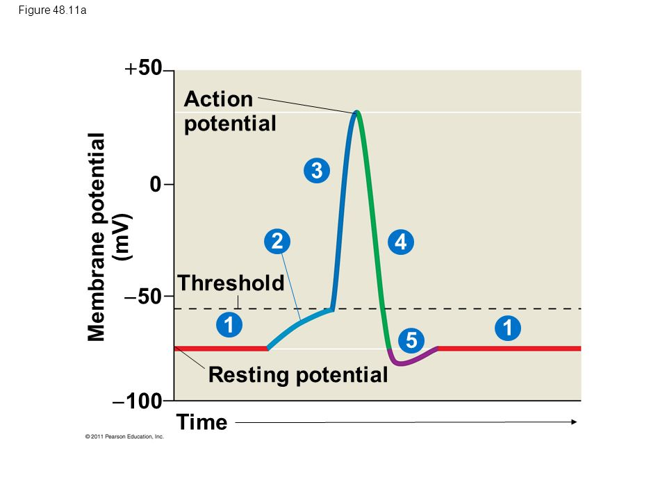
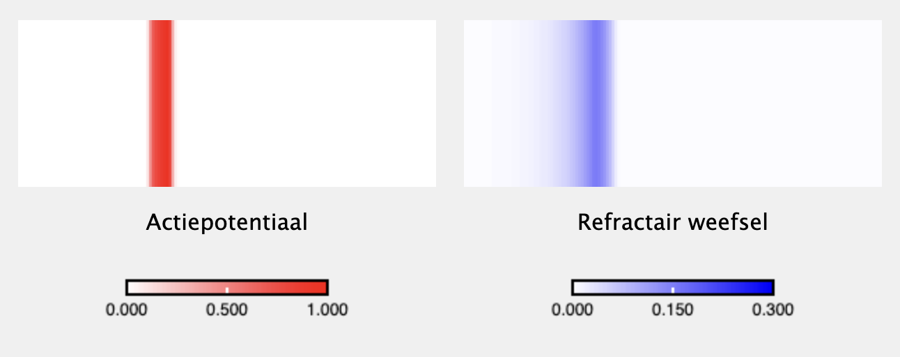
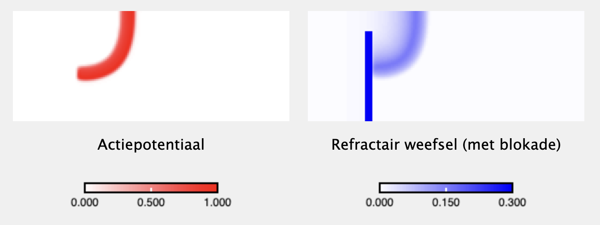
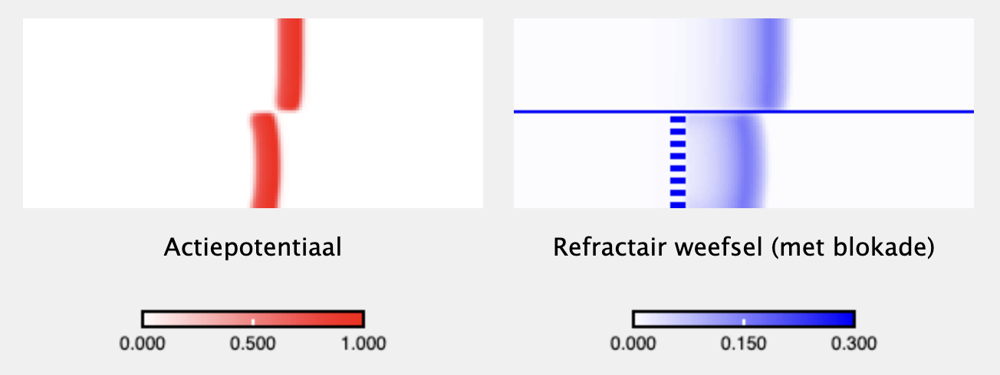
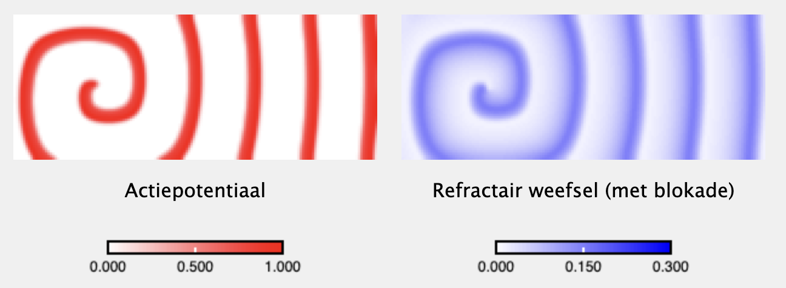
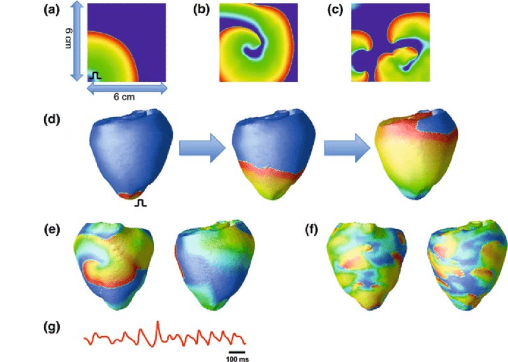
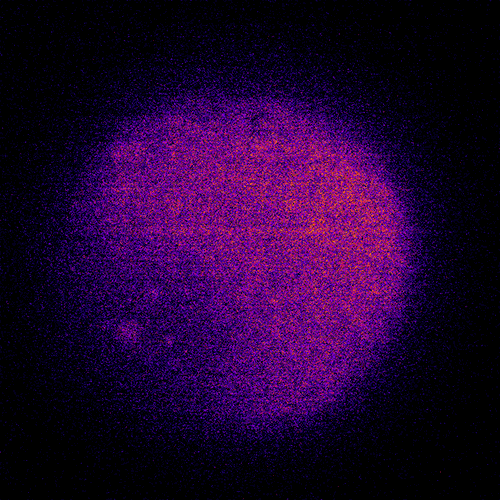
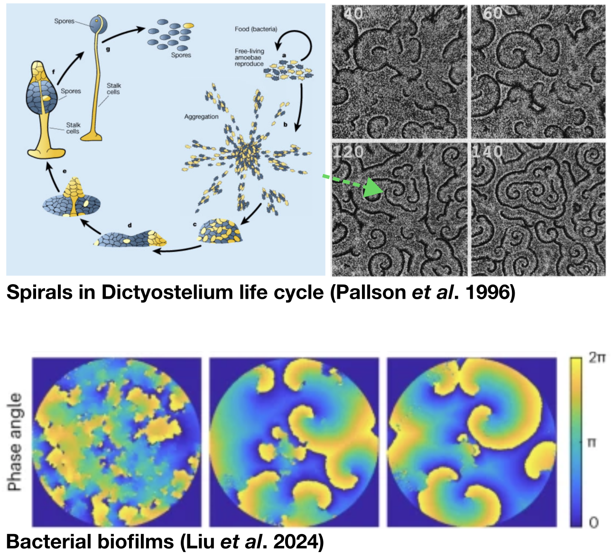



# Exciteerbare media {#sec-excit}

In het vorige onderdeel heb je geleerd dat diffusie niet altijd patronen vervaagt, maar ook stabiele patronen kan opleveren met behulp van reactie-diffusie vergelijkingen. In dit hoofdstuk gaan we echter weer naar dynamische patronen kijken, en wel met een heel concreet en medisch relevant voorbeeld: actiepotentialen en hartritmestoornissen. Aan het einde van dit hoofdstuk, word je geacht het volgende te kunnen:

* Uitleggen wat een actiepotentiaal in termen van een faseruimte inhoudt
* Met behulp van de faseruimte bepalen of een actiepotentiaal periodiek is
* Uitleggen hoe dit systeem in de ruimte leidt tot directionele (rollende) golven
* Uitleggen wat exciteerbare media zijn, en andere biologische voorbeelden geven
* Uitleggen wat het effect is van blokkades en topologie
* Uitleggen wat er kan gebeuren als een golf om zichzelf heen krult, en wat dit met hartritmestoornissen te maken heeft
* Uitleggen welke andere patronen er zijn

## Actiepotentialen, hoe zat dat ook alweer?

{#fig-actpot width="80%" fig-align="center"}

Actiepotentialen zijn kortdurende veranderingen in de elektrische lading over het membraan van neuronen of hartcellen (zie @fig-actpot). Zonder prikkels is er een rustpotentiaal (fase 1), waarbij de binnenkant van de cel negatiever is geladen dan de buitenkant (onderhouden door de natrium/kalium pomp, die ATP gebruikt om drie natrium naar buiten te pompen en tegelijkertijd twee kalium naar binnen). Kleine fluctuaties van het membraanpotentiaal worden onmiddellijk herstelt tot de rustpotentiaal. Als er echter een groot genoege prikkel is (fase 2), openen er spanningsafhankelijke natriumkanalen, waardoor er door de hogere concentratie van natrium van buiten tov binnenin de cel natrium de cel in stroomt. Nu is er sprake een positieve feedback: de potentiaal neemt nog verder toe en wordt zelfs even positief (de binnenkant van de cel heeft een hogere lading dan de buitenkant). De fase tot dit punt, wordt de depolarisatiefase genoemd (fase 3). Kort na de depolarisatie sluiten de natriumkanalen en openen er spanningsafhankelijke kaliumkanalen. Omdat voor kalium de concentratie in de cel juist hoger is dan daarbuiten stromen kaliumionen juist de cel uit, waardoor de binnenkant van de cel weer negatiever wordt. Dit heet repolarisatie (fase 4). Na een kleine doorschieter naar beneden (hyperpolarisatie, fase 5), herstelt de rustpotentiaal. 

## Hodgkin-Huxley model voor actiepotentialen

In 1963 hebben Alan Hodgkin en Andrew Huxley de Nobelprijs gekregen voor hun wiskundige model van actiepotentialen in zenuwen. Het Hodgkin-Huxley model bestond uit differentiaalvergelijkingen van vier variabelen:

* Het potentiaal ($V$)
* De hoeveelheid geopende natriumkanalen ($m$)
* De hoeveelheid geopende kaliumkanalen  ($n$)
* De hoeveelheid gesloten natriumkanalen ($h$)

:::{.callout-note #tip-hheqs collapse=true}
## Vergelijkingen van het Hodgkin-Huxley model

\begin{eqnarray}
\dt{V}=&\frac{1}{C}(I_{Na}+I_K+I_R))\\
\dt{m}=&0.1 (1-m) \frac{V+25}{ e^{(V+25)/10}-1} -4m e^{V/18}\\
\dt{h}=&0.07 (1-h) e^{V/20} - \frac{h}{ e^{(V+30)/10}+1}\\
\dt{n}=&0.01 (1-n) \frac{V+10}{e^{(V+10)/10}-1}-0.125n e^{V/80} \\
I_{Na}=&G_{Na}m^2h(\overline{E_{Na}}-V)\\
I_{K}=&G_Kn^2(\overline{E_K}-V)\\
I_R=&g_R(\overline{E_R}-V)\\
\end{eqnarray}

Met $G_{Na}=120$, $G_K=36$, $G_R=0.3$, $\overline{E_{Na}}=-115$, $\overline{E_K}=12$, en $\overline{E_R}=-10.5989$. 

*Dit is geen leerstof. *

:::

Met deze vier vergelijkingen (verstopt in @tip-hheqs), en hele precieze metingen van de relevante parameters, konden Hodgkin en Huxley membraan-potentialen heel precies omschrijven. Zo kunnen we in @fig-actionpotentials zien dat er zonder prikkel een rust-potentiaal is, kleine prikkels snel herstellen, en dat een grote prikkel een korte maar hoge piek oplevert in het potentiaal. We hebben dus te maken met een *all-or-nothing* respons. Daarnaast zie je dat er sprake is van hyperpolarisatie: na een actiepotentiaal duurt het even voordat het membraanpotentiaal volledig is herstelt. Tijdens deze periode is het moeilijker een tweede actiepotentiaal te starten (dit heet de refractaire periode), omdat de drempelwaarde van activatie nu verder weg ligt. 

```{r results='hide'}
#| label: 'fig-actionpotentials'
#| fig-cap: 'Alleen met een sterke prikkel ontstaat er in het Hodgkin-Huxley model een actiepotentiaal'
#| code-fold: true

source("https://tbb.bio.uu.nl/rdb/grindR/grind.R")
model <- function(t, state, parms) {
  with(as.list(c(state,parms)), {
    Ina <- Gna*m*m*m*h*(Ena-V)
    Ik <- Gk*n*n*n*n*(Ek-V)
    Ir <- gr*(Er-V)
    dV <- (Ina+Ik+Ir)/C
    dm <- a*(1-m)*(V+25)/(exp((V+25)/10) -1) - 4*m*exp(V/18)
    dh <- b*(1-h)*exp(V/20) - h/(exp((V+30)/10)+1)
    dn <- c*(1-n)*(V+10)/(exp((V+10)/10) -1) - 0.125*n*exp(V/80)
    
    return(list(c(dV,dm,dh,dn)))  
  }) 
}  


p <- c(a=0.12,b=0.01,c=0.01,Gna=120,Gk=36,gr=0.3,Ena=-115, Ek=12, Er=-10.59, C=1)
s <- c(V=0.5,m=0.06,h=0.16,n=0.3)

par(mfrow=c(3,2), mar=c(2.5,1,1.5,1))
run(tmax=60,ymin=30,ymax=-120,tstep=0.1,show=c("V"),ylab="V",xlab="Time (ms)")
title("Potentiaal (geen prikkel)")
abline(h=-5,lty=3)
run(tmax=60,ymin=0,ymax=1,tstep=0.1,show=c("h","m","n"),ylab="V",xlab="Time (ms)")
title("Toestand Na+/K+ kanalen")

# par(mfrow=c(2,1))
run(tmax=60,ymin=30,ymax=-120,tstep=0.1,show=c("V"),ylab="V",xlab="Time (ms)",
    arrest=40, after="if(t==30)state[\"V\"]<- -5;if(t==20)state[\"V\"]<- 5;if(t==10)state[\"V\"]<- 2;if(t==40)state[\"V\"]<- 9;if(t==50)state[\"V\"]<- -7;")
title("Potentiaal (kleine prikkels)")
abline(h=-5,lty=3)
run(tmax=60,ymin=0,ymax=1,tstep=0.1,show=c("h","m","n"),ylab="V",xlab="Time (ms)",
    arrest=40, after="if(t==30)state[\"V\"]<- -5;if(t==20)state[\"V\"]<- 5;if(t==10)state[\"V\"]<- 2;if(t==40)state[\"V\"]<- 9;if(t==50)state[\"V\"]<- -7;")
title("Toestand Na+/K+ kanalen")
# par(mfrow=c(2,1))
# run(tmax=60,ymin=30,ymax=-120,tstep=0.1,show=c("V"),ylab="V",xlab="Time (ms)",
#     arrest=40, after="if(t==30)state[\"V\"]<- -9")
# run(tmax=60,ymin=0,ymax=1,tstep=0.1,show=c("h","m","n"),ylab="V",xlab="Time (ms)",
#     arrest=40, after="if(t==30)state[\"V\"]<- -9")

# par(mfrow=c(2,1))
run(tmax=60,ymin=30,ymax=-90,tstep=0.1,show=c("V"),ylab="V",xlab="Time (ms)",
    arrest=40, after="if(t==30)state[\"V\"]<- -13")
title("Potentiaal (sterke prikkel)")
abline(h=-13,lty=3)
run(tmax=60,ymin=0,ymax=1,tstep=0.1,show=c("h","m","n"),ylab="V",xlab="Time (ms)",
    arrest=40, after="if(t==30)state[\"V\"]<- -13")
title("Toestand Na+/K+ kanalen")

# 
# run(tmax=100,ymin=30,ymax=-120,tstep=0.1,show=c("V"),ylab="V",xlab="Time (ms)")
# 
# run(tmax=20,ymin=0,ymax=1,tstep=0.1,show=c("h","m","n"),ylab="State of channels",xlab="Time (ms)")
# 
# f <- run(ymin=1,ymax=1e5,log="y",traject=T,tstep=0.1)
# 
# p <- c(N=1e5,a1=0.3,a2=0.5,a3=0.1,d=0.1,h=100,k=0.0001,p=1,r=1.5)
# plane(ymax=1e5,xmax=1e5,ymin=0.01,xmin=0.01,log="xy")
# s <- c(I=10000,E1=10000,E2=0,E3=0)
# f <- run(ymin=1,ymax=1e5,log="y",traject=T,tstep=0.1)
# s<- newton(c(I=10000,E1=10000,E2=0,E3=0),plot=T)
# continue(s,x="a1",y="I",xmax=1,xmin=0,ymax=100000)
# continue(s,x="a1",y="E1",xmax=1,xmin=0,ymax=150000)
```


## Een simpeler ODE model van een actiepotentiaal

Het bovenstaande model heeft een heel belangrijke bijdrage geleverd aan ons begrip van actie-potentialen (het heeft niet voor niets een Nobelprijs opgeleverd). Toch zijn 4 vergelijkingen lastiger te overzien dan 2 of 3 variabelen. Zo kunnen we van 4 variabelen geen faseruimte schetsen, en wordt het steeds maar ingewikkelder om te bepalen of er evenwichten zijn (hiervoor moeten alle 4 de ODEs gelijk zijn aan 0!). Fithugh en Nagumo versimpelden deze ODEs tot slechts twee vergelijkingen. Dat ging natuurlijk niet zonder de benodigde versimpelingen, maar ze hielden de volgende kenmerken in het oog:

i) Een positieve feedback loop veroorzaakt een snelle toename van het voltage. (depolarisatie)
i) Er is een drempelwaarde voor deze positieve feedback loop (drempelwaarde)
i)  Het verhoogde voltage activeert een remmend effect, waardoor de toename weer stopt (depolarisatie), en overgaat in repolarisatie
i) Na een piek is er een herstelperiode (hyperpolarisatie)

Deze kenmerken wisten ze te vangen met de volgende twee vergelijkingen: 

$$
\begin{align}
    \dt{V}&=-V(V-a)(V-1)-W \\
    \dt{W}&=\epsilon(V-bW)
\end{align}
$$ {#eq-fitzhugh}

V staat hier voor het voltage. Laten we stap voor stap ontcijferen wat hier staat. De eerste vergelijking ($\dt{V}$) beschrijft de verandering in $V$, en bestaat uit twee termen. De eerste term ($-V(V-a)(V-1)$) bevat drie maal de variabele $V$. Hoewel deze term er ingewikkeld uitziet, kunnen we dankzij de haakjes snel zien dat deze term 0 is wanneer $V=0$, $V=a$, of $V=1$. Let op: dit zijn ook meteen de énige punten waar deze term 0 is. Bij elke andere waarde van $V$ zal deze term dus een positief of een negatief effect hebben op het voltage. Laten we deze term even schetsen met R:

```{r}
#| label: 'fig-fitzcurve'
#| fig-cap: 'Fase-portret van een enkele term uit het Fitzhugh-Nagumo model'
#| code-fold: true

a=0.2

func <- function(V){
  return(-V * (V-a) * (V-1))
}

curve(func,0,1.15,lwd=2,ylim=c(-0.1,0.1), 
      ylab="dV/dt",xlab="V",col="seagreen",
      main="Vorm van -V(V-a)(V-1) voor a = 0.2")

axis(1, labels = FALSE,lwd=2) # x-axis
axis(2, labels = FALSE,lwd=2) # x-axis
abline(h=0,lty=1,col="black")
abline(v=1,lty=3,col="grey")
arrows(0.1,0.0,0.05,0.0,lwd = 2, length = 0.05)
arrows(0.15,0.0,0.1,0.0,lwd = 2, length = 0.05)
arrows(0.45,0.0,0.60,0.0,lwd = 2, length = 0.05)
arrows(0.7,0.0,0.850,0.0,lwd = 2, length = 0.05)
arrows(1.1,0.0,1.050,0.0,lwd = 2, length = 0.05)
arrows(1.2,0.0,1.150,0.0,lwd = 2, length = 0.05)
abline(v=0.2,lty=3,col="grey")
```

Aan de hand van deze grafiek kunnen we alvast inschatten dat het voltage ($V$) zal toenemen of afnemen, afhankelijk van de huidige waarde van $V$. Maar de $V$-vergelijking bevat ook nog een tweede term ($-W$). Het toenemen van het voltage wordt dus kennelijk geremd door $W$. Deze "rem" zien we terugkomen als tweede ODE ($\dt{W}$). Deze is makkelijker te interpreteren: $W$ neemt toe met snelheid $\epsilon V$ (dus: afhankelijk van het voltage), en neemt af met snelheid $\epsilon bW$. Het is bekend dat deze rem (de refractaire periode) langzamer op gang komt dan een actiepotentiaal, dus wordt aangenomen dat $\epsilon \ll 1$.     

Deze versimpeling van het Hodgkin-Huxley model heet het Fitzhugh-Nagumo model^[Kennelijk hebben biologen en andere theoretici er een handje van om modellen een dubbele naam te geven: Lotka-Volterra, Hodgkin-Huxley, Fitzhugh-Nagumo, Michaelis-Menten...]. De versimpeling heeft voor en nadelen. Het voordeel is dat we nu eenvoudiger (zelfs met pen en papier) kunnen bestuderen hoe het systeem nou eigenlijk werkt. Het nadeel is dat we alle parameters van het Hodgkin-Huxley model, die met pijn en moeite zijn gemeten, nu eigenlijk allemaal kwijt zijn. Zo kunnen we minder makkelijk ons model vergelijken met werkelijke scenarios.

Maar nu we twee vergelijkingen hebben, kunnen we wel weer een eenvoudige faseruimte bestuderen in Grind:

```{r results='hide'}
#| label: 'fig-fitzgrind'
#| fig-cap: 'Faseruimte van het Fitzhugh-Nagumo model'
#| code-fold: true
# source the grind script
source("https://tbb.bio.uu.nl/rdb/grindR/grind.R")

# define the model-function so grind can use it
model <- function(t, state, parms) {
  with(as.list(c(state,parms)), {
    dV <- -V*(V-a)*(V-1) - W  # dV/dt
    dW <- e*(V- b*W)         # dW/dt 
    return(list(c(dV,dW)))  
  }) 
}

# initial values of V and W (a bit above rest potential)
s <- c(V=0.2,W=0)         
p <- c(e=0.001,b=1,a=0.2)
plane(xmin=-0.3,ymin=-0.05,ymax=0.13,xmax=1.05,portrait=F,vector=T,grid=3)
newton(plot=T)
```

Zo zien we dat er twee nullclines zijn, en dat er een evenwichtspunt is waar de nullclines snijden. Zoals je ziet wijst het vectorveld vlak rechts van dit evenwicht terug naar links. Vlak boven het evenwicht wijst het terug naar beneden. Zoals we geleerd hebben is dit dus een stabiel evenwicht. Dit is de rustpotentiaal. 

Maar het vectorveld dichtbij dit evenwicht is vrij complex. Wat gebeurt er bijvoorbeeld als we het voltage verhogen met kleine of grote prikkels? Dit komt neer op respectievelijk een klein stapje of een grote stap naar rechts zetten vanaf dit evenwicht. Als de stap groot genoeg is, zitten we niet meer in het vectorveld dat terug naar links wijst, maar wijst het vectorveld naar rechts! Met andere woorden: voor een groot genoege prikkel worden we van dit evenwicht weggeduwd. Om dit verschil in actie te kunnen zien, rekenen we twee numerieke oplossingen door met `Grind.R`, één met een kleine prikkel (@fig-trajectoriesfh-1), en één met een grote prikkel (@fig-trajectoriesfh-2).  

:::{#fig-prikkels layout-nrow=2 .figure}
```{r results='hide'}
#| label: 'fig-trajectoriesfh'
#| fig-subcap:
#| - 'Dynamica na een kleine prikkel'
#| - 'Dynamica na een grote prikkel'
#| out-width: "80%"
#| fig-width: 7
#| fig-height: 3
#| code-fold: true

# source the grind script
source("https://tbb.bio.uu.nl/rdb/grindR/grind.R")

# define the model-function so grind can use it
model <- function(t, state, parms) {
  with(as.list(c(state,parms)), {
    dV <- -V*(V-a)*(V-1) - W  # dV/dt
    dW <- e*(V- b*W)         # dW/dt 
    return(list(c(dV,dW)))  
  }) 
}

# initial values of V and W (a bit above rest potential)
s <- c(V=0.15,W=0)         
p <- c(e=0.003,b=1,a=0.2)
par(mfrow=c(1,2),mar=c(2,2,2,2))
plane(xmin=-0.3,ymin=-0.05,ymax=0.16,xmax=1.1,portrait=F,vector=T,grid=3)
#newton(plot=T)
run(traject=T,tmax=2000)
run(traject=F,tmax=300,ymin=-0.3,ymax=1)

s <- c(V=0.25,W=0)         
p <- c(e=0.003,b=1,a=0.2)
par(mfrow=c(1,2))
plane(xmin=-0.3,ymin=-0.05,ymax=0.16,xmax=1.1,portrait=F,vector=T,grid=3)
#newton(plot=T)
run(traject=T,tmax=2000)
run(traject=F,tmax=300,ymin=-0.3,ymax=1)

```

Faseruimten en oplossingen voor het Fitzhugh-Nagumo model

:::

Met de hulp van bovenstaande figuur kunnen we conceptualiseren wat een actiepotentiaal nou eigenlijk is, en waarom er eigenlijk een refractaire periode is (d.w.z. de periode waarin het neuron ongevoelig is voor prikkels). Een actiepotentiaal is te versimpelen tot een grote omweg door deze faseruimte. Deze omweg wordt alleen gestart als er een toename van $V$ is die voorbij het stijgende deel van rode curve gaat (de $V$-nullcline). Aan de oplossing zien we dat we vrij snel (na ongeveer 70 tijdstappen) alweer een negatief geladen neuron hebben, maar dat $W$ nog vrij hoog is. We zitten dan dus linksboven in de faseruimte. Heel langzaam herstelt het systeem zich naar de rustpotentiaal. Tot die tijd is "een stapje naar rechts" zeer waarschijnlijk niet groot genoeg om een nieuwe actiepotentiaal te starten (wederom: het moet voorbij het stijgende deel van de rode $V$-nullcline). De refractaire periode ontstaat dus doordat de remmende werking van $W$ heel langzaam afneemt.

Samengevat laat dit simpele 2D vectorveld alle hierboven genoemde eigenschappen zien: **i)** het voltage kan sterk toenemen en weer herstellen, **ii)** dit gebeurt alleen bij een sterke prikkel, **iii)** vlak na een actiepotentiaal is geen onmiddellijke reactivatie mogelijk, en **iv)** er is sprake van hyperpolarisatie.

## Actiepotentialen als PDE

In het vorige hoofdstuk hebben we diffusie toegevoegd aan ODEs zodat deze PDEs worden (of platter uitgedrukt hebben we "differentiaalvergelijkingen in hokjes gestopt"). Nogmaals, met PDEs kunnen we naast veranderingen over de tijd, ook veranderingen door de ruimte bestuderen. We zagen dat dit mooie patronen op kan leveren. Wat gebeurt er als we de ODEs van het Fitzhugh-Nagumo model nemen, en deze in een PDE bestuderen? 

Dit zou een soort simulatie kunnen zijn van een axon, of van hartweefsel waarbij het actiepotentiaal zorgt voor samentrekking van de hartspier. Om dit te laten zien, geeft de onderstaande simulatie aan wat er gebeurt in een "weefsel" van 60 hoog en 150 lang. In het begin is de linker kolom sterk geprikkeld ($V=1$), en de rest van het weefsel in rust ($V=0,W=0$). 

:::{.print-only}
<center>*Interactieve content beschikbaar op de website:*

</center>
:::

:::{.screen-only}
```{=html}
<iframe id="iframeToReplace" width="100%" height="360" src="https://jsfiddle.net/bramvandijk88/8x1ezk2u/embedded/result" title="Simulation"></iframe>

```

::: 

Zoals je ziet vormt er zich een golf van $V$ (rood), die van links naar rechts doorgegeven wordt door het weefsel. Daarachter volgt een bredere band van $W$, dat er voor zorgt dat het actiepotentiaal niet meteen opnieuw geactiveerd kan worden. Dit kan je zelf testen: met de muis kun je prikkels geven aan het medium. Als je vóór een golf een prikkel geeft ontstaat er een nieuwe golf voor de bestaande golf. Deze golf gaat twee kanten op en annihileert de oorspronkelijke golf! Als je echter vlak ná een bestaande golf probeert het weefsel een prikkel te geven, dooft deze meteen uit!

## Ophopingen, blokkades, en spiralen {#sec-spiral}

Met de bovenstaande simulatie kunnen we vrij "virtueel" experimenteren. Zo weten we bijvoorbeeld dat littekenweefsel (bijv. op het hart) actiepotentialen kan verstoren, omdat deze het signaal niet (meer) geleiden. Laten we een dergelijke blokkade inbouwen door een deel van het weefsel altijd op refractair ($W=1$) te veronderstellen:

:::{.print-only}
<center>*Interactieve content beschikbaar op de website:*

</center>
:::

:::{.screen-only}
```{=html}
<iframe id="iframeToReplace" width="100%" height="360" src="https://jsfiddle.net/bramvandijk88/1akdcg0x/embedded/result" title="Simulation"></iframe>

```

::: 


Zoals je ziet krult de golf om de blokkade heen. Ook zie je dat de golf zichzelf uiteindelijk weer recht trekt. Dit komt omdat weefsel vooraan in de golf minder activatie krijgt van omliggend weefsel. Zo herstelt de rechte staande golf eigenlijk vanzelf. Als dit dus een hart-weefsel is -- waar een golf als deze verantwoordelijk is voor het sequentieel samentrekken van de hartkamers -- heeft dit litteken nog geen rampzalige gevolgen. Misschien kunnen we ons ook voorstellen dat er een stuk littekenweefsel is dat het signaal veel slechter doorlaat, maar nog wel een beetje:

:::{.print-only}
<center>*Interactieve content beschikbaar op de website:*

</center>
:::

:::{.screen-only}
```{=html}
<iframe id="iframeToReplace" width="100%" height="360" src="https://jsfiddle.net/bramvandijk88/faj58ucn/embedded/result" title="Simulation"></iframe>

```

::: 

Ook hier kan de actiepotentiaal gelukkig nog doorheen breken. Wel kun je zien dat deze golf (onderin) nu een klein beetje achterloopt op een golf die geen hinder heef ondervonden (bovenin). 

Als we echter aannemen dat de blokkade slechts tijdelijk is, gebeurt er iets vreemds:

:::{.print-only}
<center>*Interactieve content beschikbaar op de website:*

</center>
:::

:::{.screen-only}
```{=html}
<iframe id="iframeToReplace" width="100%" height="360" src="https://jsfiddle.net/bramvandijk88/aoev0dzx/embedded/result" title="Simulation"></iframe>

```

::: 


Wat je hier ziet, is een actiepotentiaal golf die om zichzelf is heen gekruld. Als dit een stuk hartweefsel is, hebben we dus te maken met een hartritmestoornis! Inderdaad zijn deze spiraalvormen een belangrijke oorzaak van hartritmestoornissen (zie @fig-hartar). Met de muis kun je het hartweefsel lokaal proberen te herstellen, maar naar alle waarschijnlijkheid maak je er alleen maar meer spiralen bij (probeer het maar eens!). In het werkcollege gaan we kijken we moeten doen om dit "hart" weer normaal te laten kloppen. 

{#fig-hartar width="80%" fig-align="center"}

<!-- VOOR COLLEGE:  -->
<!-- SELF-OSC? -->

<!-- https://jsfiddle.net/bramvandijk88/03c8jn6k/278/ -->

<!-- MET ABLATE -->

<!-- https://jsfiddle.net/bramvandijk88/03c8jn6k/337/ -->

:::{.callout-note #tip-unthinkable} 

## Het denken van het ondenkbare

De simulaties van hartritmestoornissen lijken wellicht een beetje oversimplistisch, en wellicht vooral leuk om mee te spelen. Echter hebben ze zeer belangrijke bijdragen geleverd aan medisch onderzoek. Door inzicht te geven in hoe golven ontstaan en om zichzelf heen krullen, konden nieuwe ingrepen worden ontwikkeld die anderszijds "ondenkbaar" zouden zijn. Bijvoorbeeld: door het strategisch plaatsen van littekenweefsel (meestal met behulp van hoge temperaturen en/of lasers), kan een normaal hartritme hersteld worden. Dit is een goed voorbeeld van hoe modellen ons toestaan om de meest ondenkbare "virtuele experimenten" uit te voeren, en zo belangrijke toepassingen te ontwikkelen!

:::


## Exciteerbare media en andere type golven

Het bovenstaande systeem van actie-potentialen in een weefsel is deel van een klasse systemen genaamd exciteerbare media (*excitable media*). Exciteerbare media hebben de volgende kenmerken: 

* Er is een drempelwaarde, 
* Door een positieve feedback, is er een *all-or-nothing* respons als de drempelwaarde wordt bereikt
* De activatie kan propageren door de ruimte
* Na een respons kan er kort geen activatie zijn, waardoor golven een richting krijgen (ze kunnen niet onmiddellijk terug!)

Andere biologische systemen die aan deze voorwaarden voldoen zijn epidemische processen (virus breekt uit, resistentie ontwikkelt, resistentie verzwakt), bosbranden (brand breekt uit, bos ligt in as, bos herstelt), en er zijn bovendien talloze voorbeelden uit de moleculaire/microbiële wereld:

:::{layout-ncol=2}
{#fig-excitexamp width="85%"}

{#fig-excitexamp2 width="92%"}

:::

Ook buiten de biologie zien we dergelijke systemen terug, zoals in simpele chemische reacties of vlammen op het oppervlak van een brandstof. Dit voorbeeld, en vele andere voorbeelden van excitable media vind je in deze video: 

:::{.print-only}
```{=html}
<iframe id="iframeToReplace" width="100%" height="200" src="https://youtube.com/embed/SqhXQUzVMlQ" title="Simulation"></iframe>
```
:::

:::{.screen-only}
```{=html}
<iframe id="iframeToReplace" width="100%" height="500" src="https://youtube.com/embed/SqhXQUzVMlQ" title="Simulation"></iframe>
```

::: 


## Opgaven

:::{.Rexr #exr-clear}

## Clear!

<br>

Zoals gezegd kunnen er spiralen vormen op het hartweefsel, wat een hartritmestoornis veroorzaakt. Bekijk de volgende simulatie, waarbij er door het hokje linksbovenin elke 250 tijdstappen een nieuwe golf start:

:::{.print-only}
<center>*Interactieve content beschikbaar op de website:*

</center>
:::

:::{.screen-only}
```{=html}
<iframe id="iframeToReplace" width="100%" height="800" src="https://jsfiddle.net/bramvandijk88/zr6a72ys/embedded/result" title="Simulation"></iframe>

```

::: 

a. Laat de simulatie een tijdje lopen, en bepaal de frequentie van het hart (de tijdseenheden zijn arbitrair, dus het antwoord is in de vorm "een hartslag elke X-de tijdstap"). 
b. Gebruik de knop 'Boe' om dit virtuele persoon "te laten schrikken" (de knop voegt aan alle hokjes een willekeurige hoeveelheid $V$ toe^[Let op: dit is niet echt wat er met je hart gebeurt als iemand je laat schrikken, maar dit is slechts een virtueel experiment.]). Zie je een effect op de hartslag? Is dit effect blijvend? 
c. Teken met de muis (deze zet $V$ op 0) een lijn door een golf heen. Kun je nu een blijvend effect op de hartslag creeeren? 
d. Probeer het hart te herstellen met de muis. Gebruik ook eens de 'Clear!' knop. Wat werkt het beste, en waarom?
:::

:::{.mixedexr #exr-epidemievraag}

## Epidemie

<br>

Op een groot (hypothetisch) eiland breekt al decenia, keer op keer, een vervelende infectieziekte opnieuw uit. De ziekte verspreidt zich van dorp tot dorp, en de immuniteit voor de ziekte duurt helaas slechts enkele maanden. Deze observaties suggereren dat de ziekte zich verspreidt als een golf door een exciteerbaar medium. 

a. Wat gebeurt er als de ziektegolf een dorp binnenkomt, nadat dit dorp recent al is geïnfecteerd (door dezelfde ziekte!)? 
b. Iemand stelt voor om de ziekte te stoppen door alle vatbare individuen tegelijkertijd te infecteren. Zou dit werken? Is dit ook ethisch verantwoord?

Er wordt een vaccinatie campagne opgezet, maar een groot deel van de populatie komt niet opdagen. Bestudeer de volgende simulatie, van een golf die een matig gevaccineerd dorp binnenrolt.

:::{.print-only}
<center>*Interactieve content beschikbaar op de website.*
</center>
:::

:::{.screen-only}
```{=html}
<iframe id="iframeToReplace" width="100%" height="510" src="https://jsfiddle.net/bramvandijk88/od20zhL4/embedded/result" title="Simulation"></iframe>

```

::: 

c. Kan een golf (links) de ongevaccineerde mensen (rechts) bereiken? Wanneer wel/niet?^[gebruik de muis in het linker scherm om nieuwe golven te starten]
d. Wat kan er gebeuren als een toerist van een niet-gevaccineerd land met het vliegtuig binnenkomt (rechts verschijnt)?
e. De minimale vaccinatiegraad om in deze simulatie de ziekte te stoppen is vrij laag. Waarom is in echte menselijke populatie de benodigde vaccinatiegraad hoger, denk je?
:::

  
:::{.Rexr #exr-bosbranden}

## Bosbranden

<br>

Hoewel we tot nu toe voorbeelden hebben gezien van exciteerbare media in PDEs, bestaan ze ook in *individual-based* modellen. Laten we bijvoorbeeld eens aannemen dat een groot bos in hokjes opgedeeld is, met in elk hokje een boom of een stuk lege grond. Een bosbrand begint in het midden van het bos, en verspreidt zich via de bomen. 

:::{.print-only}
<center>*Interactieve content beschikbaar op de website.*
</center>
:::

:::{.screen-only}
```{=html}
<iframe id="iframeToReplace" width="100%" height="600" src="https://jsfiddle.net/bramvandijk88/kdxu51wa/embedded/result" title="Simulation"></iframe>

```

::: 

a. Begin de simulatie een paar keer met een bomen-dichtheid van 0.4. Schat ruwweg in welke fractie van het bos afbrandt. Zie je veel variatie tussen de experimenten? 
b. Herhaal je experiment ook met dichtheden 0.2, 0.3, 0.5, en 0.6. Bepaal opnieuw welke fractie afbrandt, en hoeveel variatie er is.
c. Teken de hoeveelheid afgebrand bos als functie van de boom-dichtheid. Leg de vorm van deze functie uit in biologische termen.
d. Wat zou je aanraden om ernstige bosbranden te voorkomen?
e. Bomen planten zich ook voort. Wat denk je dat er kan gebeuren als de afgebrande bomen na een tijdje weer vruchtbare grond voor nieuwe bomen vormt? 

Brand is meestal een heel snel proces ten opzichte van de voortplanting van bomen. Bestudeer de volgende simulatie:


:::{.print-only}
<center>*Interactieve content beschikbaar op de website.*
</center>
:::

:::{.screen-only}
```{=html}
<iframe id="iframeToReplace" width="100%" height="600" src="https://jsfiddle.net/bramvandijk88/5jb91uk3/embedded/result" title="Simulation"></iframe>

```

::: 


f. Is brand een groter of een kleiner probleem als planten zich snel voort kunnen planten? 

:::

:::{.pepexr #exr-drempelwaardefh}

## Drempelwaarde van FitzHugh-Nagumon (verdiepende vraag)

<br>

In @eq-fitzhugh heb je gezien dat de activerende term van het FitzHugh-Nagumo model een zogeheten derdegraads polynoom vormt. Complexe polynomen (derdegraads, vierdegraads, *etc.*) veranderen vaak meerdere keren van richting. In @fig-fitzcurve zie je dat ook: eerst daalt de lijn, dan stijgt de lijn, en uiteindelijk daalt de lijn weer. Deze zogeheten *non-lineairiteit* resulteert er in dat er alleen toename van het voltage kan zijn als er eerst een bepaalde drempel-waarde is bereikt. 

a. In welk andere model (veel eerder in de cursus) heb je deze vorm ook gezien? 

b. De grafiek in @fig-fitzcurve is geschetst met $a=0.2$. Neem de onderstaande R-code over, en pas $a$ aan naar -0.2. Pas de assen aan zodat je de gehele curve kan zien. Bij welke drempelwaarde verwacht je nu dat er activatie is van een actiepotentiaal?

```{r}
#| eval: false
a=0.2

func <- function(V){
 return(-V * (V-a) * (V-1))
}
curve(func,0,1.15,lwd=2,ylim=c(-0.1,0.12), 
     ylab="",xlab="V",col="seagreen")
axis(1, labels = FALSE,lwd=2) # x-axis
axis(2, labels = FALSE,lwd=2) # x-axis
abline(h=0,lty=1,col="black")
abline(v=1,lty=3,col="grey")
abline(v=a,lty=3,col="grey")
```

c. Deze curve hadden we getekend door alleen naar de activerende term ($-V(V-a)(V-1)$) te kijken. We gaan nu bepalen waar de nullcline van $V$ ligt door $\frac{dV}{dt}$ op 0 te stellen. Neem aan dat we $W$ op de y-as zetten in de faseruimte, dus los op voor $W$. 
d. Vergelijk je nullcline met de activatie-term die we eerder hebben geschetst. Wat valt je op?
e. Bepaal ook de nullcline voor $W$, door $\frac{dW}{dt}$ op 0 te stellen. Schets beide nullclines in één faseruimte.
f. Vergelijk je faseruimte (met $a=-0.2$ met de faseruimte uit het hoofdstuk (waar $a=0.2$). Wat is er veranderd aan het evenwichtspunt? Heeft je faseruimte een rustpotentiaal? Een drempelwaarde? 
g. Welk type weefsel in het menselijk lichaam gedraagt zich zoals dit nieuwe systeem?
:::

:::{.screen-only}
## Herkauwen
<script src="Applets/exciteerbaar_explainer.js"></script> 
:::


## Terminologie 

| Nederlands              | Engels                    | Beschrijving |
|------------------|--------------------|-----------------------------------|
| Exciteerbare media | Exctiable media | Systemen waarin een stimulus een lokale reactie veroorzaakt die zich vervolgens kan verspreiden, zoals in zenuwcellen of chemische reacties. Een belangrijke eigenschap is een refractaire periode waardoor de golven in één richting propageren.
| Virtueel experimenteren | Virtual experimentation | Experimenten uitvoeren a.d.h.v. computersimulaties in plaats van in echte (biologische) systemen. 
:  {.striped .hover}

