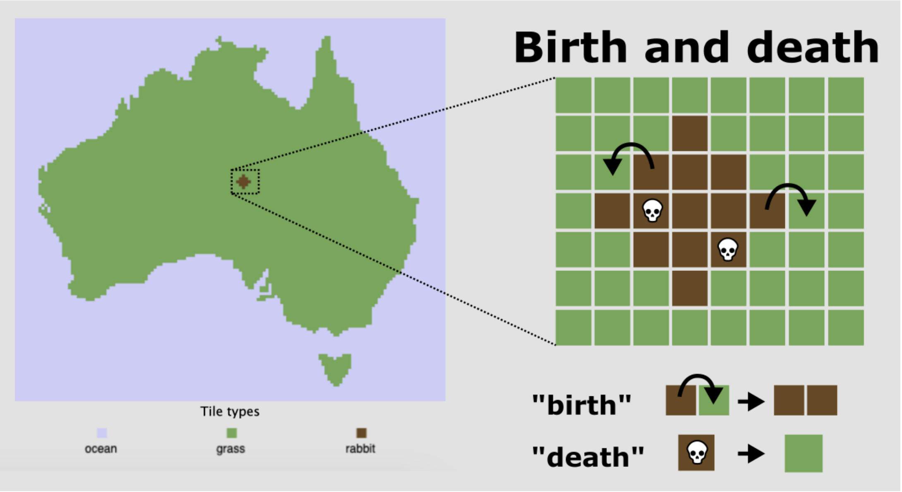
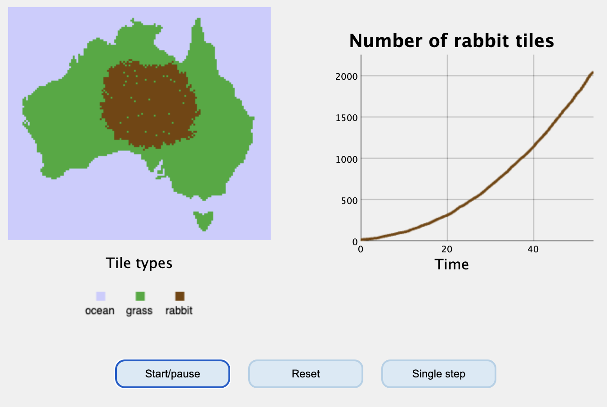




# Exponentiële groei {#sec-exp}

## Leerdoelen

In dit eerste hoofdstuk gaan we een belangrijk concept uit de biologie beter leren begrijpen: exponentiële groei. Na dit hoofdstuk word je geacht het volgende te kunnen:

-   Aantonen wanneer groei exponentiëel is
-   Uitleggen dat snelle groei niet altijd exponentiële groei is
-   Uitleggen wat dichtheidsafhankelijkheid (*density dependence*) is, en hoe dit resulteert in een maximaal draagvermogen (*carrying capacity*) van een (eco)systeem of populatie 

{fig-align="center" width="60%"}

## Bergen met rijst

In het [introducerende hoofdstuk](#sec-tbintro) hebben we besproken dat alle modellen drie belangrijke basisingrediënten hebben: variabelen, parameters, en aannames. Laten we aan de hand van deze begrippen een model maken van de beroemde mythe over de ontdekking van het schaakspel. De koning beloofde de ontdekker namelijk een gigantische hoeveelheid rijst.

### De mythe van de ontdekking van het schaakspel

De mythe van de ontdekking van het schaakspel is een beroemde legende uit India. Volgens het verhaal wilde een koning de uitvinder van het schaakspel belonen. In schijnbare bescheidenheid vroeg de uitvinder om rijst: één korrel op het eerste veld van het schaakbord, twee op het tweede, vier op het derde, en zo verder, telkens verdubbelend tot het 64e veld is bereikt. De koning stemde toe, zich niet realiserend hoeveel rijst hij zojuist had beloofd. Tegen de tijd dat het 64e veld bereikt was, had de koning niet genoeg rijst in zijn hele koninkrijk om aan de vraag te voldoen. Het totaal aantal korrels rijst komt uit op:

$$
1 + 2 + 4 + · · · + 2^{63} = 2^{64} − 1 = 18.446.744.073.709.551.615
$$ 
Als je het aantal cijfers van dit grote getal telt, zie je dat het neerkomt op 18 triljoen (een 18 met 18 nullen!). Dit kunnen we beter als een macht van 10 schrijven: $\sim 1.84 \cdot 10^{19}$. In R worden dergelijke grote getallen meestal met `e+` aangegeven:

```{r}
#| eval: true
#| echo: true
#| code-fold: false
#| class-output: output

2^64 - 1
```

Deze legende van de ontdekking van het schaakspel illustreert de snelheids waarme **exponentiële groei** getallen doet oplopen. Wat aanvankelijk klein en bescheiden lijkt, kan snel uitgroeien tot een enorme (onvoorstelbare) hoeveelheid.

## Verdubellingen modelleren

De vergissing van de koning was dat hij (zoals veel mensen) niet in kon zien hoe snel verdubbelingen toenemen. We kunnen aan de hand van deze mythe de volgende variabelen, parameters, en aannames formuleren:

-   Variabele: aantal rijstkorrels, $𝑅$
-   Parameters: vermenigvuldigingswaarde ($r = 2$) en aantal hokjes op een schaakbord ($n=64$)
-   Aannames: teveel om te benoemen, maar één is in ieder geval dat de rijst ook daadwerkelijk op het bord past!

Naast deze drie basisingrediënten, is het natuurlijk ook belangrijk om te bepalen wat de hoeveelheid rijst is waar we mee beginnen (hier $R(0) = 1$). Dit wordt in de model-wereld de **initiële conditie** (*initial condition*) genoemd, oftewel de start waarde van de variabele(n). Vanaf daar gaan we verder rekenen: op het tweede vakje liggen $R(1) = R(0) \cdot 2$ rijstkorrels, op het derde vakje $R(2) = R(0) \cdot 2 \cdot 2$ korrels, *etc.* Het aantal korrels op het 64e vakje, wordt gegeven door 63 verdubbelingen (want let op: het eerste vakje was al bezet!). Dit kunnen we omschrijven met de volgende vergelijking:

$$
R(63) = R(0) \cdot 2^{63}
$$ {#eq-rijst}

@eq-rijst geeft het aantal korrels op het 64e vakje. Dat is dus nog niet het *totaal* aantal korrels. Het totaal wordt gegeven door $R(0) + R(1) + R(2) + \cdots + R(63)$. Deze som is een beetje te lang om volledig op te schrijven, maar we weten dat elke stap de volgende **vergelijking** wordt toegepast:

$$
R(t+1) = 2\cdot R(t) 
$$ {#eq-differentie-vergelijking}

Een vergelijking in de vorm van @eq-differentie-vergelijking wordt een **differentievergelijking** genoemd^[Niet te verwarren met de differen**tiaal**vergelijking, waar we in het volgende hoofdstuk over gaan leren!]. Deze differentievergelijking is zo simpel, dat we een eenvoudig R-script kunnen schrijven die deze herhaaldelijk toepast: 

```{r}
#| eval: true
#| echo: true
#| code-fold: false

R <- 1 # beginaantal rijst (initiële conditie)

# herhaal iets 63 keer met een for-loop
for (i in 1:63) {
  R[i+1] <- 2*R[i] # het aantal rijstkorrels in elk vakje op in R
}
print(R[64]) # print het aantal rijskorrels in het 64e vakje
```


In de bovenstaande code wordt er steeds een getalletje aan R toegevoegd. $R$ is dus nu niet meer één getal, maar een steeds langer wordende lijst getallen: $1, 2, 4, 8, \dots, 2^{63}$ etcetera. Zoals je hebt geleerd heet een dergelijke lijst in R een vector, die we eenvoudig kunnen plotten met R:

```{r}
#| eval: true
#| echo: true
#| code-fold: false
#| label: fig-exponential
#| fig-cap: "Het aantal rijstkorrels per vakje (met log-lineaire schaal op de y-as)."

# beginaantal rijst
R <- 1

# herhaal iets 63 keer met een for-loop
for (i in 1:63) {
  R[i+1] <- R[i]*2 # R in volgende stap is 2*R in deze stap
}

plot(R , type='l', col="seagreen", log="y", lwd=2.5) 
```

::: {#exr-exponentiele-groei-langzaam}
## Een toenname van slechts 5%

<br>

We plotten het resultaat van de loop hierboven op een log-lineaire schaal (zie @sec-exponenten), zodat we goed kunnen zien of de groei exponentiëel is. Laten we nu aannemen dat de groei van het aantal rijstkorrels niet verdubbelt, maar met 5 procent toeneemt per hokje op het schaakbord:

$$R(t+1) = 1.05 \cdot R(t)$$ 
Pas de R-code hierboven aan om deze nieuwe differentievergelijking door te rekenen.

**a.** Is er sprake van exponentiele groei?

**b.** Hoeveel rijstkorrels heb je nu in totaal? (hint: je kan de `sum` functie gebruiken om de som van een vector in één keer uit te rekenen!)
:::

## Exponentiële groei

Hoewel in het dagelijks taalgebruik elke vorm van "snelle groei" als exponentiëel wordt bestempeld, is dit niet correct. Hele snelle groei hoeft niet altijd exponentiëel te zijn, en andersom, kan relatief langzame groei wél exponentiëel zijn (zie ook @exr-exponentiele-groei-langzaam). Er is sprake van exponentiële groei als de percentuele toename constant blijft. In het voorbeeld van de rijst was er een toename van 100% (een verdubbeling) en in @exr-exponentiele-groei-langzaam een toename van 5%, maar in beide gevallen bleef deze constant. In beide gevallen is er dus sprake van exponentiële groei! Als je wil controleren of groei exponentiëel is, kun je data altijd plotten op een log-lineaire schaal (`log="y"`), en kijken of het een rechte lijn vormt.

Nu we weten over de exponentiële groei van rijst, is het hoog tijd om de biologie in te duiken. 

## Konijnen in Australië

{fig-align="center" width="80%"}

Thomas Austin was een Engelse kolonist in Australië, en hield van jagen. Daarom liet hij in de 19e eeuw 24 konijnen vrij in Autralië. Binnen tien jaar waren er meer dan honderd miljoen konijnen in Australië, en kon de populatie onmogelijk nog onder controle gehouden worden. Net als bij het voorbeeld van de rijstkorrels, kunnen we een simpele differentievergelijking opschrijven om het aantal konijnen in Autralië te modelleren:

```{=tex}
\begin{equation}
    N(t+1) = r \cdot N(t)
\end{equation}
```

$N$ staat hier voor het aantal konijnen. Voor simpele populatiemodellen in de ecologie wordt vaak $N$ (*Number of rabbits, deer, plants*) gebruikt, maar we hadden de konijnen ook $K$ (voor konijnen) of $R$ (voor *rabbits*) kunnen noemen. Dit heeft verder geen invloed op het model. 

In plaats van het getal $2$ of $1.05$ in te vullen voor de groeisnelheid, gebruiken we hier $r$: een vrije parameter waarvan we de waarde nog niet vastzetten. Zodoende kunnen we straks zelf bepalen of we $r$ op 2, 3, of misschien nog wel hoger moeten zetten om de snelle toenname in Australië te kunnen verklaren.

## Dichtheidseffecten en logistische groei

Hoewel de groei van populaties aanvankelijk goed benaderd kan worden met exponentiële groei, kan dit niet tot in het oneindige doorgaan. Zo kan na verloop van tijd het eten opraken (voedsel is de beperkende factor), of kan een graszaadje geen onbezet plekje in het veld meer vinden (ruimte is de beperkende factor). Met andere woorden: hoe meer individuen er aanwezig zijn, hoe minder groei er kan plaatsvinden. Dergelijke effecten noemen we dichtheidseffecten, of dichtheidsafhankelijkheid (*density dependency*). De bovengenoemde dichtheidseffecten zijn negatief (groei neemt af), maar dichtheidseffecten kunnen ook positief zijn, bijvoorbeeld wanneer individuen van een soort elkaar helpen met groeien, waar we later in @sec-ruimtelijk op terug zullen komen.

We gaan echter eerst onze pijlen richten op negatieve dichtheidseffecten, omdat deze ons kunnen helpen om exponentiële groei om te zetten naar **logistische groei**. Logistische groei is een vorm van populatiegroei die exponentieel begint, maar uiteindelijk een evenwicht bereikt. Dit geeft een karakteristieke sigmoïde S-curve. Op een log-lineaire schaal begint de groeicurve als een rechte lijn, maar buigt deze uiteindelijk af naar een evenwicht (@fig-logaritmischecurves). Deze evenwichtswaarde wordt ook wel de draagkracht of het **draagvermogen** (*carrying capacity*) van het systeem genoemd. Als de populatie kleiner is dan dit draagvermogen (er zijn weinig konijnen dus veel eten), dan zal de populatie toenemen. Is de populatie echter groter dan dit draagvermogen (er zijn veel konijnen dus weinig eten), dan zal de populatie alleen maar afnemen. Ergens daartussenin zal dus een evenwichtsituatie liggen.

In de opgaven gaan we rekenen aan de konijnenpopulatie in Australië en onze eerste poging doen om de populatie een stabiel evenwicht te laten bereiken.

```{r}
#| echo: true
#| label: fig-logaritmischecurves
#| code-fold: true
#| eval: true
#| layout-ncol: 2
#| fig-height: 4
#| fig-width: 5
#| fig-cap: "Logistische groei van de konijnenpopulatie met een lineaire en logaritmisch geschaalde y-as"
#| fig-subcap: 
#|   - "(lineaire schaal)"
#|   - "(logaritmische schaal)"
x<- 24
for(i in 1:70){
  x[i+1] <- x[i] * 1.2 * (1-(x[i]/10^5))
}
plot(x, xlab="Tijd", ylab="Aantal", lwd=2.5, type='l', col='seagreen')
plot(x, xlab="Tijd", ylab="Aantal", lwd=2.5, type='l', col='seagreen',log="y")
```


## Opgaven

::: {.Rexr #exr-rabbits-map}

## Konijnen in Australië 

<br>

Als een biologische populatie zich ergens vestigt, kan deze aanvankelijk enorm snel groeien. Voorbeelden hiervan zijn een virus dat zich verspreidt in een nieuwe gastheer, een bacteriële populatie in een voedselrijk medium, of zoals in dit hoofdstuk omschreven, de konijnenpopulatie in Australie:

$$
N(t+1) = r \cdot N(t) 
$$ 

Exponentiële groei is zo simpel dat het gemakkelijk te simuleren is met de computer, bijvoorbeeld in R. Neem de volgende code over in Rstudio:

```{r}

# definieren van begin aantal konijnen
N <- 24

# Verdubbel het aantal konijnen 10 keer
for (i in 1:10){
    N <- 2*N
}
```

a. Pas de code aan om te bepalen hoeveel konijnen er na 20 stappen zijn. Voeg aan het eind van de code zelf een regel toe, waardoor er het volgende geprint wordt: `Het aantal konijnen na 20 stappen is gelijk aan 25165824`.

Om beter bij te kunnen houden hoeveel konijnen er zijn na elke stap, kunnen we het aantal konijnen bijhouden in een lijst, waar we elke herhaling het aantal konijnen op dat tijdpunt aan toevoegen. Ook kunnen we de groeisnelheid in een parameter $r$ opslaan, zodat we deze gemakkelijk kunnen aanpassen:

```{r}
#| eval: false
# Stap 1: Stel begin-aantal konijnen in
N <- 24
r <- 2

# Stap 2: Vermeerder het aantal konijnen 30 keer
for (t in 1:30){
  N[t+1] <- r*N[t]
}

# Stap 3: Plot het resultaat
plot(N, type='l')
```

b. Voer de bovenstaande code uit en bekijk het resultaat. Groeit het aantal konijnen exponentieel? Pas de R-code aan om dit te bevestigen. Wat gebeurt er als $r<1$?

Hoewel het aantal konijnen in Australië aanvankelijk exponentieel groeide, is er uiteindelijk een evenwicht bereikt bij ongeveer 500 miljoen konijnen. Kennelijk was er bij dit aantal een balans tussen geboorte en sterfte van konijnen. Laten we onze vergelijking veranderen in groei door een geboorte-term ($b$, birth) en een sterfte-term ($d$, death):

$$
N(t+1) = b \cdot N(t) - d \cdot N(t)
$$ 
De nieuwe R-simulatie wordt dan: 

```{r}
#| eval: false
# Stap 1: Stel begin-aantal konijnen in
N <- 24
b <- 2
d <- 0.1

# Stap 2: Verander het aantal konijnen 30 keer met de gegeven birth en death rates
for (t in 1:30){
  N[t+1] <- b*N[t] - d*N[t]
}

# Stap 3: Plot het resultaat
plot(N, type='l')
```

  c. Bestudeer bovenstaand script (met de gegeven parameters), en bepaal of er wel/niet sprake is van exponentiële groei. 
  d. Wat gebeurt er bij $d=1.1$? Waarom?

We kunnen onze nieuwe vergelijking ook herschrijven als:
$$
N(t+1) = (b-d) \cdot N(t) 
$$ 

Als we dan aannemen dat de eerder genoemde intrinstieke groei ($r$) gelijk is aan $b-d$, zijn we terug bij af: 

$$
N(t+1) = r \cdot N(t) 
$$ 

We hebben dus niet bereikt wat we wilden: dat er bij lage aantallen konijnen groei kan zijn, maar bij hoge aantallen niet. Om dit toch voor elkaar te krijgen, kunnen we de sterfte-term kwadrateren:

$$
N(t+1) = b \cdot N(t) - d \cdot N(t)^2
$$ 
  e. Neem aan dat $b=2$, $d=0.001$, en dat we beginnen met 24 konijnen ($N=24$). Als je deze drie waarden gebruikt, wat zijn dan de waarden van de geboorte- en sterfteterm, en de totale hoeveelheid groei?
  f. Voer dezelfde berekening uit voor 1000 konijnen (voor dezelfde waarden van $b$ en $d$) 

De onderstaande code gebruikt de bovengenoemde parameters $b=2$ en $d=0.001$.

```{r}
#| eval: false
# Stap 1: Stel begin-aantal konijnen in
N <- 24
b <- 2
d <- 0.001

# Stap 2: Verander het aantal konijnen 30 keer met de gegeven birth/death rates
for (t in 1:30){
  N[t+1] <- b*N[t] - d*N[t]^2
}

# Stap 3: Plot het resultaat
plot(N, type='l')
```

De populatie bereikt een stabiel evenwicht wanneer $N(t+1)$ gelijk is aan $N(t)$. Omdat beide vormen van $N$ nu gelijk zijn, kunnen we de differentievergelijking opschrijven als:

$$
N = b N - d  N^2
$$

g.  Los de bovenstaande vergelijking op voor $N$. Waarom stabiliseert de populatiegrootte in je Rscript dus bij $N=1000$, en niet bij $N=500$? 

Om de populaties bij 500 miljoen te laten stabiliseren, moeten we $d$ dus nog veel kleiner maken: ${1 \over 5 \cdot 10^8} = 2^{-9}$. In R schrijven we dan `d <- 2e-9`.

h. Gebruik de bovengenoemde death rate, en plot het aantal konijnen op een log-lineaire schaal (voeg `log="y"` toe aan de laatste regel). Groeit de populatie in de eerste jaren (bij benadering) exponentieel? Groeit de populatie in de laatste jaren exponentieel?

i. Neem aan dat elke tijdstap 1 jaar is. Hoeveel konijnen zijn er in je nieuwe model na 10 jaar? (let op: `N[1]` is tijdstap 0, niet tijdstap 1). Wat is er vreemd aan deze hoeveelheid? 

j. De konijnenpopulatie bereikte naar schatting binnen 10 jaar een populatiegrootte van meer dan honderd miljoen. Als we dit vergelijken met onze eigen resultaten uit de bovenstaande vraag, groeit onze populatie dus te langzaam. Misschien kunnen we de birthrate ($b$) verhogen zodat ons model overeenkomt met de data. Neem aan dat $b=3$. Gaat de konijnenpopulatie naar een evenwicht? 
k.  Heb je dit keer genoeg konijnen binnen 10 jaar om het scenario in Australië te evenaren?
l.  Met een birthrate van $b=3.7$ komen we aardig in de buurt van de geobserveerde groeisnelheid tijdens de eerste jaren in Australië. Wat gebeurt er als je deze waarde gebruikt?
:::

::: {.Rexr #exr-rabbits-in-space}
## Miniatuur Australië 

{#fig-rabbits-sim}

<br> 

Laten we de konijnenpopulatie uit de vorige opgave ook in een ander type model bekijken. Hiervoor simuleren we een "miniatuur Australië" (zie @fig-rabbits-sim). Laten we Australië in drie types hokjes opdelen: grashokjes (groen) waarop konijnen kunnen voortplanten, konijnhokjes (bruin), en oceaanhokjes (blauw). We nemen voor het gemak aan dat er geen woestijn-hokjes zijn, wat betekent dat konijnen overal in Australie kunnen voortplanten. Elke tijdstap kunnen konijnen zich vermenigvuldigen door een naastgelegen grashokje over te nemen. Deze "geboortekans" zetten we vast op 80%, en ondervindt géén dichtheidsafhankelijkheid. Konijnen kunnen ook met een vaste kans sterven, waardoor een bruin hokje weer groen wordt. Als laatste nemen we voor het gemak aan dat konijnen niet bewegen.


  a. Lees de bovenstaande modelomschrijving zorgvuldig door. Verwacht je exponentiële groei? Waarom wel/niet? 

  b. Verwacht je dat er een draagvermogen (*carrying capacity*) zal zijn?

  c. Een interactieve versie van deze simulatie zie je hieronder. Start de simulatie en bekijk de grafieken. Had je de vorige vragen juist beantwoord? 
  
```{=html}
<div class="interactive_content">
                
<iframe id="iframeToReplace" width="100%" height="550" src="https://jsfiddle.net/bramvandijk88/jq3u7f6t/embedded/result" title="Simulatie">
</iframe>

<center></img></center>

</div>
```

  d. De populatie groeit in het begin erg snel: 13, 100, 292, 619, 1081, 1695, 2458, 3291. Bepaal met R of deze toename exponentieel is.

  e. De simulatie bereikt een draagvermogen van ongeveer 8000 konijnen, wat veel minder is dan honderden miljoenen. We zouden een veel groter Australië kunnen simuleren, maar dat maakt een dergelijke computer-simulatie erg langzaam. We kunnen ook definiëren dat elk hokje niet 1 konijn is, maar een lokale populatie konijnen. Wat zou dit betekenen voor de interpretatie van de geboorte- en de sterftekans? 

:::


## Terminologie

| Nederlands              | Engels                    | Beschrijving |
|------------------|--------------------|-----------------------------------|
| Initiële conditie       | Initial condition         | De begin-toestand van het model. In simpele wiskundige modellen is dit vaak een aantal (zoals de begin-hoeveelheid rijst in dit hoofdstuk). Bij andere modellen (uit latere hoofdstukken) kan de begin-toestand ook een kleur of een patroon zijn. |
| Differentievergelijking | Difference equation / Map | Een wiskundige formule die de relatie beschrijft tussen opeenvolgende waarden van een variabele in **discrete** tijdstappen.                                                                                                                            |
| Exponentiële groei      | Exponential growth        | Groei waarbij het percentage van toename constant blijft.                                                                                                      |
| Logaritmische groei     | Logarithmic growth        | Groei die exponentiëel begint, maar waarbij het (eco)systeem of de populatie uiteindelijk een evenwicht bereikt.                                                                                                                                                                            |
| Draagvermogen           | Carrying capacity         | Het maximale aantal individuen (of de maximale concentratie) dat een systeem in evenwicht kan ondersteunen.                                                                                                                                             |
:  {.striped .hover}
