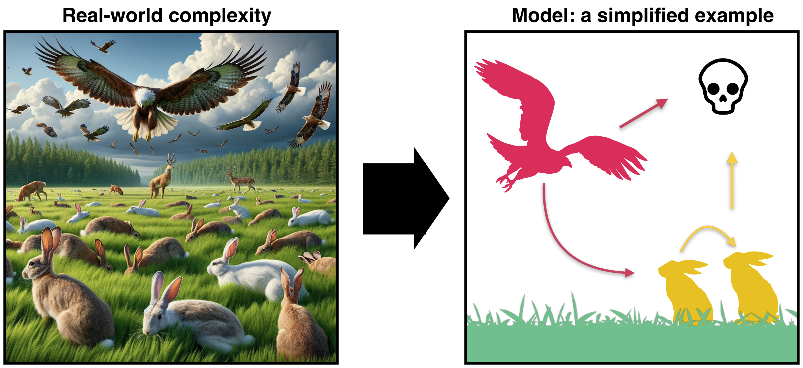
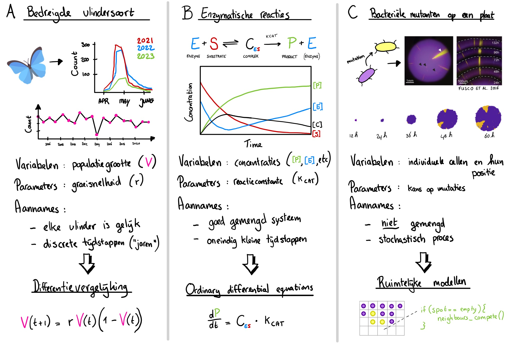

# Introductie {#sec-tbintro}

## Leerdoelen

Aan het eind van dit introducerende hoofdstuk, word je geacht hetvolgende te kunnen:

-   Uitleggen waarom modellen een belangrijk stuk gereedschap zijn binnen de biologie
-   De drie basisingrediënten van elk model benoemen
-   Onderscheid maken tussen onderwerp (*wat* gemodelleerd wordt) en model-formalismes (*hoe* er gemodelleerd wordt)
-   Voorbeelden van verschillende model-formalismes geven, en alvast enkele aannames die erbij komen kijken benoemen (nog niet in detail: gedurende de cursus leer je meer over de details)
-   Uitleggen wanneer je een model "goed" kan noemen

## Onze intuïtie is niet genoeg

Waarom zijn er het ene jaar zoveel meer konijnen dan het andere jaar? Hoe worden de patronen op de huid van een zebravis aangelegd? Komt het beschieten van dieren in de Oostvaarderseplassen hun welzijn ten goede? Waarom werken individuen van dezelfde soort samen, en vergt dit gedrag een complexe sociale structuur? Wat is er aan de hand tijdens een hartritmestoornis, en op welke manieren kunnen we het hart herstellen? Dit zijn allemaal belangrijke biologische vraagstukken, maar zoals jullie allemaal weten zijn biologische systemen vaak erg ingewikkeld. In het vakgebied Theoretische Biologie worden daarom modellen en simulaties gebruikt, om zodoende nieuwe inzicht in te vergaren en betere voorspellingen te doen. Omdat modellen een steeds belangrijker onderdeel zijn van de biologie, is het voor elke bioloog belangrijk om de nodige basiskennis te hebben.

{fig-align="center" width="80%"}

Om echt goed te begrijpen wat een model is, gaan we helemaal bij de basis beginnen en de meest simpele modellen bespreken. Je zal zien dat zelfs *simpele* modellen zich vaak onvoorspelbaar en tegenintuïtief kunnen gedragen. Onze intuïtie is dus niet te vertrouwen! Het is dus belangrijk om te leren hoe je modellen moet lezen (wiskunde en simpele R-scripts), en welke conclusies je er wel/niet uit kan trekken. Om dit te leren, bespreken we modellen uit verschillende vakgebieden binnen de biologie (microbiologie, ecologie, gedrag, evolutie). Wat je favoriete onderwerp ook is: je komt als bioloog -- ook na deze cursus -- zeer zeker nog meer met modellen in aanraking!

Dit cursusonderdeel is verdeeld over drie kernmodules (in ongeveer drie weken):

1.  Module 1: Populatiegroei
2.  Module 2: Ecologie, competitie, en evolutie
3.  Module 3: Gedrag, diffusie, en emergente patronen

Maar voordat we aan deze modules beginnen, wil ik jullie eerst graag uitleggen introduceren wat modellen nou eigenlijk **zijn**.

{#fig-veluwe}

Stel je voor dat je op de Veluwe aan het wandelen bent, en het scenario tegenkomt aan de linker zijde van @fig-veluwe: overal lopen verschillend gekleurde konijnen, roofvogels vliegen rond en grijpen hun kans, en in de achtergrond zie je herten, naaldbossen, en duistere wolken. Hoewel dit scenario natuurlijk een enorme karikatuur is, worden we in de biologie wel vaak geconfronteerd met dit probleem: biologische systemen bestaan uit veel onderdelen die allemaal tegelijk elkaar beïnvloeden. Om dit een beetje behapbaar te maken, kunnen we ervoor kiezen om het systeem versimpelen. Zo zie je aan de rechter zijde van **@fig-veluwe** dat we de achtergrond (herten, bos, wolken) even vergeten, en ons richten op slechts een paar onderdelen. Wellicht zijn we vooral geïnteresseerd in de interacties tussen de roofvogels en de konijnen. De roofvogels jagen op konijnen, terwijl de konijnen doen waar konijnen goed in zijn: vermenigvuldigen.

In de biologie zijn we veelal geïnteresseerd in de **dynamiek** van systemen. Dat betekent: hoe verandert het systeem over de tijd? In het voorbeeld van de roofvogels en konijnen, kunnen we ons bijvoorbeeld afvragen welk van de twee soorten zal toenemen, en welke zal afnemen. Je kunt je natuurlijk wel voorstellen dat als er heel veel konijnen zijn, dat de roofvogels dan een enorme kans hebben konijnen te vangen, en dus in populatiegrootte zullen toenemen. Echter zal dit het aantal konijnen verlagen... wat gebeurt er daarna? Sterven alle konijnen uit? Kunnen ze samen voortbestaan? Het antwoord hangt af van bepaalde keuzes die we moeten maken. Modelleren we alleen roofvogels en konijnen, of ook het gras dat door konijnen gegeten wordt? Hoe lang leven de roofvogels eigenlijk? En gaan de konijnen ook van ouderdom dood, of worden deze vooral door roofvogels opgegeten? Bij al deze verschillende keuzes komt belangrijke terminologie kijken die de basis vormen van elk model: **variabelen**, **parameters**, en **aannames** (*assumptions*).

::: callout-note
## Nederlands (*Dutch*)

Net zoals bij elk vakgebied, komen er bij modellen nogal wat nieuwe termen kijken. Dit jargon is niet altijd goed in het Nederlands te vertalen, en daarnaast zijn de Engelse termen vaak heel handig om te kennen. Om jullie daarmee te helpen, zullen we toch vaak het Engelse jargon gebruiken. Aan het einde van ieder hoofdstuk staat een tabel met de vertaling van deze termen.
:::

## De basisingrediënten van elk model

Modellen in de biologie kunnen heel simpel zijn, maar soms ook vrij complex zijn. Hoe ingewikkeld of simpel een model ook is, de basisingrediënten veranderen eigenlijk nauwelijks. Elk model draait om:

-   **Variabelen** (*variables*): hetgeen wat er verandert (bijvoorbeeld over de tijd). In het voorbeeld hierboven zouden dat bijvoorbeeld de populatiegroottes van de konijnen en/of roofvogels kunnen zijn. 

-   **Parameters** (*parameters*): constante waarden die bepalen *hoe* variabelen veranderen, bijvoorbeeld de groeisnelheid van de konijnen. In plaats van deze getallen vast te zetten (bijv. groeisnelheid = 2) gebruiken we meestal zogenoemde "vrije parameters'' (bijv. groeisnelheid = $r$). Let op: in biologische modellen nemen we over het algemeen aan dat dergelijke parameters positief zijn. 

-   **Aannames** (*assumptions*): keuzes die we maken om het model eenvoudig te houden. In het voorbeeld hierboven negeren we bijvoorbeeld de herten, het bos op de achtergrond, en we zouden ook kunnen kiezen om alle konijnen in het model identiek te laten zijn, ook al zien we variaties in hun kleur.

Aan het eind van dit cursusonderdeel zul je begrijpen dat de bovengenoemde begrippen gebruikt kunnen worden om allerlei biologische scenario's simpeler te omschrijven. Door deze versimpelingen te bestuderen, proberen we wat te leren over biologie. Maar afhankelijk van de biologische situatie kan het zijn dat aannames meer of minder gepast zijn.

Aan het *eind* van elk hoofdstuk staan lange verdiepende vragen, die we in het werkcollege behandelen. Tussen het lezen door staan echter ook wat kortere vragen, zodat je kan inschatten of je de stof goed tot je hebt genomen. Dus hierbij:

::: {#exr-variabelen-en-parameters}
## Bloedsuikerspiegel tijdens het sporten

 

Tijdens het sporten daalt de bloedsuikerspiegel $a$ met een vaste snelheid $b$, waarbij een eiwit $c$ tot expressie komt met vaste snelheid $d$.

**a.** Welke van de symbolen ($a$, $b$, $c$, en $d$) zou je als variabelen kunnen beschouwen, en waarom?

**b.** Welke van de symbolen zou je eerder als parameters beschouwen, en waarom?
:::

Nu we een idee hebben wat paramteres, variabelen, en aannames precies zijn, gaan we een paar voorbeeld-scenarios bespreken. Let op: deze voorbeelden hoef je nu nog niet 100% te begrijpen, en dienen op dit punt vooral ter illustratie.

## Een verschillend model voor elk scenario

Niet alle modellen zien er hetzelfde uit. Veel modellen gebruiken simpele wiskundige formules om verandering over de tijd te omschrijven. Zo zouden we de jaarlijkse populatiegrootte van een bedreigde vlindersoort (zie @fig-modeltypes A) kunnen omschrijven in een differentievergelijking (*Difference Equation,* ook wel map genoemd). Deze vergelijking omschrijft simpelweg een relatie tussen de huidige waarde van de variabele $V(t)$ (hoeveelheid vlinders in dit jaar) en de toekomstige waarde van de variabele $V(t+1)$ (hoeveelheid vlinders over 1 jaar). In het volgende hoofdstuk zul je leren hoe eenvoudig het is om met deze vergelijkingen te werken, en deze in een simpel R-script te bestuderen.

{#fig-modeltypes}

Ondanks de eenvoud van differentievergelijkingen, werken we in de biologie echter meestal met een ander type wiskundig model: differen*tiaal*vergelijkingen. In de literatuur zul je deze modelvorm tegenkomen onder de noemer *Ordinary Differential Equations* (ODEs). Deze modellen omschrijven niet discrete tijdstappen (jaar 1, jaar 2, *etc*.), maar omschrijven in plaats daarvan **de snelheid** waarmee de variabelen veranderen. Zo kun je bijvoorbeeld chemische reactiesnelheden goed beschrijven met ODEs, en op die manier bestuderen hoe enzymkinetiek werkt (@fig-modeltypes B). Omdat veel biologische processen goed uit te drukken zijn in termen van snelheden (groeisnelheid, reactiesnelheid, toxine-productie), is dit type model erg populair om simpele biologische processen te modelleren. Daarom gaan we in deze cursus uitgebreid bespreken hoe je dit type model kan lezen, en hoe je er biologische conclusie uit kan trekken.

Hoewel ODEs populair zijn binnen de biologie, is er in de laatste jaren steeds meer aandacht gekomen voor ruimtelijke patronen (*spatial patterns*). Wat hebben bijvoorbeeld de strepen van een zebravis te maken met de patronen van struikgewassen op de toendra? Op het eerste gezicht misschien niets, maar het blijkt dat beide patronen vormen door hetzelfde mechanisme! Dergelijke patronen kunnen belangrijk zijn voor natuurbehoud, en in het laatste hoofdstuk zal je zelfs zien dat er belangrijke medische consequenties zijn. Het kan dus zeer nuttig zijn om beter te begrijpen hoe patroon-vorming werkt. Hiervoor gebruiken we ruimtelijke modellen (*spatial models*) (@fig-modeltypes C).

Aan het eind van dit cursusonderdeel zal je veel verschillende modellen voorbij hebben zien komen: zowel simpele, wiskundige modellen zoals die in @fig-modeltypes A/B, als variaties op ruimtelijke modellen zoals die in @fig-modeltypes C. Het overkoepelende doel is dat je basiskennis hebt over deze modellen, begrijpt waarom ze belangrijk zijn binnen de biologie, en dat je kan je uitleggen welk biologisch scenario het beste past bij welk type model.

::: {#exr-modeluitkomsten}
## Modeluitkomsten

 

Elk type model heeft andere *modeluitkomsten*: wiskundige modellen hebben vaak vooral voorspellingen van veranderende aantallen, terwijl ruimtelijke modellen ook patronen als resultaat hebben.

**a.** Waarom denk je dat een groeiende biofilm meestal niet met ODEs wordt gemodelleerd? ANTWOORD: er is meer relevant dan alleen de groeisnelheid

**b.** Waarom denk je dat een goed gemendge fles bacterien meestal niet met een ruimtelijk model bestudeerd wordt? ANTWOORD: door goed te mengen zijn de posities niet belangrijk, dus deze modelleren is niet inzichtelijk

**c.** Waar zou je de vorming van korstmossen mee kunnen modelleren? ANTWOORD: RUIMTELIJK MODEL
:::

## Wanneer is een model "goed"?

Omdat modellen versimpelingen zijn, zullen ze nooit alle details uit de biologie beschrijven. Dit is ook niet het doel van modellen. In plaats daarvan proberen we, ondanks de versimpelingen, iets over biologie te leren, of deze beter te voorspellen. Een model is daarom niet per se slecht als het onrealistische aannames doet, omdat het best kan zijn dat je er toch iets heel belangrijks van leert, of dat de voorspellingen betrouwbaar zijn. De Britsche statisticus George P. Box zei ooit hetvolgende over modellen:

> *"All models are wrong, but some are useful."*  -- George P. Box

Als je nog niet helemaal begrijpt waarom zelfs onrealistische of "foute" modellen nuttig kunnen zijn, dan is dat niet erg. In dit cursusonderdeel gaan we aan de hand van drie modules stapje voor stapje leren werken met modellen, en je zult zien dat deze manier van denken niet alleen heel nuttig, maar ook heel leuk kan zijn!

## Terminologie 

| Nederlands | Engels | Beschrijving |
|--------|--------|------------------|
| Model | Model | Een versimpeling van een systeem, bijvoorbeeld in de vorm van eenvoudige wiskunde of computerprogramma's
| Dynamiek | Dynamics | Hoe dingen (variabelen) veranderen. Meestal zijn we geinteresseerd in veranderingen over de tijd, maar soms ook in veranderingen over de ruimte |
| Variabele | Variable | Wat er verandert, bijvoorbeeld het aantal bacteriën tijdens exponentiële groei |
| Parameter | Parameter | Constante waardes die de dynamiek bepalen, bijvoorbeeld de verdubbelingstijd van bacteriën |
