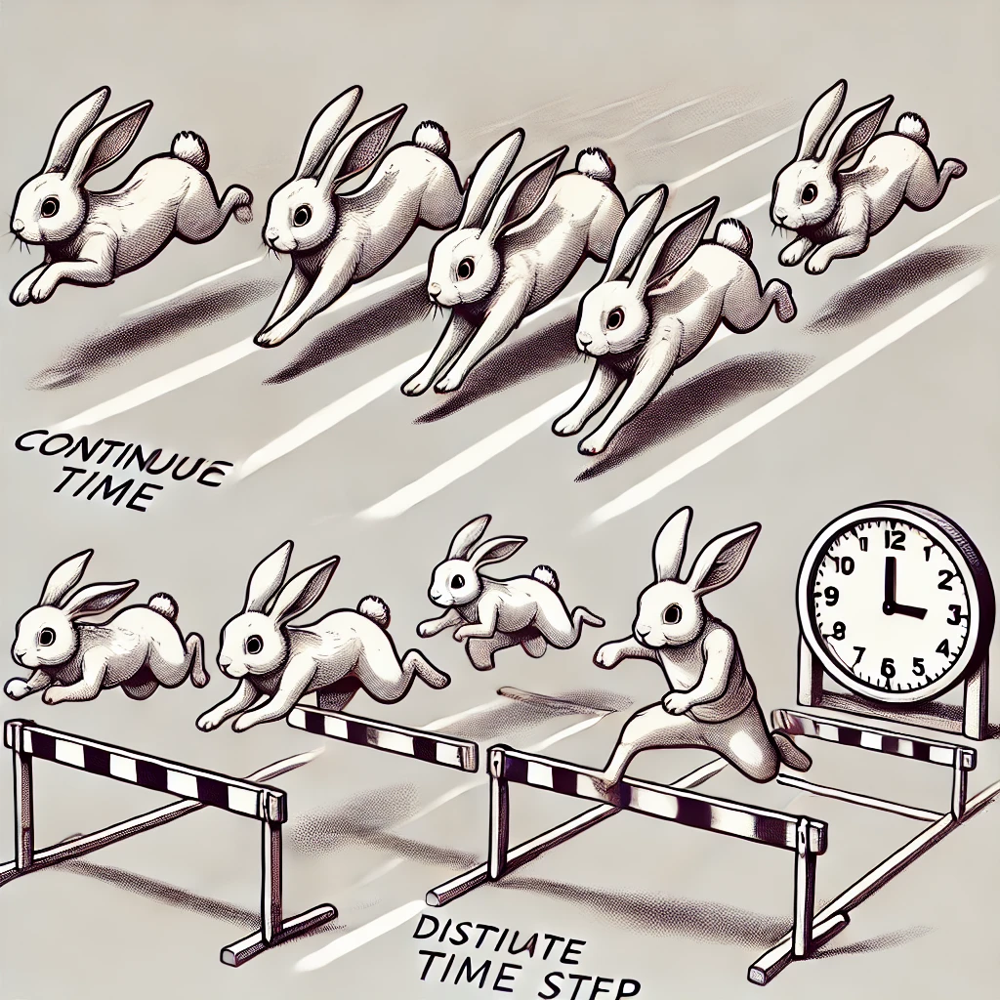

::: {.content-visible when-format="html"}

:::

# Modelleren met ODEs {#sec-odes}

In dit onderdeel bouwen we voort op de kennis van exponentiële groei, logistische groei, en draagvermogen, maar stappen we af van de differentievergelijking. We gaan kennis maken met differen*tiaal*vergelijkingen (ordinary differential equations/ODEs). ODEs zijn binnen de biologie – en ook in andere wetenschappen – een zeer populaire manier om systemen te modelleren, omdat ze relatief simpel en intuïtief zijn. 

## Leerdoelen

De leerdoelen voor dit hoofdstuk zijn:

* Begrijpen dat biologie modelleren met discrete tijdstappen soms vreemde
(maar interessante!) effecten op kan leveren
* Begrijpen dat ODEs geen “tijdstappen” hebben
* Begrijpen dat ODEs geschreven worden in termen van “x per tijdseenheid”,
en wat dit zegt over de individuele termen en parameters
* Begrijpen wanneer er in een ODE sprake is van een evenwicht
* Het in verband kunnen brengen van ODEs en hun oplossing

{fig-align="center" width="80%"}

## Chaotische konijnen 

In @sec-exp hebben we gezien wat de consequenties zijn van 24 konijnen vrijlaten in een land waar geen natuurlijke predator voor konijnen bestaat. In de opgaven hebben we deze groei gemodelleerd in R, en geprobeerd om de groei van deze konijnen enigszins te beperken door een draagvermogen in te bouwen. Hoewel dit goed leek te gaan wanneer de intrinsieke groeisnelheid ($r$) laag was,
liet snellere groei een vreemde grafieken zien (@fig-chaos-1). Van het één op het andere jaar springen we heen en weer van honderden miljoenen konijnen naar een heel klein aantal konijnen, en dit gaat over de jaren heen steeds maar door. Sterker nog, als we Thomas Austin’s experiment herhalen met een ander aantal konijnen (@fig-chaos-2) zien we dat deze fluctuaties iedere keer heel anders zijn! Met andere woorden: als we met behulp van dit model zouden willen voorspellen hoeveel konijnen er na 20 jaar zouden zijn, dan moeten we wel héél zeker weten met hoeveel konijn we precies begonnen! Bovendien hebben we niet bereikt wat we wilden: probeerde we niet juist een stabiel evenwicht te modelleren?

::: {#fig-chaos layout-ncol=2}
```{r}
#| code-fold: true
#| warning: false
#| fig.width: 6
#| fig.height: 4
#| fig-cap: "Snel-groeiende populatie gemodelleerd met een differentievergelijking, beginnende met 24 konijnen"
#| label: fig-chaos-1

library(ggplot2)
library(dplyr)
r = 2        # intrinsic growth rate
K = 10^8
init_R = 24    # start with 13

R_series <- data.frame()
for(r in c(4)){
  for(s in c(24:26)){ 
    R = s
    myR = R
    R_series <- rbind(R_series, data.frame(time=0, r=r, R=R,s=s,initR=myR))
    for(i in 1:50)
    {
      R <- r*R*(1-R/K)
      R_series <- rbind(R_series, data.frame(time=i,r=r,R=R,s=s,initR=myR))
    }
  }
}

R_series %>% filter(initR==24,time>1,time<=40,r==4) %>% 
  ggplot(aes(x=time,y=R,group=s,col=as.factor(initR))) + 
  geom_line(size=1.5) + 
  #facet_wrap(~r, scale="free_y",ncol=1) + 
  theme_bw() +
  scale_color_brewer(type="qual", palette = "Dark2", name="") +
  guides(color="none")+
  ylab("Aantal konijnen") +
  xlab("Tijd (jaren)") +
  theme_minimal(base_size=16)+
  theme(plot.margin = unit(c(0,0,0,0), "cm"))

```

```{r}
#| code-fold: true
#| warning: false
#| fig.width: 6
#| fig.height: 4
#| fig-cap: "Snel-groeiende populatie gemodelleerd met een differentievergelijking, beginnende met 24 (groen), 25 (rood), en 26 (paars) konijnen"
#| label: fig-chaos-2

R_series %>% filter(time>1,time <40,r==4) %>% 
  ggplot(aes(x=time,y=R,group=s,col=as.factor(initR))) + 
  geom_line(size=1.2) + 
  #facet_wrap(~r, scale="free_y",ncol=1) + 
  theme_bw() +
  guides(color="none")+
  scale_color_brewer(type="qual", palette = "Dark2", name="Begin aantal\nkonijnen") +
  guides(alpha="none") +
  ylab("Aantal konijnen") +
  xlab("Tijd (jaren)") +
  theme_minimal(base_size=16)+
  theme(plot.margin = unit(c(0,0,0,0), "cm"))

```
:::

Het vreemde gedrag in @fig-chaos wordt formeel **deterministische chaos** genoemd. Hiermee bedoelen we niet het type chaos dat men in spreektaal gebruikt om een rommelige kamer te omschrijven, maar de onvoorspelbare fluctuaties die bovendien extreem gevoelig zijn voor de begin-toestand. Een andere beroemd voorbeeld uit de natuurkunde
is de [dubbele slinger](https://nl.wikipedia.org/wiki/Dubbele_slinger). Hoewel je op korte termijn vaak nog enigszins kan aanvoelen in welke richting de slinger beweegt, is het op lange termijn onmogelijk in te schatten waar de slinger zich zal bevinden. Kennelijk kunnen zelfs simpele systemen zich enorm vreemd en
onvoorspelbaar gedragen. Geen wonder dat meer complexe systemen zoals biologische populaties en het weer zo moeilijk te voorspellen zijn!

::: {#tip-detchaos .callout-tip}
## Meer over "deterministische chaos" (verdieping)

Een systeem is deterministisch als de regels niet willekeurig zijn. Met andere woorden, er worden geen dobbelstenen gerold om te bepalen wat er gebeurt. De meeste chemische en biologische principes volgen zulke deterministische regeltjes, maar toch zijn ze moeilijk te voorspellen. Dit komt doordat ze ondanks het gebrek aan willekeur zeer gevoelig zijn voor de precisie van de metingen. Deze gevoeligheid ken je misschien van het concept the *butterfly effect*, waar een vleugelslag van een vlinder uiteindelijk (na lange tijd) de oorzaak kan zijn van een orkaan.  Dit wordt chaos genoemd. Zo zie je bijvoorbeeld dat als Thomas Austin 25 in plaats van 24 konijnen had vrijgelaten, dit een enorm ander beeld schept.
:::

Hoewel deterministische chaos een interessant fenomeen is (en zeer zeker niet zomaar "willekeur", zie @tip-detchaos), kunnen we ons afvragen of de groei van biologische populaties ook daadwerkelijk chaotisch is. Als we bijvoorbeeld bacteriën in het lab groeien, krijgen we meestal een logistische (sigmoïde) groeicurve, en niet een populatie die lukraak fluctueert. Wat is nou eigenlijk de oorzaak van deze chaos, en kunnen we hier misschien ook vanaf komen?

## Het probleem van "tijdstappen"

Tot nu toe namen we aan dat elke "tijdstap" van de konijnenpopulatie een jaar is. Met een bepaalde groeisnelheid ($r=2$) geeft dit inderdaad prachtige logischtische groei, maar
de daadwerkelijke populatie konijnen groeide sneller (dus: $r>2$). Helaas zagen we dat het verhogen van $r$ niet de gewenste resultaten heeft. Wat kunnen we doen om toch "snellere groei" te krijgen? 

We zouden kunnen overwegen om niet $r$ aan te passen, maar in plaats daarvan te heroverwegen wat "een tijdstap" is. Dat wil zeggen, hoeveel tijd zit er eigenlijk tussen $R(t)$ en $R(t+1)$? Als elke tijdstap een half jaar is, is er na 20 tijdstappen slechts 10 jaar voorbij. Dat betekent dat er nu na 10 jaar, 20 stappen groei hebben kunnen plaatsvinden. Als elke tijdstap $1 \over 10$ jaar is, is er na 20 tijdstappen pas 2 jaar voorbij. Na 10 jaar zullen er dus nog meer groei-stappen hebben plaatsgevonden. Met andere woorden; de grootte van de tijdstap kan ook beinvloeden hoe snel onze populatie konijnen groeit!

Om de grootte van onze tijdstap aan te passen, kunnen we ons R-script uit de opgaven van het vorige onderdeel hergebruiken:

```{r}
#| eval: false
#| echo: true
#| code-fold: false
#| 
# definieren van begin aantal konijnen
konijnen <- 24

# herhaal 40 keer de groei-vergelkijking, waarbij elke stap staat voor een HALF jaar
for (t in 1:40){
  konijnen[t+1] <- 2*konijnen[t]*(1-(konijnen[t]/10^9))
}
konijnen[20] # Aantal na 20 halve jaren
plot(konijnen,type="o",xlab="Tijd",ylab="Aantal konijnen")
```

Als je de code hierboven uitvoert zul je zien dat er na 20 halve jaren 12,425,902 konijnen zijn, en dat we gewoon een mooie sigmoïde groeicurve krijgen. Dit is ook niet raar, want eigenlijk hebben we niets aangepast: alleen onze intepretatie van "tijd-stappen" is anders. Door aan te nemen dat de tijdstap kleiner is (een half jaar in plaats van een jaar), zijn we het vreemde chaotische gedrag kwijt. Kennelijk ontstaat dit probleem alleen als de tijdstap "te groot" is. 

Dit kunnen we ook intuïtief begrijpen. Als je alleen kijkt naar hoeveel konijnen er aan het begin en aan het eind van het jaar zijn, mis je alle tussenstappen van hoe de konijnen zich tijdens het jaar voortplanten. De tussentijdse veranderingen zouden de groei kunnen aanpassen, zodat je bijvoorbeeld niet doorschiet tot onder of boven het evenwicht, maar voorzichtig het evenwicht nadert. Kleinere stapjes nemen zou dus kunnen helpen.

Hoewel we nu een oplossing voor ons fluctuatie-probleem hebben, is dit eigenlijk geen houdbare oplossing. Moeten we de hele tijd blijven controleren of de tijdstap van ons model wel "klein genoeg" is? Het antwoord op deze vraag is nee, omdat we gebruik kunnen maken van een wiskundig model dat oneindig kleine tijdstapjes aanneemt. We stappen over van de differen**tie**vergelijkingen, naar de differen**tiaal**vergelijkingen. Deze worden ook wel *ordinary differential equations* (ODEs) genoemd. 

## ODEs hebben geen tijdstappen

We gaan in dit onderdeel leren over **differentiaalvergelijkingen** (ODEs). Anders dan de eerdere vergelijkingen, beschrijven ODEs niet de populatiegrootte zelf, maar de *snelheid* waarmee deze verandert. Deze modelvorm is zeer populair binnen de biologie omdat denken in termen van snelheden vaak heel intuïtief is. Maar wat *is* een differentiaalvergelijking eigenlijk?

Zoals jullie op de middelbare school (en in het onderdeel basiswiskunde) hebben geleerd, ziet normale algebraïsche vergelijking ziet er zo uit:

\begin{align}
    6x=3
\end{align}

Waarbij (in dit geval) $x$ de onbekende is. Omdat er verder geen andere onbekenden zijn, kunnen we de vergelijking oplossen door beide kanten door $6$ te delen:

\begin{align}
    x=\frac{3}{6}=\frac{1}{2}
\end{align}

Voor deze simpele algebraïsche vergelijking is de onbekende dus $x$, en de oplossing een getal ($\frac{1}{2}$). Bij *differentiaal*vergelijkingen is de relatie tussen de onbekende en de oplossing net een beetje anders. Om dit goed te begrijpen, gaan we een simpel biologisch scenario omschrijven.


## Een hertenfeestje in wiskundige termen

{fig-align="center" width="60%"}

Stel, er zijn 100 herten in een bos, en er migreren ieder uur 3 herten naar dit bos toe (er is kennelijk een feestje). We nemen voor nu even aan dat de herten op deze korte tijdschaal niet voortplanten of dood gaan. Onder deze simpele aannames, kunnen we de functie $H(t)$ bepalen die het aantal herten in het bos over de tijd omschrijft: 

$$
    H(t) = 100 + 3 \cdot t
$$

Algemener kunnen we stellen dat voor een begin-aantal herten van $H_0$ met een migratiesnelheid van $m$, de functie er zo uit ziet:

$$
    H(t) = H_0 + m \cdot t
$$ {#eq-ht}

Hier is tijd ($t$) de onafhankelijke variabele, wat betekent dat de waarde vrij kan variëren. We kunnen dus uitrekenen hoeveel herten er na 1, 2, of 10 uur aanwezig zullen zijn. We kunnen zelfs uitrekenen hoeveel herten er na 1.4852 uur zullen zijn. Met andere woorden: tijd is een continue variabele geworden, en hoeft niet meer in vaste stapjes te worden opgedeeld. Met deze omschrijving is er dus geen sprake van "tijdstappen".

We kunnen van dit hertenfeestje ook een ODE (een differentiaalvergelijking) opschrijven. Anders dan in @eq-ht omschrijft een ODE niet het precieze aantal, maar slechts de snelheid van verandering. Dit ziet er voor ons hertenscenario zo uit:

$$
    \dt{H(t)} = m 
$$

Formeel staat hier: de afgeleide van $H(t)$ over de tijd (dat wil zeggen de snelheid van verandering) is gelijk aan $m$. Inderdaad, als we $H(t)$ uit @eq-ht zouden differentiëren voor $t$ (tijd), dan krijgen we $m$. *So far so good*.

Stel je nu voor dat we voor ons hertenfeestje alleen een ODE hadden opgesteld, en nog niet per se weten hoe $H(t)$ eruit ziet. In dat geval is $H(t)$ dus een onbekende (zoals in de algebraïsche vergelijking $x$ een onbekende was), waarvan we alleen de afgeleide hebben opgeschreven. We weten dus dat onze hertenpopulatie verandert met snelheid $m$, maar bijvoorbeeld niet met hoeveel herten we beginnen. Bovendien kan de parameter $m$ allerlei waarden hebben. Zodoende zou de oplossing voor onze ODE (dat wil zeggen, de onbekende functie $H(t)$) allerlei vormen kunnen hebben:

{fig-align="center" width="95%"}

De oplossing voor onze herten-ODE is dus niet een getal (zoals bij 𝑥 = 6), maar een functie van tijd ("een grafiekje door de tijd"). Er zijn natuurlijk ook een heleboel grafiekjes die *niet* aansluiten bij onze ODE:

{fig-align="center" width="95%"}

De bovenstaande grafiekjes van $H(t)$ zijn niet geldig voor onze ODE van het hertenfeestje, omdat niet op elk punt de helingshoek hetzelfde is (terwijl de ODE zegt dat deze altijd gelijk is aan $m$). Geldige grafiekjes worden *specifieke oplossingen* genoemd: ze gelden alleen voor specifieke beginwaarden van $H$ en een specifieke waarde van parameter $m$. Er bestaan ook
algemene oplossingen voor ODEs, wat in dit geval de wiskundige vergelijking is waaraan alle specifieke oplossingen voldoen. Voor ons hertenfeestje hadden we die al bepaald in @eq-ht. Maar, nogmaals, wat nu als we eerst een ODE hadden opgesteld? Hoe weten we dan welke oplossing (welke functie / "grafiekje
door de tijd") daarbij hoort? Deze dynamiek door de tijd is natuurlijk precies wat we willen weten, zodat we voorspellingen kunnen doen!

Stel dat de herten ook dood kunnen gaan (toch niet zo’n leuk feestje dus, maar zo is de natuur). Anders dan met de migratie, hangt de hoeveelheid sterfte af van de huidige hoeveelheid herten  ($H(t)$). De ODE wordt dan dus:

$$
\dt{H(t)} = m - d \cdot H(t)
$$ {#eq-ht2}

::: {.callout-important}
## Let op! $\mathrm{d}$ en $d$ zijn niet hetzelfde!

De bovenstaande vergelijking heeft twee verschillende d's. De d aan de linkerkant van de vergelijking geeft aan dat we het over de afgeleide hebben. De $d$ aan de rechterkant van de vergelijking staat voor *death rate*, en je kunt deze twee dus niet tegen elkaar wegdelen!
:::

Welke algemene oplossing ($H(t)=\dots$) voldoet nu aan deze vergelijking? Dat wil zeggen, welke functie $H(t)$ heeft altijd een afgeleide die aan deze ODE voldoet? Om dit te bepalen moeten we best hard gaan rekenen (hiervoor moeten we differentiaalvergelijkingen leren integreren, wat niet altijd eenvoudig is!). Ik zal jullie gerust stellen: we gaan dit ook niet doen. Er zijn meerdere redenen waarom dit niet belangrijk is: 

1. Zelfs voor relatief simpele ODEs kan het vinden van de oplossing *onmogelijk* zijn (niet slechts moeilijk, maar echt onmogelijk)
1. Je kunt met behulp van de computer (in R bijvoorbeeld) eenvoudig specifieke oplossingen ("grafiekjes") doorrekenen
1. Je kunt met pen-en-papier veel inzicht uit ODEs krijgen zonder de algemene oplossing te bepalen


::: {#exr-diffvsdiff}
## Differentie- en differentiaalvergelijkingen
<br>

Meerkeuzevraag: Welke van de volgende uitspraken beschrijft het belangrijkste verschil tussen een differentie- en een differentiaalvergelijking?

A) Een differentievergelijking gebruikt altijd kleinere tijdstappen dan een differentiaalvergelijking.

B) Een differentievergelijking beschrijft veranderingen op discrete momenten, terwijl een differentiaalvergelijking veranderingen continu beschrijft.

C) Een differentiaalvergelijking is eenvoudiger op te lossen dan een differentievergelijking.

D) Een differentievergelijking geeft alleen benaderingen, terwijl je met  differentiaalvergelijking altijd exacte oplossingen kan vinden.

E) Een differentiaalvergelijking kan alleen gebruikt worden voor complexe systemen, terwijl een differentievergelijking alleen voor eenvoudige systemen geldt.

F) Differentiaalvergelijkingen zijn eenvoudiger met de computer te berekenen dan differentievergelijkingen.

*NAAR ANTWOORDENMODEL: B*
:::


Later in de cursus gaan we R-scripts gebruiken om specifieke oplossingen te laten uit te rekenen, maar zoals gezegd kun je met pen-en-papier ook al veel voor elkaar krijgen. Hiermee oefenenen is belangrijk, want zo krijgen we een beter gevoel voor ODEs, zodat we eerder doorhebben wanneer de computer (wellicht door een typfoutje) rare resultaten geeft. Laten we beginnen met waar al het rekenwerk begint: zorgen dat we appels met appels vergelijken.

## Rekenen aan eenheden

Laten we nog even doorgaan met onze onfortuinlijke hertenfeestje met sterfte:

\begin{align}
\dt{H(t)} = m - d \cdot H(t)
\end{align}

Om het allemaal wat overzichtelijker te houden kunnen we het vermenigvuldigingsteken ($\cdot$) weglaten, en $H(t)$ opschrijven als $H$:
\begin{align}
\dt{H} = m - dH
\end{align}

Laten we nogmaals omschrijven wat hier staat. Aan de linkerzijde staat de snelheid van verandering in de hoeveelheid herten per tijdseenheid. (in het hertenscenario hadden we het over tijd in uren). De verbale omschrijving "per tijdseenheid" kunnen we wiskundig opschrijven als $\frac{1}{t}$ (of $t^{-1}$, dat is hetzelfde). Hetzelfde geldt overigens voor "per hert", wat zou vertalen naar $\frac{1}{H}$ of $H^{-1}$. Je kunt het woord "per" dus vertalen naar "gedeeld door". Dus: "herten per uur" kunnen we opschrijven als $\frac{H}{t}$.

Aan de linkerkant staat dus iets in termen van herten per uur, dus $H \over t$. Aan de rechterzijde staan twee individuele termen, namelijk $m$ en $dH$. Om de differentiaalvergelijking geldig te houden moeten deze individuele termen dezelfde eenheden hebben, je kan immers geen appels en peren bij elkaar optellen. 

\begin{align}
\underbrace{\dt{H}}_{\text{herten per uur}} = \underbrace{m}_{\text{herten per uur}} - \underbrace{dH}_{\text{herten per uur}}
\end{align}
Hieruit kunnen we dus onmiddelijk concluderen dat de migratieparameter ($m$) de eenheden "herten per uur" moet hebben. Als we dus in het veld de migratie gaan meten, weten we wat ons te doen staat.

Maar wat zijn de eenheden van de parameter $d$, die de sterfte bepaald? Hiervoor moeten we deze term gelijk stellen aan $H/t$, en oplossen voor $d$:


\begin{align*}
    dH = H/t \\
    d = 1/t
\end{align*}

Nu weten we dus dat de sterfteparameter de eenheid $1 \over t$ heeft, met andere woorden "per tijdseenheid" of "per uur". Omdat we het aantal herten hebben weggedeeld, beschrijft deze parameter dus de niet de *absolute sterfte*, maar de *relatieve sterfte*. Als we deze parameter in het veld zouden willen meten, zouden we het aantal gestorven herten per uur moeten meten *gedeelt door het totaal aantal herten*.

::: {.callout-tip} 
## ODEs doen belangrijke aannames

Zoals in de introductie uitgelegd, maken alle modellen aannames. Bij ODEs maken we ook een paar stevige aannames, namelijk:

* Populatiegroottes zijn continu. <br>*Daarom worden ze meestal als dichtheden (en niet aantallen) geïnterpreteerd. *
* Er is geen variatie binnen de populatie (elk hert is gelijk)
* Parameters zijn constant (en meestal ook groter dan $0$)
* De populatie is goed gemengd (*well-mixed assumption*)
:::


::: {#exr-eenheden-tussen}
## Plastic in de oceaan
<br>

We omschrijven hoe de hoeveelheid plastic in de oceaan verandert (kilo's per jaar) met de volgende vergelijking:

\begin{align}
\dt{P} = k - \delta P
\end{align}

a. Welke twee processen worden beschreven met de twee individuele termen? Beschrijf in je eigen woorden. 
a. Bepaal de eenheden van de parameter $k$
a. Bepaal de eenheden van de parameter $\delta$?
a. Welke parameter ($k$ of $\delta$) denk je dat groter is?

*NAAR ANTWOORDENMODEL: a. dumping en afbraak*
*NAAR ANTWOORDENMODEL: b. kilo's plastic per jaar*
*NAAR ANTWOORDENMODEL: c. per jaar*
*NAAR ANTWOORDENMODEL: d. k is dumping, dus zal wel veel groter zijn want plastic breekt niet snel af*
:::


## Evenwichten

Zoals hierboven uitgelegd is het vaak (relatief) eenvoudig om een ODE (bijvoorbeeld $\dt{H} = m - dH$) op te stellen, maar niet zo eenvoudig om de algemene oplossing ($H(t) = ...$) te vinden. In dit deel gaan we een ODE-model van de konijnen in Australië bestuderen, en zul je zien dat we die oplossing ook helemaal niet nodig hebben om inzichten te vergaren.

Een mogelijk ODE-model voor de exponentiële groei van konijnen ziet er zo uit: 

\begin{equation}
    \frac{\dd N(t)}{\dd t} = r \cdot N(t)
\end{equation}

Wederom laten we het vermenigvuldigingsteken en de $(t)$ weg, zodat het iets minder slordig wordt:

\begin{equation}
    \frac{\dd N}{\dd t} = rN
\end{equation}

De rechterzijde van deze vergelijking lijkt heel erg op de differentievergelijking uit het vorige hoofdstuk, *maar let op*, de interpretatie is net anders. Hier staat dat de *groeisnelheid* gelijk is aan $rN$, en niet de populatiegrootte in "de volgende tijdstap". Dat betekent dat bij deze ODE elke positieve waarde van $r$ (ook $r=0.1$) resulteert in groei, terwijl in de differentievergelijking alleen groei is wanneer $r>1$. Ondanks deze verschillen, kunnen we wel een vergelijkbare uitbreiding doen om de exponentiële groei niet tot in het oneindige door te laten gaan. We breiden hiervoor de ODE uit met een zogeheten  *functionele response* $f(N)$:

\begin{equation}
    \frac{\dd N}{\dd t} = rN \cdot f(N)
\end{equation}

Als de functie $f(N)$ afneemt bij toenemende hoeveelheid N, dan zal de groeisnelheid van de populatie dus ook afnemen bij toenemende hoeveelheid $N$. We weten bijvoorbeeld dat $f(N)=1-\frac{N}{100}$ gelijk wordt aan $0$ als $N=100$, dus als we onze ODE vermenigvuldigen met deze functionele response dan kan de populatie niet groeien als $N>=100$. Algemener kunnen we voor dit getal een vrije parameter voor het draagvermogen (*carrying capacity*) gebruiken ($K$). 


::: {.callout-warning}
## Parameters zijn vaak kleine letters, maar niet altijd

Over het algemeen gebruiken we voor variabelen hoofdletters (R, N) en voor parameters kleine letters (r, d). Dit is echter niet altijd zo, zoals bij de parameter $K$, die in de ecologie veel wordt gebruikt voor de *carrying capacity*. 
:::

Nu we een functionele response $f(N) = 1-\frac{N}{K}$ met carrying capacity hebben gedefinieerd, wordt onze ODE:

\begin{equation}
    \frac{\dd N}{\dd t} = rN (1-\frac{N}{K})
\end{equation}


Als een populatie groeit volgens de bovenstaande vergelijking, wanneer is er dan een evenwicht? Wanneer verandert de populatie niet meer? Met een ODE, is het antwoord daarop vrij eenvoudig: wanneer de snelheid van verandering ($\frac{\dd K}{\dd t}$) vergelijking gelijk is aan 0:

\begin{equation}
    0 = rN (1-\frac{N}{K})
\end{equation}

Het gelijk stellen aan $0$ levert een enorm voordeel op: we raken de vreemde $\dt{ }$ helemaal kwijt, en hebben daardoor ineens te maken met een normale algebraïsche vergelijking! Nu kunnen we eenvoudig uitzoeken bij welke dichtheid ($N$) de vergelijking klopt, met andere woorden we lossen op voor $N$:

\begin{align*}
    rN (1-\frac{N}{K}) &= 0 \quad \text{ als...}\\
    \color{blue} \bar{N} & \color{blue} = 0  \color{black} \quad \text{ of als...}\\
    (1-N/K) &= 0 \rightarrow \color{blue} \bar{N}=K \\
\end{align*}

Blauw-gedrukt staan de twee oplossingen van onze vergelijking. Soms (maar lang niet altijd) worden populaties in evenwicht aangegeven met een streepje boven de variabele, in dit geval $\bar{N}$. Uit deze analyse kunnen we concluderen dat de populatie konijnen niet kan groeien wanneer $N=0$ (als er geen konijnen zijn) of als $N=K$ (als de populatie gelijk is aan de carrying capacity). Het eerste evenwicht ($N=0$) wordt vaak een "triviaal" evenwicht genoemd: als populaties niet bestaan kunnen ze ook niet groeien. Het tweede evenwicht ($N=K$) is echter biologisch inzichtelijker: de populatie groeit totdat de carrying capacity is bereikt. 

We kunnen dezelfde strategie gebruiken om te controleren of pure exponentiële groei een evenwicht heeft: 

\begin{align*}
    \dt{N} &= rN = 0 \quad \text{ als...}\\
    N &= 0 &
\end{align*}

Exponentiële groei heeft dus alleen een zogezegd triviaal evenwicht.

::: {#nte-parsnul .callout-caution}
## Parameters zijn niet nul

ODEs kunnen ook gelijk zijn aan nul als parameters 0 zijn. Echter zijn dit vaak onzinnige inzichten (een model van exponentiële groei zonder groei is onzinnig). Daarom bekijken we vooral bij welke *populatiegroottes* (of dichtheden) er evenwichten zijn.
:::

Laten we ook kijken of ons hertenfeestje evenwichten heeft:

\begin{align*}
    \dt{H} &= m = 0 \quad \text{ als...}\\
\end{align*}

Zoals uitgelegd in @nte-parsnul nemen we aan dat parameters niet $0$ zijn (een model van hertenmigratie zonder migratie is geen model), en zijn we dus vooral geintresseerd in welke dichtheden $H$ evenwicht geven. Voor deze vergelijking bestaat er dus geen evenwicht, want welke waarde voor $H$ je ook invult, de populatie blijft met een constante snelheid $m$ veranderen. Voor het onfortuinlijke feestje met sterfte, ligt dat net anders:

\begin{align*}
    \dt{H} &= m - dH = 0 \quad \text{ als...}\\
    dH &= m & \\
    H &= \frac{m}{d} &
\end{align*}

De populatie herten op het feestje zal dus uiteindelijk uitkomen op een evenwicht ($H$) van $\frac{m}{d}$ herten. Op dit moment gaan er kennelijk evenveel herten dood als er naar het bos toe migreren. 

Dus: als we willen weten waar het evenwicht van een een ODE $\dt{X}$ ligt, stellen we de ODE gelijk aan $0$ en lossen we de vergelijking op voor $X$. Als de vergelijking geen $X$ bevat (of als $X$ wegvalt), dan is er geen evenwichtssituatie. 

## Opgaven

::: {#exr-eenheden-tussen2}
## Plastic in de oceaan (evenwicht)
<br>

Bekijk nogmaals de volgende vergelijking voor hoe snel de hoeveelheid plastic in de oceaan verandert:

\begin{align}
\dt{P} = k - \delta P
\end{align}

a. Bepaal bij elke hoeveelheid plastic er sprake is van een evenwichtssituatie (*steady state*)
b. Is er een triviaal ($P=0$) evenwicht?
c. Stel we vissen morgen (op een magische manier) alle plastic uit de oceaan. Schets met pen-en-paper wat er daarna zal gebeuren. 

*NAAR ANTWOORDENMODEL: a. k/delta*
*NAAR ANTWOORDENMODEL: b. nee*
*NAAR ANTWOORDENMODEL: c. zelfs als er geen plastic is, er wordt constant gedumpt, dus het gaat natuurlijk gewoon weer toenemen tenzij we ons gedrag aanpassen. plastic 'groeit' niet exponentieel, dus het zal lineair beginnen en naar een evenwicht van k/delta teruggaan (voorbeeld-schets invoegen!!)*
:::


::: {#exr-rodebloedcellen}
## Rode bloedcellen
{width="50%"}

Rode bloedcellen worden in het beenmerg geproduceerd met een snelheid $p$ cellen per dag. Elke rode bloedcel kan sterven met een kans $d$ per dag. 

a. Dit process levert dezelfde ODEs op als het bovengenoemde model voor plastic in de oceaan. Schrijf de vergelijking ($\frac{\mathrm{d}B}{dt} = \dots$) op. *dB/dt = p - dB*
a. Wat zijn de eenheden van de parameters $p$ en $d$? *p = cellen per dag, d = per dag. Zelfde idee als herten.*
a. Reken uit hoeveel bloedcellen er in het evenwicht zijn. *dB/dt = 0 geeft p - dB = 0, p = dB, B = p/d*
a. Stel je doneert een halve liter bloed. Maak met pen en papier een schets van de hoeveelheid bloedcellen over de tijd vlak na de donatie. *zelfde idee als met plastic hierboven, hoewel niet ALLES weggehaald wordt*
a. Stel nu dat je juist bloed ontvangt. Maak nog een schets van de hoeveelheid bloedcellen over de tijd. *correcte schets voor antwoordenmodel nodig!!*
a. Welke van deze twee parameters denk je dat de snelheid van het herstel bepaalt? *Intuitief zou je misschien p denken (we zien later dat dit niet zo is)*
a. Je hebt geleerd dat het vinden van algemene oplossingen van ODEs heel moeilijk kan zijn (met andere woorden, de exacte functie $B(t)$ die aan onze bloed-cellen ODE voldoet is lastig). Echter kunnen we de specifieke oplossing van een ODE wel doorrekenen als we de begin-hoeveelheid en de parameters van het model invullen. Als we deze waarden weten, kunnen we met R numeriek een specifieke oplossing doorrekenen. **Analyseer het onderstaande script regel voor regel, en lees de comments en zorg dat je begrijpt wat er gebeurt**.
```{r}
#| eval: false
# Stap 1: stel parameters in
p <- 2e11    
d <- 1/120   

# Stap 2: stel het beginaantal B in
B <- p/d

# Stap 3: maak functie die B, p, en d gebruikt om de verandering uit te rekenen
verandering <- function (B, p, d){
  delta <- p- d*B
  return(delta)
}

# Stap 4: een test of de functie werkt
verandering(B=p/d, p=p, d=d) 

# Stap 5: maak een lege lijst met begin-aantal erin
B <- c(0.9*p/d)

# Stap 6: reken 500 keer de volgende hoeveelheid B uit
for (t in 1:500) {
  B[t+1] <- B[t] + verandering(B=B[t], p=p, d=d)
}

# Stap 7: plot de tijdserie
plot(B, xlab="Tijd in dagen", ylab="Aantal rode bloedcellen", type="l", col="red", lwd=2)
```
h. In regel 15 rekent het script de hoeveelheid verandering in $B$ uit. Waarom geeft de functie $0$ terug? *je begint met evenwichtshoeveelheid B, dus er is geen verandering!*
a. De code in de for-loop produceert een specifieke oplossing, dat wil zeggen het rekent één van de mogelijke tijd-series uit voor $B(t)$. Dit gebeurt op een zeer grove manier door in stappen de integraal (de opsomming van kleine veranderingen) door te rekenen. Om dit netjes te doen, gebruik je normaal gesproken integrators die automatisch zorgen dat de tijdstap niet te groot is^[Hiervoor gaan we later in de cursus een R-script genaamd Grind.R inladen]. Leg uit waarom dat belangrijk kan zijn (hint: denk aan het vorige hoofdstuk). *grote tijdstappen kunnen soms problemen geven, dat hebben ze voor de logistische groei al gezien.*
a. Schat met behulp van de grafiek in hoe lang het duurt om de helft van het bloedverlies te herstellen. *ongeveer 100 dagen, daarom moet je tussen donaties 3-4 maanden wachten*
a. Stel dat je slechts een beetje bloed verliest (0.1%). Hoe lang duurt het om hiervan de helft te herstellen? *Zelfde snelheid! De helft is nu wel veel minder, maar het herstel gaat even snel*. 
a. Wat bepaalt denk je hoe snel je van bloedverlies herstelt ($p$, $d$, of beide)? *ze zullen vast p denken*
a. Gebruik het script om te bepalen welke parameter ($p$ of $d$) de snelheid van herstel bepaalt. Komt dit overeen met je eerdere inschatting? *d bepaald het, niet p. Veel van hen zullen dit verkeerd inschatten (denk ik) *
:::

::: {#exr-diffvsdiffinR}
## Een differentie- en **differentiaal**vergelijking doorrekenen met R

<br>

We hebben eerder een R-script bekeken die een tijdserie produceert van een  differentievergelijking voor logistische konijnengroei, waar de populatiegrootte in de variabele "konijnen" stond. Om de leesbaarheid te vergroten worden vaak kortere namen gebruikt voor parameters en variabelen (meestal enkele letters), bijvoorbeeld $N$ voor aantal konijnen, en $r$ voor de intrinsieke groeisnelheid. Het R-script zie er dan bijvoorbeeld zo uit:

```{r}
#| eval: false
# SIMPEL SCRIPT VOOR DIFFERENTIEVERGELIJKING
# Stap 1, definieer beginaantal konijnen en parameters
N <- 24    # aantal konijnen
r <- 2     # intrinsieke groeisnelheid
K <- 10^9  # schaalt de dichtheidsafhankelijkheid

# Stap 2: bereken het aantal konijnen in [t+1] 40 keer
for (t in 1:40){
  N[t+1] <- r*N[t]*(1-(N[t]/K))
}

# Stap 3: bekijk resultaten
N[20] # Aantal na 20 halve jaren
plot(N,type="o",xlab="Tijd (jaren)", ylab="Aantal konijnen")
```

We kunnen een vergelijkbaar script gebruiken om de ODE (differen*tiaal*vergelijking) van konijnengroei door te rekenen. Let op: ODEs hebben in werkelijkheid geen ``tijdstappen'' (tijd is een continue variabele), maar een computer werkt eigenlijk altijd in stappen. We moeten dus in ieder geval zorgen dat we kleine stapjes nemen. Neem de onderstaande code over en zorg dat je de regels zo goed mogelijk begrijpt.

```{r}
#| eval: false 
# SIMPEL SCRIPT VOOR DIFFERENTIAALVERGELIJKING
# Stap 1, definieer beginaantal konijnen en parameters
N <- 24 
r <- 2
K <- 10^9

# Stap 2, definieer tijdstappen en maak een dataframe aan
delta_t <- 0.0001 # grootte van de tijdstap
tijdstapjes <- seq(0,20,by=delta_t)
tijdserie <- data.frame(t=tijdstapjes,konijnen=N)

# Stap 3: Reken in kleine stapjes de volgende N uit
for (t in 1:length(tijdstapjes)-1){
  groeiN <- delta_t * r*N*(1-N/K)  
  N <- N + groeiN 
  tijdserie[t+1,"konijnen"] <- N
}

# Stap 3: bekijk resultaten
tijdserie[20,] # Aantal na 0.19 jaar
plot(tijdserie$t, tijdserie$konijnen, type="l",xlab="Tijd (jaren)", ylab="Aantal konijnen")
```

Het bovenstaande script is iets anders geschreven dan het eerste script. Simpele scripts kunnen vaak op heel veel manieren geschreven worden. Zo genereert de bovenstaande code niet een tijdserie-vector (zoals het vorige voorbeeld), maar een tijdserie-dataframe. Het voordeel hiervan is dat we ook een tweede kolom kunnen bijhouden: de hoeveelheid tijd die is verstreken.

a. Bestudeer het eerste R-script (voor de \textbf{differentie}vergelijking). Voer het script uit voor veel verschillende waarden van $r$. Wat gebeurt er met $r<1$? Wat gebeurt er met $r>3.7$? <br>
a. Bestudeer ook het R-script voor de \textbf{differentiaal}vergelijking. Wat gebeurt er met $r<1$? \\
        Wat gebeurt er met $r>3.7$? Welke waarde van $r$ geeft afname? Welke Bij welke waarde van $r$ krijg je chaotische fluctuaties? 
a. Maak de tijdstap voor de differentiaalvergelijking heel klein (bijv $delta_t = 0.0001$), en voer het hele script uit. Wat valt je op? (hint: R-studio heeft rechtsboven in de console een grote rode STOP-knop)
 
 *NAAR ANTWOORDEN: 
 a. Vanaf r > 3 krijg je fluctuaties, r>3.7 chaos. 
 b. r<1 geeft ook groei! belangrijk verschil. r>3.7 geeft geen chaos! Je moet r behoorlijk hoog opschroeven om dat toch te vinden, want de tijdstapjes zijn klein (250 werkt)
 c. dat het langzaam wordt. ODEs zijn dus precieser, maar dat wordt ook steeds moeilijker voor je computers. Dit is waarom je meestal betere tools gebruikt om ODEs te integreren, zoals GrindR ;D*


## Terminologie

::: todo-box
| Nederlands              | Engels                    | Beschrijving|
|------------------|--------------------|-----------------------------------|
| Differentiaalvergelijking / ODE | Differential equation / ODE | Een wiskundige vergelijking die omschrijft hoe snel een variabele (bijvoorbeeld een populatiegrootte) verandert. |
| Specifieke oplossing van een ODE | Specific solution of an ODE | Eén van de vele mogelijke oplossingen van een ODE, bijvoorbeeld door specifieke parameters / begin-hoeveelheden in te vullen |
| Algemene oplossing | General solution | De wiskundige vergelijking waar alle specifieke oplossingen aan voldoen. Meestal moeilijk te verkrijgen. |
| Functionele response | Functional response | Een (meestal eenvoudige) wiskundige functie die de relatie omschrijft tussen de snelheid waarmee een proces verloopt, en de grootte van een variabele |
| Evenwicht | Equilibrium / steady state | We spreken van een evenwichtssitautie als alle processen elkaar opheffen, zodat de variabelen van het systeem niet meer veranderen. |
| Triviaal evenwicht | Trivial equilibrium | Een evenwichts-situatie die biologisch gezien niet interessant is, bijvoorbeeld een evenwicht bij $0$ konijnen.  |

:::