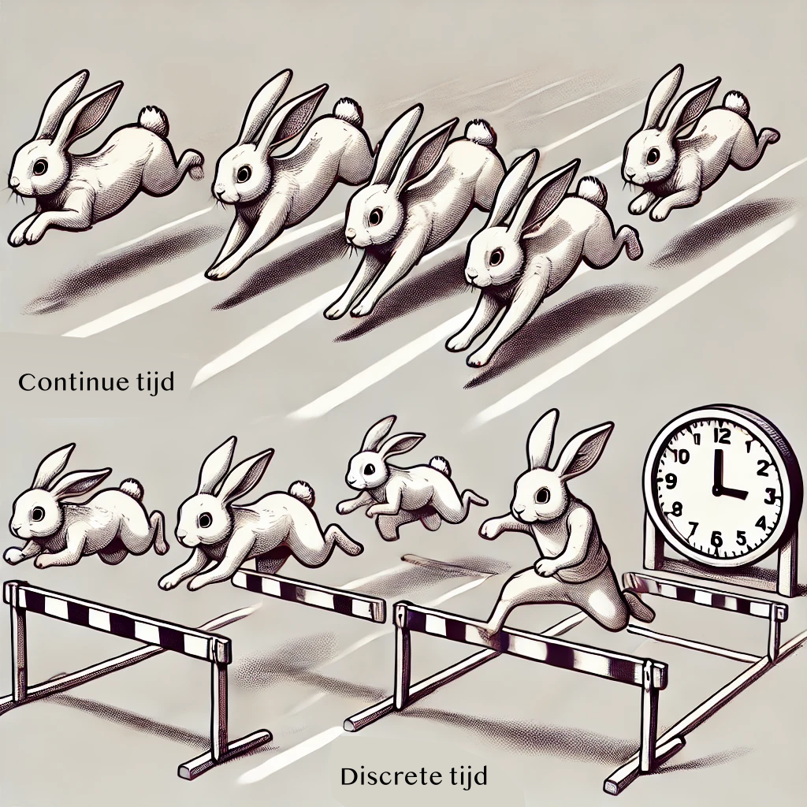
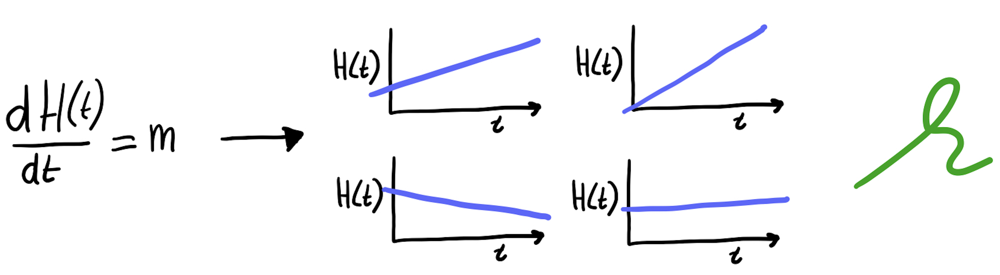
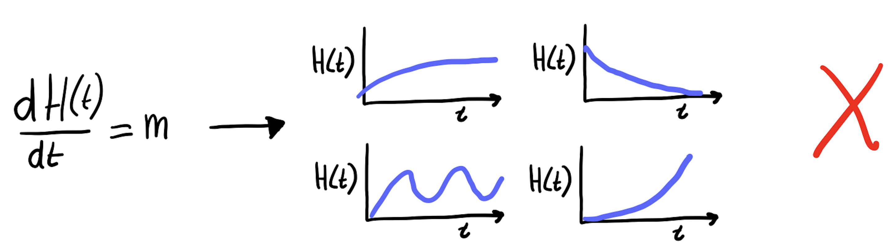
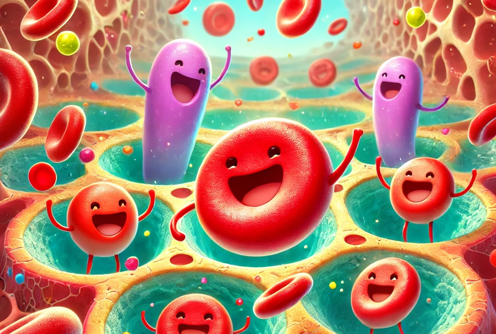




# Modelleren met ODEs {#sec-odes}

In dit onderdeel bouwen we voort op de kennis van exponentiële groei, logistische groei, en draagvermogen, maar stappen we af van de differentievergelijking. We gaan kennis maken met differen*tiaal*vergelijkingen (ordinary differential equations/ODEs). ODEs zijn binnen de biologie – en ook in andere wetenschappen – een zeer populaire manier om systemen te modelleren, omdat ze relatief simpel en intuïtief zijn. 

## Leerdoelen

De leerdoelen voor dit hoofdstuk zijn:

* Begrijpen dat biologie modelleren met discrete tijdstappen soms vreemde effecten op kan leveren.
* Begrijpen dat ODEs geen "tijdstappen" hebben.
* Begrijpen dat ODEs geschreven worden in termen van "x per tijdseenheid",
en wat dit zegt over de individuele termen en parameters.
* Begrijpen wanneer er in een ODE sprake is van een evenwicht.
* ODEs verband kunnen brengen met hun oplossing.

{fig-align="center" width="70%"}

## Chaotische konijnen

In @sec-exp hebben we gezien wat de consequenties zijn van 24 konijnen vrijlaten in een land waar geen natuurlijke predator voor konijnen bestaat. In de opgaven hebben we deze groei gemodelleerd in R, en hebben we geprobeerde de populatie te laten stabiliseren bij 500 miljoen konijnen. Met een lage groeisnelheid zagen we dat ons model een prachtige logistische groeicurve gaf, maar dat de groei veel langzamer was dan waargenomen in Australië. Het verhogen van de groeisnelheid gaf echter vreemde grafieken (@fig-chaos-1). Deze vreemde grafieken zijn een beroemde eigenschap van differentievergelijkingen voor logistische groei. De meest beroemde vorm van deze differentievergelijking is:

$$
\begin{align}
 N(t+1) &= rN(t)(1-\frac{N(t)}{K})
 \end{align}
$$ {#eq-logisticmap}

Waarbij niet $b$ (birth) en $d$ (death) zijn gebruikt (zoals in het werkcollege), maar een intrinsieke (netto) groei parameter ($r$) en daarnaast een parameter die het draagvlak bepaalt ($K$). Anders dan dit verschil, laat @eq-logisticmap dezelfde vreemde grafieken zien wanneer $r \geq 3.7$ (zie @fig-chaos-1). Van het één op het andere jaar springen we heen en weer van honderden miljoenen konijnen naar een heel klein aantal konijnen, en dit gaat over de jaren heen steeds maar door. Sterker nog, als we Thomas Austin’s experiment herhalen met een ander aantal konijnen (@fig-chaos-2) zien we dat deze fluctuaties iedere keer heel anders zijn! Met andere woorden: als we met behulp van dit model zouden willen voorspellen hoeveel konijnen er na 20 jaar zouden zijn, dan moeten we wel héél zeker weten met hoeveel konijnen we precies begonnen! Bovendien hebben we niet bereikt wat we wilden: probeerden we niet juist een stabiel evenwicht te modelleren?


::: {#fig-chaos layout-ncol=2}

```{r}
#| code-fold: true
#| warning: false
#| fig.width: 6
#| fig.height: 4
#| fig-cap: "Snel-groeiende konijnenpopulatie gemodelleerd met een differentievergelijking, beginnende met 24 konijnen (r=4, K=10e8)"
#| label: fig-chaos-1

library(ggplot2)
library(dplyr)
r = 4        # intrinsic growth rate
K = 10^8
init_R = 24    # start with 24

R_series <- data.frame()
for(r in c(r)){
  for(s in c(24:26)){ 
    R = s
    myR = R
    R_series <- rbind(R_series, data.frame(time=0, r=r, R=R,s=s,initR=myR))
    for(i in 1:50)
    {
      R <- r*R*(1-R/K)
      R_series <- rbind(R_series, data.frame(time=i,r=r,R=R,s=s,initR=myR))
    }
  }
}

R_series %>% filter(initR==24,time>1,time<=40,r==4) %>% 
  ggplot(aes(x=time,y=R,group=s,col=as.factor(initR))) + 
  geom_line(size=1.5) + 
  #facet_wrap(~r, scale="free_y",ncol=1) + 
  theme_bw() +
  scale_color_brewer(type="qual", palette = "Dark2", name="") +
  guides(color="none")+
  ylab("Aantal konijnen") +
  xlab("Tijd (jaren)") +
  theme_minimal(base_size=16)+
  theme(plot.margin = unit(c(0,0,0,0), "cm"))

```

```{r}
#| code-fold: true
#| warning: false
#| fig.width: 6
#| fig.height: 4
#| fig-cap: "Dezelfde differentievergelijking beginnende met 24 (groen), 25 (rood), en 26 (paars) konijnen. (r=4, K=10e8)"
#| label: fig-chaos-2

R_series %>% filter(time>1,time <40,r==4) %>% 
  ggplot(aes(x=time,y=R,group=s,col=as.factor(initR))) + 
  geom_line(size=1.2) + 
  #facet_wrap(~r, scale="free_y",ncol=1) + 
  theme_bw() +
  guides(color="none")+
  scale_color_brewer(type="qual", palette = "Dark2", name="Begin aantal\nkonijnen") +
  guides(alpha="none") +
  ylab("Aantal konijnen") +
  xlab("Tijd (jaren)") +
  theme_minimal(base_size=16)+
  theme(plot.margin = unit(c(0,0,0,0), "cm"))

```

Kleine initiële verschillen in het aantal konijnen kunnen na verloop van tijd een groot effect hebben in een chaotisch systeem.
:::

{style="width:20%; float: right; margin: 5px;"} Het vreemde gedrag in @fig-chaos wordt formeel **deterministische chaos** genoemd. Hiermee bedoelen we niet het type chaos dat men in spreektaal gebruikt om een rommelige kamer te omschrijven, maar fluctuaties die onvoorspelbaar zijn omdat ze zeer gevoelig zijn voor de begin-toestand. Een andere beroemd voorbeeld uit de natuurkunde
is de [dubbele slinger](https://nl.wikipedia.org/wiki/Dubbele_slinger) (zie ook de animatie rechts). 

Hoewel je op korte termijn vaak nog enigszins kan aanvoelen in welke richting de slinger beweegt, is het op lange termijn onmogelijk in te schatten waar de slinger zich zal bevinden. Kennelijk kunnen zelfs simpele systemen zich enorm vreemd en
onvoorspelbaar gedragen. Geen wonder dat meer complexe systemen zoals biologische populaties en het weer zo moeilijk te voorspellen zijn!

::: {#tip-detchaos .callout-tip collapse='false'}
## Meer over "deterministische chaos" (verdieping)

Een systeem is deterministisch als de regels niet willekeurig zijn. Met andere woorden, er worden geen dobbelstenen gerold om te bepalen wat er gebeurt. De meeste chemische en biologische principes volgen zulke deterministische regeltjes, maar toch zijn ze moeilijk te voorspellen. Dit komt doordat ze ondanks het gebrek aan willekeur zeer gevoelig zijn voor de precisie van de metingen. Deze gevoeligheid ken je misschien van het concept the *butterfly effect*, waar een vleugelslag van een vlinder uiteindelijk (na lange tijd) de oorzaak kan zijn van een orkaan.  Zo zie je bijvoorbeeld dat als Thomas Austin 25 in plaats van 24 konijnen had vrijgelaten, het precieze aantal konijnen na 20 jaar maximaal verschillend kan zijn!
:::

Hoewel deterministische chaos een interessant fenomeen is (en zeer zeker niet zomaar "willekeur", zie @tip-detchaos), kunnen we ons afvragen of de groei van biologische populaties ook daadwerkelijk chaotisch is. Als we bijvoorbeeld bacteriën in het lab groeien, krijgen we meestal een logistische (sigmoïde) groeicurve, en niet een populatie die lukraak fluctueert. Wat is nou eigenlijk de oorzaak van deze chaos, en kunnen we hier misschien ook vanaf komen?

## Het probleem van "tijdstappen"

Tot nu toe namen we aan dat elke "tijdstap" van de konijnenpopulatie een jaar is, en hebben we de groeisnelheid geprobeerd aan te passen om ons model overeen te laten komen met de data uit Australië. Helaas zagen we dat dit niet de gewenste resultaten heeft. Wat kunnen we doen om toch "snellere groei" te krijgen? 

We zouden kunnen overwegen om niet de groeisnelheid aan te passen, maar in plaats daarvan te heroverwegen wat "een tijdstap" is. Dat wil zeggen, hoeveel tijd zit er eigenlijk tussen $R(t)$ en $R(t+1)$? Als elke tijdstap een half jaar is, is er na 20 tijdstappen slechts 10 jaar voorbij. Dat betekent dat er nu na 10 jaar, 20 stappen groei hebben kunnen plaatsvinden. Als elke tijdstap een maand is ($1 \over 12$ jaar), is er na 20 tijdstappen nog geen twee jaar voorbij. In plaats van de groeisnelheid aan te passen, zouden we dus ook de grootte van "de tijdstap" aan kunnen passen! 

Om de grootte van onze tijdstap aan te passen, kunnen we het R-script uit de opgaven van het vorige onderdeel hergebruiken: 

```{r}
#| eval: false
#| echo: true
#| code-fold: false
#| 
# definieren van begin aantal konijnen
N <- 24
r <- 2

# herhaal 40 keer de groei-vergelkijking, waarbij elke stap staat voor een HALF jaar
for (t in 1:40){
  N[t+1] <- r*N[t]*(1-(N[t]/10^9))
}
N[21] # Aantal na 20 halve jaren (N[1] is de nulde tijdstap!)
plot(N,type="o",xlab="Tijd",ylab="Aantal konijnen")
```

Als je de code hierboven uitvoert zul je zien dat er na 20 halve jaren 12,425,902 konijnen zijn, en dat we gewoon een mooie sigmoïde groeicurve krijgen. Dit is ook niet raar, want eigenlijk hebben we niets aangepast: alleen onze interpretatie van "tijdstappen" is anders. Door aan te nemen dat de tijdstap kleiner is (een half jaar in plaats van een jaar), zijn we het vreemde chaotische gedrag kwijt. Kennelijk ontstaat dit probleem alleen als de tijdstap "te groot" is. 

Dit kunnen we ook intuïtief begrijpen. Als je alleen kijkt naar hoeveel konijnen er aan het begin en aan het eind van het jaar zijn, mis je alle tussenstappen van hoe de konijnen zich tijdens het jaar voortplanten. De tussentijdse veranderingen zouden de groei kunnen aanpassen, zodat je bijvoorbeeld niet doorschiet tot onder of boven het evenwicht, maar voorzichtig het evenwicht nadert. Kleinere stapjes nemen maakt het groeiprocess simpelweg gelijkmatiger. 

Hoewel we nu een oplossing voor ons fluctuatie-probleem hebben, is dit eigenlijk geen houdbare oplossing. Moeten we de hele tijd blijven controleren of de tijdstap van ons model wel "klein genoeg" is? Het antwoord op deze vraag is nee, omdat we gebruik kunnen maken van een wiskundig modelformalisme dat oneindig kleine tijdstapjes aanneemt. We stappen over van de differen**tie**vergelijkingen, naar de differen**tiaal**vergelijkingen. Deze worden ook wel *ordinary differential equations* (ODEs) genoemd. 

## ODEs hebben geen tijdstappen

We gaan in dit onderdeel leren over **differentiaalvergelijkingen** (ODEs). Anders dan de eerdere vergelijkingen, beschrijven ODEs niet de populatiegrootte zelf, maar de *snelheid* waarmee deze verandert. Deze modelvorm is zeer populair binnen de biologie omdat denken in termen van snelheden vaak heel intuïtief is. Maar wat *is* een differentiaalvergelijking eigenlijk?

Zoals jullie op de middelbare school (en in het [onderdeel basiswiskunde](@sec-algebra)) hebben geleerd, ziet een normale algebraïsche vergelijking er zo uit:

\begin{align}
    6x=3
\end{align}

Waarbij (in dit geval) $x$ de onbekende is. Omdat er verder geen andere onbekenden zijn, kunnen we de vergelijking oplossen door beide kanten door $6$ te delen:

\begin{align}
    x=\frac{3}{6}=\frac{1}{2}
\end{align}

Voor deze simpele algebraïsche vergelijking is de onbekende dus $x$, en de oplossing een getal ($\frac{1}{2}$). Bij *differentiaal*vergelijkingen is de relatie tussen de onbekende en de oplossing net een beetje anders. Om dit goed te begrijpen, gaan we een simpel biologisch scenario omschrijven.

## Een hertenfeestje in wiskundige termen 

{fig-align="center" width="60%"}

Stel, er zijn 100 herten in een bos, en er migreren ieder uur 3 herten naar dit bos toe (misschien is er een feestje). We nemen voor nu even aan dat de herten op deze korte tijdschaal niet voortplanten of dood gaan. Onder deze simpele aannames, kunnen we een wiskundige functie bepalen, $H(t)$, die het aantal herten in het bos over de tijd omschrijft: 

$$
    H(t) = 100 + 3 \cdot t
$$

Algemener kunnen we stellen dat voor een begin-aantal herten van $H_0$ met een migratiesnelheid van $m$, de functie er zo uit ziet:

$$
    H(t) = H_0 + m \cdot t
$$ {#eq-ht}

Hier is tijd ($t$) de onafhankelijke variabele, wat betekent dat de waarde vrij kan variëren. We kunnen dus uitrekenen hoeveel herten er na 1, 2, of 10 uur aanwezig zullen zijn. We kunnen zelfs uitrekenen hoeveel herten er na 1.4852 uur zullen zijn. Met andere woorden: tijd is een **continue variabele** geworden (zie @tip-contdisc), en hoeft niet meer in vaste stapjes te worden opgedeeld. Met deze omschrijving is er dus geen sprake van "tijdstappen".

::: {#tip-contdisc .callout-tip collapse='false'}

## Continue en discrete variabelen

Biologische variabelen kunnen continu of discreet zijn. Continue variabelen zijn eigenschappen zoals lengte, gewicht of temperatuur, die elke waarde op een schaal kunnen aannemen, inclusief niet-gehele getallen met decimalen. Tussen twee gegeven waarden zijn altijd tussenliggende waarden mogelijk. Dit maakt continue variabelen zeer geschikt voor processen met vloeiende overgangen, zeker wanneer ook tijd continu wordt verondersteld. Discrete variabelen hebben alleen specifieke waarden (vaak gehele getallen). Er bestaan geen tussenliggende waarden, omdat ze gebaseerd zijn op tellingen.

:::

## Een ODE van hertenmigratie

We kunnen van het bovengenoemde hertenfeestje ook een ODE (een differentiaalvergelijking) opschrijven. In tegenstelling tot @eq-ht, beschrijft een ODE niet het aantal herten zelf, maar de snelheid waarmee dat aantal verandert. Voor ons scenario ziet dit er zo uit:

$$
    \dt{H(t)} = m 
$$ {#eq-odeherten}

Formeel staat hier: de afgeleide van $H(t)$ over de tijd (dat wil zeggen de snelheid van verandering) is gelijk aan $m$. Inderdaad, als we $H(t)$ uit @eq-ht zouden differentiëren voor $t$ (tijd), dan krijgen we $m$. *So far so good*.

Stel je echter voor dat we niet weten met hoeveel herten we begonnen maar alleen weten dat er ieder uur $m$ herten bijkomen. In dat geval kunnen dus we alleen @eq-odeherten opschrijven, zonder dat we de specifieke vorm van $H(t)$ weten. In dat geval is $H(t)$ dus een **onbekende functie** (zoals in een algebraïsche vergelijking $x$ een onbekende waarde is). De oplossing van deze ODE is dus een wiskundige functie $H(t)$, waarvan de afgeleide altijd $m$ is. Hoe vinden we dan deze oplossing?

## Functies als oplossingen

Omdat @eq-odeherten heel erg simpel is, kunnen we wel bedenken hoe mogelijke oplossingen er uit zouden kunnen zien: 

{fig-align="center" width="80%"}

De oplossing voor een ODE is dus niet een enkel getal (zoals bij de algebraïsche vergelijking de oplossing $x=6$ was), maar een functie van tijd ("een grafiekje door de tijd"). Sterker nog, omdat $m$ en de beginwaarde van $H$ niet vast staat, is de oplossing een hele familie van functies. Maar er zijn natuurlijk ook een heleboel functies die *niet* aansluiten bij onze ODE:

{fig-align="center" width="78%"}

De bovenstaande grafiekjes van $H(t)$ zijn niet geldig voor onze ODE van het hertenfeestje, omdat niet op elk punt de helingshoek hetzelfde is (terwijl de ODE zegt dat deze altijd gelijk is aan $m$!). Geldige grafiekjes worden *specifieke oplossingen* genoemd: ze gelden alleen voor specifieke beginwaarden van $H$ en een specifieke waarde van parameter $m$. Er bestaan ook **algemene oplossingen** voor ODEs. Dat zijn formules waaraan alle specifieke oplossingen voldoen. Voor ons hertenfeestje waren we daarmee begonnen: @eq-ht. 

Maar stel dat we beginnen met een ODE zonder vooraf een specifieke oplossing te kennen. Hoe weten we dan de oplossing van die ODE? Het zijn natuurlijk vooral de oplossingen die ons inzicht geven in de dynamiek van het systeem! Maar oplossingen vinden, is lang niet altijd eenvoudig. 

Stel bijvoorbeeld dat de herten ook naar huis kunnen gaan. Omdat alleen herten die in het bos aanwezig zijn naar huis kunnen gaan, hangt deze snelheid af van de huigide hoeveelheid herten ($H(t)$). De ODE wordt dan dus:

$$
\dt{H(t)} = m - d \cdot H(t)
$$ {#eq-ht2}

::: {.callout-important}
## Let op! $\mathrm{d}$ en $d$ zijn niet hetzelfde!

De bovenstaande vergelijking heeft twee verschillende d's. De d aan de linkerkant van de vergelijking is de d van differentiaal, en geeft dus aan dat we het over de afgeleide hebben. De $d$ aan de rechterkant van de vergelijking zou kunnen staan voor *depart* (vertrekken), en is een model-parameter (in andere modellen zou je $d$ kunnen tegenkomen als *death rate* of *decay*). Je kunt deze twee d's dus niet tegen elkaar wegdelen! We hadden deze parameter ook $v$ voor vertrekken kunnen noemen, of $q$ voor kukelekuu (die laatste keuze is om meerdere reden misschien niet zo handig ;)). 
:::

Welke algemene oplossing ($H(t)=\dots$) voldoet nu aan deze vergelijking? Oftewel: welke functie $H(t)$ heeft altijd een afgeleide die aan deze ODE voldoet? Wat in ons eerste model eenvoudig uit ons hoofd te doen was, is nu ineens wat lastiger geworden. Om de oplossing te vinden, moeten we differentiaalvergelijkingen integreren, wat niet altijd eenvoudig is. Gelukkig hoeven jullie dit niet handmatig te doen, en wel om de volgende redenen:

1. Zelfs voor relatief eenvoudige ODEs kan het vinden van de **algemene** oplossing *onmogelijk* zijn (niet alleen moeilijk, maar écht onmogelijk).
1. Met behulp van een computer (bijvoorbeeld in R) kun je eenvoudig specifieke oplossingen (grafiekjes over de tijd) berekenen.
1. Je kunt met pen en papier veel inzicht uit ODEs krijgen zonder de algemene oplossing te bepalen.

## Rekenen aan eenheden {#sec-odes-eenheden}

Later in de cursus gaan we R-scripts gebruiken om specifieke oplossingen te laten uitrekenen, maar zoals gezegd kun je met pen en papier ook al veel voor elkaar krijgen. Hiermee oefenenen is belangrijk, want zo krijgen we een beter gevoel voor ODEs, zodat we eerder doorhebben wanneer de computer (wellicht door een typefoutje) rare resultaten geeft. Laten we beginnen met waar al het rekenwerk begint: zorgen dat we appels met appels vergelijken.

Laten we nog even doorgaan met het model van herten-migratie met herten die naar huis vetrekken:

\begin{align}
\dt{H(t)} = m - d \cdot H(t)
\end{align}

Om het allemaal wat overzichtelijker te houden kunnen we het vermenigvuldigingsteken ($\cdot$) weglaten, en $H(t)$ opschrijven als $H$:

\begin{align}
\dt{H} = m - dH
\end{align}

Laten we nogmaals omschrijven wat hier staat. Aan de linkerzijde staat de verandering in de hoeveelheid herten per tijdseenheid (in het hertenscenario hadden we het over tijd in uren). De verbale omschrijving "per tijdseenheid" kunnen we wiskundig opschrijven als $\frac{1}{t}$ (of $t^{-1}$, dat is hetzelfde). Hetzelfde geldt overigens voor "per hert", wat zou vertalen naar $\frac{1}{H}$ of $H^{-1}$. Je kunt het woord "per" dus vertalen naar "gedeeld door". Dus: "herten per uur" kunnen we opschrijven als $\frac{H}{t}$.

Aan de linkerkant staat dus iets in termen van van "verandering in aantal herten per tijdsinterval in uren", wat we voor het gemak afkorten naar "herten per uur", dus $H \over t$. Aan de rechterzijde staan twee individuele termen, namelijk $m$ en $dH$. Om de differentiaalvergelijking geldig te houden moeten deze individuele termen dezelfde eenheden van "herten per uur" hebben, want je kan immers geen appels en peren bij elkaar optellen. 

\begin{align}
\underbrace{\dt{H}}_{\text{herten per uur}} = \underbrace{m}_{\text{herten per uur}} - \underbrace{dH}_{\text{herten per uur}}
\end{align}

Hieruit kunnen we dus onmiddelijk concluderen dat de migratieparameter ($m$) ook in termen van "herten per uur" uitgedrukt moet worden. Wiskundig stellen we dan dat de eenheid (soms ook dimensie genoemd) van $m$ "herten per uur" is. Als we dus in het veld de migratie gaan meten, weten we wat ons te doen staat. 

Maar wat zijn de eenheden van de parameter $d$, die het vertrek bepaalt? Hiervoor moeten we deze term gelijk stellen aan $H/t$, en oplossen voor $d$:

\begin{align*}
    dH = H/t \\
    d = 1/t
\end{align*}

Nu weten we dus dat de vertrekparameter de eenheid/dimensie $1 \over t$ heeft, met andere woorden "per tijdseenheid" of "per uur". Omdat we het aantal herten hebben weggedeeld, beschrijft deze parameter dus de niet het vertrek op populatieniveau, maar de vertreksnelheid per individu (dat laaste wordt ook wel *per capita* genoemd). Als we deze parameter in het veld zouden willen meten, zouden we het aantal vertrekkende herten per uur moeten meten *gedeeld door het totaal aantal herten*. 

::: {.callout-tip collapse='false'} 
## ODEs doen belangrijke aannames

Zoals in de introductie uitgelegd, maken alle modellen aannames. Bij ODEs maken we ook een paar stevige aannames, namelijk:

* Populatiegroottes zijn continu. <br>*Daarom worden ze meestal als dichtheden (en niet aantallen individuen) geïnterpreteerd. *
* Er is geen variatie binnen de populatie <br> *Elk hert is gelijk, dus dezelfde migratiesnelheid en vertrekkans, ongeacht leeftijd, geslacht, etc.*
* De populatie is goed gemengd (*well-mixed assumption*)<br>*Er is dus niet zoiets als een ruimtelijk patroon, waarbij bijvoorbeeld herten aan de rand van een bos meer kans hebben op sterfte door predatie dan herten in het midden van het bos.*
:::

::: {#exr-eenheden-tussen}
## Plastic in de oceaan
<br>

We omschrijven hoe de hoeveelheid plastic in de oceaan verandert (kilo's per jaar) met de volgende vergelijking:

\begin{align}
\dt{P} = k - \delta P
\end{align}

a. Welke twee processen worden beschreven met de twee individuele termen? Beschrijf in je eigen woorden. 
a. Bepaal de eenheid van de parameter $k$
a. Bepaal de eenheid van de parameter $\delta$?
a. Welk van de twee termen ($k$ of $\delta P$) denk je dat groter is, gegeven het huidige gedrag van mensen?

:::

## Evenwichten

Zoals hierboven uitgelegd is het vaak (relatief) eenvoudig om een ODE (bijvoorbeeld $\dt{H} = m - dH$) op te stellen, maar niet zo eenvoudig om de algemene oplossing ($H(t) = ...$) te vinden. In dit deel gaan we een ODE-model van de konijnen in Australië bestuderen, en zal je zien dat we die oplossing ook helemaal niet nodig hebben om inzichten te vergaren.

Een mogelijk ODE-model voor de exponentiële groei van konijnen ziet er zo uit: 

\begin{equation}
    \frac{\dd N(t)}{\dd t} = r \cdot N(t)
\end{equation}

Wederom laten we het vermenigvuldigingsteken en de $(t)$ weg, zodat het iets leesbaarder wordt:

\begin{equation}
    \frac{\dd N}{\dd t} = rN
\end{equation}

De rechterzijde van deze vergelijking lijkt heel erg op de differentievergelijking uit het vorige hoofdstuk, *maar let op*, de interpretatie is net anders. Hier staat dat de **groeisnelheid** gelijk is aan $rN$, en niet de populatiegrootte in "de volgende tijdstap". Dat betekent dat bij deze ODE elke positieve waarde van $r$ (ook $r=0.1$) resulteert in groei, terwijl er in de differentievergelijking alleen groei is wanneer $r>1$. Ondanks deze verschillen, kunnen we ook met ODEs de groei beperken door kleine uitbreidingen te doen. In het volgende hoofdstuk zullen we bijvoorbeeld -- zoals in opgave @exr-rabbits-map -- geboorte- ($b$, *birth*) en sterfte- ($d$, *death*) processen gaan toevoegen. Maar eerst gaan we onze ODE op een andere manier uitbreiden:

\begin{equation}
    \frac{\dd N}{\dd t} = rN \cdot f(N)
\end{equation}

Met de functie $f(N)$ kunnen we de ODE uitbreiden, bijvoorbeeld door de groeisnelheid van een populatie afhankelijk te maken van de huidige populatiedichtheid. 

Als $f(N)$ bijvoorbeeld afneemt bij toenemende $N$, zal de groeisnelheid van de populatie ook afnemen naarmate $N$ groter wordt. Stel dat we $f(N) = 1 - \frac{N}{100}$ kiezen. Deze functie wordt gelijk aan $0$ als $N = 100$:

```{r}
# Define the function
f <- function(N) {
  1 - N / 100
}

# Generate a sequence of N values
N_values <- seq(0, 120, by = 1)  # Extended range to visualize the function around 100

# Compute f(N)
f_values <- f(N_values)
par(mar=c(2,2,2,2))
# Plot the function
plot(
  N_values, f_values, type = "l", col = "blue", lwd = 2,
  xlab = "N", ylab = "f(N)", main = "Plot van f(N) = 1 - N/100",
  ylim = c(-0.2, 1.4), xlim = c(-10, 140), axes=F
)
abline(v=0,lwd=2)
abline(h=0,lwd=2)
# Add the vertical line below the x-axis
segments(
  x0 = 100, y0 = par("usr")[3],  # par("usr")[3] gives the lower limit of the y-axis
  x1 = 100, y1 = 0, col = "grey", lty = 3,lwd=1.2
)
# Annotate the points (100, 0) and (0, 1)
text(100, -0.37, labels = "100", col = "black", cex=0.7, xpd=T)
text(-10, 1, labels = "1", col = "black")
text(-15, 1.3, labels = "f(N)", col = "grey", cex=0.9, xpd=T)
text(140, -0.15, labels = "N", col = "grey", cex=0.9, xpd=T)
```

Als we onze ODE vermenigvuldigen met deze functie, betekent dit dat de snelheid van verandering $0$ wordt wanneer er $100$ konijnen zijn. Dit model impliceert dat de populatie niet meer kan groeien als $N \geq 100$, omdat de groeisnelheid dan $0$ of zelfs negatief is. Simpel gezegd: er is een limiet aan de groei (en dus de grootte) van de populatie. Algemener kunnen we het getal $100$ vervangen door een parameter die we het draagvermogen (carrying capacity, $K$) noemen. Het draagvermogen stelt de maximale populatiegrootte voor die de omgeving kan ondersteunen. Onze uiteindelijke ODE wordt dan:

$$
\begin{equation}
    \frac{\dd N}{\dd t} = rN \left(1-\frac{N}{K}\right)
\end{equation}
$$ {#eq-logisticode}

::: {.callout-warning collapse=false}
## Parameters zijn vaak kleine letters, maar niet altijd

Over het algemeen gebruiken we voor variabelen hoofdletters ($R$, $N$) en voor parameters kleine letters ($r$, $d$). Dit is echter niet altijd zo, zoals bij de parameter $K$, die in de ecologie veel wordt gebruikt voor de *carrying capacity*. 
:::

Als een populatie groeit volgens vergelijking @eq-logisticode, wanneer is er dan een evenwicht? Wanneer verandert de populatie niet meer? Met een ODE, is het antwoord daarop vrij eenvoudig te vinden: wanneer de snelheid van verandering ($\frac{\dd N}{\dd t}$) gelijk is aan 0:

\begin{equation}
    0 = rN \left(1-\frac{N}{K}\right)
\end{equation}

Het gelijkstellen aan $0$ levert een enorm voordeel op: we raken de vreemde $\dt{ }$ helemaal kwijt, en hebben daardoor ineens te maken met een normale algebraïsche vergelijking! Nu kunnen we eenvoudig uitzoeken bij welke dichtheid ($N$) de vergelijking klopt, met andere woorden we lossen op voor $N$:

\begin{align*}
    rN \left(1-\frac{N}{K}\right) &= 0 \quad \text{ als...}\\
    \color{blue} \bar{N} & \color{blue} = 0  \color{black} \quad \text{ of als...}\\
    \left(1-\frac NK \right) &= 0 \rightarrow \color{blue} \bar{N}=K \\
\end{align*}

Blauw-gedrukt staan de twee oplossingen van onze vergelijking, die de evenwichten of *steady states* van de populatie geven. Soms (maar lang niet altijd) worden populaties in evenwicht aangegeven met een streepje boven de variabele, in dit geval $\bar{N}$. Uit deze analyse kunnen we concluderen dat de populatie konijnen niet kan groeien wanneer $N=0$ (als er geen konijnen zijn) of als $N=K$ (als de populatie gelijk is aan $K$: de *carrying capacity* van het systeem. Het eerste evenwicht ($N=0$) wordt vaak een "triviaal" evenwicht genoemd: als populaties niet bestaan kunnen ze ook niet groeien. Het tweede evenwicht ($N=K$) is echter biologisch meer relevant: de populatie groeit totdat de *carrying capacity* is bereikt. 

We kunnen dezelfde strategie gebruiken om te controleren of pure exponentiële groei een evenwicht heeft: 

\begin{align*}
    \dt{N} &= rN = 0 \quad \text{ als...}\\
    N &= 0 &
\end{align*}

Exponentiële groei heeft dus alleen een zogezegd triviaal evenwicht ($N = 0$). 

::: {#tip-parsnul .callout-warning collapse=false}
## Parameters zijn niet nul

ODEs kunnen ook gelijk zijn aan nul als parameters 0 zijn. Echter zijn dit vaak onzinnige inzichten (een model van exponentiële groei zonder groei is niet nuttig). Daarom bekijken we vooral bij welke **populatiegroottes** (of dichtheden) er evenwichten zijn.
:::

Laten we ook kijken of ons hertenfeestje evenwichten heeft:

\begin{align*}
    \dt{H} &= m = 0 \quad \text{ als...}\\
\end{align*}

Zoals uitgelegd in @tip-parsnul nemen we aan dat parameters niet $0$ zijn (een model van hertenmigratie zonder migratie is geen model), en zijn we dus vooral geïnteresseerd in welke waarden voor $H$ een  evenwicht geven. Voor deze vergelijking bestaat er dus geen evenwicht, want welke waarde voor $H$ je ook invult, de populatie blijft met een constante snelheid $m$ veranderen. Voor het feestje waarbij ook herten vertrekken, ligt dat net anders:

\begin{align*}
    \dt{H} &= m - dH = 0 \quad \text{ als...}\\
    dH &= m & \\
    \bar{H} &= \frac{m}{d} &
\end{align*}

De populatie herten op het feestje zal dus uiteindelijk uitkomen op een evenwicht ($\bar{H}$) van $\frac{m}{d}$ herten. Op dit moment gaan er kennelijk evenveel herten dood als er naar het bos toe migreren. 

### Conclusie evenwichten

Dus: als we willen weten waar het evenwicht van een een ODE (bijv. $\dt{X}$) ligt, stellen we de ODE gelijk aan $0$ en lossen we de vergelijking op voor $X$. Als de vergelijking geen $X$ bevat (of als $X$ wegvalt), en je dus alleen constanten overhoudt, is er geen evenwicht. 

## Opgaven

::: {.pepexr #exr-eenheden-tussen2}
## Plastic in de oceaan (evenwicht)
<br>

Bekijk nogmaals de volgende vergelijking voor hoe snel de hoeveelheid plastic in de oceaan verandert:

\begin{align}
\dt{P} = k - \delta P
\end{align}

a. Bepaal bij welke hoeveelheid plastic er sprake is van een evenwichtssituatie (*steady state*)
b. Is er een triviaal ($P=0$) evenwicht?
c. Stel we vissen morgen (op een magische manier) alle plastic uit de oceaan. Schets met pen en paper wat er daarna zal gebeuren. 

:::

::: {.mixedexr #exr-rodebloedcellen}

## Rode bloedcellen

{width="50%"}

Rode bloedcellen worden in het beenmerg geproduceerd met een snelheid $p$ cellen per dag. Elke rode bloedcel kan sterven met een kans $d$ per dag. 

  a. Dit process levert dezelfde ODEs op als het bovengenoemde model voor plastic in de oceaan. Schrijf de vergelijking ($\dt{B} = \dots$) op. 
  a. Wat zijn de eenheden van de parameters $p$ en $d$? 
  a. Reken uit hoeveel bloedcellen er in het evenwicht zijn. 
  a. Stel je doneert een halve liter bloed. Maak met pen en papier een schets van de hoeveelheid bloedcellen over de tijd vlak na de donatie.
  a. Stel nu dat je juist bloed ontvangt. Maak nog een schets van de hoeveelheid bloedcellen over de tijd. 
  a. Welke van deze twee parameters denk je dat de snelheid van het herstel bepaalt? 

Je hebt geleerd dat het vinden van algemene oplossingen van ODEs heel moeilijk kan zijn (met andere woorden, de exacte functie $B(t)$ vinden die aan onze bloedcellen-ODE voldoet is lastig). We kunnen echter een specifieke oplossing van een ODE wel berekenen, als we tenminste de begin-hoeveelheid en de parameters van het model invullen. Dan kunnen we met R numeriek doorrekenen wat er gaat gebeuren. **Analyseer het onderstaande script regel voor regel, en lees de comments en zorg dat je begrijpt wat er gebeurt**.
```{r}
#| eval: false
# Stap 1: stel parameters in
p <- 2e11    
d <- 1/120   

# Stap 2: stel het beginaantal B in
B <- p/d

# Stap 3: maak functie die B, p, en d gebruikt om de verandering uit te rekenen
verandering <- function (B, p, d){
  delta <- p - d*B
  return(delta)
}

# Stap 4: een test of de functie werkt
verandering(B=p/d, p=p, d=d) 

# Stap 5: maak een vector van 1 lang met het begin-aantal erin
B <- c(0.9*p/d)

# Stap 6: reken 500 keer de volgende hoeveelheid B uit
for (t in 1:500) {
  B[t+1] <- B[t] + verandering(B=B[t], p=p, d=d)
}

# Stap 7: plot de tijdserie
plot(B, xlab="Tijd in dagen", ylab="Aantal rode bloedcellen", type="l", col="seagreen", lwd=2)
```

  g. In 'Stap 4' rekent het script de hoeveelheid verandering in $B$ uit. Waarom geeft de functie $0$ terug? 
  h. De code in de for-loop produceert een specifieke oplossing, dat wil zeggen het rekent één van de mogelijke tijd-series uit voor $B(t)$. Dit gebeurt op een zeer grove manier door in stappen de integraal (de opsomming van kleine veranderingen) door te rekenen. Om dit netjes te doen, gebruik je normaal gesproken integrators die automatisch zorgen dat de tijdstap niet te groot is^[Hiervoor gaan we later in de cursus een R-script genaamd Grind.R inladen]. Leg uit waarom dat belangrijk kan zijn (hint: denk aan het vorige hoofdstuk). 
  i. Schat met behulp van de grafiek in hoe lang het duurt om de helft van het bloedverlies te herstellen.
  j. Stel dat je slechts een beetje bloed verliest (0.1%). Hoe lang duurt het om hiervan de helft te herstellen? 
  k. Wat bepaalt denk je hoe snel je van bloedverlies herstelt ($p$, $d$, of beide)? 
  l. Gebruik het script om te bepalen welke parameter ($p$ of $d$) de snelheid van herstel bepaalt. Komt dit overeen met je eerdere inschatting? 
:::

::: {.Rexr #exr-diffvsdiffinR}
## Een differentie- en **differentiaal**vergelijking doorrekenen met R

<br>

We hebben eerder een R-script bekeken die een tijdserie produceert van een  differentievergelijking voor logistische konijnengroei. We kunnen in deze differentievergelijking ook de parameter $K$ gebruiken om de groei te stoppen. De code ziet er dan ongeveer zo uit: 

```{r}
#| eval: false
# SIMPEL SCRIPT VOOR DIFFERENTIEVERGELIJKING
# Stap 1, definieer beginaantal konijnen en parameters
N <- 24    # aantal konijnen
r <- 2     # groei per jaar
K <- 10^9  # schaalt de dichtheidsafhankelijkheid

# Stap 2: bereken het aantal konijnen in [t+1] 40 keer
for (t in 1:40){
  N[t+1] <- r*N[t]*(1-(N[t]/K))
}

# Stap 3: bekijk resultaten
N[20] # Aantal na 20 jaren
plot(N,type="o",xlab="Tijd (jaren)", ylab="Aantal konijnen")
```

We kunnen een vergelijkbaar script gebruiken om de ODE (differen*tiaal*vergelijking) van konijnengroei door te rekenen. Let op: ODEs hebben in werkelijkheid geen "tijdstappen" (tijd is een continue variabele), maar een computer werkt eigenlijk altijd in stappen. We moeten dus in ieder geval zorgen dat we kleine stapjes nemen. Neem de onderstaande code over en zorg dat je de regels zo goed mogelijk begrijpt.

```{r}
#| eval: false 
# SIMPEL SCRIPT VOOR DIFFERENTIAALVERGELIJKING
# Stap 1, definieer beginaantal konijnen en parameters
N <- 24 
r <- 2
K <- 10^9

# Stap 2, definieer tijdstappen en maak een dataframe aan
delta_t <- 0.01 # grootte van de tijdstap 
tijdstapjes <- seq(0,20,by=delta_t)
tijdserie <- data.frame(t=tijdstapjes,konijnen=N)

# Stap 3: Reken in kleine stapjes de volgende N uit
for (t in 1:length(tijdstapjes)-1){
  groeiN <- delta_t * r*N*(1-N/K)  
  N <- N + groeiN 
  tijdserie[t+1,"konijnen"] <- N
}

# Stap 3: bekijk resultaten
tijdserie[20,] # Aantal na 0.19 jaar
plot(tijdserie$t, tijdserie$konijnen, type="l",xlab="Tijd (jaren)", ylab="Aantal konijnen")
```

Het bovenstaande script is iets anders geschreven dan het eerste script. Simpele scripts kunnen vaak op heel veel manieren geschreven worden. Zo genereert de bovenstaande code niet een tijdserie-vector (zoals het vorige voorbeeld), maar een tijdserie-dataframe. Het voordeel hiervan is dat we ook een tweede kolom kunnen bijhouden: de hoeveelheid tijd die is verstreken.

a. Bestudeer het eerste R-script (voor de **differentie**vergelijking). Voer het script uit voor veel verschillende waarden van $r$. Wat gebeurt er met $r<1$? Wat gebeurt er met $r>3.7$? <br>
b. Bestudeer ook het tweede R-script (voor de **differentiaal**vergelijking, waarbij we kleine stapjes nemen). Wat gebeurt er met $r<1$? Wat gebeurt er nu met $r>3.7$? Welke waarde van $r$ geeft afname? Welke Bij welke waarde van $r$ krijg je chaotische fluctuaties? 
c. Maak de tijdstap voor de differentiaalvergelijking heel klein (bijv `delta_t = 0.0001`), en voer het hele script uit. Wat valt je op? (hint: R-studio heeft rechtsboven in de console een grote rode STOP-knop)

:::

## Terminologie


| Nederlands              | Engels                    | Beschrijving|
|------------------|--------------------|-----------------------------------|
| Differentiaalvergelijking / ODE | Differential equation / ODE | Een wiskundige vergelijking die omschrijft hoe snel een variabele (bijvoorbeeld een populatiegrootte) verandert. |
| Continue variabelen | Continuous variables | Variabelen  die elke waarde op een schaal kunnen aannemen, inclusief decimalen (denk aan lengte, temperatuur, of gewicht) |
| Discrete variabelen | Discrete variables | Variabelen die een beperkt aantal (specifieke) waarden kunnen aannemen. Vaak zijn dit gehele getallen (denk aan een aantal cellen of een aantal mutaties) |
| Specifieke oplossing van een ODE | Specific solution of an ODE | Eén van de vele mogelijke oplossingen van een ODE, bijvoorbeeld door specifieke parameters / begin-hoeveelheden in te vullen |
| Algemene oplossing | General solution | De wiskundige vergelijking waar alle specifieke oplossingen aan voldoen. Meestal moeilijk te verkrijgen. |
| Evenwicht | Equilibrium / steady state | We spreken van een evenwichtssituatie als alle processen elkaar opheffen, zodat de variabelen van het systeem niet meer veranderen. |
| Triviaal evenwicht | Trivial equilibrium | Een evenwichts-situatie die biologisch gezien niet interessant is, bijvoorbeeld een evenwicht bij $0$ konijnen.  |
:  {.striped .hover}