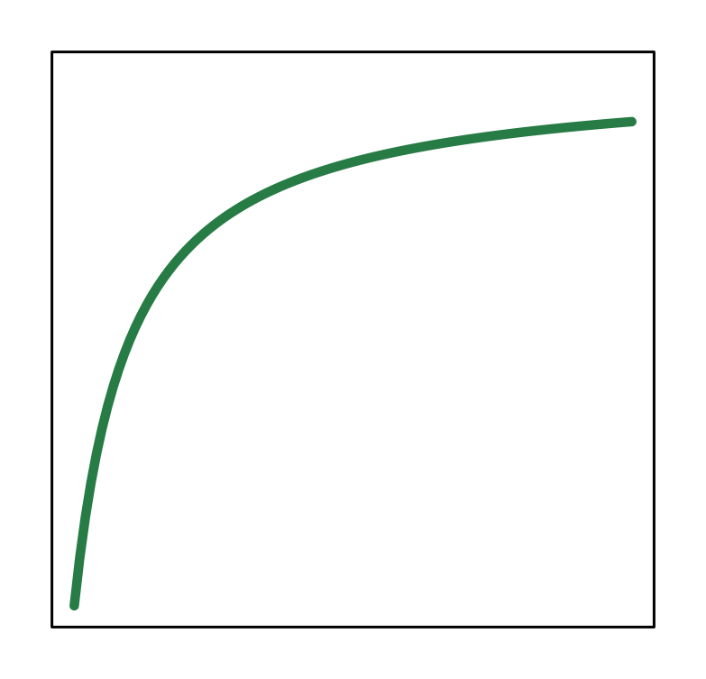
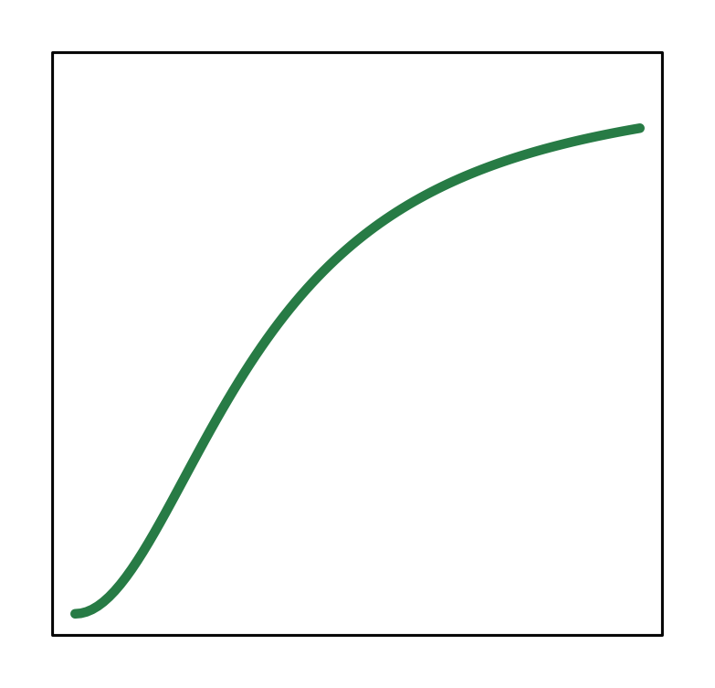
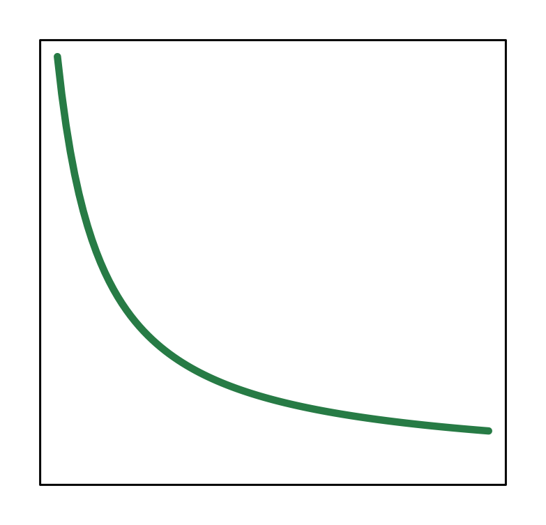
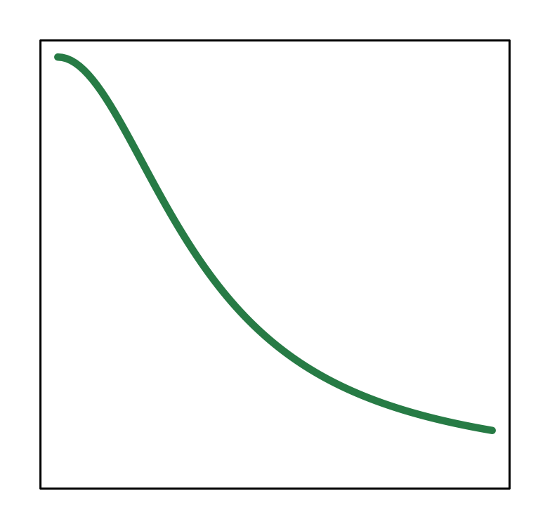
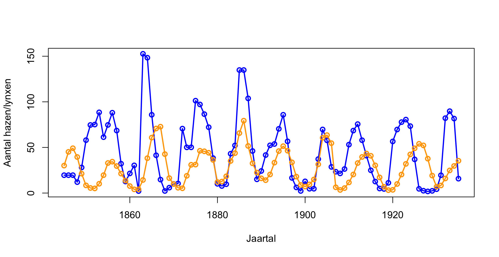




# ODEs modelleren in R {#sec-grind .unnumbered}

In @sec-meerdere hebben we een heel beroemd model uit de biologie geanalyseerd: het *Lotka-Volterra predator-prooi model*. Dit model gaat natuurlijk niet specifiek over konijnen en vossen, maar zou op allerlei systemen toegepast kunnen worden: bacteriofagen die bacteriën infecteren, protozoa die bacteriën eten, lieveheersbeestjes die bladluizen eten, vleermuizen die motjes eten, *etc.* Naast het predator-prooi model bestaat er ook het *Lotka-Volterra competitie model* (waar we in het volgende hoofdstuk naar gaan kijken). Zodoende is het Lotka-Volterra model uitgegroeid tot één van de meest veelzijdige modellen in de biologie, waarmee voorspellingen gedaan kunnen worden over welke soorten wel/niet kunnen samenleven. 

We hebben gezien hoe met behulp van faseruimtes het best eenvoudig kan zijn om inzicht in een biologisch proces te vergaten. Maar de eenvoud van deze eerdere analyses is deels te verklaren door de eenvoud van het model dat we hebben gebruikt. Hoe meer interacties we willen begrijpen, hoe moeilijker het zal worden om met pen en papier te werk te gaan. Daarom gaan we leren om ODEs door te rekenen met het Rscript `Grind.R`, waarmee je eenvoudig faseruimtes en grafiekjes van de dynamica van variabelen kan plotten. 

{fig-align="center" width="90%"}

## Leerdoelen 

Misschien is het je opgevallen dat dit hoofdstuk geen nummer heeft. Dit hoofdstuk is inhoudelijk namelijk wat korter, en is vooral bedoeld om kennis te maken met het R-script `Grind.R`. De overige leerdoelen zijn:

  * Begrijpen hoe een simpel model (zoals het Lotka-Volterra model) kan worden uitgebreid door extra details toe te voegen (bijvoorbeeld een predator die verzadigd).
  * Een Hill-functie herkennen, en de kenmerken kunnen benoemen (initiële helling, half-waarde, maximum).
  * R kunnen gebruiken om faseruimtes met nullclines en trajectories te tekenen, en de daarbij horende oplossingen.
  
## De verzadigde predator

In ons eerdere Lotka-Volterra model namen we aan dat predatie lineair proportioneel is aan de dichtheden van de predator en prooi. Dit deden we door gebruik te maken van een simpele predatieterm: $aRN$. Mede dankzij deze eenvoud waren de nullclines zo eenvoudig: een stel rechte lijnen waarvan het makkelijk te bepalen is waar/of ze snijden. Echter heeft deze eenvoud ook zijn beperkingen. Dit lineaire verband betekent dat per predator (ookwel: *per capita*) in totaal $aR$ prooi gegeten kan worden (nogmaals, "per"  kun je lezen als "gedeeld door", dus $\frac{aRN}{N} = aR$). Bij oneindig hoge prooi dichtheden, kan elke predator dus oneindig veel prooi eten. In het echt zal een predator eigenlijk een tijd bezig zijn met het verwerken en verteren van de prooi. Zodoende zal de predatie-term bij hele hoge prooi-dichtheden eigenlijk moeten verzadigen. Om dit te verwerken, zouden we de predatie-term aan kunnen passen:

\begin{align*}
\frac{\dd \color{#2a53f7}R}{\dd t} &= \underbrace{b(1-\frac{\color{#2a53f7}R}{K})\color{#2a53f7}R}_{\text{geboorte prooi}} - \underbrace{d\color{#2a53f7}R}_{\text{sterfte prooi}} - \underbrace{\frac{\color{black}a\color{#2a53f7}R\color{orange}N}{h+\color{#2a53f7}R}}_{\text{nieuwe predatieterm}}\\
\frac{\dd \color{orange}N}{\dd t} &= \underbrace{\frac{a\color{#2a53f7}R\color{orange}N}{h+\color{#2a53f7}R\color{black}}}_{\text{geboorte predator}} - \underbrace{\delta \color{orange}N}_{\text{sterfte predator}}
\end{align*}

Wat is met deze nieuwe predator-term de *per capita* predatie? Dat wil zeggen: hoeveel prooi kan een enkele predator per tijdseenheid opeten? Hiervoor delen we wederom de predatie-term door $N$, waardoor we functie $\frac{aR}{h+R}$ krijgen. Om een beeld van deze functie te krijgen, is het handig om deze even te schetsen. 

## Vorm van de nieuwe predatieterm 

Laten we eerst even naar de noemer te kijken, en vooral naarde balans tussen $h$ en $R$. Als $R$ heel klein is, heeft $h$ de overhand in de noemer, waardoor $R$ verwaarloosbaar is. Dus voor kleine $R$ nadert de functie $\frac{aR}{h}$, wat een lineaire toename is. Dus voor kleine prooi-dichtheden, neemt predatie lineair toe met de prooi-dichtheid, net zoals in het eerdere model. Maar als $R$ alsmaar groter wordt, wordt $h$ juist verwaarloosbaar ten opzichte van $R$. Daarom nadert deze functie bij hoge $R$ de waarde $\frac{aR}{R} = a$. Dus: zelfs bij hele hoge prooidichtheiden kan een enkele predator per tijdseenheid (bijv. per dag) hoogstens $a$ prooi eten. Tussen deze twee extreme waarden zit nog een laatste bijzondere punt: het punt waar $R$ precies gelijk is aan $h$. Op dit punt is de functie gelijk aan $\frac{aR}{R+R}=\frac{aR}{2R}=\frac{a}{2}$. De parameter $h$ geeft dus de prooi-dichtheid waar de predatieterm half-maximaal is. Nu kunnen we de functie schetsen, zoals weergegeven in @fig-predatieterm-1. 

## Hill-functies

Functies van deze vorm worden "Hill-functies" genoemd (vernoemd naar Archibald Hill, niet naar het feit dat het een soort heuveltje is). Met een kleine aanpassing aan deze Hill-functie ($\frac{aR^2}{h^2+R^2}$), kun je deze respons ook sigmoide (S-vormig) laten verlopen (@fig-predatieterm-2). 

```{r}
#| fig-cap: ""
#| fig-subcap: 
#|   - ""
#|   - ""
#| label: "fig-predatieterm"
#| code-fold: true
#| fig.width: 4
#| fig.height: 4
#| layout-ncol: 2
#| 
a=1
h=1

func <- function(x){
  return(a*x/(x+h))
}

curve(func,0,8,lwd=2,ylim=c(0,1.), xaxt="n", yaxt="n",
      ylab="Predatie",xlab="Hoeveelheid prooi (R)",col="seagreen",
      main="Hill-functie (Type 2)")

axis(1, labels = FALSE) # x-axis
axis(2, labels = FALSE) # x-axis
abline(h=a,lty=2,col="grey")
abline(v=h,lty=2,col="grey")
mtext("h",side=1,at=h,line=0.7)
mtext("0",side=1,line=0.5,at=0)
mtext("0",side=2,line=0.5,at=0)
text(-1.5,1,"a",xpd=NA)

func <- function(x){
  return(a*x^2/(x^2+h^2))
}

curve(func,0,3,lwd=2,ylim=c(0,1.), xaxt="n", yaxt="n",
      ylab="Predatie",xlab="Hoeveelheid prooi (R)",col="seagreen",
      main="Hill-functie (Type 3)")

axis(1, labels = FALSE) # x-axis
axis(2, labels = FALSE) # x-axis
abline(h=a,lty=2,col="grey")
abline(v=h,lty=2,col="grey")
mtext("h",side=1,at=h,line=0.7)
mtext("0",side=1,line=0.5,at=0)
mtext("0",side=2,line=0.5,at=0)
text(-0.5,1,"a",xpd=NA)
```


<!-- ::: {#exr-hillfuncties} -->

<!-- ## Hill-functies  -->
<!-- <br><br> -->
<!-- De bovengenoemde Hill-functies zijn zeer veelzijdig, en met kleine aanpassingen kun je de vorm goed aanpassen. Vaak willen we bijvoorbeeld kunnen wisselen tussen geen interactie (0) en volledige interactie (1), of geen genexpressie (0) en volledige genexpressie (1), *etc.* Om dit te doen kunnen we de parameter $a$ op 1 zetten, waardoor we deze volledig weg kunnen laten uit de hill-functie. -->

<!-- Neem de onderstaande code over in R: -->

<!-- ```{r} -->
<!-- #| eval: false -->

<!-- h=1 -->
<!-- n=2 -->

<!-- func <- function(x){ -->
<!--   return(x^n/(x^n+h^n)) -->
<!-- } -->

<!-- curve(func,0,3,lwd=2.5,ylim=c(0,1.),  -->
<!--       ylab="f(x)",xlab="x",col="seagreen") -->
<!-- ``` -->

<!-- Stel dat we de interacties tussen genen bestuderen die elkaars expressie beïnvloeden. Hoewel de bovengenoemde Hill-functies een graduele overgang beschrijven, zien we in dit (hypothetische) scenario iets anders. We zien dat een klein beetje expressie van gen 1 geen invloed heeft op gen 2, maar dat er bij een bepaalde kritische expressie van gen 1 plotseling maximale expressie van gen 2 is. Nog meer expressie van gen 1 heeft geen verdere invloed op de expressie van gen 2. -->

<!--   a. Bestudeer hoe je de Hill-functie in de R-code hierboven zou kunnen aanpassen om het bovengenoemde scenario met een plotseling overgang te modelleren (neem aan dat $x$ de expressie van gen 1 is, en dat op de y-as de expressie van gen 2 staat). -->

<!-- We zien dat gen 2 ook een effect heeft op gen 1. Dit effect is wél gradueel, maar er vindt juist remming plaats.  -->

<!--   b. Hoe kun je de Hill-functie omkeren zodat deze niet van 0 naar 1 gaat, maar van 1 naar 0 gaat? Schrijf de vergelijking op, en test het met je R script.  -->
<!--   c. Kun je de vergelijking die je hebt opgeschreven in b nog versimpelen? (je kunt je algebra altijd even controleren met het R-script!)  -->
<!--   d. Wat moet je doen als je toch wil dat de maximale genexpressie $a$ is, en niet 1?  -->
<!-- ::: -->

Nu we kennis hebben gemaakt met Hill-functies (zie ook @tip-hillfuncties), gaan we terug naar het Lotka-Volterra model. Omdat het Lotka-Volterra model is uitgebreid met deze verzadigingsterm, moeten we opnieuw de nullclines uitrekenen en schetsen (ook die zijn veranderd!). Maar zoals je je wellicht kan voorstellen worden de nullclines iets ingewikkelder door deze non-lineaire term in onze vergelijkingen. Naar mate we onze modellen meer en meer uitbreiden, wordt het natuurlijk steeds lastiger om alles met de hand te doen. Daarom gaan we in dit hoofdstuk de faseruimte en het vectorveld laten tekenen door Grind.R, een Rscript dat deze analyses een fluitje van een cent maakt!

::: {.callout-tip #tip-hillfuncties collapse="false"}

## Veel gebruikte Hill-functies 


| Naam  | Vergelijking | Grafiek | 
|--|--------|---|
| Type II | $$\frac{x}{x+h}$$ | {width="250"} |
| Type III | $$\frac{x^2}{x^2+h^2}$$ | {width="250"} |
| Type II (afnemend) | $$\frac{1}{\frac{x}{h}+1}$$ | {width="250"} |
| Type III (afnemend) | $$\frac{1}{\frac{x^2}{h^2}+1}$$ | {width="250"} |

```{r} 
#| eval: false
#| echo: false

h=1
n=2

func <- function(x){
  return(1-x^n/(x^n+h^n))
}
par(las=1, mar=c(1,1,1,1))
curve(func,0,3,lwd=3.5,ylim=c(0,1.), xaxt="n", yaxt="n",
      ylab="f(x)",xlab="x",col="seagreen")
```
|
:::


## Grind tutorial

Grind (*GReat INtegrator Differential equations*) is een Rscript geschreven door Rob de Boer (<https://tbb.bio.uu.nl/rdb>), wat het heel makkelijk maakt om faseruimtes, vectorvelden, en oplossingen te berekenen en plotten. Ook kun je Grind gebruiken om modellen te fitten aan experimentele data, zodat je op basis van metingen in het veld parameters als $b$, $d$, $K$, en $h$ zou kunnen schatten. Dat laatste is heel relevant wanneer modellen gebruikt worden voor (bijvoorbeeld) belangrijke beleidsbeslissingen, maar in deze cursus gaan we het vooral gebruiken om gemakkelijk faseruimtes met nullclines te schetsen, en oplossingen te bestuderen. De volledige handleiding en introductie tot Grind vind je [hier](https://tbb.bio.uu.nl/rdb/grindR/basics.html).

Voordat je Grind kan gebruiken, moet je eenmalig een paar "packages" in R installeren:

```{r}
#| eval: false
# Installeer de packages (hoeft maar 1 keer!)
install.packages("FME", "deSolve","coda","rootSolve") 
```

Nadat deze packages zijn geinstalleerd, moeten we het Grind.R script inladen. Dit kan je vanaf de website doen:

```{r}
#| echo: true
#| eval: false
source("https://tbb.bio.uu.nl/rdb/grindR/grind.R")
```

Of vanaf je eigen computer als je het script hebt gedownload:

```{r}
#| echo: true
#| eval: false
source("C:/Student/Modellen/grind.R")
```

Als het laden van het script goed is gegaan, krijg je een melding: 

```{r}
#| echo: false
source("https://tbb.bio.uu.nl/rdb/grindR/grind.R")
colors[1] = "blue"
colors[2] = "#FF7F50"
```

Nu kunnen we Grind.R gebruiken. De differentiaalvergelijkingen staan in een functie genaamd 'model'^[Op regel 2 zie dat dat deze 'model'-functie zit een beetje raar zit ingepakt in een `with` functie. Dit heeft een technische reden (en is zeker geen leerstof), maar helpt R begrijpen hoe de variabelen/parameters heten. De enige regels die je eigenlijk hoeft aan te passen zijn degene met de vergelijkingen (hier regel 3 en 4), en zorgen dat deze vergelijkingen in de goede volgorde worden teruggegeven (regel 5).]: 
```{r}
#| code-fold: false
#| eval: true
#| code-line-numbers: true

model <- function(t, state, parms) {
  with(as.list(c(state,parms)), {
    dR <- r*R*(1 - R/K) - a*R*N/(R+h)
    dN <- c*a*R*N/(R+h) - delta*N
    return(list(c(dR, dN)))  
  }) 
}  
```

En vervolgens geef je de parameters en begin-waarden (*initial condition*) voor de variabelen aan:

```{r}
#| code-fold: false
#| eval: true
p <- c(r=1,K=1,a=1,c=1,delta=0.3,c=1,h=1)  #parameters
s <- c(R=1,N=0.01) #begin-dichtheden van R en N  
colors[1] = "blue"
colors[2] = "#FF7F50"
```

Hierboven geef ik ook even de nieuwe kleuren aan voor de 'eerste' en 'tweede' vergelijking, zodat dit overeenkomt met de kleuren die we tot nu toe hebben gebruikt. Dit is niet noodzakelijk, maar zo raken we niet in de war. 

Nu kun je met met de functie `run` eenvoudig een oplossing uitrekenen:

```{r}
#| code-fold: false
#| eval: true
run()
```

Zoals je ziet genereert Grind een grafiek (een oplossing), en vertelt het ook meteen wat de eind-waarden zijn van je variabelen.

We kunnen ook argumenten aan `run` meegeven, bijvoorbeeld om wat langer door te rekenen (`tmax`, deze optie is standaard 100) en een optie om y-as logaritmisch te schalen: 
```{r}
#| code-fold: false
#| eval: true
run(tmax=200,log = "y") 
```

Zoals je ziet zijn de waarden na tijdstip 100 niet meer veel veranderd. Het systeem was dus eigenlijk al (bijna) in evenwicht. 

We kunnen ook een faseruimte maken met de functie `plane`:

```{r}
#| code-fold: false
#| eval: true
plane() 
```

Ook deze functie kunnen we weer argumenten meegeven, bijvoorbeeld om de assen iets verder te vergroten en een vectorveld te tekenen: 

```{r}
#| code-fold: false
#| eval: true
plane(xmax=1.5, ymax=1.5,vector = T) 
```

Als laatste willen we (net als in het vorige hoofdstuk) weten of de evenwichten stabiel of instabiel zijn. Hiervoor geven we Grind een geschatte waarde dichtbij een evenwicht mee, en gebruiken we de functie `newton`:

```{r results='hide'}
#| code-fold: false
#| eval: true
plane(xmax=1.5, ymax=1.5,vector = T)
newton(state=c(R=0.0,N=0.0),plot=T)
newton(state=c(R=1.0,N=0.0),plot=T)
newton(state=c(R=0.4,N=0.8),plot=T)
run(traject = T)
```

De laatste regel gebruikt `run` met de optie `traject=T` om een trajectorie door de faseruimte te tekenen. Dit vertaalt het grafiekje door de tijd die we eerder hebben uitgerekend, naar een mooie inwaardse spiraal. Er zijn nog [veel meer opties](https://tbb.bio.uu.nl/rdb/grindR/basics.html) in Grind.R. Als je wil zien welke argumenten een functie allemaal kent, kun je gebruik maken van `args`:

```{r}
#| code-fold: false
#| eval: true
args(plane)
```

Zo zie je bijvoorbeeld dat je de legenda zou kunnen verbergen met de `legend` optie, of de lijndikte (`lwd`) zou kunnen aanpassen. Met andere woorden: met R kunnen we zonder al te veel rekenwerk prachtige figuren genereren en wiskundige modellen doorrekenen! 

## Lotka-Volterra in Grind
Als je de bovenstaande tutorial hebt gevolgd (en de packages hebt geïnstalleerd), kun je nu het volgende script overnemen en aan de slag met het vernieuwde Lotka-Volterra model, waar de predatieterm verzadigt:

```{r}
#| code-fold: false
#| eval: true
#| code-line-numbers: true

model <- function(t, state, parms) {
  with(as.list(c(state,parms)), {
    dR <- r*R*(1 - R/K) - a*R*N/(R+h)
    dN <- c*a*R*N/(R+h) - delta*N
    return(list(c(dR, dN)))  
  }) 
}  
p <- c(r=1,K=2,a=1,c=1,delta=0.3,c=1,h=1)  #parameters
s <- c(R=1,N=0.01) #begin-dichtheden van R en N  

colors[1] = "blue" #optioneel, default = 'red'
colors[2] = "#FF7F50" #optioneel, default = 'blue'
par(mfrow=c(1,2)) # optioneel, maakt 2 plotjes naast elkaar

plane(xmax=3,ymax=2)
run(tstep=0.5, legend=F)
```

Door te oefenen met dit R-script, naast de pen en papier opgaven, is het de bedoeling dat je een goed gevoel ontwikkelt voor ODEs: simpele, wiskundige modellen, die veel in de biologische literatuur voorkomen. Hieronder volgt een korte vraag, om met zowel pen en papier als Grind te oefenen.

::: {#exr-paraboollv}

## De nieuwe nullcline voor de prooi 
<br>

Hierboven hebben we nullclines gegenereerd van het vernieuwde Lotka-Volterra model (met een verzadigbare predator). Zoals je ziet is dit geen rechte lijn meer. 

  a. Bepaal met pen en papier aan welke functie de vernieuwde nullcline voor de prooi voldoet. 
  b. Wat is het effect van de $K$ parameter op de ligging van deze nullcline?
  c. Neem het R-script hierboven over met het Lotka-Volterra model met verzadigbare predator. Verdubbel de waarde van $K$. Wat valt je op?
:::

## Bifurcaties van evenwichten

Het bovenstaande Lotka-Volterra model heeft een interessant eigenschap: afhankelijk van de parameters kan het type evenwicht veranderen. Iets dergelijks zagen we ook al eerder terug: de predator kon alleen samenleven met de prooi als de parameters dat toelieten. Deze transitie zien we ook terug in dit vernieuwde model (van @fig-lvvoort-1 naar @fig-lvvoort-2). Deze bifurcatie (van geen samenleving naar wél samenleving) wordt een **kritische transitie** genoemd. Echter is er met dit vernieuwde model een tweede bifurcatie mogelijk: de predator-nullcline kan de prooi-nullcine links of rechts van de top van de parabool snijden (van @fig-lvvoort-2 naar @fig-lvvoort-3). Als het snijpunt links van de top van de parabool ligt, zien we voortdurende oscillaties van predator en prooi, waarbij de populaties om het instabiele evenwicht heen blijven draaien. Eerder hadden we al gezegd dat attractoren niet altijd hetzelfde zijn als het evenwichtspunt, en hier zie je dat heel goed! Deze **attractor**, waarbij de populaties constant om het evenwicht heen blijven draaien, heet de limietcyclus. De overgang van de stabiele spiraal (snijpunt rechts van de parabool) naar de instabiele spiraal (snijpunt links van de parabool) staat bekend als de **Hopf-bifurcatie**.

```{r results='hide'}
#| code-fold: true
#| eval: true
#| code-line-numbers: false
#| fig.width: 4
#| fig.height: 4
#| fig-cap: "Verschillende faseruimtes voor het Lotka-Volterra systeem met een verzadigbare predator."
#| fig-subcap: 
#|   - "Als de nullclines niet snijden, is er geen evenwicht."
#|   - "Vertrouwde inwaartse spiraal die naar een stabiel evenwicht gaat."
#|   - "Voortdurende oscillaties rond een instabiel evenwicht."
#| label: "fig-lvvoort"
#| layout-ncol: 3

model <- function(t, state, parms) {
  with(as.list(c(state,parms)), {
    dR <- r*R*(1 - R/K) - a*R*N/(R+h)
    dN <- c*a*R*N/(R+h) - delta*N
    return(list(c(dR, dN)))  
  }) 
}  

colors[1] = "blue" #optioneel, default = 'red'
colors[2] = "#FF7F50" #optioneel, default = 'blue'

p <- c(r=1,K=0.4,a=1,c=1,delta=0.3,c=1,h=1)  #parameters
s <- c(R=0.4,N=0.01) #begin-dichtheden van R en N  
plane(xmax=2.2,ymax=2)
run(tstep=0.5, traject=T,col="grey")
newton(state=c(R=0.5,N=0.5),plot=T)

p <- c(r=1,K=1,a=1,c=1,delta=0.3,c=1,h=1)  #parameters
s <- c(R=2,N=0.01) #begin-dichtheden van R en N  
plane(xmax=2.2,ymax=2)
run(tstep=0.5, traject=T,col="grey")
newton(state=c(R=0.5,N=0.5),plot=T)

p <- c(r=1,K=2,a=1,c=1,delta=0.3,c=1,h=1)  #parameters
s <- c(R=2,N=0.01) #begin-dichtheden van R en N  
plane(xmax=2.2,ymax=2)
run(tstep=0.5, traject=T,col="grey")
newton(state=c(R=0.5,N=0.5),plot=T)
```

Voortdurende oscillaties tussen prooi en predator worden inderdaad waargenomen, bijvoorbeeld de oscillaties tussen hazen en lynxen in Noord Amerika (@fig-hazenenlynxen). Ook in experimenten zijn dergelijke oscillaties waargenomen, bijvoorbeeld door *Paramecium* (een-cellige protist, prooi) en *Didinium* (eencellige protist, predator) samen te groeien in een Erlenmeyer (Xia *et al.*, 1992).

{#fig-hazenenlynxen}

Bifurcaties kun je weergeven in een bifurcatiediagram, waarbij we de parameter die het evenwicht beïnvloedt op de x-as zetten, en de populatiegroottes in evenwicht op de y-as. Als we dit doen voor de bovenstaande bifurcaties, krijgen we dit: 

```{r results='hide'}
#| echo: false
source("https://tbb.bio.uu.nl/rdb/grindR/grind.R")
library(ggplot2)
library(dplyr)
```

```{r results='hide'}
#| fig-cap: "Bifurcatiediagram van het Lotka-Volterra predator-prooi model"
#| label: "fig-lvbif"
#| code-fold: true
#| fig.width: 5
#| fig.height: 3
#| 

my_theme <- theme_bw() + 
  theme(panel.border = element_blank(), panel.grid.major = element_blank(),
        panel.grid.minor = element_blank(), axis.line = element_line(colour = "black"))

  
model <- function(t, state, parms){
  with(as.list(c(state,parms)),{
    dR <- R*(b*(1-R/K)-d) - a*R*N/(R+h)
    dN <- c*a*R*N/(R+h) - delta*N
    return(list(c(dR,dN)))
  })
}  


# all <- data.frame()
# for(k in c(0.00001,seq(0.001,4.0,by=0.001))){
#   p <- c(a=0.5,delta=0.25,b=0.5,d=0.01,c=0.99,K=k,h=1)
#   s <- c(R=0.4,N=0.4)
#   plane(ymax=1.2,ymin=-0.1,xmin=-0.01, xmax=1.2,tstep=0.01,tmax=50)
#   #res <- newton()
#   dat <- run(table=T,step=11,tmax=1000,timeplot=F)
#   dat$K = k
#   all <- rbind(all,tail(dat,100))
#   cat(k,"\n")
# }
# 
# bifurcation_data <- all %>% group_by(K) %>% 
#   mutate(maxN=max(N)) %>% 
#   mutate(minN=min(N)) %>% 
#   mutate(maxR=max(R)) %>% 
#   mutate(minR=min(R)) %>% 
#   filter(time==1000) %>% 
#   distinct()
# 
# write.table(bifurcation_data, "Modellering/figuren/bifurcation_data.csv")

bifurcation_data <- read.table("figuren/bifurcation_data.csv")
#list.files("figuren")

colors <- c("R" = "blue", "N" = "#FF7F50")

bifurcation_data %>%
  ggplot(aes(x=K,y=maxN)) +
  #geom_line(col="#FF7F50",linewidth=1, aes(color="N")) +
  geom_line(aes(y=maxR,color="R"),linewidth=1) +
  geom_line(aes(y=minR,color="R"),linewidth=1) +
  geom_line(aes(y=minN,color="N"),linewidth=1) +
  geom_line(aes(y=maxN,color="N"),linewidth=1) +
  ylab("Steady state population sizes") +
  my_theme +
  scale_color_manual(name="Soort",values = colors)


```

Omdat er bij hoge waarden van $K$ oscillaties zijn, geven de lijnen de minimale en maximale waarde van deze oscillaties aan. Omdat de parameter $K$ het draagvlak van de prooi beinvloed, geeft dit diagram dus weer wat er bijvoorbeeld zou gebeuren als we konijnen op de Veluwe gaan bijvoeren: eerst krijgen we meer konijnen, dan krijgen we alleen meer predatoren, en daarna begint het systeem harder en harder te schommelen! Zo zie je: het behoud van biodiversiteit is zelfs in dit simplistische "ecosysteem" niet triviaal!

## Grind.R kan nog veel meer

Met het R-script `Grind.R` kan je nog veel meer dan alleen faseplaatjes en bifurcaties analyseren. Zo kan je bijvoorbeeld met een zogeheten "interactie matrix" (waarin staat hoe alle soorten interacteren met alle soorten) een heel ecosysteem doorrekenen (zie @fig-grindvoorbeeld voor een voorbeeld met 30 soorten), wat fascinerend complexe en onvoorspelbare dynamiek kan opleveren. Hoewel [het brede scale aan functionaliteiten van Grind.R](https://tbb.bio.uu.nl/rdb/grindR/manual.html) leuk zijn om mee te spelen, is dit geen leerstof. De algemene boodschap is dat we voor meer ingewikkelde systemen meestal niet met pen en papier te hoeven rekenen, maar de computer het werk kunnen laten doen! 


```{r results='hide'}
#| label: fig-grindvoorbeeld
#| code-fold: true

source("https://tbb.bio.uu.nl/rdb/grindR/grind.R")
set.seed(12)
model <- function(t, state, parms) {
  N <- state
  S <- A %*% N # R code for matrix x vector multiplication
  dN <- r*N*(1 - S)
  return(list(dN))  
}  

p <- c()
n <- 30
s <- rep(0.01,n)
names(s) <- paste("N",seq(1,n),sep="")
r <- abs(rnorm(n,1,0.1))
A <- matrix(runif(n*n),nrow=n,ncol=n)
diag(A) <- 1; A

run(tmax=300,legend=F)

```

## Terminologie


| Nederlands                | Engels                | Beschrijving                                                                                                                                  |
|------------------|--------------------|----------------------------------|
| Hill-functies | Hill functions | Een set wiskundige functies die verzadigen bij grote waarden (ze hebben een horizontale assymptoot). |
| Kritische-transitie | Critical Transition | Een punt waarbij een parameter-verandering het gedrag van een model fundamenteel verandert, bijvoorbeeld doordat het aantal of de stabiliteit van de evenwichten verandert. In dit hoofdstuk zien we bijvoorbeeld dat er alleen samenleving mogelijk is als $K$ hoog genoeg is. Er is dus een waarde van $K$ waarbij er een kritische transitie is. |
| Hopf-bifurcatie | Hopf-bifurcation | Een omslagpunt waar, als je een bepaalde parameter verandert, een stabiel evenwicht overgaat in periodiek gedrag. In dit hoofdstuk zagen we dit terug doordat het verhogen van $K$ de stabiele samenleving van predator en prooi kan veranderen in periodieke oscillaties van de populatiegroottes. |
:  {.striped .hover}