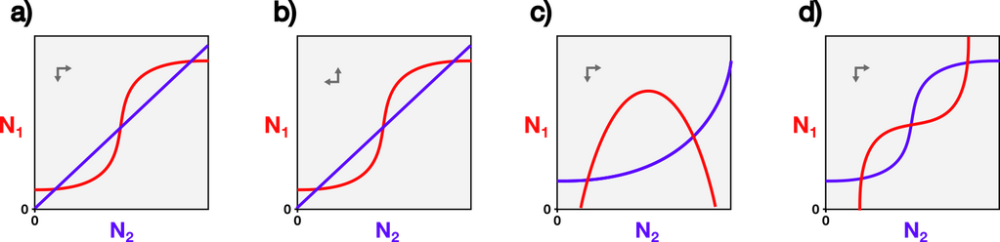
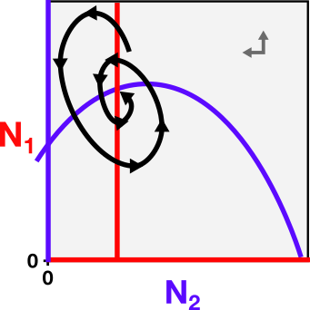
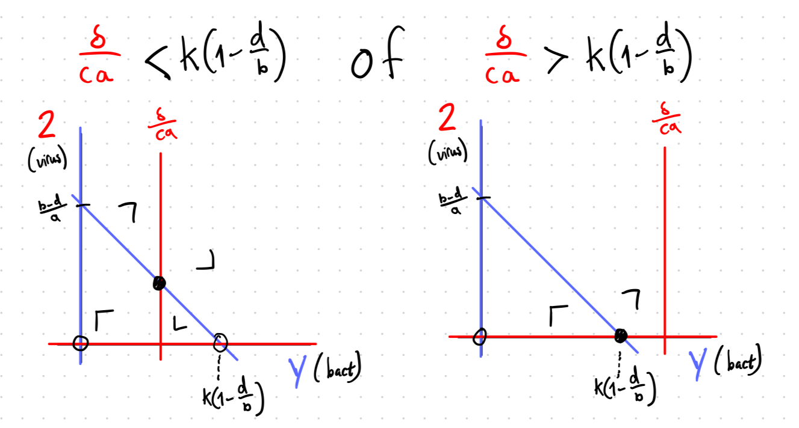

::: {.content-visible when-format="html"}

:::

# Oefenvragen {.unnumbered}

<!-- Op deze pagina komen binnenkort oefenvragen beschikbaar voor het onderdeel "Biologische Modellen". Omdat dit een nieuw vak is, zijn er geen oude tentamenvragen beschikbaar, maar ik zal een aantal oefenvragen voor jullie samenstellen. Nog even geduld!  -->

Op deze pagina kun je oefenvragen vinden voor het onderdeel "Biologische Modellen". Omdat dit een nieuw vak is, zijn er geen oude tentamenvragen beschikbaar, maar ik heb wel een aantal oefenvragen voor jullie gemaakt. **Hoewel het tentamen voornamelijk meerkeuze- en invulvragen zal bevatten, zijn de oefenvragen hier in een open vraagvorm**. Maar, als je deze vragen kunt beantwoorden, zal een meerkeuzevraag over hetzelfde onderwerp geen probleem zijn!

De antwoorden geef ik nog niet, maar ik zal deze een aantal dagen voor het tentamen op de website zetten. Als je vragen hebt over de vragen, of als je een foutje ziet, laat het me dan weten. (net zoals bij het echte tentamen!)

::: {#exr-eiwit}

## Eiwit in het cytosol 
*moeilijkheidsgraad: eenvoudig*

We modelleren de verandering van een eiwit ("eiwit $X$") in het cytosol. De veranderingen worden uitgedrukt in de hoeveelheid eiwitmoleculren per minuut, gegeven het model:

$\frac{dX}{dt} = q - lX$

a. Wat zijn de eenheden van $q$ en $l$?
b. Een stamcel begint met een hoeveelheid eiwit $X=0$, en de parameters zijn bepaald op $q=3$ en $l=0.02$. Hoeveel eiwitmoleculen heeft deze cel na lang wachten?  <!-- q/l = 3/0.02 = 150 -->
:::

::: {#exr-groei}

## Exponentiële groei 
*moeilijkheidsgraad: gemiddeld*

Je hebt 24 uur geleden bacteriën uitgeplaat, en deze zijn allemaal tot kolonies uitgegroeid. Een paar kolonies zijn veel groter dan de rest. Je medestudent zegt: "deze hebben waarschijnlijk een mutatie waardoor ze sneller exponentiël kunnen groeien". In welke mate ben je het eens/oneens met je medestudent? Licht je antwoord toe.

:::

::: {#exr-turing}

## Tegen-intuitief
*moeilijkheidsgraad: uitdagend*

Helemaal aan het begin van de cursus zijn jullie gewaarschuwd om niet altijd je intuïtie te vertrouwen. Dit is gedurende de hele cursus voorbij gekomen, en zo ook in de laatste hoofdstukken over IBMs en reactie-diffusie systemen (PDEs). Geef voor deze twee type modellen (IBMs/PDEs) een voorbeeld van een tegen-intuitief resultaat. *(let op: als je al je intuitie hebt bijgestuurd moet je misschien even doen alsof je dit aan je tante vertelt)*

<!-- ibms: aapjes kunnen meer fruit vinden als ze langzaam eten -->
<!-- pdes: patronen ontstaan juist DOOR diffusie  -->

:::

::: {#exr-complexnull}

## Evenwichten in 2D 
*moeilijkheidsgraad: eenvoudig*

Gegeven faseruimtes met complexe nullclines. Maak met pen en papier de vectorvelden af, en bestudeer de gevonden equilibria. Let goed op de kleuren van de null-clines, en dat er **geen** nullclines langs de x- en y-as lopen!

Geef voor elke faseruimte aan:

- Hoeveel triviale evenwichten zijn er ? <!-- allemaal 0 -->
- Hoeveel zadelpunten zijn er? <!-- a=2, b=1, c=1, d=2 -->
- Hoeveel evenwichten zijn stabiel? <!-- a=2, b=0, c=1, d=1 -->

{width=90%}

Bekijk ook de onderstaande faseruimte. Een student schetst een trajectorie die eindigt in een stabiel evenwicht, weergegeven met de zwarte pijl. Leg uit waarom deze trajectorie niet correct geschets is. <!-- Ten eerste: het is geen stabiel evenwicht, maar instabiel. Daarnaast kruist de trajectory de nullclines heel vaak onder een hoek, en dat kan ook niet. -->

{width=40%}

:::

::: {#exr-eiwit}

## Virtueel experimenteren 
*moeilijkheidsgraad: eenvoudig*

In Wageningen simuleren ze met zeer grote precisie hoe planten groeien. Hoewel deze modellen complex zijn (en dus een beetje langzaam zijn), zijn er toch belangrijke voordelen aan virtueel experimenteren. Noem twee van deze voordelen. <!-- goedkoop, ethnisch voor plant en mens, ondenkbare experimenten uitvoeren -->

:::

::: {#exr-modelkeuzes}

## Modelkeuzes
*moeilijkheidsgraad: uitdagend*

Je hebt in dit cursusonderdeel al over allerlei verschillende modellen geleerd. Zoals in het introductiehoofdtuk uitgelegd, is niet elk model geschikt voor elke situatie. Als je bijvoorbeeld een goed gemengde Erlenmeyer met miljoenen bacteriële cellen modelleert, is een *individual-based model* met de posities van elk individu misschien niet zo nuttig. Anderzijds kun je zwerm-patronen van slijmschimmels niet modelleren met ODEs, want met ODEs is "een ruimtelijk patroon" niet een van de mogelijke uitkomsten.

Om te oefenen met welk type model past bij welk vraagstuk, staan hieronder een aantal omschrijvingen van biologische systemen die we zouden willen modelleren. Omschrijf voor elk scenario welk type model je zou gebruiken om deze te bestuderen, en motiveer je antwoord. Denk na over het type model (differen*tie*vergelijkingen, differen*tiaal*vergelijkingen (ODEs), individual-based models, reactie-diffusie vergelijkingen (PDEs)), maar ook over het type variabele waarmee je de toestand modelleert (discreet, continu, zie @fig-contdisc).

a. Twee soorten bacteriën ondervinden competitie in een goed gemengde Erlenmeyer.
b. Twee druppels met fluorescente eiwitten worden op een agar plaat gepipetteerd, waarbij interessante patronen ontstaan.
c. In een pas afgebrand bos komen pionierssoorten op. De eerste die zich vestigt neemt de ruimte in, waardoor er geen ruimte meer is voor anderen.
d. Een populatie zooplankton in een goed-gemengd deel van de oceaan ondervindt onderlinge competitie om algen en andere voedselbronnen.
e. Op de huid van een hagedis vormen zich tijdens de ontwikkeling gevlekte patronen
f. Een populatie divers gekleurde konijnen wordt door havikken bejaagd
g. Bacteriële cellen die groeien op een agarplaat kunnen met een kleine kans muteren, en daarbij fluorescent worden
h. Een morfogen diffundeert door een weefsel van cellen, en activeert daarbij verschillende genexpressiepatronen tijdens de ontwikkeling.
i. De hoeveelheid paracetamol in het bloed na inname wordt langzaam afgebroken
j. Na bevruchting ontstaat een calcium-golf op het membraan van de eicel
k. Een populatie van zeehonden wordt vanuit verschillende hoeken (richtingen) door orca's belaagd
:::

::: {#exr-bacteriofaagvraag}

## Bacteriën en bacteriofagen
*moeilijkheidsgraad: a-c = eenvoudig, d = uitdagend*

Bacteriofagen zijn virussen die bacteriën infecteren, en de bacterie daarmee in een virus-fabriek kunnen veranderen. Je collega modelleert dit process met simpele ODEs die de populatiegroottes van bacteriën en virussen beschrijven:

$\frac{dZ}{dt} = caZY - \delta Z$, en

$\frac{dY}{dt} = bY(1-\frac{Y}{K}) - dY - aZY$

a. Welke vergelijking beschrijft de bacteriën, en welke de virussen?
b. Omschrijf voor elke term in de vergelijkingen waar deze voor staat.
c. Je collega meet zorgvuldig alle parameters. De parameter $c$ heeft een waarde van 10. Leg in biologische begrippen uit wat dit betekent.
d. Het experiment laat zien dat de bacteriofaag zich in de populatie kan vermenigvuldigen, en dat er daarna een stabiel evenwicht ontstaat waarbij de populaties niet meer veranderen. Je wil weten of het model dezelfde conclusie trekt. Je besluit je de faseruimte te analyseren.   De nullclines voor Z zijn gegeven door: $Z=0$ en $Y=\frac{\delta}{ca}$   
De nullclines Y zijn gegeven door: $Y=0$ en $Z=\frac{b(1-\frac{Y}{K}) - d}{a}$.   
De parameterwaarden zijn: $c=10, b=2, K=2, a=0.7, \delta=12, d=0.5$.    Voorspelt het model ook dat er een stabiel evenwicht zal zijn van bacteriën en virussen?

<!-- ::: -->

<!--  @exr-bacteriofaagvraag -->

<!-- **a.**  -->
<!-- Dit is het Lotka-Volterra predator prooi model. Populatie Y kan onafhankelijk groeien, dus dat zijn de bacteriën. Populatie Z groeit alleen ten koste van Y, dus dat zijn de virussen.  -->

<!-- **b.** -->
<!-- $bY(1-\frac{Y}{K})$ is de dichtheidsafhankelijke geboorte van de bacteriën. $dY$ is de sterfte van de bacteriën. $aZY$ is de afname van bacterien door predatie van virussen. De term $caZY$ is het ontstaan van nieuwe virussen door  predatie, en $\delta Z$ is de sterfte van de virussen. -->

<!-- **c.**  -->
<!-- De parameter $c$ geeft de conversie van bacteriën naar virussen. Omdat de vergelijkingen populatiegroottes omschrijven, betekent een waarde van 10 dat er 10 nieuwe virussen ontstaan voor elke bacterie die door een virus wordt gedood. -->

<!-- **d.**  -->
<!-- Om dit te bepalen, schetsen we de nullclines en moeten we weten of deze elkaar snijden. Als de nullclines elkaar snijden in het postieve domein, is er een biologisch relevant (niet-triviaal) evenwicht. Omdat we de parameterwaarden hebben, kunnen we bepalen of dit het geval is door zorgvuldig naar de snijpunten met de assen te kijken. -->

<!-- De aflopende nullcline van de bacteriën snijdt de X-as op $Z=K(1-\frac{d}{b})$. De verticale nullcline van de virussen ligt op de waarde $Z=\frac{\delta}{ca}$. Door deze twee punten met elkaar te vergelijken, kunnen we weten of er een evenwicht is: de nullclines snijden namelijk alleen in het positieve domein als $\frac{\delta}{ca} < K(1-\frac{d}{b})$. In het andere geval kan het virus nier verspreiden, omdat er alleen een stabiel evenwicht is voor bacteriën (zie ook figuur hieronder). Als je de gegeven waarden voor de parameters invult, zie je dat het rechter plaatje het geval moet zijn. De voorwaarde voor verspreiding van het virus wordt dan namelijk $\frac{12}{10 \cdot 0.7} < 2 \cdot(1-\frac{0.5}{2})$, dus $1.71428 < 1.5$, en dat is natuurlijk niet waar. De nullclines snijden dus niet in het positieve domein, maar zien er (ongeveer) uit zoals in het rechter plaatje.    -->

<!--  -->

<!-- @exr-modelkeuzes -->

<!-- **a.** -->
<!-- Differentiaalvergelijkingen (ODEs): -->
<!-- De grootte van de bacteriepopulaties kan prima als continu worden beschouwd, omdat er heel veel individuen zijn (het verschil tussen 1 miljoen en 1 miljoen en een half, is niet belangrijk). Er is ook geen ruimtelijk patroon omdat de Erlenmeyer gemengt is. De populaties delen alle voedselbronnen, dus groei kan goed met een gedeelde carrying capacity ($1-\frac{N_1+N_2}{K}$) gemodelleerd worden.  -->

<!-- **b.** -->

<!-- Reactie-diffusie systeem (PDE): -->
<!-- Er zijn ruimtelijke patronen, dus we moeten zeker voor een ruimtelijk model gaan. Omdat het hier om concentraties gaat (en niet discrete individuen met birth/death processen) is een reactie-diffusie systeem een goed modelformalisme.   -->

<!-- **c.** -->

<!-- Individual based model (IBM): -->

<!-- Er is een ruimtelijk patroon met individuen (planten). Omdat er sprake is van "bezette" en "onbezette" plekjes, is een grid de meest eenvoudige manier om dit te bestuderen. Echter zou je ook kunnen kiezen voor een continue ruimte, waarbij je binnen een radius bekijkt of de ruimte 'vol' is.  -->

<!-- **d.** -->
<!-- Differentiaalvergelijkingen (ODEs): -->

<!-- Hoewel in het hoofdstuk staat dat zelfs de oceaan niet *altijd* goed gemengd is, geeft deze modelomschrijving duidelijk aan dat dit hierbij wel het geval is. We hoeven dus eigenlijk geen ruimtelijk model te gebruiken. Zoöplankton deelt zich constant (en niet 1 keer per week/maand/jaar), dus is continue tijd geschikt. We gebruiken daarom niet een differentievergelijking, maar ODEs.   -->

<!-- **e.** -->

<!-- Reactie-diffusie systeem (PDE): -->

<!-- We willen hier een ruimtelijk patroon bestuderen. Als het gaat om individuele cellen zouden we een grof grid kunnen gebruiken. Als de stoffen echter ook door de extracellulaire matrix diffunderen, kunnen er misschien fijnere patronen ontstaan en moet een veel fijner grid (of een 'echte' PDE!) gebruikt worden.  -->

<!-- **f.** -->

<!-- ODE of individual based model: -->

<!-- We zouden een ODE kunnen gebruiken met verschillende vergelijkingen voor elke kleur konijnen. Er kan echter een probleem ontstaan op het moment dat de konijnen- en/of havikkenpopulatie(s) erg klein worden (zie @nte-atto). Een individual based model is computationeel waarschijnlijk langzamer, maar kan wel voorkomen dat we hele gekke (en onwaarschijnlijke) resultaten krijgen als er hele kleine populaties zijn. -->

<!-- **g.** -->

<!-- Individual based model: -->

<!-- De bacteriën groeien op een agarplaat, dus om het systeem goed weer te geven zou een ruimtelijk model het meest geschikt zijn. Gemuteerde bacteriën delen dan lokaal en kunnen zo zorgen voor een lokaal groepje gemuteerde bacteriën. Vaak worden deze systemen op een grid gemodelleerd, maar meer moderne simulaties gebruiken biofysische modellen met continue ruimte, waarbij cellen elkaar weg kunnen duwen (*cell shoving*).  -->

<!-- **h.** -->

<!-- Reactie-diffusie systeem (PDE): -->

<!-- Het morfogen diffundeert, dus die zou het best met continue ruimte (of in ieder geval kleine hokjes) gemodelleerd kunnen worden. De individuele cellen zouden eventueel wel discreet gemodelleerd kunnen worden (al dan niet op een grid).  -->

<!-- **i.** -->

<!-- ODE: -->

<!-- De paracetamol bevindt zich in het bloed, waarvan we over het algemeen aannemen dat het goed gemengd wordt. Ook hoeven we ons bij moleculaire concentraties niet druk te maken over individuele verschillen en is het modelleren van de dichtheid paracetamol een goed genoege benadering.  -->

<!-- **j.** -->

<!-- Reactie-diffusie systemen (PDEs): -->

<!-- We hebben een ruimtelijk model nodig, en we hebben te maken met concentraties. Daarom  zijn reactie-diffusie systemen het meest geschikt. De individuele calcium-atomen gaan we natuurlijk niet modelleren.  -->

<!-- **k.** -->

<!-- Individual based model (IBM): -->

<!-- Het is belangrijk om de zeehonden en orca's als individuen weer te geven, omdat ze elk een andere kant op zullen bewegen. Daarnaast is er een ruimtelijk patroon, doordat de zeehonden vanuit verschillende hoeken worden belaagd. -->
