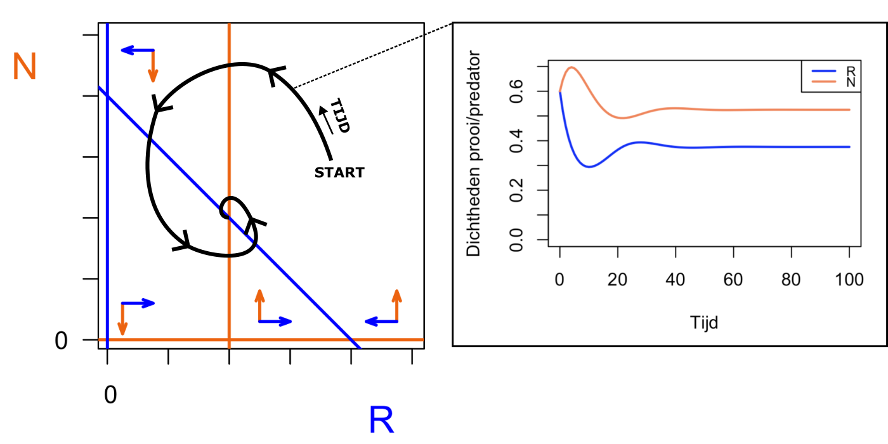
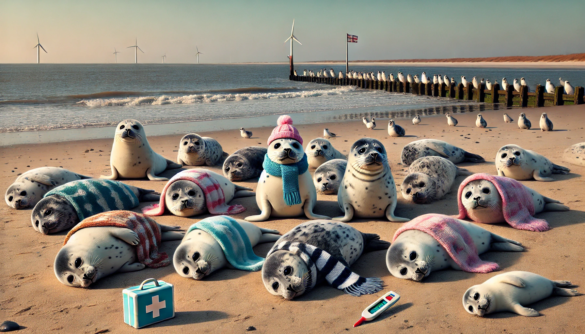
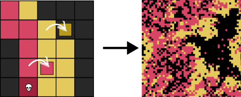
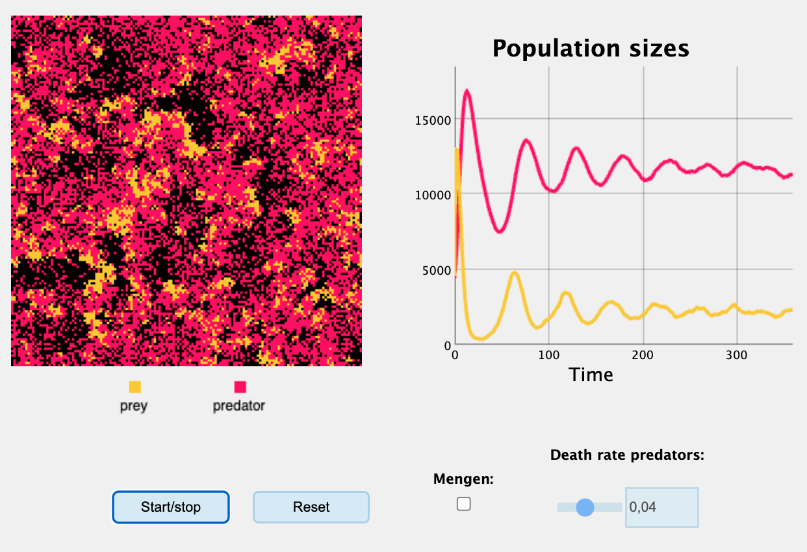
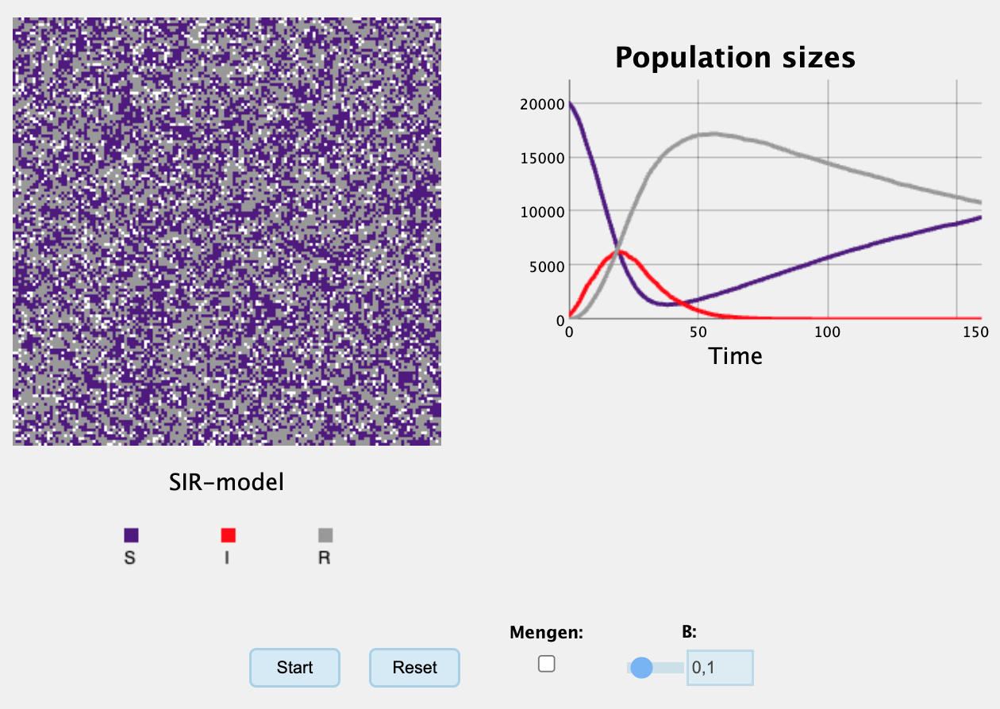



# Predator-prooi interacties {#sec-meerdere}

Biologische populaties leven nooit in isolatie, maar ondergaan interacties met andere populaties. Dit hebben we in het vorige hoofdstuk ook al kort gezien in de computermodellen waarin samenwerking centraal stond. Maar er bestaan natuurlijk veel meer typen interacties, en deze interacties kunnen we niet alleen met computermodellen bestuderen. Neem bijvoorbeeld de populatie konijnen in Australië, waarvoor we hebben aangenomen dat ze een dichtheidsafhankelijke afname van hun groei hebben. Worden de populatiegroottes van konijnen (normaal gesproken) niet ook door predatoren beïnvloed? Is onder die omstandigheden voedselbeperking überhaupt nog erg relevant, of gaan konijnen vooral aan predatie dood? Om deze vragen te kunnen beantwoorden, gaan we leren werken met **systemen van differentiaalvergelijkingen** aan de hand van een beroemd predator-prooi model.

::: {#fig-shared .figure}
::: {layout-ncol=2}
{fig-align="center" width="100%"}

{fig-align="center" width="100%"}
:::

Afbeeldingen gedownload op pexels.com (CC0, free to use)
:::

## Leerdoelen

De leerdoelen van dit onderdeel zijn:

-   Begrijpen hoe met ODEs interacties tussen populaties kunnen worden beschreven.
-   Beschrijven hoe een fase-ruimte in elkaar zit, en de belangrijkste onderdelen kunnen benoemen (nullclines, vectorveld, trajectory, evenwichten).
-   Biologische vraagstukken kunnen vertalen naar parameter veranderingen.
-   De consequenties van parameter veranderingen kunnen aflezen aan een faseruimte.

## Konijnen en vossen 

In het vorige hoofdstuk hebben we populaties gemodelleerd waarbij de groei wordt beperkt door de dichtheid, resulterend in een draagvermogen (de *carrying capacity*). We zouden echter ook kunnen modelleren dat er een dichtheidsafhankelijk effect is van een *andere* populatie. Bijvoorbeeld, als er heel veel predatoren zijn, zullen er meer konijnen dood gaan door predatie. Door de consumptie van deze prooidieren, zal deze predatorpopulatie zelf kunnen toenemen. Laten we dit modelleren voor konijnen en vossen, met de volgende aannames:

-   De konijnen hebben dichtheidsafhankelijke geboorte $b$
-   De konijnen sterven met een vaste snelheid $d$
-   Predatie gebeurt met snelheid $a$. Hoe meer konijnen en vossen, hoe meer predatie er zal plaatsvinden.
-   De groeisnelheid van vossen wordt uitsluitend bepaald door predatie
-   Ook vossen sterven met een vaste snelheid $\delta$

We kunnen elk van deze aannames vertalen naar een wiskundige functie die beschrijft hoe populaties reageren op hun eigen dichtheid, of die van een ander (@fig-lvresponses).

{#fig-lvresponses fig-align="center" width="80%"}

De eerste twee processen (@fig-lvresponses a+b, de reproductie en sterfte van konijnen) kennen we al van het vorige hoofdstuk. Hoewel we de konijnen eerder $N$ hadden genoemd, is het in het predator-prooi model dat we gaan bespreken gebruikelijk om de [prooi]{style="color:#2d43fc; font-weight:bold"} R te noemen. Onze groeivergelijking voor prooidieren (met dichtheidsafhankelijke geboorte) ziet er dan dus zo uit:

\begin{align*}
    \frac{\dd {\color{#2d43fc}R}}{\dd t} &= b\left(1-\frac{{\color{#2d43fc}R}}{K}\right){{\color{#2d43fc}R}} - d{\color{#2d43fc}R}

\end{align*}

Hieraan gaan we toevoegen dat vossen de konijnen opeten. De [predator]{style="color:#ff7700; font-weight:bold"} wordt in dit model vaak aangegeven met een $N$. We gaan ervan uit dat predatie direct proportioneel is aan de dichtheden konijnen en vossen (dus $R\cdot N$), en vermenigvuldigen dit met een nieuwe vrije parameter ($a \cdot R\cdot N$) om daarmee de predatie omhoog of omlaag te kunnen schroeven (zie @fig-lvresponses c). Deze nieuwe term noemen we de predatieterm. Als we de predatieterm toevoegen aan onze vergelijking, krijgen we:

\begin{align*}
  \frac{\dd {\color{#2d43fc}R}}{\dd t} &= b\left(1-\frac{{\color{#2d43fc}R}}{K}\right){{\color{#2d43fc}R}} - d{{\color{#2d43fc}R}} - a{{\color{#2d43fc}R}}\color{#ff7700}N
\end{align*}

Zoals je ziet is de variabele $N$ oranje gekleurd, om aan te geven dat dit de [predator]{style="color:#f2790f; font-weight:bold"}populatie is. Nu gaan we een tweede vergelijking schrijven voor het aantal vossen. Zoals gezegd wordt hun groeisnelheid alleen bepaald door de hoeveelheid geconsumeerde prooi. Hiervoor kunnen we dus de predatieterm ($aRN$) uit de konijnen vergelijking hergebruiken (@fig-lvresponses d). Echter, omdat de biomassa van konijnen natuurlijk niet 1 op 1 vertaalt in biomassa voor vossen, kunnen we wederom een nieuwe vrije parameter toevoegen ($c \cdot aRN$). Meestal nemen we aan dat $c \leq 1$, dat wil zeggen: er wordt niet meer dan 1 vos geboren per geconsumeerd konijn. Als laatste voegen we een eenvoudig sterfteterm toe voor de predator, en zo wordt ons uiteindelijke model:

$$
\begin{align*}
    \frac{\dd {\color{#2d43fc}R}}{\dd t} &= \underbrace{b\left(1-\frac{{\color{#2d43fc}R}}{K}\right){\color{#2d43fc}R}}_{\text{geboorte konijnen}} - 
\underbrace{d{\color{#2d43fc}R}}_{\text{sterfte konijnen}} - \underbrace{a{\color{#2d43fc}R}\color{#ff7700}N}_{\text{predatie}}\\
\frac{\dd \color{#ff7700}N}{\dd t} &= \underbrace{ca{\color{#2d43fc}R}\color{#ff7700}N}_{\text{geboorte vossen}} - \underbrace{\delta \color{#ff7700}N}_{\text{sterfte vossen}}
\end{align*}
$$ {#eq-vossen-konijnen}

Het bovenstaande model staat bekend als het **Lotka-Volterra predator-prooi model**, vernoemd naar de ontdekkers Alfred Lotka en Vito Volterra. De vergelijking  bestaat uit 2 ODEs die van elkaar afhankelijk zijn, en wordt daarom een 2 dimensioneel (2D) ODE systeem genoemd. We spreken van een **systeem van differentiaalvergelijkingen** wanneer de variabelen in elkaars vergelijking terugkomen, waardoor de dynamica van de variabelen gekoppeld (en niet onafhankelijk) is. Hierbij nemen we dus aan dat de organismen in hetzelfde (eco)systeem voorkomen, want konijnen op de Veluwe en konijnen op een eiland in Zweden beïnvloeden elkaar niet (tenzij ze het vliegtuig nemen).

We zouden het systeem natuurlijk nog verder uit kunnen breiden. We zouden bijvoorbeeld een top predator (adelaars) kunnen toevoegen, en dan hebben we een 3 dimensioneel (3D) ODE systeem^[3D slaat hier dus niet op ruimtelijke dimensies, maar op de hoeveelheid variabelen van het ODE systeem]. We zouden zelfs een heel ecosysteem kunnen opbouwen, en een 10D of 100D systeem bestuderen. Voor deze "hoogdimensionele" systemen kunnen we vaak alleen numeriek (met de computer) uitrekenen wat er gebeurt. Maar voor 2D systemen kunnen we nog best veel met pen en papier voor elkaar krijgen.

## Evenwichtsanalyse van 2D systemen

In het vorige hoofdstuk hebben we geleerd dat een populatie in evenwicht is wanneer er geen verandering meer is: als de ODE gelijk is aan $0$. Als je werkt met meerdere ODEs, moet dit **voor elke ODE waar zijn**. Dit is biologisch ook wel te begrijpen: de prooi is in evenwicht als alle processen (alle termen) elkaar opheffen, maar als ondertussen de predator nog verandert is deze balans onmiddellijk weer verstoord! 

We moeten dus uitzoeken wanneer zowel de prooi vergelijking als de predator vergelijking $0$ zijn. Door de ODEs beide aan 0 gelijk te stellen, krijgen we een stelsel van twee algebraïsche vergelijkingen met 2 onbekenden. Deze kunnen we proberen op te lossen om te ontdekken bij welke hoeveelheid konijnen/vossen er een evenwicht is, maar dit geeft eigenlijk maar weinig inzicht in hoe de populaties veranderen *over de tijd*. Maar dit is nou juist wat we graag willen weten, zodat we goed kunnen voorspellen wat er zou kunnen gebeuren als je plotseling een wolf op de Veluwe loslaat. Hoe gaan de populaties precies veranderen? Gaat het naar een stabiel evenwicht? Dit kunnen we bestuderen door gebruik te maken van faseruimtes.

## Wat zijn faseruimtes?

Omdat we te maken hebben met 2 variabelen, zijn er allerlei combinaties mogelijk: weinig konijnen en weinig vossen, weinig konijnen en veel vossen, veel konijnen en weinig vossen, en veel konijnen en veel vossen, en alles daartussenin. We zouden de gehele ruimte van mogelijkheden kunnen weergeven in een assenstelsel:

```{r}
#| fig.width: 7
#| fig.height: 4
#| code-fold: true

vectorfield <- function(x,y,dx,dy){

  arrows(x, y, x+0, y+dy, length = 0.07, angle = 20, col="#2d43fc",lwd=2)

  arrows(x, y, x+dx, y+0, length = 0.07, angle = 20, col="#f2790f",lwd=2)

}

N <- 1:100

R <- 1:100

par(pty="s",mfrow=c(1,1),mar=c(4,4,1,1.5))

plot(R,N,  col.axis="#f2790f",type='n',xaxt='n',xlab="",ylab="",axes=FALSE, frame.plot=TRUE)

mtext("R", side=1, line=2, col="#2d43fc", cex=1.5, at=90)

mtext("N", side=2, line=2, col="#f2790f", cex=1.5,adj=1,las=2, at=90)

mtext("0", side=2, line=1, col="black", cex=1,adj=1,las=2, at=0)

mtext("0", side=1, line=1, col="black", cex=1,adj=0,las=1, at=-1)

Axis(side=1, labels=FALSE)

Axis(side=2, labels=FALSE)

#vectorfield(6,10,10,-10)

```

Als we nu naar onze vergelijkingen kijken, kunnen we voor extreme waarden van R en N proberen te beredeneren wat er gebeurt. Laten we bijvoorbeeld kijken wat er gebeurt als er heel weinig prooien en predatoren zijn. Omdat ODEs meestal de dichtheden van de populaties beschrijven (bijvoorbeeld "vossen per vierkante kilometer"), kan deze dichtheid ook kleiner zijn dan 1. Wat als er een dichtheid is van 0.001 konijnen, en 0.001 vossen? 

Als we de geboorteterm van prooien $b(1- \frac{R}{K})R$ uitvermenigvuldigen krijgen we $bR - \frac{bR^2}{K}$. Omdat we aannemen dat $R=0.001$, is de tweede term extra klein (want $0.001^2 = 10^{-6}$). Deze tweede term is onder deze omstandigheden dus verwaarloosbaar. Biologisch gesproken kunnen we zeggen dat wanneer er weinig konijnen zijn, dan is dichtheidsafhankelijke afname van groei verwaarloosbaar. Ditzelfde principe kunnen we toepassen op de predatieterm ($aRN$), waar de kleine $R$ en kleine $N$ met elkaar vermenigvuldigd worden, dus dat wordt ook een extra klein getal. 

Samengevat verwachten we bij lage dichtheden dus hetvolgende:

\begin{align*}
  \frac{\dd {{\color{#2d43fc}R}}}{\dd t} &=\underbrace{b{{\color{#2d43fc}R}}}_{\text{klein}} -
    \underbrace{b{{\color{#2d43fc}R}}^2}_{\text{verwaarloosbaar klein}} -
   \underbrace{d{{\color{#2d43fc}R}}}_{\text{klein}} - \underbrace{a{{\color{#2d43fc}R}}{\color{#ff7700}N}}_{\text{verwaarloosbaar klein}}
\end{align*}

Als we de negeerbare termen weglaten (we gaan ze dus daadwerkelijk negeren), wordt onze konijnenvergelijking:

\begin{align*}
   \frac{\dd {{\color{#2d43fc}R}}}{\dd t} &= b{{\color{#2d43fc}R}} -
   d{{\color{#2d43fc}R}}
\end{align*}

Aangenomen dat $b>d$, een zeer redelijke aanname^[Als maximale geboorte niet groter is dan minimale sterfte, kan een populatie namelijk nooit groeien...], kan de konijnenpopulatie dus groeien. Als we ook in de predatorvergelijking kijken wat er gebeurt bij hele kleine populatiegroottes, zien we dit:

\begin{align*}
\frac{\dd {\color{#ff7700}N}}{\dd t} &=
    \underbrace{a{{\color{#2d43fc}R}}{\color{#ff7700}N}}_{\text{verwaarloosbaar klein}} -
    \underbrace{d{\color{#ff7700}N}}_{\text{klein}}
\end{align*}

Waardoor voor de predatoren bij kleine dichtheden de vergelijking teruggebracht wordt tot:

\begin{align*}
\frac{\dd {\color{#ff7700}N}}{\dd t} &= -d{\color{#ff7700}N}
\end{align*}

Voor de predator is er bij kleine dichtheden dus alleen sterfte over. Dit is ook wel logisch, want er is dus helemaal geen prooi aanwezig om op te kunnen eten. De predatorpopulatie zal in deze omstandigheid dus afnemen. Om onze inzichten samen te vatten, kunnen we linksonderin (voor lage dichtheden van beide populaties) twee pijltjes tekenen in onze faseruimte:

```{r}
#| fig.width: 7
#| fig.height: 4
#| code-fold: true

vectorfield <- function(x,y,dx,dy){
  arrows(x, y, x+0, y+dy, length = 0.07, angle = 20, col="#f2790f",lwd=2)
  arrows(x, y, x+dx, y+0, length = 0.07, angle = 20, col="#2d43fc",lwd=2)
}

N <- 1:100
R <- 1:100

par(pty="s",mfrow=c(1,1),mar=c(4,4,1,1.5))

plot(R,N,  col.axis="#f2790f",type='n',xaxt='n',xlab="",ylab="",axes=FALSE, frame.plot=TRUE)

mtext("R", side=1, line=2, col="#2d43fc", cex=1.5, at=90)
mtext("N", side=2, line=2, col="#f2790f", cex=1.5,adj=1,las=2, at=90)
mtext("0", side=2, line=1, col="black", cex=1,adj=1,las=2, at=0)
mtext("0", side=1, line=1, col="black", cex=1,adj=0,las=1, at=-1)

Axis(side=1, labels=FALSE)
Axis(side=2, labels=FALSE)

vectorfield(5,10,10,-10)
```

Oke, dus we weten nu dat er met weinig prooien/predators, toename van de prooi zal zijn en afname van de predator. We weten ook dat er met meer en meer prooi, steeds meer negatieve dichtheidseffecten zullen zijn voor de prooi: de birth rate gaat omlaag en er worden meer konijnen opgegeten. De predator heeft juist alleen maar voordeel bij meer prooi. Met andere woorden, we kunnen rechtsonderin ons diagram (meer prooi maar evenveel predator als het vorige scenario) een pijltje tekenen die de afname van prooi, en de toename van predatoren weergeeft:

```{r}
#| fig.width: 7
#| fig.height: 4
#| code-fold: true

vectorfield <- function(x,y,dx,dy){
  arrows(x, y, x+0, y+dy, length = 0.07, angle = 20, col="#f2790f",lwd=2)
  arrows(x, y, x+dx, y+0, length = 0.07, angle = 20, col="#2d43fc",lwd=2)
}

N <- 1:100
R <- 1:100

par(pty="s",mfrow=c(1,1),mar=c(4,4,1,1.5))

plot(R,N,  col.axis="#f2790f",type='n',xaxt='n',xlab="",ylab="",axes=FALSE, frame.plot=TRUE)

mtext("R", side=1, line=2, col="#2d43fc", cex=1.5, at=90)
mtext("N", side=2, line=2, col="#f2790f", cex=1.5,adj=1,las=2, at=90)
mtext("0", side=2, line=1, col="black", cex=1,adj=1,las=2, at=0)
mtext("0", side=1, line=1, col="black", cex=1,adj=0,las=1, at=-1)

Axis(side=1, labels=FALSE)
Axis(side=2, labels=FALSE)

vectorfield(5,10,10,-10)
vectorfield(95,5,-10,10)

```

## Nullclines en vectorvelden

Uit het bovenstaande diagram kunnen we aflezen dat ergens tussen de pijltjes links onderin en de pijltjes rechts onderin, beide pijltjes van richting zijn veranderd. Neem bijvoorbeeld de groei van de predator (de oranje pijltjes): eerst is de groei negatief, maar met genoeg prooi wordt deze, op een bepaald punt, positief. Kunnen we precies bepalen *waar* dit oranje pijltje is omgeklapt, zodat het nu naar boven wijst? Hiervoor moeten we bepalen waar in deze faseruimte de groeisnelheid van de predatorpopulatie 0 is: aan de ene kant van 0 liggen namelijk positieve nummers, en aan de andere kant negatieve nummers. Dit is dus waar de pijl is omgeklapt. Om dit punt te bepalen, stellen we de predatorvergelijking gelijk aan 0:

\begin{align*}
    ca{{\color{#2d43fc}R}}{\color{#ff7700}N} - \delta {\color{#ff7700}N} &= 0\\
    {\color{#ff7700}N} \big( ca{{\color{#2d43fc}R}} - \delta \big) &= 0 \\
    {\color{#ff7700}N} &= 0 \qquad \text{Oplossing 1} \\
    {{\color{#2d43fc}R}} &= \frac{\delta}{ca} \quad \text{Oplossing 2}
\end{align*}

Deze twee oplossingen, geven aan waar $\dt{N}$ gelijk is aan 0, en kunnen we als lijnen tekenen in ons diagram. $N=0$ is een horizontale lijn op de x-as, en $R=\frac{\delta}{ca}$ een verticale lijn bij een bepaalde (positieve) waarde van $R$. Waar de verticale lijn precies ligt, ligt dus aan de parameters van het model. Maar één ding weten we zeker: dit is waar het oranje pijltje omklapt. De lijn moet dus tussen onze eerder getekende pijlen liggen: 

```{r}
#| fig.width: 7
#| fig.height: 4
#| code-fold: true

vectorfield <- function(x,y,dx,dy){
  arrows(x, y, x+0, y+dy, length = 0.07, angle = 20, col="#f2790f",lwd=2)
  arrows(x, y, x+dx, y+0, length = 0.07, angle = 20, col="#2d43fc",lwd=2)
}

N <- 1:100
R <- 1:100

par(pty="s",mfrow=c(1,1),mar=c(4,4,1,1.5))
plot(R,N,  col.axis="#f2790f",type='n',xaxt='n',xlab="",ylab="",axes=FALSE, frame.plot=TRUE)

mtext("R", side=1, line=2, col="#2d43fc", cex=1.5, at=90)
mtext("N", side=2, line=2, col="#f2790f", cex=1.5,adj=1,las=2, at=90)
mtext("0", side=2, line=1, col="black", cex=1,adj=1,las=2, at=0)
mtext("0", side=1, line=1, col="black", cex=1,adj=0,las=1, at=-1)

Axis(side=1, labels=FALSE)
Axis(side=2, labels=FALSE)

vectorfield(5,12,10,-10)
vectorfield(95,6,-10,10)
abline(h=0, lwd=2, col="#f2790f")
abline(v=40, lwd=2, col="#f2790f")

```

De lijnen die we hierboven geschetst hebben heten nullisoclines, of kortgezegd: **nullclines**. Een nullcline is een lijn in de faseruimte waar de verandering van één van de variabelen (in dit geval de groei van de predator populatie) nul is. We kunnen ook de nullclines voor de prooi bepalen:

\begin{align*}
    b\left(1-\frac{{\color{#2d43fc}R}}{K}\right){\color{#2d43fc}R} - d{\color{#2d43fc}R} - a{\color{#2d43fc}R}\color{#ff7700}N &= 0 \\
    {\color{#2d43fc}R} \left( b\left(1-\frac{{\color{#2d43fc}R}}{K}\right) - d - a{\color{#ff7700}N} \right) &= 0\\
    {\color{#2d43fc}R} &= 0 \quad \text{(oplossing 1)} \\
    b\left(1-\frac{{\color{#2d43fc}R}}{K}\right) - d - a\color{#ff7700}N &= 0 \\
    a\color{#ff7700}N &= b\left(1-\frac{{\color{#2d43fc}R}}{K}\right) - d  \\
    \color{#ff7700}N &= \frac{b\left(1-\frac{{\color{#2d43fc}R}}{K}\right) - d}{a} \quad \text{(oplossing 2)}
\end{align*}

De eerste nullcline ligt dus bij R=0 (en is dus verticaal). De tweede nullcline ziet er wat ingewikkelder uit, want hier is $N$ een functie van $R$ (met andere woorden $N=f(R)$). Dit is conceptueel niet heel anders dan "y als een functie van x", zoals je misschien gewend bent. Je ziet dat $N$ lineair afneemt met $R$, dus deze nullcline zal een schuine lijn naar beneden vormen in ons assenstelsel. Met alle nullclines bij elkaar, zien we dus:

```{r}
#| fig.width: 7
#| fig.height: 4
#| code-fold: true

vectorfield <- function(x,y,dx,dy){
  arrows(x, y, x+0, y+dy, length = 0.07, angle = 20, col="#f2790f",lwd=2)
  arrows(x, y, x+dx, y+0, length = 0.07, angle = 20, col="#2d43fc",lwd=2)
}

N <- 1:100
R <- 1:100

par(pty="s",mfrow=c(1,1),mar=c(4,4,1,1.5))
plot(R,N,  col.axis="#f2790f",type='n',xaxt='n',xlab="",ylab="",axes=FALSE, frame.plot=TRUE)

mtext("R", side=1, line=2, col="#2d43fc", cex=1.5, at=90)
mtext("N", side=2, line=2, col="#f2790f", cex=1.5,adj=1,las=2, at=90)
mtext("0", side=2, line=1, col="black", cex=1,adj=1,las=2, at=0)
mtext("0", side=1, line=1, col="black", cex=1,adj=0,las=1, at=-1)

Axis(side=1, labels=FALSE)
Axis(side=2, labels=FALSE)

vectorfield(5,12,10,-10)
vectorfield(95,6,-10,10)

abline(h=0, lwd=2, col="#f2790f")
abline(v=40, lwd=2, col="#f2790f")
abline(v=0, lwd=2, col="#2d43fc",)
abline(a=80,b=-1, lwd=2,col="#2d43fc")

```

De pijltjes in ons diagram geven het zogenoemde "vectorveld" aan. We weten dat **op** de nullclines één van de populaties niet groeit, omdat de corresponderende differentiaalvergelijking hier gelijk is aan 0. Vergelijkbaar is de groeisnelheid van deze populatie steeds lager naarmate je dichter bij de nullcline kijkt. Als je de nullcline passeert, passeer je de 0 en zal het pijltje (de richting van groei) andersom staan. Met deze informatie kunnen we het puzzeltje oplossen, en de andere gebieden van het vectorveld ook invullen:

```{r}
#| fig.width: 7
#| fig.height: 4
#| code-fold: true

vectorfield <- function(x,y,dx,dy){
  arrows(x, y, x+0, y+dy, length = 0.07, angle = 20, col="#f2790f",lwd=2)
  arrows(x, y, x+dx, y+0, length = 0.07, angle = 20, col="#2d43fc",lwd=2)
}

N <- 1:100
R <- 1:100

par(pty="s",mfrow=c(1,1),mar=c(4,4,1,1.5))

plot(R,N,  col.axis="#f2790f",type='n',xaxt='n',xlab="",ylab="",axes=FALSE, frame.plot=TRUE)

mtext("R", side=1, line=2, col="#2d43fc", cex=1.5, at=90)
mtext("N", side=2, line=2, col="#f2790f", cex=1.5,adj=1,las=2, at=90)
mtext("0", side=2, line=1, col="black", cex=1,adj=1,las=2, at=0)
mtext("0", side=1, line=1, col="black", cex=1,adj=0,las=1, at=-1)

Axis(side=1, labels=FALSE)
Axis(side=2, labels=FALSE)

vectorfield(5,12,10,-10)
vectorfield(95,6,-10,10)
vectorfield(50,6,10,10)
vectorfield(15,95,-10,-10)

abline(h=0, lwd=2, col="#f2790f")

abline(v=40, lwd=2, col="#f2790f")

abline(v=0, lwd=2, col="#2d43fc",)

abline(a=80,b=-1, lwd=2,col="#2d43fc")

```

Laten we even stil staan bij wat het diagram dat we net hebben geconstrueerd eigenlijk betekent. In het diagram worden alle mogelijke toestanden^[Dat wil zeggen: alle mogelijke combinaties van hoeveelheden predator en prooi] weergegeven voor onze prooi- en predatordichtheden (toestanden wordt ook wel fasen genoemd, vandaar het woord faseruimte). Met dit diagram kunnen we aflezen hoe de populaties zullen veranderen over de tijd. In het vorige hoofdstuk hebben we besproken dat het vinden van algemene oplossingen (de functie die precies omschrijft hoe populaties veranderen) vaak te moeilijk is. Voor het bovenstaande predator-prooi model is dat zelfs *onmogelijk*. Gelukkig kunnen we met behulp van faseruimtes (zelfs met pen en papier!) specifieke oplossingen aflezen. Dat wil zeggen: gegeven een bepaalde begintoestand, waar zal het systeem zich heen bewegen? In @fig-faseruimteoplossingenlv zie je dat we op die manier een "traject" (*trajectory*) door de ruimte kunnen tekenen, wat direct vertaalt in een specifieke oplossing. Zo kunnen we toch voorspellen wat het systeem gaat doen!

{#fig-faseruimteoplossingenlv}

## Stabiele en instabiele evenwichten in 2D systemen

Zoals je ziet spiraliseert het systeem in @fig-faseruimteoplossingenlv richting het kruispunt tussen de twee nullclines. Dit is ook wel logisch, want de nullclines geven aan waar de individuele populaties niet meer veranderen, dus een **snijpunt van twee nullclines van verschillende populaties** geeft aan waar *beide* populaties niet meer veranderen. Maar zoals we voor 1D systemen geleerd hebben: niet elke evenwichtsituatie is stabiel. Met andere woorden, niet elk snijpunt van twee verschillende nullclines is ook een **attractor** van het systeem. Hoe kunnen we aflezen of een evenwicht stabiel of instabiel is? Om dit te bepalen, moeten we voor elk evenwicht analyseren wat er rond het evenwicht gebeurt. Laten we beginnen met alle evenwichten annoteren met een nummer:

```{r}
#| fig.width: 7
#| fig.height: 4
#| label: "fig-faseruimtecompleet"
#| fig-cap: "Complete fase-ruimte van het predator-prooi systeem, waarbij open cirkels instabiele evenwichten weergeven, en het stabiele evenwicht is weergegeven met een gesloten (ingevulde) cirkel"
#| code-fold: true

vectorfield <- function(x,y,dx,dy){
  arrows(x, y, x+0, y+dy, length = 0.07, angle = 20, col="#f2790f",lwd=2)
  arrows(x, y, x+dx, y+0, length = 0.07, angle = 20, col="#2d43fc",lwd=2)
}

N <- 1:100
R <- 1:100

par(pty="s",mfrow=c(1,1),mar=c(4,4,1,1.5))
plot(R,N,  col.axis="#f2790f",type='n',xaxt='n',xlab="",ylab="",axes=FALSE, frame.plot=TRUE)

mtext("R", side=1, line=2, col="#2d43fc", cex=1.5, at=90)
mtext("N", side=2, line=2, col="#f2790f", cex=1.5,adj=1,las=2, at=90)
mtext("0", side=2, line=1, col="black", cex=1,adj=1,las=2, at=0)
mtext("0", side=1, line=1, col="black", cex=1,adj=0,las=1, at=-1)

Axis(side=1, labels=FALSE)
Axis(side=2, labels=FALSE)

vectorfield(5,22,10,-10)
vectorfield(95,16,-10,10)
vectorfield(50,6,10,10)
vectorfield(15,95,-10,-10)

abline(h=0, lwd=2, col="#f2790f")
abline(v=40, lwd=2, col="#f2790f")
abline(v=0, lwd=2, col="#2d43fc",)
abline(a=80,b=-1, lwd=2,col="#2d43fc")
points(40,40,cex=1.3,pch=19)
text(55,45,"Evenwicht 3", cex=0.7)
points(0,0,cex=1.3)
text(15,5,"Evenwicht 1", cex=0.7)
points(80,0,cex=1.3)
text(90,8,"Evenwicht 2", cex=0.7)

```

Laten we beginnen bij evenwicht 1, waar beide populaties 0 zijn. Een dergelijk evenwicht noemen we triviaal, omdat geen van de relevante variabelen (predator/prooi) aanwezig is. In dit punt is er dus ook geen verandering in de prooi- en predatorpopulatie. Maar wat als we, vanaf dit punt ($0,0$), een beetje predator toevoegen? Kan de predator dan groeien? In dit geval kijken we vlak boven het evenwicht, want dat is het punt waar er "een beetje predator" aanwezig is. We zien dat in dit gebied de oranje pijl naar beneden wijst, dus kan de predatorpopulatie alleen maar weer afnemen. Biologisch betekent dit het volgende: predatoren kunnen niet groeien als er geen prooien zijn (dit is het equivalent van vossen vrijlaten op Australië voordat er konijnen waren!). We moeten natuurlijk ook controleren wat er gebeurt als we een beetje prooi toevoegen. Om dit te bestuderen, kijken we rechts van dit evenwicht. Hier is de groeisnelheid van de prooi positief, en kan de prooipopulatie dus gaan groeien (ook dit is logisch, want dit is precies wat er gebeurde met de vrijgelaten konijnen in Australië!). Een evenwicht is alleen stabiel als het systeem na **elke** verstoring terug gaat naar het evenwicht. Dus we moeten hierbij concluderen dat het evenwicht bij ($0,0$) **instabiel** is.

Voor evenwicht 2 en 3 kunnen we dezelfde analyse toepassen. Prooi toevoegen aan evenwicht 2 resulteert in afname van de prooipopulatie, maar predator toevoegen resulteert in toename van de predator. Vergelijkbaar met evenwicht 1 is ook dit dus ook een *instabiel evenwicht*. Voor evenwicht 3 geldt wederom dat prooi toevoegen resulteert in afname. Echter zien we dat we bij het toevoegen van predatoren (vlak boven evenwicht 3) we precies *op* de nullcline zitten, en de groeisnelheid van de predator dus 0 blijft. Omdat evenwicht 3 robust is voor het toevoegen van prooi (de verstoring neemt af) en ook voor het toevoegen van predator (de verstoring vergoot in ieder geval niet), kunnen we concluderen dat dit evenwicht **stabiel** is. Daarom staat hij in figuur @fig-faseruimtecompleet aangegeven met een gesloten cirkel.

## Verhoogde death rates van predatoren

Nu we onze faseruimte hebben uitgewerkt, is het heel makkelijk om biologisch relevante vragen te stellen. We zouden ons bijvoorbeeld af kunnen vragen wat er gebeurt met een verhoogde sterfte van de predatoren. Om het effect hiervan te begrijpen, nemen we de eerder gevonden vergelijkingen voor de nullclines er weer even bij:

\begin{align*}
    {{\color{#2d43fc}R}}_{1} \rightarrow {{\color{#2d43fc}R}} &= 0 \\
    {\color{#2d43fc}R}_{2} \rightarrow {\color{#ff7700}N} &= \frac{b(1-\frac{{\color{#2d43fc}R}}{K}) - d}{a} \\
    {\color{#ff7700}N}_{1} \rightarrow {\color{#ff7700}N} &= 0 \\
    {\color{#ff7700}N}_{2} \rightarrow \frac{\delta}{ca}
\end{align*}

::: {.callout-warning}

## Een nullcline gegeven door X = ..., is niet altijd de nullcline voor X!

Bij nullclines heb je vaak te maken met twee variabelen, dus kun je ze op meerdere manieren opschrijven. Bijvoorbeeld, de vergelijkingen $y=x^2$ en $x=\sqrt y$ bevatten dezelfde informatie en zien er hetzelfde uit in een grafiek.

Het is vaak handig om nullclines op te schrijven als functie van de variabele op de x-as (in het predator-prooi systeem, schrijven we dus $N=f(R)$). Dit is omdat we gewend zijn om y als functie van x te schetsen, en niet andersom. Dit is een conventie en kan omgedraaid worden — de prooi hoeft natuurlijk niet op de x-as te staan!

:::

Kijkende naar de vier nullclines hierboven, kunnen we zien dat slechts 1 ervan afhangt van de sterfte van predatoren ($\delta$). Als deze verhoogd, wordt de fractie $\frac{\delta}{ca}$ hoger, en verschuift dus de nullcline naar rechts. Let op! Dit kan ook veranderen hoe het vectorveld precies loopt, en waar eventuele snijpunten liggen! In @fig-predatordeath-1 zie je bijvoorbeeld hoe de faseruimte eruit ziet als predatoren een hoge death rate hebben. In dit geval zien we dat er geen stabiel evenwicht meer is voor zowel predator als prooi. In plaats daarvan is er alleen een evenwicht met prooi overgebleven, en hoewel dit evenwicht voorheen instabiel was, is deze nu (kijkend naar het vectorveld) stabiel geworden! Dus: als de death rate te hoog is kunnen predatoren (zoals je eigenlijk wel verwacht) niet overleven. Maar let op, niet elke parameter-verandering heeft intuïtieve effecten! Als we bijvoorbeeld dezelde analyse doen voor een verhoogde birth rate van de prooi (@fig-predatordeath-2), zien we dat er in evenwicht precies evenveel prooien zullen zijn, en alleen maar meer predatoren. 

Zoals ik in de introductie al heb benadrukt: onze intuïtie is niet altijd genoeg!

```{r}
#| fig-cap: ""
#| fig-subcap:
#|   - "Effect van een verhoging van de death rate van de predators zorgt dat de predator niet meer kan overleven: een intuïtief resultaat!"
#|   - "Effect van een verhoging van de birth rate van de prooi levert alleen meer predatoren op: een tegenintuïtief resultaat!"
#| label: "fig-predatordeath"
#| code-fold: true
#| fig.width: 4
#| fig.height: 4.5
#| layout-ncol: 2

N <- 1:100
R <- 1:100

par(pty="s",mfrow=c(1,1),mar=c(4,3.3,1,1))
plot(R,N,  col.axis="#FF7F50",type='n',xaxt='n',xlab="",ylab="",axes=FALSE, frame.plot=TRUE)
mtext("R", font=2,side=1, line=2, col="#2d43fc", cex=1.5, at=90)
mtext("N", font=2,side=2, line=2, col="#FF7F50", cex=1.5,adj=1,las=2, at=90)
mtext("0", font=2,side=2, line=1, col="black", cex=1,adj=1,las=2, at=0)
mtext("0", font=2,side=1, line=1, col="black", cex=1,adj=0,las=1, at=-1)
Axis(side=1, labels=FALSE)
Axis(side=2, labels=FALSE)
abline(h=0, lwd=3, col="#FF7F50")
abline(v=40, lwd=2, col="#FF7F50", lty=8)
arrows(45, 70, 85, 70, length = 0.07, angle = 20, col="grey",lwd=2)
text(65,80,"Verschuiving \npredator-nullcline",cex=0.7)
mtext("Effect hogere death rate predator", font=2,side=3, line=1, col="black", cex=1.0, at=50)
abline(v=90, lwd=3, col="#FF7F50")
abline(v=0, lwd=3, col="#2d43fc")
abline(a=80,b=-1, lwd=3,col="#2d43fc")
points(0,0,cex=1.3)
points(80,0,cex=1.3,pch=19)
add_vector <- function(x,y,dx,dy){
  arrows(x, y, x+dx, y, length = 0.07, angle = 20, col="#2d43fc",lwd=2)
  arrows(x, y, x, y+dy, length = 0.07, angle = 20, col="#FF7F50",lwd=2)
}

add_vector(10,20,10,-10)
add_vector(85,30,-10,-10)
add_vector(102,20,-10,10)

N <- 1:100
R <- 1:100

plot(R,N,  col.axis="#FF7F50",type='n',xaxt='n',xlab="",ylab="",axes=FALSE, frame.plot=TRUE)

mtext("R", font=2,side=1, line=2, col="#2d43fc", cex=1.5, at=90)
mtext("N", font=2,side=2, line=2, col="#FF7F50", cex=1.5,adj=1,las=2, at=90)
mtext("0", font=2,side=2, line=1, col="black", cex=1,adj=1,las=2, at=0)
mtext("0", font=2,side=1, line=1, col="black", cex=1,adj=0,las=1, at=-1)

Axis(side=1, labels=FALSE)
Axis(side=2, labels=FALSE)

abline(h=0, lwd=3, col="#FF7F50")
abline(v=40, lwd=3, col="#FF7F50")

arrows(20, 63, 20, 73, length = 0.07, angle = 20, col="grey",lwd=2)
text(20,45,"Verschuiving \nprooi-nullcline",cex=0.7)

arrows(15,50,19,65,length=0,lty=3,lwd=0.5)
mtext("Effect hogere birth rate prooi", font=2,side=3, line=1, col="black", cex=1.0, at=50)

abline(v=0, lwd=3, col="#2d43fc",)
abline(a=80,b=-1, lwd=2,lty=8,col="#2d43fc")
abline(a=100,b=-1.15, lwd=3,col="#2d43fc")

points(0,0,cex=1.3)
points(40,54,cex=1.3,pch=19)
points(80,0,cex=1.3)

add_vector <- function(x,y,dx,dy){
  arrows(x, y, x+dx, y, length = 0.07, angle = 20, col="#2d43fc",lwd=2)
  arrows(x, y, x, y+dy, length = 0.07, angle = 20, col="#FF7F50",lwd=2)
}

add_vector(10,30,10,-10)
add_vector(50,10,10,10)
add_vector(30,95,-10,-10)
add_vector(90,30,-10,10)
```

Op een vergelijkbare manier kunnen we het effect van andere parameterveranderingen bestuderen. Zodoende kunnen ecologen voorspellen of soorten dreigen uit te sterven, of epidemiologen voorspellen of een virus zal uitbreiden, *etc.*

## Opgaven

:::{.pepexr #exr-ziekezeehonden}

## Zieke zeehonden
<br>


{width="80%" fig-align="center"}

Laten we aannemen dat zeehonden ($Z$) in de waddenzee groeien met dichtheidsafhankelijke geboorte (maximale geboorte $b$, dichtheidseffect $k$) en constante sterfte ($d$). Een deel van deze zeehonden is geïnfecteerd met een ziekte waardoor ze na een korte tijd dood gaan. De geïnfecteerde zeehonden noemen we $I$. Zodoende kunnen we het volgende systeem van ODEs opstellen:

\begin{align*}
\dt{Z} &= bZ(1-Z/k)-dZ-\beta ZI \text{,} \quad \text{en} \\
\dt{I} &= \beta ZI - \delta I \quad \text{met } \delta \gg d
\end{align*}

  a. Waar staan de parameters $\beta$ en $\delta$ voor? Hoe zou je de $\beta ZI$ term noemen?

  b. Naast de ODE voor $I$ staat een extra aanname, namelijk  $\delta \gg d$. Gegeven de modelomschrijving hierboven, vind je dit een redelijke aanname? 

  c. We gaan eerst het model bekijken zonder infectie. Als er geen infectie aanwezig is ($I=0$), versimpelt de vergelijking in een 1D populatiegroei model. Wat is in dit geval het evenwicht van de gezonde zeehondenpopulatie? 

  d. PCB's (polychloorbifenylen) zijn schadelijke stoffen die de geboortesnelheid van zeehonden kunnen beinvloeden. Stel dat er nog steeds geen infectie aanwezig is, en dat de PCB's de geboortesnelheid ($b$) halveren. Wordt de populatie gezonde zeehonden kleiner?

  e. We gaan bestuderen wat er gebeurt als er een ziekte wordt geïntroduceerd in deze populatie. Om het 2D systeem te analyseren, maken we een faseruimte. Zet de gezonde zeehonden op de x-as, en de zieke zeehonden op de y-as. Schets twee kwalitatief verschillende faseruimtes: één waar de ziekte verspreidt en de zeehonden chronisch geinfecteerd blijven, en één waar de ziekte uitsterft. 
  
  f. Bestudeer de stabiliteit van alle evenwichten (snijpunten tussen verschillende nullclines) in de faseruimtes uit e. Als je dit nog niet gedaan hebt, moet je hiervoor ook het vectorveld bepalen (de richtingen van de pijltjes). 
 
  g. Welke parameters bepalen in welk scenario van de vorige vraag we ons bevinden? 

  h. Ga er opnieuw vanuit dat PCB's de geboorte van gezonde zeehonden ($b$) halveren, en schets de nieuwe nullcline samen met de oude nullcline in 1 faseruimte.

  i. Hoeveel kleiner wordt de gezonde zeehondenpopulatie in evenwicht? 

:::

::: {.Rexr #exr-lvinspace}

## Lotka Volterra (in space!)

{width="60%" fig-align="center" #fig-lotkaexplainer}

In @sec-exp hebben we een miniatuur Australië bestudeerd waarin konijnen zich konden verspreiden. Hierbij zagen we enkele verschillen tussen het wiskundige model (de differentievergelijking / ODEs) en het ruimtelijke model. We gaan nu bestuderen of Lotka-Volterra in een vergelijkbaar ruimtelijk model ook belangrijke verschillen heeft.

Wederom delen we de ruimte op in verschillende types hokjes: lege hokjes (zwart), prooidierhokjes (geel), en predatorhokjes (rood). (zie @fig-lotkaexplainer). Prooidieren kunnen een leeg, nabijgelegen hokje in een prooidierhokje veranderen (dit stelt geboorte voor). Als er geen leeg hokje beschikbaar is, kan de prooi niet reproduceren. De predator kan alleen reproduceren als er een nabijgelegen prooihokje is, en verandert deze dan in een predatorhokje. Beide types individuën sterven met 4% kans, waarna het hokje weer leeg wordt.

Net als bij de konijnen in Australië, hoeven we geen extra dichtheidseffect in te bouwen omdat deze automatisch bestaat: het aantal hokjes is eindig.


:::{.print-only}
<center>*Deze interactieve content is beschikbaar op de website.*</center>

:::

:::{.screen-only}
```{=html}
<iframe id="iframeToReplace" width="100%" height="560"
src="https://jsfiddle.net/bramvandijk88/xyhob5Lm/embedded/result" title="Simulation"></iframe>
```
:::

In dit "toy-model" wordt predatie versimpeld tot 1 prooihokje in 1 predatorhokje veranderen.

a. Wat zegt dit over de parameter $c$ zoals je die in dit hoofdstuk hebt leren kennen? 

Bekijk de simulatie en de grafieken.

b. Correspondeert dit resultaat met de inwaartse spiraal die we in de faseruimte van dit hoofdstuk gezien hebben?

c. Bij hoeveel prooi/predator stabiliseert het systeem ongeveer? Kun je voorbeelden bedenken van predator-prooi systemen die een dergelijke verhouding hebben? 

Gebruik de knoppen onderaan de simulatie om de populatie te mengen, en wacht tot deze nieuwe situatie in evenwicht is. Start de simulatie ook een keer opnieuw onder gemengde omstandigheden.

d. Bij welke populatiegroottes stabiliseert het systeem nu? 

e. Een van de populaties lijkt veel meer gebaat bij een gemengd systeem dan de ander. Waarom is dat denk je? 

Ga terug naar de ongemengde simulatie. Wacht tot de populatie is gestabiliseerd, en gebruik daarna de knoppen om de death rate van de predator te halveren.

f. Omschrijf wat er gebeurt (halveer zo nodig de death rate van de predatoren nog eens).

g. Wat gebeurt er als de death rate van de predator heel laag is (bijvoorbeeld 0.001)? Denk je dat dit ook in de ODEs zou gebeuren? 
:::

::: {.mixedexr #exr-virusuitbraak}

## Virus-uitbraak 
<br>


Als een nieuw virus ontstaat, kan deze zich vroeg in de epidemie vaak enorm hard uitbreiden: veel individuen zijn nog niet resistent. Over de tijd zullen individuen echter resistent worden. Zodoende hebben we te maken met drie type individuen: vatbare individuen (*susceptibles*, $S$), geinfecteerde individuen (*infected*, $I$), en resistente individuen (*recovered*, $R$). De totale populatiegrootte ($S$+$I$+$R$), kunnen we $N$ noemen. Nu kunnen we een systeem van drie ODEs opstellen:

\begin{align}
N &= S+I+R\\
\dt{S} &= b(1-\frac{N}{K})S - dS - \beta S I + fR \\
\dt{I} &= b(1-\frac{N}{K})I + \beta SI - (d+\delta)I - rI \\
\dt{R} &= b(1-\frac{N}{K})R + rI - fR
\end{align}

Bekijk de vergelijkingen hierboven.

a. Heeft de infectie invloed op de geboorte van de individuën? Heeft de infectie invloed op de sterfte?

b. In welke eenheden wordt de $\delta$ parameter uitgedrukt? Wat is de biologische interpretatie van deze parameter? 

Aangenomen dat de parameters positief zijn (en dat de infectie zich kan verspreiden), kunnen we een oplossing met de computer doorrekenen. Omdat dit 3 ODEs zijn, geeft dit ook 3 grafiekjes (zie Figuur hieronder).

c. Waarom is de eerste piek van de rode lijn het hoogst?

```{r, results='hide',warning=FALSE,echo=FALSE,message=FALSE}

source("https://tbb.bio.uu.nl/rdb/grindR/grind.R")

```

```{r}
#| code-fold: true
#| eval: true
#| fig.width: 6
#| fig.height: 3
#| fig-align: "center"
#source("https://tbb.bio.uu.nl/rdb/grindR/grind.R")
par(mar=c(4,4,0,2))

model <- function(t, state, parms){
  with(as.list(c(state,parms)),{
    N <- S+I+R
    dS <- b*(1-N/K)*S - d*S - beta*S*I + f*R
    dI <- b*(1-N/K)*I + beta*S*I - (d+delta)*I - r*I
    dR <- b*(1-N/K)*R + r*I - f*R - d*R
    return(list(c(dS,dI,dR)))
  })
}

colors[1] = "#4E1681"
colors[2] = "#F05D5D"
colors[3] = "#e2d5cb"

p <- c(b=0.7,beta=0.3,r=0.1,d=0.1,delta=0.1,K=4,f=0.005)
s <- c(S=3.5,I=0.001,R=0.0)

plot <- run(tmax=200,ylab="Dichtheden",xlab="Tijd",tstep=0.1)
```

Tijdens de Covid-19 pandemie hebben we gezien dat twee maatregelen zeer effectief waren: 1.) *social distancing* (mensen waarmee je contact hebt proberen niet te besmetten) en 2) *contactbeperkingen* (het aantal mensen waarmee je contact hebt reduceren). Hieronder zie je een interactieve simulatie van bovenstaande interacties in een ruimtelijk model. Met de 'mengen' optie worden na elke tijdstap alle individuen volledig gehusseld.

d. Controleer of dit model zich (ongeveer) hetzelfde als het ODE model gedraagt. Controleer dit ook in gemengde omstandigheden.

e. Is het effect in deze simulatie (zonder mengen) meer vergelijkbaar met *social distancing* of met *contactbeperkingen*? 

:::{.print-only}
<center>*Deze interactieve content is beschikbaar op de website.*</center>

:::

:::{.screen-only}
```{=html}
<iframe id="iframeToReplace" width="100%" height="590"
src="https://jsfiddle.net/bramvandijk88/x716p038/embedded/result" title="Simulation"></iframe>
```
:::

f. Maak de $\beta$-parameters van het virus hoger (bijvoorbeeld 1.0, maar je kan ook andere waarden proberen). Start de simulatie een paar keer opnieuw onder zowel gemengde als niet-gemengde omstandigheden. Kan het virus zich nu wel handhaven in een ongemengde populatie?

:::

::: {.pepexr #exr-3dsysteem}

## Een 3D systeem

<br>
Bekijk het volgende 3D ODE systeem van een voedselketen (B eet A, C eet B):

\begin{align*}
\dt{A} &= rA(1-A/k)-cAB \\
\dt{B} &= cAB - dB - eBC \\
\dt{C} &= eBC - fC
\end{align*}

a. Wat betekent het dat de term $cAB$ in precies dezelfde vorm terugkomt in $\dt{A}$ en $\dt{B}$? 

b. Ga ervan uit dat alle drie de populaties in evenwicht aanwezig zijn. Bepaal voor deze situatie de hoeveelheid $B$ in evenwicht  (hint: denk eerst even goed na, dit is namelijk heel makkelijk!)

:::

## Terminologie

| Nederlands              | Engels                    | Beschrijving|
|----------------------|--------------------|-----------------------------------|
| Systeem van differentiaalvergelijkingen | System of differential equations | Wanneer we met meerdere differentiaalvergelijkingen werken, waarbij de variabelen elkaar beïnvloeden, spreken we van een systeem van differentiaalvergelijkingen. |
| Faseruimte | Phase space | De ruimte van alle mogelijke toestanden van een systeem. Voor 2 vergelijkingen, is deze ruimte weer te geven in een 2D grafiek, met op elke as één van de variabelen. |
| Nullcline | Nullcline | Een lijn in de faseruimte waarop één van de variabelen niet verandert (de snelheid van verandering voor deze variabele is 0) |
| Vectorveld | Vector field | De richting van verandering in elk punt in de faseruimte wordt het vectorveld genoemd. Meestal versimpelen we deze tot 2 pijltjes per sector in de faseruimte om de leesbaarheid te vergroten. |
| Parameterverandering | Parameter change | We spreken van een parameterverandering als één van de parameters van het systeem verandert. Deze veranderingen hebben een biologische betekenis: meer sterfte voor predatoren, een verhoogde birth rate voor de prooi, een sneller replicerend virus, *etc.* |
:  {.striped .hover}