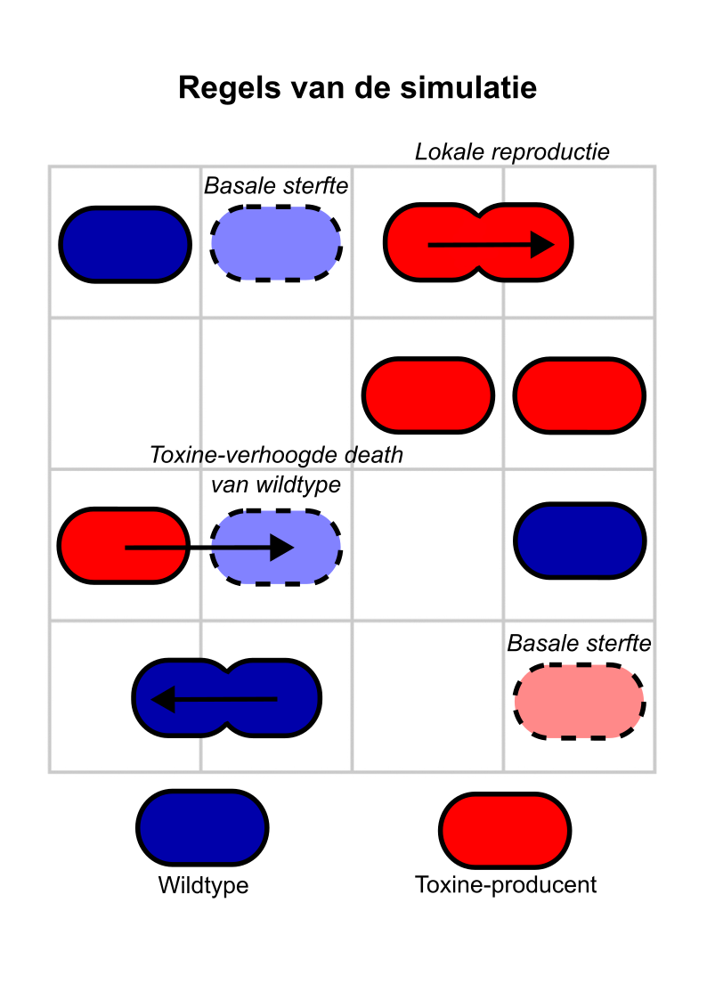

::: {.content-visible when-format="html"}

:::

# Mini-project {#sec-evolutie .unnumbered}

## Toxine-producerende bacteriën

Verschillende bacteriën die in eenzelfde omgeving groeien ondergaan vele interacties met elkaar. Naast het concurreren om voedsel, kunnen sommige bacteriën ook giftige stoffen (toxines) uitscheiden om hun concurrenten te onderdrukken. Sommige bacteriën scheiden deze toxines uit in het medium, terwijl andere de toxines direct in hun buurcellen kunnen injecteren. Hoewel dit deze bacteriën kan bevoordelen, dragen ze ook de metabolische kosten voor het produceren van de toxines (en de resistentie daartegen!). Om de ecologie van toxineproducenten te bestuderen, hebben we een systeem van ODEs opgesteld dat twee stammen beschrijft – een toxineproducerende stam die resistent is tegen het toxine en een gevoelige die dood gaat naar mate er meer toxine-producenten aanwezig zijn:

\begin{align}
\dt{X} &= a_{1}X(1-\frac{X+Y}{K}) - dX \\
\dt{Y} &= a_{2}Y(1-\frac{X+Y}{K}) - dY - cXY
\end{align}

In dit cursusonderdeel schrijven jullie een kort verslag over het bovenstaande ODE model, en een computersimulatie die deze interacties in de ruimte simuleert. Dit verslag dient de volgende vorm te hebben: 

  * Een korte introductie (~200 woorden), waarin het onderwerp het het vraagstuk geïntroduceerd wordt.     
  * Stapsgewijs antwoorden op de vragen (a=..., b=..., etc.).
  * Een korte conclusie (1-2 zinnen)
  * Bijlage: [ingevuld samenwerkingsformulier](../Appendices/samenwerkings_startformulier.docx)

Per onderdeel (a, b, c, *etc.*), word jullie verslag volgens de volgende standaard beoordeeld:

  * 1 pt. Antwoorden/figuren zijn correct (of er wordt een juiste beredenering gegeven voor een alternatief antwoord)
  * 1 pt. Uit het antwoord is goed af te lezen wat de vraag was (dit geldt ook voor vragen waar alleen een figuur wordt gevraagd!). Voorbeelden zijn "Het model laat zien dat het verhogen van de carrying capacity van de konijnen geen invloed heeft op de hoeveelheid konijnen in evenwicht..." of "In Figuur X tonen we de mogelijke faseruimtes voor Vergelijking Y, waar de blauwe lijnen...".

Omdat er 12 subvragen zijn, levert dit 24 punten op. De overige 6 punten verdien je met een passende inleiding (3 pt) en onderbouwde conclusie (3 pt). 

Succes met de opdracht!

::: {.callout-caution #ctn-project}

## Computerpracticum over toxine-productie

Verschillende bacteriën die in eenzelfde omgeving groeien ondergaan vele interacties met elkaar. Naast het concurreren om voedsel, kunnen sommige bacteriën ook giftige stoffen (toxines) uitscheiden om hun concurrenten te onderdrukken. Sommige bacteriën scheiden deze toxines uit in het medium, terwijl andere de toxines direct in hun buurcellen kunnen injecteren. Hoewel dit deze bacteriën kan bevoordelen, dragen ze ook de metabolische kosten voor het produceren van de toxines (en de resistentie daartegen!). Dit geeft een verlaagde groeisnelheid ten opzichte van bacteriën die het toxine niet produceren. Om de ecologie van toxineproducenten te bestuderen, hebben we een systeem van ODEs opgesteld dat twee stammen beschrijft – een toxineproducerende stam die resistent is tegen het toxine en een gevoelige die extra dood gaat naar mate er meer toxine-producenten aanwezig zijn:

\begin{align}
\dt{X} &= a_{1}X(1-\frac{X+Y}{K}) - dX \\
\dt{Y} &= a_{2}Y(1-\frac{X+Y}{K}) - dY - cXY
\end{align}

a. Omschrijf waar de termen in de vergelijkingen voor staan, en welke ODE (dX of dY) de toxine-producerende stam voorstelt, en welke de sensitieve stam.
b. Gegeven de biologische context, waar staan de parameters $a1$, $a2$, $K$, $d$ en $c$ voor? 
c. We gaan ervan uit dat er metabolische kosten zijn voor de productie van toxines, maar dat sensitieven behoorlijk gevoelig zijn voor deze toxines. Verwachten we dan dat een toxine-producerende mutant kan invaderen? 
d. Bereken de nullclines van dit systeem.
e. Schets de nullclines die je hebt gevonden in d in een faseruimte (een uitgebreid stappenplan vind je in [Tip 15.1](competitie.qmd#tip-odesschetsen)). Beschrijf en schets wat er met de nullclines gebeurt naar mate de kosten voor het produceren van het toxine hoger en hoger zijn.
f. Beschrijf de evenwichten in de verschillende faseruimtes uit e in biologische begrippen. Kan een toxine-producerende mutant (met lage metabolische kosten) invaderen in een populatie van sensitieven?

Neem het volgende Grind-script over: 

```{r results='hide'}
#| eval: false

source("https://tbb.bio.uu.nl/rdb/grindR/grind.R")

model <- function(t, state, parms){
  with(as.list(c(state,parms)),{
    dX <- a1*X*(1-(X+Y)/K) - d*X
    dY <- a2*Y*(1-(X+Y)/K) - d*Y - c*X*Y
    return(list(c(dX,dY)))
  })
}  

colors[1] = "navy"
colors[2] = "red"

p <- c(a1=0.6,a2=1.0,d=0.1,c=0.5,K=1)
s <- c(X=0.0001,Y=0.9)
par(mfrow=c(1,3))
plane(vector=T,grid=3,ymax=1.1,xmax=1.1,tstep=0.1, portrait=T, main="Totale faseruimte")
plane(vector=T,grid=6,ymax=0.85,ymin=0.6,xmax=0.25, xmin=0.05, portrait=F, main="(ingezoomed)")
newton(state=c(X=0.15,Y=0.7),plot=T)

run(tmax=400,traject=F, main="Invasie van X")
```

  g. Bestudeer met de parameters gegeven in het R-script of een toxine-producerende mutant zich kan verspreiden in een populatie van sensitieve cellen.
  h. Verandert je antwoord in f als je de toxines 2 keer zo sterk maakt? En als je de toxines 10 keer zo sterk maakt?
  i. Ga terug naar de oorspronkelijke parameters (`p <- c(a1=0.6,a2=1.0,d=0.1,c=0.5,K=1)`). Bestudeer nu ook of een sensitieve cell zich kan verspreiden in een populatie van toxine-producerende cellen.
  j. Trek uit de bovenstaande analyses alvast een biologische conclusie.

De ODEs nemen aan dat het systeem goed gemengd is, zoals in een Erlenmeyer die goed wordt geschud. Laten we ons virtuele experiment ook herhalen op het equivalent van een agar-plaat, waar zowel reproductie als de effecten van de toxines *lokaal* zijn. 

De parameters in de simulatie hebben vergelijkbare interpretaties als in de ODEs. In de simulatie is er echter geen sprake van *snelheden* van geboorte en sterfte, maar *kansen* van geboorte en sterfte. Let op: door deze kansprocessen moet je de simulatie soms meerdere keren herhalen om een betrouwbaar beeld te krijgen.

{width="60%" fig-align="center"}

Je vindt de simulatie hier: <https://tbb.bio.uu.nl/bvd/bms/simulations/toxins/>. 

k. Bestudeer met de standaard parameters of de toxine-producent kan invaderen, en vorm een hypothese over wat er gebeurt. 
l. Test en bespreek je hypothese met de opties die beschikbaar zijn in de simulatie.
