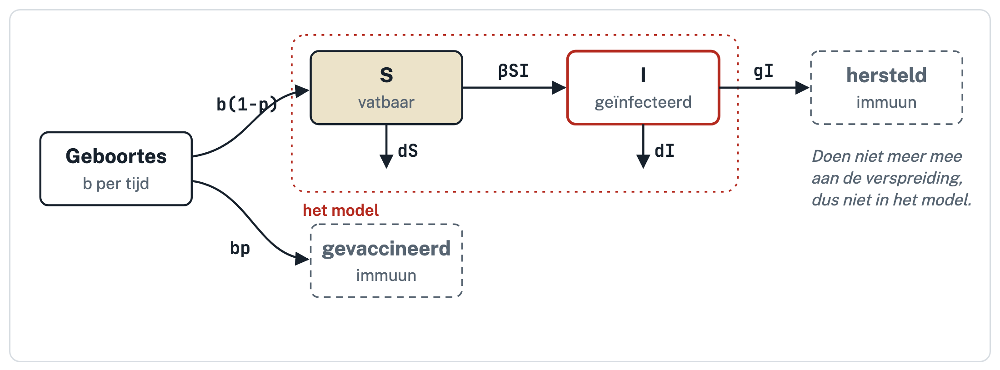
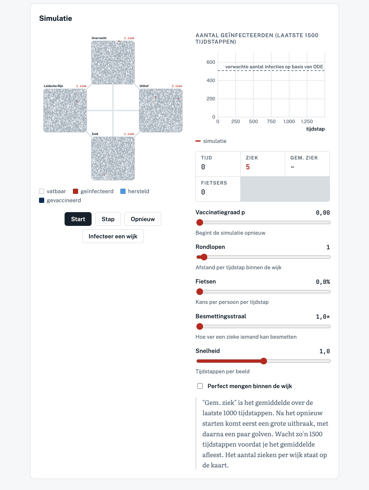



# Mini-project: mazelen in Utrecht {#sec-evolutie .unnumbered}

Mazelen is een van de meest besmettelijke ziektes die we kennen. Hoeveel mensen moet je vaccineren om een uitbraak te voorkomen? In dit project leid je dat eerst af met een ODE-model. Daarna kijk je met een simulatie van vier Utrechtse wijken of het antwoord verandert als mensen niet perfect door elkaar lopen, maar vooral hun buren tegenkomen en af en toe naar een andere wijk fietsen.

## Eisen aan je verslag

- Beantwoord de vragen puntsgewijs (a = …, b = …, enz.), in **volzinnen**.
- Sluit af met een korte conclusie (de laatste subvraag).
- Lever het samenwerkingsstartformulier mee in. Zonder dit formulier kun je **geen** voldoende krijgen.

## Deel A: het ODE-model

We kijken naar mazelen in een populatie en houden twee groepen mensen bij:

- $S$: het aantal **vatbare** mensen. Ze zijn nooit ziek geweest en niet gevaccineerd, dus ze kunnen nog besmet raken.
- $I$: het aantal **geïnfecteerde** mensen. Ze zijn ziek en kunnen anderen besmetten.

Elke tijdseenheid worden er $b$ baby's geboren. Dat is een vast aantal, dat niet afhangt van hoeveel mensen er op dat moment vatbaar of ziek zijn. Een fractie $p$ van de baby's wordt gevaccineerd; de rest, $b(1-p)$, is vatbaar en komt in $S$. Vatbaren raken besmet door contact met geïnfecteerden, en geïnfecteerden herstellen met snelheid $g$. Iedereen sterft met snelheid $d$.

We nemen aan dat gevaccineerde en herstelde mensen lang genoeg immuun blijven: zo lang dat we ze binnen de tijdschaal van het model niet opnieuw vatbaar hoeven te laten worden. Ze worden dus niet meer ziek en besmetten niemand. Ze bestaan wel, maar ze hebben geen enkele invloed op hoe de ziekte zich verspreidt. Daarom houden we ze in dit model niet bij: zodra iemand gevaccineerd wordt of herstelt, verdwijnt hij uit de vergelijkingen.

{#fig-mazelen-schema width="85%" fig-align="center"}

Hieronder staat het model in Grind.

```{r}
#| eval: false
source("https://tbb.bio.uu.nl/rdb/grindR/grind.R")

# Grind model
model <- function(t, state, parms) {
  with(as.list(c(state,parms)), {
    dS <- b*(1-p) - beta*S*I - d*S
    dI <- beta*S*I - g*I - d*I
    return(list(c(dS, dI)))
  })
}

# Parameters (p-vector) en beginwaarden (s-vector)
p <- c(
  b    = 10,       # aantal geboortes per tijdseenheid
  d    = 0.01,     # sterfte per individu per tijdseenheid
  g    = 0.1,      # herstelsnelheid
  beta = 0.00165,  # transmissiesnelheid
  p    = 0         # fractie van de baby's die gevaccineerd wordt
)

s <- c(S = 1000, I = 1)  # beginwaarden

par(mfrow=c(1,2))
plane(xmax=1000, ymax=800, main="Faseruimte (x-as: S, y-as: I)")
run(legend=TRUE, main="Tijdreeksen van S en I", tmax=500, tstep=0.1)
```

a. Schrijf de ODEs uit het Grind-model op in standaard wiskundige notatie. Geef met accolades kort aan wat elke term betekent.

b. Leg uit waar alle parameters ($b$, $d$, $g$, $\beta$ en $p$) voor staan. Gegeven bovenstaande uitleg, waarom wordt $b$ niet vermenigvuldigd met de populatiegrootte, en $d$ wel?

c. Bepaal in welke eenheden de parameter $g$ wordt uitgedrukt. 

d. Bereken het aantal vatbare individuen in evenwicht als er geen ziekte is ($I = 0$). Noem dit $\bar{S}$. Hoe hangt $\bar{S}$ af van $p$?

e. Bereken de nullclines van dit systeem. Schrijf je berekening uit (maak een foto van je schrift of typ dit in je verslag)

f. Schets met pen en papier de nullclines in een faseruimte (x-as: $S$, y-as: $I$) voor twee kwalitatief verschillende scenario's. Geef met pijltjes aan in welke richting de populaties veranderen, en geef de evenwichten aan. Wat betekent elk scenario voor een ziekte die binnenkomt in een populatie zonder ziekte (dus bij $S = \bar{S}$, $I \approx 0$)? Je mag een foto van je schets in je verslag zetten.

g. Hoe kun je met vaccinatie zorgen dat je in het scenario terechtkomt waarin de ziekte niet kan invaderen? Kijk daarvoor wat er met de nullclines gebeurt als de vaccinatiegraad $p$ groter wordt.

h. Hoe laag moet het aantal vatbaren zijn zodat een binnenkomende ziekte *niet* kan invaderen? Schrijf deze voorwaarde op door de plek van de verticale $I$-nullcline te vergelijken met $\bar{S}$, het punt waar de $S$-nullcline de $S$-as snijdt. Los je voorwaarde op voor $p$, en reken met de parameters uit de Grind-code uit hoeveel je minstens moet vaccineren.

i. De minimale vaccinatiegraad uit vraag h noemen we $p_c$. Controleer met Grind of je $p_c$ klopt: laat de ODEs lopen met een vaccinatiegraad net onder en net boven $p_c$. Laat met plaatjes zien wat er gebeurt.

   *Tip: zet bij een andere $p$ ook de beginwaarde op $S = 1000(1-p)$, en laat de simulatie lang genoeg lopen (bijvoorbeeld `tmax=2000`).*

## Deel B: mazelen in vier Utrechtse wijken

Stel: de vaccinatiegraad in Utrecht is de afgelopen jaren gedaald, en de mazelen dreigt terug te komen. De GGD wil weten hoeveel kinderen er gevaccineerd moeten worden om een uitbraak te voorkomen. Volgens het ODE-model uit deel A is het antwoord $p_c \approx 0{,}93$. Maar dat model neemt aan dat iedereen iedereen kan besmetten, alsof de hele stad continu door elkaar loopt. Zo gaat het in het echt natuurlijk niet. Je komt vooral mensen in je eigen buurt tegen, en soms fiets je naar een andere wijk. In deel B onderzoek je met een individual-based model (IBM) of dat de voorspelling verandert.

In de simulatie hieronder wonen 6000 mensen in vier wijken van een soort mini-Utrecht: Overvecht, Leidsche Rijn, de Uithof en Zuid (1500 per wijk). Elk poppetje is één persoon:

- Een vatbaar persoon kan besmet raken door geïnfecteerden die vlak bij staan. Hoe meer zieken in de buurt, hoe groter de kans. Met de schuifregelaar **besmettingsstraal** maak je de afstand waarover iemand besmet kan worden tot 3 keer zo groot. Maar: we nemen aan dat de besmettingskans per contact dan kleiner wordt, zodat een zieke nog steeds evenveel mensen besmet.
- Binnen hun wijk lopen mensen een beetje rond. Met de schuifregelaar **rondlopen** bepaal je hoe veel ze per tijdstap lopen. Met **perfect mengen** wordt iedereen elke tijdstap op een willekeurige plek in zijn eigen wijk gezet.
- Af en toe stapt iemand op de fiets naar een andere wijk. Met de schuifregelaar **fietsen** bepaal je hoe vaak dat gebeurt. Wie aankomt, stapt af op een willekeurige plek in de nieuwe wijk, en gaat daar rondlopen.
- Geïnfecteerden herstellen met een vaste kans per tijdstap en blijven daarna lang immuun. Echter, anders dan in de ODE houden we herstelde mensen hier wél bij: ze verdwijnen niet uit het model, maar blijven gewoon in hun wijk rondlopen (blauw op de kaart). Ze worden niet meer ziek en besmetten niemand, maar ze nemen wel ruimte in tussen de andere mensen.
- Iedereen sterft met een vaste kans per tijdstap. Elk sterfgeval wordt meteen vervangen door een baby op een willekeurige plek in dezelfde wijk, zodat er in elke wijk altijd 1500 mensen wonen. Een fractie $p$ van de baby's wordt gevaccineerd; de rest is vatbaar. Zo komen er, net als in de ODE, steeds nieuwe vatbaren bij.
- Heel af en toe raakt iemand besmet van buiten de stad. Zo kunnen we zien of een constante dreiging van een ziekte zich zal verspreiden of niet. Met de knop **Infecteer een wijk** breng je zelf 10 zieken binnen in een willekeurige wijk. 

De ziekte in de simulatie is precies dezelfde als in deel A: dezelfde herstelsnelheid $g = 0{,}1$, dezelfde sterfte $d = 0{,}01$ (een leven duurt gemiddeld 100 tijdstappen) en dezelfde besmettelijkheid. Volgens het ODE-model kan de ziekte dus ook hier niet uitbreken als meer dan 93% van de baby's gevaccineerd wordt. Alleen de manier waarop mensen elkaar ontmoeten is anders. Als de simulatie iets anders laat zien dan het ODE-model, komt dat dus door de structuur van het model, niet door de ziekte. De stippellijn in de grafiek is het aantal geïnfecteerden dat het ODE-model in evenwicht voorspelt.

:::{.print-only}
<center>*Simulatie van vier Utrechtse wijken, beschikbaar op de website:*</center>
{fig-align=center width="80%"}
:::

:::{.screen-only}
```{=html}
<iframe class="applet" width="100%" height="1180" style="border:0"
src="Applets/mazelen_simulatie.html" title="Simulatie van vier Utrechtse wijken"></iframe>
```
:::

j. Zet **perfect mengen** aan. Bekijk het gemiddelde aantal geïnfecteerden bij $p = 0$, $0{,}5$, $0{,}7$, $0{,}8$, $0{,}85$ en $0{,}9$, en vergelijk dit met de stippellijn van het ODE-model. Bij welke $p$ verdwijnt de ziekte? Klopt dat met $p_c \approx 0{,}93$? Doe elke instelling een paar keer.

k. Zet perfect mengen weer uit en klik op **Opnieuw** (rondlopen 1, fietsen 0, straal 1×, $p = 0$). Er komt een uitbraak, maar daarna smeult de ziekte met gemiddeld zo'n 70 zieken, ver onder de stippellijn (509). De parameters zijn hetzelfde als bij perfect mengen. Waarom haalt de simulatie het verwachte aantal infecties dan niet?

   *Hint: zet de snelheid laag en volg een groepje zieken. Wie staan er om een zieke heen, een paar tijdstappen nadat hij ziek is geworden?*

l. Varieer hoeveel mensen rondlopen: 0, 1, 2 en 4 (fietsen 0, $p = 0$). Hoe verandert het gemiddelde aantal zieken? Leg uit met je antwoord op de vorige vraag.

m. Zet rondlopen weer op 1. Vergelijk fietsen op 0 met fietsen op 1. Wat zie je? Waarom maakt fietsen zo veel uit?

   *Hint: waar komt een fietser terecht als hij aankomt in een andere wijk?*

n. Zet fietsen weer op 0 en rondlopen op 1. Maak de besmettingsstraal stap voor stap groter: 1×, 1,5×, 2× en 3×. Wat gebeurt er met het aantal zieken? Een zieke besmet volgens het ODE-model nog steeds evenveel mensen. Waarom maakt de straal dan toch zo veel uit?

o. Zet de straal weer op 1× en fietsen op 0,5. Zoek voor rondlopen 2 en voor rondlopen 4 bij welke vaccinatiegraad de ziekte verdwijnt. Vergelijk dit met perfect mengen (vraag j) en met het ODE-model. Wat doet de hoeveelheid menging met de $p_c$ die je in de simulatie vindt?

p. Is de $p_c$ uit het ODE-model te hoog, te laag, of precies goed? Zou je bij het vaststellen van een vaccinatiedoel liever de ODE of de simulatie gebruiken? Bedenk ook hoe mensen in het echt mengen (school, werk, het openbaar vervoer).

q. Schrijf een korte conclusie over dit project (~200 woorden).
