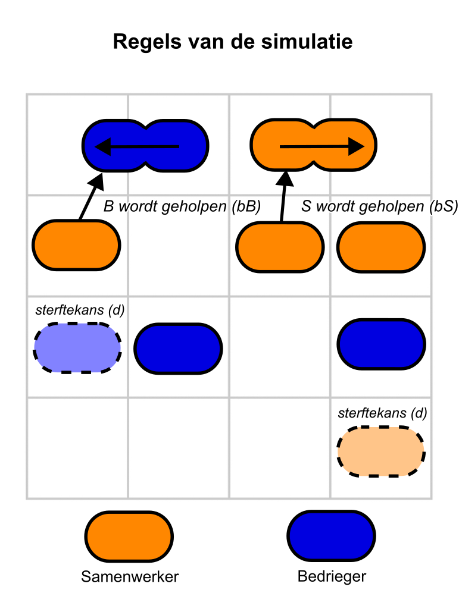



# Mini-project: Samenwerkers en Bedriegers {#sec-samenwerkers-bedriegers .unnumbered}

## Belangrijke informatie over je verslag

Hieronder staat waar je verslag van het mini-project (de samenwerkingsopdracht) aan moet voldoen:

- Je verslag moet puntsgewijs (a=..., b=..., etc.) antwoord geven op de gestelde vragen.
- Gebruik **volzinnen** in het beantwoorden van de vragen, waaruit blijkt op welke vraag je antwoord geeft. Zo volgt het vanzelf een logisch verhaal.
- Je verslag moet een korte conclusie bevatten waarin je de belangrijkste inzichten uit dit project samenvat (dit is de laatste subvraag).
- Bij je verslag, **moet** je ook het samenwerkingsstartformulier inleveren. Zonder dit formulier kun je **geen** voldoende krijgen.
- Lever je verslag als een PDF in. Zo gaat er niets mis met de opmaak tijdens het nakijken. 

---

## Samenwerkers en Bedriegers

We bestuderen een model dat de interactie beschrijft tussen samenwerkers (S) en bedriegers (B) in een populatie.
Samenwerkers dragen bij aan elkaars groei, terwijl bedriegers profiteren van de samenwerkers zonder zelf bij te dragen aan de groei van de populatie.Het model wordt beschreven door de volgende ODEs:

\begin{align*}
\frac{dS}{dt} &= b_S S^2 (1 - \frac{S + B}{K}) - d S \\
\frac{dB}{dt} &= b_B S B (1 - \frac{S + B}{K}) - d B
\end{align*}

Hierbij is S de dichtheid van samenwerkers, B de dichtheid van bedriegers, en K de maximale dichtheid die het ecosysteem aan kan. 

a. Beschrijf in woorden wat de termen in de ODEs betekenen.

b. Leg het biologische belang van de dichtheidterm ($(1 - (S + B)/K)$) uit. 

c. Leg uit waarom de dichtheidsterm geen eenheid heeft.

d. Bereken^[Laat je berekening zien] in welke eenheden de parameter \(b_S\), \(b_B\), en \(d\) worden uitgedrukt.

Je hebt tijdens de cursus geleerd dat je 2D systemen (ODEs met twee variabelen) kan analyseren met een toestandsruimte. Laten we een toestandsruimte tekenen met S op de x-as en B op de y-as. In deze toestandsruimte kunnen we de nullclines tekenen, dat zijn de lijnen waar de verandering van S of B gelijk is aan nul. Beide hebben in ieder geval triviale nullclines: S kan niet groeien als S=0, en B kan niet groeien als B=0. 

e. Bepaal de niet-triviale nullclines voor S en B. Omdat we B op de y-as hebben staan, is het fijn om deze op te schrijven in de vorm $B = f(S)$, zodat we ze kunnen tekenen in de toestandsruimte. **Controlleer je antwoord met een studentassistent, zodat je met f verder kan**

f. Bepaal op welke punten je nullclines de S-as (x-as) snijden (hint: als je de nullclines vermenigvuldigd met S, kun je de abc-formule toepassen). 

g. Let uit of de populaties kunnen groeien als $S$ en $B$ beide heel groot zijn ($S+B \gg K$). Je mag dit zowel wiskundig als biologisch uitleggen.

h. Maak twee schetsen van alle nullclines (ook de triviale) in de toestandsruimte. Neem voor één schets aan dat $b_S > b_B > d$, en voor de tweede dat $b_B > b_S > d$. 

i. Geef boven je schets aan wat de twee geschetste scenarios uit $h$ biologisch gezien betekenen.

j. Geef met pijltjes (vectoren) aan welke populatie in welk deel van de toestandsruimte kan groeien (hint: begin bij je antwoord op vraag $g$). 

k. Geef met open/gesloten rondjes aan waar evenwichten liggen, en of deze stabiel (gesloten) of instabiel (open) zijn. De stabiliteit kun je bepalen door te kijken naar de richting van de pijltjes in de buurt van het evenwicht.

Bekijk het onderstaande `grind.R`-script:

### Grind-model

```{r results='hide'}
#| eval: false
source("https://tbb.bio.uu.nl/rdb/grindR/grind.R")

# Grind model
model <- function(t, state, parms) {
  with(as.list(c(state, parms)), {
    dS <- bS * S * S * (1 - S - B) - d * S
    dB <- bB * S * B * (1 - S - B) - d * B
    return(list(c(dS, dB)))
  })
}

colors[1] = "orange"
colors[2] = "blue"

# Parameters
p <- c(
  bS = 1,    
  bB = 2, 
  d = 0.1   
)

# Beginwaarden
s <- c(S = 0.5, B = 0.1)
plane(vector=T,ymax=0.8)
run(tmax=1000, legend=T, tstep=0.5)
```

l. Gebruik bovenstaande grind script om je schetsen uit h t/m k te reproduceren. Gebruik het `newton` commando om de evenwichten aan te geven. 

m. Gebruik `run` om met verschillende parameterwaarden te kijken wat er gebeurt met de populaties. 

n. Kun je parameters vinden waarbij samenwerkers en bedriegers kunnen coëxisteren? Leg uit waarom dit wel / niet biologisch relevant is. 

We gaan nu een ruimtelijke simulatie van samenwerkers in bedriegers bekijken met vergelijkbare regels als hierboven. De onderstaande cartoon geeft de regels van de simulatie weer.


{width=50%}

[Klik hier om de simulatie te bekijken](https://jsfiddle.net/bramvandijk88/vy3rzeq1/show)

o. Gebruik de sliders en knoppen om het systeem te analyseren voor vergelijkbare parameters als je ODE model. Licht je bevindingen toe. 

p. Gebruik een knop om het ruimtelijke model meer op het ODE systeem te laten lijken. Wat gebeurt er nu?

q. Schrijf een korte conclusie over dit project (~200 woorden). Wat zijn de belangrijkste inzichten die je hebt opgedaan over de dynamiek tussen samenwerkers en bedriegers?


