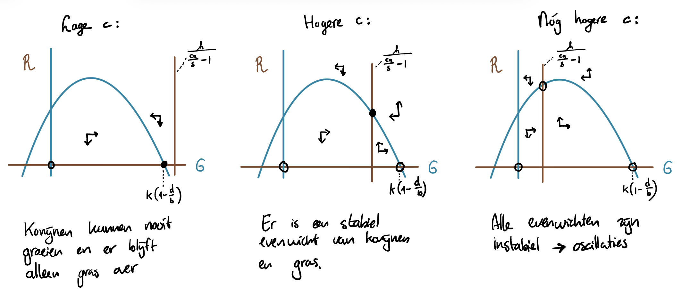



# Mini-project {#sec-evolutie .unnumbered}

## Efficiënte konijnen

We bestuderen in een ecosysteem de hoeveelheid gras ($G$) en konijnen ($N$).
We nemen aan dat gras logistisch groeit, en wordt opgegeten door konijnen. Konijnen gebruiken een fractie $c$ van het gegeten gras om nieuwe konijnen-biomassa te maken. Hoewel de waarden van deze parameter (en de andere parameters) niet in het veld gemeten is, kunnen we met een model wel onderzoeken wat er gebeurt als deze parameter verandert. Zo kunnen we biologische inzichten vergaren.

Hieronder staat het model beshreven in grind.

```{r results='hide'}
#| eval: false
source("https://tbb.bio.uu.nl/rdb/grindR/grind.R")

# Grind model
model <- function(t, state, parms) {
  with(as.list(c(state,parms)), {
    dG <- b*G*(1 - G/K) - d*G - a*G*R/(G+h)
    dR <- c*a*G*R/(G+h) - delta*R
    return(list(c(dG, dR)))
  })
}

# Parameters (p-vector) en beginwaarden (s-vector)
p <- c(
  b = 1,       # groeisnelheid gras (per tijd)
  d = 0.2,     # natuurlijke sterfte/afbraak gras (per tijd)
  K = 10,      # draagkracht gras (hoeveelheid gras)
  a = 10,      # graas-snelheid (gras per konijn per tijd)
  c = 0.5,   # conversie-efficiëntie (dimensieloos)
  delta = 0.2, # sterfte konijnen (per tijd)
  h = 2        # halfverzadiging (hoeveelheid gras)
)

s <- c(G = 1, R = 1)  # beginwaarden (gras, konijnen)

colors[1] <- "darkseagreen"
colors[2] <- "brown"
par(mfrow=c(1,2))

plane(xmax=15, ymax=0.3, main="Faseruimte (x-as: G, y-as: R)")
run(legend=TRUE, main="Tijdreeksen van G en R", xlab="Tijd", tmax=200, tstep=0.25)
```

a. Schrijf de ODEs uit het bovenstaande Grind-model op in standaard wiskundige notatie (dus niet in R-code). Geef hierbij met accolades (zoals in @eq-vossen-konijnen) kort aan wat elke term in de ODEs betekent.

> (**volzin voorbeeld**) De ODEs zoals gegeven in het grind-script, zijn alsvolgt:

>$$
\begin{align*}
    \frac{\dd {\color{#31ad8a}G}}{\dd t} &= \underbrace{b\left(1-\frac{{\color{#31ad39}G}}{K}\right){\color{#31ad8a}G}}_{\text{groei van nieuw gras}} - 
\underbrace{d{\color{#31ad8a}G}}_{\text{sterfte gras}} - \underbrace{\frac{a{\color{#31ad8a}G}\color{#ba5323}R}{\color{#31ad8a}G+h}}_{\text{predatie van gras door konijnen}}\\
\frac{\dd \color{#ba5323}R}{\dd t} &= \underbrace{\frac{ca{\color{#31ad8a}G}\color{#ba5323}R}{\color{#31ad8a}G+h}}_{\text{toename van konijnen door predatie}} - \underbrace{\delta \color{#ba5323}R}_{\text{sterfte konijnen}}
\end{align*}
$$ 

> MAX 2 PT<br>
> (1pt) ...heeft de juiste vergelijkingen opgeschreven<br>
> (1pt) ...heeft de termen correct gelabeled met acolades 

b. Leg uit waar alle parameters ($b$, $K$, $d$, $a$, $h$, $c$, en $\delta$) voor staan.  

> (**volzin voorbeeld**)De parameters uit dit model hebben de volgende betekenis:

>$b$ is de maximale groeisnelheid van de graspopulatie. <br>
>$K$ is de hoeveelheid gras waarbij de groei van nieuw gras 0 wordt (dit bepaalt het maximale draagvermogen van gras in het ecosysteem).<br> 
$d$ is de sterftesnelheid van gras <br>
$a$ is de maximale begrazings-snelheid van konijnen (maximale hoeveelheid gras dat een konijn per tijdseenheid kan eten)<br>
$h$ is de hoeveelheid gras waarbij de begrazings-snelheid de helft is van de maximale begrazings-snelheid<br>
$c$ is de conversie-efficiëntie van gras naar konijnen-biomassa<br>
$\delta$ is de sterftesnelheid van konijnen

> MAX 2 PT<br>
> (2pt) ...heeft alle parameters juist benoemd<br>
> (1pt) ...heeft meer dan de helft van de parameters juist benoemd<br>

c. Bepaal in welke eenheden de parameter $a$ wordt uitgedrukt (let op: hill-functies hebben geen eenheden, en kun je daarom meteen wegstrepen). 

> (**volzin voorbeeld**) Om de eenheden van parameter $a$ te bepalen, stellen we de term waar $a$ voorkomt gelijk aan de eenheden van de linkerzijde van de ODE, en lossen we op voor a:<br>

> Gras per tijdseenheid = $G/t = aRG/(G+h)$
Zoals gezegd heeft de hillfunctie geen eenheid, dus die kunnen we wegstrepen voordat we beginnen met rekenen: 
$aR = G/t$, 
Nu kunnen we beide kanten delen door $R$, het aantal konijnen. 
$a = G/t \cdot 1/R$. De eenheid voor $a$ is dus gras PER tijdseenheid PER konijn.

> MAX 1 PT<br>
> (1pt) ...heeft de juiste eenheden afgeleid

d. Welke waarde van $c$ verwacht je intuïtief dat het gunstigst is voor de konijnenpopulatie?

> (**volzin voorbeeld**) We verwachten intuïtief dat konijnen graag een hoge ... 

> Intuitief gezien zou je verwachten dat een hogere waarde van c gunstiger is voor de konijnenpopulatie. Omdat het gaat om de conversieefficientie zou deze niet boven de 1 moeten liggen (dat betekent dat er biomassa uit het niets ontstaat!), maar je zou denken dat 1 heel gunstig is voor de konijnenpopulatie omdat ze dan alle biomassa die ze eten omzetten in nieuwe konijnen-biomassa.

> MAX 1 PT<br>
> (1pt) ... de student geeft een logische redenatie 

e. Bereken waar de nullclines van dit systeem. 

> (**volzin voorbeeld**) We hebben de nullclines van het systeem bepaald door de vergelijkingen gelijk te stellen aan 0, en op te lossen voor (een van de variabelen):

> Gras nullclines:<br>
$bG(1 - G/K) - dG - aGR/(G+h) = 0$ herschrijven we tot:<br>
$G(b(1 - G/K) - d - aR/(G+h)) = 0$. <br>
Zo zie je dat er een nullcline is als $G=0$ (nullcline 1), maar ook als de rest 0 is. <br><br>Voor de rest geldt:<br><br>
$b(1 - G/K) - d = aR/(G+h)$
Beide kanten maal $G+h$:<br>
$(G+h)(b(1-G/K) – d) = aR$<br>
Beide kanten delen door a:<br>
$R = \frac{1}{a} (G+h) (b(1-G/K) – d)$  (nullcline 2)

>Konijnen nullclines:<br>
$caGR/(G+h) - deltaR = 0$ herschrijven we tot: 
$R(caG/(G+h) - delta) = 0$. <br>
Zo zien we dat er een nullcline is als $R=0$ (nullcline 1), maar ook als de rest 0 is.<br><br> Daarvoor geldt:<br>
$caG/(G+h) = delta$<br>
Beide kanten maal $G+h$:<br>
$caG = \delta(G+h)$<br>
$caG = \delta G + \delta h$<br>
$caG - \delta G = \delta h$<br>
$G(ca-\delta) = \delta h$<br>
$G = \delta h/(ca - \delta)$<br>
Breuk versimpelen:<br>
$G = h/(ca/\delta - 1)$ (nullcline 2)<br>

> MAX 4 PT <br>
> (4pt) ... de student heeft de juiste nullclines herleidt
> (OF 2pt) ... de student heeft de juiste stappen gemaakt, maar de verkeerde nullclines gevonden

f. Waar liggen de nullclines voor de konijnen als $ca=\delta$? Leg je antwoord uit in biologische begrippen.

> (**volzin voorbeeld**) Wanneer we veronderstellen dat $ca=\delta$, ligt de nullcline bij $\infty$ omdat...

> ...omdat je dan deelt door 0. Daarom zit je altijd aan de 'linkerkant' van deze rechte nullcline, waar de konijnen niet kunnen groeien. Dat is begrijpelijk, omdat de hoeveelheid nieuwe konijnen-biomassa die ze maximaal kunnen maken precies gelijk is aan de hoeveelheid konijnen-biomassa die sowieso verloren gaat door sterfte. Dus de konijnenpopulatie kan nooit groeien. 

> MAX 2 PT <br>
> (2pt) ... de student heeft de juiste conclusie getrokken (oneindig)
> (OF 1pt) ... de student heeft, gegeven hun foute nullclines, een logische conclusie getrokken 

g. Schets de nullclines in een faseruimte (x-as: gras, y-as: konijnen). Varieer hierbij de waarde van $c$ zodat er drie kwalitatief verschillende scenario's ontstaan (laag, midden, hoog). Geef aan of licht toe waarom de nullclines deze vorm / ligging hebben.

> (**volzin voorbeeld**) We geven de nullclines weer in een faseruimte in FIGUUR X ...

> De meeste nullclines zijn eenvoudig lijnen (twee triviale bij G=0 en R=0, en een rechte lijn voor de konijnen bij h/(ca/delta - 1)). Alleen de nullcline voor het gras is een kromme lijn, en die lijkt ingewikkelder dan die is. 

> $R= \frac{1}{a} (G+h)  (b(1-G/K) – d)$

> Net als in het klassieke Lotka-Volterra model, is dit een bergparabool. Deze heeft de nullpunten G=-h (links van de y-as), want als $G$ gelijk is aan $h$ dan wordt de hele vergelijking 0. Er is ook een nullpunt bij $b(1-G/K) – d = 0$. Dit kunnen we herschrijven tot:
$1-G/K = d/b$ en dat geeft $G = K(1-d/b)$. Gegeven dat death kleiner is dan birth ligt dit rechts van de y-as. 

> Er wordt gevraagd $c$ te varieren, en $c$ komt alleen in de niet-triviale konijnen-nullcline voor, namelijk $G = h/(ca/delta - 1)$

> Hoe groter $c$, hoe groter het getal onder de breuk, dus hoe kleiner de breuk. Voor hele grote $c$ ligt de nullcline dus dicht bij 0. Voor kleiner waarden van $c$ ligt de nullcline verder naar rechts. Zo kan de nullcline voor de konijnen links van de parabool liggen (scenario 1: hoge $c$), rechts van de parabool liggen maar wel snijden (scenario 2: kleinere $c$), of rechts van de parabool liggen en niet meer snijden (scenario 3: hele lage $c$). Zie onderstaande figuur:

> 

> MAX 5 PT <br>
> (3pt) ... de juiste nullclines correct getekend, en alle drie scenario's zijn weergegeven<br>
> (OF 2pt) ... de onjuiste nullclines correct getekend, en hiervan verschillelnde scenarios<br>

> (EN 2pt) ... geeft aan waarom de nullclines eruit zien zoals ze eruit zien, bijvoorbeeld door<br> snijpunten aan te geven, of de vorm van de parabool in text te beschrijven. Deze punten kunnen
verdiend worden ook alseerder de onjuiste nullclines zijn bepaald. 

h. Gebruik de eerder gegeven grind code (met de gegeven parameters) om te onderzoeken bij welke waarden van $c$ de scenario's uit g optreden. 

> (**volzin voorbeeld**) Wanneer we de waarde van $c$ varieren in de grind-simulatie, zien we de volgende effecten...

> Als $c$ < 0.025 dan ligt de konijnennullcline zo ver rechts van de parabool dat er geen snijpunt meer is. Dit betekent dat de konijnen nooit kunnen groeien, want zelfs met de maximale hoeveelheid gras hebben ze niet genoeg. 

> Als $0.025 < c < 0.033$ dan snijden de nullclines rechts van de top van de parabool, en zien we dempende oscillaties (door de stable spiral). Als $c$ echter groter is dan 0.044 dan snijden de nullclines links van de top van de parabool, en zien we blijvende oscillaties (door de instabiele spiral). 

> Het parameter-gebied waar je stabiele hoeveelheden gras en konijnen verwacht is in dit geval dus verrassend klein! :)

> MAX 4 PT <br>
> (2pt) ... legt uit waarom de verschillende scenario's optreden bij verschillende waarden van $c$ <br>
> (1pt) ... legt specifiek tussen welke waarden van $c$ het systeem stabiel is<br>
> (1pt) ... geeft aan dat het gebied voor stabiele hoeveelheden vrij klein is

i. Stel ook eens zeer hoge waarden in voor $c$ (bijvoorbeeld 0.5 of 0.8). Wat gebeurt er in deze gevallen? (hint: het kan zijn dat je de tijdstapgroote $tstep$ een stuk kleiner in moet stellen). Leg je antwoord uit in biologische termen.

> (**volzin voorbeeld**) Wanneer we de waarde van $c$ heel hoog veronderstellen (zeer efficiente konijnen), dan...

> Bij hele hoge $c$ (dus hele efficiente konijnen) krijg je zeer grote oscillaties. Dit komt doordat de konijnen heel snel groeien als er gras is, en daardoor het gras heel snel opeten. Maar als het gras op is, dan sterven de konijnen ook heel snel weer uit. Dit leidt tot grote pieken en dalen in de populaties. Als de tijdstap niet klein genoeg is, dan kan het model deze snelle veranderingen niet goed bijhouden, en krijg je onnatuurlijke resultaten (zoals negatieve populaties).

> MAX 2 PT <br>
> (2pt) ... ligt toe dat er dan oscillaties ontstaan. Doorrekenfouten zullen er niet meer zijn want ze kijken naar het grind script. 

j. Heroverweeg je antwoord op d in het licht van je bevindingen in h en i.

> (**volzin voorbeeld**) Gegeven dat zeer efficiente konijnen zulke grote fluctuaties veroorzaken, zou je kunnen concluderen dat...

> Hoewel een hoge efficientie goed klinkt voor de konijnen populatie, leidt dit wel tot enorme fluctuaties in de populaties. In het wiskundige model sterven de populaties weliswaar niet uit (ze kunnen altijd herstellen), maar dit is natuurlijk zeer onrealistisch (lees nog eens over de attovos). Misschien willen de konijnen dus wel een matige efficientie, zodat ze stabieler kunnen blijven bestaan. Als we echter aan evolutie denken is dat niet hoe het werkt: evolutie kan niet "vooruit denken". 

> MAX 2 PT <br>
> (2pt) ... legt uit dat oscillaties eventuele onrealistische populatie-dalingen kunnen veroorzaken, en dat dit in echte systemen wel eens tot uitsterven zou kunnen leiden!

Nu we het effect van $c$ in het wiskundige model begrijpen, gaan we een simulatie bekijken waarbij de konijnen zich fysiek in een (ruimtelijk) grasveld bevinden. 

In de versimpelde simulatie bewegen de konijnen zich over een rasterwereld:

*	Groene vakjes stellen gras voor.
*	Lichtbruine vakjes stellen kale grond voor (geen gras).
*	Gras kan lokaal weer aangroeien op kale vakjes met een constante snelheid, waardoor de graspopulatie zichzelf kan onderhouden.
*	In tegenstelling tot het ODE-model heeft gras hier geen natuurlijke sterfte.

Konijnen bewegen willekeurig rond. Alle konijnen eten al het gras binnen een bepaalde straal onmiddelijk op (je weet hoe ze zijn, gekke knijnen). Een vaste fractie (c) van elk opgegeten grasvakje wordt omgezet in nieuwe biomassa. Wanneer deze 1 bereikt, plant het konijn zich voort en verschijnt er een nieuw konijn vlakbij het huidige konijn. Dan moet het konijn opnieuw gras gaan eten om weer nieuwe konijnen te kunnen maken.

Konijnen sterven met een constante kans per tijdseenheid. Deze sterftekans hangt *niet* af van de hoeveelheid gras, net zoals in het ODE-model.

De grafiek in de simulatie toont alleen de laatste 500 tijdstappen, zodat de dynamiek duidelijker zichtbaar is.

https://jsfiddle.net/bramvandijk88/z2shmyt0/

k. Gebruik de simulatie om te bestuderen wat het effect is van de $c$ parameter in dit nieuwe model. Zie je iets wat in het ODE model niet gebeurde?

> (**volzin voorbeeld**) Wanneer we de waarde van $c$ varieren in de ruimtelijke simulatie, zien we de volgende effecten...

> Bij $c = 0.04$ overleven de konijnen het vaak niet, terwijl ze in de ODE dan al konden groeien. 
> Met $c > 0.5$ komen er snel heel veel konijnen, die het gras zo snel opeten dat de populatie uitsterft. Dit gebeurde in het ODE model niet, omdat de konijnen daar oneindig kleine populaties konden krijgen die weer herstelden. In de ruimtelijke simulatie kunnen populaties echter niet onder 0 komen, en als ze eenmaal uitgestorven zijn, kunnen ze niet meer terugkomen.
Over het algemeen zijn er minder mooie oscillaties in dit model, en is er meer overgelaten aan willekeur. 

> MAX 3 PT <br>
> (2pt) ... legt wederom uit wat er met verschillende waarden van $c$ gebeurt (hoeft niet kwantitatief te kloppen, als de richting van het effect maar klopt)
> (1pt) ... ligt toe dat je vaak ziet dat de populatie konijnen uitsterft, zelfs met lagere waarden van $c dan in het ODE model.

l. De simulatie heeft een vinkje om de konijnen en het gras elke tijdstap te "mengen" (door ze op willekeurige plekken te zetten). Zet deze knop aan en bestudeer nogmaals wat het effect is van de $c$ parameter. 

> (**volzin voorbeeld**) Wanneer we de simulatie mengen, zien we dat konijen...

> In de gemengde versie is een $c$ waarde van 0.04 weldegelijk genoeg om de konijnen te laten groeien, terwijl dat in het niet-gemengde systeem niet zo was. Dit zou kunnen komen doordat de konijnen er last van hebben als ze hun eigen gras "te snel" opeten, waardoor er niet genoeg om hun heen overblijft. 

> Ook zie je met een gemengd systeem duidelijkere oscillaties, omdat de alle interacties tussen gras en konijnen wat meer gemiddeld worden. Omdat ODEs ervan uitgaan dat alle interacties gemiddeld zijn (elk konijn is gelijk en ziet dezelfde hoeveelheid gras), lijkt het gemengde systeem dus ook meer op het ODE model!

> https://jsfiddle.net/bramvandijk88/7gv0rwet/

> MAX 3 PT<br>
> (2pt) ... legt een scenario uit waar konijnen nu soms wel/niet kunnen groeien met dezelfde waarde van $c$ 
> (1pt) ... ligt toe dat er nu wel weer duidelijkere oscillaties zijn, zoals in het ODE model


m. Bekijk ook de volgende simulatie: https://tbb.bio.uu.nl/bvd/simulations/konijnen_competition/ van bruine konijnen, en witte konijnen met een conversie-efficiëntie die 50% hoger is. Omschrijf in je eigen woorden wat je ziet. 

> (**volzin voorbeeld**) Als we de simulatie met witte en bruine konijnen met elkaar vergelijken, zien we dat.... 

> Hier zie je dat de meest efficiente populatie konijnen (wit) niet wint. Het kan dus inderdaad evolutuionair voordelig zijn om minder efficient te zijn, omdat je dan stabieler kunt blijven bestaan!

> MAX 4 PT<br>
> (2pt) ... geeft een heldere omschrijving van wat je in de simulatie observereert
> (2pt) ... geeft een **verklaring** voor wat je ziet in de simulatie

n. Schrijf een korte conclusie over dit project (~200 woorden).

> (**volzin voorbeeld**) In het kort, kunnen we uit dit project concluderen dat...

> In dit project hebben we bestudeerd hoe de conversie-efficiëntie van konijnen ($c$) invloed heeft op de dynamiek van een gras-konijnen systeem. In het ODE-model zagen we dat bij lage waarden van $c$ de konijnenpopulatie niet kon groeien, terwijl bij matige waarden stabiele populaties of dempende oscillaties ontstonden. Bij hoge waarden van $c$ leidden de snelle groei en daaropvolgende uitputting van gras tot grote oscillaties in de populaties. Dit suggereert dat een matige efficiëntie gunstiger kan zijn voor de stabiliteit van de populatie. In het ruimtelijke model lagen de specifieke waarden van $c$ ergens anders, veel algemene trends waren vergelijkbaar. Echter, in dit model konden populaties daadwerkelijk uitsterven, wat bij hoge $c$ waarden vaker voorkwam dan in het ODE-model. Door dit model te mengen zagen we dat het meer op het ODE model ging lijken: die nemen immers een gemenge populatie aan. Tot slot illustreerde de simulatie met witte en bruine konijnen dat een hogere efficiëntie niet altijd leidt tot een evolutionair voordeel, aangezien juiste de minder efficiënte populatie overleefde. Al met al benadrukt dit project hoe belangrijke parameters zoals conversie-efficiëntie de dynamiek van populaties kunnen beïnvloeden, en hoe verschillende modelbenaderingen aanvullende inzichten kunnen bieden in ecologische processen.

> MAX 5 PT<br>
> (2pt) ... de conclusie heeft een rode draad (kan gewoon de logica van het project volgen)<br>
> (2pt) ... de conclusie bevat de belangrijkste bevindingen uit het project<br>
> (1pt) ... de conclusie eindigt met een heldere, algemene slotzin<br>

In totaal kan de student dus 40 punten verdienen voor dit project:

1. ODEs opschrijven → 2

2. Betekenis parameters → 2

3. Eenheden van a → 1

4. Intuïtieve verwachting voor 𝑐→ 1

5. Nullclines afleiden → 4

6. Konijnen nc als ac=delta → 2

7. Nullclines schetsen (3 scenario’s) → 5

8. Scenario’s koppelen aan c-waarden (Grind) → 4

9. Zeer hoge c → 2

10. Heroverweging van (d) → 2

11 .Ruimtelijke simulatie (niet-gemengd) → 3

12. Ruimtelijke simulatie (gemengd) → 3

13. Competitie-simulatie (wit vs bruin) → 4

14. Conclusie (~200 woorden) → 5

2+2+1+1+4+2+5+4+2+2+3+3+4+5=40 punten​

Slechts enkele "bonus" punten zijn te verdienen (vragen die niet expliciet gesteld worden maar begrip aantonen), maar door alleen lettelrijk de vragen te beantwoorden kan er al een hoog cijfer worden gescoord. Dit is prima. Er kunnen absoluut veel 9s vallen, maar een 10 is echt voorbehouden aan de beste antwoorden die echt blijk geven van extra inzet / begrip. 
