

# Reacties en diffusie {#sec-diffusie}

De individual-based modellen uit het vorige hoofdstuk laten zien hoe complex gedrag kan worden gemodelleerd met verrassend simpele regels. We hebben hierbij gezien dat systemen zich kunnen zelf-organiseren tot patronen die niet zijn voorgedefinieerd: de levensechte "beestjes" van particle life, aapjes die op een verrassende manier meer eten kunnen vinden, en mieren die prachtige foerageerpatronen vormen. Deze patronen zijn voorbeelden van **dynamische** patronen: er is sprake van constante verandering over de tijd. Zo zagen we predator en prooi prachtige rollende golven vormen (*travelling waves*), of soms wat meer rommelige golven (*chaotic waves*). Misschien heb je tijdens het werkcollege zelfs wel een soort hypnotiserende spiralen gezien (*spiral waves*). Dergelijke patronen (zie @fig-dynpat) vinden we ook terug in de biologie, bijvoorbeeld in de vorming van biofilms in bacteriële kolonies. Dus, kennis van al deze intrigerende patronen die we zien in onze computersimulaties, kan bijdragen aan ons begrip van de biologie.


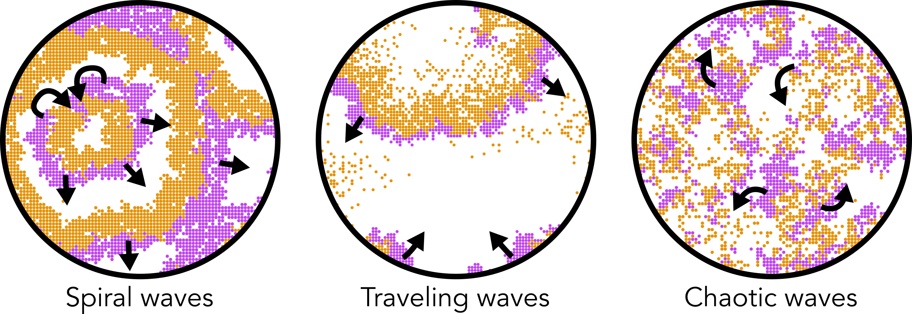{#fig-dynpat}

In dit hoofdstuk gaan we verder op het thema van patroonformatie, door te leren hoe een zebra haar strepen heeft gekregen. De strepen van een zebra zijn echter niet constant aan het veranderen, maar vormen een *stabiel patroon*. Hoe wordt een dergelijk stabiel patroon aangelegd? We gaan dit bekijken in reactie-diffusie vergelijkingen, waarbij (chemische) reacties in tijd en ruimte worden gemodelleerd. Hoewel deze modelvorm ook dynamische patronen kan opleveren (zoals de eerder genoemde golven en spiralen, wat we in het volgende hoofdstuk zullen zien), kun je hiermee ook de stabiele patronen op de huid van een dier verklaren. Om te beginnen gaan we eerst leren hoe we reactie-vergelijkingen kunnen omzetten naar ODEs. 

Leerdoelen:

* Reactie-vergelijkingen kunnen omzetten tot simpele ODEs
* Uitleggen wat het omschrijvingsniveau van een reactie-diffusie systeem (ookwel: PDE) is, en hoe dit verschilt van ODEs en IBMs
* Uitleggen wat Turing-patronen zijn, en wanneer deze ontstaan
* Begrijpen dat een mechanisme dat een patroon *kan* verklaren, dat niet hetzelfde is als bewijs dat het mechanisme *daadwerkelijk* het patroon verklaart.

## Van reactievergelijking naar ODEs

Met ODEs hebben we ons tot nu toe vooral gericht op het modelleren van populaties. Echter zouden we ook interacties op moleculair niveau kunnen beschrijven met ODEs. Neem bijvoorbeeld het "centrale dogma" van de biologie:

\begin{align*}
    \mathrm{DNA} & \rightarrow \mathrm{mRNA} \rightarrow \mathrm{Eiwit}
\end{align*}

Laten we voor het gemak aannemen dat het DNA in de cel simpelweg aanwezig is, en dat er met een constante snelheid ($e$) mRNA wordt afgeschreven. Dit mRNA wordt met een bepaalde snelheid ($v$) vertaald naar eiwit, en het breekt langzaam af ($d$). Ook het eiwit breekt langzaam af ($\delta$). Zo kunnen we het bovenstaande diagram dus in 2 hele eenvoudige ODEs uitdrukken: 

\begin{align*}
    \dt{M} &= e - dM \\
    \dt{E} &= vM - \delta E
\end{align*}

Het eiwit zorgt er wellicht voor dat de cel meer glucose op kan nemen. Hiervoor kunnen we een derde vergelijking toevoegen:

\begin{align*}
    \dt{M} &= e - dM \\
    \dt{E} &= vM - \delta E\\
    \dt{G} &= pE - \kappa G\\
\end{align*}

Om de cirkel volledig rond te maken, kunnen we verder nog stellen dat glucose de expressie van het gen bepaalt. Om ervoor te zorgen dat de genexpressie desondanks gelimiteerd is, maken we gebruik van een Hill-functie ( [hier](../Modellen/odes_grind.qmd#hill-functies) uitgelegd):

\begin{align*}
    \dt{M} &= \frac{eG}{G+h} - dM \\
    \dt{E} &= vM - \delta E\\
    \dt{G} &= pE - \kappa G\\
\end{align*}

De parameter $h$ is de half-waarde constante voor de transcriptie: als er precies $h$ glucose in de cell aanwezig is, is de mRNA-transcriptie half-maximaal. De maximale transcriptie is $e$, en als er 0 glucose is, is er geen expressie. Als we de ODEs doorrekenen zonder glucose, dan blijven inderdaad alle concentraties 0  (@fig-glucose links). Als we echter een heel klein beetje glucose toevoegen, dan ontstaat er een evenwicht met veel glucose in de cel (@fig-glucose rechts). 

```{r, results='hide'}
#| code-fold: true
#| eval: true
#| fig-height: 3
#| label: 'fig-glucose'
#| fig-cap: 'Met R berekende oplossingen van simpele ODEs van mRNA, eiwit, en glucose in de cel.'

source("https://tbb.bio.uu.nl/rdb/grindR/grind.R")

par(mfrow=c(1,2),mar=c(3,3,3,3))
model <- function(t, state, parms) {
  with(as.list(c(state,parms)), { 
    
    dM <- e*G/(G+h) - d*M
    dE <- v*M - delta*E
    dG <- p*E - kappa*G
    
    return(list(c(dM, dE, dG)))  
  }) 
}

p <- c(e=1,h=2,d=0.3,v=0.3,delta=0.05,p=0.4,kappa=0.2) #Parameters
s <- c(M=0.0,E=0.0,G=0.00) #Starting population sizes
run(tmax=200,ymin=0.0,ymax=1) 
title("Begin-concentratie G: 0.00")
s <- c(M=0.0,E=0.0,G=0.01) #Starting population sizes
run(tmax=200) 
title("Begin-concentratie G: 0.01")

```

Samengevat zien we dus dat, met de gegeven parameters, een stabiele hoeveelheid glucose (en mRNA/eiwit) kan ontstaan in de cel. Dit evenwicht wordt alleen bereikt als er een klein beetje glucose aanwezig is in de cel. Een cel die geen glucose detecteert zal dus geen genen tot expressie brengen. Maar wellicht diffundeert er een beetje glucose naar binnen vanuit de omgeving, of van een nabij gelegen cel. Om deze processen te modelleren, kunnen we gebruik maken van **reactie-diffusiesystemen**.

Reactie-diffusiesystemen beschrijven niet alleen de reactiesnelheden van processen (zoals hierboven), maar ook hoe ze door de ruimte diffunderen. Zo kun je modelleren hoe een chemisch signaal door een weefsel verspreidt, of hoe het evenwicht tussen verspreiding door diffusie en de reactiesnelheden eventuele patronen oplevert. Deze modellen worden bijvoorbeeld gebruikt om de verspreidingspatronen van dieren en planten te modelleren, hoe "golven" van ziekteverwekkers zich door een populatie mensen verspreiden (denk aan het coronavirus!), of hoe actiepotentialen zich van de sinusknoop naar de hartpunt (apex) bewegen. We zien reactie-diffusiesystemen dus overal terug in de biologie. 

## Diffusie tussen hokjes

Nu we een beeld hebben gekregen van hoe we simpele reacties kunnen modelleren met ODEs, gaan we beginnen met het modelleren van een diffusie-proces. Laten we eerst alleen diffusie bekijken (m.a.w. zonder reacties). Stel je voor dat we midden op een gel een druppel verf laten vallen. Langzaam diffundeert de verf door de gel heen. De meest eenvoudige manier om dit te modelleren, is om wederom een grid voor te stellen, waarbij het middelste punt de initiële hoeveelheid verf bevat (zie @fig-diffhokjes, in stap 0 is de concentratie in het midden "4"). Alle andere hokjes bevatten geen verf, dus is de hoeveelheid verf 0. Om een diffusie-proces te simuleren, stellen we dat een bepaalde hoeveelheid (bijv. 10%) van de verf naar de vier directe buur-cellen diffundeert. Zodoende is er vier keer 0.4 (10% van 4) uit het middelste hokje verdwenen, en hebben de hokjes eromheen nu een hoeveelheid verf van 0.4 (@fig-diffhokjes, stap 1). Na 3 stappen diffusie is de vlek al wat meer uitgebreid (@fig-diffhokjes, stap 3)^[Let op: de getallen worden hier afgerond om het process te visualiseren].


```{r results='hide'}
#| code-fold: true
#| label: 'fig-diffhokjes'
#| fig-cap: "Diffusie tussen hokjes van een concentratie van een hypothetisch stofje."
#| fig-height: 7
#| fig-width: 7

# Laad het viridis package (quietly zorgt ervoor dat er niets geprint word)
library(viridis,quietly = T)

par(mfrow=c(2,2),mar=c(2,2,2,2))

# Parameters
grid_size <- 8
initial_value <- 4
diffusion_rate <- 1/10
iterations <- 4

# Leeg grid maken
grid <- matrix(0, nrow = grid_size, ncol = grid_size)

# Middelste punt een waardeg even
mid <- ceiling(grid_size / 2) +1
grid[mid, mid] <- initial_value

# Functie voor diffusie 
diffuse <- function(grid, rate) {
  new_grid <- grid
  for (i in 2:(nrow(grid) - 1)) {
    for (j in 2:(ncol(grid) - 1)) {
      vec <- c(grid[i-1, j], grid[i+1, j], grid[i, j-1], grid[i, j+1])
      sumvec <- sum(vec,na.rm=T)
      new_grid[i, j] <- grid[i, j] + 
        rate * (sumvec - 4 * grid[i, j])
    }
  }
  return(new_grid)
}

# Functie voor het plotten
plot_grid <- function(grid, iteration) {
  plot(1:nrow(grid), 1:ncol(grid), type = "n", xlab = "", ylab = "", axes = FALSE, 
       xlim = c(1, grid_size), ylim = c(1, grid_size))
  
  # Grijze gridlijnen
  abline(h = 0:grid_size, v = 0:grid_size, col = "grey", lty = 2) 
  
  # Normaliseer waarden tussen 0 en 1
  norm_grid <- (grid - min(grid)) / (1 - min(grid))
  
  # Viridis kleuren gebruiken
  colors <- viridis(120)[1:100]
  colors[1] <- "#CCCCCC"
  # Nummbers op de goede plek zetten 
  for (i in 2:(nrow(grid)-0)) {
    for (j in 2:(ncol(grid)-0)) {
      color_index <- 1+38*min(100,log10(floor(norm_grid[i, j] * 100) + 1))  # Map to color scale
      text(i - 0.5, j - 0.5, round(grid[i, j], 2), col = colors[color_index], cex = 0.9, font=2)  # Tekst op goede plek
    
    }
  }
  title(paste("Stap ", iteration-1))
}

# Herhaal plotten, diffusie, plotten, diffusie, etc.
for (iter in 1:iterations) {
  plot_grid(grid, iter)
  grid <- diffuse(grid, diffusion_rate)
}
```

En zo eenvoudig kan het zijn: door de ruimte in hokjes op te delen kunnen we heel eenvoudig een diffusie-proces simuleren. Hoe kleiner de hokjes zijn, hoe preciezer we de lokale concentraties van de stofjes kunnen simuleren. Echter wordt het dan ook steeds zwaarder voor de computer om alle hokjes door te rekenen. Om deze beperking te omzeilen, kunnen partiële differentiaalvergelijkingen (PDEs) worden gebruikt, waarbij ruimte niet discreet maar continu is ("oneindig kleine hokjes"). PDEs lijken op ODEs, maar waar ODEs alleen tijd als onafhankelijke variabele gebruiken, hebben PDEs zowel tijd als ruimte als onafhankelijke variabelen. Met de computer benaderen we PDE door de hokjes voldoende klein te houden  (net zoals ODEs in grind tijd in kleine stapjes opdeelt). 

De beste manier om het effect van diffusie weer te geven, is het toepassen op een afbeelding. In @fig-blurring zie je dat diffusie vooral het effect heeft dat de afbeelding minder en minder patroon bevat, totdat alle pixels dezelfde kleur hebben. Misschien verbaast het je niet dat het vervagen van foto's met Photoshop vaak precies op deze manier werkt!

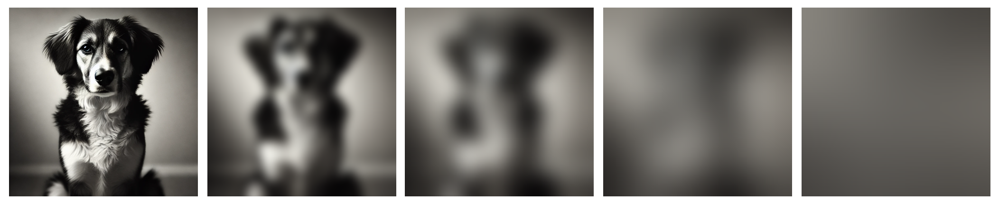{#fig-blurring}

We kunnen de eerder genoemde cellen met ODEs voor mRNA, eiwit, en glucose, ook in hokjes stoppen, en het effect van diffusie tussen buur-cellen bestuderen. We kunnen bijvoorbeeld 1 cel in het midden een boel glucose geven, en alle andere cellen 0 glucose. Zonder diffusie zie je dat alleen de cel in het midden eiwitten tot expressie brengt. Door echter een beetje diffusie van glucose toe te passen, zien we dat het signaal zich over het weefsel verspreidt. Net als bij het plaatje van de hond, zien we dus dat diffusie het initiële patroon (een hele duidelijke stip in het midden) verzacht, totdat er geen patroon meer is en alle cellen precies hetzelfde zijn. 

:::{.print-only}
<center>*Interactieve content beschikbaar op de website:*
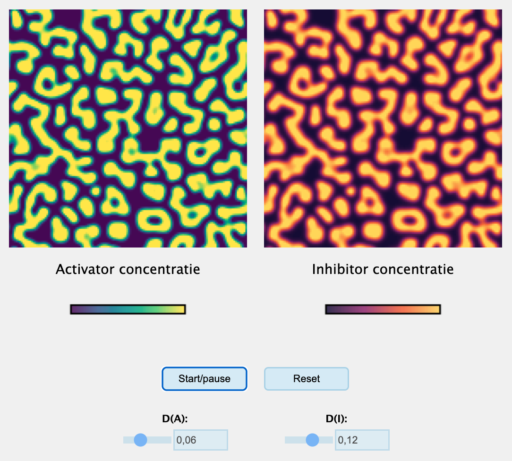
</center>
:::

:::{.screen-only}
```{=html}
<iframe id="iframeToReplace" width="100%" height="520" src="https://jsfiddle.net/bramvandijk88/u78h2d96/embedded/result"
title="Simulation"></iframe>
```
:::

## Activerende en remmende eiwitten

We hebben nu een beeld gekregen van reactie-diffusiesystemen, maar tot nu toe lijken ze patronen alleen maar tegen te werken.  Maar reactie-diffusiesystemen kunnen weldegelijk prachtige patronen generen, zo ontdekte Alan Turing in 1952. Turing vroeg zich af of diffusie ook de *oorzaak* kon zijn van bepaalde patronen. Hij stelde zich voor dat in een weefsel twee eiwitten tot expressie komen: *activators* ($A$) en *inhibitors* ($I$). De activator ($A$) verhoogt de expressie van beide eiwitten, en de inhibitor verlaagt deze. Dit scenario kunnen we omschrijven in een simpel systeem van ODEs:

\begin{align}
    \dt{A} &= k_AA - k_II - dA^2 \\
    \dt{I} &= k_AA - k_II - dI
\end{align}

Waarbij $A$ de activator is, $I$ de inhibitor, $k_A$ de activatie-constante, $k_I$ de inhibitie-constante, en $d$ de afbraak van de eiwitten. Omdat zelf-activatie oneindige exponentiële groei kan opleveren, nemen we aan dat de afbraak van de activator (per molecuul) toeneemt met de dichtheid. Voor de inhibitor nemen we normale (constante) afbraak aan. 

Zoals jullie hebben geleerd kunnen we een dergelijk simpel ODE-systeem analyseren met nullcline analyse. Laten we ervoor kiezen om een faseruimte te tekenen met $I$ op de y-as, en $A$ op de x-as. Zodoende willen we dus nullclines vinden waarbij $I$ wordt uitgedrukt als functie van $A$. Laten we eerste de nullcline(s) voor $A$ bepalen:

\begin{align*}
    \dt{A} &= k_AA - k_II - dA^2 = 0 \\
    k_II &= k_AA - dA^2 = A(k_A-dA) \\
    I &= \color{blue} \frac{A(k_A-dA)}{k_I} \\
\end{align*}

$A$ heeft dus één enkele nullcline: een bergparabool met nullpunten $A=0$ en $A=\frac{k_a}{d}$. De nullcline(s) voor $I$ zijn:

\begin{align}
    \dt{I} &= k_AA - k_II - dI = 0 \\
    k_II + dI &= k_AA \\
    I(k_I + d) &= k_AA \\
    I &= \color{red} \frac{k_AA}{k_I + d} \\ 
\end{align}

$I$ heeft dus ook één nullcline. $A$ verschijnt alleen in de teller van de breuk, dus deze nullcline neemt lineair toe met $A$ (met hellingshoek $\frac{k_A}{k_I - d}$). Naar verwachting vinden we dus een parabool en een lineaire functie in onze faseruimte. Als we de faseruimte tekenen met `Grind.R`, is dat inderdaad wat we zien (@fig-phaseturing). Aan dit vectorveld kunnen we ook aflezen dat er twee evenwichten zijn: een instabiel evenwicht wanneer er geen $A$ en $I$ is, en een stabiel evenwicht bij een bepaalde hoeveelheid $A$ en $I$. Het eerste trajectorie in @fig-phaseturing laat zien dat de eiwitten inderdaad naar het stabiele evenwicht kunnen gaan. Als je echter met veel inhibitors begint, zien we beide concentraties juist hard afnemen. Hoewel het evenwicht bij $(0,0)$ instabiel is, zijn negatieve concentraties niet biologisch relevant, en kunnen we voor de eenvoud aannemen dat deze concentraties naar $0$ gaan. 

Afhankelijk van de initiële conditie, zien we dus dat we wel/niet expressie van de eiwitten zien. Dit wordt ook wel bistabiliteit genoemd. In een systeem met bistabiliteit heeft de geschiedenis van een systeem (waar het systeem voorheen was) invloed op de verdere verloop van het systeem (waar het naar toe gaat). Dergelijke effecten zijn waargenomen voor de genexpressie van bacteriën, en zijn bovendien erg belangrijk voor natuurbehoud. Het kan namelijk erg moeilijk kan zijn om een eenmaal omgeslagen ecosysteem weer terug te krijgen in de "gezonde" toestand. (zie ook @tip-hysterese). 


```{r, results='hide',warning=FALSE,echo=FALSE,message=FALSE,out.width="60%"}
#| label: 'fig-phaseturing'
#| fig-width: 5
#| fig-height: 5
#| fig-cap: "De uitkomst van het activator-inhibitor systeem hangt af van de initiële conditie"

   source("https://tbb.bio.uu.nl/rdb/grindR/grind.R")
par(mfrow=c(1,1),mar=c(5, 4, 4, 2)) 
model <- function(t, state, parms) {
  with(as.list(c(state,parms)), {
    dI <- ka*A - ki*I - d*I
    dA <- ka*A - ki*I - d*A*A
    return(list(c(dI,dA)))  
  }) 
}  

#par(mfrow=c(2,1))
p <- c(ka=1, ki=0.8,d=2.5)
s <- c(I=0.001,A=0.01)
plane(ymax=0.16,xmax=0.4,xmin=-0.12,ymin=-0.1,vector=T,portrait=F,grid=5,x=2,y=1,npixels=500)
newton(state=c(I=0.10,A=0.3),plot=T)
newton(state=c(I=0.0,A=0.0),plot=T)
s <- c(I=0.00,A=0.03)
f <- run(tmax=20,tstep=0.1,timeplot=T,traject=T)
text(0.15,0.0,"Start trajectorie 1",cex=0.8)
s <- c(I=0.03,A=0.00)
f <- run(tmax=4,tstep=0.1,timeplot=T,traject=T)
text(-0.05,0.052,"Start\n trajectorie 2",cex=0.8)
```


:::{.callout-note #tip-hysterese collapse=false}
## **Verdieping:** hysterese in ecosystemen

Als een systeem meerdere evenwichten heeft, en je verandert langzaam de condities, dan kan er een punt zijn dat het van het ene naar het andere evenwicht omklapt. Dergelijke "tipping points" worden op alle schalen gezien: van de expressie van het lac-operon in E. coli, tot hele ecosystemen. In de onderstaande foto zie je bijvoorbeeld twee bijna identieke meren, maar één van de meren is door eutroficatie (aanwezigheid van te veel voedingsstoffen) omgeslagen naar een ongezonde vertroebelde toestand. Een dergelijke vertroebeling ongedaan maken blijkt erg lastig te zijn. Inderdaad weten we dankzij modellen dat deze systemen *bistabiel* zijn, zoals weergegeven met de twee kuilen waarin het balletje naar beneden kan rollen: als het balletje eenmaal in een ander minimum ligt, krijg je deze er niet zomaar meer uit! Dit fenomeen wordt *hysterese* genoemd.

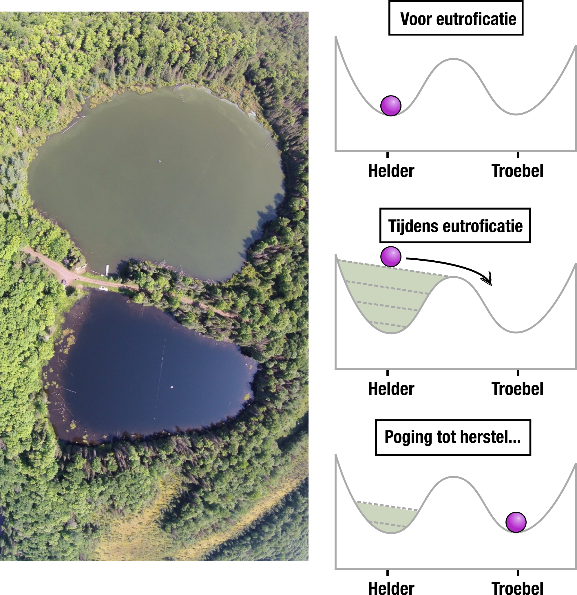{width="70%" fig-align="center"}
:::

## Turing-patronen 

Oke, we weten nu dus naar welke evenwichten de activators en inhibitors kunnen gaan. Laten we de variabelen $A$ en $I$ in hokjes stoppen, en hetzelfde lokale diffusieproces toepassen als eerder besproken. Elke tijdstap worden dus de differentiaalvergelijkingen zoals hierboven een klein stukje doorgerekend, dan een stapje diffusie, differentiaalvergelijkingen doorrekenen, diffusie, *etc.* We beginnen met een willekeurige hoeveelheid $A$ per hokje, en zonder $I$:

:::{.print-only}
<center>*Interactieve content beschikbaar op de website:*

</center>
:::

:::{.screen-only}
```{=html}
<iframe id="iframeToReplace" width="100%" height="630"
src="https://jsfiddle.net/bramvandijk88/rsybex04/embedded/result"
title="Simulation"></iframe>
```
:::

Als je de simulatie hierboven een tijdje laat lopen, zul je zien dat er iets interessants gebeurt: ondanks de diffusie ontstaat een contrastrijk en stabiel patroon. Precies welk patroon je krijgt (groter/kleiner, strepen/vlekken), hangt af van de diffusie-snelheden en de activatie-/inhibitieconstanten (zie een paar voorbeelden in @fig-turingvoorbeelden).

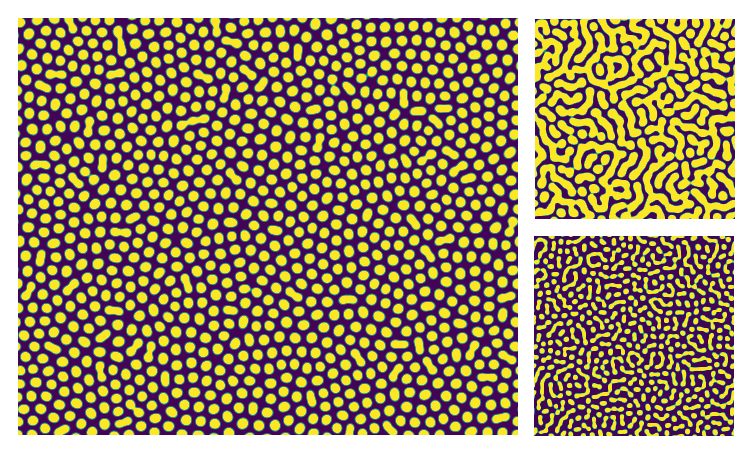{#fig-turingvoorbeelden}

Met de bovenstaande simulatie zul je ook kunnen zien dat niet elke simulatie Turing-patronen oplevert. Als je bijvoorbeeld de diffusie van de activator verhoogt krijg je geen patronen. Hoe het ook zij: Turing slaagde er in om een proces te vinden waarbij, met de juiste parameter-voorwaarden, diffusie niet patronen uitvaagt maar juist genereert! Als de diffusie niet in alle richtingen even snel is (of: als de deeltjes gemiddeld gezien een kant opstromen), kan je ook strepen krijgen die erg veel op de vacht van een zebra lijken:

:::{.print-only}
<center>*Interactieve content beschikbaar op de website:*
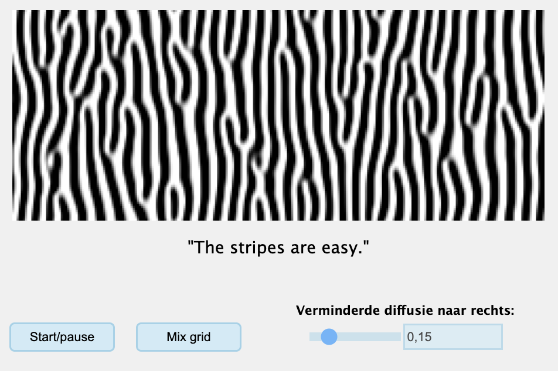
</center>
:::

:::{.screen-only}
```{=html}
<iframe id="iframeToReplace" width="100%" height="500" src="https://jsfiddle.net/bramvandijk88/se96bu58/embedded/result"
title="Simulation"></iframe>
```

::: 

Dit is dan ook waarom Alan Turing ooit stelde:

> "The stripes are easy, but what about the horse part?"<br>
-- Alan Turing

Vele decennia later is er ook veel gemodelleerd aan "the horse part": hoe krijg je van een enkele cel een complex organisme met de juiste verdeling van weefsels en vingers? Het blijkt dat niet alleen de vlekken op de vacht, maar ook de ontwikkeling van planten en dieren veelal met Turing patronen verklaard kan worden. Zie bijvoorbeeld onderstaande afbeeldingen uit [onderzoek van James Sharpe](https://pubmed.ncbi.nlm.nih.gov/23276682/), wat aantoont hoe vergelijkbare activatie-en-inhibitie interacties vorm kan geven aan complexe organismen. 

::: {#fig-sharpe layout-nrow=2}

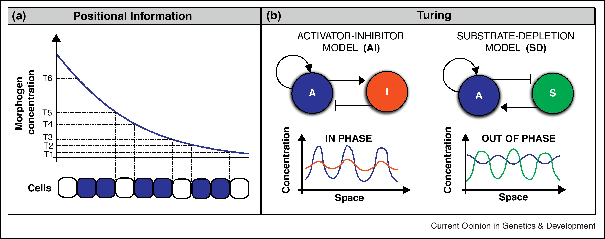{#fig-sharpe-1 width="70%"}

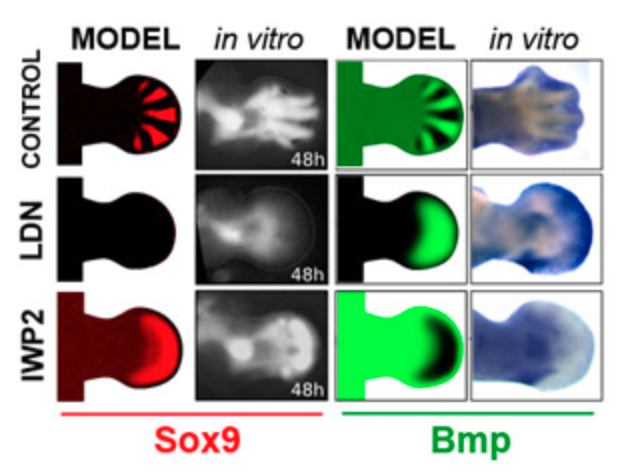{#fig-sharpe-2 width="70%"}

Turing patronen zijn ook relevant voor morphologie en ontwikkeling!

:::


## Niet alle repetitieve biologische patronen zijn Turing patronen 

Zoals we hierboven hebben gezien, ontstaan Turing-patronen door een combinatie van lokale activatie en inhibitie op afstand, wat niet alleen betrokken is bij vachtpatronen, maar ook bij de aanleg van het lichaam zelf. Heel recent is zelfs gevonden dat Turing-mechanismen een rol spelen bij de [ontwikkeling van vingerafdrukken](https://www.sciencedirect.com/science/article/pii/S0092867423000454?via\%3Dihub). 

:::{#fig-turingornot layout-ncol=2}

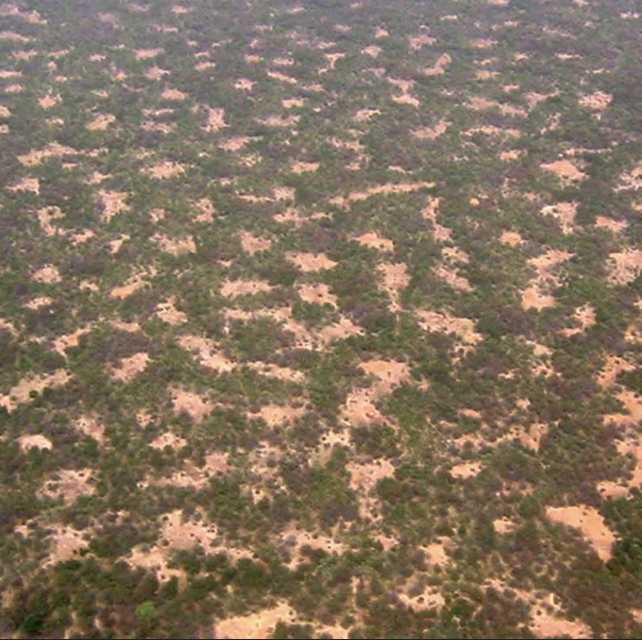{width=60%}

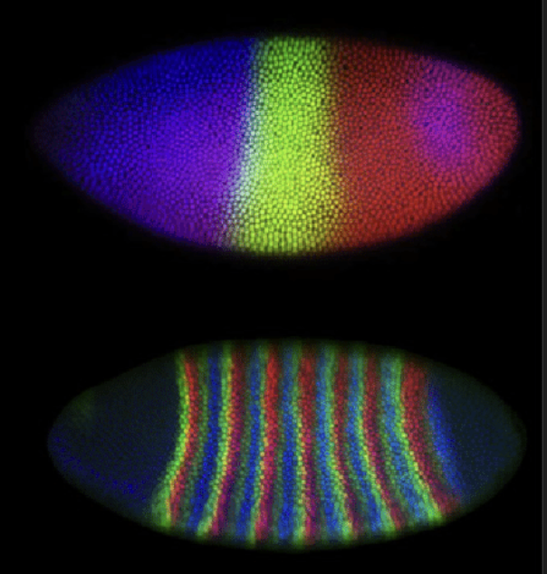{width=56%}

Biologie heeft veel patronen, maar niet alles hoeft met een Turing-patroon verklaard te worden!
:::

Ook veel andere biologische processen ondergaan vergelijkbare interacties. In droge gebieden houden planten samen lokaal water vast, maar onttrekken daardoor water uit de omgeving op afstand. Ook dit levert patronen op die lijken op Turing-patronen. Maar **let op**: hoewel Turing-mechanismen veel patronen in de natuur *kunnen* verklaren, betekent dit niet dat deze patronen ook door Turing-mechanismen zijn ontstaan. Zo is er bijvoorbeeld veel onderzoek gedaan naar mogelijke Turing-mechanismen in de ontwikkeling van fruitvliegjes, maar dit patroon bleek op een geheel andere manier te vormen (@fig-turingornot). Kortom: hoewel Turing patronen een terugkerend principe lijken te zijn binnen de biologie, is niet ieder "vlekken-of-strepen-patroon" ontstaan door Turing mechanismen. Zo kan je bijvoorbeeld op een grid van struikgewas (groen) of droge aarde (lichtbruin) ook vergelijkbare patronen krijgen door een simpele "meerderheidsregel". Dat wil zeggen: als er meer planten in de buurt zijn dan verandert een grid-punt in een plant, en als er meer droge aarde in buurt is, dan verandert een grid-punt in droge aarde. Het resultaat is een patroon wat ook heel erg lijkt op het struikgewas in @fig-turingornot: 

:::{.print-only}
<center>*Interactieve content beschikbaar op de website.*
</center>
:::

:::{.screen-only}
```{=html}
<iframe id="iframeToReplace" width="100%" height="500"
src="https://jsfiddle.net/bramvandijk88/q5spktxd/embedded/result"
title="Simulation"></iframe>
```

::: 

Ook bovenstaand mechanisme genereert iedere keer dat je het uitvoert (dubbelklik!) een nieuw uniek patroon. Hoewel we in ODEs en het lab soms vergeten dat ze bestaan, zijn patronen in de biologie heel belangrijk. Hoewel bijvoorbeeld de oceaan relatief goed gemengd lijkt, is zelfs hier soms sprake van duidelijke patronen die de biologie beïnvloeden. Patronen zijn dus wellicht helemaal niet de uitzondering!

> "Patterns do not always need an explantion. The pattern is the default."<br>
-- Paulien Hogeweg (lecture 'Computational biology', 2012)

## Opgaven 

::: {.mixedexr #exr-reactievergelijkingen}
## Reactievergelijkingen

<br>

Bekijk de volgende reactievergelijking van de snelheid voor enzymatische reacties (bekend als Michaelis-Menten kinetiek), waarbij een enzym ($E$) een complex vormt met een substraat ($S$). Dit complex ($C_{ES}$) catalyseert de reactie naar product ($P$), waarbij het enzym weer vrij komt. Echter kan het complex ook weer uit elkaar vallen zonder reactie, en weer $E$ + $S$ opleveren. 

\begin{align}
    E+S & \quad \underset{k_2}{\stackrel{k_1}{\rightleftharpoons}} \quad C_{ES} \quad \xrightarrow{k_{cat}} \quad E+P\\
\end{align}

a. Stel dat we een dynamisch model van dit systeem zouden willen maken. Wat zijn de variabelen die we zouden willen modelleren? Wat zijn de parameters? 
b. Aangenomen dat de reactiesnelheden direct proportioneel zijn aan de concentraties, is de snelheid waarmee het complex $C_{ES}$ ontstaat gelijk aan $E \cdot S \cdot k_1$. Zijn er nog meer processen die de hoeveelheid complex verhogen of verlagen? Welke vergelijkingen beschrijven deze processen? 
c. Alle processen uit vraag b bij elkaar geven de totale snelheid waarmee complex ontstaat en/of vervalt. Met deze kennis kunnen we ODEs opstellen. Schrijf van $C_{ES}$ en de andere variabelen differentiaalvergelijkingen op. 
d. Bekijk het onderstaande Grind-model van dit systeem. Het script print hoeveel product er is ontstaan aan het begin van het reactie-proces. Schets door het script te bestuderen hoe deze initiële reactie-snelheid afhangt van de initiële substraat-concentratie. Hint: bekijk hoeveel een verdubbeling van $S$ de reactiesnelheid verhoogt bij lage $S$ (bijv. 0.001), en ook bij hele hoge $S$ (bijv 1000). 

```{r results='hide'}
#| eval: false
source("https://tbb.bio.uu.nl/rdb/grindR/grind.R")

model <- function(t, state, parms) {
  with(as.list(c(state,parms)), { 
    
    dE <- k2*C - k1*E*S + kcat*C
    dS <- k2*C - k1*E*S
    dC <- k1*E*S - kcat*C - k2*C
    dP <- kcat*C
    
    return(list(c(dE, dS, dC, dP)))  
  }) 
}

p <- c(k1=1,k2=0.2,kcat=1) #Parameters
s <- c(E=1,S=1,C=0,P=0) #Starting population sizes
run(tmax=10,tstep=0.1) 
stapje <- run(tmax=1,ymax=3,tstep=1,timeplot=F) 
cat(paste("Er is in 1 stap",stapje["P"],"product ontstaan"))
```
:::

::: {.pepexr #exr-diffusievraag}

## Diffusie simuleren

<br>

Kijk nog eens naar @fig-diffhokjes. De diffusie-constante die in dit figuur werd aangenomen was 0.1, dat wil zeggen, van de totaal-concentratie 4.0 in het middelste punt, diffundeert 0.4 naar elk van de buurhokjes. 

Stel dat elke stap in @fig-diffhokjes één minuut voorstelt, en dat je experimenteel hebt waargenomen dat na 3 minuten de verf volledig over de plaat is verspreid. Kennelijk is de diffusie in @fig-diffhokjes te langzaam. 

a. Teken de begin-conditie in @fig-diffhokjes na, en bepaal wat er gebeurt met een snellere diffusie-constante. Probeer een diffusie-constante van 0.2 en 0.3. Wat valt je op? 
b. Hoe kan je er voor zorgen dat de stof beter is verspreid na 3 minuten?

Lokale diffusie op een grid heeft dus zijn beperkingen, vooral doordat tijdstapjes te groot kunnen zijn. 

c. Leg uit waar we dit probleem eerder hebben gezien, en waarom partiële differentiaalvergelijkingen (met "oneindig kleine hokjes") dit probleem niet hebben. 
:::

::: {.Rexr #exr-bijproducten}

## Bijproducten

<br>

Bacteriën produceren tijdens hun metabolisme vaak bijproducten, zoals melkzuur, alcohol, en waterstofperoxide. Hoewel lage concentraties van deze metabolieten vaak niet schadelijk zijn, kan het op den duur opbouwen in de omgeving en zo de sterftekans van de bacteriën verhogen. We bestuderen in deze opgave een eenvoudig *individual-based model* (IBM), dat de volgende regels volgt:

1. Plaats een aantal individuen in het midden van een continue ruimte
2. Voor elk individu:
    i. Tel het aantal individuen binnen een **kleine** radius van een individu (a)
    ii. Tel het aantal individuen binnen een **grote** radius van een individu (i)
    iii. Het individu reproduceert met kans $a \cdot birth$
    i. Het individu sterft met kans $i \cdot toxiciteit$
3. Beweeg alle individuen een klein beetje een willekeurige kant op.
4. Ga terug naar stap 2.

:::{.print-only}
<center>*Interactieve content beschikbaar op de website:*
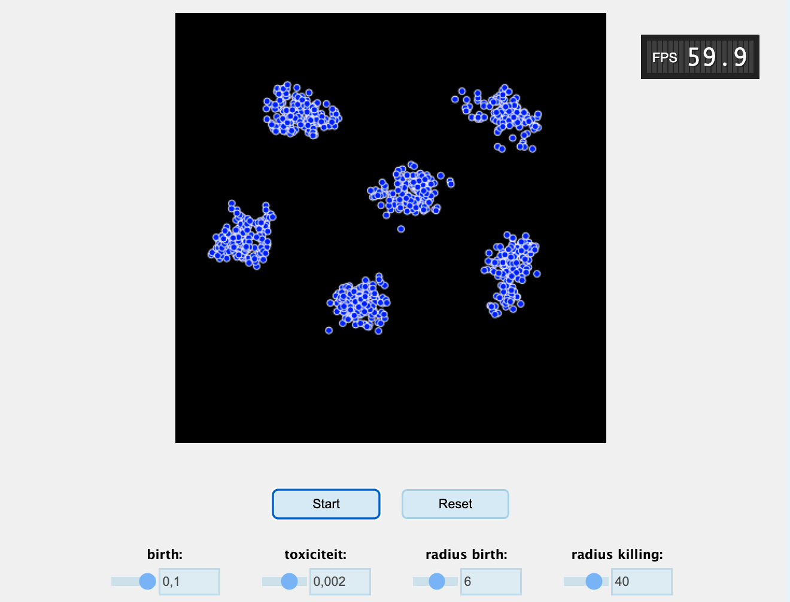
</center>
:::

:::{.screen-only}
```{=html}
<iframe id="iframeToReplace" width="100%" height="650"
src="https://jsfiddle.net/bramvandijk88/50o4pkfL/embedded/result"
title="Simulation"></iframe>

```

::: 


Bestudeer de simulatie door deze een paar keer opnieuw te starten, zodat je goed kan zien wat er gebeurt. 

a. Gebruik eerst de standaard parameter-waarden. Omschrijf wat hier gebeurt in termen van concepten uit dit hoofdstuk. 
b. Controleer of dit model vergelijkbare voorwaarden heeft voor patroonvorming als in het hoofdstuk besproken. 
c. Stel dat er ergens in de simulatie een virus uitbreekt. Kan het virus alle individuen besmetten?
d. Tel hoeveel groepjes je ziet, en gebruik daarna je muis om een paar groepjes weg te halen (alsof er dus idd een ernstig virus is uitgebroken). Wat gebeurt er daarna? Waarom gebeurde dit niet voor de ziekteuitbraak?
:::


## Terminologie

| Nederlands              | Engels                    | Beschrijving|
|----------------------|--------------------|-----------------------------------|
| Reactie-diffusie vergelijkingen | Reaction-diffusion equations | Een type model waarbij variabelen in zowel tijd als ruimte kunnen worden gemodelleerd. Hiermee kunnen we goed onderzoek doen naar het ontstaan van patronen. |
| Turing patronen | Turing patterns | Een zelforganiserend patroon in biologische systemen dat ontstaat door interacties tussen twee chemische stoffen die reageren en zich met verschillende snelheden verspreiden. Turing patronen ontstaan vaak door "remming op afstand" en "activatie van dichtbij". |
| Hysterese | Hysteresis | Wanneer een systeem meerdere evenwichten heeft, kunnen er omslagpunten ("tipping points") zijn waarbij het systeem van de ene naar de andere staat overslaat. Dit fenomeen wordt hysterese genoemd. |
:  {.striped .hover}