

# Zwermen en foerageren {#sec-zwermen}

In @sec-ruimtelijk hebben jullie kennis gemaakt met individual-based models, en met name het belang van ruimtelijke structuur in biologische populaties. Voor het gemak namen we in dit eerdere hoofdstuk aan dat individuen posities innamen op een grid, maar in werkelijkheid is ruimte natuurlijk niet in hokjes opgedeeld. In dit hoofdstuk gaan we een aantal individual-based modellen bekijken waar individuen vrij kunnen bewegen in een continue ruimte. Hiervoor zullen we eerst leren wat er eigenlijk wordt bedoeld met een "continue" ruimte. Daarna bekijken we eerst wat conceptuele voorbeelden, en gaan dan naar meer biologisch relevante scenarios kijken. 

Aan het eind van dit hoofdstuk, word je geacht hetvolgende te kunnen:

* Uitleggen wat het verschil is tussen discrete en continue variabelen, en modelaspecten kunnen benoemen waarbij deze keuze relevant is 
* Begrijpen dat simpele regels complexe patronen en gedrag kunnen opleveren
* Uitleggen wat de voordelen zijn van het virtuele experimenteren / het virtueel bestuderen van gedrag
* Uitleggen wat een *parameter-sweep* is, en hoe dit zich verhoudt tot bifurcatie analyse van wiskundige modellen

## Modelkeuzes met continue en discrete variabelen 

Eerder in dit cursusonderdeel heb je al kennisgemaakt met discrete tijdstappen. Zo zagen we bijvoorbeeld bij de differentievergelijkingen dat je alleen in één keer van $t=1$ naar $t=2$ kan gaan. Met differentiaalvergelijkingen is tijd continu, en is de tijd tussen $t=1$ en $t=2$ in oneindig kleine stapjes is opgedeeld. Ook bij andere facetten van een model moeten we kiezen tussen discrete en continue waarden: modelleren we het daadwerkelijke (discrete) aantal konijnen, of versimpelen we hun aantal tot een (continue) dichtheid? Met ODEs, en zo ook met het predator-prooi model, nemen we aan dat populatiegrootes continu zijn. Zelfs als de dichtheid vossen kleiner is dan 1, kan dit nog steeds een biologisch relevant aantal vossen omschrijven (want $1 \over 10$ vossen per vierkante meter is nogsteeds een behoorlijk druk bos!). Maar hoe klein kan de dichtheid zijn voordat we ons zorgen moeten maken of we het nog over "hele vossen" hebben? Om te illustreren hoe belangrijk dit is, kun je in @tip-atto lezen over het probleem van "de atto-vos". 

::: {.callout-important #tip-atto collapse=false}

## De atto-vos
In 1991, tijdens het graven van de kanaaltunnel tussen Engeland en Frankrijk, waren er veel zorgen dat vossen met rabiës (hondsdolheid) de vossen in het Verenigd Koninkrijk zouden besmetten. Echter is het VK tot op de dag van vandaag volledig rabiës-vrij gebleven. De voorspelling was gedaan met een ODE-model, maar de dichtheid van de vossenpopulatie die succesvol door de kanaal-tunnel zou migreren was zeer laag ($10^{-18}$). Een hoeveelheid in de ordegrootte $10^{-18}$ wordt ook wel "atto" genoemd (net zoals micro $10^{-6}$ is en nano $10^{-9}$ heet). Daarom kunnen we dit artefact van modelleren het "atto-vos"-probleem noemen. Want laten we eerlijk zijn: een heel klein stukje vos kan niet door een tunnel migreren, en dus ook geen ziektes verspreiden!

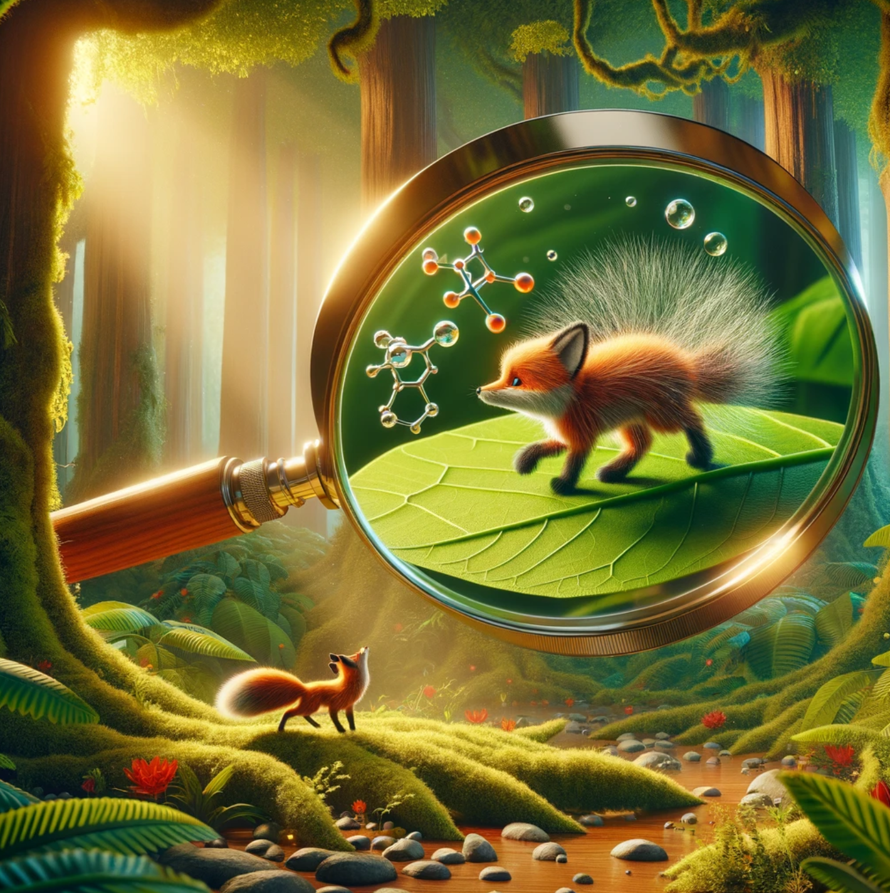{width="70%" fig-align="center"}

:::

Het probleem van discrete tijdstappen uit @sec-exp en de anekdote van de atto-vos zijn niet de enige momenten dat het belangrijk is om stil te staan bij wat voor variabelen we gebruiken, en wat ze precies betekenen. Bij elk model is het belangrijk om na te gaan welke keuze het meest logisch is: zijn de variabelen (toestand, tijd, en ruimte) discreet of continu (@fig-contdisc)? Natuurlijk zijn modellen altijd doelbewuste versimpelingen, maar in het geval van de atto-vos schepte het model een heel verkeerd beeld van het probleem! Toch is experimenteren met infectieziektes zeer onwenselijk, dus zijn deze modellen natuurlijk wel een zeer belangrijk stuk gereedschap! Laten we onze eerdere aanname dat ruimte in "hokjes" is opgedeeld dus ook eens onder de loep nemen. 

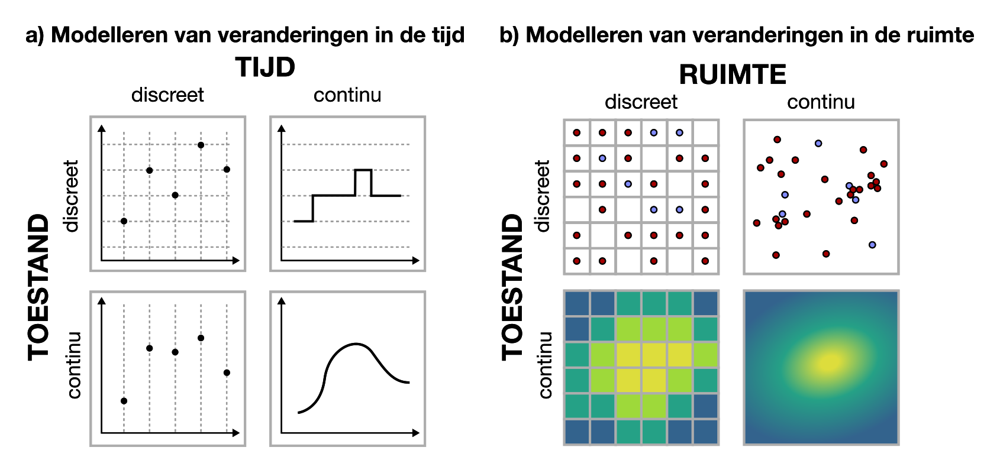{#fig-contdisc width="92%"}

## Particle life

[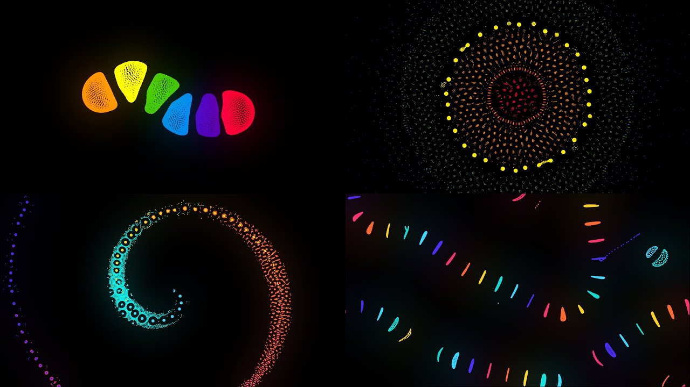{width="80%" fig-align="center"}](https://youtu.be/p4YirERTVF0)

Hoewel biologie zeer complex is, bestaat het fundamenteel niet uit andere deeltjes dan niet-levende systemen. Deeltjes trekken elkaar aan, stoten elkaar af, en ondergaan interacties. Laten we zoiets in R modelleren, en kijken wat er gebeurt. Stel je voor dat we 100 punten in een ruimte verspreiden, allemaal met een x- en y-coördinaat. Zoals hierboven besproken kiezen we er dit keer niet voor om de coördinaten als gehele getallen (1, 2, 3, \textit{etc.}) uit te drukken, maar drukken we ze uit als decimale getallen (2.159, 0.156, \textit{etc.}). We geven de 100 punten allereerst een willekeurige plek in de ruimte, en nemen dan aan dat ze elkaar van een afstand aantrekken, terwijl ze op kleine schaal elkaar juist afstoten. Hoewel de code hiervoor niet super ingewikkeld is, is **de code geen leerstof**. In plaats daarvan, kunnen we onze **regels uitdrukken in "pseudocode"**, waarin we verbaal omschrijven wat er moet gebeuren: 

1. Verspreid 100 punten in een 2D ruimte met willekeurige coördinaten tussen 0 en 1
1. Voor elk punt, bereken de afstand tot alle punten in de buurt, en zet een stapje in hun gemiddelde richting (dus naar het midden van de groep)
1. Wanneer twee punten overlappen, zet juist dan een stapje weg van dit punt. 
1. (elke 10e tijdstap, geef de punten weer in een plot)
1. Ga terug naar stap 2

Zoals gezegd, de R code hoeven jullie niet te begrijpen, maar voor de geïnteresserde student staat deze hier: 

```{r}
#| code-fold: true
#| freeze: false
#| eval: true 
#| code-summary: "Code voor geïnteresseerde student"

set.seed(8)
# Aantal tijdstappen
par(mar = rep(2, 4), bg = "black")
aantal_tijdstappen <- 150

# Aantal punten
aantal_punten <- 100

# Startcoördinaten
alle_posities <- data.frame(
  x = runif(aantal_punten),
  y = runif(aantal_punten)
)

# Parameters voor gedrag van punten
minimale_afstand <- 0.4
aantrekkingsfactor <- 0.001  # Factor voor de (globale) aantrekkingskracht
botsingsfactor <- 0.003   # Factor voor de (lokale) afstotingskracht

# Functie om, per punt, de aantrekkingskracht en botsingsdetectie te berekenen
update_positie <- function(alle_posities, i) {
  dx <- 0 #verandering in x voor dit punt
  dy <- 0 #verandering in y voor dit punt
  
  for (j in 1:aantal_punten) {
    if (i != j) { #niet met jezelf botsen / naar je zelf toe bewegen
      afstand_x <- alle_posities$x[j] - alle_posities$x[i]
      afstand_y <- alle_posities$y[j] - alle_posities$y[i]
      afstand <- sqrt(afstand_x^2 + afstand_y^2) #stelling van pythagoras
      
      # Aantrekkingskracht
      dx <- dx + aantrekkingsfactor * afstand_x / afstand
      dy <- dy + aantrekkingsfactor * afstand_y / afstand
      
      # Afstotingskracht voor botsingsdetectie
      if (afstand < minimale_afstand) {
        dx <- dx - botsingsfactor * afstand_x / afstand
        dy <- dy - botsingsfactor * afstand_y / afstand
      }
    }
  }
  
  return(c(dx, dy))
}
par(mfrow=c(3,5))
# Simuleer de diffusie en toon de resultaten stap voor stap
for (t in 1:aantal_tijdstappen) {
  # Maak (leeg) dataframe voor posities in volgende tijdstap
  nieuwe_positie <- data.frame(x = numeric(aantal_punten), y = numeric(aantal_punten))
  
  # Bereken de verplaatsingen op basis van huidige posities
  for (i in 1:aantal_punten) {
    verplaatsing <- update_positie(alle_posities, i)
    nieuwe_positie$x[i] <- alle_posities$x[i] + verplaatsing[1]
    nieuwe_positie$y[i] <- alle_posities$y[i] + verplaatsing[2]
  }
  
  # Update alle posities 
  alle_posities <- nieuwe_positie
  
  # Plot de huidige posities van de punten
  if(t%%10==1){
    plot(alle_posities$x, alle_posities$y, xlim = c(0, 1), ylim = c(0, 1), col = "orange", pch = 19, cex = 0.5,
       xlab = "X", ylab = "Y")
    title(sprintf("Tijdstip: %d", t-1),col.main="white")
  }
  
}
```

Zoals je ziet onstaat er na een tijdje een zeer specifiek patroon. Als je dit patroon nog niet erg spannend vindt, zouden we ook kunnen kijken wat er met meerdere deeltjes (kleuren) gebeurt, die naast de aantrekkingskracht op henzelf ook elkaar aantrekken. Bijvoorbeeld: oranje is aangetrokken tot rood, rood tot paars, *etc.* Dan gebeurt er hetvolgende:

```{r}
#| eval: false
#| code-fold: true
#| code-summary: "Klik hier voor de R-code. De browser-simulatie hieronder is geïmplementeerd met Javascript"
library(stringr)

# Set up the plot area
par(mar = rep(2, 4), bg = "black")

# Define global parameters
num_colors <- 6
dots_per_color <- 100
total_particles <- num_colors * dots_per_color
colors <- rep(c("#E40303", "#FF8C00", "#FFED00", "#008026", "#24408E", "#732982"), each = dots_per_color)
movement_rate <- 0.0003  # Control the influence of the attraction/repulsion
self_attraction_rate <- 0.0005  # Mild attraction to particles of the same color
repulsion_distance <- 3.5  # Distance threshold for repulsion
speed <- 0.1  # Control the delay between frames (R-studio wont keep up otherwise!)
noise_level <- 0.01  # Define the level of noise to add to the directions


# Initialize positions of the particles in distinct regions
positions <- matrix(0, nrow = total_particles, ncol = 2)
set.seed(42)
for (i in 1:num_colors) {
  start_index <- (i - 1) * dots_per_color + 1
  end_index <- i * dots_per_color
  positions[start_index:end_index, ] <- matrix(runif(dots_per_color * 2, min = (i - 1) * 1 - 10, max = i * 1 - 10), ncol = 2)
}
directions <- matrix(runif(total_particles * 2, min = -0.1, max = 0.1), ncol = 2)

# Function to get the next color in the sequence
next_color <- function(color) {
  color_order <- c("red", "blue", "green", "orange", "purple")
  return(color_order[(match(color, color_order) %% num_colors) + 1])
}

# Function to update positions
update_positions <- function(positions, directions, movement_rate, self_attraction_rate, repulsion_distance) {
  for (i in 1:total_particles) {
    attraction_force <- c(0, 0)
    repulsion_force <- c(0, 0)
    self_attraction_force <- c(0, 0)
    
    # Calculate attraction, self-attraction, and repulsion forces
    for (j in 1:total_particles) {
      if (i != j) {
        diff <- positions[j, ] - positions[i, ]
        distance <- sqrt(sum(diff^2))
        
        # Attraction to particles of the next color in sequence
        if (colors[j] == next_color(colors[i]) && colors[i] != "purple") {
          attraction_force <- attraction_force + movement_rate * diff
        }
        
        # Mild attraction to particles of the same color
        if (colors[j] == colors[i]) {
          self_attraction_force <- self_attraction_force + self_attraction_rate * diff
        }
        
        # Repulsion from particles that are too close
        if (distance < repulsion_distance) {
          repulsion_force <- repulsion_force - movement_rate * (repulsion_distance - distance) * diff / distance
        }
      }
    }
    
    # Add noise to the direction
    noise <- runif(2, min = -noise_level, max = noise_level)
    directions[i, ] <- noise
    positions[i, ] <- positions[i, ] + directions[i, ]
    
    # Combine forces
    total_force <- attraction_force + self_attraction_force + repulsion_force
    directions[i, ] <- total_force
    positions[i, ] <- positions[i, ] + directions[i, ]
    
  }
  return(list(positions = positions, directions = directions))
}

# Create a directory to save the frames
#dir.create("frames")


par(bg = 'black')
# Update and animate the particles
for (i in 1:1000) {
  #png(filename = sprintf("frames/frame_%04d.png", i), width = 1280, height = 720, bg = "black")
  # Initialize plot
  
  
  # Update positions and directions
  updated <- update_positions(positions, directions, movement_rate, self_attraction_rate, repulsion_distance)
  positions <- updated$positions
  directions <- updated$directions
  
  plot(NULL, xlim = c(-10, 10), ylim = c(-10, 10), xlab = "", ylab = "", xaxt = 'n', yaxt = 'n', asp = 1, axes=F)
  # Add a semi-transparent black background
  rect(-100, -100, 100, 100, col = rgb(0, 0, 0, 0.05), border = NA)
  # Draw the particles
  points(positions[, 1], positions[, 2], col = colors, pch = 16, cex = 0.4)
  
  # Pause for a moment to create animation effect
  Sys.sleep(speed)
  
}
```


:::{.print-only}
<center>*Interactieve content beschikbaar op de website:*
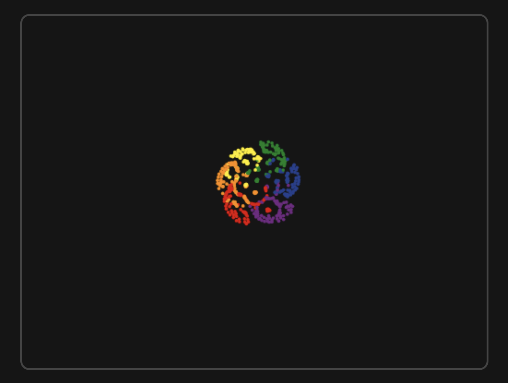{fig-align=center}
</center>
:::

:::{.screen-only}
```{=html}
<iframe id="iframeToReplace" width="100%" height="550"
src="https://jsfiddle.net/bramvandijk88/puj6b0qn/embedded/result" title="Simulation"></iframe>
```
:::

  
Zoals je ziet vormen de deeltjes nu niet meer een stabiel patroon, maar blijven de deeltjes constant rondjes om elkaar heen draaien. Als we één van deze 6 kleuren (rood) juist geen aantrekking geven tot een andere kleur, dan gebeurt er werkelijk iets opmerkelijks:

:::{.print-only}
<center>*Interactieve content beschikbaar op de website:*
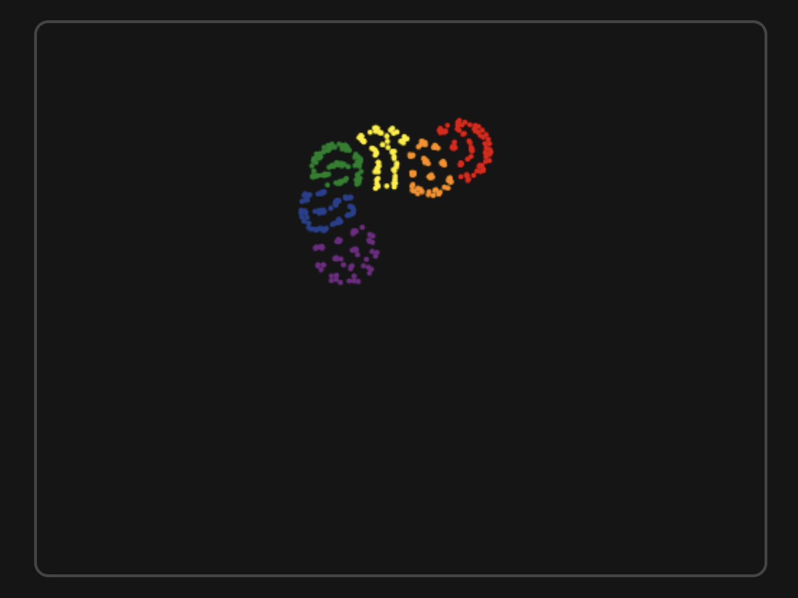{fig-align=center}
</center>
:::

:::{.screen-only}
```{=html}
<iframe id="iframeToReplace" width="100%" height="550"
src="https://jsfiddle.net/bramvandijk88/ntmv7z6u/embedded/result" title="Simulation"></iframe>
```
:::


Zoals je je kan voorstellen, kunnen variaties op deze simpele regels enorm veel verschillende patronen opleveren. Het systeem wat je hier bekijkt is *particle life* genoemd. Als je hier meer over wil weten, vind je [hier](https://www.youtube.com/watch?v=p4YirERTVF0) een uitgebreide video, en [hier](https://webgl-particle-life.netlify.app/) een app die je zelf kan downloaden om met deze systemen te spelen.

Als je de bovenstaande video's en simulaties bekijkt zou je bijna denken dat je naar echte beestjes kijkt. Het lijkt bijvoorbeeld bijna alsof de bovenstaande worm "beslissingen" maakt wanneer deze zich plotseling omdraait. Maar alles gaat alleen maar om het aantrekken en wegduwen van stipjes. Een enkele stip zou natuurlijk niet dergelijk complex gedrag ontwikkelen, dat gebeurt alleen in de aanwezigheid van anderen. Als simpele onderdelen bij elkaar komen en daardoor complexe dynamica of patronen genereren, spreken we van een *emergente eigenschap/emergente eigenschappen*. Emergente eigenschappen komen we overal tegen in de biologie: van vetzuren die zich organiseren tot dubbele membranen, tot microben die doolhof-achtige patronen vormen (@fig-maze), tot de strepen op een zebra, tot chimpansees en mensen die complexe politieke structuren vormen. Hoewel al deze structuren erg complex lijken, is het in de kern wellicht gedreven door hele simpele regels. 

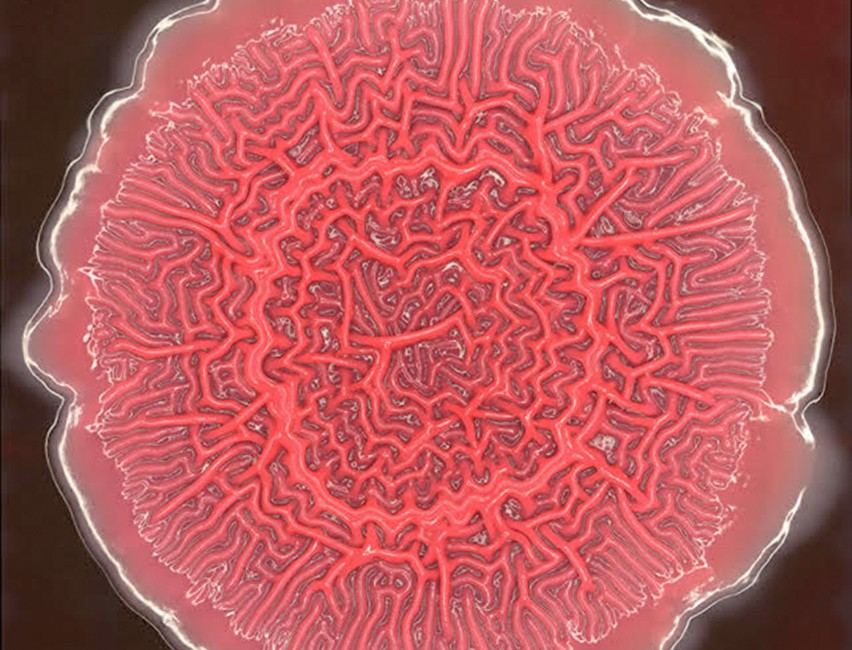{#fig-maze width="60%"}

## Zwermpatronen in boids

Particle life is een zogenaamd *toy model*. Dat wil zeggen: het laat bepaalde principes heel goed zien, maar het is niet per se een model van een specifiek biologisch systeem. Maar het illustreert wel heel goed dat complex (emergent) gedrag uit hele simpele regels kan ontstaan. Hier en daar doet het zelfs wel wat denken aan de zwermpatronen die je ziet in bijvoorbeeld insecten, vissen en vogels. Wellicht kunnen we dit model aanpassen om specifieker naar dit gedrag te kijken: hoe spreeuwen zogenaamde "murmuraties" vormen. 

Laten we er allereerst vanuit gaan dat de vogels alleen andere vogels kunnen zien wanneer die in hun buurt zijn. Dat wil zeggen, hun gedrag wordt alleen bepaald door nabije buren. In pseudocode, volgt elke vogel de volgende regels:

* Probeer je richting uit te lijnen met de groep
* Beweeg je naar het midden van de groep toe
* Probeer te voorkomen dat je met anderen botst

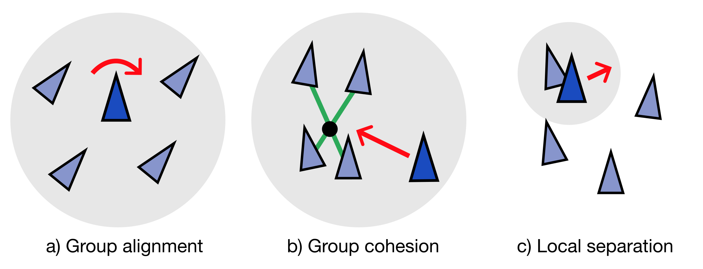

Als je deze drie regels samenvoegt, zul je zien dat je onmiddelijk prachtige murmuraties ziet:

:::{.print-only}
<center>*Interactieve content beschikbaar op de website:*
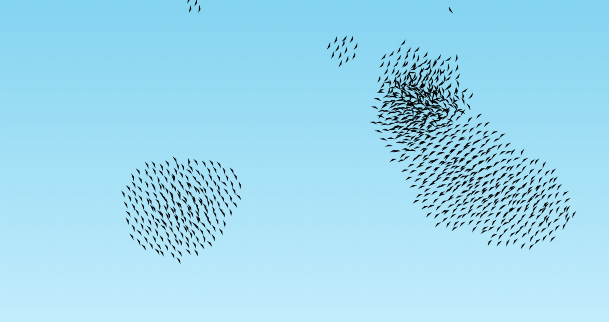{fig-align=center}
</center>
:::

:::{.screen-only}
```{=html}
<iframe id="iframeToReplace" width="100%" height="550"
src="https://tbb.bio.uu.nl/bvd/bms/simulations/murmuraties/" title="Simulation"></iframe>
```
:::


Dit model is door de bedenker, Craig Reynolds, "boids" genoemd, omdat hij het grappig vond hoe mensen in New York het woord *birds* uitspraken. Anders dan particle life, kunnen we met een dergelijk model wel degelijk biologisch onderzoek doen. Het wordt bijvoorbeeld door de onderzoeksgroep van Charlotte Hemelrijk (Emeritus professor aan de Rijksuniversiteit Groningen) gebruikt om te onderzoeken hoe zwermen van spreeuwen reageren op [predatie door haviken](https://www.sciencedirect.com/science/article/abs/pii/S0003347211002867). Met dergelijk onderzoek kunnen we observaties uit het veld goed aanvullen, want dergelijk veldwerk is natuurlijk heel pittig en tijdrovend! Dat gezegd hebbende, is er natuurlijk niets zo indrukwekkend als echte beelden van dit prachtige fenomeen:



## Aapjes met gedrag

In hoofdstuk @sec-ruimtelijk hebben we de basis geleerd van individual-based modellen, maar hebben we vooral gekeken naar groeiende populaties op een grid. Hoewel dergelijke grids veel technische voordelen hebben (een grid is heel handig als je snel wilt bepalen wie er "naast" iemand zit), is een echt ecosysteem natuurlijk niet in hokjes opgedeeld. Nu we hierboven individuen iets meer vrijheid hebben gegeven, kunnen we wellicht ook meer "gedragsregels" toevoegen. Laten we dit eerst doen met een simpel model van aapjes die naar fruit zoeken.

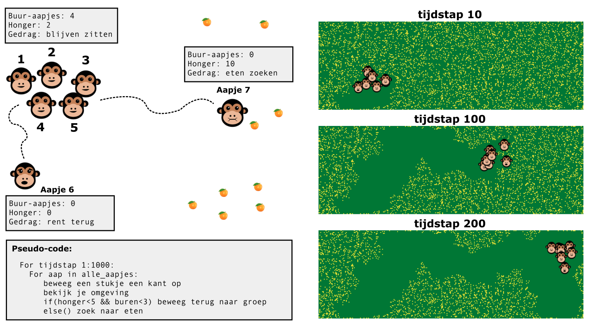

Laten we een groot grasveld voorstellen, waarin zich individuele aapjes bevinden. Wederom schrijven we het systeem op in pseudocode:

Voor elke aap in de simulatie:

* Als er minder dan 10 apen in de buurt zijn, en de aap heeft geen enorme honger, dan rent deze terug naar de groep. 
* Als een aap honger heeft, en er zijn genoeg apen in de buurt, loopt deze een willekeurige kant op om te zoeken naar fruit.
* Als een aap 6 stukken fruit heeft gevonden, blijft de aap zitten en gaat eten. Zolang de aap aan het eten is, gaat deze niet op zoek naar de groep of naar meer eten. 

:::{.callout-note}
Nu je een paar keer pseudocode hebt gezien, begrijp je misschien waarom dit handig is. Als wetenschapper is het belangrijk om goed te communiceren hoe je onderzoek precies is opgezet, maar we willen niet altijd door hele stukken code moeten lezen. Het doel van pseudocode is om deze precies genoeg te maken, zodat iemand anders het zou kunnen reproduceren (eventueel in een andere programmeertaal!). De resultaten van zo'n computermodel zouden namelijk niet van de programmeertaal moeten afhangen, maar van de aannames die gedaan worden. 
:::

Zoals je in de bovenstaande omschrijving kan lezen, zal niet elk aapje hetzelfde doen. Aapje 1 t/m 5 hebben veel buur-aapjes en voelen zich veilig. Omdat ze ook geen honger hebben, blijven ze zitten. Aapje 6 heeft ook geen honger, maar voelt zich niet veilig, en rent terug naar de groep. Aapje 7 heeft echter veel honger, en zal dus (eventueel met gevaar voor eigen leven) naar eten blijven zoeken. Door deze gedragsregels een lange tijd te herhalen, kunnen we onderzoeken hoe onze virtuele aapjes naar eten zoeken, en hoe ze groepjes vormen. 

:::{.print-only}
<center>*Interactieve content beschikbaar op de website:*
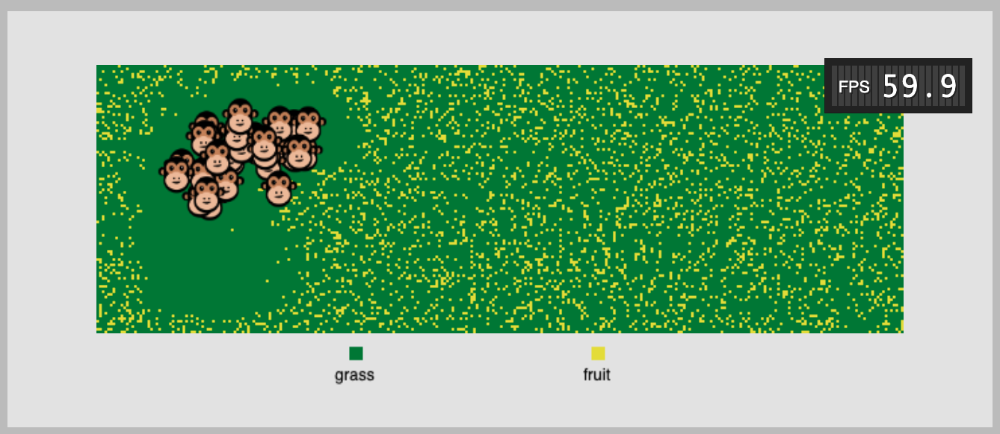
</center>
:::

:::{.screen-only}
```{=html}
<iframe id="iframeToReplace" width="100%" height="330"
src="https://tbb.bio.uu.nl/bvd/bms/simulations/aapjes_min/" title="Simulation"></iframe>
```
:::

Met een dergelijk model kun je heel goed biologisch onderzoek doen (je kan heel veel simulaties tegelijk runnen, en je verstoort alleen virtuele apen!). Heel leuk onderzoek is bijvoorbeeld gedaan door Daniel van der Post, die heeft laten zien dat verschillende apengroepen in dezelfde omgeving hele andere voedselculturen kunnen ontwikkelen^[Van der Post, D. J., & Hogeweg, P. (2008). Diet traditions and cumulative cultural processes as side-effects of grouping. Animal Behaviour, 75(1), 133-144.]. In het werkcollege gaan jullie [met deze simulatie](https://tbb.bio.uu.nl/bvd/bms/simulations/aapjes/) aan de slag, en bestuderen hoe emergente eigenschappen bepalen hoe veel fruit deze aapjes vinden. Natuurlijk kan je allerlei gedrag aan een dergelijk model toevoegen: vlooien, vechten, opvoeden, en ga zo maar door. Deze modellen kunnen dus een hele efficiënte (snel, goedkoop) en niet-verstorende manier zijn om gedrag te bestuderen. 

## Parameter-sweeps

In de hoofdstukken over het Lotka-Volterra predator-prooi model heb je kennis gemaakt een bifurcatie-diagram (@fig-lvbif). Door de parameter $K$ te varieren, zagen we twee belangrijke overgangen (bifurcaties): eerst een overgang van alleen prooi naar een stabiele samenleving van predator en prooi, en dan een tweede overgang naar oscillerende predator-prooi populaties (Hopf bifurcatie). Computermodellen zoals de IBM van de aapjes hierboven bevatten vaak erg veel parameters: hoe snel eten de aapjes, hoeveel aapjes moeten er in de buurt zijn zodat een aapje zich veilig voelt, hoeveel eten ligt er in de omgeving, *etc.* Zodoende is het vaak belangrijk om een zogeheten *parameter-sweep* te doen, waarbij je vele parameters systematisch bestudeert en de uitkomst classificeert. Op deze manier kun je enerzijds bepalen of het gedrag van je model niet maar alleen voorkomt voor hele specifieke parameters (en dus wellicht in werkelijkheid nauwelijks voorkomt) en anderzijds bepalen welke parameters het meest belangrijk zijn voor hoe het model zich gedraag. Als je bijvoorbeeld twee parameters varieert, kun je deze uitkomsten bijvoorbeeld opslaan in een grote tabel waarbij de rijen de ene parameter zijn, en de kolommen de andere (@fig-parsweep).

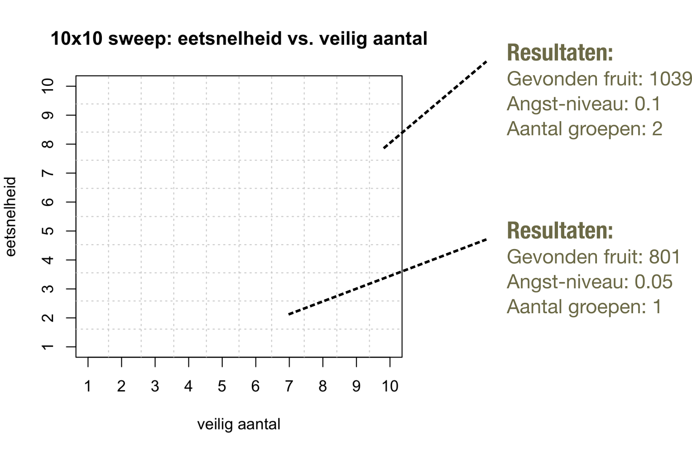{#fig-parsweep width="90%" fig-align="center"}

<!-- ```{r} -->
<!-- #| code-fold: true -->
<!-- #| label: 'fig-parsweep' -->
<!-- #| fig-width: 5 -->
<!-- #| out-width: "50%" -->
<!-- #| fig-height: 5 -->

<!-- # Set up an empty plot with specified x and y limits -->
<!-- plot(1, type="n", xlim=c(1,10), ylim=c(1,10), -->
<!--      xlab="veilig aantal", ylab="eetsnelheid", -->
<!--      xaxt="n", yaxt="n") -->

<!-- # Add custom axes with ticks from 1 to 10 -->
<!-- axis(1, at=1:10) -->
<!-- axis(2, at=1:10) -->

<!-- # Add grid lines to create a 10x10 grid -->
<!-- grid(nx=10, ny=10) -->

<!-- # Optionally, add a title to the plot -->
<!-- title("10x10 sweep: eetsnelheid vs. veilig aantal") -->

<!-- ``` -->

## Foeragerende mieren

Als het gaat om foerageren, lijken mieren een stuk georganiseerder dan de aapjes uit de bovenstaande simulatie. Ze rennen niet maar zo een kant op, maar volgen elkaar netjes van/naar een voedselbron. Echter doen mieren dat niet altijd door elkaar te zien (sterker nog, sommige mieren zijn volledig blind!). In plaats daarvan ruiken ze elkaars feromonen, die bijvoorbeeld aangeven waar het voedsel ligt, waar het nest is, of waar er gevaar dreigt. Hoewel dit meestal heel goed werkt, kun je ook een zogeheten "mierenkringen" *ant mills* krijgen, waar mieren voor eeuwig in rondjes achter elkaar aan lopen (soms net zo lang tot ze van uitputting dood gaan!). 

:::{layout-ncol=2}
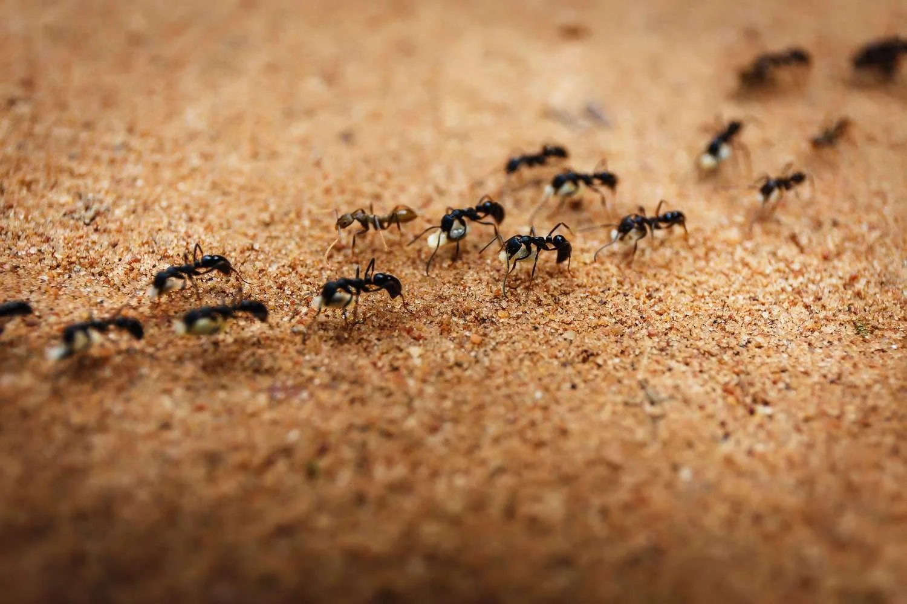{width="80%"}

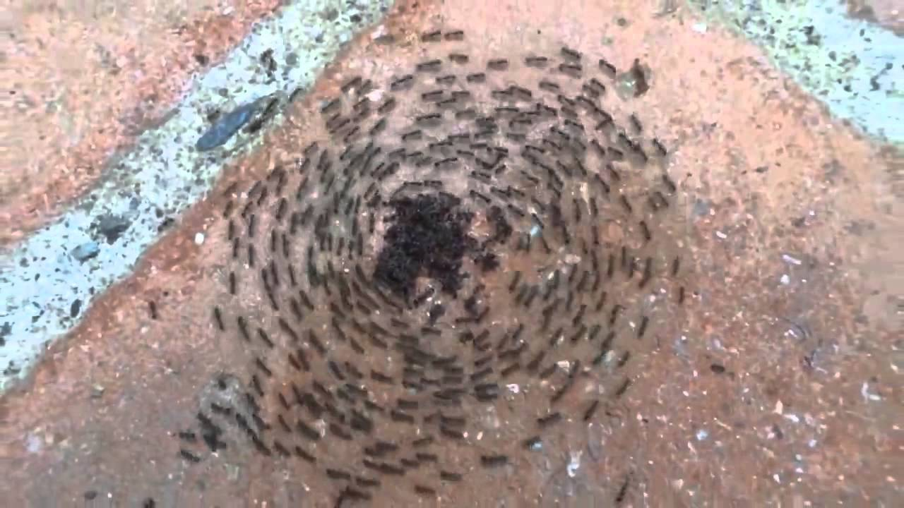{width="95%"}
:::

Dus, een belangrijk verschil met de aapjes is dat de mieren niet direct *elkaar* zien, maar feromonen. Mieren laten deze feromonen achter, maar deze feromonen worden ook afgebroken of verdunnen. Zo onstaat er dus een interessante interactie van de mieren naar de omgeving, en van de omgeving naar de mieren. Diffusie van stofjes is een concept waar we in het volgende hoofdstuk nog meer naar zullen kijken. Maar voor nu, als we deze componenten samenbrengen in een simulatie, zien we inderdaad dat mieren niet alleen prachtige sporen vormen, maar ook de bovengenoemde mierenkringen kunnen vormen:

:::{.print-only}
<center>*Interactieve content beschikbaar op de website:*
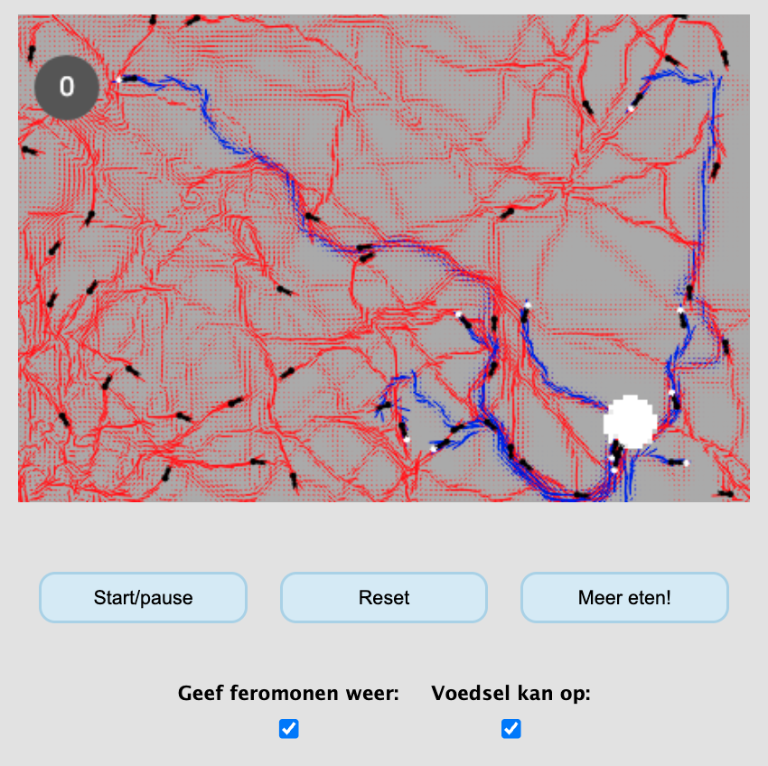
</center>
:::

:::{.screen-only}
```{=html}
<iframe id="iframeToReplace" width="100%" height="650"
src="https://jsfiddle.net/bramvandijk88/rhq6owfL/embedded/result" title="Simulation"></iframe>
```
:::


## Opgaven

<!-- ::: {.pepexr #exr-pseudo} -->

<!-- ## Pseudocode  -->

<!-- <br> -->

<!-- Stel, we maken een model van predatoren en prooien in de ruimte. We geven de predatoren weer als rode stippen, en de prooien als blauwe stippen, en nemen daarbij aan dat predatoren alleen een prooi kunnen vangen wanneer deze in de buurt is. Hieronder zie je een mogelijke configuratie van die model met discrete ruimte, en een met continue ruimte: -->

<!-- ```{r} -->
<!-- #| code-fold: true -->
<!-- #| fig-height: 4 -->
<!-- #| fig-width: 8 -->
<!-- # Set up for two plots side by side -->
<!-- par(mfrow=c(1, 2),mar=c(2,2,2,2)) -->

<!-- # First plot: 7x7 grid with 1 red dot in the center and 7 blue dots, with at least 4 nearby -->
<!-- plot(1:7, 1:7, type="n", xlab="X", ylab="Y", xlim=c(0.7, 7.3), ylim=c(0.7, 7.3), xaxt="n", yaxt="n", bty="n") -->

<!-- # Add grid lines -->
<!-- grid(nx=7, ny=7, col="grey",lwd=3) -->

<!-- # Coordinates for blue dots ensuring 4 are adjacent to the red dot -->
<!-- blue_dots <- matrix(c(3, 3,  # Nearby -->
<!--                       3, 4,  # Nearby -->
<!--                       4, 3,  # Nearby -->
<!--                       5, 4,  # Nearby -->
<!--                       1, 1,  # Distant -->
<!--                       6, 5,  # Distant -->
<!--                       7, 3), ncol=2, byrow=TRUE) -->

<!-- # Add blue dots to the plot -->
<!-- points(blue_dots, pch=19, col="blue", cex=2) -->

<!-- # Coordinates for red dot (middle of 7x7 grid) -->
<!-- red_dot <- c(4, 4) -->

<!-- # Add red dot to the plot -->
<!-- points(red_dot[1], red_dot[2], pch=19, col="red", cex=2) -->

<!-- # Second plot: Continuous space with irregular distances and red dot near the middle -->
<!-- plot(NA, xlim=c(0, 7), ylim=c(0, 7), xlab="X", ylab="Y", bty="n") -->

<!-- # Coordinates for blue dots in continuous space -->
<!-- blue_dots_cont <- matrix(c(1, 1,  -->
<!--                            3, 2, -->
<!--                            4.5, 1.5, -->
<!--                            3.5, 4, -->
<!--                            3.8, 5.5,  # Nearby blue dot 1 -->
<!--                            3.5, 3.3,  # Nearby blue dot 2 -->
<!--                            3.2, 4.5), ncol=2, byrow=TRUE)  # Nearby blue dot 3 -->

<!-- # Add blue dots to the plot -->
<!-- points(blue_dots_cont, pch=19, col="blue", cex=2) -->

<!-- # Coordinates for red dot near the middle -->
<!-- red_dot_cont <- c(3, 3.5) -->

<!-- # Add red dot to the plot -->
<!-- points(red_dot_cont[1], red_dot_cont[2], pch=19, col="red", cex=2) -->
<!-- ``` -->

<!-- De predator in het discrete scenario links zit op positie (x=4, y=4). De x-y-coördinaten van de prooidieren zijn: -->

<!--   * 3, 3 -->
<!--   * 3, 4 -->
<!--   * 4, 3 -->
<!--   * 5, 4 -->
<!--   * 1, 1 -->
<!--   * 6, 5 -->
<!--   * 7, 3 -->

<!-- a. Stel je voor dat de predator alleen prooi kan vangen binnen een afstand van 1 hokje. Leg in "pseudocode" uit hoe je kan bepalen welke prooidieren dichtbij genoeg zijn voor de predator. Let op: je hoeft hierbij geen afstanden te berekenen! -->
<!-- b. Bespreek met je medestudenten of jullie antwoorden hetzelfde zijn (let op: zelfs als jullie antwoorden verschillen, dat betekent niet dat één van jullie het fout heeft!) -->

<!-- Kijk nu naar het rechter scenario, waar de ruimte continu is. De prooi zit dan ook op positie x=2.9, y=3.5. De x-y-coördinaten van de prooien zijn nu:  -->

<!--     * 1, 1 -->
<!--     * 3, 2 -->
<!--     * 4.5, 1.5 -->
<!--     * 3.5, 4 -->
<!--     * 3.8, 5.5 -->
<!--     * 3.5, 3.3 -->
<!--     * 3.2, 4.5 -->

<!-- c. Leg opnieuw in pseudocode uit hoe je bepaalt welke prooidieren binnen een interactie-afstand van 1 zitten. Dit keer moet je wél afstanden berekenen. Hoeveel prooidieren heb je nu gevonden? Vergelijk je antwoord weer met een medestudent. -->

<!-- d. Hierboven heb je twee algoritmes bedacht. Stel dat er veel meer prooidieren aanwezig zijn (bijvoorbeeld 1000). Met welk van de twee algoritmen kun je sneller bepalen welke prooien er "in de buurt" van de predator zijn?  -->
<!-- ::: -->

<!-- ::: {.Rexr #exr-gol} -->

<!-- ## Game of life  -->

<!-- <br> -->

<!-- 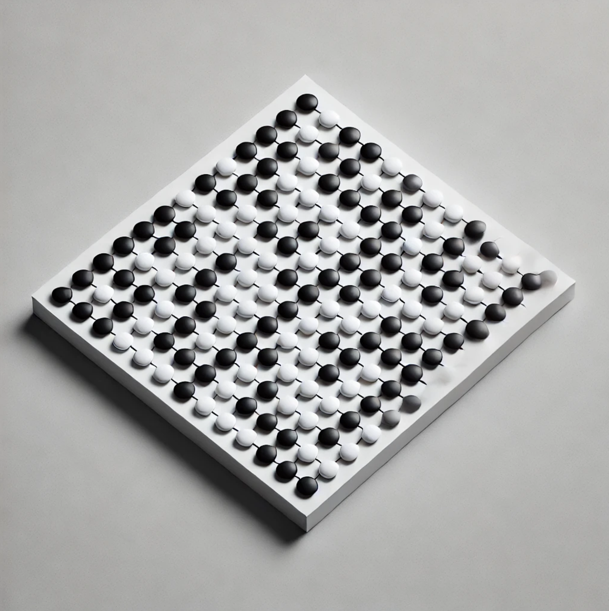{width="70%" fig-align="center"} -->

<!-- Stel we modelleren slechts 1 type individu op een heel groot grid. Dit individu is "levend", en alle andere hokjes zijn "dood". Neem aan dat elke tijdstap, ieder hokje de volgende regels volgt: -->

<!--   * Een levend individu met meer dan drie buren gaat dood ("overpopulatie") -->
<!--   * Een levend individu met minder dan twee buren gaat dood ("onderpopulatie") -->
<!--   * Een dood hokje wordt levend als er exact drie levende buren zijn -->

<!-- a. Stel je begint met een willkeurige configuratie van levende individuen (bijvoorbeeld: 50\% van de hokjes is levend). Wat denk je dat er gaat gebeuren? Bespreek ook met je medestudenten (mits die deze deze vraag nog niet gedaan hebben!) -->
<!-- b. Wat zou je moeten doen als je *zonder computer* zou willen weten wat er precies gaat gebeuren? -->
<!-- c. Bekijk [de volgende simulatie](https://tbb.bio.uu.nl/bvd/bms/simulations/gol/). Was je voorspelling in de goede richting?  -->
<!-- d. Maak de volgende zin af: "Als je precies de regels van een systeem weet..."  -->
<!-- ::: -->

**Let op:** dit hoofdstuk heeft slechts 1 opgave. Echter is het wel belangrijk dat je de vraag maakt, want de resultaten sla je op in een tabel die je bij het onderdeel Statistiek verder zal analyseren. 

Daarnaast kun je verder werken aan het [mini-project](project.qmd), waarbij je met een groep samenwerkt om zorgvuldig verslag te doen van een uitgebreide werkcollegevraag.

::: {.Rexr #exr-aapjes} 

## Aapjes die gele pixels eten

<br>

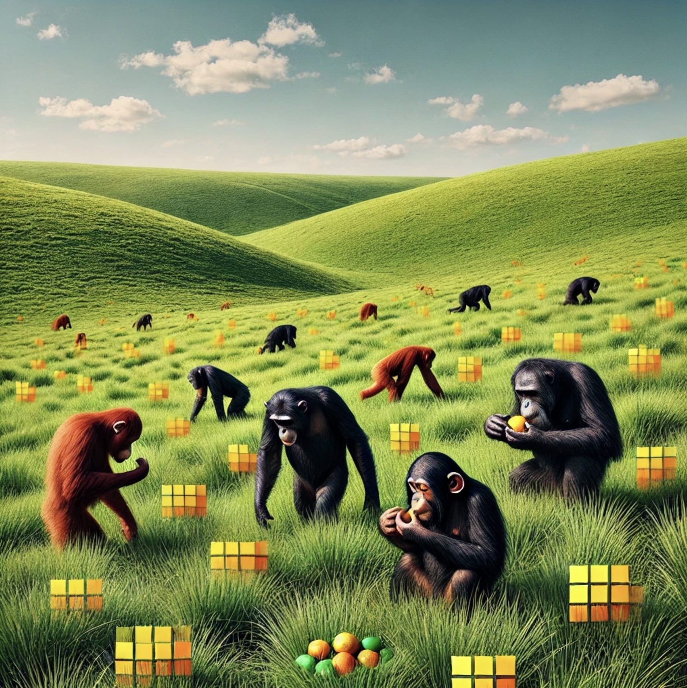{width="70%" fig-align="center"}

In deze opgaven kijken we naar het individual-based model van [aapjes die naar fruit zoeken](https://tbb.bio.uu.nl/bvd/bms/simulations/aapjes/), zoals besproken in dit hoofdstuk. De aapjes volgen de volgende regels:

  * Als er minder dan 10 apen in de buurt zijn, ren terug naar de groep
  * Als er genoeg apen in de buurt zijn, loop een willekeurige kant op om te zoeken naar fruit
  * Als je 6 stukken fruit hebt gevonden, blijf zitten waar je zit en ga eten. Eet per tijdstap een x-aantal stukken fruit, gegeven door de parameter "eet-snelheid". Pas als je klaar bent met eten ga je weer terug naar de groep.  

In de simulatie wordt bijgehouden hoeveel fruit de aapjes (in totaal) hebben gevonden. De aapjes eten standaard 3 stukken fruit per tijdstap, (dus eten voor 2 tijdstappen). 

a. Wacht 1000 tijdstappen. Waarom neemt de totale hoeveelheid gevonden fruit na een tijdje niet zo veel meer toe?
b. Vorm met andere studenten groepjes van 2. Kies een hogere óf lagere eetsnelheid. Herhaal je experiment 5 keer en schrijf iedere keer op hoeveel fruit er is gevonden na 1000 tijdstappen. Bekijk ook goed hoe de aapjes zich over het veld bewegen.
c. Kies een andere eetsnelheid, en herhaal weer 5 keer je experiment. Zie je verschillen? Had je dit resultaat verwacht?
d. Vergelijk je resultaten ook met een ander groepje. Probeer je ondervindingen biologisch uit te leggen. 
e. Bewaar je resultaten in een tabel. Deze ga je in het onderdeel 'Statistiek' bestuderen om te kijken of je resultaten betrouwbaar zijn, of dat het misschien toch toeval is.

<!-- eetsnelheid_min <- c(2552,2190,2590,2511,2186) -->
<!-- eetsnelheid_max <- c(781,926,785,848,979) -->
<!-- test_verschil <- t.test(eetsnelheid_min,eetsnelheid_max) -->
<!-- print(test_verschil) -->

:::

## Terminologie 

| Nederlands              | Engels                    | Beschrijving |
|------------------|--------------------|-----------------------------------|
| Discrete variabelen  | Discrete variables | Variabelen die niet alle waarden kunnen innemen, maar alleen waarden met een vaste afstand. Meestal heeft dit simpelweg de vorm 1,2,3, *etc.*, maar je zou er ook voor kunnen kiezen om alleen met tienvouden te werken ( 1,10,100,1000) of om ook negatieve getallen te gebruiken (-10,-9,-8)
| Continue variabelen  | Continuous variables | Variabelen die alle numerieke waarden in een bepaald bereik kunnen innemen. Bijvoorbeeld alle waarden tussen 0 en 1 of alle waarden tussen $-\infty$ en $\infty$. Tussen 0 en 1 zitten oneindig veel waarden, en tussen $-\infty$ en $\infty$ zitten ook oneindig veel waarden. (eigenlijk zou je dus kunnen stellen dat sommige oneindigheden groter zijn dan andere oneindigheden!) 
| Discrete ruimte  | Discrete space | De gemodelleerde ruimte is opgedeeld in vaste afstanden, zoals bijvoorbeeld op een grid van vierkanten waar ieder punt 4 of 8 buren heeft (afhankelijk van of je de diagonale buren meetelt). Ook een hexagonaal patroon (zoals een bijenkorf) is een discrete ruimte, waarbij iedere hexagon 6 buren heeft. 
| Continue ruimte  | Continuous space | De gemodelleerde ruimte heeft geen vaste posities, waardoor punten, eiwitten, individuen, *etc.* elke positie in kunnen nemen. Dit geeft vaak vloeiende bewegingen, maar is een stuk moeilijker voor je computer om door te rekenen!
| Pseudocode  | Pseudocode | Een verbale omschrijving van wat een computerprogramma doet (en hoe deze dat doet!), zonder ons druk te maken over de technische aspecten zoals het gebruik van de juiste syntax, de functienamen, of alle komma's op de goede plek staan, *etc.*
| Emergente eigenschappen | Emergent properties | Een eigenschap van een systeem die ontstaat door de interactie tussen de onderdelen, en die niet zichtbaar is in de losse onderdelen zelf. Bijvoorbeeld: individuele neuronen kunnen niet "denken", maar een groot aantal neuronen met de juiste verbindingen kunnen deze zin interpreteren ook al is de zin veel te lang en staat er te weinig interpunctie in.
:  {.striped .hover}