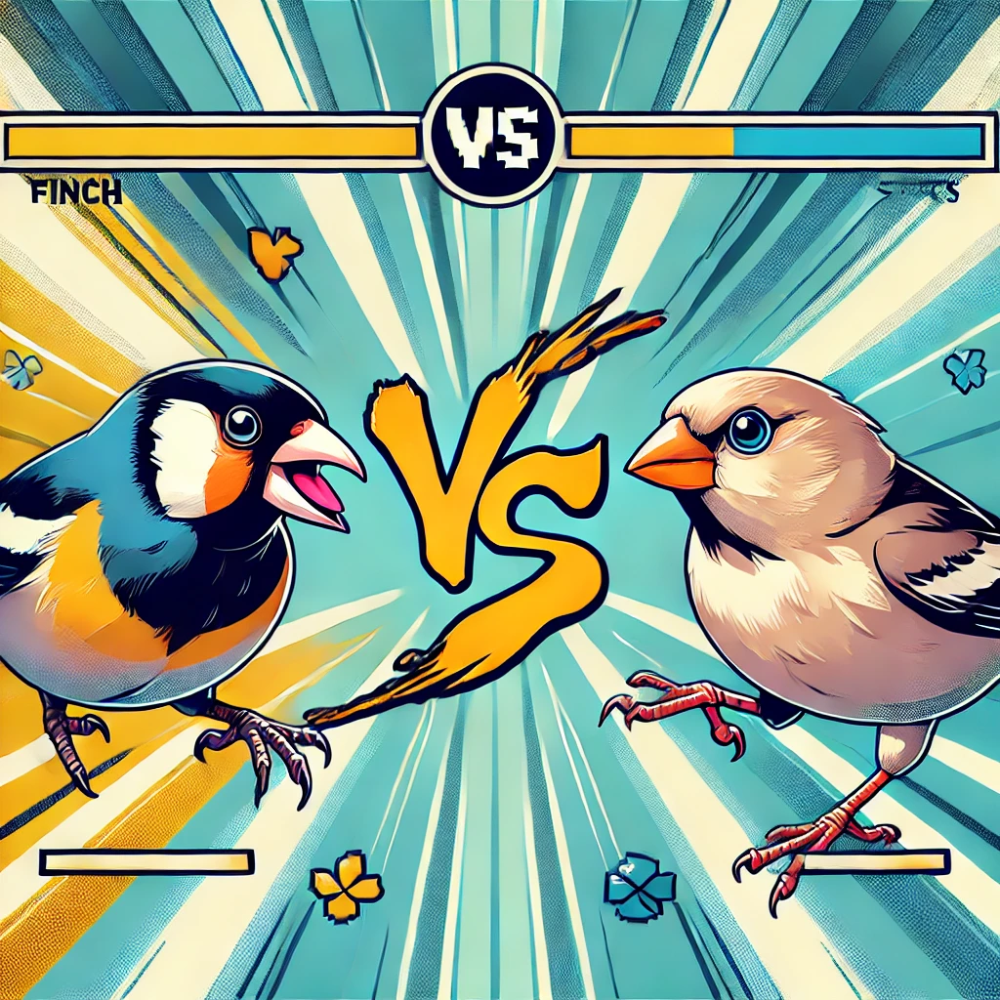
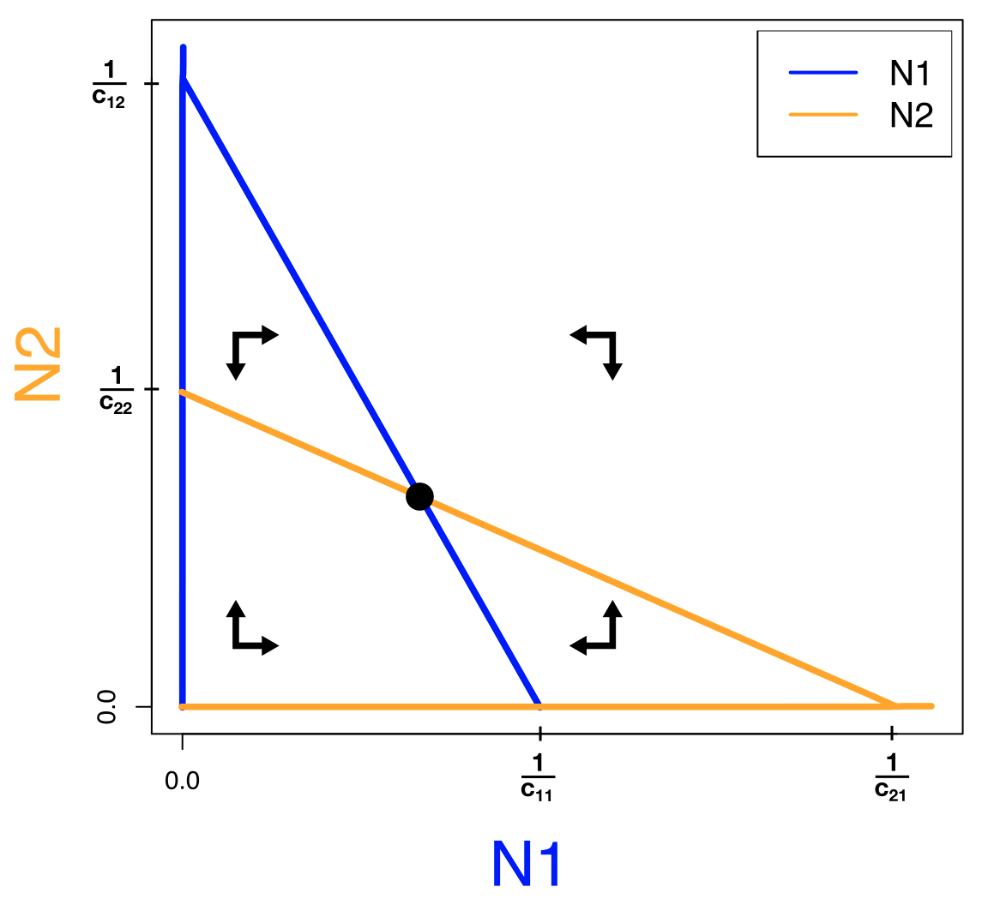

::: {.content-visible when-format="html"}

:::

## Coexistentie en exclusie

De predator-prooi relaties uit de vorige hoofdstukken zijn natuurlijk een hele specifieke interacties tussen soorten. Maar soorten hebben vaak op een veel meer subtiele manier competitie: ze strijden om een beperkte hoeveelheid voedselbronnen of nestplekken. Sterker nog, dergelijke competitie is veel algemener: transcriptiefactoren hebben competitie om bindingsplekken op het DNA, eiwitten hebben competitie om substraat, cellen in een weefsel hebben competitie om nutrienten (denk hierbij bijvoorbeeld ook aan kanker!). Om dergelijke interacties te begrijpen, maken we kennis met inter- en intraspecifieke competitie.

{fig-align="center" width="70%"}

## Leerdoelen

De leerdoelen voor dit hoofdstuk zijn:

-   Begrijpen hoe intra- en interspecifieke interacties gemodelleerd kunnen worden
-   Mogelijke evenwichten in faseruimtes van competitie kunnen benoemen, en uitleggen wat de biologische intepretaties van deze evenwichten zijn
-   Een gegeven vectorveld afmaken en daarbij horende oplossingen schetsen

## Competitie binnen en tussen soorten

**Inter-specifieke competitie** is competitie tussen soorten, en **intra-specifieke competitie** staat voor competitie binnen een soort[^ecoevo_competitie-1]. Als twee soorten bijvoorbeeld voornamelijk hetzelfde voedsel eten (we blijven nog even bij ecologie), zullen ze veel competitie om dat voedsel hebben. Formeel zeggen we dan dat de niches van de soorten overlappen, wat we bijvoorbeeld kunnen bepalen door precies te meten welk zaadjes verschillende soorten vogels eten (@fig-zaadoverlap). Hoe meer de niches overlappen, hoe sterker de **inter-specifieke** competitie.

[^ecoevo_competitie-1]: Als je net als ik dit slecht kan onthouden, kun je de **Intratuin** als ezelsbruggetje gebruiken: "in de tuin" klinkt kloppend, maar "tussen de tuin" klinkt toch een beetje vreemd

```{r}
#| code-fold: true
#| eval: true
#| code-line-numbers: false
#| fig.width: 4
#| fig.height: 2
#| label: "fig-zaadoverlap"
#| fig-cap: "Als twee vogelsoorten verschillende voorkeur voor zaadgrootte hebben, zullen we competitie hebben om de zaadjes waar ze overlappen."
#| 
n <- 1
plot_niche_overlap <- function(mean1=-1, sd1=1, mean2=1, sd2=1){
  # Define the range for the x-axis
  x_range <- seq(-5, 5, length.out = 1000)
  
  # Calculate the densities
  density1 <- dnorm(x_range, mean = mean1, sd = sd1)
  density2 <- dnorm(x_range, mean = mean2, sd = sd2)
  
  # Scale the densities to the same maximum height
  max_height <- 0.4
  density1_scaled <- density1 / max(density1) * max_height
  density2_scaled <- density2 / max(density2) * max_height
  overlap <- pmin(density1_scaled,density2_scaled)
  # Plot the first normal distribution
  
  plot(x_range, density1_scaled, type = "l", 
       axes=F, xaxt='n', yaxt='n',yaxs="i",
       col = "blue", lwd = 2, ylim = c(0, max_height*1.1), 
       xlab = "", ylab = "", main = "")
  polygon(x_range,overlap,col="#FF000033",border = NA)
  lines(x_range, density1_scaled, col = "blue", lwd = 2)
  lines(x_range, density2_scaled, col = "orange", lwd = 2)
  
  arrows(0,0,7.5,0,xpd=NA,lwd=3,length = 0.1)
  arrows(0,0,-7.5,0,xpd=NA,lwd=3,length = 0.1)
  mtext("Kleine zaadjes",1,at=-5.5,cex=0.6)
  mtext("Grote zaadjes",1,at=4.8,cex=0.6)
  text(-10,0.6,paste0(LETTERS[n],')'),font=2,xpd=NA)
  
  overlap_pc <- round(sum(overlap)/sum(density1_scaled),digits=2)*100
#   title(main=paste0("N1 heeft ", 
#                     round(sum(overlap)/sum(density1_scaled),2)*100,"%",
#                     " overlap met N2\n",
#                     "N2 heeft ", 
#                     round(sum(overlap)/sum(density2_scaled),2)*100,"%",
#                     " overlap met N1"),line = 0.5,cex.main=0.7)
#   n <<- n + 1
}
par(mfrow=c(1,1),mar=c(4,4,0,4))
plot_niche_overlap()
```

De niche overlap binnen een soort is eigenlijk per definitie 100%. Het is daarom redelijk om aan te nemen dat de competitie om voedsel binnen een soort (intra-specifieke competitie) sterker dan de inter-specifieke competitie om voedsel. Echter kan **intra-specifieke competitie** ook door andere biologische processen teweeg gebracht worden. Zo kunnen bijvoorbeeld haviken uilen aanvallen om hen uit de beste jachtgebieden te verdrijven, of produceren veel schimmels toxines om bacteriën te onderdrukken. Zodoende kan het toch zijn dat de intra-specifieke competitie de overhand speelt, afhankelijk van de situatie. Hoe hebben de twee bovengenoemde processen precies invloed om het wel/niet kunnen samenleven van soorten? Dit gaan we bestuderen met het **Lotka-Volterra competitie** model (vergelijkbaar maar niet hetzelfde als het Lotka-Volterra predator-prooi model).

## Lotka-Volterra competitie

Laten we aannemen dat er twee populaties bestaan die beide logistisch groeien, genaamd $N_1$ en $N_2$:

\begin{align*}
\dt{N_1} &= rN_1(1-\frac{N_1}{K}) \\
\dt{N_2} &= rN_2(1-\frac{N_2}{K})
\end{align*}


<!-- Let op: het bovenstaande model bevat géén interacties tussen de soorten: $N_1$ bevat alleen $N_1$, en $N_2$ bevat alleen $N_2$. Biologisch betekent dat dus dat de groei van $N_1$ niet beinvloed wordt door de aanwezigheid van $N_2$, en *vice versa*. Er is dus sprake van **intra**specifieke competitie. Om ook interspecifieke comptitie te modelleren, kunnen we aannemen dat niet de dichtheid van 1 soort, maar de totaaldichtheid ($N_1$ + $N_2$) bepaalt of het draagvlak is bereikt (en of er dus nog groei mogelijk is): -->


<!-- \begin{align*} -->
<!-- \dt{N_1} &= rN_1(1-\frac{N_1+N_2}{K}) \\ -->
<!-- \dt{N_2} &= rN_2(1-\frac{N_1+N_2}{K}) -->
<!-- \end{align*} -->

<!-- Beide populaties hebben nu een gedeeld draagvlak ($K$). Dit is biologisch goed te verdedigen: deze wordt bepaald door de hoeveelheid voedsel of ruimte. Echter ondervinden beide populaties precies dezelfde dichtheidseffecten. Maar wellicht heeft soort 1 sterkere competitie met "zichzelf" (intra), en soort 2 sterke competitie met "de ander" (inter). Om dit te kunnen bestuderen, introduceren we een set van vier nieuwe parameters toe die de intra- en interspecifieke competitie schalen: -->


<!-- \begin{align*} -->
<!-- \dt{N_1} &= rN_1(1-\frac{c_{11}N_1+c_{12}N_2}{K}) \\ -->
<!-- \dt{N_2} &= rN_2(1-\frac{c_{22}N_2+c_{21}N_1}{K}) -->
<!-- \end{align*} -->

<!-- Hierbij schalen $c_{11}$ en $c_{22}$ de intraspecifieke competitie voor respectievelijk soort 1 en 2, $c_{12}$ de competitie die soort 1 van soort 2 ondervindt, en $c_{21}$ de competitie die soort 2 van soort 1 ondervindt. Laten we het aantal parameters beperken door aan te nemen dat $K=1$, waardoor we deze kunnen weglaten uit de vergelijking. Als we $N1$ blauw kleuren, en $N2$ oranje, dan wordt ons systeem: -->


<!-- \begin{align*} -->
<!-- \color{blue} \dt{N_1} &= r\textcolor{blue}{N_1}(1 - c_{11}\textcolor{blue}{N_1} - c_{12}\textcolor{#FF7F50}{N_2})\\ -->
<!-- \color{#FF7F50}\dt{N_2} &= r\textcolor{#FF7F50}{N_2}(1 - c_{22}\textcolor{#FF7F50}{N_2} - c_{21}\textcolor{blue}{N_1}) -->
<!-- \end{align*} -->

<!-- Om te kunnen onderzoeken of twee soorten kunnen samenleven, en onder welke voorwaarden, kunnen we weer de faseruimte analyseren. In het vorige hoofdstuk heb je geleerd hoe je dit eenvoudig met R zou kunnen doen. Echter is er ook een belangrijk voordeel aan het zelf schetsen van de faseruimte: we weten dan precies welke parameters bepalen hoe de nullclines liggen. Bovendien ontwikkel je door hiermee te oefenen een beter gevoel voor deze dynamische systemen. Daarom staat in @tip-odesschetsen een uitgebreid stappenplan voor het zelf tekenen van een faseruimte. -->

<!-- ::: {.callout-tip #tip-odesschetsen collapse="true"} -->
<!-- ## Algemeen stappenplan voor het schetsen van faseruimtes. -->

<!-- Stel, we analyseren een 2D ODE systeem bestaande uit variable $A$ en $B$: -->

<!-- 1.  Teken een assenstelsen met één populatie op de x-as, en de ander op de y-as. We zetten bijvoorbeeld A op de y-as en B op de x-as. -->
<!-- 2.  Vind de nullcline(s) voor A. Hiervoor los je $\dt{A}=0$ op. Je kan een aantal verschillende typen nullclines vinden: -->
<!--     -   $A=0$, wat gebeurt als elke term $A$ bevat. Voor groeimodellen komt deze nullcline vaak (maar niet altijd!) voor. -->
<!--     -   $A=C$, een *horizontale* lijn bij een niet-triviale hoeveelheid $A$. -->
<!--     -   $B=C$, een *verticale* lijn bij een niet-triviale hoeveelheid $B$. -->
<!--     -   $A=f(B)$ of $B=f(A)$, wat gebeurt als je beide onbekenden ($A$ en $B$) overhoudt. In dit geval is het vaak makkelijk om de zoeken naar een functie die in je assenstelsel een functie y=f(x) geeft. In dit geval is dus $A=f(B)$ prettiger, want we hadden ervoor gekozen $A$ op de y-as te zetten. -->
<!-- 3.  Vind ook de nullclines voor B. Als je wederom twee onbekenden overhoudt, zoek dan $A=f(B)$ zodat je die makkelijk kan schetsen. -->
<!-- 4.  Teken de nullclines. Zorg dat je weet waar de nullclines (eventueel) de x- en y-as snijden, want dit kan belangrijk zijn om te bepalen of de nullclines elkaar snijden. -->
<!--     -   Snijpunten met de y-as vind je door $x=0$ in de vullen. -->
<!--     -   Snijpunten met de x-as vindt je door $f(x)=0$ op te lossen. -->
<!-- 5.  Neem een extreme waarde in de faseruimte, en ga in de oorspronkelijke ODEs op zoek naar termen met hoge machten (kwadratische termen zoals ($A^2$, $B^2$, of $AB$, of misschien zelfs $A^3$, $B^4$, *etc.*). De termen met de hoogste macht hebben altijd de overhand bij extreme waarden. Dat wil zeggen: deze termen zijn extra klein als de variabelen klein zijn, en extra groot als de variabelen groot zijn. Zo kun je bepalen wie zal groeien/krimpen. -->
<!-- 6.  Teken pijltjes in deze hoek van de faseruimte om te richting van verandering aan te geven. -->
<!-- 7.  Vul de rest van het vectorveld in. De $A$ en $B$ nullclines geven aan waar het pijltje van richting verandert (respectievelijk voor $A$ en $B$) -->
<!-- 8.  Kies de begintoetsand waarin je geïnteresseerd bent. Schets een trajectory die de richtingen van het vectorveld volgt. Dit hoeft niet precies te kloppen. -->
<!-- 9.  Schets eventueel de oplossing die hierbij hoort. -->
<!-- ::: -->

<!-- ## Faseruimte van het competitiemodel -->

<!-- We volgen het hierboven genoemde stappenplan voor de analyse van ODEs, en gaan een faseruimte maken van het competitiemodel zoals eerder besproken: -->


<!-- \begin{align*} -->
<!-- \color{blue} \dt{N_1} &= r\textcolor{blue}{N_1}(1 - c_{11}\textcolor{blue}{N_1} - c_{12}\textcolor{#FF7F50}{N_2})\\ -->
<!-- \color{#FF7F50}\dt{N_2} &= r\textcolor{#FF7F50}{N_2}(1 - c_{22}\textcolor{#FF7F50}{N_2} - c_{21}\textcolor{blue}{N_1}) -->
<!-- \end{align*} -->

<!-- Zoals gezegd is het handig om eerst te kiezen wat we op straks op de x- en y-as gaan zetten (deze keuze heeft geen invloed op het model zelf, alleen op de visualisatie). Laten we ervoor kiezen om $N_1$ op de x-as te zetten, en $N_2$ op de y-as. We stellen beide ODEs gelijk aan 0, en gaan nullclines bepalen: -->


<!-- \begin{align*} -->
<!-- \color{blue} \dt{N_1} &= r\textcolor{blue}{N_1}(1 - c_{11}\textcolor{blue}{N_1} - c_{12}\textcolor{#FF7F50}{N_2}) = 0  \quad \text{als...} \\ -->
<!-- \textcolor{blue}{N_1} &= 0 \quad \text{of...} \\ -->
<!-- 1 - c_{11}\textcolor{blue}{N_1} - c_{12}\textcolor{#FF7F50}{N_2} &= 0 \\ -->
<!--  \textcolor{#FF7F50}{N_2} &= \frac{1 - c_{11}\textcolor{blue}{N_1}}{c_{12}}  -->
<!-- \end{align*} -->

<!-- Let op dat dit beide nullclines zijn voor [N1]{style="color: blue; font-weight:bold"}. Met andere woorden: hoewel de tweede nullcline uitgedrukt is als $N_2=f(N_1)$, wordt dit straks een [blauwe]{style="color: blue; font-weight:bold"} nullcline. We hadden deze nullcline ook kunnen uitdrukken als $N_1=f(N_2)$, maar omdat $N_2$ op de y-as staat, is die laatste keuze wat minder fijn schetsen.  -->

<!-- Op dezelfde manier kunnen we ook de $N_2$ ([oranje]{style="color: #FF7F50; font-weight:bold"}) nullclines vinden: -->

<!-- \begin{align*} -->
<!-- \textcolor{#FF7F50}{N_2} &= 0 \quad \text{of...} \\ -->
<!-- \textcolor{#FF7F50}{N_2} &= \frac{1 - c_{21}\textcolor{blue}{N_1}}{c_{22}} -->
<!-- \end{align*} -->

<!-- We vinden dus ook twee nullclines voor $N_2$. We vinden wederom een nullcline voor een populatiegrootte van 0 (een populatie die niet bestaat kan ook niet groeien), en een nullcline die we uitdrukken als $N_2=f(N_1)$, zodat we dit kunnen schetsen in de vorm $y=f(x)$.  -->

<!-- De twee "triviale" nullclines (dus $N_1=0$ en $N_2=0$) zijn simpelweg lijnen die op de assen liggen. De andere twee nullclines zijn functies die lineair afnemen met $N_1$, maar let op, er staan andere parameters in de vergelijkingen. Om precies te bepalen hoe deze rechte lijnen lopen, moeten we hun snijpunten met de x- en de y-as bepalen. [De nullcline van $N_1$]{style="color: blue; font-weight:bold"} snijdt de y-as wanneer $N_1=0$, dus bij $N_2=\frac{1}{c_{12}}$, en de x-as bij $\frac{1 - c_{11}N_1}{c_{12}}=0$, wat alleen 0 is als de teller 0 is, dus als $N1=\frac{1}{c_{11}}$. Vergelijkbaar, snijdt [de nullcline van $N_2$]{style="color: #FF7F50; font-weight:bold"} de y-as bij $N_2=\frac{1}{c_{22}}$ en de x-as bij $N_1=\frac{1}{c_{21}}$.  -->

<!-- Om precies te weten hoe deze lijnen in de faseruimte liggen, moeten we keuzes maken over de parameters. Als we bijvoorbeeld aannemen dat interspecifieke competitie zwakker is dan intraspecifieke competitie ($c_{12}$ en $c_{21}$ zijn kleiner dan $c_{11}$ en $c_{22}$), dan liggen de nullclines zoals weergegeven in  (@fig-competition_nullclines-1). Om ook het vectorveld te bepalen, kijken we altijd naar extreme waarden (heel veel of weinig van beide populaties). Voor deze vergelijkingen komen we heel ver met alleen intuïtie: als beide soorten heel abundant zijn, kunnen ze alleen maar afnemen. Ook in de vergelijkingen zie je dit terug: als je de ODEs uitvermenigvuldigd zijn er kwadratische termen voor de competitie, terwijl de groei lineair toeneemt. Als de populaties dus heel groot zijn, zal competitie de overhand spelen, en de populaties dus afnemen. Beide manieren tonen dus aan dat het vectorveld rechtsbovenin naar links/onder wijst. De andere punten van het vectorveld kunnen we simpelweg afmaken door de pijltjes om te laten klappen als je over een nullcline gaat. Gaan we over een $N_1$ nullcline dan klapt de x-as om (want $N_1$ staat op de x-as), en gaan we over een $N_2$ nullcline dan klapt de y-as om. Omdat alle pijltjes naar het snijpunt wijzen (@fig-competition_nullclines-2), weten we dat het evenwicht op dit punt stabiel is. -->

<!-- ::: {#fig-competition_nullclines layout-ncol=2} -->

<!-- {#fig-competition_nullclines-1} -->

<!-- {#fig-competition_nullclines-2} -->
<!-- ::: {#exr-compofexcl} -->

<!-- ## Sterkere intraspecifieke competitie -->

<!-- Hierboven hebben we nullclines geschetst van het competitiemodel, onder de aannamen dat interspecifieke competitie sterker is dan intraspecifieke competitie ($c_{12}$ en $c_{21}$ zijn kleiner dan $c_{11}$ en $c_{22}$). Beginnende vanuit deze opstellen: stel dat $N_2$ steeds sterkere competitie krijgt met $N_1$. -->

<!-- a. Welke lijn in deze faseruimte gaat verschuiven?  *ANTWOORD: de oranje lijn: het snijpunt van de oranje lijn met de x-as schuift naar links*.  -->
<!-- b. Wanneer is deze verandering  -->

<!-- $c_{12}$ en $c_{21}$ juist groter zijn dan $c_{11}$ en $c_{22}$. -->

<!-- De richting van het vectorveld rechtsbovenin verandert niet: als beide soorten heel abundant zijn kunnen ze alleen afnemen. -->

<!-- b. Maak de rest van het vectorveld af.  -->
<!-- Maak ook het vectorveld af -->

<!-- interspecifieke c -->

<!-- van het vernieuwde Lotka-Volterra model (met een verzadigbare predator). Zoals je ziet is dit geen rechte lijn meer.  -->

<!--   a. Bepaal met pen-en-papier aan welke functie de vernieuwde nullcline voor de prooi voldoet.  -->
<!--   b. Wat is het effect van de $K$ parameter op de ligging van deze nullcline? -->
<!--   c. Neem het R-script hierboven over met het Lotka-Volterra model met verzadigbare predator. Verdubbel de waarde van $K$. Wat valt je op? -->
<!-- ::: -->

<!-- ## Coexistentie of exclusie?  -->

<!-- Het vo -->
<!-- Mogelijke nullclines (en bijhorende vectorveld) van het Lotka-Volterra competitiemodel. -->
<!-- ::: -->


<!-- Maar zoals je je wellicht kan voorstellen worden de nullclines iets ingewikkelder door deze non-lineaire term in onze vergelijkingen. Naar mate we onze modellen meer en meer uitbreiden, wordt het natuurlijk steeds lastiger om alles met de hand te doen. Daarom gaan we in dit hoofdstuk de faseruimte en het vectorveld laten tekenen door `Grind.R`, een Rscript dat deze analyses een fluitje van een cent maakt! -->

<!-- ```{r, results='hide',warning=FALSE,echo=FALSE,message=FALSE} -->
<!-- source("https://tbb.bio.uu.nl/rdb/grindR/grind.R") -->
<!-- ``` -->

<!-- ```{r} -->
<!-- #| code-fold: true -->
<!-- #| eval: true -->
<!-- #| fig.width: 6 -->
<!-- #| fig.height: 3 -->

<!-- par(mar=c(4,4,0,2)) -->
<!-- model <- function(t, state, parms){ -->
<!--   with(as.list(c(state,parms)),{ -->
<!--     N <- S+I+R -->
<!--     dS <- b*(1-N/K)*S - d*S - beta*S*I -->
<!--     dI <- beta*S*I - (d+delta)*I - r*I -->
<!--     dR <- r*I - d*R -->
<!--     return(list(c(dS,dI,dR))) -->
<!--   }) -->
<!-- }   -->

<!-- colors[1] = "#4E1681" -->
<!-- colors[2] = "#F05D5D" -->
<!-- colors[3] = "#e2d5cb" -->

<!-- p <- c(b=0.7,beta=0.3,r=0.1,d=0.1,delta=0.1,K=4) -->
<!-- s <- c(S=3.5,I=0.001,R=0.0) -->
<!-- plot <- run(tmax=100,ylab="Dichtheden",xlab="Tijd") -->
<!-- ``` -->
