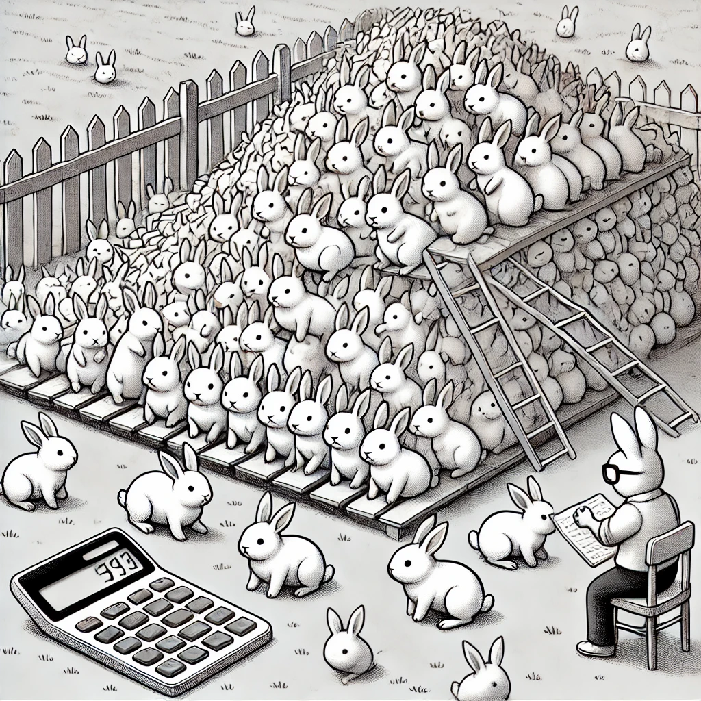

::: {.content-visible when-format="html"}

:::

# Exponentiële groei {#sec-exp}

## Leerdoelen

In dit eerste hoofdstuk van Module 1 gaan we een belangrijk concept uit de biologie beter leren begrijpen: exponentiële groei. Aan het eind van dit onderdeel, word je geacht het volgende te kunnen:

-   Aantonen wanneer groei exponentieel is
-   Uitleggen dat snelle groei niet altijd exponentiële groei is
-   Uitleggen wat dichtheidsafhankelijkheid (*density dependence*) is, en hoe dit resulteert in een draagvermogen (*carrying capacity*)

{fig-align="center" width="80%"}

## Bergen met rijst

In het introductie-hoofdstuk hebben we besproken dat alle modellen drie belang- rijke basisingrediënten hebben: variabelen, parameters, en aannames. Laten we dit toepassen op een beroemde mythe over de ontdekking van het schaakspel, waar een koning per ongeluk een beetje te veel rijst beloofde.

### De mythe van de ontdekking van het schaakspel

De mythe van de ontdekking van het schaakspel is een beroemde legende uit India. Volgens het verhaal wilde een koning de uitvinder van het schaakspel belonen. De uitvinder vroeg bescheiden om rijst: één korrel op het eerste veld van het schaakbord, twee op het tweede, vier op het derde, en zo verder, telkens verdubbelend op elk van de 64 velden. De koning stemde toe, zich niet realiserend hoeveel rijst dit zou betekenen. Tegen de tijd dat het 64e veld bereikt was, had de koning niet genoeg rijst in zijn hele koninkrijk om aan de vraag te voldoen. Het totaal aantal korrels rijst komt uit op:

$$
1 + 2 + 4 + · · · + 26^3 = 26^4 − 1 = 18.446.744.073.709.551.615
$$ Als je het aantal cijfers van dit grote getal telt, zie je dat het neerkomt op 18 miljoen-miljoen-miljoen (een 18 met 18 nullen!). Dit kunnen we beter als een macht van 10 schrijven: $\sim 1.84 \cdot 10^{19}$. In R worden dergelijke grote getallen meestal met `e+` aangegeven:

```{r}
#| eval: true
#| echo: true
#| code-fold: false
#| class-output: output

2^64
```

Deze legende van de ontdekking van het schaakspel illustreert de kracht van exponentiële groei en hoe snel getallen kunnen oplopen. Wat aanvankelijk klein en bescheiden lijkt, kan snel uitgroeien tot een enorme, (onvoorstelbare) hoeveelheid.

## Verdubellingen modelleren

De vergissing van de koning was dat hij (zoals veel mensen) niet in kon zien hoe snel verdubbelingen toenemen. We kunnen deze aan de hand van deze mythe de volgende variabelen, parameters, en aannames formuleren:

-   Variabele: aantal rijstkorrels, 𝑅
-   Parameters: vermenigvuldigingswaarde (𝑟 = 2) en aantal hokjes op een schaakbord ($n=64$)
-   Aannames: teveel om te benoemen, maar één is in ieder geval dat de rijst ook daadwerkelijk op het bord past!

Naast deze drie basisingrediënten, is het natuurlijk ook belangrijk om te bepalen wat de hoeveelheid rijst is waar we mee beginnen (hier $R(0) = 1$). Dit wordt in de model-wereld de **initiële conditie** (*initial condition*) genoemd. Vanaf daar gaan we verder rekenen: op het tweede vakje liggen $R(1) = R(0) \cdot 2$ rijstkorrels, op het derde vakje $R(2) = R(0) \cdot 2 \cdot 2$ korrels, *etc.* Het aantal korrels op het 64e vakje, wordt gegeven door 63 verdubbelingen (het eerste vakje was al bezet!). Dit kunnen we omschrijven met de volgende vergelijking:

$$
R(63) = R(0) \cdot 2^{63}
$$ {#eq-rijst}

Vergelijking @eq-rijst geeft het aantal korrels op het 64e vakje. Dat is dus nog niet het *totaal* aantal korrels. Het totaal wordt gegeven door $R(0) + R(1) + R(2) + \cdots + R(63)$. Deze som is een beetje te lang om volledig op te schrijven, maar we weten dat elke stap devolgende **differentievergelijking** wordt toegepast:

$$
R(t+1) = 2\cdot R(t) 
$$ {#eq-differentie-vergelijking}

We kunnen in R een simpele loop schrijven die vergelijking @eq-differentie-vergelijking herhaaldelijk toepast:

```{r}
#| eval: true
#| echo: true
#| code-fold: false

R <- 1 # beginaantal rijst

# herhaal iets 63 keer met een for-loop
for (t in 1:63) {
  R[t+1] <- 2*R[t]
}
print(R[64])
```

In de bovenstaande code wordt er steeds een getalletje aan R toegevoegd. $R$ is dus nu niet meer een getal, maar een steeds langer wordende lijst getallen: $1, 2, 4, 8, \dots, 2^{63}$, \*etc. Deze lijst kunnen we zelf weer plotten met R: \`

```{r}
#| eval: true
#| echo: true
#| code-fold: false
#| label: fig-exponential

# beginaantal rijst
R <- 1

# herhaal iets 63 keer met een for-loop
for (i in 1:63) {
  R[i+1] <- R[i]*2 # R in volgende stap is 2*R in deze stap
}

plot(R , type='l', col="seagreen", log="y", lwd=2) 
```

::: {#exr-exponentiele-groei-langzaam}
## Een toenname van slechts 5%

<br>

We plotten het resultaat van de loop hierboven op een log-lineaire schaal, zodat we goed kunnen zien of de groei exponentiëel is. Laten we nu aannemen dat de groei van het aantal rijstkorrels niet verdubbeld, maar met 5 procent toeneemt per hokje:

$$R(t+1) = 1.05 \cdot R(t) $$ Pas de R-code hierboven aan om deze nieuwe differentievergelijking door te rekenen.

**a.** Is er sprake van exponentiele groei?

**b.** Hoeveel rijstkorrels heb je nu in totaal? (hint: je kan de `sum` functie gebruiken om de som van een vector in één keer uit te rekenen!)

**NAAR ANTWOORDENMODEL:**

**a.** ja, het percentage is klein maar is alsnog exponentieel!!

**b.** 434.0933.
:::

## Exponentiële groei

Hoewel in het dagelijks taalgebruik elke vorm van "snelle groei" als exponentieel wordt bestempeld, is dit niet correct. Hele snelle groei kan niet exponentieel zijn, en andersom, kan vrij langzame groei wél exponentieel zijn. Er is sprake van exponentiële groei als de percentuele toename constant blijft. In de bovenstaande voorbeelden was dat een toename van 100% (een verdubbeling) en een toename van 5%, maar in beide gevallen was de toename constant. In beide gevallen is er dus sprake van exponentiële groei! Als je zeker wil weten of groei exponentiëel is, kun je data altijd plotten op een log-lineaire schaal (`log="y"`), en kijken of het een rechte lijn vormt.

## Konijnen in Australië

{fig-align="center" width="80%"}

Thomas Austin was een Engelse kolonist in Australië, en hield van jagen. Daarom liet hij in de 19e eeuw 24 konijnen vrij in Autralië. Binnen tien jaar waren er meer dan honderd miljoen konijnen op Australië, en kon de populatie onmogelijk nog onder controle gehouden worden. Net als bij het voorbeeld van de rijstkorrels, kunnen we een simpele differentievergelijking opschrijven om het aantal konijnen in Autralië te modelleren:

```{=tex}
\begin{equation}
    N(t+1) = r \cdot N(t)
\end{equation}
```
N staat hier voor het aantal konijnen. In plaats van het getal `2` of `1.05` in te vullen voor de groeisnelheid, gebruiken we hier $r$: een vrije parameter waarvan we de waarde nog niet vastzetten. Zodoende kunnen we straks zelf bepalen of we $r$ op 2, 3, of misschien nog wel hoger moeten zetten om de toenname in Australië te kunnen verklaren.

## Dichtheidseffecten en logistische groei

Hoewel de groei van populaties aanvankelijk goed benaderd kan worden met exponentiële groei, kan dit niet tot in het oneindige doorgaan. Zo kan na verloop van tijd het eten opraken (voedsel is de beperkende factor), of kan een graszaadje geen onbzet plekje in het veld meer vinden (ruimte is de beperkende factor). Met andere woorden: hoe meer individuen er aanwezig zijn, hoe minder groei er kan plaatsvinden. Dergelijke effecten noemen we dichtheidseffecten, of dichtheidsafhankelijkheid (*density dependency*). De bovengenoemde dichtheidseffecten zijn negatief (groei neemt af), maar dichtheidseffecten kunnen ook positief zijn, bijvoorbeeld wanneer individuen van een soort elkaar helpen met groeien, waar we later in @sec-ruimtelijk op terug zullen komen.

We gaan echter eerst onze pijlen richten op negatieve dichtheidseffecten, omdat deze ons kunnen helpen om exponentiële groei om te zetten naar **logistische groei**: groei die exponentiëel begint maar uiteindelijk een stabiel evenwicht bereikt.

::: {#tip-logaritmisch .callout-note}
## Logaritmische groei

Logistische groei is een vorm van populatiegroei die exponentieel begint, maar uiteindelijk naar een evenwicht gaat. Dit geeft de karakteristieke sigmoïde S-curve. Op een log-lineaire schaal begint de groeicurve als een rechte lijn, maar buigt deze uiteindelijk af naar een evenwicht (@fig-logaritmischecurves). Deze evenwichtswaarde wordt ook wel de draagkracht of het **draagvermogen** (*carrying capacity* ) van het systeem genoemd. Als de populatie kleiner is dan dit draagvermogen (er zijn weinig konijnen dus veel eten), dan zal de populatie toenemen. Is de populatie echter groter dan dit draagvermogen (er zijn veel konijnen dus weinig eten), dan zal de populatie alleen maar afnemen. Ergens daartussenin zal dus een evenwichtsituatie liggen.

In de opgaven gaan we rekenen aan de konijnenpopulatie in Australië en onze eerste poging doen om de populatie een stabiel evenwicht te laten bereiken.

```{r}
#| echo: true
#| label: fig-logaritmischecurves
#| code-fold: true
#| eval: true
#| fig-height: 3
x<- 24
for(i in 1:70){
  x[i+1] <- x[i] * 1.2 * (1-(x[i]/10^5))
}
par(mfrow=c(1,2))
plot(x, xlab="Tijd", ylab="Aantal", lwd=2.5, type='l', col='seagreen')
plot(x, xlab="Tijd", ylab="Aantal", lwd=2.5, type='l', col='seagreen',log="y")

```
:::


## Opgaven

::: {#exr-rabbits-map}
## Konijnen in Australië

<br>

Als een biologische populatie zich ergens vestigt, kan het aanvankelijk enorm snel groeien. Voorbeelden hiervan zijn een virus dat zich verspreid in een nieuwe gastheer, een bacteriële populatie in een voedselrijk medium, of zoals in dit hoofdstuk omschreven, de konijnenpopulatie in Australie:

$$
N(t+1) = r \cdot N(t) 
$$ Exponentiële groei is zo simpel dat het gemakkelijk te simuleren is met de computer, bijvoorbeeld in R. Neem devolgende code over in Rstudio:

```{r}
# definieren van begin aantal konijnen
konijnen <- 24

# verdubbel het aantal konijnen 10 keer
for (i in 1:10){
    konijnen <- konijnen*2
}
```

**a.** Pas de code aan om te bepalen hoeveel konijnen er na 20 verdubbelingen zijn. Voeg aan het eind van de code zelf een regel toe, waardoor er hetvolgende geprint wordt: `Het aantal konijnen na 20 tijdstappen is gelijk aan 25165824`.

**b.** Om beter bij te kunnen houden hoeveel konijnen er zijn na elke herhaling, kunnen we het aantal konijnen bijhouden in een lijst, waar we elke herhaling het aantal konijnen op dat tijdpunt aan toevoegen:

```{r}
#| eval: false
# Stap 1: Stel begin-aantal konijnen in
konijnen <- 24

# Stap 2: Verdubbel het aantal konijnen 30 keer
for (t in 1:30){
  konijnen[t+1] <- 2*konijnen[t]
}

# Stap 3: Plot het resultaat
plot(konijnen, type='l')
```

Voer de bovenstaande code uit en bekijk het resultaat. Groeit het aantal konijnen exponentieel? Pas de R-code aan om dit te bevestigen.

**c.** Hoewel het aantal konijnen in Australië aanvankelijk exponentieel groeide, is er uiteindelijk een evenwicht bereikt bij ongeveer 500 miljoen konijnen. Om dit in onze R-simulatie te bereiken hebben we dichtheidsafhankelijkheid (*density dependence*) nodig. Dat wil zeggen: we willen dat de populatie minder toeneemt naar mate er meer konijnen zijn. Om dit voor elkaar te krijgen kunnen we simpele wiskundige functies gebruiken.

Wanneer is $f(x) = 1 - \frac{x}{100}$ gelijk aan nul?

Wanneer is $f(x) = 1 - \frac{x}{1000}$ gelijk aan nul?

Wanneer is $f(x) = 1 - \frac{x}{K}$ gelijk aan nul?

**d.** De $x$ uit de bovenstaande functie zou voor het aantal konijnen ($N$) kunnen staan. Dat zou betekenen dat bij kleine aantallen konijnen de functie bijna gelijk is aan $1$, maar bij grote aantallen konijnen deze steeds kleiner wordt. Als we onze groei-vergelijking vermenigvuldigen met deze nieuwe functie $f(N)$, zouden we de groei dus moeten kunnen stoppen:

$$
N(t+1) = r \cdot N(t) \cdot f(N)
$$

Omdat $f(N)$ steeds kleiner wordt, zal de groeisnelheid beschreven met de bovenstaande differentievergelijking dus afnemen naar mate er meer konijnen zijn. Pas de R-code aan zodat het voldoet aan de bovenstaande vergelijking. Kies voor $f(N)=1-N/K$ een waarde $K=10^9$, en simuleer de konijnenpopulatie voor 30 jaar. Bij hoeveel konijnen stabiliseert de populatie? *ANTWOORD: 500 miljoen. Anders dan bij ODEs is dat niet K (maar dat weten ze nog niet per se, misschien wel goed om toe te lichten als extratje in het antwoordenmodel omdat ze hier misschien LATER naar terugkijken)*

**e.** Plot het aantal konijnen op een log-lineaire schaal (voeg `log="y"` toe). Groeit de populatie in de eerste jaren (bij benadering) exponentieel? Groeit de populatie in de laatste jaren exponentieel?

**f.** Neem aan dat elke tijdstap 1 jaar is. Hoeveel konijnen zijn er in je nieuwe model na 10 jaar? Wat is er vreemd aan deze hoeveelheid? *ANTWOORD: konijnen\[10\] geeft 12287.85. Dit is ten eerste raar want we hebben dus kennelijk halve konijnen.*

**g.** De konijnenpopulatie bereikte naar schatting binnen 10 jaar een populatiegrootte van meer dan honderd miljoen. Als we dit vergelijken met onze eigen resultaten uit de bovenstaande vraag, groeit onze populatie dus te langzaam. Pas de R-code aan waardoor de konijnenpopulatie ieder jaar ver**drie**voudigd, en simuleer wederom 30 tijdstappen (30 "jaar"). Gaat de konijnenpopulatie naar een evenwicht? Heb je dit keer wel ongeveer 100 miljoen konijnen na 10 jaar? *ANTWOORD: het gaat de hele tijd heen en weer rond 700 miljoen, en nee, je hebt nogsteeds niet snel genoege groei*

**h.** Probeer ook wat er gebeurt als de populatie ieder jaar ver**vier**voudigd. Wat valt je op? Heb je nu 100-miljoen konijnen in 10 jaar? *ANTWOORD: het gaat nu helemaal raar doen (chaos), en nog steeds groeien ze niet eens snel genoeg (je hebt 6 miljoen konijnen)*
:::

::: {#exr-rabbits-in-space}
## Miniatuur Australië 

{#fig-rabbits-sim}

<br> Laten we de konijnenpopulatie uit de vorige opgave ook in een ander type model bekijken. Hiervoor simuleren we een "miniatuur Australië" (zie @fig-rabbits-sim). Laten we Australië in drie types hokjes opdelen: grashokjes (groen) waarop konijnen kunnen voortplanten, konijnhokjes (bruin), en oceaanhokjes (blauw). We nemen voor het gemak aan dat er geen woestijn-hokjes zijn, wat betekent dat konijnen overal in Australie kunnen voortplanten. Elke tijdstap kunnen konijnen zich vermenigvuldigen door een naastgelegen grashokje over te nemen. Deze "geboortekans" zetten we vast op 80%, en ondervindt géén dichtheidsafhankelijkheid. Konijnen kunnen ook met een vaste kans sterven, waardoor een bruin hokje weer groen wordt. Als laatste nemen we voor het gemak aan dat konijnen niet bewegen.


a) Lees de bovenstaande modelomschrijving zorgvuldig door. Verwacht je exponentiële groei? Waarom wel/niet? 
*ANTWOORD: naief verwacht je van wel, want b \> d* **b.** 

a) Verwacht je dat er een draagvlak (*carrying capacity*) zal zijn?
*ANTWOORD: naief zou je denken van niet, want er is op het eerste gezicht geen afname van birth, maar misschien snappen ze ook wel dat dit niet kan!*

a) Een interactieve versie van deze simulatie zie je hieronder. Start de simulatie en bekijk de grafieken. Had je de vorige vragen juist beantwoord? 
*ANTWOORD: misschien hadden ze geen draagvlak verwacht, maar achteraf gezien zullen ze zeker snappen dat dit wel MOET bestaan*


::: {.content-visible when-format="html"}
```{=html}
<iframe width="740" height="550" src="https://tbb.bio.uu.nl/bvd/simulations/australia/" title="Simulation"></iframe>
```
:::
  
  
::: {.content-visible when-format="pdf"}

...

:::
d) De populatie groeit in het begin erg snel: 13, 100, 292, 619, 1081, 1695, 2458, 3291. Bepaal met R of deze toename exponentieel is.
*ANTWOORD: nee, geeft geen rechte lijn op log-lin schaal: plot(c(13,100,292,619,1081,1695,2458,3191), log="y")*
d) De simulatie bereikt een draagvlak van ongeveer 8000 konijnen, wat veel minder is dan honderden miljoenen. We zouden een veel groter Australië kunnen simuleren, maar dat maakt een dergelijke computer-simulatie erg langzaam. We kunnen ook definiëren dat elk hokje niet 1 konijn is, maar een lokale populatie konijnen. Wat zou dit betekenen voor de interpretatie van de geboortekans en de sterftekans? 
*ANTWOORD: dit zijn nu niet meer de geboorte / sterfte van individuen, maar de kans op uitbreiding / uitsterven van lokale populaties*
:::


## Terminologie

::: todo-box
| Nederlands              | Engels                    | Beschrijving                                                                                                                                                                                                                                           |
|------------------|--------------------|-----------------------------------|
| Initiele conditie       | Initial condition         | De begin-toestand van het model. In simpele wiskundige modellen is dit vaak een aantal (zoals de begin-hoeveelheid rijst in dit hoofdstuk). Bij andere modellen (uit latere hoofdstukken) kan de begin-toestand kan ook een kleur of een patroon zijn. |
| Differentievergelijking | Difference equation / Map | Een wiskundige formule die de relatie beschrijft tussen opeenvolgende waarden van een variabele in **discrete** tijdstappen                                                                                                                            |
| Exponentiële groei      | Exponential growth        | Groei waarbij het toenamingspercentage constant blijft                                                                                                                                                                                                 |
| Logaritmische groei     | Logarithmic growth        | Groei die exponentiëel begint, maar wat uiteindelijk een evenwicht bereikt.                                                                                                                                                                            |
| Draagvermogen           | Carrying capacity         | Het maximale aantal individuen (of de maximale concentratie) dat een systeem in evenwicht kan ondersteunen                                                                                                                                             |
:::
