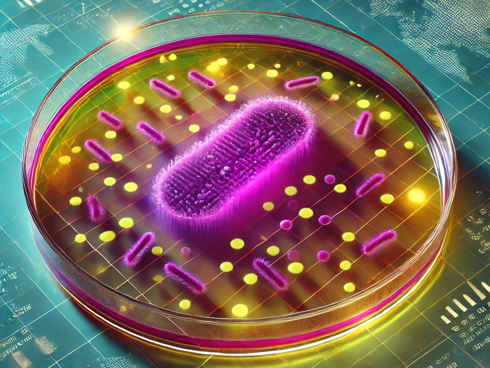
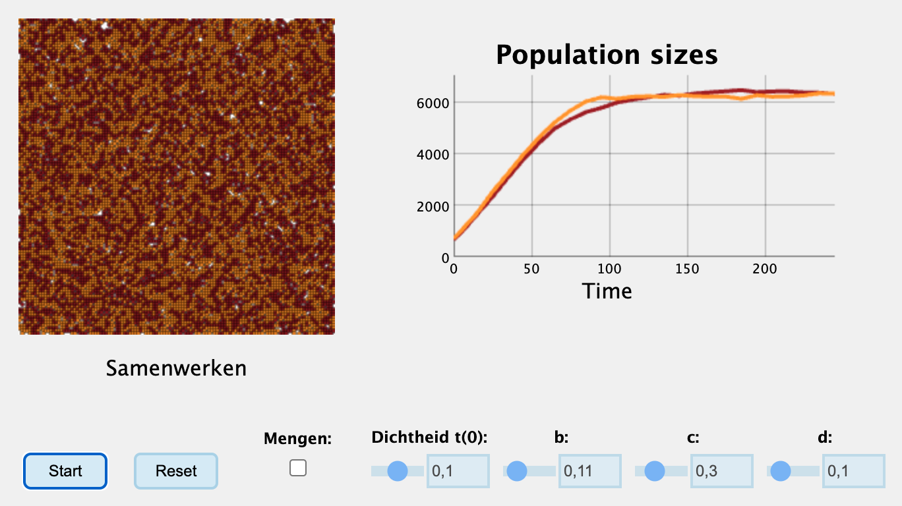

# Ruimtelijke groei {#sec-ruimtelijk}

Zoals je hebt gezien maken modellen vaak vele aannames. Hoewel we tot nu toe veel aannames expliciet hebben benoemd (goed gemengd systeem, parameters zijn constant, \textit{etc.}), zijn er soms ook aannames die je misschien niet onmiddellijk zijn opgevallen. Zo hebben we het bijvoorbeeld gehad over dichtheidsafhankelijke groei, maar daarbij altijd aangenomen dat alle individuen deze dichtheidseffecten op dezelfde manier ervaren. Maar een bos kan zich vooral aan de rand uitbreiden: daar hebben de individuen toegang tot lege plekjes met veel licht. Hetzelfde geldt voor bacteriën op een agarplaat (aan de rand zijn meer nutriënten beschikbaar) of een groeiende tumor (cellen in het midden schieten zuurstof en voedingsstoffen tekort).

In de bovenstaande scenario's is het steeds geval dat de individuen/cellen aan de rand een lagere dichtheid ervaren dan individuen in het midden. Met andere woorden: niet ieder individu ondervindt dezelfde dichtheidseffecten, wat in onze eerdere modellen wel aangenomen werd! Sterker nog, tot nu toe spraken we helemaal niet over individuen, want we omschreven steeds slechts de totale populatiegrootte!

{fig-align="center" width="80%"}

## Leerdoelen

In dit hoofdstuk, gaan we na denken over hoe populaties (of het nu bomen, bacteriën, of tumorcellen zijn) groeien in de ruimte. Dit doen we door kennis te maken met **individual-based modelling**, wat aanneemt dat organismen discrete individuen zijn, eventueel met hun eigen omgeving en eigen gedragsregels. Aan het eind van dit hoofdstuk, moet je begrijpen:

-   Wat er bedoelt wordt met 'omschrijvingsniveau'
-   Dat je naast populatiegroottes ook vanuit het individu kan denken
-   Dat interacties lokaal zijn, dus dat de posities van individuen ertoe kunnen doen
-   Hoe het komt dat sommige ruimtelijke modellen een "ingebouwd" draagvlak hebben

## Wat is individual-based modelling?

Individual-based modelling (IBMs, ook wel *agent-based modelling* of ABMs genoemd), is een modeltechniek waarbij organismen als discrete entiteiten (indivuen) worden beschouwd. Hierdoor kunnen we niet louter en alleen populatiegroottes bestuderen, maar ook de eigenschappen en gedragingen van individuen *binnen* de populatie. Formeler gezegd kunnen we stellen dat individual-based modellen een ander **omschrijvingsniveau** hebben dan ODEs/differentievergelijkingen. Dit omschrijvingsniveau bepaald ook welke **modeluitkomsten** we kunnen verwachten: als we alleen de populatiegroottes bestuderen, kunnen we geen inzichten over individuele verschillen verwachten! Laten we hiermee kennis maken door te denken aan een bacteriekolonie die zich over een agarplaat verspreidt.

## Individuen en hun posities

Stel je voor dat in het midden van een agarplaat een enkele (paarse) bacteriecel begint met delen (zie @fig-colony). Deze cel groeit met een bepaalde snelheid, en kan op een bepaald moment delen. Maar reproductie is (meestal) een lokaal proces, dat wil zeggen, de dochtercel zal naast de oudercel geplaatst worden. We kunnen ons dus voorstellen dat, wanneer dit proces stap voor stap doorspeelt, de kolonie bij benadering in een cirkelvorm zal uitgroeien. Als er ook een kans is dat de dochtercel een mutatie heeft (waardoor deze bijvoorbeeld geel wordt), dan ontstaat er over de tijd zelfs een interessant patroon (zie @fig-colony, rechter zijde). Door het perspectief in te nemen van de cel (in plaats van de totale populatie), kunnen we dus gaan nadenken over individuele verschillen in positie, kleur, groeisnelheid, *etc.*

```{r ruimtelijkegroei}
#| code-fold: true
#| fig-cap: "Paarse stippen staan voor wildtye bacteriën, terwjil gele stippen bacteriën zijn met een mutatie. Door lokale celdeling onstaat er een \"taartpunt\" van mutanten, zoals waargenomen in [Fusco et. al (2016)](https://www.nature.com/articles/ncomms12760)"
#| label: fig-colony
#| code-summary: "Code (voor de leuk, dit is geen leerstof)"
# Functie om het grid te visualiseren als punten
plot_grid <- function(grid) {
  par(mar = c(1, 1, 1, 1))
  plot(1, 1, type = "n", xlim = c(1, nrow(grid)), ylim = c(1, ncol(grid)), xlab = "", ylab = "", axes = FALSE, asp = 1)
  
  points(which(grid == 1, arr.ind = TRUE), col = "black", bg = "purple", pch = 21, lwd=0.2, cex = 0.5)
  points(which(grid == 2, arr.ind = TRUE), col = "black", bg = "gold", pch = 21,lwd=0.2, cex = 0.5)
}

# Functie om de groei-regels over het hele grid toe te passen. Deze regel werkt zo:
# Voor elk lege punt (0), pak een 
update_grid <- function(grid) {
  size <- nrow(grid)
  new_grid <- grid
  
  for (i in 1:size) {
    for (j in 1:size) {
      if (grid[i, j] == 1 || grid[i, j] == 2) {
        neighbors <- cbind(c(i-1, i+1, i, i), c(j, j, j-1, j+1))
        for (k in 1:nrow(neighbors)) {
          ni <- neighbors[k, 1]
          nj <- neighbors[k, 2]
          if (ni > 0 && ni <= size && nj > 0 && nj <= size && grid[ni, nj] == 0) {
            if (runif(1) < 0.5) {  # Geboortekans van 50%
              new_grid[ni, nj] <- grid[i, j]  # Kleur wordt overgedragen
              if(runif(1) < 0.01) grid[i,j] <- 2
            }
          }
        }
      }
    }
  }
  
  return(new_grid)
}

# Maak een grid van 0-en met één 1tje in het midden
grid <- matrix(0, nrow = 100, ncol = 100)
grid[50,50] <- 1
set.seed(59)

# Loop om het grid bij te werken en te visualiseren
layout(matrix(c(1,2,2,3,3,4,4),nrow=1))
for (t in 1:75) {
  if(t==2 || t%%22==0) plot_grid(grid)
  if(t==2) arrows(20,20,40,40,length=0.06,lwd=2)
  grid <- update_grid(grid)
  
  Sys.sleep(0.1)  # Korte vertraging om de veranderingen zichtbaar te maken
}
title("Een groeiende bacteriekolonie met (gele) mutanten", cex.main=2,line = -2, outer = TRUE)
```

De ruimtelijke structuur die in de IBM van Figuur @fig-colony ontstaat is een geheel *nieuw* type model-resultaat, en staat ons toe om vele nieuwe vragen te stellen: hoe verspreiden mutaties zich in een bacteriekolonie? Hoe belangrijk is zuurstof-beperking voor de groei van een tumor? Hoe behouden we diverse ecosystemen wanneer bossen de heide overgroeien? Hoewel IBMs ook zonder ruimtelijke structuur gemodelleerd kunnen worden, is dergelijke structuur natuurlijk wel een belangrijk component van biologische systemen! Maar hoe pakken we dat dan aan, individuen in de ruimte modelleren?

## Geboorte in "lege hokjes"

Nu we het belang inzien van individuen en hun positie, hoe verwerken we dit dan in een model? De meest eenvoudig vorm is wellicht een 2-dimensionale ruimte, waarin elk individu een x- en een y-coordinaat heeft. We kunnen bijvoorbeeld een dataframe maken met daarin twee individuen:

```{r}
#| eval: true
# Maak twee individuen met een positie en een kleur
individual1 <- data.frame(x=6,y=6,col="brown")
individual2 <- data.frame(x=7,y=6,col="orange")
# Zet ze samen in een dataframe als 'beginpopulatie'
population <- rbind(individual1, individual2)
population
```

Om het extra simpel te houden, nemen we aan dat de x-y coordinaten altijd gehele getallen zijn ($x=1,2,3,\dots,S$ en $y=1,2,3,\dots,S$), zodat we ons volledige ruimte kunnen voorstellen als een simpel grid van hokjes (een soort schaakbord, maar dan zonder die oneindige berg rijst). Nu zouden we elk individu in deze lijst "regels" kunnen geven voor hun voortplanting. Elk individu zou bijvoorbeeld zich in een leeg buur-hokje kunnen voortplanten met een kans van 60%, en kunnen sterven met een kans van 5%. Laten we even stellen dat de kleur van het individu niet uitmaakt voor deze regels: deze is alleen voor de visualisatie. Als we dit simuleren in R, zouden we zoiets kunnen zien:

```{r ruimtesim2}
#| code-fold: true
#| code-summary: "Code"
#| fig.width: 6
#| fig.height: 3.5
#| fig-cap: "Simulatie van groei op een grid, waarbij \"individuen\" kunnen reproduceren in lege buur-hokjes met een kans van 60%, en sterven met een vaste kans van 5%. De kleur heeft hier geen invloed op, en dient alleen ter illustratie. "
#| label: fig-simgrowthgrid222
# Maak een 12x12 grid
grid_size <- 12
grid <- matrix(0, nrow = grid_size, ncol = grid_size)
# Maak twee individuen met een positie en een kleur
individual1 <- data.frame(x=6,y=6,col="brown")
individual2 <- data.frame(x=7,y=6,col="orange")
# Zet ze samen in een dataframe als 'mbeginpopulatie'
population <- rbind(individual1, individual2)
grid[6, 6] <- 1 # 6,6 zit vol
grid[6, 7] <- 1 # 7,6 zit vol (let op dat row=y en col=x)

# Groei-simulatie functie
simulate_growth <- function(geboorte = 0.6, sterfte=0.1) {
  deaths <- c() # Houd bij wie er dood gaan, zodat deze aan het einde uit de populatie gehaald kunnen worden
  for (i in 1:nrow(population)) {
    ind <- population[i,]
    if(runif(1) < geboorte){
      new_x <- ind$x + sample(c(-1:1),1)
      new_y <- ind$y + sample(c(-1:1),1)
      if(new_x<1 || new_x > grid_size || new_y < 1 || new_y > grid_size) next
      if(grid[new_y,new_x] == 0){
        grid[new_y,new_x] <<- 1
        population <<- rbind(population,data.frame(x=new_x,y=new_y,col=ind$col))
      }
    }
    if(runif(1) < sterfte){
      grid[ind$y,ind$x] <<- 0
      deaths <- c(deaths, i)
    }
  }
  if(length(deaths) > 0) population <<- population[-deaths,]
}

# Functie om het grid als bruine stipjes op een grid te plotten. 
plot_grid <- function(grid, time) {
  plot(1:grid_size, 1:grid_size, type = "n", xlab = "", ylab = "", axes = FALSE)
  # Grijze lijntjes
  for (i in 0:(grid_size)+1) {
    abline(h = i-0.5, col = "grey", lty = 1)
    abline(v = i-0.5, col = "grey", lty = 1)
  }
  # Bruine stipjes
  for (i in 1:nrow(population)) {
    ind <- population[i,]
    points(ind$x, ind$y, pch = 16, col = ind$col)
  }
  title(paste("Tijdstap",time))
}

# Start een random nummer generator (gerandeert reproduceerbaarheid)
#set.seed(591)

par(mfrow=c(3,5),mar=c(1,1,2,2))
# Simuleer een x-aantal tijdstappen (x=iterations)
iterations <- 28
plot_grid(grid,0)
for (i in 1:iterations) {
  if(i%%2==0) plot_grid(grid,i)
  simulate_growth(0.6, 0.1)
}
```

Hoewel het R-script geen dichtheidsafhankelijke afname van de geboortekans gebruikt (deze blijft altijd 60%), zal de populatie toch niet meer toenemen zodra het grid vol zit. De reden dat er toch een draagvlak aanwezig is, is simpelweg doordat individuen alleen kunnen voortplanten in *lege* hokjes. De *daadwerkelijke* geboortekans is dus helemaal niet constant, want op een vol grid is die veel kleiner dan op een leeg grid! Als we hadden aangenomen dat individuen ook kunnen voortplanten in bezette hokjes, dan zou de populatie inderdaad exponentiëel blijven groeien.

::: callout-tip
## Is ruimte beperkend voor groei?

De aanname dat ruimte een intrinsieke beperking is voor groei hangt sterk af van het biologische scenario: voor planten die licht moeten opvangen geldt dit waarschijnlijk wel, maar voor de grazers die deze planten eten wellicht niet. Vergelijkbaar hebben bacteriën op een agarplaat of tumorcellen alleen voedingsstoffen aan de rand, wat een vergelijkbaar effect oplevert waarbij er alleen in "lege ruimte" groei mogelijk is. Dergelijke overwegingen zijn heel belangrijk als we biologische systemen goed willen kunnen voorspellen!
:::

Een ander belangrijk verschil met onze eerdere (wiskundige) modellen is dat we nu gebruik maken van **stochasticiteit**, dat wil zeggen kansprocessen. Specifieker zijn birth en death zijn geen snelheden meer, maar kansprocessen. Als in deze simulatie birth veel hoger is dan death ($b\gg d$), zal de populatie natuurlijk gewoon uitgroeien totdat een groot deel van het grid vol zit (@fig-stochasticity-1). Daarna zal de populatie een beetje rond een evenwicht fluctueren, waarbij death wordt gecompenseerd door birth.

Wanneer het verschil tussen $b$ en $d$ veel kleiner is, groeit het grid minder vol. Ook zie je dat de fluctuaties rond het evenwicht wat sterker zijn geworden (@fig-stochasticity-2). Daarnaast zie je in deze simulatie dat er aan het einde, door toeval, alleen nog oranje individuen over zijn!

Als $b$ slechts een klein beetje groter is dan $d$ (@fig-stochasticity-3), zien we zelfs dat de kleine start-populatie van 2 cellen door stomme pech uit zou kunnen sterven. Ook dit was niet mogelijk in de ODEs, waar $b>d$ altijd exponentiële groei geeft.

```{r ruimtelijkegroei3}
#| code-fold: true
#| code-summary: "Code"
#| fig.width: 10
#| fig.height: 2.5
#| fig-cap: "De simulatie wanneer birth veel waarschijnlijker is dan death."
#| fig-subcap: 
#|   - "Simulatie met b=0.6, d=0.1"
#|   - "Simulatie met b=0.3, d=0.1"
#|   - "Simulatie met b=0.12, d=0.1"
#| layout-nrow: 3
#| label: fig-stochasticity

# Maak een 12x12 grid
grid_size <- 32
grid <- matrix(0, nrow = grid_size, ncol = grid_size)
# Maak twee individuen met een positie en een kleur
individual1 <- data.frame(x=16,y=16,col="brown")
individual2 <- data.frame(x=17,y=16,col="orange")
# Zet ze samen in een dataframe als 'mbeginpopulatie'
population <- rbind(individual1, individual2)
grid[16, 16] <- 1 # 6,6 zit vol
grid[16, 17] <- 1 # 7,6 zit vol (let op dat row=y en col=x)

# Groei-simulatie functie
simulate_growth <- function(geboorte = 0.6, sterfte=0.1) {
  deaths <- c() # Houd bij wie er dood gaan, zodat deze aan het einde uit de populatie gehaald kunnen worden
  for (i in 1:nrow(population)) {
    ind <- population[i,]
    if(runif(1) < geboorte){
      new_x <- ind$x + sample(c(-1:1),1)
      new_y <- ind$y + sample(c(-1:1),1)
      if(new_x<1 || new_x > grid_size || new_y < 1 || new_y > grid_size) next
      if(grid[new_y,new_x] == 0){
        grid[new_y,new_x] <<- 1
        population <<- rbind(population,data.frame(x=new_x,y=new_y,col=ind$col))
      }
    }
    if(runif(1) < sterfte){
      grid[ind$y,ind$x] <<- 0
      deaths <- c(deaths, i)
    }
  }
  if(length(deaths) > 0) population <<- population[-deaths,]
}

# Functie om het grid als bruine stipjes op een grid te plotten. 
plot_grid <- function(grid, time) {
  plot(1:grid_size, 1:grid_size, type = "n", xlab = "", ylab = "", axes = FALSE)
  # Grijze lijntjes
  for (i in 0:(grid_size)+1) {
    abline(h = i-0.5, col = "grey", lty = 1)
    abline(v = i-0.5, col = "grey", lty = 1)
  }
  # Bruine stipjes
  for (i in 1:nrow(population)) {
    ind <- population[i,]
    points(ind$x, ind$y, pch = 16, col = ind$col,cex = 1)
  }
  title(paste0("Grid op t=",time))
}

# Start een random nummer generator (gerandeert reproduceerbaarheid)
set.seed(596)
#par(mfrow=c(1,2),mar=c(3,3,1,1))
layout.matrix <- matrix(c(1, 2), nrow = 1, ncol = 2)
layout(mat = layout.matrix, widths=c(2.5,1))
par(mar=c(4,4,1,1))
population <- rbind(individual1, individual2)
grid <- matrix(0, nrow = grid_size, ncol = grid_size)
grid[16, 16] <- 1 # 6,6 zit vol
grid[16, 17] <- 1 # 7,6 zit vol (let op dat row=y en col=x)
# Simuleer een x-aantal tijdstappen (x=iterations)
iterations <- 300
popsize <- nrow(population)
for (i in 1:iterations) {
  simulate_growth(0.6, 0.1)
  popsize[i+1] <- nrow(population)
}
ts.plot(popsize, xlab="Tijd", ylab="Populatiegrootte", lwd=2, main="")
par(mar=c(1,1,1,1))
plot_grid(population,300)

par(mar=c(4,4,1,1))
population <- rbind(individual1, individual2)
grid <- matrix(0, nrow = grid_size, ncol = grid_size)
grid[16, 16] <- 1 # 6,6 zit vol
grid[16, 17] <- 1 # 7,6 zit vol (let op dat row=y en col=x)
# Simuleer een x-aantal tijdstappen (x=iterations)
iterations <- 300
popsize <- nrow(population)
for (i in 1:iterations) {
  simulate_growth(0.3, 0.1)
  popsize[i+1] <- nrow(population)
}
ts.plot(popsize, xlab="Tijd", ylab="Populatiegrootte", lwd=2, main="")
par(mar=c(1,1,1,1))
plot_grid(population,300)

par(mar=c(4,4,1,1))
population <- rbind(individual1, individual2)
grid <- matrix(0, nrow = grid_size, ncol = grid_size)
grid[16, 16] <- 1 # 6,6 zit vol
grid[16, 17] <- 1 # 7,6 zit vol (let op dat row=y en col=x)
# Simuleer een x-aantal tijdstappen (x=iterations)
iterations <- 300
popsize <- nrow(population)
for (i in 1:iterations) {
  simulate_growth(0.12, 0.1)
  popsize[i+1] <- nrow(population)
  if(popsize[i+1]==0) break
}
ts.plot(popsize, xlab="Tijd", ylab="Populatiegrootte", lwd=2, main="")
par(mar=c(1,1,1,1))
plot_grid(population,300)
```

## Lokale interacties en samenwerken

In de biologie is vaak sprake van samenwerking (ook wel coöperatie genoemd). Wolven jagen samen, planten zenden chemische signalen uit om anderen te waarschuwen voor herbivoren, en bacteriën scheiden enzymen uit die suikers beschikbaar maken voor nabijgelegen bacteriën. Dergelijke samenwerkingen zouden we kunnen verwerken in onze simulatie in een vorm van dichtheidsafhankelijkheid.

Als we positieve dichtheidsafhankelijke effecten willen gebruiken in een IBM op een grid, zouden we de totaalpopulatie kunnen meten en de kans op geboorte ($b$) hiermee aan kunnen aanpassen. Echter hoeft het helemaal niet zo te zijn dat iedereen de vruchten plukt van samenwerkingen. Als een individu in grid-punt `(10,10)` anderen helpt (bijvoorbeeld de bacterie maakt suikers vrij), zal een individu in gridpunt `(25,20)` daar geen direct voordeel van hebben. In plaats daarvan, zouden we bijvoorbeeld de geboortekans van de 8 buren van `(10,10)` kunnen verhogen. Dit noemen we een **lokale interactie**. Bijvoorbeeld, de oranje en rode individuen kunnen de volgende geboortekansen krijgen:

$$ \text{Geboortekans(\color{red}rood\color{black})} = b+c\cdot (\sum{\text{aantal \color{orange}oranje \color{black} buren}})$$
$$\text{Geboortekans(\color{orange}oranje\color{black})} = b+c\cdot (\sum{\text{aantal \color{red} rode \color{black} buren}})$$

Hieronder zie je een interactieve simulatie van dit systeem (je moet nog wel even op start drukken), waarbij je de parameters $b$, $c$, en $d$, en de begin-dichtheid kan instellen. De parameters zijn zo ingesteld dat $b$ maar een klein beetje groter is dan $d$, maar doordat de individuen elkaar helpen groeien ze toch prima uit totdat het hele grid vol is.

::: {.content-visible when-format="html"}
```{=html}
<iframe width="100%" height="480" src="https://tbb.bio.uu.nl/bvd/simulations/samenwerken/" title="Simulation"></iframe>
```
:::

::: {.content-visible when-format="pdf"}

WEBSHOT IS EEN LEUK IDEE, MAAR BETER MAKEN WE PRINT SCREENS MET EEN LINK ZODAT HET IIG DE JUISTE VISUALISATIE IS... 

[](https://tbb.bio.uu.nl/bvd/simulations/samenwerken/)

<https://tbb.bio.uu.nl/bvd/simulations/samenwerken/>
:::

Wat opvalt aan de bovenstaande simulatie is dat de populatie uitgroeit, maar dat als we naar de grafiek kijken, dit niet exponentieel lijkt te beginnen (met andere woorden, we zien geen sigmoïde curve). Dit zou kunnen komen doordat we met een vrij hoge dichtheid van cellen beginnen, waardoor we onmiddellijk al in het steile deel van de groeicurve zitten. In het werkcollege zul je deze simulatie verder bestuderen.

## De parasiet

Als we het hebben over samenwerking, kunnen we ons afvragen wat er zou gebeuren als iemand valsspeelt. Daarom gaan we de bovenstaande simulaties uitbreiden met een derde soort: een [parasiet]{style="color:blue; font-weight:bold"}. In het Engels worden samenwerkers vaak *cooperators* worden genoemd, en heten de parasieten vaak *cheaters* of *defectors*. We nemen aan dat deze cheater geen hulp geeft, en wel wordt geholpen door zowel de rode als oranje individuen:

$$ \text{Geboortekans(\color{red}rood\color{black})} = b+c\cdot (\sum{\text{aantal \color{orange}oranje \color{black} buren}})$$
$$\text{Geboortekans(\color{orange}oranje\color{black})} = b+c\cdot (\sum{\text{aantal \color{red} rode \color{black} buren}})$$
$$\text{Geboortekans(\color{blue}blauw\color{black})} = b+c\cdot (\sum{\text{aantal \color{red} rode \color{black} plus \color{orange}oranje \color{black} buren}})$$ 


Dit levert de volgende dynamica op:

::: {.content-visible when-format="html"}
```{=html}
<iframe width="100%" height="500" src="https://tbb.bio.uu.nl/bvd/bms/simulations/parasiet/" title="Simulation"></iframe>
```
:::

::: {.content-visible when-format="pdf"}
HIER MOET WEBSHOT KOMEN
:::

Zoals je ziet heeft deze verandering een enorme impact! Waar eerst de simulatie niet veel meer veranderde nadat het grid was volgegroeid, zien we nu het systeem alsmaar in beweging blijft. De cheaters overgroeien steeds de cooperators, maar omdat ze daarna zichzelf niet helpen sterven ze lokaal uit. Overgebleven cooperators kunnen de "lege ruimte" die daardoor is ontstaan weer veroveren, waarna er weer cheaters komen, *etc.*. Zo gaat de simulatie alsmaar door. Als je echter het systeem mengt, zul je zien dat ditzelfde niet gebeurt: de cheaters nemen de hele simulatie over en alles sterft uit. Nadat alles is uitgestorven, is het natuurlijk *game over*.

## De eindeloze mogelijkheden van IBMs

Nu je een klein beetje een beeld hebt gekregen van individual-based modelling, kun je je misschien voorstellen dat de mogelijkheden eindeloos zijn. Hokjes kunnen namelijk niet alleen individuen bevatten, maar ook voedsel, antibiotica, andere organismen, uitgescheden eiwitten, windrichtingen en noem zo maar op. Bovendien hoeven individuen niet in hokjes te zitten, maar zouden ze vrij door een continue ruimte kunnen lopen, zoals de mieren in de simulatie hieronder:

```{=html}
<!--<details>-->
<iframe width="100%" height="600" src="//jsfiddle.net/bramvandijk88/rhq6owfL/46/embedded/result/" allowfullscreen="allowfullscreen" allowpaymentrequest frameborder="0"></iframe>
</iframe>
<!--<summary>
Click here to see an individual-based model in Javascript
</summary>
</details> -->
```

Je begrijpt nu wellicht dat je met IBMs allerlei dingen simuleren: (*"the sky is the limit!"*)! Maar dat is misschien niet altijd even wenselijk. Met modellen proberen we natuurlijk (zoals in de introductie uitgelegd) de biologie enigszins te versimpelen, dus het is de kunst om de modellen niet te complex te maken. Aan de andere kant kunnen modellen die te simpel zijn de plank enorm misslaan. De balans tussen een simpel en een complex model is helemaal niet eenvoudig op te maken. Albert Einstein begreep dit ook:

::: {style="text-align: center"}
"A model should be as simple as possible, but no simpler"<br> -- Albert Einstein[^groei_ruimte-1]
:::

[^groei_ruimte-1]: Eigenlijk is dit helemaal niet een werkelijke citaat van Einstein, maar wel de boodschap achter een vrij complex relaas over *irreducible basic elements* en *adequate representations*, wat toch iets minder catchy bleek te zijn.

## Terminologie

::: todo-box
| Nederlands              | Engels                    | Beschrijving|
|------------------|--------------------|-----------------------------------|
| Individual-based modellen | Individual-based models | Modellen waarbij de eigenschappen en het gedrag van individuen wordt beschreven. |
| Omschrijvingsniveau | Level of description | Het belangrijkste aspect dat een model omschrijft wordt vaak het omschrijvingsniveau genoemd. Voor modellen van groei (bijvoorbeeld ODEs) is vaak de populatiegrootte het omschrijvingsniveau, terwijl bij een individual-based model het individu het omschrijvingsniveau is. |
| Modeluitkomsten | Model outcomes | Het omschrijvingsniveau bepaald sterk welke *uitkomsten* een model kan hebben: een model dat alleen populatiegroottes omschrijft, kan geen inzichten geven in individuele verschillen. |
| Stochasticiteit | Stochasticity | Stochastischiteit verwijst naar de mate van willekeur of onzekerheid in een proces of in een systeem. Zodoende zijn de uitkomsten niet volledig voorspelbaar, maar variëren door toeval of willekeurige invloeden. In dit hoofdstuk gebruiken we geboorte- en sterfte-kansen, waardoor bijvoorbeeld groeiende populaties ook door domme pech uit kunnen sterven! |
| Lokale interactie | Local interaction | Interacties tussen individuen die alleen plaatsvinden wanneer zij zich binnen een bepaalde nabije afstand van elkaar bevinden. |
