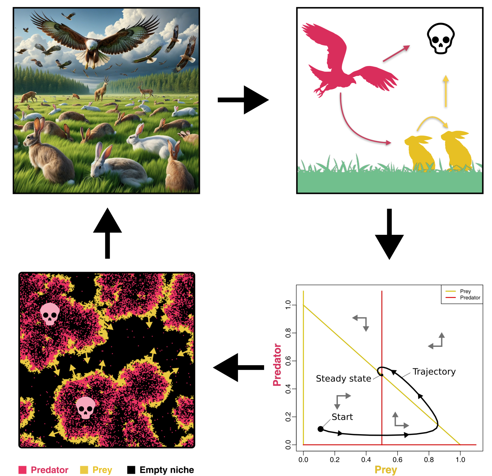

# Biologische modellen en simulaties

{fig-align="center" width=80%}

In dit introducerende hoofdstuk maak je kennis met Theoretische Biologie, een vakgebied dat biologische modellen maakt en bestudeert. Aan de hand van deze modellen proberen we nieuwe inzichten en ideeën te ontwikkelen, om zo biologische processen preciezer te begrijpen. Om dit goed te illustreren bespreken we zowel verschillende onderwerpen (microbiologie, ecologie, gedrag, evolutie) als methodes (wiskunde, simpele R-scripts en meer geavanceerde computer-simulaties). 

Dit doen we in drie kernmodules, ruwweg verdeeld over drie weken: 

1. Module 1: Populatiegroei
2. Module 2: Ecologie, competitie, en evolutie
3. Module 3: Gedrag, diffusie, en emergente patronen

Maar voordat we aan deze modules beginnen, wil ik jullie eerst graag uitleggen introduceren wat modellen nou eigenlijk **zijn**. 

