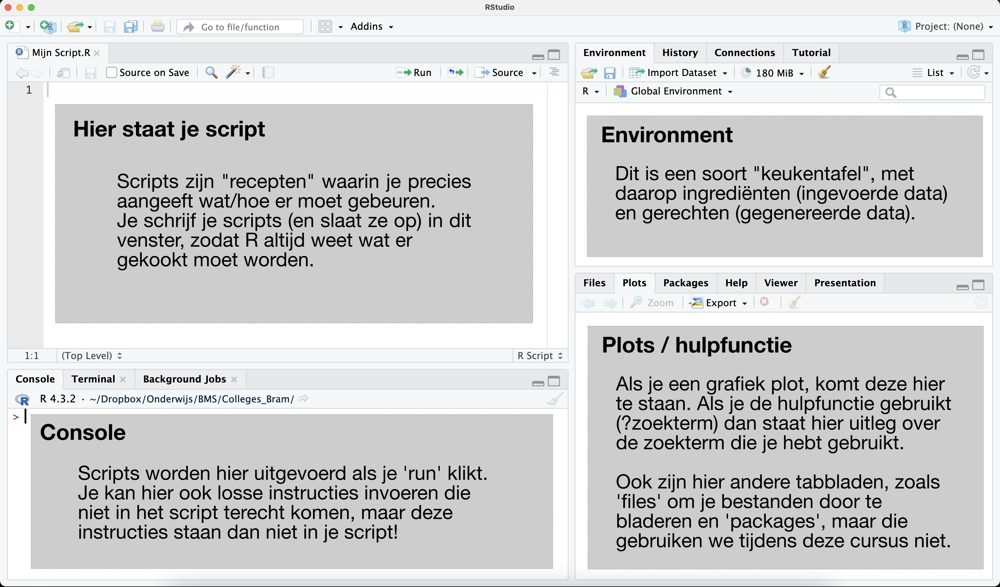

# Introductie en installatie 

Biologie in de 21e eeuw vereist analyse van grote hoeveelheden data, en modellering om complexe biologische systemen beter te begrijpen en te voorspellen. In dit onderdeel van de cursus maak je kort kennis met de basisprincipes van R, zodat ook jij straks voorspellingen kan doen, kan aantonen of een gemeten verschil statistisch significant is, en mooie grafieken kan maken.


{#fig-phrogs}

## Beginnen met Rstudio

{width="50%" fig-align="center"}

Er bestaan heel veel verschillende programmeertalen. Misschien heb je weleens gehoord van Python, C, of Javascript. Het analyseren van grote datasets wordt door biologen echter veelal in de programmeertaal R gedaan, omdat deze makkelijk te installeren is door het grote aantal gebruikers is er op internet gemakkelijk hulp te vinden. Daarom gaan jullie tijdens deze cursus met Rstudio leren programmeren, een programma dat je relatief eenvoudig kan installeren op je laptop. Maar eerst moeten we nog even R zelf installeren.

## R zelf installeren

R kun je eenvoudig installeren. Het is te vinden op de [CRAN website](https://cran.r-project.org/), en de instructies voor Mac en Windows gebruikers zijn daar ook te vinden:

-   Windows-gebruikers: ga naar "Download R for Windows", klikken op de link "base" en vervolgens op de link "Download R x.x.x for Windows" om het installatiebestand te downloaden. Open het gedownloadde `.exe` bestand en volg de instructies om R te installeren.

-   Mac-gebruikers: "Download R for (Mac) OS X". Download het juiste installatiebestand voor jouw macOS-versie. Let op: als je een oudere Mac gebruikt moet je de "Intel Mac" versie downloaden. Open het .pkg bestand en volg de instructies.

## R-studio installeren

Nadat je R geïnstalleerd hebt, kun je beginnen met het installeren van Rstudio. Deze downloaden we vanaf de [website van Rstudio](https://posit.co/download/rstudio-desktop/). Deze website legt ook uit dat je wel eerst R moet installeren, maar dat hebben we al gedaan. We kunnen dus meteen naar stap 2: Install Rstudio. Deze website herkent vanzelf wel besturingssysteem je gebruikt, dus hoef je het alleen nog maar te installeren:

-   Windows-gebruikers: volg de instructies van de installatie-wizard

-   Mac-gebruiker: open de .dmg en sleep "Rstudio" naar je Applications folder

Nu kun je Rstudio opstarten, en zou alles moeten werken[^intro_r_day1-1]

[^intro_r_day1-1]: In een enkel geval kan Rstudio de installatie van R niet automatisch vinden. Ga dan naar 'Tools' \> 'Global options', en dan naar het tabblad 'General'. Hier kan je handmatig instellen waar R geïnstalleerd staat. Vraag waar nodig hulp van je student-assistent (of ChatGPT ;\])

## Je eerste script

Nu je Rstudio hebt opgestart, gaan we eerst een nieuw script aanmaken. Ga hiervoor naar `File -> New file -> R script` (`Ctrl/Cmd+Shift+N`). Nu opent zich een nieuw venster, met daar in een `script` zonder naam. Sla dit lege script op op een logische plek op je computer. Maar wat is een script eigenlijk?

Een script is vergelijkbaar met een recept: het bevat de instructies om iets lekkers te koken, maar niet de ingredienten of het resultaat zelf. Deze instructies staan in zogeheten "plain text" formaat. Dit betekent dat de tekst geen vetgedrukte woorden, cursief, onderstrepingen, kleuren of speciale lettertypes bevat. Plain tekst kan data beschrijven (bijvoorbeeld met elke regel een observatie), of in het geval van een R-script een set van instructies. Elke regel bevat hoogstens 1 instructie, en deze code kan regel-per-regel worden uitgevoerd, of in één keer.

Kopieer voor het volgende onderdeel de volgende code naar je eigen script:

```{r}
#| eval: false
1+2
1+2-3
1+2-3*4/5
```

## Script en console

In Rstudio kun je op meerdere manieren regels code uitvoeren. Om de code uit je script regel-per-regel uit te voeren, klik je de bovenste regel aan (niet selecteren, maar gewoon ergens in de regel klikken), en gebruik je de knop `Run` (de sneltoets hiervoor is `Ctrl/Cmd+Enter`, wat heel handig is om in je vingers te krijgen!). Nu je de eerste regel hebt uitgevoerd, zie je in de console (onder het script) het antwoord: `[1] 3`. De `[1]` geeft aan dat dit het eerste waarde is die de berekening heeft gegeven. Omdat je maar 1 berekening hebt (1+2) gevraagd, is dit dus ook het enige waarde. Later zul je zien dat een berekening ook meerdere waarden terug kan geven. Je kan ook het hele script in één keer uitvoeren door op `Source` te klikken. Als je dit doet, zul je zien dat er regel voor regel antwoord word gegeven op de sommetjes. 

De bovenstaande uitleg geeft aan hoe je het script (het "recept") uit kan voeren, maar wat nu als je even snel iets wil uitproberen voordat je het recept helemaal overhoop gooit? Hiervoor kun je direct in de console typen. Als je bijvoorbeeld de berekening `81/250` in de console typt, heb je gauw een antwoord op je vraag maar is je script niet aangepast. De console is dus handig om even gauw wat uit te rekenen, maar let op: dit wordt niet opgeslagen als je het script opslaat!

## Rekenen met R

Zoals je nu misschien begrijpt, is R een geweldig krachtige rekenmachine! In plaats van alles handmatig uit te rekenen of in je grafische rekenmachine in te typen, kunnen we onze eigen R-scripts maken die berekeningen eenvoudig en reproduceerbaar maken. Om dit nog makkelijker te maken, kunnen we gebruik maken van variabelen:

```{r}
#| eval: false

# a, b, en c waardes toekennen (assigning variables)
a <- 1
b <- 3
c <- 2.5

# rekenen met a, b, en c
a+b-c # a plus b min c
a*b  # a maal b
a/b  # a gedeeld door b
b*b  # b maal b
b^2  # b kwadraad
sqrt(b) # wortel (sqaure root) van b


# andere manieren om variabelen te definieren
3 -> d
e = 2.5

# een uitgebreider sommetje uitrekenen
d/e+d*(c+d)

# deze som kunnen we ook weer opslaan in een variabele
uitkomst <- d/e+d*(c+d)
```

## Comments {#sec-environment}

In de bovenstaande code zie je meerdere regels met een hekje (#) ervoor. Alle tekst na een hekje wordt door R genegeerd, zodat we in onze code opmerkingen kunnen plaatsen. Deze opmerkingen heten in het Engels *comments*.

## De "Environment"

Variabelen die je definieert worden opgeslagen in de **Environment**. Waar het script een soort "recept" is, is de **Environment** meer vergelijkbaar met de keukentafel: hier worden alle ingeladen gegevens, berekeningen, en grafieken opgeslagen terwijl je aan je gerecht werkt. De environment helpt je om een overzicht te houden van wat er allemaal gebeurt, en blijft behouden totdat je Rstudio afsluit. Let op: ook de stapjes die je met de console hebt gedaan komen op deze keukentafel terecht, maar als je wil dat iemand anders het gerecht kan maken moet je zorgen dat ook het **recept** (dus het script) klopt. Het script is namelijk vaak het enige wat we zullen opslaan. Zo kunnen we de volgende keer ons script opnieuw uitvoeren, of ons script met andere onderzoekers delen. Let op: als je de volgende keer Rstudio opstart, begin je met een leeg Environment. In de kook-analogie begin je dus opnieuw met koken, en begint de keukentafel weer helemaal leeg!

## Opgave onderdeel 1

Om te testen of je de informatie uit onderdeel 1 hebt begrepen staat hier een simpele opgave. Lees de code hierboven nog eens door, en beantwoord de volgende vragen:

1.  Definieer a=2, en reken met R uit wat $a^3$ is.
```{r}
#| eval: false
#| echo: true
#| code-fold: true
#| code-summary: "NAAR ANTWOORDENMODEL:"

a <- 2
a^3
```
2.  Definieer b=9.5 en reken uit wat $b^{19}$ is (let op: je hoeft niet 19 keer b te typen)
```{r}
#| eval: false
#| echo: true
#| code-fold: true
#| code-summary: "NAAR ANTWOORDENMODEL:"

b <- 9,5
b^19
```
3.  Stel je zet eerst 3 stappen naar links, dan 4 stappen naar boven, en loopt vervolgens terug naar je beginpositie. Schrijf een script met R die uitrekent hoe ver je in totaal hebt gelopen. Zorg dat de uitkomst van je berekening **niet** in de environment staat, maar slechts in de console wordt weergegeven.
```{r}
#| eval: false
#| echo: true
#| code-fold: true
#| code-summary: "NAAR ANTWOORDENMODEL:"

# Dit is simpelweg de stelling van pythagoras:
a <- 3
b <- 4
c <- sqrt(a^2+b^2)
a+b+c
```
4.  Bereken nu uit hoever je gelopen zou zijn als je in plaats hiervan 5 stappen naar links en 6 stappen naar boven had gezet. Zorg dit keer dat de uitkomst **wel** in de environment staat on de de naam "afstand". Voeg de onderstaande regel code toe aan het eind van je script (hint: er is een knop om de code te kopiëren!). Voer je script uit. Hoeveel stappen heb je gelopen? Sla je script op!
```{r}
#| eval: false
#| echo: true

print(paste('Je hebt', afstand, 'stappen gelopen'))
```


```{r}
#| eval: false
#| echo: true
#| code-fold: true
#| code-summary: "NAAR ANTWOORDENMODEL:"

# Vergelijkbaar met de vorige vraag:
a <- 5
b <- 6
c <- sqrt(a^2+b^2)
afstand <-a+b+c
print(paste('Je hebt', afstand, 'stappen gelopen'))
```
