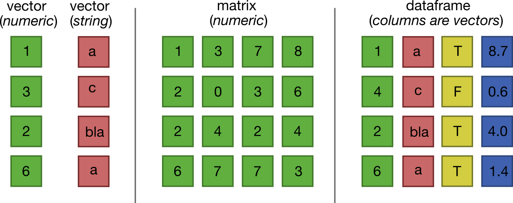
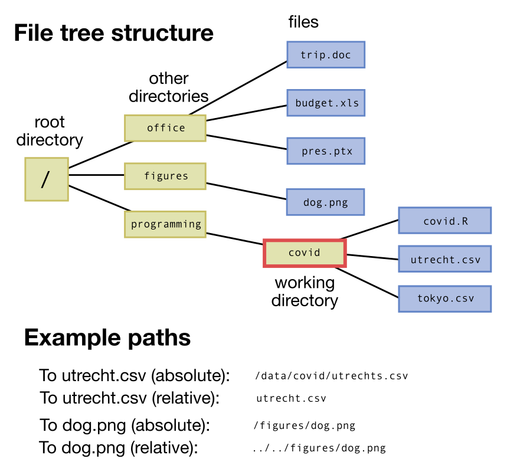

# Programmeren met R

## Typen variabelen

We hebben in het eerste onderdeel al een beetje kennis gemaakt met variabelen, door letters bepaalde numerieke waarden te geven (`a <- 2`, `b <- 9.5`, *etc*). Maar je kan in variabelen niet alleen nummers opslaan, maar ook een heleboel andere type gegevens. De meest belangrijke variabelen zijn:

-   *Numerics* (`1`, `2`, `3`, maar ook `2.158196` zijn *numeric*)

-   *Logicals* (`TRUE` en `FALSE`, ook wel `T`/`F` of `1`/`0`)

-   *Strings* (`"a"`, `"Hoi"`, of `"bananen zijn krom"`)

## Geen appels en peren vergelijken

In R kun je berekeningen uitvoeren, maar je kan natuurlijk geen appels en peren vergelijken. Bekijk bijvoorbeeld devolgende code:

```{r}
#| eval: false
appels <- 3
peren <- "groen"
appels + peren
```

Als je de bovenstaande code probeert uit te voeren, geeft R een foutmelding: `Error in appels + peren : non-numeric argument to binary operator`[^intro_r_day2-1]. Het is erg prettig dat R deze foutmelding geeft. Hoewel dit een overduidelijk onzinnige som is, kan het ook zijn dat je met de beste intenties een foutje maakt!

[^intro_r_day2-1]: Wat deze error precies betekent is niet belangrijk

## Data structuren

Het is vaak heel handig om je variabelen in lijsten of tabellen op te slaan. Dergelijke lijsten of tabellen worden meestal *data structures* genoemd. De meest belangrijke data structures in R zijn:

-   *Vectors* (lijst van elementen van hetzelfde type)

-   *Macrices* (tabel van elementen van hetzelfde type)

-   *Dataframes* (tabel waarin elke kolom een ander type data kan zijn)

{#fig-datastructures}

### Vectoren {#sec-vectoren}

Om een vector te maken, kunnen we deze handmatig intypen:

```{r}
#| eval: false
mijnvector <- c(1,2,0.1,-5)
mijnvector[1] # geeft het eerste getal
mijnvector[2] # geeft het tweede getal, etc
```

Maar handmatig getallen invoeren is niet altijd handig. Gelukkig kun je met R een boel lijstjes maken op een snellere manier automatisch genereren:

```{r}
#| eval: false

1:4                # 1, 2, 3, 4
5:2                # 5, 4, 3, 2
rep(2,4)           # 2, 2, 2, 2
seq(0,4.5,1.5)     # 0.0, 1.5, 3.0, 4.5
sample(1:6,4)      # 4, 6, 3, 5 (iedere keer anders!)
sample(letters,4)  # "f", "j", "o", "y" (iedere keer anders!)
runif(2)           # 0.9965360 0.8978062 (iedere keer anders!)
```

De laatste vijf regels van het bovenstaande script zijn voorbeelden van "functies". Een functie is een herhaalbaar blokje code die je aanroept met de naam (rep, seq, sample), gevolgd door haakjes met daartussen eventuele *argumenten*. De functie zet deze argumenten om in een zogeheete *return*-waarde, wat bijvoorbeeld een getal of een lijst getallen is. Je leert meer over functies in het onderdeel @sec-functies.

Je kan met vectoren ook rekenen. Zo kan je bijvoorbeeld twee vectoren bij elkaar optellen, of één en hetzelfde getal bij alle elementen van een vector optellen:

```{r}
#| eval: false
# Rekenen met vectoren
x <- 1:3           # 1, 2, 3
x + 10             # 11 12 13
y <- c(1, 10, 4)   # 1 10 4
x + y              # 2 12  7
x * y              # 1 20 12
x + y / 100        # 1.01 2.10 3.04
(x + y) / 100      # 0.02 0.12 0.07
```

In de bovenstaande code zie je een subtiel verschil tussen de laatste twee regels. Net als bij wiskunde gaan haakjes voor delen en vermedigvuldigen. Soms moet je dus goed aangeven in welke volgorde je de berekeninng wil uitvoeren!

### Matrices

Matrices in R kun je maken door de functie `matrix` aan te roepen, die je waarden van de matrix en het aantal rijen als argumenten geeft:

```{r}
#| eval: false
matrix(c(1, 2, 3, 4,5, 6, 7, 8, 9), nrow=3)
matrix(c(1, 2, 3, 4,5, 6, 7, 8, 9), nrow=3, byrow=T)
```

Zoals je ziet zijn er geen comments geplaatst bij deze twee regels. Voer de bovenstaande code zelf uit, en kijk naar de verschillende uitkomsten van de eerste en de tweede regel. Je kan de matrix ook vullen met andere waarden:

```{r}
#| eval: false
kansen_matrix <- matrix(runif(9),nrow=3) # willekeurige getallen tussen 0 en 1
percentage_matrix <- kansen_matrix*100   # de kansen matrix keer 100, dus percentages
letter_matrix <- matrix(sample(letters,9),nrow=3) # willekeurige letters
```

### Data frames

De laatste (en voor biologen meest belangrijke) data structuur in R is de data frame. In een dataframe bevat elke kolom een ander gegeven (naam, leeftijd, haarkleur), en is elke rij een apart observatie. Een dergelijke structuur is heel handig om wetenschappelijke data te verzamelen. Ook deze kun je weer handmatig invoeren:

```{r}
#| eval: false
biologen <- data.frame(naam=c("Lina","Yassin","Bram"),
                       leeftijd=c(19,18,80), 
                       haarkleur=c("Blauw","Groen", "Paars"))

```

::: {.content-visible when-format="html"}
```{r}
#| echo: false

biologen <- data.frame(naam=c("Lina","Yassin","Bram"),
                       leeftijd=c(19,18,80), 
                       haarkleur=c("Blauw","Groen", "Paars"))

library(DT)
library(datasets)
datatable(biologen, options = list(searching=F, pageLength = 3,lengthChange = FALSE, info=FALSE,paging=FALSE))
```
:::

<br>Als je deze dataset wil bekijken in Rstudio, kun je `View(biologen)` typen. Dit opent een tabblad waarin je de data kan verkennen en sorteren (voor grotere datasets is dit natuurlijk erg handig!).

Het natuurlijk meestal niet handig om handmatig data frames in te typen in R. In plaats daarvan kun je grote datasets vaak opslaan of downloaden in een groot tekstbestand, bijvooreeld in *comma-seperated-value* (csv) bestanden. Als je een dergelijk tekstbestand hebt, kun je deze inlezen met de functie `read.table` of `read.csv`:

```{r}
#| eval: false
covid_data <- read.csv("E:/Files/Covid.csv") # waar het bestand staat
head(covid_data) # bekijk de eerste 6 rijen
View(covid_data) # bekijk de hele tabel in Rstudio
```

::: {.content-visible when-format="html"}
```{r}
#| echo: false
library(DT)
library(datasets)
suppressMessages(library(here)) # Package required 
covid_data <- read.csv(here("Programmeren/COVID_testen_Utrecht.csv")) # waar het bestand staat
datatable(covid_data, options = list(searching=F, pageLength = 8))
```
:::

## Files, paden, en de 'working directory'

Om (zoals hierboven) een bestand in te kunnen lezen, moet Rstudio wel weten waar het bestand staat. Op computers staan alle bestanden in een hierachische structuur (zie bijvoorbeeld onderstaande Figuur). Hoewel je misschien gewend bent om door deze structuur van "mappen" te klikken met de muis, moet je in een script altijd precies vertellen waar het bestand staat. Standaard zoekt Rstudio vaak in de home directory van je besturingsysteem (`/Users/Naam` in MacOs, `C:/Users/UserName/Documents` in Windows). De directory vanuit waar Rstudio naar het bestand zoekt, heet de *Working Directory* (rood omlijnd in de figuur). Door de Working Directory goed in te stellen, hoef je niet elke keer het hele pad naar het bestand in te typen (dit heet het absolute pad), maar kun je korter omschrijven waar het bestand staat (dit heet het relatieve pad). Vaak is het dus handig om je Working Directory aan te passen naar dezelfde map waar je het script hebt opgeslagen, zodat je alle data, scripts, en grafieken een beetje bij elkaar kan houden. Dit kan je doen door, nadat je je script ergens hebt opgeslagen, te navigeren naar `Session > Set Working Directory > To Source File Location`.

{#fig-filesandpaths}

## Indexing

Nu je weet hoe je tabellen in kan lezen, is het belangrijk om te leren over "indexing". Indexing is het selecteren van specifieke waarden uit een vector, matrix, of dataframe. Dit doe je door de positie (index) van deze elementen tussen vierkante haakjes aan te geven:

```{r}
#| eval: false
jaartallen <- 2009:2024         # Jaren dat ik biologie "studeer"
jaartallen[6:9]                 # 2014 2015 2016 2017

m <- matrix(runif(9),nrow=3)    # Willekeurige getallen in een matrix
m[1,2]    # rij 1, kolom 2
m[1,]     # rij 1 volledig
m[,2]     # kolom 2 volledig
m[1:2,3]  # van rij 1 t/m 2, alleen de 3e kolom

biologen <- data.frame(naam=c("Lina","Yassin","Bram"),
                       leeftijd=c(19,18,80), 
                       haarkleur=c("Blauw","Groen", "Paars"))
biologen[1,2] # eerste rij, tweede kolom (leeftijd: 19)
```

Omdat in data frames de kolommen namen hebben, kun je ook deze gebruiken om specifieke datapunten te selecteren:

```{r}
#| eval: false
biologen[1,"leeftijd"] #identiek aan biologen[1,2], maar duidelijker wat je selecteert
```

Je kunt met dataframes ook met het dollar-teken een gehele kolom opvragen, een kolom bewerken, of een kolom toevoegen:

```{r}
#| eval: false
biologen$leeftijd
biologen$leeftijd <- biologen$leeftijd + 1  # Alle biolgen zijn 1 jaar ouder geworden
biologen$rol <- c("student","assistent","docent") # Een nieuwe kolom genaamd 'rol'
```

::: {.content-visible when-format="html"}
```{r}
#| echo: false
biologen <- data.frame(naam=c("Lina","Yassin","Bram"),
                       leeftijd=c(19,18,80), 
                       haarkleur=c("Blauw","Groen", "Paars")) 
library(DT)
library(datasets)
biologen$leeftijd <- biologen$leeftijd + 1  # Alle biolgen zijn 1 jaar ouder geworden
biologen$rol <- c("student","assistent","docent") # Een nieuwe kolom genaamd 'rol'

datatable(biologen, options = list(searching=F, pageLength = 3,lengthChange = FALSE, info=FALSE,paging=FALSE))
```
:::

## Functies, condities, en loops

### Functies en help-functie {#sec-functies}

In het onderdeel @sec-vectoren heb je al een aantal voorbeelden gezien van functies, herhaalbare blokjes code die je gemakkelijk kan aanroepen. Functie hebben een `input` (waarde(n) die je meegeeft als zogeheten *argumenten*), en `output` (waarde(n) die het terug geeft, de *return*-waarde). Er bestaan standaard in R een heleboel functies, waarvan je een aantal in deze cursus nog veel zal tegenkomen:

-   `read.csv`, leest comma-separated-values bestand in als dataframe
-   `print` of `cat`, geeft iets (variabelen of tekst) weer in de console
-   `plot`, om data te plotten in een grafiek
-   `length` geeft de lengte van een vector
-   `mean`, gemiddelde van een vector
-   `sd`, standaarddeviatie van een vector
-   `sum`, som van een vector
-   `min` geeft de kleinste waarde in een vector
-   `max` geeft de grootste waarde in een vector
-   `sort`, sorteert een vector

Er zijn nog veel meer standaard functies in R. Als je graag meer wil eten over hoe de functie werkt, kun je de naam van de functie typen met een `?` ervoor:

```{r}
#| eval: false
?mean
```

Dit geeft extra uitleg voor deze functie in het "Help" venster:

{#fig-helpinR}

### Zelf functies maken

Je kan ook zelf functies maken, als je bijvoorbeeld iets heel specifieks wil doen. Je moet hiervoor aangeven wat de argumenten zijn, welke berekening op basis van deze argumenten wordt uitgevoerd, en wat er door de functie wordt teruggegeven (de return-waarde). Hier is een voorbeeld:

```{r}
#| eval: false
# Definitie van de functie
som_kwadraten <- function(a, b) {
  resultaat <- a^2 + b^2
  return(resultaat)
}

# Voorbeeld gebruik van de functie
som_kwadraten(1,2)            # 5
som_kwadraten(3, 4)           # 25
som_kwadraten(0.5, 0.1)       # 0.26
```

Bij het definieren van de functie geven de gekrulde haken aan wat de zogeheten `scope` van de functie is: dit blokje code behoort alleen deze functie toe. Je ziet deze `scopes` ook terug wanneer je op bepaalde voorwaarden gaat toetsen, wat het volgende onderdeel zal uitleggen.

##Condities

Vaak is het handig om in een script te controleren of aan een bepaalde voorwaarde wordt voldaan. Hiervoor kun je `if`, `else`, en `else if` gebruiken:

```{r}
#| eval: false
leeftijd_student <- sample(16:19,1) # genereer willekeurige leeftijd tussen 16 en 19
if(leeftijd_student >= 18){
  print("Student is volwassen")
} else{
  print("Student is niet volwassen")
}
```

Om voorwaarden te controleren, gebruik je zoheten **conditionals**, die teruggeven of iets waar (`TRUE`) of niet waar (`FALSE`) is. Hierboven gebruiken we `>=` (groter dan of gelijk aan) om te controleren of de student minstens 18 jaar oud is. Veelgebruikte andere conditionals zijn:

-   `a == b` : TRUE als a gelijk is aan b

<!-- -->

-   `a != b` : TRUE als a niet gelijk is aan b

-   `a > b` : TRUE als a is groter is dan b

-   `a < b` : TRUE als a is kleiner is dan b

-   `a >= b` : TRUE als a is groter is dan of gelijk is aan b

-   `a <= b` : TRUE als a is kleiner is dan of gelijk is aan b

Daarnaast kun je eventueel meerdere condities combineren:

-   `a==b & b!=c` : TRUE als a gelijk is aan b en b **niet** gelijk is aan c

-   `a<b | b>c` : TRUE als a kleiner is dan b en b groter is dan c

Als laatste kun je nog veel meer combinaties controleren door `if`-`else` elkaar op te laten volgen en te nesten. Als we bijvoorbeeld twee dobbelsteenworpen simuleren, kunnen we precies controleren welke dobbelsteen hoger is dan 4, en een voor ieder scenario een unieke uitkomst maken:

```{r}
#| eval: false
d1 <- sample(1:6,1) # dobbelsteen 1
d2 <- sample(1:6,1) # dobbelsteen 2

if (d1 > 4) {
  if (d2 > 4) {
    print("d1 en d2 zijn hoger dan 4")
  } else {
    print("d1 is hoger dan 4, maar d2 niet")
  }
} else if(d2 > 4) {
  print("d1 is niet hoger dan 4, maar d2 wel")
} 
```

Let op: als je de bovenstaande code goed leest, zie je dat er helemaal **niets** gebeurt als geen van beide dobbelstenen groter dan 4 is.

## Loops

Hoewel functies het makkelijker maken om dezelfde berekening meerdere keren uit te voeren, wat nu als je een functie 100 keer wil aanroepen? Hebben we dan 100 regels nodig? Het antwoord is nee, want elke programmeertaal (dus ook `R`) heeft manieren om stukken code gemakkelijk te herhalen. In R bestaan veel verschillende manieren om dit te doen (`repeat`, `apply`, `while`), maar in deze introductie maken we vooral kennis met de meest-gebruikte loop in de programmeer-wereld: de for-loop.

Laten we bijvoorbeeld de exponentiele afname van paracetamol in het bloed beschrijven met een simpele \`\`simulatie''. Iemand neemt 400 milligram paracetamol in, wat ieder uur (ongeveer) met 70% afneemt:

```{r}
#| eval: false
p <- 400 # hoeveelheid paracetamol
d <- 0.7 # afname (d van decay)
# Herhaal iets 10 keer, waarbij 'i' steeds met 1 toeneemt
for(i in 1:10){
  p <- p*d
}
cat('Na 10 uur is er',p,'milligram paracetamol in het bloed') # 11.299 mg
```

Aan het einde van deze `for-loop` kunnen we kijken wat de waarde van p is door in de console `p` te typen.

```         
> p
[1] 11.29901
```

Zoals we eerder hadden besproken, staat de `[1]` voor het feit dat dit de eerste en enige waarde is die in de variable `p` is opgeslagen. We hebben nu dus alleen de \*\*laatste\* waarde bewaard. Wellicht willen we echter graag bijhouden hoeveel paracetamol er in elke stap aanwezig was, zodat we dat na onze loop kunnen plotten. Om dit te doen, kunnen we de `i` als index gebruiken om een vector te vullen:

```{r}
p <- 400 # hoeveelheid paracetamol
d <- 0.7 # afname (d van decay)
# Herhaal iets 10 keer, waarbij 'i' steeds met 1 toeneemt
for(i in 1:10){
  p[i+1] <- p[i]*d
}
plot(p, type='o')
```

Omdat dit voorbeeld om simpele exponentiele afname gaat, hadden we de bovenstaande berekening ook "in één keer" kunnen uitrekenen door $p \cdot d^{10}$ uit te rekenen. Laten we dat even controleren:

```{r}
#| eval: false
p <- 400 # hoeveelheid paracetamol
d <- 0.7 # afname (d van decay)
p*d^10 # 11.299 mg, dat klopt dus!
```

Dit antwoord komt inderdaad overeen met onze berekening met de `for` loop. Hoewel deze loop dus misschien wat onnodig lijkt, hebben we niet altijd zo'n simpele formule beschikbaar. Bovendien willen we wellicht iets veel specifiekers simuleren, bijvoorbeeld dat de persoon elke 12 uur opnieuw paracetamol inneemt:

```{r}
#| eval: true

p <- 400 # hoeveelheid paracetamol
d <- 0.7 # afname (d van decay)

for(i in 1:100){
  if(i%%12==0){ # is i precies deelbaar door 12?
    p[i] <- p[i] + 400
  } 
  p[i+1] <- p[i]*d
}
plot(p, type='o')
```

Of dat de persoon met 10% kans elk uur een paracetamol inneemt:

```{r}
#| eval: true

p <- 400 # hoeveelheid paracetamol
d <- 0.7 # afname (d van decay)

for(i in 1:100){
  if(runif(1)<0.1){ # is willekeurig getal (tussen 0 en 1) kleiner dan 0.1?
    p[i] <- p[i] + 400
  } 
  p[i+1] <- p[i]*d
}
plot(p, type='o')
```

## Grafieken plotten met R

Om de bovenstaande plot van de paracetamol afname iets vollediger en mooier te maken, kunnen we meer argumenten aan de plotfunctie toevoegen:

```{r}
#| eval: true

p <- 400 # hoeveelheid paracetamol
d <- 0.7 # afname (d van decay)

for(i in 1:100){
  if(runif(1)<0.1){ # is willekeurig getal (tussen 0 en 1) kleiner dan 0.1?
    p[i] <- p[i] + 400
  } 
  p[i+1] <- p[i]*d
}
plot(p, type='l', lwd=2, col="purple", xlab="Tijd (uren)", ylab="Paracetamol in bloed")
legend(70, max(p), legend=c("Paracetamol"), col=c("purple"),lty=1,lwd=2)
```

Er zijn binnen R nog veel meer manieren om data te plotten, zoals bijvoorbeeld de `boxplot` die je bij het onderdeel statistiek zeker nog tegen zal komen. Daarnaast zijn er in R veel packages beschikbaar kunnen helpen bij het maken van mooie grafieken, zoals [ggplot](https://ggplot2.tidyverse.org/), maar daar gaan we in deze cursus niet dieper op in.
