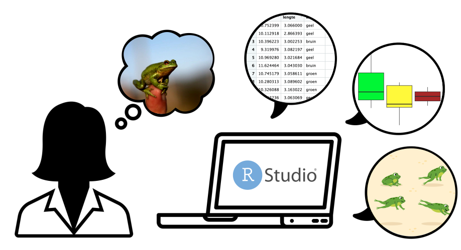

# Introductie en installatie {#sec-introductieR}

Biologie in de 21e eeuw vereist analyse van grote hoeveelheden data, en modellering om complexe biologische systemen beter te begrijpen en te voorspellen. In dit eerste onderdeel leer je de basisprincipes van R, waarmee we gedurende de cursus modellen bouwen, data analyseren en grafieken maken.

{#fig-phrogs}

## Beginnen met Rstudio

{width="60%" fig-align="center"}

Er bestaan heel veel verschillende programmeertalen. Misschien heb je weleens gehoord van Python, C, of Javascript. Het analyseren van grote datasets wordt door biologen echter veelal in de programmeertaal R gedaan, omdat deze makkelijk te installeren is en door het grote aantal gebruikers er op internet veel hulp te vinden is. Hiervoor gebruiken we het programma Rstudio, waarin we op een georganiseerde manier met R-code kunnen werken. Maar eerst moeten we wel nog even **R zelf** installeren. 

## R zelf installeren

R kun je eenvoudig installeren. Het is te vinden op de [CRAN website](https://cran.r-project.org/), en de instructies voor Mac en Windows gebruikers zijn daar ook te vinden:

- Windows-gebruikers: ga naar "Download R for Windows", klik op de link "base" en vervolgens op de link "Download R x.x.x for Windows" om het installatiebestand te downloaden. Open het gedownloade `.exe` bestand en volg de instructies om R te installeren.
- Mac-gebruikers: "Download R for (Mac) OS X". Download het juiste installatiebestand voor jouw macOS-versie (let op: als je een oudere Mac gebruikt moet je de "Intel Mac" versie downloaden). Open het .pkg bestand en volg de instructies.

## R-studio installeren

Nadat je R geïnstalleerd hebt, kun je Rstudio installeren. Deze downloaden we vanaf de [website van Rstudio](https://posit.co/download/rstudio-desktop/). Deze website legt ook uit dat je wel eerst R moet installeren, maar dat hebben we al gedaan. We kunnen dus meteen naar stap 2: Install Rstudio. De website herkent vanzelf welk besturingssysteem je gebruikt, dus hoef je het alleen nog maar te installeren:

-   Windows-gebruikers: volg de instructies van de installatie-wizard
-   Mac-gebruiker: open de .dmg en sleep "Rstudio" naar je Applications folder

Nu kun je Rstudio opstarten, en zou alles moeten werken[^intro_r_day1-1]

[^intro_r_day1-1]: In een enkel geval kan Rstudio de installatie van R niet automatisch vinden. Ga dan naar 'Tools' \> 'Global options', en dan naar het tabblad 'General'. Hier kan je handmatig instellen waar R geïnstalleerd staat. Vraag waar nodig hulp van je student-assistent (of ChatGPT ;\])

## Je eerste script

Nu je Rstudio hebt opgestart, gaan we eerst een nieuw script aanmaken. Ga hiervoor naar `File -> New file -> R script` (`Ctrl/Cmd+Shift+N`). Nu opent zich een nieuw venster, met daar in een `script` zonder naam. Sla dit lege script op en geef het script een logische naam (in plaats van de standaardnaam 'Untitled1'). Zo kan je het later makkelijk terug vinden en overschrijf je minder makkelijk per ongeluk je scripts. Maar wat is een script eigenlijk?

Een script is vergelijkbaar met een recept: het bevat de instructies om een gerecht te koken, maar niet de ingrediënten of het gerecht zelf. De instructies om het gerecht te produceren staan in het zogeheten "plain text" bestandsformaat. Dit betekent dat de tekst geen vetgedrukte woorden, cursief, onderstrepingen, kleuren of speciale lettertypes bevat. Naast een R-script met een set instructies, kan plain tekst ook data beschrijven, bijvoorbeeld met elke regel een observatie. In het geval van een script, bevat elke regel hoogstens één instructie. De code kan regel-per-regel worden uitgevoerd, of in één keer.

Kopieer voor het volgende onderdeel de volgende code naar je eigen script:

```{r}
#| eval: false
1+2
1+2-3
1+2-3*4/5
```

## Script en console

Rstudio is standaard opgedeeld in verschillende vensters (zie @fig-rstudiolayout). Om een regel code uit te voeren, klik je in het script-venster (linksboven) op de desbetreffende regel (niet selecteren, maar gewoon ergens in de regel klikken), en gebruik je de knop `Run` (de sneltoets hiervoor is `Ctrl/Cmd+Enter`, wat heel handig is om in je vingers te krijgen!). Als je dit met de eerste regel doet, springt Rstudio door naar de tweede regel. Als je dus nog een keer `Ctrl/Cmd+Enter` drukt, voert deze de tweede regel code uit, dan de derde regel, *etc.*. 

Als je de eerste regel code uitvoert, zie je in de console (onder het script) het "antwoord" staan: `[1] 3`. Dit antwoord noemen we in de programmeerwereld meestal de `return-value`: wat geeft de berekening terug? De `[1]` geeft aan dat dit de eerste waarde is die de berekening heeft gegeven. Omdat je maar 1 berekening hebt (1+2) gevraagd, is dit dus ook het enige waarde. Later zul je zien dat een berekening ook meerdere waarden terug kan geven. Je kan ook het hele script in één keer uitvoeren door op `Source` te klikken (of `Ctrl/Cmd+Shift+Enter`). Als je dit doet, zul je zien dat er regel voor regel antwoord wordt gegeven op de sommetjes. 

{#fig-rstudiolayout width="90%" fig-align="center"}

De bovenstaande uitleg geeft aan hoe je het script (het "recept") uit kan voeren, maar vaak wil je even snel iets uitproberen of uitrekenen voordat je het recept helemaal overhoop gooit. Hiervoor kun je direct in de console typen (linksonderin in @fig-rstudiolayout). Als je bijvoorbeeld de berekening `81/250` in de console typt, heb je gauw een antwoord op je vraag maar is je script niet aangepast. De console is dus handig om even gauw wat uit te rekenen, maar let op: dit wordt natuurlijk niet opgeslagen als je het script opslaat!

## Rekenen met R

Zoals je nu misschien begrijpt, is R een geweldig krachtige rekenmachine! In plaats van alles handmatig uit te rekenen of in je grafische rekenmachine in te typen, kunnen we onze eigen R-scripts maken die berekeningen eenvoudig en reproduceerbaar maken. Om dit nog makkelijker te maken, kunnen we gebruik maken van variabelen. Variabelen zijn waarden die we opslaan onder een bepaalde noemer, bijvoorbeeld 'a', 'b', of 'c':

```{r}
#| eval: false

# a, b, en c waardes toekennen (assigning variables)
a <- 1
b <- 3
c <- 2.5

# rekenen met a, b, en c
a+b-c # a plus b min c
a*b  # a keer b
a/b  # a gedeeld door b
b*b  # b keer b
b^3  # b tot de macht 3 
sqrt(b) # wortel (square root) van b

# andere manieren om variabelen te definieren
3 -> d
e = 2.5

# een uitgebreider sommetje uitrekenen
d/e+d*(c+d)

# deze som kunnen we ook weer opslaan in een variabele
uitkomst <- d/e+d*(c+d)
```

## Comments {#sec-environment}

In de bovenstaande code zie je meerdere regels met een hekje (#) ervoor. Alle tekst na een hekje wordt door R genegeerd, zodat we in onze code opmerkingen kunnen plaatsen. Deze opmerkingen heten in het Engels *comments*. In de code die je te zien krijgt in deze cursus, proberen we zoveel mogelijk comments te plaatsen om uit te leggen hoe de code werkt. 

## De "Environment"

Variabelen die je definieert worden opgeslagen in de **Environment** (rechtsboven in @fig-rstudiolayout). Op dezelfde manier dat een script een soort "recept" is, is de **Environment** een soort "keukentafel": hier komen al je ingrediënten te liggen. Alle ingeladen gegevens, berekeningen, en grafieken blijven opgeslagen totdat je Rstudio afsluit. Let op: ook de stapjes die je met de console hebt gedaan komen op deze keukentafel terecht, maar als je wil dat iemand anders het gerecht kan maken moet je zorgen dat deze stapjes ook in het **recept** (dus het script) staan! Het script is namelijk in veel gevallen het enige wat we zullen opslaan. Zo kunnen we de volgende keer ons script opnieuw uitvoeren, of ons script met andere onderzoekers delen. Nogmaals: als je de volgende keer Rstudio opstart, begin je met een lege Environment. In de kook-analogie begin je dus opnieuw met koken, en begint de keukentafel weer helemaal leeg! Bij het afsluiten van Rstudio krijg je echter de vraag of je de 'R sessie' wil opslaan. Als je dit doet, dan laad Rstudio bij het opstarten wél weer de environment in, en wordt je keukentafel dus precies zoals je hem had achtergelaten.

## Plots/Help en meer

Het laatste window in Rstudio (rechtsonderin) wordt voornamelijk gebruikt om grafieken (plots) weer te geven en voor de hulp-functie binnen Rstudio. Er zijn ook nog vele andere tabbladen, maar daar zullen we in deze cursus geen aandacht aan besteden. 

## Weergave van code en resultaten

Met programmeren produceren we code en resultaten. Om dat onderscheid duidelijk te maken, gebruikt dit cursusboek twee verschillende stijlen voor deze onderdelen. R-code ziet er zo uit:

```{r}
#| eval: false
# definieer een waarde voor x en y
x <- 10
y <- 9
# Met 'cat' kunnen we tekst en berekeningen aan elkaar plakken
cat("De som van x en y is:", x+y, "en x min y is:", x-y, "\n... einde berekening!")
```

De resultaten van code worden zo weergegeven:

```{r}
#| eval: true
#| echo: false

x <- 10
y <- 9
cat("De som van x en y is:", x+y, "en x min y is:", x-y, "\n... einde berekening!")

```

Soms staat er ook een stukje code midden in een regel. `Dat ziet er zo uit`. 

## Opgaven

Om deze opgaven te maken, moet je eerst Rstudio installeren. Nadat je dat gedaan hebt, en de rest van de informatie op deze pagina hebt begrepen, kun je aan de slag!

:::{.Rexr #exr-rekenenmetR}

## Rekenen met R 

<br>

Maak een nieuw (leeg) Rscript in Rstudio, en voer de volgende berekeningen uit:

  a.  Definieer a=2, en reken uit wat $a \cdot a \cdot a$ is. Reken ook eens uit wat $a^3$ is.
  b.  Definieer nu b=9.5 en reken uit wat $b^{19}$ is (let op: je hoeft niet 19 keer b te typen)
  c.  Stel je zet eerst 3 stappen naar links (laten we deze afstand $a$ noemen), dan 4 stappen naar voren (laten we deze $b$ noemen), en loopt vervolgens in een rechte lijn terug naar je beginpositie. Schrijf een script met R die uitrekent hoe ver je in totaal hebt gelopen. Zorg dat **de uitkomst** van je berekening **niet** in de environment staat, maar slechts in de console wordt weergegeven (met andere woorden, definieer geen nieuwe variabele!).
  d.  Bereken nu uit hoever je gelopen zou hebben als je in plaats hiervan 5 stappen naar links en 6 stappen naar boven had gezet. Zorg dit keer dat de uitkomst **wel** in de environment staat onder de naam "afstand". Voeg de onderstaande regel code toe aan het eind van je script (hint: er is een knop om de code te kopiëren!). Voer je script uit. Hoeveel stappen heb je gelopen? Sla je script op onder de naam `Pythagoras.R`.

```{r}
#| eval: false
#| echo: true

print(paste('Je hebt', afstand, 'stappen gelopen'))
```
:::

:::{.Rexr #exr-rekenenmetR2}

# Meer rekenen met R 

<br>

Maak deze vraag direct nadat je de vorige vraagt hebt gedaan (zonder Rstudio opnieuw op te starten). Maak wel een *nieuw* (leeg) Rscript aan.  

a. Bereken met R wat a+10 is. Bereken ook d+10 uit. Leg het verschil in de uitkomsten uit. 
b. Gebruik de console (niet je script!) om $d$ op 0 te zetten. Bereken nu de breuk $a \over d$ in de console. In de console zal de uitkomst dan weergegeven worden na `[1]`, wat betekent dat dit de eerste (in dit geval, de enige) uitkomst is (een breuk heeft immers maar één waarde). Wat is de uitkomst van deze breuk?
c. Zet nu $d$ op 0.001. Bereken wederom de breuk $a \over d$, en de breuk $a \over d^2$. Leg aan de hand van deze uitkomsten je antwoord in **b.** uit. 

:::


