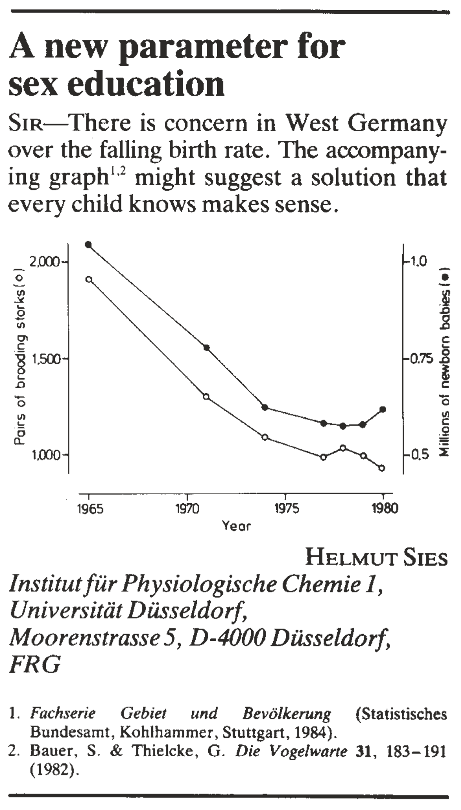



```{r}
#| eval: true
#| echo: false
#| output: false

source("_stat_setup.R")

```

# Associaties, causaliteit, en experimenten {#sec-associaties}

Kan het eten van vlees darmkanker veroorzaken?
Hangt het aantal nakomelingen van koolmezen samen met het moment waarop 
de eieren worden gelegd?
Vergroot dagelijks gebruik van sociale media 
de kans op angstklachten of depressie?
Draagt een verhoging van importtarieven bij aan inflatie?

Veel vragen binnen de biologie en daarbuiten
gaan over de samenhang, relaties---oftewel **associaties**---tussen variabelen.
Vaak willen we bovendien weten of de ene variabele de andere beïnvloedt. 
In dat geval spreken we over **oorzakelijke** of **causale** verbanden.

Wat is het verschil tussen associaties en causale verbanden?
Waarom is het moeilijk om verstandige conclusies te trekken over oorzaak en gevolg?
En hoe kunnen we met goed geplande experimenten 
toch aantonen dat er een oorzakelijk verband bestaat tussen variabelen?

Dat zijn de thema's van dit hoofdstuk.

## Leerdoelen

Na het bestuderen van dit hoofdstuk kun je:

- uitleggen wat een associatie is tussen variabelen;
- uitleggen op welke manieren associaties kunnen ontstaan;
- causale diagrammen lezen, maken, en interpreteren;
- uitleggen wat confounders en collider zijn en hoe ze associaties kunnen beïnvloeden,
  en ze identificeren in causale diagrammen;
- uitleggen waarom het moeilijk is om oorzakelijke verbanden aan te tonen op 
  basis van observationele data;
- beschrijven hoe experimenten wél oorzakelijke verbanden
  kunnen aantonen;
- de eigenschappen van een gerandomiseerd gecontroleerd experiment opnoemen,
  en uitleggen waarom die eigenschappen belangrijk zijn om oorzakelijke verbanden 
  aan te tonen;
- uitleggen waarom blinderen belangrijk kan zijn om waarnemersbias te voorkomen;
- uitleggen wanneer *Regression to the mean* kan optreden
  en waarom een geschikte controlegroep nodig is om dat te ondervangen;
- uitleggen wat het placebo-effect is, en waarom dat vaak wordt verward
  met *Regression to the mean*.

## Associaties tussen verschillende typen variabelen

Twee variabelen zijn geassocieerd
als de waarde van de ene variabele informatie geeft over de waarde van de andere.
Roken en longkanker zijn geassocieerd omdat
rokers vaker longkanker krijgen.
Als je leert dat iemand rookt, 
leer je dus ook iets over diens kans op longkanker.

### Associaties tussen een continue variabele en een categorische variabele

Variabelen die geassocieerd zijn
hoeven niet van hetzelfde type te zijn.
Zo kan een numerieke variabele
geassocieerd zijn met een categorische variabele.
Daarvan zijn we in @sec-toetsen-gemiddelden al voorbeelden tegengekomen.
In @sec-t-toets-twee-steekproeven gebruikten we een $t$-toets voor twee onafhankelijke steekproeven
om aan te tonen dat het gemiddelde gewicht van de bonte manakin 
(*manacus manacus*) verschilt tussen de geslachten.
In andere woorden, `gewicht` (continu) 
hangt samen met `geslacht` (nominaal).
Je kunt de $t$-toets voor twee onafhankelijke steekproeven 
dus zien als een methode om de samenhang te beoordelen tussen een continue variabele 
en een categorische variabele met twee niveaus.

### Associaties tussen twee continue variabelen

Natuurlijk kunnen twee continue variabelen ook geassocieerd zijn.
In @exm-gewicht-lengte bekijken we een voorbeeld uit de NHANES-dataset.

::: {#exm-gewicht-lengte}
### Samenhang tussen lichaamsgewicht en lengte in de NHANES-data

In de NHANES-dataset is van de meeste deelnemers de lichaamslengte en het lichaamsgewicht gegeven. 
Zou er een verband zijn tussen lichaamslengte en gewicht?
We onderzoeken het door die variabelen tegen elkaar uit te zetten
in een spreidingsdiagram (@fig-gewicht-lengte). 

Er is duidelijk een trend te zien: langere mensen zijn gemiddeld
zwaarder. 
Maar mensen met dezelfde lichaamslengte kunnen sterk verschillen in gewicht.
Aan de vorm van de grafiek kun je zien dat dit
sterkst geldt voor lange mensen (>150cm; hoofdzakelijk volwassenen).

Merk ook op dat de trend geen rechte lijn is:
gewicht neemt sneller dan lineair toe met lichaamslengte.

```{r}
#| code-fold: true
#| warning: false
#| fig.cap: "Lichaamsgewicht uitgezet tegen lichaamslengte (NHANES-dataset)."
#| label: fig-gewicht-lengte
#| fig.width: 4.5
#| fig.height: 3.5
#| out.width: "64%"

data(NHANES)


ggplot(
  data = NHANES, 
  aes(x = Height, y = Weight)
) +
  geom_point(
    color = puntkleur1,
    alpha = 0.5
  )+
  labs( x = "Lichaamslengte (cm)", y = "Gewicht (kg)") +
  theme_minimal()

```
:::

Wanneer twee continue variabelen met elkaar samenhangen
zeggen we ook wel dat ze **gecorreleerd** zijn.
Meestal wordt dan bedoeld dat de variabelen *lineair* met elkaar samenhangen
(in @sec-linrel gaan we het specifiek over lineaire relaties hebben),
maar soms worden ook andere verbanden bedoeld. 
In de volksmond wordt het woord correlatie soms ook gebruikt
voor een samenhang tussen categorische variabelen,
maar in de statistiek is het woord gereserveerd voor samenhang tussen numerieke variabelen.

### Associaties tussen twee categorische variabelen

Ook categorische variabelen kunnen met elkaar samenhangen.
We leggen dat weer uit aan de hand van een voorbeeld.

::: {#exm-mosaic}
## Hangt woontoestand samen met gezondheidstoestand?

In de NHANES dataset is van iedere onderzochte persoon ook opgenomen wat
diens *woontoestand* is.
We vragen ons af: 
hangt iemands woontoestand samen met diens gezondheidstoestand?

Woontoestand is opgeslagen in de variabele `HomeOwn`, 
een factor met niveaus *Koopwoning*, *Huurwoning*, en *Overig*.
De variabele gezondheidstoestand (`HealthGen`)
hadden we in @tbl-gezondheid al bekeken.
Dit is ook een factor, met niveaus
*Slecht*, *Matig*, *Goed*, *Zeer Goed*, en *Uitstekend*. 

Om de samenhang te onderzoeken, maken we eerst
een **kruistabel**. Een kruistabel is
een tabel die voor iedere combinatie van niveaus
het aantal waarnemingen toont.

```{r}
#| code-fold: true
#| warning: false
#| 
# samenhang gezondheidstoestand en woontoestand

# Vertaal de niveaus van HomeOwn naar het Nederlands
NHANES$HomeOwn <- factor(
  NHANES$HomeOwn,
  levels = c("Other", "Rent", "Own"),
  labels = c("Overig", "Huurwoning", "Koopwoning"),
  ordered = TRUE
)

# Vertaal de niveaus van HealthGen naar het Nederlands
NHANES$HealthGen <- factor(
  NHANES$HealthGen,
  levels = c("Poor", "Fair", "Good", "Vgood", "Excellent"),
  labels = c("Slecht", "Matig", "Goed", "Zeer Goed", "Uitstekend"),
  ordered = TRUE
)

# Genereer de kruistabel voor HealthGen en HomeOwn
kruistabel <- table(
  NHANES$HealthGen,
  NHANES$HomeOwn
)

# Geef de kruistabel weer in een nette tabel
kable(
  t(kruistabel),
  caption = "Kruistabel van gezondheidstoestand en woontoestand."
)

```

De getallen in de kruistabel zijn lastig te overzien
en geven niet direct een beeld van de samenhang tussen de variabelen.
Daarom geven we de kruistabel weer met een **mozaïekplot**:

```{r}
#| code-fold: true
#| warning: false
#| fig.cap: "Mozaïekplot: Samenhang tussen woontoestand en gezondheidstoestand"
#| label: fig-mozaiek
#| fig.width: 7
#| fig.height: 4.5
#| out.width: "100%"

kleuren <- c(opvulkleur2, opvulkleur1, opvulkleur)

mosaicplot(
  kruistabel, 
  col = kleuren, 
  main = NULL,
  xlab = "Gezondheidstoestand",
  ylab = "Woontoestand"
  )
```

Uit deze mozaïekplot kun je verschillende dingen aflezen.
De breedte van de kolommen geeft de frequentie weer 
van de verschillende niveaus van gezondheidstoestand.
Binnen de kolommen laten de hoogtes van de blokken
voor iedere gezondheidstoestand
de relatieve frequenties zien van de verschillende woontoestanden.
Die verschillen niet drastisch per niveau van gezondheidstoestand,
maar het lijkt erop dat de oranje blokken van links naar rechts wel hoger worden.
Dat suggereert dat gezondere personen vaker een huis bezitten.
Alleen de categorie "Slecht" past niet helemaal in die trend,
  al zou steekproefvariabiliteit in die kleine categorie een rol kunnen spelen.

Om te beoordelen of de twee variabelen daadwerkelijk samenhangen
zouden we eigenlijk een statistische toets moeten uitvoeren.
Een geschikte toets is de $\chi^2$-toets voor onafhankelijkheid;
helaas hebben we in deze cursus geen tijd om die te behandelen.

Over de oorzaken van deze samenhang kunnen we alleen maar speculeren.
Maar een slechte gezondheid
en hoge medische kosten
kunnen wellicht van invloed zijn op iemands mogelijkheden
om een huis te kopen.

:::

## Oorzaken van associaties

Als twee variabelen geassocieerd zijn,
willen we graag weten hoe dat komt.
Welke mechanismen zijn verantwoordelijk voor die associatie?
In de praktijk is dat vaak moeilijk te achterhalen,
omdat variabelen op allerlei manieren met elkaar verweven kunnen raken.

Een directe manier waarop variabelen geassocieerd kunnen raken
is als ze elkaar beïnvloeden---een **oorzakelijk** of **causaal verband**.
Roken en longkanker zijn bijvoorbeeld geassocieerd doordat roken kanker *veroorzaakt*.

Het is heel waardevol om te weten dat dit verband
oorzakelijk is, 
want dat betekent dat we longkanker kunnen voorkomen
door te stoppen met roken.
Als je niet weet wat iets veroorzaakt, 
weet je ook niet hoe je het moet bestrijden.

Maar als twee variabelen geassocieerd zijn,
wil dat nog niet zeggen dat er een causaal verband bestaat tussen die variabelen.
Bijvoorbeeld:
het aantal regenpakken in het straatbeeld 
is geassocieerd met het aantal paraplu's,
maar regenpakken veroorzaken geen paraplu's,
en paraplu's geen regenpakken.
Maatregelen tegen het gebruik van paraplu's
zullen dus ook niets veranderen aan het aantal regenpakken.

### Causale diagrammen

Een nuttig hulpmiddel bij het denken over associaties en causale relaties
is een **causaal diagram**.
Een eenvoudig voorbeeld van een causaal diagram is het volgende figuur:

::: {#fig-CD style="width: 60%; margin: auto;"}

```{mermaid}

graph LR;
  A([roken]) --> B([longkanker])
```

Een eenvoudig causaal diagram dat stelt dat roken longkanker veroorzaakt.
:::

In een causaal diagram worden de namen van variabelen verbonden met pijlen
als we vermoeden dat die variabelen elkaar causaal beïnvloeden. 
Het voorbeeld van @fig-CD is  eigenlijk de weergave van een *model*
dat stelt dat er een causaal verband is
tussen roken en longkanker.
Zoals ieder model is het diagram een vereenvoudiging van de werkelijkheid,
in dit geval omdat allerlei andere relevante variabelen zijn weggelaten.

:::: {#exm-zelfbeeld}
## Leidt een positief zelfbeeld tot succes?

Zelfs als we vermoeden dat twee variabelen een causaal verband hebben,
is het niet altijd vanzelfsprekend 
in welke richting de pijl wijst.
Dit voorbeeld illustreert dat met een concreet voorbeeld.

In de jaren 1980 en 1990 ontdekten onderzoekers dat mensen met
een positief zelfbeeld vaak succesvoller zijn in het leven. Dit leidde tot
beleidsmaatregelen die gericht waren op het verhogen van de zelfwaarde
bij kinderen, in de hoop dat dit ze succesvoller zou maken.

Maar is het vanzelfsprekend dat de pijl van `zelfwaarde` naar `success`
loopt? Het lijkt ook logisch dat succes op school, in sport, of in het sociale leven kan bijdragen aan een positief zelfbeeld. 
Dat suggereert dat de pijl de andere kant op staat.

::: {#fig-welk-diagram layout="[[1,1,1]]" out.width="100%" fig.align="center"}

```{mermaid}
%%| label: fig-welk-diagram-a

graph TD;
  A([zelfwaarde]) --> B([succes])
```

```{mermaid}
%%| label: fig-welk-diagram-b

graph TD;
  A([succes]) --> B([zelfwaarde])
```

```{mermaid}
%%| label: fig-welk-diagram-c

graph TD;
  A([succes]) --> B([zelfwaarde])
  B([zelfwaarde]) --> A([succes]) 
```

Welk causaal diagram weerspiegelt de werkelijkheid het beste?
:::

Het verschil tussen de modellen is van cruciaal belang 
voor ouders, beleidsmakers en scholen. 
Als zelfbeeld het gevolg is van succes (en niet andersom)
dan helpt het niet om zelfvertrouwen kunstmatig te bevorderen
en kan wellicht beter worden ingezet op kennis en vaardigheden.

Interessant? In de referentie in de voetnoot[^associatiestussenvariabelen-1].

[^associatiestussenvariabelen-1]: Orth, Ulrich, and Richard W. Robins.
    “Is High Self-Esteem Beneficial? Revisiting a Classic Question.” The
    American Psychologist 77, no. 1 (January 2022): 5–17.
    https://doi.org/10.1037/amp0000922.
:::

:::{#exr-transcriptiefactoren .pepexr}
## Gen-expressie en transcriptiefactoren
<br>

Stel dat je onderzoek doet naar het metabolisme van een bepaalde bacterie.

Om te achterhalen welke genen gereguleerd worden door een transcriptiefactor TF,
maak je gebruik van genexpressiedata.
Het valt je op dat als TF een hoge expressie heeft,
gen X dat vaak ook heeft.

a.  Welk van de onderstaande causale diagrammen ligt voor de hand?

::: {#fig-welk-diagram-2 layout="[[1,1,1]]"  out.width="100%" fig.align="center"}

```{mermaid}
%%| label: fig-welk-diagram-2-a

graph TD;
  A([TF]) --> B([X])
```

```{mermaid}
%%| label: fig-welk-diagram-2-b

graph TD;
  A([X]) --> B([TF])
```

```{mermaid}
%%| label: fig-welk-diagram-2-c

graph TD;
  C([Een andere variabele]) --> B([TF])
  C --> A([X])
```

Welk causaal diagram ligt het meest voor de hand? 
De variabele `TF` staat voor de expressie van de transcription factor,
en `X` voor de expressie van het gen.
:::
    
b.  Kun je je situaties voorstellen waarbij de andere diagrammen van toepassing zijn?

:::

### Causale ketens

Associaties kunnen ook 
ontstaan tussen variabelen die in het causale diagram alleen indirect verbonden zijn.
Een eenvoudig voorbeeld is een **causale keten**:

::: {#fig-causale-keten fig-align="center"}

```{mermaid}

graph LR;
  A([roker]) --> B([longkanker]) --> C([levensduur])
```

Roken kan geassocieerd raken met levensduur via longkanker.
:::

Hier raakt roken geassocieerd met levensduur
omdat roken longkanker veroorzaakt, en longkanker mortaliteit.

In het algemeen:
als een keten van pijlen (die dezelfde kant op staan)
variabele $A$ met variabele $B$ verbindt
dan valt te verwachten dat er een (indirecte) causale relatie bestaat tussen $A$ en $B$.
Beide variabelen kunnen daardoor geassocieerd zijn, 
en het manipuleren van $A$ kan dan effect hebben op $B$.

### Confounding: associaties veroorzaakt door een gezamenlijke oorzaak

Variabelen kunnen ook geassocieerd zijn 
  zonder via een causale keten aan elkaar verbonden te zijn.
Er is dan dus wel een associatie of correlatie,
  maar de variabelen beïnvloeden elkaar niet oorzakelijk,
  en manipulatie van de één heeft geen effect op de ander.

::: {#exm-ijs}

## Veroorzaken ijsjes verdrinkingen? Of is het andersom?

Bekijk @fig-ijs hieronder eens. 
De figuur is gebaseerd op Amerikaanse cijfers uit 2019,
maar andere jaren laat een vergelijkbaar beeld zien.[^cijfersijs]
In die grafiek is voor iedere maand het aantal sterfgevallen door verdrinking
uitgezet tegen... de verkoopcijfers van ijsjes?!?!

[^cijfersijs]: Versies van deze figuur zijn op veel plekken op het internet te vinden. Wij hebben deze variant voor het jaar 2019 zelf samengesteld.
    De verdrinkingscijfers zijn op 4 februari 2025 gedownload van de [National Safety Council](https://injuryfacts.nsc.org). De ijsverkoopcijfers komen van [www.kaggle.com](www.kaggle.com); de oorsprong van de getallen is niet duidelijk.

```{r}
#| code-fold: true
#| warning: false
#| fig.cap: "Samenhang tussen ijsverkoop en verdrinkingen in de VS (cijfers voor 2019)."
#| label: fig-ijs
#| fig.width: 7
#| fig.height: 5
#| out.width: "95%"
#| 
# Inlezen van gegevens
verdrinkingen <- read_csv("data/drowning.csv")
ijsverkoop <- read_csv("data/ice_cream.csv")

# Splits datum in jaar, maand en dag
ijsverkoop$JAAR  <- as.numeric(format(ijsverkoop$DATE, "%Y"))
ijsverkoop$MAAND <- as.numeric(format(ijsverkoop$DATE, "%m"))
ijsverkoop$DAG   <- as.numeric(format(ijsverkoop$DATE, "%d"))

# Selecteer alleen gegevens uit 2019
ijsverkoop_2019 <- subset(ijsverkoop, JAAR == 2019)
verdrinkingen_2019 <- subset(verdrinkingen, Year == 2019)

# Samenvoegen van gegevens in een nieuw data frame
gegevens <- data.frame(
  ijsverkoop = ijsverkoop_2019$IPN31152N,
  verdrinkingen = verdrinkingen_2019$Drowning,
  maand = c("januari",
            "februari",
            "maart",
            "april",
            "mei",
            "juni",
            "juli",
            "augustus",
            "september",
            "oktober",
            "november",
            "december")
)

# Visualisatie met ggplot2
ggplot(gegevens, aes(x = ijsverkoop, y = verdrinkingen, 
                     label = maand)) +
  geom_point(color = puntkleur1, size = 2) +
  geom_text(vjust = 1.7, hjust = 0.4) +
  theme_minimal() +
  labs(
      x = "aantal verkochte ijsjes (x 1000)",
      y = "aantal verdrinkingen"
      ) +
  coord_cartesian(xlim = c(70, 130), ylim = c(100, 700))
```

De figuur laat een positieve associatie zien.
Vooral in de zomermaanden mei, juni, juli en augustus
  zijn de cijfers verontrustend:
  de ijscoman doet dan goede zaken,
  maar helaas verdrinken er in die periode ook erg veel mensen.
Is het tijd om ijsjes te verbieden?

Er is natuurlijk een veel betere verklaring.
Deze variabelen zijn gecorreleerd 
  als gevolg van één of meerdere **gezamenlijke oorzaken**.
Een gezamenlijke oorzaak is een variabele
  die beide variabelen beïnvloedt;
  andere woorden hiervoor zijn **confounder** of **lurking variable**.
Een belangrijke factor is waarschijnlijk de variabele `gemiddelde dagtemperatuur`. 
De warmte tijdens de zomermaanden leidt tot een grotere behoefte aan ijs,
maar ook tot meer recreatie in en rond het water,
en dat laatste kan leiden tot hogere verdrinkingscijfers.^[Andere factoren spelen mogelijk ook mee. Bijvoorbeeld, zowel `ijsverkoop` als `waterrecreatie` zijn wellicht hoger in vakantieperiodes.]
Dit eenvoudige model is weergegeven in het causale diagram @fig-causaal-ijs hieronder:

::: {#fig-causaal-ijs style="width: 60%; margin: auto"}

```{mermaid}
graph TD;
  Z([maand]) --> A([gemiddelde dagtemperatuur]) --> B([waterrecreatie]) --> D([verdrinking])
  A --> C([ijsverkoop])
```

Variabelen `ijsverkoop` en `verdrinking` hebben een gezamenlijke oorzaak, `gemiddelde dagtemperatuur`.
:::
:::

De boodschap van dit absurde voorbeeld:
variabelen die elkaar niet rechtstreeks beïnvloeden
raken vaak toch geassocieerd door confounders.

De structuur van een causaal diagram vertelt je wat mogelijk confounders zijn.
In @fig-causaal-ijs vertrekken er *twee* pijlen vanuit `gemiddelde dagtemperatuur`. 
Daardoor heeft het diagram een "gevorkte" structuur.
Altijd als er een vork bestaat in het causale diagram 
kan de variabele op de splitsing (hier `gemiddelde dagtemperatuur`) 
als confounder optreden
voor variabelen aan verschillende kanten "onder" de splitsing.

::: {#exr-confounding .pepexr}

## Wat zou een mogelijke confounder kunnen zijn?
<br>

In sommige epidemiologische studies 
komt een correlatie naar voren tussen lichaamslengte en IQ.

a.  Kun jij bedenken wat een confounder zou kunnen zijn?

b.  Teken een causaal diagram met die confounder, lichaamslengte, en IQ.

:::

::: {#exr-confounding-2 .pepexr}

## Welke variabelen zijn mogelijk geassocieerd door een confounder?
<br>

Bekijk het volgend causale model:

```{mermaid}
graph TD;
    A[Genetische aanleg] --> B[Roken]
    A --> C[Alcoholgebruik]
    B --> D[Hartproblemen]
    C --> D
    E[Socio-economische status] --> C
    E --> F[Lichaamsbeweging]
    B --> F
```

a.  Als dit model klopt, welke confounders kunnen dan de associatie 
    tussen roken en alcoholgebruik beïnvloeden?
    
b.  Welke confounders kunnen de associatie tussen roken en lichaamsbeweging beïnvloeden?

c.  Welke confounders kunnen de associatie tussen hartproblemen en lichaamsbeweging beïnvloeden?

:::


### Colliders: associaties veroorzaakt door selectie van een subpopulatie

Er is nog een andere manier waarop associaties kunnen ontstaan
tussen variabelen die elkaar niet causaal beïnvloeden.
We illustreren dat weer met een voorbeeld.

::: {#exm-aanmelding}

## Selectie voor een masteropleiding

Als een student zich aanmeldt voor de masteropleiding 
*Bioinformatics and Biocomplexity*
doorloopt deze een selectieprocedure
waarbij gecontroleerd wordt of de achtergrond van de student
goed aansluit bij de opleiding.

Op basis van beschikbare informatie---CV, vakken, cijfers, motivatie, referenties---krijgen studenten een score voor verschillende deelaspecten, 
waaronder hun kennis van bioinformatica
en hun ervaring 
met biologisch modelleren.

Stel dat de opleiding besloten heeft
alleen student toe te laten
waarvan het gemiddelde van deze twee scores boven een bepaalde drempel ligt.
We kunnen de situatie dan weergeven in het volgende causale diagram:
  
:::{#fig-collider}

```{mermaid}
graph TD;
  A([score bioinformatica]) --> B([toelating])
  C([score biologisch modelleren]) --> B
```

Causaal diagram van de toelatingsprocedure voor de masteropleiding BIBC.
(In werkelijkheid is de procedure veel complexer.)
:::

Merk op dat er geen causale pijl is tussen `score bioinformatica` en `score biologisch modelleren`.

Stel dat in de aanmeldingen 
beide scores niet gecorreleerd zijn.
Nu onderzoeken we de *toegelaten* studenten.
Stel dat we uit die groep een willekeurige student kiezen
en ontdekken dat deze student nauwelijks ervaring heeft met bioinformatica.
Dan kunnen we direct concluderen
  dat deze student een hoge `score biologisch modelleren` moet hebben gehad,
  *want anders was deze niet toegelaten*.
Dat geldt ook andersom:
  heeft de student een lage `score biologisch modelleren`,
  dan moet de `score bioinformatica` hoog zijn.
Kortom:
  *binnen de groep van toegelaten studenten
  kunnen beide scores negatief geassocieerd zijn,
  zelfs als die associatie niet bestaat in de totale populatie van aanmeldingen!*
De associatie ontstaat doordat we een selectie hebben gemaakt
  op basis van de variabele `toelating`.
Figuur @fig-collider-plot illustreert dit effect.

```{r}
#| code-fold: true
#| warning: false
#| fig.cap: "Illustratie van *collider-bias*. In de volledige populatie van aanmeldingen (grijs en oranje samen) zijn beide scores niet geassocieerd. Toch laat de selectie van studenten met een hoge gemiddelde score (boven de zwarte lijn; oranje datapunten) wél een negatieve associatie zien. (De gegevens zijn natuurlijk fictief.)"
#| fig.width: 4
#| fig.height: 4
#| out.width: "60%"
#| label: fig-collider-plot

# Parameters
n_steekproef <- 500  # Aantal waarnemingen in de populatie
drempel <- 1

# Genereer bivariate normale steekproef zonder correlatie
set.seed(42)
sigma <- matrix(c(1, 0, 0, 1), nrow = 2)  # Covariantiematrix
steekproef <- as.data.frame(
  mvrnorm(n_steekproef, mu = c(0, 0), Sigma = sigma)
)
colnames(steekproef) <- c("X", "Y")

# Voeg een kleurkolom toe en initialiseer als "darkgrey"
steekproef$kleur <- "darkgrey"

# Bepaal welke studenten toegelaten worden
deelsteekproef_indices <- ((steekproef$X + steekproef$Y) > 2*drempel)
# Stel de kleur van die datapunten in op oranje
steekproef$kleur[deelsteekproef_indices] <- puntkleur1

# Plot de gegevens
plot <- ggplot(
  steekproef, aes(x = X, y = Y, color = kleur)
) +
  geom_point(alpha = 1, size = 1) +
  scale_color_identity() +
  theme_minimal() +
  labs(
    title = NULL,
    x = "score bioinformatica", y = "score biologisch modelleren"
  ) +
  theme(
    axis.text.x = element_blank(),
    axis.text.y = element_blank()
  ) + 
  geom_line(data = data.frame(X = c(-3, 3), Y = c(5, -1)), color = "black") +
  coord_cartesian(xlim = c(-3,3), ylim = c(-3, 3))

print(plot)

```  

:::

In @fig-collider zie je dat er twee pijlen naar `toelating` toe wijzen.
Een variabele waarnaar meerdere pijlen wijzen
  wordt een **collider** genoemd.
De algemene boodschap die je uit @exm-aanmelding moet meenemen is de volgende:

::: {.callout-important}

## Collider-bias
  
Stel dat $C$ een collider is 
  die causaal beïnvloed wordt door $X$ en $Y$ (en mogelijk andere variabelen):

```{mermaid}
graph TD;
  X([X]) --> C([C])
  Y([Y]) --> C
  Z([...]) --> C
```
Nu selecteren we een deelpopulatie op basis van de waarde
  van $C$.
Dan kan het zijn dat, binnen die selectie,
  de associatie tussen $X$ en $Y$ verschilt
  van die van de gehele populatie.
  
In het bijzonder kunnen $X$ en $Y$ binnen de selectie
  geassocieerd zijn
  terwijl ze elkaar op geen enkele manier causaal beïnvloeden,
  en de associatie niet bestaat in de gehele populatie.
Ook kan de associatie
  binnen de selectie negatief zijn, 
  terwijl die in de volledige populatie positief is
  (of andersom).
  
Collider-bias speelt in veel onderzoeken een rol
en wordt vaak niet herkend.
:::


::: {.content-hidden}
Bijvoorbeeld, 
  tijdens de corona-pandemie werd in korte tijd veel onderzoek gedaan
  naar risicofactoren bij SARS-COV-2.
Daarbij werd vaak gebruik gemaakt van gegevens van patiënten
  die in het ziekenhuis opgenomen waren,
  of die vrijwillig deelnamen aan een onderzoek
  via een app.
In beide gevallen is er dus noodgedwongen 
  een selectie gemaakt,
  op basis van ziekenhuisopname
  of bereidheid om een app te gebruiken.
Dat levert complicaties op omdat het aannemelijk is
dat de risicofactoren zelf
van invloed zijn op de kans dat iemand in die selectie terecht komt.
Dat leidt tot ingewikkelde causale diagrammen, zoals die hieronder:

```{mermaid}
%%| fig-align: "center"
graph TD;
  A([risicofactor 1]) --> B([deelname onderzoek])
  C([risicofactor 2]) --> B
  B --> D([verloop ziekte])
  A -->|?| D
  C -->|?| D
```
Je ziet: `deelname onderzoek` is hier een collider,
  want er wijzen meerdere pijlen naartoe,
  vanaf beide risicofactoren.
De selectie van deelnemers kan nu gemakkelijk leiden
  tot onechte associaties tussen de risicofactoren.
Dat maakt het vervolgens moeilijk om het causale effect in te schatten
  van iedere afzonderlijke risicofactor op het verloop van de ziekte.

Interessant? Lees er meer over in het artikel in de voetnoot.[^colliderCovid]

[^colliderCovid]: Griffith, Gareth J., Tim T. Morris, Matthew J. Tudball, Annie Herbert, Giulia Mancano, Lindsey Pike, Gemma C. Sharp, et al. “Collider bias Undermines Our Understanding of COVID-19 Disease Risk and Severity.” Nature Communications 11 (November 12, 2020): 5749. https://doi.org/10.1038/s41467-020-19478-2.

:::


::: {#exr-colliders .pepexr}
## Een lawine van collider bias
<br>

Bekijk het volgend causale model:

```{mermaid}
graph TD;
    A[Genetische aanleg] --> B[Roken]
    A --> C[Alcoholgebruik]
    B --> D[Hartproblemen]
    C --> D
    E[Socio-economische status] --> C
    E --> F[Lichaamsbeweging]
    B --> F
```

We selecteren een groep personen met een hoog alcoholgebruik
en onderzoeken hun leefgedrag. Als het causale model klopt,
welke variabelen zouden dan binnen die groep geassocieerd kunnen raken
als gevolg van collider bias?

:::


### Verstrikt in het netwerk van causale relaties

In de praktijk zijn er bij veel onderzoeken veel meer variabelen betrokken.
Een goed voorbeeld is een onderzoek dat probeerde te bepalen 
of een hoog lichaamsgewicht van een moeder vóór haar zwangerschap
een verhoogd risico oplevert op een keizersnede.[^associatiestussenvariabelen-2]
In het artikel over dit onderzoek 
beelden de auteurs een causaal diagram af;
we hebben dat nagetekend in @fig-keizersnede.

[^associatiestussenvariabelen-2]: Hamra, Ghassan B., Jay S. Kaufman, and
    Anjel Vahratian. “Model Averaging for Improving Inference from
    Causal Diagrams.” International Journal of Environmental Research
    and Public Health 12, no. 8 (August 2015): 9391–9407.
    https://doi.org/10.3390/ijerph120809391.

::: {#fig-keizersnede}

```{mermaid}
graph LR;
  A --> K([Zwangerschaps-vergiftiging])
  A([Chronische hoge bloeddruk]) --> B([Gewicht moeder voor de zwangerschap])
  B --> C([Keizersnede])
  D([Lichaamslengte moeder]) --> B
  D --> E([Gewichtstoename tijdens zwangerschap])
  E --> F([Geschat gewicht foetus])
  F --> C
  E --> C
  G([Leeftijd moeder]) --> B
  G --> C
  G --> L([Locatie prenatale zorg])
  H([Ras moeder]) --> B
  H --> G
  H --> C
  H --> L
  H --> J([Opleidingsniveau moeder])
  H --> I([Armoede-index])
  I --> L
  J --> G
  J --> C
  J --> I
  K --> C
  L --> C
```

Causaal diagram uit een onderzoek naar factoren die het risico op een keizersnede 
vergroten.[^associatiestussenvariabelen-2]
:::

Het is gemakkelijk om in zo'n web van relaties 
verstrikt te raken.
Als in een dataset een associatie gevonden wordt
tussen lichaamsgewicht van de moeder en keizersnedes,
mag niet direct geconcludeerd worden dat er een oorzakelijk verband is.
Eerst zul je met geavanceerde methoden zorgvuldig moeten zorgen
dat de kluwen aan confounders wordt ontward,
zonder daarbij onbedoeld collider-bias te introduceren.

::: {#exr-keizersnede .pepexr}

## Een ingewikkeld causaal diagram
<br>

Bekijk @fig-keizersnede nog eens goed. Zie je confounders die de associatie tussen `Gewicht moeder voor de zwangerschap` en `Keizersnede` kunnen beïnvloeden?
:::

### Correlaties in tijdseries

Veel variabelen veranderen door de tijd.
Het is daardoor gemakkelijk om variabelen te vinden die tegelijkertijd stijgen
of tegelijkertijd dalen.
Dat levert datasets op waarin die variabelen gecorreleerd zijn
terwijl ze absoluut niets met elkaar te maken hebben.
Het internet staat vol met prachtige voorbeelden.
(Zoek eens op "spurious correlations".)

We kunnen ze ook gemakkelijk zelf verzinnen.
Bijvoorbeeld, 
in 1992 kregen in Nederland 10 baby's de voornaam Mees.
In de 20 jaar daarna heeft die naam een indrukwekkende opmars gemaakt:
in 2012 kwamen er maar liefst 492 Meesjes bij.
In precies diezelfde periode steeg de globale productie van PC's
van zo'n 30 miljoen stuks naar 350 miljoen per jaar!
De correlatie is spectaculair,
maar is natuurlijk enkel gebaseerd op een toevallige samenloop van omstandigheden.

::: {.content-hidden}
Het is een gemakkelijk spelletje. 
De mobiele telefoon kwam bijvoorbeeld een stukje later op dan de PC,
maar dat geldt ook voor de meisjesnaam Mila.
Voor elke trend is er wel een naam te vinden.
:::

Als de variabelen zo duidelijk ongerelateerd zijn
is het effect al snel komisch.
Het wordt minder amusant als mensen op basis van exact dezelfde drogredenering
verbanden gaan vermoeden tussen vaccins en autisme,
of 5G en COVID-19.

::: {#exr-theory-of-the-stork .pepexr}

## Oplossing voor een maatschappelijk probleem.
<br>

Bekijk onderstaande brief die in 1988 in het gerenommeerde tijdsschrift Nature
gepubliceerd werd.

{width="50%"}

a.  Met welk probleem heeft West-Duitsland te kampen?

b.  Wat is gezien de gegevens Prof. Sies de oorzaak van het probleem?

c.  Welke oplossing ziet Prof. Sies dus voor het West-Duitse probleem?

:::

## Twee soorten onderzoek: experimenteel en observationeel

Voordat we uitleggen hoe we toch causale relaties kunnen aantonen,
moeten we eerst het onderscheid introduceren tussen
  *observationeel onderzoek* en *experimenteel onderzoek*.
  
Bij **observationeel onderzoek** verzamelen onderzoekers gegevens
  zonder in te grijpen in de onderzochte processen. 
Ze observeren en registreren natuurlijke variaties in variabelen en proberen hieruit patronen of verbanden af te leiden.
Voorbeelden zijn:

-  Epidemiologische onderzoeken waarbij ziekenhuisgegevens worden gebruikt
   om risicofactoren te ontdekken, 
   zonder dat deelnemers wordt gevraagd hun gedrag te veranderen.
-  Gedragsonderzoek waarbij dieren op afstand worden geobserveerd
   en nauwkeurig wordt bijgehouden welke gedragingen ze vertonen.

Bij **experimenteel onderzoek** manipuleren onderzoekers actief een of meer  variabelen en meten ze het effect daarvan op een of meer andere variabelen.
Voorbeelden zijn:

- Ecologisch onderzoek naar het effect van begrazing door herbivoren op de plantendiversiteit,
  waarbij stukken land actief worden beschermd tegen begrazing
  en de plantendiversiteit van die stukken wordt vergeleken 
  met stukken waar begrazing wél wordt toegestaan.
- Onderzoek naar de effectiviteit van een vaccin,
  waarbij één groep mensen wordt gevaccineerd en een andere groep niet,
  en de kans op infectie of ziekenhuisopname vervolgens wordt vergeleken tussen beide groepen.

Variabelen die door de onderzoekers worden gemanipuleerd
  worden **experimentele** of **onafhankelijke** variabelen genoemd.
De variabele waarop het effect wordt bepaald heet de **afhankelijke** variabele of de **responsvariabele**.

### Het is moeilijk causale relaties aan te tonen met observationele studies 

Observationeel onderzoek heeft een aantal grote voordelen.
De belangrijkste is dat bij dit soort onderzoek
  het natuurlijke verloop van het systeem dat je onderzoekt
  niet wordt verstoord.
Je meet wat er van nature gebeurt
  in plaats van wat je door ingrijpen in het systeem laat gebeuren.

Maar er is ook een enorm nadeel.
Hierboven hebben we het uitgebreid gehad
  over confounders en collider-bias,
  subtiele effecten die de associatie tussen variabelen 
  in observationele data kunnen beïnvloeden.
Het is daardoor bij observationele onderzoeken altijd moeilijk
  om aan te tonen of een gemeten verband
  causaal is.
  
@Tbl-woorden-variabelen-verdelingen vat de verschillen tussen observationeel en experimenteel onderzoek samen.

::: {.content-hidden}
Overigens zijn er ook veel onderzoeken waarbij de controle 
over de relevante variabelen niet volledig is
en die dus in feite noch strikt observationeel noch strikt experimenteel zijn.
:::

| Kenmerk                | Observationeel onderzoek  | Experimenteel onderzoek |
|:------------------------|:--------------------------|:--------------------------|
| Manipulatie van variabelen | ❌ Nee  | ✅ Ja  |
| Causale conclusies mogelijk? | ⚠️ Beperkt  | ✅ Ja  |
| Controle over confounders? | ⚠️ Beperkt | ✅ Groot  |
| Natuurlijke setting? | ✅ Ja | ❌ Meestal niet  |
| Voorbeelden | Cohortstudies, surveys | gerandomiseerde gecontroleerde experimenten, laboratoriumexperimenten |

: Verschillen tussen observationeel en experimenteel onderzoek
{#tbl-woorden-variabelen-verdelingen .striped .hover}


## Gerandomiseerde gecontroleerde experimenten, of: Hoe experimenten wél causale relaties kunnen aantonen

Om uit te leggen hoe experimenteel onderzoek
  wél causale relaties kan aantonen,
  bespreken we nu de "gouden standaard" van het experimenteel onderzoek:
  het **gerandomiseerd gecontroleerd experiment** (GGE; *randomized trials*).
Twee eisen definiëren een GGE. 
We leggen ze uit aan de hand van een eenvoudig voorbeeld:
  een onderzoek dat moet uitwijzen of een zeker vaccin beschermt 
  tegen een bepaalde virale infectie.
  
De eerste eis is dat er een nauwkeurig ontworpen
  **controlebehandeling** moet zijn.
Om aan te tonen dat het vaccin werkt, 
  moeten we het vaccin aan een groep proefpersonen toedienen
  en bijhouden hoe vaak ze in de periode daarna geïnfecteerd raken.
Maar dat is niet genoeg:
  we zullen het aantal infecties in deze groep moeten vergelijken 
  met een andere groep
  die het vaccin *niet* heeft gekregen.
Zo'n extra groep die als "baseline" dient wordt de **controlegroep** genoemd.

Voor een goede controle
  is het niet voldoende om de controlegroep simpelweg *geen* behandeling te geven.
In plaats daarvan moeten we ervoor zorgen dat de proefpersonen in de controlegroep
zoveel mogelijk hetzelfde traject doorlopen als de proefpersonen in de vaccingroep.
Zij krijgen dus ook een prik, 
  het liefst zelfs met dezelfde samenstelling als het echte vaccin,
  behalve dat de actieve component wordt weggelaten.
Alleen op die manier zijn we er zeker van
  dat eventuele verschillen in de uitkomsten van beide groepen
  enkel het gevolg zijn van de werking van de actieve component,
  en niet van andere verschillen tussen de blootstelling van beide groepen,
  zoals
  de bezoeken aan het ziekenhuis,
  het ontvangen van een prik,
  of een conserveermiddel in het vaccin.
  
::: {.content-hidden}
Het idee kan weer worden geïllustreerd met behulp van 
  causale diagrammen (@fig-controlegroep).
  
::: {#fig-controlegroep layout-ncol="2" out-width="100%"}

```{mermaid}
%%| fig-width: 3.5
%%| fig-cap: ""
%%| label: fig-controlegroep-a
graph TD;
  A(["behandelgroep\n (vaccin of geen behandeling)"]) --> B([actieve component\n toegediend])
  A --> D([ziekenhuisbezoek])
  A --> F([...])
  B --> E([infectie])  
  D --> E
  F --> E
```

```{mermaid}
%%| fig-width: 3.5
%%| fig-cap: ""
%%| label: fig-controlegroep-b
graph TD;
  A(["behandelgroep<br/>(vaccin of controle)"]) --> B([actieve component\n toegediend])
  A ~~~ D([ziekenhuisbezoek])
  A ~~~ F([...])
  B --> E([infectie])  
  D --> E
  F --> E
```

Het belang van een zorgvuldige controlebehandeling. (a) Als de controlegroep simpelweg geen behandeling krijgt, zijn er mogelijk meerdere causale paden van `behandelgroep` naar `infectie`.
(b) Een zorgvuldig gekozen controlebehandeling zorgt ervoor dat de groepen zoveel mogelijk identiek worden behandeld. Zo kan het effect van `behandelgroep` op `infectie` alleen via `actieve component` lopen, omdat toewijzing aan een groep geen effect heeft op de andere variabelen.
:::

:::
  
Het tweede eis aan een GGE is dat de toewijzing van eenheden aan groepen
  plaatsvindt door middel van **randomisatie**.
Dat wil zeggen dat de onderzoekers een onafhankelijk kansproces gebruiken,
  zoals randomgetallen verkregen met R,
  om te bepalen welke eenheid welke behandeling krijgt.
Het doel daarvan is om eventuele confounders te elimineren.

Het grote nadeel van observationeel onderzoek was
  dat er vaak variabelen zijn,
  bekend of onbekend,
  die zowel de verklarende variabele
  als de uitkomst beïnvloeden.
Zulke confounders zorgen voor valse correlaties
  waardoor het moeilijk wordt 
  een oorzakelijk verband vast te stellen.
Hetzelfde probleem kan optreden bij experimenten
  als een variabele zowel de toewijzing aan een behandelgroep
  als de responsvariabele beïnvloedt.
De situatie is weergegeven in het causale diagram van @fig-randomgetallen-a.

::: {#fig-randomgetallen layout="[[1,1]]" out-width="100%"}

```{mermaid}
%%| fig-width: 3
%%| fig-cap: "Observationeel of niet-gerandomiseerd onderzoek."
%%| label: fig-randomgetallen-a

graph TD;
  A([mogelijke confounder]) --> B([infectie])
  C([behandelgroep]) -->|?| B
  A --> C
```

```{mermaid}
%%| fig-width: 4.5
%%| fig-cap: "Gerandomiseerde toewijzing aan de behandelgroepen elimineert confounders."
%%| label: fig-randomgetallen-b
graph TD;
  A([mogelijke confounder]) --> B([infectie])
  C([behandelgroep]) -->|?| B
  D([randomgetallen]) --> C
  A ~~~ C
```

Het belang van randomisatie. (a) Als de toewijzing van behandelgroep niet gerandomiseerd plaatsvindt, dan kunnen er confounders zijn die zowel de behandeling als de uitkomst beïnvloeden. (b) Als de toewijzing van de groepen enkel door randomgetallen worden bepaald, sluit dat confounders uit.
:::

Het effect kan subtiel zijn.
Stel bijvoorbeeld dat we besluiten om de proefpersonen
  op basis van hun voornaam aan een groep toe te kennen.
Zeg, proefpersonen met namen van A tot K krijgen het vaccin,
  die met namen L tot Z de controlebehandeling.
Het is moeilijk te zeggen wat het effect zal zijn.
De naam Noah, de meest populaire jongensnaam in 2024,
  kwam in Nederland vóór het jaar 2000 nauwelijks voor,
  en dus zijn vrijwel alle Noahs jong.
De namen Mohammed en Inaya zijn het meest populair in grote steden
  zoals Rotterdam,
  en veel minder op het platteland.
Kortom, namen zijn geassocieerd met allerlei variabelen
  waaronder gender, leeftijd, geografie, etniciteit, 
  en het inkomen en opleidingsniveau van de ouders.
Het kan zijn dat de veel van deze associaties verzwakt worden
  door de letters A tot K samen te voegen tot één groep,
  maar er is een serieus risico dat er confounders overblijven.
Een dergelijk risico is er altijd 
  als de groepen ingedeeld worden op basis van een arbitrair gekozen variabele.

Randomisatie lost dit probleem heel eenvoudig op;
  zie @fig-randomgetallen-b. Als de toewijzing aan groepen
  *enkel* op basis van randomgetallen gebeurt,
  is er gegarandeerd geen associatie tussen de behandelgroep
  en andere variabelen.
Confounders zijn op die manier uitgesloten.  

Deze twee aspecten samen
---een zorgvuldige controlebehandeling én randomisatie---
zorgen ervoor dat een GGE confounders kan omzeilen
en zo causale verbanden kan aantonen.

### Zouden alle onderzoeken dan experimentele onderzoeken moeten zijn?

Vergeleken met observationele onderzoeken 
zijn experimentele onderzoeken dus veel beter in staat om causale relaties
aan te tonen.
Waarom houden we ons dan nog bezig met observationeel onderzoek?

Het antwoord is vrij eenvoudig:
bij veel onderzoeksvragen is het onpraktisch, onmogelijk, of ernstig onethisch
om experimenten uit te voeren.
Het onderzoek uit @fig-keizersnede betrof de vraag of
overgewicht van de moeder vóór de zwangerschap de kans 
op een keizersnede zou verhogen.
We kunnen alle mogelijk confounders uitsluiten door een experimenteel 
onderzoek uit te voeren. 
Maar dan zouden we een groep random gekozen jonge vrouwen
moeten dwingen om tot hun eerste zwangerschap 
een door ons bepaald gewicht aan te houden.
(Krijg dat maar eens door de ethische commissie...)
Dit soort beperkingen speelt bij heel veel onderzoeken een rol.

:::{.content-hidden}
Wat is het verband tussen trauma in de kindertijd
en antisociale persoonlijkheidsstoornis op volwassen leeftijd?
(Gaan we de helft van de proefpersonen actief traumatiseren?)
Wat is het effect van slaaptekort van de chirurg op medische fouten tijdens operaties?
(Gaan we een groep chirurgen slaapdronken operaties laten uitvoeren?)
:::

Waar mogelijk zijn gerandomiseerde gecontroleerde experimenten de gouden standaard.
Dat geldt zeker in de medische wereld.
Maar in veel gevallen zullen we toch genoegen moeten nemen met observationele gegevens.

## Blinderen voorkomt verstoringen door proefpersonen en onderzoekers zelf

Zelfs als je onderzoek voldoet
aan de eisen van een GGE
zijn nog niet alle gevaren de wereld uit.
Er zijn namelijk subtiele manieren waarop
de personen die betrokken zijn bij het onderzoek
de uitkomsten kunnen beïnvloeden. 
Dat gaat vaak onbedoeld en zonder kwade opzet.
Daarom worden waar nodig maatregelen genomen om dit te voorkomen.

### Het blinderen van proefpersoon

Bij onderzoeken waarbij proefpersonen betrokken zijn
spreken we van een **geblindeerde** opzet 
als de proefpersonen zelf niet te weten krijgen
in welke groep ze zijn ingedeeld en welke behandeling ze dus hebben gekregen.

Om het belang daarvan uit te leggen
keren we weer even terug naar het onderzoek
naar de werkzaamheid van een vaccin.
We hebben twee groepen: de vaccingroep en de controlegroep.
Stel je voor dat een proefpersoon weet dat deze
als onderdeel van het onderzoek
een vaccin toegediend heeft gekregen.
Welk effect zou dat kunnen hebben?

Het is weer moeilijk vooraf te zeggen, maar hier is een optie.
Als deze persoon vertrouwen heeft in het onderzochte vaccin,
dan zal deze na de inenting misschien minder bang zijn
om geïnfecteerd te raken.
Dat zou kunnen leiden tot een verandering in diens gedrag.
Gevolg zou kunnen zijn dat personen in de vaccingroep
daardoor vaker geïnfecteerd raken dan personen in de controlegroep.
Het causale diagram in @fig-blinderen-a illustreert 
dat er nu twee causale paden bestaan van `behandelgroep`
naar `infectie`, 
waardoor verschillen tussen behandelgroep en controlegroep niet meer
indicatief zijn voor de werking van het vaccin.

::: {#fig-blinderen layout="[[1,1]]" out-width="100%"}

```{mermaid}
%%| fig-width: 3.5
%%| fig-cap: ""
%%| label: fig-blinderen-a
graph TD;
  A(["behandelgroep<br/>(vaccin of controle)"]) --> B([gedrag proefpersoon])
  A -->|?| C([infectie])
  B --> C
```

```{mermaid}
%%| fig-width: 3.5
%%| fig-cap: ""
%%| label: fig-blinderen-b
graph TD;
  A(["behandelgroep<br/>(vaccin of controle)"]) ~~~ B([gedrag proefpersoon])
  A -->|?| C([infectie])
  B --> C
```

Het effect van blindering in een onderzoek naar de effectiviteit van een vaccin. 
(a) Als de proefpersoon weet welke behandeling deze
heeft ondergaan, kan dat diens gedrag beïnvloeden, met gevolgen voor de kans op infectie.
(b) Blindering sluit dat uit,
waardoor alleen de werking van het vaccin zelf verantwoordelijk kan zijn voor een verschil 
tussen de groepen in de kans op infectie.
:::

Deze complicatie kan voorkomen worden 
door ervoor te zorgen dat de proefpersoon zelf niet weet
welke behandeling deze heeft ondergaan (@fig-blinderen-b).
Dat is de functie van blindering.

Het is belangrijk om te beseffen 
dat blindering niet altijd mogelijk of ethisch te verantwoorden is.
Of blindering kan worden toegepast
hangt dus van de details van het onderzoek af.

### Blinderen van de onderzoeker

In @sec-bias hebben we het kort gehad over 
*waarnemersbias*: het fenomeen dat mensen geneigd zijn
te zien wat ze verwachten.
Wetenschappers zijn zelf niet immuun voor deze neiging.
Helaas kan dat de uitkomsten van onderzoeken ernstig verstoren.

Een voorbeeld is een medisch onderzoek
naar de effectiviteit van
*artroscopische lavage en debridement*:
kijkoperaties waarbij het kniegewricht wordt schoongespoeld en losse
stukjes kraakbeen worden verwijderd.
Lange tijd waren artsen ervan overtuigd dat deze behandeling effectief 
was tegen pijn en mobiliteitsproblemen bij osteoarthritis.
Een onderzoek dat in 2002 gepubliceerd werd 
maakte daar een eind aan.[^knie]
  
[^knie]: Moseley, J. Bruce, Kimberly O’Malley, Nancy J. Petersen, Terri J. Menke, Baruch A. Brody, David H. Kuykendall, John C. Hollingsworth, Carol M. Ashton, and Nelda P. Wray. “A Controlled Trial of Arthroscopic Surgery for Osteoarthritis of the Knee.” The New England Journal of Medicine 347, no. 2 (July 11, 2002): 81–88. https://doi.org/10.1056/NEJMoa013259.
  
In dat onderzoek kreeg één groep proefpersonen een echte operatie,
en een andere groep een nep-operatie:
er werd onder verdoving een incisie gemaakt,
maar in werkelijkheid werd de procedure niet uitgevoerd!
Patiënten werden na afloop van het onderzoek 24 maanden gevolgd.
De patiënt wist in dit onderzoek niet welke behandeling deze had ondergaan,
en ook de beoordelend arts kreeg dit niet te horen.
Zo'n opzet wordt **dubbelblind** genoemd.

De uitkomst van het onderzoek was verrassend:
patiënten die lavage of lavage met debridement hadden ondergaan
waren er op geen enkel moment beter aan toe dan de controlegroep.
  
De eerdere overtuiging dat deze behandelingen effectief zouden zijn
was hoogstwaarschijnlijk gebaseerd op twee vormen van waarnemersbias.

- Ten eerste die van de patiënten.
  Na een behandeling hopen en verwachten patiënten dat hun klachten verminderd zijn.
  Een gevolg daarvan kan zijn dat zij verbeteringen rapporteren die er in werkelijkheid niet of nauwelijks zijn.
- Ten tweede die van de beoordelend artsen. Ook artsen die 
  verwachten dat een behandeling werkt,
  kunnen daardoor verbeteringen zien die er niet zijn.

Het onderzoek uit 2002 wist deze effecten te blokkeren 
door het onderzoek dubbelblind uit te voeren.

:::{.content-hidden}
::: {#fig-dubbel-blinderen layout-ncol="2"}

```{mermaid}
%%| fig-width: 3.5
%%| fig-cap: ""
%%| label: fig-dubbel-blinderen-a
graph TD;
  A(["behandelgroep"]) --> D([verwachting onderzoeker])
  A -->|?| C([daadwerkelijke uitkomst])
  C --> E([beoordeling/meting onderzoeker])
  D --> E
```

```{mermaid}
%%| fig-width: 3.5
%%| fig-cap: ""
%%| label: fig-dubbel-blinderen-b
graph TD;
  A(["behandelgroep"]) ~~~ D([verwachting onderzoeker])
  A -->|?| C([daadwerkelijke uitkomst])
  C --> E([beoordeling/meting onderzoeker])
  D --> E
```

Het effect van waarnemersbias bij een onderzoeker/arts. 
(a) Als de onderzoeker weet welke behandeling een proefpersoon heeft gehad,
dan heeft de behandeling effect op de verwachtingen van de onderzoeker. 
Dit kan gevolgen hebben voor de beoordeling of meting die door de onderzoeker
wordt uitgevoerd, 
en zo bijdrage aan een associatie tussen de behandelgroep en de beoordeling.
(b) Door ook de onderzoeker te blinderen wordt dit tweede, ongewenste causale pad uitgesloten.
:::

:::

::: {#exr-blinderen .pepexr}

## Blindering buiten de wetenschap
<br>

Blindering wordt vaak toegepast in medisch onderzoek. 
Maar er zijn veel andere situaties waarin waarnemersbias een probleem kan zijn
en blindering kan helpen, zelfs buiten het wetenschappelijk onderzoek.

a.  Docenten kunnen soms onbewust de tentamens van studenten 
    van wie ze een goede indruk hebben
    hoger beoordelen.  Hoe kan een docent die zich van dat gevaar bewust is,
    zorgen dat dit niet kan gebeuren?
    
b.  Als een organisatie wil voorkomen dat bij sollicitatieprocedures
    het oordeel impliciet of expliciet beïnvloed wordt door bias 
    op basis van gender of etniciteit,
    hoe kan het bedrijf dat dan voorkomen?
    
c.  Voor liefhebbers van audio-apparatuur is *the sky the limit*.
    Je kunt bijvoorbeeld €400,- uitgeven aan één digitale interlink kabel.
    De vraag is of zo'n kabel daadwerkelijk een (positief) effect heeft 
    op de geluidskwaliteit van je installatie. 
    Veel "audiofielen" beweren zulke effecten duidelijk te horen.
    Maar waarnemersbias kan daarbij gemakkelijk een rol spelen.
    
    Als je zelf houdt van mooi geluid, maar niet onnodig geld uit wilt geven,
    hoe kun je dan je eigen waarnemersbias elimineren?
    
d.  Aan het eind van de basisschool krijgen leerlingen van school
    een advies over het passend vervolgonderwijs---het schooladvies.
    Onderzoek heeft aangetoond dat leerlingen van kleur, met een migratieachtergrond,
    of met ouders met een laag opleidingsniveau,
    vaak een te laag advies krijgen. Bij het oordeel van 
    de school kan impliciete bias een rol spelen.
    
    Leg uit waarom dat een argument is om leerlingen óók te toetsen 
    met een "doorstroomtoets" (bijvoorbeeld van het Cito).

:::

## Terugkeer naar het gemiddelde (*Regression to the mean*)

In 1885 deed de vermaarde onderzoeker Francis Galton (1822--1911)
 onderzoek naar de erfelijkheid van lichaamslengte.
Hij stelde een dataset samen met daarin de lichaamslengtes
  van verschillende ouderparen en hun volwassen kinderen.
Hij vond wat iedereen al wist:
  lange ouders krijgen gemiddeld lange kinderen.
De verrassing kwam toen hij de gegevens in meer detail analyseerde.
Het bleek namelijk dat de kinderen van lange ouders
  wel langer zijn dan gemiddeld,
  *maar niet zo extreem als hun ouders*.
Hetzelfde gold voor opvallend *kleine* ouders.
Hun kinderen zijn gemiddeld ook klein,
  maar niet zo klein als hun ouders.
Galton schreef dit alles op in een beroemd artikel
  met de naam "Regression toward mediocrity in Hereditary Stature".^[Galton, Francis. “Regression towards Mediocrity in Hereditary Stature.” Journal of the Anthropological Institute of Great Britain and Ireland, 1886, 246–63.]

In 1930 viel Horace Secrist (1881--1943),
  een Amerikaanse econoom en statisticus,
  iets vreemds op toen hij naar gegevens keek van Amerikaanse bedrijven.
In allerlei sectoren was volgende patroon te vinden.
Als je uit de cijfers van 1916 de meest succesvolle bedrijven selecteerde
  en vervolgens keek hoe die bedrijven er in 1922 voor stonden,
  dan bleek steeds dat ze in 1922 in de middenmoot vielen.
Het leek haast op een wetmatigheid
  dat bedrijven die in 1916 boven het maaiveld uitstaken
  in 1922 een kopje kleiner waren gemaakt.[^secrist]
  
[^secrist]: Lees er meer over in dit boek: Ellenberg, Jordan. How Not to Be Wrong: The Power of Mathematical Thinking. New York, 2015.

De observaties van Galton en Secrist
  gaan over heel verschillende systemen,
  maar zijn voorbeelden van hetzelfde mechanisme,
  dat **terugkeer naar het gemiddelde** wordt genoemd,
  of **regression to the mean**.
  
*Regression to the mean* treedt vaak op
  als de waarde van een variabele tenminste deels 
  bepaald wordt door toeval
  en daardoor door de tijd heen fluctueert. 
@Fig-reg-mean hieronder laat een variabele zien 
die door de tijd heen fluctueert.
Het zijn fictieve (gesimuleerde) gegevens,
  maar je kunt je voorstellen dat het gaat
  om de dagwinst van een bedrijf door de tijd heen.
Je ziet,
  door toevallige factoren maakt het bedrijf
  goede dagen mee, maar ook slechte dagen.
Uitzonderlijke dagen die meer dan twee standaarddeviaties
  afwijken van het gemiddelde
  zijn met oranje datapunten aangegeven.
Omdat de winst op die dagen uitzonderlijk is,
  zie je dat de grafiek de neiging heeft
  om vanaf die uitzonderlijke punten
  terug te bewegen richting het gemiddelde.
Als een bedrijf vandaag uitzonderlijk veel succes heeft,
  dan is het volgende week waarschijnlijk *minder* succesvol!
Dat is *regression to the mean* in actie.

```{r}
#| code-fold: true
#| warning: false
#| fig.cap: "."
#| label: fig-reg-mean
#| fig.width: 7
#| fig.height: 1.6
#| out.width: "100%"

# Parameters for Ornstein-Uhlenbeck process
t_max <- 2000  # Totale tijdstappen
dt <- 1        # Grootte van tijdstap
theta <- 0.02  # Snelheid van terugkeer naar gemiddelde
sigma <- 1     # Amplitude van ruis
mu <- 0        # Langetermijngemiddelde

# Stationaire standaardafwijking berekenen
sigma_inf <- sigma / sqrt(2 * theta)

# Ornstein-Uhlenbeck proces simuleren
set.seed(141)
X <- numeric(t_max)
X[1] <- 0  # Begin op nul
for (t in 2:t_max) {
  X[t] <- X[t - 1] + theta * (mu - X[t - 1]) * dt + 
    sigma * sqrt(dt) * rnorm(1)
}

time <- 1:t_max

data <- data.frame(
  tijd = time, 
  X = X
)

# Drempelwaarden voor extreme waarden bepalen
threshold_pos <- mu + 2 * sigma_inf
threshold_neg <- mu - 2 * sigma_inf

# Y-as uitdrukken in termen van sigma_inf
data <- data %>% 
  mutate(
    X_scaled = X / sigma_inf,
    extreem = (X > threshold_pos | X < threshold_neg)
  )

# Integere waarden voor Y-as
Y_ticks <- seq(
  floor(min(data$X_scaled)), 
  ceiling(max(data$X_scaled)), 
  by = 1
)

# Plot genereren
ggplot(data, aes(x = tijd, y = X_scaled)) +
  geom_line(color = "gray") +
  geom_point(
    data = data %>% filter(extreem), 
    aes(x = tijd, y = X_scaled), 
    color = puntkleur1, size = 1.5
  ) +
  geom_hline(
    yintercept = c(threshold_pos, threshold_neg) / sigma_inf, 
    linetype = "dotted", color = lijnkleur0
  ) +
  scale_y_continuous(breaks = Y_ticks, labels = Y_ticks) +
  labs(
    title = NULL,
    x = "Tijd", 
    y = "Variabele"
  ) +
  theme_minimal() +
  theme(
      axis.text.x = element_blank(),
  )

```

Dit is ook de verklaring voor de observatie van Secrist.
Bedrijven die in 1916 de beste cijfers hadden binnen hun sector
  hadden vast een goed product en competent management, 
  maar daarnaast ook waarschijnlijk wat geluk gehad:
  een paar grote orders misschien?
De kans dat deze bedrijven in 1922
  weer tot de uitzonderlijke geluksvogels behoren
  is niet groot;
  en dus zijn hun cijfers in 1922 over het algemeen gezakt richting het gemiddelde.
  
Iets vergelijkbaars geldt voor de cijfers van Galton.
De lichaamslengte van een volwassen persoon wordt deels bepaald door diens genen,
  en is daardoor deels erfelijk.
Maar ook voeding, gezondheid, slaapkwaliteit, 
  en andere levensomstandigheden zijn van grote invloed.
Of iemand tijdens de groei gunstige omstandigheden ondervindt 
  is deels een kwestie van toeval.
Bijzonder lange mensen hebben dus typisch
  een bijzondere combinatie van genen,
  maar ze hebben ook waarschijnlijk toevallig een aantal belangrijke levensomstandigheden 
  mee gehad tijdens hun opvoeding.
Zelfs als hun kinderen dezelfde aanleg meekrijgen
  valt te verwachten dat zij gemiddeld kleiner uitvallen
  dan hun ouders
  omdat zij naar verwachting niet onder dezelfde positieve omstandigheden opgroeien.

Bij het analyseren van gegevens kan *regression to the mean* 
  een bijzonder misleidend effect hebben.
Stel, je hebt al lange tijd last van rugklachten,
  maar de ernst van de klachten fluctueert van week tot week.
Je kijkt de klachten dus al enige tijd aan 
  zonder de mening van een arts te vragen.
Maar in een kwade week in maart speelt de pijn zozeer op
  dat je eindelijk de fysiotherapeut belt.
Je kunt dezelfde week terecht, en gedurende drie weken
  behandelt de fysiotherapeut je klachten met massages en oefeningen.
Gelukkig worden de klachten gedurende die periode merkbaar minder.

De vraag rijst nu:
kun je nu concluderen dat de behandeling geholpen heeft?

Een tegenwerping kan zijn dat het hier om een steekproef met maar één proefpersoon gaat. Daaruit kun je zelden iets concluderen!
Maar laten we ons voorstellen dat we in de database van de fysiotherapeut
nog 30 andere cliënten terugvinden met exact hetzelfde verhaal.
Zijn we dan wél overtuigd?

Het echte probleem is dat we niet kunnen uitsluiten
dat het de vermindering van de klachten
het resultaat is van *regression to the mean*.
Jij en je mede-cliënten gingen naar de fysio
op een moment waarop de klachten te ernstig waren 
om ze nog langer te negeren.
(Wellicht op een "oranje moment" in @fig-reg-mean.)
Als je op zo'n extreem punt bent aangekomen
kun je verwachten dat de klachten ook zonder behandeling
zullen verminderen.
Je klachten zijn *na* de behandeling verminderd;
dat wil nog niet zeggen dat dit *door* behandeling kwam.

*Regression to the mean* is een extra reden waarom een 
controlegroep essentieel is.
Het is niet genoeg dat de klachten na behandeling gemiddeld verminderen;
we willen zien dat ze na behandeling sterker verminderen
dan bij de controlegroep die de behandeling niet heeft gehad.

Voor nog meer interessante voorbeelden 
kun je de referenties in de voetnoten bekijken.[^associatiestussenvariabelen-3]

[^associatiestussenvariabelen-3]: Kahneman, Daniel. Thinking, Fast and
    Slow. 1st edition. New York: Farrar, Straus and Giroux, 2011.
    
    Morton, Veronica, and David J Torgerson. “Effect of Regression to the Mean on Decision Making in Health Care.” BMJ : British Medical Journal 326, no. 7398 (May 17, 2003): 1083–84.
    
:::{#exr-military .pepexr}
## Belonen of straffen?
<br>

In zijn boek *Thinking Fast and Slow* beschrijft Daniel Kahneman, 
professor in de Psychologie en Nobelprijswinnaar in de Economie,
de volgende scene:

*"I had one of the most satisfying eureka experiences of my career
while teaching flight instructors in the Israeli Air Force
about the psychology of effective training.
I was telling them about an important principle of skill training:
reward for improved performance works better than punishment
of mistakes.
This proposition is supported by much evidence from research 
on pigeons, rats, humans, and other animals.*

*When I finished my enthusiastic speech, 
one of the most seasoned instructors in the group raised his hand
and made a short speech of his own.
He began by conceding that rewarding improved performance might be
good for the birds,
but he denied that it was optimal for flight cadets.
This is what he said: "On many occasions I have praised flight cadets
for clean execution of some aerobatic maneuver.
The next time they try the same maneuver they usually do worse.
On the other hand, I have often screamed into a cadet's earphone
for bad execution, 
and in general he does better on this next try.
So please don't tell us that reward works and punishment does not,
because the opposite is the case."*

Kun jij verklaren waarom de ervaringen van de instructeur
zo indruisen tegen de kennis van Kahneman?

:::


## Het machtige placebo-effect?

Tot slot moeten we het nog hebben over het *placebo-effect*.

Een **placebo** is een nep-medicijn of nep-behandeling die wordt gegeven 
aan een controlegroep.
Een controlegroep die een nep-behandeling krijgt toegediend wordt daarom ook wel een **placebo-groep** genoemd.
Van een *placebo-effect* wordt gesproken
als iemand een verbetering van klachten ervaart, 
enkel doordat deze *gelooft* een effectieve behandeling te hebben ondergaan.

Het idee dat geloven in de werkzaamheid van een behandeling
op zichzelf heilzaam kan zijn
is op het eerste gezicht heel verwonderlijk.
Zo'n effect zou je vooral verwachten bij klachten
die tot op zekere hoogte subjectief zijn, 
zoals pijnklachten,
en veel minder bij meetbare fysieke klachten,
zoals bloedarmoede.
Toch doen er wilde verhalen de ronde over de macht van de placebo.
Zoek op YouTube naar "Power of Placebo", 
en je vindt een indrukwekkende lijst video's 
van artsen en wetenschappers die uitleggen
hoe krachtig het placebo-effect kan zijn.

En het placebo-effect bestaat ook echt;
er zijn studies die het overtuigend aantonen,
bijvoorbeeld bij pijnklachten.

Maar helaas wordt het placebo-effect vaak enorm overdreven.
Dat komt voornamelijk doordat geen rekening wordt gehouden
met de mogelijkheid van *regression to the mean*.
Als de controlegroep een nep-behandeling krijgt 
en er toch gemiddeld op vooruit gaat,
is daarmee niet aangetoond dat die verbetering het effect was
van geloof in de behandeling.
Het kan ook zijn dat dit type klachten de neiging hebben
om ook zonder behandeling spontaan te verminderen.

Om het placebo-effect te kunnen onderscheiden van
*regression to the mean* zijn tenminste twee controle-groepen nodig:
één groep met proefpersonen die te horen krijgen dat ze een effectieve behandeling hebben gekregen terwijl dat niet zo is,
en één groep met proefpersonen die niet te horen krijgen
of ze een echte behandeling of een placebo-behandeling hebben gekregen.
Als de respons van die groepen verschilt
spelen kennis en verwachting blijkbaar een rol.
De meeste medische onderzoeken hebben deze controlegroepen niet
en kunnen het onderscheid tussen *regression to the mean* 
en placebo dus niet maken.

Ook kan waarnemersbias een rol spelen.
Proefpersonen die denken een behandeling te hebben ondergaan
zijn mogelijk geneigd verbeteringen te rapporteren
die er in werkelijkheid niet zijn.
Placebo-effect en waarnemers-bias lopen daardoor vaak door elkaar.

Al met al moet je claims over het placebo-effect dus serieus nemen,
maar in ieder afzonderlijke geval met een gezonde sceptische blik beoordelen.

Interessant? Zie de referenties in de voetnoot.[^associatiestussenvariabelen-5]

[^associatiestussenvariabelen-5]: McDonald, Clement J., Steven A.
    Mazzuca, and George P. McCabe. “How Much of the Placebo ‘Effect’ Is
    Really Statistical Regression?” Statistics in Medicine 2, no. 4
    (October 1983): 417–27. https://doi.org/10.1002/sim.4780020401.
    
    Hróbjartsson, Asbjørn, and Peter C Gøtzsche. “Placebo Interventions for All Clinical Conditions.” Edited by Cochrane Consumers and Communication Group. Cochrane Database of Systematic Reviews, January 20, 2010. https://doi.org/10.1002/14651858.CD003974.pub3.


::: {.callout-warning}
## Pas op voor misleidende percentages

In besprekingen van het placebo-effect kom je vaak uitspraken tegen als:[^associatiestussenvariabelen-6]

    "34.2% of patients improved after placebo-treatment"
    
Dit soort getallen zegt niet zoveel. Als 34,2% van de patiënten verbeteringen liet zien, hoe zat het dan met de overige 65,8%?
Als die juist *verslechteringen* lieten zien, 
lijken de resultaten bepaald niet te wijzen op een placebo-effect.

Een ander voorbeeld:

    "In fact both of these pills were placebo's, 
    but 30% of students actually responded saying 
    they felt either more sedated or more stimulated."
    
(Deze quote komt van [dit](https://www.youtube.com/watch?v=t70dQVGOm4I&t=16s) filmpje op YouTube.) Deze uitspraak gaat over de perceptie van de aan het onderzoek deelnemende studenten. Zou een objectieve test óók aantonen dat ze verdoofd of juist actiever waren geworden, of is dit slechts suggestie? (Er is een verschil tussen een *echt* effect van een nep-behandeling, en een *ingebeeld* effect van een nep-behandeling.)

Kijk in het algemeen uit voor berichten waarin alleen het percentage
van één van de mogelijk uitkomsten worden genoemd.
Veel nieuwsberichten zijn van dat type: "De Nederlandse burger is pessimistisch: 50% van de
ondervraagden denkt er het komend jaar financieel op achteruit te gaan." Wat als de andere 50% erop *vooruit* denkt te zullen gaan -- klinkt het dan nog steeds pessimistisch?

:::

[^associatiestussenvariabelen-6]: Beecher, Henry K. “THE POWERFUL
    PLACEBO.” Journal of the American Medical Association 159, no. 17
    (December 24, 1955): 1602–6.
    https://doi.org/10.1001/jama.1955.02960340022006.

## Samenvatting

### Mogelijke oorzaken van associaties tussen variabelen

**Directe causale effecten:**\
A beïnvloedt B rechtstreeks.

::: {style="width: 30%; margin: auto;"}

```{mermaid}
graph LR;
  A(["A"]) --> B(["B"])
```
:::

**Een causale keten:**\
A beïnvloedt C via B.

::: {style="width: 30%; margin: auto;"}

```{mermaid}
graph LR;
  A(["A"]) --> B(["B"]) --> C(["C"])
```
:::

**Confounders:**\
Confounder C beïnvloedt A én B, waardoor 
A en B geassocieerd raken.

::: {style="width: 30%; margin: auto;"}

```{mermaid}
graph LR;
  C(["C"]) --> A(["A"])
  C --> B(["B"])
```
:::

**Colliders:**
A en B beïnvloeden C,
en we maken een selectie op basis van de waarde van C.
Binnen die selectie kunnen A en B geassocieerd zijn,
zelfs als A en B elkaar niet beïnvloeden.

::: {style="width: 30%; margin: auto;"}

```{mermaid}
graph LR;
  A(["A"]) --> C(["C"])
  B(["B"]) --> C
```
:::

**Tijdsseries:**
Twee variabelen die stijgen of dalen in de tijd
zijn altijd geassocieerd,
zelfs als ze niets met elkaar te maken hebben.

](figuren/correlation_causation.png)

### Experimenteel en observationeel onderzoek

Bij **observationeel onderzoek** verzamelen onderzoekers gegevens zonder in te grijpen in de onderzochte processen. 

Bij **experimenteel onderzoek** manipuleren onderzoekers actief een of meer variabelen en meten ze het effect daarvan op een of meer andere variabelen.

| Kenmerk                | Observationeel onderzoek  | Experimenteel onderzoek |
|:------------------------|:--------------------------|:--------------------------|
| Manipulatie van variabelen | ❌ Nee  | ✅ Ja  |
| Causale conclusies mogelijk? | ⚠️ Beperkt  | ✅ Ja  |
| Controle over confounders? | ⚠️ Beperkt | ✅ Groot  |
| Natuurlijke setting? | ✅ Ja | ❌ Meestal niet  |
| Voorbeelden | Cohortstudies, surveys | gerandomiseerde gecontroleerde experimenten, laboratoriumexperimenten |


**Gerandomiseerd gecontroleerd experiment:**

1. Controlegroep met controlebehandeling.

2. Gerandomiseerd toewijzen van proefpersonen aan behandelgroepen.

**Blind onderzoek:**\
Een onderzoek waarbij de proefpersoon niet kan weten
welke behandeling deze heeft gekregen,
om uit te sluiten dat die kennis effect heeft op de respons.

**Dubbelblind onderzoek:**\
Een onderzoek waarbij ook de onderzoekers die de respons
beoordelen geen kennis hebben van de behandeling die 
de proefpersoon heeft ondergaan.
Dat verkleint de kans op waarnemersbias.

### Terugkeer naar het gemiddelde (*regression to the mean*)

Het fenomeen dat schommelende toevalsprocessen na extreme waarden vaak terugkeren richting het gemiddelde, simpelweg doordat de kans op extreme waarden kleiner is dan de kans op waarden rond het evenwicht.

### Het placebo-effect

Het placebo-effect is het verschijnsel waarbij een patiënt verbetering van klachten ervaart na een behandeling zonder werkzame stof, puur door het vertrouwen in of de verwachting van effect.


## Terminologie

| Nederlands   | Engels           | Betekenis                   |
|:-------------|:-----------------|:----------------------------|
| afhankelijke variabele/responsvariabele | dependent variable | Variabele die in experimenteel onderzoek wordt gemeten om het effect van een manipulatie te bepalen. |
| associatie | association | Er bestaat een associatie tussen twee variabelen als informatie over de waarde van de ene variabele informatie geeft over de waarde van de andere variabele. |
| causaal diagram | causal diagram | Diagram waarin causale verbanden worden weergegeven door variabelen die elkaar beïnvloeden te verbinden met een pijl.  |
| causale keten | chain of causation | Een keten van pijlen die twee variabelen met elkaar verbindt in een causaal diagram. |
| collider | collider  | Een variabele die causaal wordt beïnvloed door twee of meer variabelen. |
| controlebehandeling | control treatment | Behandeling voor de controlegroep die zoveel mogelijk lijkt op de geteste behandeling, afgezien van de actieve stof of de te testen ingreep. |
| controlegroep | control group | Groep die de controlebehandeling toegediend krijgt, om zo als baseline te dienen voor het meten van het effect van de experimentele behandeling. |
| correlatie | correlation | Samenhang tussen twee continue variabelen; meestal wordt een lineaire relatie bedoeld. |
| dubbelblind onderzoek | double-blind experiment | Onderzoeksopzet waarbij zowel de proefpersoon als de uitvoerend arts of onderzoeker niet weet welke behandeling de proefpersoon krijgt. |
| experimenteel onderzoek | experimental research | Type onderzoek waarbij onderzoekers actief een of meerdere variabelen manipuleren en meten wat het effect daarvan is op andere variabelen. |
| experimentele/onafhankelijke variabele | independent variable | Variabele die in experimenteel onderzoek actief wordt gemanipuleerd. |
| geblindeerd onderzoek | blinded experiment | Onderzoek waarbij de proefpersoon niet weet welke behandeling deze krijgt. |
| gerandomiseerd gecontroleerd experiment (GGE) | randomised controlled experiment / trial | Gouden standaard voor experimenteel onderzoek, waarbij er 1) een controlegroep is die een controlebehandeling krijgt, en 2) de toewijzing van eenheden aan de behandelgroepen gerandomiseerd is. |
| gezamenlijke oorzaak | confounder / lurking variable | Een variabele die meerdere variabelen tegelijkertijd beïnvloedt, waardoor ze geassocieerd kunnen raken zonder elkaar direct te beïnvloeden. |
| kruistabel | contingency table | Tabel die het aantal waarnemingen toont voor elke combinatie van niveaus van twee categorische variabelen. |
| mozaïekplot | mosaic plot | Grafische visualisatie van een kruistabel. |
| observationeel onderzoek | observational research | Type onderzoek waarbij onderzoekers gegevens verzamelen zonder in te grijpen op de onderzochte processen. |
| oorzakelijke/causale verbanden | causal relations | Associatie waarbij een variabele de andere variabele beïnvloedt. |
| placebo | placebo | Nep-medicijn of nep-behandeling die wordt gegeven aan de controlegroep. |
| placebo-groep | placebo group | Groep van proefpersonen die een placebo toegediend krijgen. |
| randomisatie | randomisation | Het gebruik van een onafhankelijk kansproces om te besluiten welke eenheid welke behandeling krijgt. |
| terugkeer naar het gemiddelde | regression to the mean | Het fenomeen dat schommelende toevalsprocessen na extreme waarden vaak terugkeren richting het gemiddelde, simpelweg doordat de kans op extreme waarden kleiner is dan de kans op waarden rond het evenwicht. |

: Woordenlijst @sec-associaties {#tbl-associaties .striped .hover}
