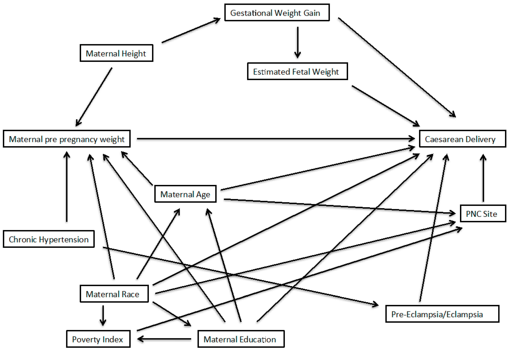



```{r}
#| eval: true
#| echo: false
#| output: false

library(ggplot2)

opvulkleur <- "#e8601d"
lijnkleur1 <- "darkorchid"
lijnkleur2 <- "red"
lijnkleur3 <- "blue"

```

# Associaties, oorzaak en gevolg, en experimenten

Kan het eten van vlees darmkanker veroorzaken?
Hangt het aantal nakomelingen van koolmezen samen met het moment waarop 
de eieren worden gelegd?
Vergroot het dagelijks gebruik van sociale media 
de kans op angstklachten of depressie?
Draagt een verhoging van importtarieven bij aan inflatie?
Heel veel vragen binnen de biologie en daarbuiten
gaan over de **samenhang**, oftewel **associatie**, tussen variabelen.
Belangrijker nog, 
  vaak willen we weten of een variabele een andere beïnvloedt. 
We hebben het dan over **oorzakelijke verbanden** of **causaliteit**.
Hoe kunnen we door middel van goed geplande experimenten 
aantonen dat er een oorzakelijk verband bestaat tussen variabelen?
Dat zijn de thema's van dit hoofdstuk.

## Associaties tussen verschillende typen variabelen

Twee variabelen hangen samen of zijn geasssocieerd
als de waarde van de ene variabele iets zegt over de waarde van de andere.
Roker zijn en longkanker krijgen zijn geassocieerd omdat
uit gegevens blijkt dat rokers een grotere kans hebben op longkanker.

### Associaties tussen een continue variabele en een categorische variabele

Twee variabelen die geassocieerd zijn
hoeven niet van hetzelfde type te zijn.
Zo kan een numerieke variabele
geassocieerd zijn met een categorische variabele.
Daarvan zijn we in @sec-toetsen-gemiddelden eigenlijk al voorbeelden tegengekomen.
In @sec-t-toets-twee-steekproeven gebruikten we een $t$-toets voor twee onafhankelijke steekproeven
om aan te tonen dat het gemiddelde gewicht van de bonte manacin 
(*manacus manacus*) verschilt tussen de geslachten.
In andere woorden, `gewicht` (continu) 
hangt samen met `geslacht` (nominaal).
Zo bekeken is iedere $t$-toets voor twee onafhankelijke steekproeven 
erop gericht om te bekijken 
of een continue variabele samenhangt met een categorische variabele
met twee niveaus.

### Associaties tussen twee continue variabelen

Natuurlijk kunnen twee continue variabelen ook geassocieerd zijn.
Hieronder bekijken we een voorbeeld uit de NHANES-dataset.

::: {#exm-gewicht-lengte}
### Samenhang tussen lichaamsgewicht en lengte in de NHANES-data

In de NHANES-dataset is van de meeste deelnemers de lichaamslengte en het lichaamsgewicht gegeven. 
Zou er een verband zijn tussen lichaamslengte en gewicht? 
We onderzoeken het door die variabelen tegen elkaar uit te zetten
in een spreidingsdiagram (@fig-gewicht-lengte). 

Er is duidelijk een trend te zien: langere mensen zijn gemiddeld
zwaarder. Maar er is grote variatie tussen mensen met hetzelfde gewicht,
vooral onder volwassenen.
Merk ook op dat de trend geen rechte lijn is:
over het algemeen neemt gewicht sneller dan lineair toe met lichaamslengte.

```{r}
#| code-fold: true
#| warning: false
#| fig.cap: "Lichaamsgewicht uitgezet tegen lichaamslengte (NHANES-dataset)."
#| label: fig-gewicht-lengte
#| fig.width: 4.5
#| fig.height: 3.5
#| out.width: "64%"

library(NHANES)
library(ggplot2)

data(NHANES)


ggplot(
  data = NHANES, 
  aes(x = Height, y = Weight)
) +
  geom_point(
    color = "#e8601d",
    alpha = 0.5
  )+
  labs( x = "Gewicht (kg)", y = "Lengte (cm)") +
  theme_minimal()

```
:::

Wanneer twee continue variabelen met elkaar samenhangen
wordt ook wel gesproken over **correlatie**.
Meestal wordt dan bedoeld dat de variabelen *lineair* met elkaar samenhangen;
in @sec-linrel gaan we het specifiek over lineaire relaties hebben. 
Soms wordt het woord correlatie breder gebruikt, vooral in de volksmond;
maar statistici reserveren het wel 
voor een samenhang tussen numerieke variabelen.

### Samenhang tussen twee categorische variabelen

Ook categorische variablelen kunnen met elkaar samenhangen.
We leggen dat weer uit aan de hand van een voorbeeld.

::: {#exm-mosaic}
## Hangt woontoestand samen met gezondheidstoestand?

In de NHANES dataset is van iedere onderzochte persoon ook opgenomen wat
diens *woontoestand* is: de variabele `HomeOwn`, 
een factor met niveaus 
`Own`, `Rent`, en `Other` 
(*Koopwoning*, *Huurwoning*, en *Overig*). 
In @exm-freq-gezondheidsstatus hadden we 
de variabele *gezondheidstoestand* albekeken (`HealthGen`),
een factor met vijf niveaus: *Slecht*, *Matig*, *Goed*, *Zeer Goed*, of *Uitstekend*. 
We vragen ons af: 
is er een samenhang tussen woontoestand en en gezondheidstoestand?

Om dit te onderzoeken, maken we eerst
een **kruistabel**. Een kruistabel is
een tabel die voor iedere combinatie van niveaus
het aantal waarnemingen toont.

```{r}
#| code-fold: true
#| warning: false
#| 
# samenhang gezondheidstoestand en woontoestand

if (!("knitr" %in% .packages())) {
  library(knitr)
}

# Vertaal de niveaus van HomeOwn naar het Nederlands
NHANES$HomeOwn <- factor(
  NHANES$HomeOwn,
  levels = c("Other", "Rent", "Own"),
  labels = c("Overig", "Huurwoning", "Koopwoning"),
  ordered = TRUE
)

# Vertaaal de niveaus van HealtGen naar het Nederlands
NHANES$HealthGen <- factor(
  NHANES$HealthGen,
  levels = c("Poor", "Fair", "Good", "Vgood", "Excellent"),
  labels = c("Slecht", "Matig", "Goed", "Zeer Goed", "Uitstekend"),
  ordered = TRUE
)

# Genereer de kruistabel voor HealthGen en HomeOwn
kruistabel <- table(
  NHANES$HealthGen,
  NHANES$HomeOwn
)

# Geef de kruistabel weer in een nette tabel
kable(
  t(kruistabel),
  caption = "Kruistabel van gezondheidstoestand en woontoestand."
)

```


De getallen in de kruistabel zijn lastig te overzien. 
Daarom maken we op basis van de kruistabel een **mozaïekplot**:

```{r}
#| code-fold: true
#| warning: false
#| fig.cap: "Mozaïekplot: Samenhang tussen woontoestand en gezondheidstoestand"
#| label: fig-mozaiek
#| fig.width: 7
#| fig.height: 4.5
#| out.width: "100%"

kleuren <- c("DarkOrchid", "#409899", "#e8601d")

# Create a mosaic plot using base R
mosaicplot(
  kruistabel, 
  col = kleuren, 
  main = "Samenhang tussen woontoestand en gezondheidstoestand",
  xlab = "Gezondheidstoestand",
  ylab = "Woontoestand"
  )
```

Uit deze mozaïekplot kun je verschillende dingen aflezen.
Je ziet misschien dat de plot bestaat uit vijf kolommen.
De breedte van die kolommen geeft weer van hoeveel 
personen de gezondheid "Slecht", "Matig", etc. is.
Dat zijn dus dezelfde verhoudingen als in @fig-stapel.
Binnen de kolommen laten de hoogtes van de blokken
vervolgens voor iedere gezondheidstoestand
de verhoudingen zien van de verschillende woontoestanden.

Het lijkt erop dat, over het geheel genomen,
gezondere personen vaker een huis bezitten,
al past de categorie "Slecht" niet helemaal in de trend.

Om te beoordelen of de twee variabelen daadwerkelijk samenhangen
zouden we eigenlijk een statistische toets moeten uitvoeren.
Een geschikte toets zou de $\chi^2$-toets voor onafhankelijkheid zijn,
maar we hebben in deze cursus geen tijd om die te behandelen.
Voor de volledigheid kunnen we deze toch even uitvoeren:

```{r}
#| warning: false
# chi-kwadraat-toets voor onafhankelijkheid
chisq.test(kruistabel)
```

In de uitvoer is de $P$-waarde gegeven:
die is kleiner dan $2{,}2 \times 10^{-16}$.
Dat maakt het zeer onwaarschijnlijk dat de verschillen in verhoudingen
het gevolg zijn van steekproefvariatie.
De twee variabelen hangen dus vrijwel zeker samen.

We kunnen alleen maar speculeren over de oorzaken van de samenhang.
Je kunt je voorstellen dat personen met een matige gezondheid
hierdoor soms beperkt worden en daardoor minder inkomen hebben.
Dat zou kunnen verklaren dat zij minder vaak in staat zijn
om een huis te kopen.
Maar waarschijnlijk spelen er veel meer factoren een rol.

:::

## Oorzaken van associaties

Als we tot de conclusie komen dat twee variabelen geassocieerd zijn,
dan willen we graag weten hoe dat komt.
Welke mechanismen zijn verantwoordelijk voor die associatie?
In de praktijk is dat nog niet zo gemakkelijk,
omdat variabelen op allerlei manieren met elkaar verknoopt kunnen raken.

Een specifieke manier waarop variabelen geassocieerd kunnen raken
is als ze elkaar beïnvloeden. 
We hebben het dan over een **oorzakelijk** of **causaal verband**.
Roken en longkanker zijn geassocieerd omdat roken kanker *veroorzaakt*.
Het is heel waardevol om te weten dat het verband tussen die twee variabelen
oorzakelijk is, want dat betekent dat het aantal longkankerpatienten
zal afnemen als we maatregelen nemen tegen roken.
Als je niet weet wat longkanker veroorzaakt, 
weet je ook niet hoe je longkanker moet voorkomen.

Maar als twee variabelen geassocieerd zijn,
wil nog niet zeggen dat er een causaal verband bestaat tussen die variabelen.
Bijvoorbeeld:
het aantal regenpakken in het straatbeeld 
is geassocieerd met het aantal paraplu's,
maar regenpakken veroorzaken geen paraplu's,
en paraplu's geen regenpakken.
Maatregelen tegen het gebruik van paraplu's
zullen dus ook niet helpen bij het bestrijden van regenpakken.
Een veelgehoorde uitspraak is dan ook: "Correlatie is nog geen causatie."

Hoewel veel mensen dit begrijpen
blijft de verleiding groot om associaties kritiekloos als oorzakelijke verbanden
te interpreteren.
Hopelijk zul jij daar na het lezen van dit hoofdstuk
heel voorzichtig mee zijn,

### Causale diagrammen

Een nuttig hulpmiddel bij het denken over associaties en causale relaties
is een **causaal diagram**.
Een eenvoudig voorbeeld van een causaal diagram is het volgende figuur:

::: {#fig-CD fig-align="center"}
```{mermaid}

graph LR;
  A([roker]) --> B([longkanker])
```

Een eenvoudig causaal diagram dat stelt dat roken longkanker veroorzaakt.
:::

In een causaal diagram worden de namen van variabelen verbonden met pijlen
als we vermoeden dat die variabelen elkaar causaal beïnvloeden. 
Het voorbeeld van @fig-CD stelt dus simpelweg dat er een causaal verband is
tussen roken en longkanker.
Het is duidelijk dat `roker` en `longkanker` daardoor geassocieerd kunnen raken.

In ingewikkeldere causale diagrammen kunnen associaties ook 
ontstaan tussen variabelen die niet direct verbonden zijn.
Een eenvoudig voorbeeld is een causale "ketting":

::: {#fig-ketting fig-align="center"}
```{mermaid}

graph LR;
  A([roker]) --> B([longkanker]) --> C([mortaliteit])
```

Roken kan geassocieerd raken met mortaliteit via longkanker.
:::

Hier raakt roken geassocieerd met mortaliteit
omdat roken longkanker veroorzaak, en longkanker mortaliteit.

### Het omdraaien van de causaliteit

Zelfs als twee variabelen een causaal verband hebben,
is het niet altijd vanzelfsprekend 
in welke richting de pijl moet wijzen.
Hieronder volgt een voorbeeld.

::: todo-box
RH: onderstaande netjes herschrijven, met references.
:::

:::: {#exm-zelfbeeld}
## Leidt een positief zelfbeeld tot succes?

In de jaren 1980 en 1990 ontdekten onderzoekers dat mensen met
een positief zelfbeeld vaak succesvoller zijn in het leven. Dit leidde tot
beleidsmaatregelen die gericht waren op het verhogen van het zelfbeeld
bij kinderen, in de hoop dat dit hen succesvoller zou maken.

Maar het is niet vanzelfsprekend dat de causale pijl van zelfbeeld naar success
loopt. Kan het niet ook andersom zijn?

::: {#fig-welk-diagram layout-ncol="3" out.width="100%"}
```{mermaid}

graph TD;
  A([zelfbeeld]) --> B([succes])
```

```{mermaid}

graph TD;
  A([succes]) --> B([zelfbeeld])
```

```{mermaid}

graph TD;
  A([succes]) --> B([zelfbeeld])
  B([zelfbeeld]) --> A([succes]) 
```

Welk causale diagram beschrijft de werkelijkheid het beste?
:::

Het ligt voor de hand dat succes op school, in sport of in het sociale leven
bijdraagt aan een positief zelfbeeld. 
Als dat het mechanisme is dat de associatie verklaart,
dan helpt het niet om zelfvertrouwen kunstmatig op te blazen
en kan wellicht beter worden ingezet op vaardigheden en inspanning.

Interessant? In de referentie in de voetnoot[^associatiestussenvariabelen-1]
lees je meer over het debat rondom de zelfwaardebeweging.
::::

[^associatiestussenvariabelen-1]: Orth, Ulrich, and Richard W. Robins.
    “Is High Self-Esteem Beneficial? Revisiting a Classic Question.” The
    American Psychologist 77, no. 1 (January 2022): 5–17.
    https://doi.org/10.1037/amp0000922.

### Confounding: assiciaties veroorzaakt door een gezamenlijke oorzaak

Bekijk @fig-ijs hieronder eens. 
Deze is gebaseerd op cijfers uit de VS, uit 2019,
maar ieder ander jaar laat een vergelijkbaar beeld zien.[^cijfersijs]
In die grafiek zijn voor iedere maand het aantal verlijdens door verdrinking
uitgezet tegen de verkoopcijfers van ijsjes.
(Versies van deze figuur zijn op veel plekken op het internet te vinden.)

^cijfersijs: De verdrinkingscijfers zijn op 4 februari 2025 gedownload van de [National Safety Council](https://injuryfacts.nsc.org). De ijsverkooopcijfers komen van [www.kaggle.com](www.kaggle.com); de oorsprong van de getallen is niet duidelijk.

::: {.todo-box}
Hieronder zijn de maanden in het Engels. 
Kan iemand die in de code vertalen naar het Nederlands?
Kwestie van verdrinkingen_2019$Month overschijven.
:::

```{r}
#| code-fold: true
#| warning: false
#| fig.cap: "Samenhang tussen ijsverkoop en verdrinkingen in de VS (cijfers voor 2019)."
#| label: fig-ijs
#| fig.width: 7
#| fig.height: 5
#| out.width: "88%"
#| 
# Controleer of benodigde pakketten zijn geladen
if (!("readr" %in% .packages())) { library(readr) }
if (!("ggplot2" %in% .packages())) { library(ggplot2) }

# Inlezen van gegevens
verdrinkingen <- read_csv("data/drowning.csv")
ijsverkoop <- read_csv("data/ice_cream.csv")

# Splits datum in jaar, maand en dag
ijsverkoop$JAAR  <- as.numeric(format(ijsverkoop$DATE, "%Y"))
ijsverkoop$MAAND <- as.numeric(format(ijsverkoop$DATE, "%m"))
ijsverkoop$DAG   <- as.numeric(format(ijsverkoop$DATE, "%d"))

# Selecteer alleen gegevens uit 2019
ijsverkoop_2019 <- subset(ijsverkoop, JAAR == 2019)
verdrinkingen_2019 <- subset(verdrinkingen, Year == 2019)

# Samenvoegen van gegevens in een nieuw data frame
gegevens <- data.frame(
  ijsverkoop = ijsverkoop_2019$IPN31152N,
  verdrinkingen = verdrinkingen_2019$Drowning,
  maand = c("januari",
            "februari",
            "maart",
            "april",
            "mei",
            "juni",
            "juli",
            "augustus",
            "september",
            "oktober",
            "november",
            "december")
)

# Visualisatie met ggplot2
ggplot(gegevens, aes(x = ijsverkoop, y = verdrinkingen, 
                     label = maand)) +
  geom_point(color = "#e8601d", size = 2) +
  geom_text(vjust = 1.7, hjust = 0.4) +
  theme_minimal() +
  labs(
      x = "aantal verkochte ijsjes (x 1000)",
      y = "aantal verdrinkingen"
      ) +
  coord_cartesian(xlim = c(70, 130), ylim = c(100, 700))
```

De figuur laat een positieve associatie zien tussen het aantal verdrinkingen
  dat in een maand plaatsvindt
  en het aantal ijsjes dat geconsumeerd wordt.
Vooral in de zomermaanden mei, juni, juli en augustus
  zijn de cijfers verontrustend:
  de ijscoman doet dan goede zaken,
  maar helaas verdrinken er in die periode een groot aantal mensen.
Is het tijd om ijsjes te verbieden?
Of zou de causaliteit de andere kant op lopen?

Er is natuurlijk een veel betere verklaring.
Hoogstwaarschijnlijk bestaat er tussen `ijsverkoop` en `verdrinking` 
  geen oorzakelijk verband.
In plaats daarvan zijn deze variabelen waarschijnlijk gecorreleerd 
  als gevolg van één of meerdere **gezamenlijke oorzaken**.
Een gezamenlijke oorzaak is een variabele
  die beide variabelen beïnvloedt;
  andere woorden hiervoor zijn **confounder** of **lurking variable**.
Een belangrijke factor is waarschijnlijk de variabele `gemiddelde dagtemperatuur`. In de warme zomermaanden wordt meer ijs geconsumeerd,
maar wordt er ook meer gerecreëerd in en rond het water,
en dat kan leiden tot hogere verdrinkingscijfers.^[Andere factoren spelen mogelijk ook mee. Bijvoorbeeld, zowel `ijsverkoop` als `waterrecreatie` zijn wellicht hoger in vakantieperiodes.]
Een eenvoudig model is weergegeven in het causale diagram @fig-causaal-ijs hieronder.

::: {#fig-causaal-ijs}
```{mermaid}

graph TD;
  Z([maand]) --> A([gemiddelde dagtemperatuur]) --> B([waterrecreatie]) --> D([verdrinking])
  A --> C([ijsverkoop])
```

Variabelen `ijsverkoop` en `verdrinking` hebben een gezamenlijke oorzaak, `dagtemperatuur`.
:::


De boodschap van dit absurde voorbeeld is natuurlijk het volgende:
variabelen die elkaar niet rechtstreeks beïnvloeden
raken vaak geassocieerd door confounders.
De structuur van een causaal diagram kan je vertellen wat mogelijk confounders zijn.
In @fig-causaal-ijs vertrekken er *twee* pijlen vertrekken vanuit `gemiddelde dagtemperatuur`. 
Daardoor heeft het diagram een "gevorkte" structuur.
Altijd als er een vork bestaat in het causale diagram kunnen variabeleln "boven" de vork (dus `maand` en `gemiddelde dagtemperatuur`) confounders zijn
voor variabelen aan verschillende kanten "onder" de vork 
(hier dus `waterrecreatie`/`verdrinking` aan de ene kant, 
en `ijsverkooop` aan de andere kant).

::: {#exr-confounding}

## Welke variabelen zijn mogelijk geassocieerd?

:::

::: {#exr-confounding}

## Wat zouden mogelijke confounders kunnen zijn?

:::


### Colliders: associaties veroorzaakt door selectie van een subpopulatie

We beginnen weer met een voorbeeld.

::: {#exm-aanmelding}

## Selectie voor een masteropleiding

Als een student zich aanmeldt voor de masteropleiding 
  *Bioinformatics and Biocomplexity*
  volgt een selectieprocedure
  waarbij gekeken wordt of de achtergrond van de student
  goed aansluit bij de opleiding.
Op basis van beschikbare informatie ---CV, vakken, cijfers, motivatie, referenties---
  krijgt iedere student scores voor verschillende deelaspecten.
Bijvoorbeeld, 
  als een student gedegen achtergrond heeft
  in de bioinformatica,
  dan heeft dat een positieve invloed op diens kans door de selectie te komen.
Hetzelfde geldt als een student aantoonbaar affiniteit en ervaring heeft 
  met biologisch modelleren.
Laten we aannemen dat de opleiding besloten heeft
  om alleen student toe te laten
  waarvan het gemiddelde van beide scores boeven een drempel uitkomt.
(In werkelijkheid worden nog veel meer variabelen meegewogen,
  maar voor dit voorbeeld houden we het eenvoudig.)

We kunnen de situatie dan weergeven in het volgende causale diagram:
  
:::{#fig-collider}
```{mermaid}
graph TD;
  A([score bioinformatica]) --> B([toelating])
  C([score biologisch modelleren]) --> B
```
:::

Merk op dat er volgens @fig-collider geen causaal verband bestaat
  tussen beide scores. 
Als een student een extra cursus bioinformatica volgt,
  gaat diens `score bioinformatica` omhoog,
  en dat zal invloed hebben op zijn kansen om toegelaten te worden;
maar diens `score biologisch modelleren` zal er niet door veranderen, want
  daarvoor staat de pijl tussen `toelating` en `score biologisch modelleren`
  de verkeerde kant op.
Op basis van de pijlen in @fig-collider zullen beide scores
  dus niet geassocieerd raken.
Het kan natuurlijk zijn dat
  `score bioinformatica` en `score biologisch modelleren` 
  bij voorbaat geassocieerd zijn (positief of negatief),
  maar laten we even aannemen dat dat niet het geval is.

Nu selecteren we een willekeurige student die voor de opleiding is aangenomen,
  en we vernemen dat deze student heel weinig ervaring heeft met bioinformatica.
Dan kunnen we direct concluderen
  dat deze student een hoge score moet hebben gehad voor biologisch modelleren,
  *want anders was deze niet aangenomen*.
Dat geldt ook andersom:
  heeft de student een lage `score biologisch modelleren`,
  dan moet diens `score bioinformatica` wel hoog zijn.
Kortom:
  *binnen de subpopulatie van studenten die zijn toegelaten
  kunnen beide scores (negatief) geassocieerd zijn,
  zelfs als die associatie niet bestaat in de populatie aanmeldingen als geheel*!
De associatie ontstaat doordat we een selectie hebben gemaakt
  op basis van de variabele `toelating`.
Figuur @fig-collider-plot illustreert dat.

```{r}
#| code-fold: true
#| warning: false
#| fig.cap: "Illustratie van collider bias. In de volledige populatie van aanmeldingen (grijs en oranje samen) zijn beide scores niet geassocieerd. Toch laat de selectie van studenten met een hoge gemiddelde score (boven de zwarte lijn; oranje datapunten) wél een negatieve associatie zien. (De gegevens zijn natuurlijk fictief.)"
#| fig.width: 4
#| fig.height: 4
#| out.width: "60%"
#| label: fig-collider-plot

if (!("MASS" %in% .packages())) {
  library(MASS)
}
if (!("ggplot2" %in% .packages())) {
  library(ggplot2)
}

# Parameters
n_steekproef <- 500  # Aantal waarnemingen in de populatie
drempel <- 1

# Genereer bivariate normale steekproef zonder correlatie
set.seed(42)
sigma <- matrix(c(1, 0, 0, 1), nrow = 2)  # Covariantiematrix
steekproef <- as.data.frame(
  mvrnorm(n_steekproef, mu = c(0, 0), Sigma = sigma)
)
colnames(steekproef) <- c("X", "Y")

# Voeg een kleurkolom toe en initialiseer als "darkgrey"
steekproef$kleur <- "darkgrey"

# Bepaal welke studenten toegelaten worden
deelsteekproef_indices <- ((steekproef$X + steekproef$Y) > 2*drempel)
# Stel de kleur van die datapunten in op oranje
steekproef$kleur[deelsteekproef_indices] <- "#e8601d"

# Plot de gegevens
plot <- ggplot(
  steekproef, aes(x = X, y = Y, color = kleur)
) +
  geom_point(alpha = 1, size = 1) +
  scale_color_identity() +
  theme_minimal() +
  labs(
    title = NULL,
    x = "score bioinformatica", y = "score biologisch modelleren"
  ) +
  theme(
    axis.text.x = element_blank(),
    axis.text.y = element_blank()
  ) + 
  geom_line(data = data.frame(X = c(-3, 3), Y = c(5, -1)), color = "black") +
  coord_cartesian(xlim = c(-3,3), ylim = c(-3, 3))

print(plot)

```  


:::


In @fig-collider zie je dat er twee pijlen naar `toelating` toe wijzen.
Een variabele waarnaar meerdere pijlen wijzen
  wordt een **collider** genoemd.
De algemene boodschap die je uit @exm-aanmelding moet meenemen is de volgende:

::: {.callout-important}

## Collider bias
  
Laat $C$ een collider zijn 
  die causaal beïnvloed wordt door $X$ en $Y$ (en mogelijk andere variabelen):
```{mermaid}
graph TD;
  X([X]) --> C([C])
  Y([Y]) --> C
  Z([...]) --> C
```
Nu selecteren we een subpopulatie op basis van de waarde
  van de collider-variabele.
Dan is er een grote kans dat, binnen die selectie,
  de associatie tussen $X$ en $Y$ anders is
  dan in de gehele populatie.
  
Specifiek kunnen $X$ en $Y$ binnen de selectie
  sterk geassocieerd zijn
  terwijl ze dat niet zijn in de gehele populatie
  en ze elkaar op geen enkele manier causaal beïnvloeden.
Ook is het mogelijk dat de associatie tussen $X$ en $Y$ 
  binnen de selectie negatief is, 
  terwijl die in de gehele populatie positief is
  (of andersom).
:::

Collider bias komt enorm vaak voor en wordt vaak niet herkend.
Bijvoorbeeld, 
  tijdens de corona-pandemie werd in korte tijd veel onderzoek gedaan
  naar risicofactoren bij SARS-COV-2.
Daarbij werd vaak gebruik gemaakt van gegevens van patienten
  die in het ziekenhuis opgenomen waren,
  of die vrijwillig deelnamen aan een onderzoek
  via een app.
Een probleem daarbij is dat de risicofactoren mogelijk zelf
van invloed zijn op de kans dat iemand aan het onderzoek deelneemt.
Dat leidt tot ingewikkelde causale diagrammen, zoals die hieronder:

```{mermaid}
graph TD;
  A([risicofactor 1]) --> B([deelname onderzoek])
  C([risicofactor 2]) --> B
  B --> D([verloop ziekte])
  A -->|?| D
  C -->|?| D
```
Je ziet: `deelname onderzoek` is hier een collider,
  en de selectie van deelnemers kan nu gemakkelijk leiden
  tot onechte associaties tussen risicofactoren.
Dat maakt het vervolgens moeilijk om het causale effect in te schatten
  van iedere afzonderlijke risicofactor op het verloop van de ziekte.

Interessant? Lees er meer over in het artikel in de voetnoot.[^colliderCovid]

[^colliderCovid]: Griffith, Gareth J., Tim T. Morris, Matthew J. Tudball, Annie Herbert, Giulia Mancano, Lindsey Pike, Gemma C. Sharp, et al. “Collider Bias Undermines Our Understanding of COVID-19 Disease Risk and Severity.” Nature Communications 11 (November 12, 2020): 5749. https://doi.org/10.1038/s41467-020-19478-2.
    

### Verstrikt in het netwerk van causale relaties

In de praktijk zijn er bij veel onderzoeken nog veel meer variabelen betrokken.
Een goed voorbeeld is een onderzoek dat probeerde te bepalen 
of een hoog lichaamsgewicht van een moeder vóór haar zwangerschap
een verhoogd risico oplevert op een keizersnede.[^associatiestussenvariabelen-2]
In het artikel over dit onderzoek 
beeldden de autheurs een causaal diagram af;
we hebben dat diagram nagetekend in @fig-keizersnede.

[^associatiestussenvariabelen-2]: Hamra, Ghassan B., Jay S. Kaufman, and
    Anjel Vahratian. “Model Averaging for Improving Inference from
    Causal Diagrams.” International Journal of Environmental Research
    and Public Health 12, no. 8 (August 2015): 9391–9407.
    https://doi.org/10.3390/ijerph120809391.

::: todo-box
Rutger checken of deze figuur voldoet.
:::



:::{#fig-keizersnede}
```{mermaid}
graph TD;
  A([Chronische hoge bloeddruk]) --> B([Gewicht moeder voor de zwangerschap])
  A --> K([Zwangerschaps-vergiftiging])
  B --> C([Keizersnede])
  D([Lichaamslengte moeder]) --> B
  D --> E([Gewichtstoename tijdens zwangerschap])
  E --> F([Geschat gewicht feutus])
  F --> C
  E --> C
  G([Leeftijd moeder]) --> B
  G --> C
  G --> L([Locatie prenatale zorg])
  H([Ras moeder]) --> B
  H --> G
  H --> C
  H --> L
  H --> J([Opleidingsniveau moeder])
  H --> I([Armoede-index])
  I --> L
  J --> C
  J --> G
  J --> I
  K --> C
  L --> C
```

Causaal diagram over de relatie tussen een hoog lichaamsgewicht van een moeder
vóór haar zwangerschap en het risico op een keizersnede.[^associatiestussenvariabelen-2]
:::

Het is gemakkelijk om in zo'n web van relaties 
verstrikt te raken. 
Het kan zijn dat lichaamsgewicht het risico op een keizersnede
daadwerkelijk beïnvloed. 
Maar als in gegevens een dergelijke associatie wordt gevonden,
 mag die conclusie niet zomaar getrokken worden.
Het vereist heel geavanceerde methoden om deze kluwe te ontwarren,
en zelfs daarmee is het nooit uit te sluiten
dat er een confounder is gemist.

::: {#exr-keizersnede}

## Een ingewikkeld causaal diagram

Bekijk @fig-keizersnede nog eens goed. Zie je confounders die de associatie tussen lichaamsgewicht en keizersnede kunnen beïnvloeden?
:::


## Twee soorten onderzoek: experimenteel en observationeel

Voordat we uitleggen hoe we toch onderscheid kunnen maken 
  causale relaties en misleidende associaties
  moeten we het onderscheid uitleggen tussen
  *observationeel onderzoek* en *experimenteel onderzoek*.
  
Bij **observationeel onderzoek** verzamelen onderzoekers gegevens
  zonder in te grijpen in de onderzochte processen. 
Ze observeren en registreren natuurlijke variaties in variabelen en proberen hieruit patronen of verbanden af te leiden.
Voorbeelden zijn:

-  Epidemiologische onderzoeken waarbij ziekenhuisgegevens worden gebruikt
   om risicofactoren te ontdekken, 
   zonder dat deelnemers wordt gevraagd hun gedrag te veranderen.
-  Gedragsonderzoek waarbij dieren op afstand worden geobserveerd
   en nauwkeurig wordt bijgehouden welke gedragingen ze vertonen.

Bij **experimenteel onderzoek** manipuleren onderzoekers actief een of meer  variabelen en meten ze het effect daarvan op een of meer andere variabelen.
Voorbeelden zijn:

- Ecologisch onderzoek naar het effect van begrazing door herbivoren op de plantendiversiteit,
  waarbij stukken land actief worden beschermd tegen begrazing
  en de plantendiversiteit van die stukken wordt vergeleken 
  met stukken waar begrazing wél wordt toegestaan.
- Onderzoek naar de effectiviteit van een vaccin,
  waarbij één groep mensen wordt gevaccineerd en een andere groep niet,
  en de kans op infectie of ziekenhuisopname vervolgens wordt vergeleken tussen beide groepen.

Variabelen die door de onderzoekers worden gemanipuleerd
  worden **experimentele** of **onafhankelijke** variabelen genoemd.
De variabele waarop het effect wordt bepaald heet de **afhankelijke** variabele of de **responsvariabele**.

### Het is moeilijk causale relaties aan te tonen met observationele studies 

Observationeel onderzoek heeft een aantal grote voordelen.
De belangrijkste is dat bij dit soort onderzoek
  het natuurlijke verloop van het systeem dat je onderzoekt
  niet wordt verstoord.
Je meet wat er van nature gebeurt
  in plaats van wat je door ingrijpen in het system laat gebeuren.

Maar er is ook een enorm nadeel.
Hierboven hebben we het uitgebreid gehad
  over confounders en collider bias,
  subtiele effecten die de associatie tussen variabelen 
  in observationele data kunnen beïnvloeden.
Het is daardoor bij observationele onderzoeken altijd moeilijk
  om aan te tonen of een gemeten verband
  causaal is.
  
@Tbl-woorden-variabelen-verdelingen vat de verschillen tussen observationeel en experimenteel onderzoek samen.

Overigens zijn er ook veel onderzoeken waarbij de controle 
over de relevante variabelen niet volledig is
en die dus in feite noch strikt observationeel noch strikt experimenteel zijn.

| Kenmerk                | Observationeel onderzoek  | Experimenteel onderzoek |
|:------------------------|:--------------------------|:--------------------------|
| Manipulatie van variabelen | ❌ Nee  | ✅ Ja  |
| Causale conclusies mogelijk? | ⚠️ Beperkt  | ✅ Ja  |
| Controle over confounders? | ⚠️ Beperkt | ✅ Groot  |
| Natuurlijke setting? | ✅ Ja | ❌ Meestal niet  |
| Voorbeelden | Cohortstudies, surveys | gerandomiseerde gecontroleerde experimenten, laboratoriumexperimenten |

: Verschillen tussen observationeel en experimenteel onderzoek
{#tbl-woorden-variabelen-verdelingen .striped .hover}


### Randomized trials, of: Hoe experimenten wél causale relaties kunnen aantonen

Om uit te leggen hoe experimenteel onderzoek
  wél causale relaties kan aantonen,
  bespreken we nu de "gouden standaard" van het experimenteel onderzoek:
  het **gerandomiseerd gecontroleerd experiment** (GGE).
Twee eisen definieren een GGE. 
We leggen ze uit aan de hand van een eenvoudig voorbeeld:
  een onderzoek dat moet uitzoeken of een zeker vaccin beschermt 
  tegen een specifieke virale infectie.
  
De eerste eis is dat er een nauwkeurig ontworpen
  **controlebehandeling** is.
Om aan te tonen dat het vaccin werkt 
  moeten we het vaccin aan een groep proefpersonen toedienen
  en bijhouden hoe vaak ze in de periode daarna geïnfecteerd raken.
Maar dat is niet genoeg:
  we zullen het aantal infecties in deze groep moeten vergelijken 
  met een andere groep
  die het vaccin *niet* heeft gekregen.
Zo'n extra groep die als "baseline" dient wordt de **controlegroep** genoemd.

Voor een goede controle
  is het niet voldoende om de controlegroep simpelweg *geen* behandeling te geven.
In plaats daarvan moeten we ervoor zorgen dat de proefpersonen in de controlegroep
zoveel mogelijk dezelfde behandeling krijgen als de proefpersonen de vaccingroep.
Zij krijgen dus ook een prik, 
  soms zelfs met dezelfde samenstelling als het echte vaccin,
  behalve dat de actieve component wordt weggelaten.
Alleen op die manier zijn we er zeker van
  dat eventuele verschillen in de uitkomsten van beide groepen
  enkel het gevolg zijn van de werking van de actieve component,
  en niet van andere verschillen tussen de ervaring van de groepen:
  de bezoeken aan het ziekenhuis,
  de toediening van de prik,
  of een conserveermiddel in het vaccin.
Het idee is ook goed te illustreren door middel van 
  causale diagrammen (@fig-controlegroep).
  
::: {#fig-controlegroep layout-ncol="2" out-width="100%"}
```{mermaid}
%%| fig-width: 3.5
%%| fig-cap: ""
%%| label: fig-controlegroep-a
graph TD;
  A(["behandelgroep\n (vaccin of geen behandeling)"]) --> B([actieve component\n toegediend])
  A --> D([ziekenhuisbezoek])
  A --> F([...])
  B --> E([infectie])  
  D --> E
  F --> E
```
```{mermaid}
%%| fig-width: 3.5
%%| fig-cap: ""
%%| label: fig-controlegroep-b
graph TD;
  A(["behandelgroep\n (vaccin of controle)"]) --> B([actieve component\n toegediend])
  A ~~~ D([ziekenhuisbezoek])
  A ~~~ F([...])
  B --> E([infectie])  
  D --> E
  F --> E
```

Het belang van een zorgvuldige controlebehandeling. (a) Als de controlegroep simpelweg geen behandeling krijgt, zijn er mogelijk meerdere causale paden van `behandelgroep` naar `infectie`.
(b) Een zorgvuldig gekozen controlecontrolebehandeling zorgt ervoor dat de groepen zoveel mogelijk identiek worden behandeld. Zo kan het effect van `behandelgroep` op `infectie` alleen via `actieve component` lopen, omdat toewijzing aan een groep geen effect heeft op de andere variabelen.
:::
  
Het tweede eis aan een GGE is dat de toewijzing van eenheden aan groepen
  plaatsvindt door middel van **randomisatie**.
Dat wil zeggen dat de onderzoekers een onafhankelijk kansproces gebruiken,
  zoals randomgetallen verkregen met R,
  om te bepalen elke eenheid welke behandeling krijgt.
Het doel daarvan is om counfounders te elimineren.

Het grote nadeel van observationeel onderzoek was
  dat er vaak variabelen zijn,
  bekend of onbekend,
  die zowel de verklarende variabele
  als de uitkomst beïnvloeden.
Zulke confounders zorgen voor valse correlaties
  waardoor het moeilijk wordt 
  een oorzakelijk verband vast te stellen.
Hetzelfde probleem kan optreden bij experimenten
  als een variabele zowel de toewijzing aan een behandelgroep
  als de responsvariabele beïnvloedt.
De situatie is weergegeven in het causale diagram van @fig-randomgetallen-a.
Stel bijvoorbeeld dat we besluiten om de proefpersonen
  op basis van hun eerste voornaam aan een groep toe te kennen.
Zeg, proefpersonen met namen van A tot K krijgen het vaccin,
  die met namen L tot Z de controlebehandeling.
Het is moeilijk te zeggen wat het effect zal zijn.
De naam Noah, de meest populaire jongensnaam in 2024,
  kwam vóór het jaar 2000 nauwelijks voor in Nederland,
  en dus zijn vrijwal alle Noahs jong.
De namen Mohammed en Inaya zijn het meest populair in grote steden
  zoals Rotterdam,
  en veel minder op het platteland.
Kortom, namen zijn geassocieerd met allerlei variabelen
  waaronder gender, leeftijd, geografie, ethniciteit, 
  en het het inkomen en opleidingsniveau van de ouders.
Het kan zijn dat de veel van deze associaties verzwakt worden
  door de letters A tot K samen te voegen tot één groep,
  maar er is een serieus risico dat er confounders overblijven.
Een dergelijk risico is er altijd 
  als de groepen ingedeeld worden op basis van een arbitrair gekozen variabele.

Randomisatie lost dit probleem heel eenvoudig op;
  zie @fig-randomgetallen-b. Als de toewijzing aan groepen
  *enkel* op basis van randomgetallen gebeurt,
  is er gegarandeerd geen associatie tussen de behandelgroep
  en andere variabelen.
Confounders zijn op die manier uitgesloten.  

::: {#fig-randomgetallen layout-ncol="2"}
```{mermaid}
%%| fig-width: 3.5
%%| fig-cap: "Observationeel of niet-gerandomiseerd onderzoek."
%%| label: fig-randomgetallen-a

graph TD;
  A([mogelijke confounder]) --> B([infectie])
  C([behandelgroep]) -->|?| B
  A --> C
```

```{mermaid}
%%| fig-width: 3.5
%%| fig-cap: "Gerandomiseerde toewijzing aan de behandelgroepen elimineert confounders."
%%| label: fig-randomgetallen-b
graph TD;
  A([mogelijke confounder]) --> B([infectie])
  C([behandelgroep]) -->|?| B
  D([randomgetallen]) --> C
  A ~~~ C
```

Het belang van randomisatie. (a) Als de toewijzing van behandelgroep niet gerandomiseerd plaatsvindt, dan kunnen er confounders zijn die zowel de behandeling als de uitkomst beïnvloeden. (b) Als de toewijzing van de groepen enkel door randomgetallen worden bepaald, sluit dat confounders uit.
:::

Deze twee aspecten samen
---een zorgvuldige controlebehandeling én randomisatie---
zorgen ervoor dat een GGE confounders kan omzeilen
en zo directe causale verbanden kan aantonen.

## Blinderen: verstoring door proefpersonen en onderzoekers zelf

  


### Enkelvoudig blinderen

Niet geblindeerd: dan kan de wetenschap van welke behandeling de
proefpersoon heeft gehad de uitkomst beinvloeden. Dat kan bewust of
onbewust. Als je een effect verwacht, dan herken je die wellicht
sneller.

::: {#fig-blinderen layout-ncol="2"}
```{mermaid}
%%| fig-width: 3.5
graph TD;
  A([behandeling]) --> B([verwachting proefpersoon])
  A -->|?| C([uitkomst])
  B --> C
```

```{mermaid}
%%| fig-width: 3.5

graph TD;
  A([behandeling]) ~~~ B([verwachting proefpersoon])
  A -->|?| C([uitkomst])
  B --> C
```
:::

### Dubbel blinderen

::: {#fig-dubbel-blinderen layout-ncol="2"}
```{mermaid}

graph TD;
  A([behandeling]) --> D([verwachting onderzoeker])
  A -->|?| C([daadwerkelijke uitkomst])
  C --> E([Beoordeling/meting onderzoeker])
  D --> E
```

```{mermaid}

graph TD;
  A([behandeling]) ~~~ D([verwachting onderzoeker])
  A -->|?| C([daadwerkelijke uitkomst])
  C --> E([Beoordeling/meting onderzoeker])
  D --> E
```
:::

## *Regression to the mean* en controlegroepen

Galton 1888

Essentie:

-   Variabelen flucueren in de tijd
-   Selecteren op extreme waarden.
-   Neiging weer terug te bewegen naar het gemiddelde.

Medische klachten fluctueren. Je kijkt het even aan. -\> klachten zijn
op een gegeven moment extreem -\> naar een arts -\> behandeling -\>
verbetering. Was de behandeling effectief, of waren je klachten ook
zonder behandeling weer terugbewogen naar een voor jou meer typische
waarde?

Neiging om te zeggen: "Bij mij heeft het geholpen!".\
Maar is dat ook zo? Het enige wat je weet is: "Bij mij zijn de klachten
verminderd *na* de behandeling." Niet: "*door* de behandeling.". (Dit
alles ook los van confirmation bias.)

Piloten en complimenten[^associatiestussenvariabelen-3]

[^associatiestussenvariabelen-3]: Kahneman, Daniel. Thinking, Fast and
    Slow. 1st edition. New York: Farrar, Straus and Giroux, 2011.

### Controlegroepen

Meer weten over regression to the mean?[^associatiestussenvariabelen-4]

[^associatiestussenvariabelen-4]: Morton, Veronica, and David J
    Torgerson. “Effect of Regression to the Mean on Decision Making in
    Health Care.” BMJ : British Medical Journal 326, no. 7398 (May 17,
    2003): 1083–84.

## Placebo-effect

Voorbeelden: pijnklachten. Weten dat je een pijnstiller hebt gehad, kan
pijn verminderen.

Effect van placebo vaak overdreven.[^associatiestussenvariabelen-5]
Onterecht vaak verward met regression to the mean. Om placebo aan te
tonen is het niet voldoende om te laten zien dat een groep met
placebo-behandeling ook (deels) beter wordt. Dat is namelijk ook te
verwachten bij regression to the mean. Om placebo-effect aan te tonen
moet je laten zien dat er een verschil is tussen twee controlegroepen:

[^associatiestussenvariabelen-5]: McDonald, Clement J., Steven A.
    Mazzuca, and George P. McCabe. “How Much of the Placebo ‘Effect’ Is
    Really Statistical Regression?” Statistics in Medicine 2, no. 4
    (October 1983): 417–27. https://doi.org/10.1002/sim.4780020401.

-   Een controlegroep die denkt de behandeling te hebben ontvangen, maar
    waarbij dat niet zo is.
-   Een geblindeerde controlegroep die de behandeling niet heeft
    ontvangen maar dat zelf niet kan weten.

::: callout-warning
## Pas op voor percentages verbetering

box: Beecher[^associatiestussenvariabelen-6]: 34.2% of patients improve
after placebo-treatment; that does not mean anything.

Veel nieuwsberichten zijn van hetzelfde type: "Maarlieft 50% van de
ondervraagden denkt dat het huidige kabinet het beter gaat doen dan het
vorige." (Wat als de andere 50% het tegenovergestelde verwacht?)
:::

[^associatiestussenvariabelen-6]: Beecher, Henry K. “THE POWERFUL
    PLACEBO.” Journal of the American Medical Association 159, no. 17
    (December 24, 1955): 1602–6.
    https://doi.org/10.1001/jama.1955.02960340022006.

## Samenvatting

## Terminologie

## Opgaven


