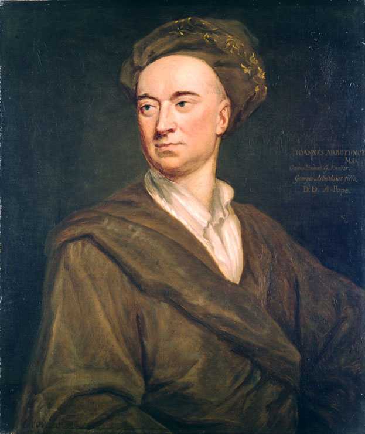



# Het toetsen van hypotheses {#sec-hypothesetoetsen}


{width=3.5in #fig-arbuthnot-schilderij}

In het jaar 1710 deed de Schotse arts en schrijver John Arbuthnot 
een interesssante ontdekking
toen hij de geboortecijfers van Londen over de periode 1629--1710 bestudeerde.[^arbuthnot]
Tot zijn verbazing waren er over de gehele periode ieder jaar meer jongetjes geboren dan meisjes.
@Fig-arbuthnot laat de cijfers zien die destijds op zijn bureau lagen.
Het leek erop dat er structureel meer jongetjes geboren werden dan meisjes!

```{r}
#| code-fold: true
#| fig-cap: "Geboortecijfers (doopregister) van Londen in de periode 1629--1710."
#| label: fig-arbuthnot
#| fig.height: 3.5

# Installeer en laad de benodigde pakketten
if (!requireNamespace("HistData", quietly = TRUE)) { 
  install.packages("HistData") 
}
if (!requireNamespace("ggplot2", quietly = TRUE)) { 
  install.packages("ggplot2") 
}
if (!requireNamespace("tidyr", quietly = TRUE)) { 
  install.packages("tidyr") 
}

library(HistData)
library(ggplot2)
library(tidyr)

# Laad de Arbuthnot-data
data("Arbuthnot")

# Zet de data om in lang formaat voor ggplot2
arbuthnot_lang <- pivot_longer(
  Arbuthnot,
  cols = c("Males", "Females"),
  names_to = "Geslacht",
  values_to = "Geboorten"
)

# Maak de plot
ggplot(arbuthnot_lang, aes(
  x = Year, 
  y = Geboorten, 
  color = Geslacht
)) +
  geom_point() +  # Voeg punten toe voor ruwe data
  geom_line() +   # Voeg lijnen toe om trends te laten zien
  labs(
    title = NULL,
    x = "Jaar",
    y = "Aantal geboorten volgens doopregister",
    color = "Geslacht"
  ) +
  scale_color_manual(
    values = c("Males" = "DarkOrchid", "Females" = "darkorange"),
    labels = c("Males" = "Jongens", "Females" = "Meisjes")
  ) +
  theme_minimal()

```

[^arbuthnot]: Arbuthnot, J. (1710). *An argument for divine providence, taken from the constant regularity observ’d in the births of both sexes.* Philosophical Transactions of the Royal Society of London, 27, 186–190. https://doi.org/10.1098/rstl.1710.0011

Maar er is een andere verklaring mogelijk.
Ook als in werkelijkheid iedere baby
met precies gelijke kans een jongetje of een meisje wordt,
dan kan het gebeuren dat er een paar jaar achtereen 
*toevallig* meer jongetjes dan meisjes geboren worden.
Misschien was de periode 1667--1735 zo'n toevallige periode?

Arbuthnot begreep dat die mogelijkheid bestond,
maar zag ook in dat het wel héél erg toevallig zou zijn
als de balans 84 jaar achter elkaar naar dezelfde kant was doorgeslagen.
Om te bepalen hoe onwaarschijnlijk dat zou zijn
berekende hij de kans dat dit zou gebeuren
als het in werkelijkheid even waarschijnlijk was 
dat in een gegeven jaar meer meisjes of meer jongetjes zouden worden geboren.
Die kans is gelijk aan de kans om met een muntje 84 keer achter elkaar "kop" te gooien,
oftewel $(\frac{1}{2})^{84} = 5 \times 10^{-26}$.[^verwaarlozen]
Als je nu begint met het gooien van je eerste muntje
en dat iedere seconde blijft volhouden, 
zul je gemiddeld $6 \times 10^{17}$ jaar moeten wachten op zo'n \emph{lucky streak}.
(Dat is ongeveer 100 miljoen keer langer dan de huidige leeftijd van het heelal.)

[^verwaarlozen]: We verwaarlozen in deze berekening de kans dat er in een jaar exact 
    evenveel jongetjes als meisje geboren worden. Zouden we die kans meenemen, 
    dan zou de kans op meer jongetjes dan meisjes niet $\frac{1}{2}$ zijn, 
    meer net iets kleiner.
    Arbuthnot verwaarloost dat effect in zijn berekening ook,
    maar merkt op dat dit betekent dat de échte kans alleen maar *kleiner* zal zijn
    dan de kans die hij voorrekent. 
    Dat zou het argument tegen toeval alleen maar sterker maken. 

Aangenomen dat de kans dat de jongens in een gegeven jaar 
in de meerderheid zijn gelijk is aan $\frac{1}{2}$ 
is de kans op de waargenomen geboortecijfers dus uiterst klein. 
Dat deze kans zo klein is, geeft aan dat "toeval" geen geloofwaardige verklaring is. 
Zo toonde Arbuthnot aan dat er iets anders aan de hand moest zijn.
Hij zag hierin de hand van God: 
omdat mannen in die tijd "hun brood moesten verdienen met gevaar", 
was de mortaliteit onder jonge mannen hoger dan onder jonge vrouwen. 
Om dat te compenseren liet God meer mannen geboren worden, concludeerde Arbuthnot.

Hoewel de biologie tegenwoordig andere verklaringen biedt
voor de scheve geslachtsverhouding
was Arbuthnot's argumentatie zijn tijd ver vooruit.
Die redenering is namelijk een voorbeeld van een **hypothesetoets**---
een techniek die pas in de 20e eeuw formeel werd ontwikkeld!

## Hypothesetoetsen

Een **hypothese** is een veronderstelling of voorlopige verklaring die getoetst kan worden door middel van onderzoek, experimenten of observaties. Hypothesen vormen vaak de basis van wetenschappelijke studies en kunnen, afhankelijk van de onderzoeksresultaten, worden bevestigd, verworpen of aangepast.

Het argument van Arbuthnot toetst de hypothese dat 
er in ieder gegeven jaar een gelijke kans is
dat er meer jongetjes of juist meer meisjes geboren worden. 
Arbuthnots berekeningen tonen aan dat *als* deze hypothese waar zou zijn, 
de waargenomen geboortecijfers buitengewoon onwaarschijnlijk zouden zijn. 
Dit wordt vervolgens geïnterpreteerd als bewijs tegen de hypothese. 

In het algemeen is een **hypothesetoets** een methode om te evalueren 
in welke mate een verzameling waarnemingen
---zoals meetgegevens of steekproeven---
bewijs levert tegen een hypothese.

::: {.callout-important icon=false}

Een **hypothesetoets** is een methode
die gebruikt wordt om te evalueren in hoeverre een verzameling waarnemingen
---bijvoorbeeld meetresultaten of gegevens uit een steekproef---
bewijs levert tegen een specifieke hypothese.

:::

## De nulhypothese $\HO$ en de alternatieve hypothese $\HA$

Laten we de kans dat er in een gegeven jaar meer jongetjes geboren worden
dan meisjes $p\ped{J}$ noemen.
Arbuthnot wilde aantonen dat $p\ped{J}$ *niet* gelijk is aan $\frac{1}{2}$.
Hij deed dat door bewijs te verzamelen tegen de hypothese dat dat *wel* zo was.
Die hypothese dat $p\ped{M} = \frac{1}{2}$ is de hypothese van een scepticus^[Een **scepticus**
is een persoon die de waarheid van beweringen in twijfel trekt totdat overtuigend bewijs geleverd is.]
die niet zomaar bereid is te geloven dat het bewijsmateriaal voldoende is
om conclusies te trekken.
Zo'n sceptische hypothese wordt een **nulhypothese** genoemd.
Deze wordt vaak genoteerd als $\HO$.
Het doel van iedere hypothesetoets is om te zien in hoeverre
de gegevens bewijs leveren tegen de $\HO$.

Tegenover de nulhypothese staat de **alternatieve hypothese**, $\HA$.
$\HA$ is de ontkenning van $\HO$.
Als $\HO$ de hypothese is dat $p\ped{J} = \frac{1}{2}$,
dan is $\HA$ de hypothese dat $p\ped{J} \neq \frac{1}{2}$.
Bewijs tegen $\HO$ geldt als bewijs vóór $\HA$.[^bewijs]

[^bewijs]: Je kunt met recht kanttekeningen plaatsen bij deze redenering;
zie bijvoorbeeld: 

    Cohen, Jacob. “The Earth Is Round ($p<.05$).” American Psychologist 49, no. 12 (1994): 997–1003.
    
    We gaan daar hier niet verder op in om verwarring te voorkomen.

## De kansverdeling "onder $\HO$"

Arbuthnot had toegang tot geboortecijfers voor 82 jaar. 
In alle 82 jaren werden er meer jongetjes geboren dan meisjes.
Omdat dat een erg extreme situatie is, 
stellen we ons nu voor dat dit maar in 48 jaren het geval was. 
(De meisjes waren dus in de overige 34 jaren in de meerderheid.)
Hoe sterk hadden we het bewijs tegen $\HO$ dan gevonden?
Natuurlijk is 48 nog steeds meer dan de helft van de jaren ($82/2 = 41$),
maar het is een stuk beter voor te stellen dat deze afwijking 
puur toevallig tot stand is gekomen.

Laten we het aantal jaren waarin jongetjes in de meerderheid waren $X$ noemen.
Als we uitgaan dat de $\HO$ waar is,
dan kunnen we de kans op $X$ voor iedere mogelijke waarde van 0 tot 82 uitrekenen.[^binomiaal]
(De berekening is niet zo moeilijk,
    maar voert te ver voor deze cursus.)
Het resultaat is weergegeven in @fig-binomiale-kans.
Deze kansverdeling laat zien dat "onder $\HO$" 
(dat betekent: onder de aanname dat $\HO$ waar is)
een waarde van $X$ tussen, zeg, 32 en 50
redelijk in de verwachting ligt. 
Waarden van $X$ die verder in de staarten van de verdeling liggen
zijn onder $\HO$ onwaarschijnlijk.
Vind je in werkelijkheid een waarde ver in één van de staarten
dan is dat dus een indicatie dat $\HO$ niet juist is.

[^binomiaal]: De verdeling (@fig-binomiale-kans) heeft een naam: de **binomiale verdeling**. 
    Deze verdeling kom je altijd tegen als je $n$ keer iets probeert,
    steeds met een vaste kans $p$ op "succes",
    en geïnteresseert bent in het totaal aantal keren succes, $X$.
    Meer informatie kun je [hier](https://nl.wikipedia.org/wiki/Binomiale_verdeling) vinden.

```{r}
#| code-fold: true
#| fig-cap: "De kansverdeling onder $\\HO$ van het aantal jaren (van in totaal 82 jaren) waarin meer jongens dan meisjes geboren worden."
#| label: fig-binomiale-kans
#| fig.height: 3.5
#| fig.width: 7

# Controleer of de benodigde pakketten zijn geladen
if (!("ggplot2" %in% .packages())) {
  library("ggplot2")
}

# Parameters definiëren voor de binomiale verdeling
n <- 82
p <- 0.5
mean <- n * p
sd <- sqrt(n * p * (1 - p))
standaard_deviaties <- 4  # Aantal standaarddeviaties als parameter

# Limieten voor de x-as bepalen (ongeveer 3 standaarddeviaties rond het gemiddelde)
x_min <- ceiling(mean - standaard_deviaties * sd)
x_max <- floor(mean + standaard_deviaties * sd)

# Mogelijke uitkomsten en kansen berekenen
uitkomsten <- seq(x_min, x_max)
kansen <- dbinom(uitkomsten, size = n, prob = p)

# Data frame maken met de uitkomsten en kansen
kansen_binomiaal <- data.frame(
  uitkomsten = factor(uitkomsten),
  kansen = kansen
)

# Maak de plot
verdelingBinomiaal <- function(kleur) {
  ggplot(kansen_binomiaal, aes(x = uitkomsten, y = kansen)) +
    geom_bar(
      stat = "identity",     # Balken representeren kanswaarden direct
      width = 1,              # Volledige breedte van de categorie
      fill = kleur,           # Kleur voor de balken
      color = "black"         # Randkleur voor de balken
    ) +
    labs(
      title = "",
      x = expression(Aantal~jaren~met~meer~jongetjes~dan~meisjes~italic(X)), # Titel voor de x-as
      y = "Kans onder de nulhypothese"              # Titel voor de y-as
    ) +
    theme_minimal()           # Minimalistisch thema voor de plot
}

# Kleur voor de balken
kleur <- "darkorange"

# Plot de binomiale verdeling
verdelingBinomiaal(kleur)

```

## De overschrijdingskans of $P$-waarde

Hoe opmerkelijk een bepaalde waarde van $X$ is
onder $\HO$
kan worden uitgedrukt in een getal
dat de **overschrijdingskans** of **$P$-waarde** genoemd wordt. 
(In dit boek schrijven we de $P$ met een hoofdletter,
maar in andere literatuur kom je ook $p$ tegen.)
De $P$-waarde is gedefinieerd als de kans
onder $\HO$ om een uitkomst te vinden die minstens even extreem is
als de waarde die daadwerkelijk gevonden is.
Stel dat Arbuthnot in werkelijkheid de waarde $X = 48$ had gevonden. 
Dan is de $P$-waarde de kans om, aangenomen dat $\HO$ waar is,
een waarde van $X$ te vinden die ten minste zo onwaarschijnlijk is als $X = 48$.
Die kans is in @fig-binomiale-P-waarde weergegeven als de oppervlakte van de paarse staven.
We kunnen de $P$-waarde in dit geval dus berekenen door de kansen van alle paarse staven op te tellen.
$$
\begin{align}
P & = \pr{X \le 34} + \pr{X \ge 48}\\ 
& = \left(\pr{X = 0} + \ldots + \pr{X = 34}\right) +  \left(\pr{X = 48} + \ldots + \pr{X = 82}\right).
\end{align}
$$
Na veel rekenwerk vinden we zo dat
$$
P = 0{,}15.
$$

::: {.todo-box}
Hieronder in de figuur kansen toevoegen. Het oranje stuk heeft kans 0,85,
het paarse stuk 0,15. Zie figuur 5.12 voor voorbeelden van pijltjes e.d.
:::


```{r}
#| code-fold: true
#| fig-cap: "Illustratie van de $P$-waarde voor de waarneming $X = 48$. De oppervlakte van de paarse staven is de $P$-waarde: de kans op $X = 48$ of extremer onder $\\HO$."
#| label: fig-binomiale-P-waarde
#| fig.height: 3.5
#| fig.width: 7

m <- 41
X <- 48

# Maak een vector van kleuren
kleur_vector <- ifelse(
  abs(uitkomsten - m) < abs(m - X), 
  "darkorange", 
  "DarkOrchid"
  )

verdelingBinomiaal(kleur_vector)

```

Laten we even stilstaan bij de betekenis van dit resultaat.
De $P$-waarde zegt dat, als $\HO$ waar is,
een $X$-waarde die minstens zo onwaarschijnlijk is als $X = 48$
een kans heeft van $P = 0{,}15$.
Dat wil zeggen dat $X = 48$ onder $\HO$ niet heel erg verrassend is;
gebeurtenissen met een dergelijke kans gebeuren regelmatig.
Dat betekent dat deze $P$-waarde geen (sterk) bewijs vormt tegen $\HO$.
Als in de geboortecijfers van Arbuthnot de jongens dus $X = 48$ jaren in de meerderheid waren,
dan had Arbuthnot niet kunnen uitsluiten dat dit simpelweg toeval was. 

In werkelijkheid waren jongens in alle 82 jaren in de meerderheid.
De $P$-waarde van die bevinding is $P = \pr{X = 82} + \pr{X = 0} = 4\times 10^{-25}$.
(De gebeurtenis $X = $ is net zo extreem als de gebeurtenis $X = 82$
en moet in deze berekening dus ook worden meegenomen.)
Die kans is zo klein dat $\HO$ er volstrekt ongeloofwaardig door wordt.

In de praktijk wordt vaak de richtlijn gehanteerd
dat een $P$-waarde opmerkelijk is
als deze kleiner is dan $0{,}05$.
Dan wordt het resultaat **statistisch significant** genoemd.

Een $P$-waarde van 0,05 betekent
dat je onder $\HO$ zo'n extreme uitkomst maar
1 op de 20 keer verwacht.
Dat is een kleine kans, en dus zeker een reden om nog eens kritisch
naar de $\HO$ te kijken.
Maar gebeurtenissen met een kans van 0,05
zijn ook weer niet zó bijzonder.
Een $P$-waarde van 0,05 is dus opmerkelijk, maar op zichzelf geen sterk bewijs tegen $\HO$.
We komen in @sec-? nog uitgebreid terug op de interpretatie van de $P$-waarde.

## Iedere toets is gebaseerd op een statistisch model

Bij het berekenen van de kansverdeling van @fig-binomiale-kans
en de $P$-waarde hierboven
hebben we impliciet enkele aannames gemaakt.

Ten eerste namen we aan dat in elk jaar de kans op meer jongens dan meisjes
gelijk was aan de kans op meer meisjes dan jongens.
Zo kwamen we op de nulhypothese $p\ped{J}=\frac{1}{2}$.
Hierbij hebben we de (kleine) kans genegeerd dat er in een jaar 
precies evenveel jongens als meisjes geboren worden.
Als we dat mee zouden nemen, zou $p\ped{J}$ iets *kleiner* moeten zijn dan $\frac{1}{2}$.

Ten tweede zijn we er stilzwijgend vanuit gegaan dat de uitkomsten
van verschillende jaren *onafhankelijk* zijn. 
Bij de berekening 
$\pr{X = 82} = \left(\frac{1}{2}\right)^{82}$
maakten we namelijk gebruik van de vermenigvuldigingsregel (@eq-vermenigvuldigingsregel)
en die is alleen geldig voor onafhankelijke gebeurtenissen. 
Deze aanname is op zich niet onredelijk,
maar ook weer niet vanzelfsprekend. 
Bij allerlei dieren is aangetoond dat de geslachtsverhouding 
afhankelijk is van ecologische en fysiologische condities,
zoals beschikbaarheid van voedsel, stress, en populatiedichtheid.
Dat geldt mogelijk ook voor mensen: 
er zijn aanwijzingen dat tijdens periodes van hongersnood naar verhouding
meer meisjes geboren worden.^[Song, Shige. “Does Famine Influence Sex Ratio at Birth? Evidence from the 1959–1961 Great Leap Forward Famine in China.” Proceedings of the Royal Society B: Biological Sciences 279, no. 1739 (July 22, 2012): 2883–90. https://doi.org/10.1098/rspb.2012.0320.
]
De kans op een jongetje zou dus van jaar tot jaar iets kunnen verschillen, 
en variatie daarin zou meerdere jaren kunnen aanhouden.
Dan zouden de uitkomsten van de verschillende jaren niet 
onafhankelijk zijn.

De $P$-waarde die we voor de gegevens van Arbuthnot berekenden 
is dus gebaseerd
op een *statistisch model van de werkelijkheid*.
Zo'n model is altijd nodig wanneer we een hypothesetoets uitvoeren.
Om de $P$-waarde te berekenen moeten de kansen weten op bepaalde uitkomsten,
en die kansen kun je niet berekenen zonder kennis of veronderstellingen
over de onderliggende biologie en de manier waarop 
de gegevens tot stand zijn gekomen. 

Het model dat we gebruikte voor Arbuthnot's $P$-waarde
is waarschijnlijk niet exact waar,
maar in dit geval waarschijnlijk goed genoeg:
subtiele afwijkingen van het model zullen de miniscule $P$-waarde
niet betekenisvol veranderen.
In andere gevallen kan een verkeerd gekozen model
de resultaten wel sterk vertekenen;
het is dus altijd belangrijk om de aannames kritisch te evalueren
voordat je conclusies trekt.

Een kansmodel dat gebruikt wordt om een hypothese mee te toetsen
wordt vaak een **nulmodel** genoemd.
We vatten samen wat een nulmodel is:

::: {.callout-important icon=false}

## Het nulmodel

Iedere hypothesetoets is gebaseerd op een statistisch model.
Zo'n model is gestoeld op bepaalde veronderstellingen of aannames.
Die aannames gaan zowel over de manier waarop de gegevens zijn verzameld 
als over de (biologische) werkelijkheid. 
Zo'n model wordt een **nulmodel genoemd**.

Aannames zijn bijna altijd noodzakelijk:
zonder aannames over de werkelijkheid
valt meestal niets te zeggen over de kansen op uitkomsten,
en kan er dus ook geen $P$-waarde berekend worden.

De nulhypothese van een hypothesetoets
is een uitspraak over een parameter van het nulmodel.
Bijvoorbeeld,
bij onze berekeningen op basis van de gegevens van Arbuthnot
gingen uit van het model dat ieder jaar

- ofwel de jongetjes ofwel de meisjes in de meerderheid zijn,
- de uitkomst van ieder jaar onafhankelijk is van de uitkomst van andere jaren,
- de kans op een meerderheid van jongetjes ieder jaar gegeven is door parameter $p\ped{J}$.

De nulhypothese stelt vervolgens dat $p\ped{J} = \frac{1}{2}$.

Deze aannames zijn samen voldoende om de kansverdeling van $X$ vast te leggen;
daarmee kan dus ook de $P$-waarde berekend worden.

:::

## De algemene vorm van een hypothesetoets

Voor het uitvoeren van de hypothesetoets van Arbuthnot
hebben we niet gebruik gemaakt van de alle details van de gegevens
(aantal jongetjes en meisjes per jaar)
maar alleen van het kengetal/de statistiek $X$.
Zo'n kengetal dat gebruikt wordt binnen een statistische toets
wordt een **toetsingsgrootheid** genoemd.
Welke toetsingsgrootheid gebruikt wordt
hangt af van de nulhypothese de getoetst wordt
en van de methode die wordt toegepast.
In het volgende hoofdstuk maak je bijvoorbeeld kennis met $t$-toetsen;
in die toetsen heet de toetsingsgrootheid $t$ in plaats van $X$.

Hoewel iedere toetsmethode een andere toetsingsgrootheid 
en andere berekeningen vereist, 
is de logische structuur van een hypothesetoets altijd hetzelfde.
We presenteren die hier in 5 stappen.

::: {.callout-important icon=false}

## De structuur van een hypothesetoets in 6 stappen

1. Kies een statistisch model dat past bij de casus.
2. Stel de hypotheses $\HO$ en $\HA$ op in termen van een parameter van het statistisch model.
3. Bepaal de kansverdeling van de toetsinggrootheid aangenomen dat $\HO$ waar is.
4. Bereken de toetsingsgrootheid op basis van de waarnemingen.
5. Bereken de $P$-waarde.
6. Trek je conclusies.

:::

In de laatste stap trek je je conclusies over $\HO$ op basis van de $P$-waarde. Hoe kleiner $P$ is, hoe opmerkelijker de gevonden toetsingsgrootheid is onder de nulhypothese, en hoe meer je de nulhypothese dus in twijfel zult trekken. 
We zagen al dat de waarde $0{,}05$ vaak als grens wordt gehanteerd: als $P < 0{,}05$, dan spreekt men van een "statistisch significant" resultaat. 
Merk op dat een $P$-waarde van $0{,}05$ onder de nulhypothese gemiddeld één op de 20 keer voorkomt (want $0{,}05$ is precies een twintigste). Een waarde $P = 0{,}05$ is dus maar matig bewijs tegen de nulhypothese.

## Hypothesetoetsen als besluitprocedures


Vaak gebruikt en gepresenteerd als besluitprocedure.

De alternatieve hypothese $\HA$. Merk op: $\HO$ meestal specifiek, $\HA$ niet. De vraag is nu: kunnen we $\HO$ verwerpen?

Type-1-fout vs. type-2-fout
Kans $\alpha$: kans op een type-1-fout aangenomen dat $\HO$ waar is.

Kans $\beta$: kans op een type-2-fout aangenomen dat $\HA$ waar is. Die kans is niet volledig gedefinieerd omdat $\HA$ niet specifiek is. kan alleen worden berekend als een specifieke alternatieve hypothese kiezen.

Toch: compromis.

Standaard procedure: kies een acceptabele $\alpha$, en kies een criterium voor verwerpen om dat te bereiken.

## Verwerpingsgebied

Verwerpen als voor gewenste $\alpha$. 

Verwerpingsgebied.

Veelvoorkomende keuze: $\alpha = 0{,}05$. Waarom?

## Relatie tussen verwerpingsgebied en $P$-waarde

Verwerp als $P < \alpha$.

Statistische software zoals R geeft $P$-waarde. Gemakkelijk.

## Betrouwbaarheidsinterval

Geschikt voor besluitprocedure. Kwantificeert niet direct de mate van bewijs; P-waarde wel. Aan de andere kant, geeft weer welke verzameling van nul-hypotheses zouden worden verworpen. Geeft ook aan hoe groot de afwijking van $\HO$ waarschijnlijk is; $P$-waarde niet.


## Waarom een besluitprocedure?

Standaard leerboeken vragen altijd om een conclusie: gaan we de nul-hypothese verwerpen. Dat is eigenlijk misleidend. Het is voor een wetenschapper meestal subtieler om te zeggen dat er een bepaalde mate van bewijs bestaat tegen een hypothese dan om geforceerd een keuze te maken.

In wetenschappelijke artikelen wordt zelden expliciet een nulhypothese geformuleerd en een besluit gemaakt over het al dan niet verwerpen van die hypothese. Over het rapporteren van statistiek hebben we het in een later hoofdstuk uitgebreider.


Als je per sé een besluit wil nemen over het al-dan-niet verwerpen van de nulhypothese, dan zul je in stap 1 ook moeten besluiten welke $\alpha$ (kans op een type-I fout) je acceptabel vindt. In stap 6 bepaal je dan of $P < \alpha$. Als dat zo is, dan verwerp je de nulhypothese. Meestal wordt in de praktijk de waarde $\alpha = 0{,}05$ als grens genomen; je verwerpt in dat geval de nulhypothese als $P < 0{,}05$.


## De nulhypothese is een statistisch model


## Box veelgemaakte fouten:

Reasoning based on small sample sizes (incl. $n = 1$)


## Samenvatting

## Terminologie 
| Nederlands                  | Engels                        | Betekenis |
|---------------              |--------------------           |-------------------     |


: Woordenlijst @sec-schatten . {#tbl-woorden-schatten .striped .hover}


## Opgaven
