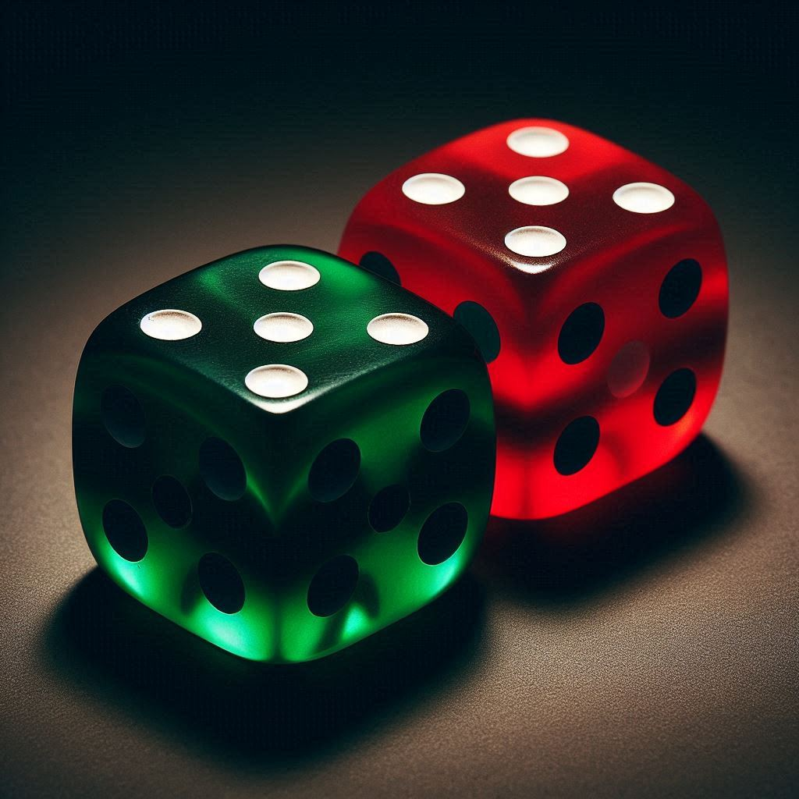



# Inleiding: Wat is (bio)statistiek? {#sec-inleiding}

## Omgaan met onzekere gegevens

Meten is weten, toch?
Helaas is het in de praktijk niet zo simpel.
Meetgegevens, en data in het algemeen,
    zijn namelijk altijd onzeker.
Metingen hebben afwijkingen
    en meetfouten,
    en steekproeven zijn niet altijd representatief
    en onderhevig aan toeval.
Bovendien kunnen de meeste gegevens op meerdere manieren verklaard worden.
Meten is vaak een essentiële eerste stap 
    naar weten,
    maar om verder te komen 
    moeten we de gegevens zorgvuldig evalueren en interpreteren.

In de wetenschap -- en ook daarbuiten! --
    moeten we dus om kunnen gaan met onzekere gegevens.
Dat is waar statistiek over gaat:
    statistiek is de verzameling van methoden en technieken
    die bedacht zijn om verstandige conclusies te trekken
    uit onzekere gegevens.
In deze cursus geven we je een korte introductie
    in dit uitgebreide vakgebied.

## Onderwerpen

::: {.todo-box}
[schrijven]
:::

## Onzekerheid en kansrekenen

Net als in het dagelijks leven
    is in de wetenschap
    het onderscheid tussen een bewezen feit en een hypothese niet zwart-wit.
We verzamelen metingen en observaties,
    en naarmate er meer gegevens zijn die slecht passen bij een hypothese,
    nemen we die hypothese minder serieus.
Een feit is in de praktijk dus een hypothese
    die de beschikbare gegevens veel beter kan verklaren
    dan alle alternatieve hypotheses die we kunnen bedenken,
    waardoor we er nauwelijks meer aan twijfelen.
Maar vaak zijn meerdere hypotheses
    verenigbaar met de beschikbare gegevens
    en kunnen we dus geen harde uitspraken doen.

De uitdaging is om te kwantificeren in hoeverre bepaalde observaties
    bewijs vormen tegen een bepaalde hypothese.
Een observatie die slecht past bij een hypothese
    is een observatie die onder die hypothese erg *onwaarschijnlijk* is.
Statistische analyses zijn daarom vaak gebaseerd op berekeningen van *kansen*.
We zullen ons in deze cursus daarom ook kort verdiepen in het kansrekenen. 

::: {#exr-kleurenblind}

## Kleurenblind

::: {.todo-box}
De dobbelstenen hieronder hebben een onmogelijk aantal stippen... 
Dall-E begrijpt dat niet.
Beter om zelf een foto'tje te maken.
:::

{width=2.5in}

Stel je voor dat je thuis twee dobbelstenen hebt: 
    een rode en een groene.
Je weet dat de rode dobbelsteen eerlijk is;
    de kans dat je er een 6 mee gooit, 
    is gewoon $\frac{1}{6}$.
Maar de groene dobbelsteen is een fop-dobbelsteen:
    één kant is verzwaard,
    en daardoor is de kans op een 6 bij deze dobbelsteen $\frac{1}{2}$.

Het probleem is: 
    je bent kleurenblind,
    en hebt dus geen idee welke dobbelsteen welke is.
Daarom doe je een experiment:
    je pakt willekeurig één van de dobbelstenen en gooit er 4 keer mee.
Tot je verbazing gooi je 4 keer een 6.

Er zijn twee hypotheses. 
De eerste is dat de gekozen dobbelsteen rood is; 
    we noemen die $H\ped{R}$. 
De andere is dat de gekozen dobbelsteen groen is; 
    we noemen die hypothese $H\ped{G}$.
    
**a.** Stel dat $H\ped{R}$ waar is. 
    Wat is dan de kans op de uitkomst ``4 keer een 6''?
    Schrijf een kort R-scriptje om dit te berekenen.
    (We gaan het nog uitgebreid hebben over kansrekenen, maar dit kun je vast al!)

**b.** Stel dat $H\ped{G}$ waar is. 
    Wat is dan de kans op de uitkomst ``4 keer een 6''?
    Doe deze berekening óók in R.

**c.** Kun je op basis van de uitkomst ``4 keer een 6''
    met zekerheid zeggen of $H\ped{R}$ of $H\ped{G}$ waar is?
    
**d.** Welke hypothese vind jij geloofwaardiger, gezien de uitkomst van het experiment?

:::

::: {#tip-geloofwaardigheid-hypotheses .callout-tip}

## Geloofwaardigheid

@exr-kleurenblind heeft een belangrijke boodschap:
    dat twee hypotheses niet kunnen worden uitgesloten
    wil niet zeggen dat ze even geloofwaardig zijn.
In debatten en discussies doen mensen vaak alsof dat wél zo is.
Trap daar niet in!

:::

## Veelgemaakte redeneerfouten

Weinig mensen hebben van nature een goede intuïtie
    voor kansen en onzekerheid.
Zowel in de wetenschap als in het dagelijks leven
    kom je dus heel veel redeneerfouten tegen,
    soms met ernstige consequenties.
Een belangrijk doel van deze cursus is dan ook
    om ervoor te zorgen dat jij veelgemaakte fouten kunt herkennen
    en ze zelf niet meer snel zult maken!

## Statistische modellen

Eerder in deze cursus heb je geleerd over theoretische modellen.
Je hebt geleerd dat een model een vereenvoudigde beschrijvingen is
    van een aspect van de echte wereld,
    gebaseerd op bepaalde aannames.
Zulke aannames zijn strikt genomen zelden waar,
    en de conclusies die getrokken worden op basis van een model
    zijn alleen betrouwbaar
    als die aannames redelijk zijn voor de toepassing.    
In de statistiek is het net zo.
Om de kans op een gebeurtenis te berekenen
    moet je meestal aannames maken over de werkelijkheid.
In andere woorden,
    kansberekeningen zijn meestal gebaseerd op een **statistisch model**.
Het is belangrijk om dat model zorgvuldig te kiezen,
    want je conclusies vallen of staan met je aannames.
Dat geldt net zozeer voor statistische modellen
    die we gebruiken om gegevens te interpreteren
    als voor dynamische modellen 
    over predatoren en hun prooi.

## Statistiek en data science is onmisbaar in biologisch onderzoek

::: {.todo-box}

Schrijven!

Geef voorbeelden en een collage van statistische plaatjes van recente publicaties.

:::

## Statistiek en data science in de samenleving

::: {.todo-box}
Schrijven!

Benoem politiek, economie, bedrijfsleven, verkiezingen, ...

:::

## Over dit deel van het cursusboek

Er zijn veel goede boeken beschikbaar over (bio)statistiek.
Toch hebben we ervoor gekozen om zelf een cursusboek te schrijven.
Dat heeft verschillende redenen.
Ten eerste is dit een erg korte introductie;
    we denken dat een eigen cursusboek de stof efficiënter kan aanbieden
    dan een bestaand boek dat bedoeld is voor een veel langere cursus.
Ten tweede willen we graag laten zien dat de verschillende onderdelen
    van de cursus Kwantitatieve Biologie
    niet los van elkaar staan:
    ook in dit onderdeel komen basiswiskunde, 
    programmeren in R,
    en het denken in termen van modellen 
    weer van pas.

::: {.todo-box}
Aanvullen!

:::

## Terminologie in het Engels

Dit boek is in het Nederlands geschreven
    omdat we denken dat veel studenten daar baat bij zullen hebben.
Tegelijkertijd is het belangrijk om de statistische terminologie
    ook in het Engels te kennen.
Daarom zullen aan het eind van ieder hoofdstukje 
    altijd een korte Engelse woordenlijst invoegen.
Het is de bedoeling dat je die ook leert.
We beginnen gelijk: hier is de woordenlijst van dit hoofdstuk:

| Nederlands    | Engels             | Beschrijving         |
|---------------|--------------------|----------------------|
| hypothese     | hypothesis         | Een voorspelling die met statistiek mogelijk ontkracht of bewezen kan worden |
| kans          | probability        | Hoe waarschijnlijk het is dat iets gebeurt |
| kansrekenen   | probability theory | De wiskunde achter kansen, er zijn andere rekenregels die je aan moet houden met kansen |
| meetfout      | measurement error  | Een fout die is gemaakt tijdens de metingen, waardoor de data minder bruikbaar is |
| statistiek    | statistics         | De wiskunde achter het verzamelen en analyseren van data. |
| toeval        | chance             | Iets wat gebeurd zonder dat er een duidelijke reden voor was, geen statistische term |

: Woordenlijst @sec-inleiding {#tbl-woorden-inleiding .striped .hover}

::: {.callout-warning}

## *Probability* of *chance*?

Let op het verschil tussen *probability* en *chance*: 
    de beste vertaling voor het Nederlandse woord kans is bijna altijd *probability*,
    omdat *chance* ook wordt gebruikt voor toeval, 
    mogelijkheid of gelegenheid:

> *He found the key by chance.*
    
> *If you try hard, you have a chance.*
    
> *I'll give you one more chance to fix your mistakes.*

:::

## Opgaven

::: {.todo-box}

Toevoegen.

:::

