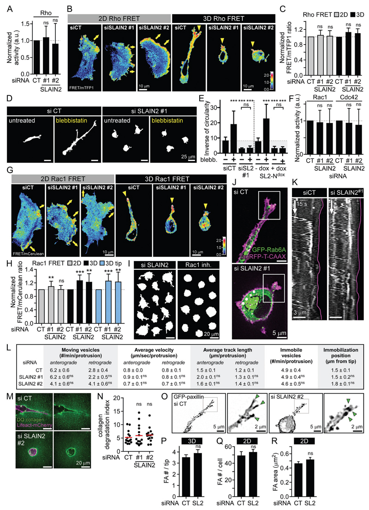



# Inleiding: Waarom is (bio)statistiek? {#sec-inleiding}

## Omgaan met onzekere gegevens

Meten is weten, toch?
Helaas is het in de praktijk niet zo simpel.
Meetgegevens, en data in het algemeen,
    zijn namelijk nooit volledig exact
    en bovendien afhankelijk van interpretatie.
Metingen hebben afwijkingen
    en meetfouten;
    steekproeven zijn niet altijd representatief
    en deels het resultaat van toeval.
Weten vereist meten, evalueren en interpreteren.

Zowel binnen de wetenschap als daarbuiten
    moeten we dus om kunnen gaan met onzekerheid in gegevens.
Daar komt statistiek om de hoek kijken.
Statistiek is de wetenschap van methoden en technieken
    die ons helpen om verantwoorde conclusies te trekken
    uit onzekere gegevens.
In deze cursus maak je kennis met de basisprincipes
    van dit uitgebreide vakgebied.

## Statistiek en data science zijn onmisbaar in biologisch onderzoek

De ontwikkeling van de statistiek als vakgebied
is historisch nauw verweven met de biologie.
Pioniers als Ronald A. Fisher, Karl Pearson en Francis Galton
ontwikkelden hun statistische methoden oorspronkelijk om biologische vragen te beantwoorden. 
Veel van de statistische concepten
die we in deze cursus zullen behandelen
ontstonden uit de behoefte om biologische fenomenen te begrijpen.
Zonder deze ontwikkelingen zou de moderne biologie---van epidemiologie tot evolutiebiologie---niet de nauwkeurigheid en voorspellende kracht hebben die ze vandaag kent.

Tegenwoordig behoren methoden uit de statistiek 
tot het standaardgereedschap van elke bioloog.
Het maakt daarbij niet veel uit welk deelgebied van de biologie
we bekijken.
@Fig-collage is een compilatie van figuren uit artikelen 
die recent zijn gepubliceerd door onderzoekers uit uiteenlopende onderzoeksgroepen van ons departement.
Kwantitatieve data-analyse en statistiek zijn daaruit niet weg te denken.

::: {#fig-collage layout="[[1, 1.34, 1.6], [1.5, 1, 1]]"}

![Cell biology^[Bouchet *et al.* Developmental Cell 39, no. 6 (2016): 708–23]](figuren/emss-70716-f002.jpg)

![Animal ecology^[Horn *et al.* eLife (October 2020)]](figuren/lax_58139_elife-58139-fig2-v2.tif.jpg)

![Ecology and Biodiversity^[Grace *et al.* Nature 529, no. 7586 (2016): 390–93]](figuren/strucEq.PNG)

![Microbiology^[Keizer *et al.* Frontiers in Microbiology 11 (2020)]](figuren/fmicb-11-534118-g001.jpg)

Statistiek en data-analyse zijn onmisbaar in alle vakgebieden binnen de biologie. Klik op een figuur om die uit te vergroten.

:::

## Statistiek en data science in wetenschap en samenleving

Ook buiten de biologie kom je overal statistiek tegen.
De technieken die binnen de biologie gebruikt worden
worden net zo goed toegepast binnen andere wetenschapsgebieden,
zoals psychologie, sociologie, geneeskunde, en
economie.
De vaardigheid om met statistiek om te gaan
is dus een essentiële academische vaardigheid.

Maar het belang van statistiek stopt niet bij muren van de universiteit.
Voor veel bedrijven zijn statistische methoden en data-analyse
cruciaal.
Zij vertrouwen op statistiek om hun voorraad te optimaliseren,
prijzen te bepalen, of voor hun marketingstrategie.
Ook de overheid en politiek kunnen niet zonder.
Hoe zouden we de corona-pandemie zijn doorgekomen
zonder schattingen van $R_0$, voorspellingen van 
het aantal ziekenhuisopnames, en analyses van effecten van maatregelen?
Hoe zou het stikstofdebat eruit zien zonder statistische modellen?
Hoe zouden verkiezingen verlopen zonder peilingen?
Ook als kritische burger heb je baat bij kennis van statistiek: dat helpt je om zin en onzin in maatschappelijke debatten
te onderscheiden.

::: {.content-hidden}
## Onzekerheid en kansrekenen

Net als in het dagelijks leven
    is in de wetenschap
    het onderscheid tussen hypotheses en feiten niet zwart-wit.
We verzamelen metingen en observaties,
    en naarmate er meer gegevens opduiken 
    die slecht passen bij een hypothese
    wordt die hypothese minder geloofwaardig.
Een feit is in de praktijk dus geen onomstotelijk gegeven,
    maar een hypothese
    die de beschikbare gegevens veel beter kan verklaren
    dan alle alternatieve hypotheses die we kunnen bedenken,
    waardoor we er nauwelijks meer ruimte is voor twijfel.
Vaak zijn meerdere hypotheses
    verenigbaar met de beschikbare gegevens
    en kunnen we dus geen harde uitspraken doen.

De uitdaging is om te kwantificeren in hoeverre bepaalde observaties
    bewijs vormen tegen een hypothese.
Een observatie die slecht past bij een hypothese
    is een observatie die onder die hypothese erg *onwaarschijnlijk* is.
Statistische analyses zijn daarom vaak gebaseerd op berekeningen van *kansen*.
We zullen ons in deze cursus dus ook kort verdiepen in de basisprincipes
  van het kansrekenen.
Als je wiskunde A hebt gehad, zul je die stof deels herkennen.

:::

## Over dit deel van het cursusboek

Er zijn veel goede boeken beschikbaar over (bio)statistiek,
  zowel gedrukt als online.
Toch hebben we ervoor gekozen om zelf een cursusboek te schrijven.
Dat heeft verschillende redenen.

Ten eerste hebben we in deze korte cursus
  alleen tijd voor beknopte introductie.
Een op maat gemaakt eigen cursusboek 
  kan de stof efficiënter aanbieden
  dan een bestaand boek dat bedoeld is voor een veel langere cursus.
We voelen ons ook bezwaard om je een duur uitgebreid boek te laten kopen
  en daar maar een klein deel van te behandelen.

Ten tweede willen we graag laten zien dat de verschillende onderdelen
    van de cursus Biologische modellen en Statistiek
    niet los van elkaar staan.
Ook in dit onderdeel van de cursus 
  zullen basiswiskunde, 
  programmeren in R
  en het denken in termen van modellen weer van pas komen.
  
Ten derde hebben we met een eigen cursusboek
  zelf in de hand welke stof we willen behandelen
  en welke nuances we willen aanbrengen.
In een paar keuzes wijken we af van de meeste boeken
  die speciaal voor biologen geschreven zijn.
Hieronder noemen we er een paar.

#### Statistiek is een modelleervak
  
Eerder in deze cursus heb je je verdiept in theoretische modellen.
Je hebt geleerd dat een model een vereenvoudigde beschrijvingen is
    van een aspect van de echte wereld,
    gebaseerd op aannames.
Zulke aannames zijn strikt genomen zelden waar
    en de conclusies die getrokken worden op basis van een model
    zijn alleen betrouwbaar
    als die aannames geschikt zijn voor de toepassing.

In de statistiek is het net zo.
Om de kans op een gebeurtenis te berekenen
    of conclusies te trekken uit onzekere gegevens
    zul je altijd aannames moeten maken over de werkelijkheid;
    zowel over de manier waarop de gegevens tot stand zijn gekomen
    als over de onderliggende biologie.
In andere woorden,
    kansberekeningen zijn altijd gebaseerd op een **statistisch model**.
Het is belangrijk om dat model zorgvuldig te kiezen,
    want je conclusies vallen of staan met je aannames.
Dat geldt net zozeer voor statistische modellen
    die we gebruiken om gegevens te interpreteren
    als voor dynamische modellen 
    over, zeg, predatoren en hun prooi.

Voor statistici is dit allemaal vanzelfsprekend.
Maar in leerboeken bedoeld voor andere vakgebieden ---biologen, (bio)medici, geesteswetenschappers, sociale wetenschappers---wordt dit zelden benadrukt.
In dit boek proberen we dat wel te doen.

#### Hypothesetoetsen als besluitprocedures

In @sec-hypothesetoetsen en @sec-toetsen-gemiddelden
  zul je leren over hypothesetoetsen.
Traditioneel worden hypothesetoetsen gepresenteerd als *besluitprocedures*:
  berekeningen met als doel om te besluiten of bepaalde hypotheses
  moeten worden verworpen.
Hoewel besluitprocedures van groot praktisch belang zijn,
  is het in de wetenschap zelden verstandig, laat staan noodzakelijk,
  om een binair besluit te forceren over de status van een hypothese.
In werkelijkheid zijn de beschikbare gegevens vaak
  op zichzelf niet doorslaggevend
  en in verschillende mate te verenigen met verschillende hypotheses;
  de suggestie van een mechanische besluitprocedure 
  staat in dat geval in de weg van een genuanceerde visie.

De gebruikelijke presentatie van hypothesetoetsen suggereert bovendien
  dat bij het oordeel over een hypothese
  enkel de huidige dataset betrokken hoeft te worden,
  alsof bestaande voorkennis daarbij irrelevant zou zijn.
Het wordt breed onderkend dat dit absurd is,
  maar veel leerboeken suggereren, onbedoeld misschien, iets anders.

In dit boek zullen we daarom minder nadruk leggen
  op binaire conclusies,
  al zullen we de theorie daarachter wel in @sec-hypothesetoetsen bespreken.

#### Subtiele redeneerfouten en *statistical literacy*

Redeneren over onzekere gegevens is niet makkelijk,
  en bepaalde redeneerfouten worden keer op keer gemaakt,
  in het dagelijks leven, het publieke debat, en de wetenschap,
  soms met ernstige consequenties.
Een belangrijk doel van deze korte cursus is dan ook
  om ervoor te zorgen dat jij deze subtiele fouten zelf niet meer maakt
  en ze kunt herkennen en benoemen waar je ze tegenkomt.
We geven dit soort conceptueel inzicht en *statistical literacy*
  in dit boek meer nadruk dan in eerdere cursussen.
  
## Statistiek is leuk!

Misschien zie je op tegen dit onderdeel van de cursus.
Veel studenten zijn bang dat ze statistiek moelijk zullen vinden,
en ook nog saai.

Wij denken dat het meevalt. 
Veel studenten geven achteraf aan dat statistiek veel leuker is
dan ze vooraf hadden gedacht.
Bovendien zul je merken dat je investering zich uitbetaalt:
na deze cursus zul je je veel minder gemakkelijk laten misleiden
door misinformatie in de media, wetenschap, en politiek.
Is dat niet de moeite waard?

## Terminologie

Hieronder volgt een lijst met de belangrijkste termen uit dit hoofdstuk.

Dit boek is in het Nederlands geschreven
    omdat we denken dat veel studenten daar baat bij zullen hebben.
Tegelijkertijd is het belangrijk om de statistische terminologie
    ook in het Engels te kennen.
Daarom zullen we voor ieder begrip ook de Engelse vertaling geven.
Het is de bedoeling dat je die ook leert.

| Nederlands    | Engels             | Beschrijving         |
|:---------------|:--------------------|:----------------------|
| hypothese     | hypothesis         | Een veronderstelling die door onderzoek mogelijk ontkracht of bevestigd kan worden. |
| kans          | probability        | Een maat die aangeeft hoe waarschijnlijk het is dat een gebeurtenis plaatsvindt. |
| kansrekenen   | probability theory | De wiskundige studie van onzekerheid, waarschijnlijkheid, en de   regels voor het berekenen kansen. |
| meetfout      | measurement error  | Het verschil tussen het resultaat van een meting en de daadwerkelijke waarde van de variabele. |
| statistiek    | statistics         | De wetenschap van methoden en technieken om verantwoorde conclusies te trekken uit onzekere gegevens. |

: Woordenlijst @sec-inleiding {#tbl-woorden-inleiding .striped .hover}

::: {.callout-warning}

## *Probability* of *chance*?

Let op het verschil tussen *probability* en *chance*: 
    de beste vertaling voor het Nederlandse woord kans is bijna altijd *probability*,
    omdat *chance* ook wordt gebruikt voor toeval, 
    mogelijkheid of gelegenheid:

> *He found the key by chance.*
    
> *If you try hard, you have a chance.*
    
> *I'll give you one more chance to fix your mistakes.*

:::

