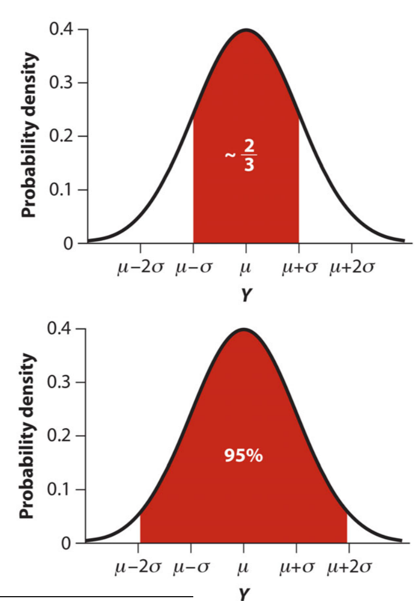



# Kansen en statistische modellen {#sec-kans}

In de eerdere hoofdstukken hebben we benadrukt
    dat bijna alle biologische gegevens onzeker zijn.
Soms komt dat door meetfouten,
    soms doordat de gegevens schattingen zijn op basis van een steekproef. 
Het is daarom heel belangrijk om
  te begrijpen wat je wel of niet kunt concluderen 
  uit zulke onzekere gegevens.
Daarvoor zul je om moeten gaan met **kansen**.
In dit hoofdstuk geven we een korte introductie in kansrekenen,
of met een mooi klassiek woord de *waarschijnlijkheidsleer*.

We beginnen met een paar belangrijk begrippen.

## Basisbegrippen

Wanneer je met een gewone dobbelsteen gooit,
    weet je van tevoren niet wat de uitkomst zal zijn.
Zo'n experiment, 
    gebeurtenis of proces met een onzekere uitkomst wordt een **kansexperiment** genoemd.
Andere voorbeelden zijn het willekeurig trekken van een individu 
    uit een populatie,
    of een draai aan het roulettewiel.

Een **kansvariabele** is een variabele
    waarvan de waarde afhangt van de uitkomst van een kansexperiment.
Een voorbeeld is het aantal ogen van een dobbelsteen. 
Andere woorden voor kansvariabele zijn **stochastische variabele**
    of **stochast**.
Een kansvariabele wordt meestal aangeduid met een hoofdletter,
    zoals $X$ of $Y$.

Eerder hebben we verschillende typen variabelen besproken, 
zoals continu, discreet, nominaal en ordinaal (zie @fig-variabelen). 
Kansvariabelen kunnen op dezelfde manier worden ingedeeld.

::: {#exr-type}
# Typen kansvariabelen

Van welk type zijn de volgende kansvariabelen?

**a.**  Het aantal ogen bij het werpen van een dobbelsteen.

**b.**  Het resultaat bij het gooien van een muntje (dus kop of munt). 
:::

De verzameling van alle mogelijke uitkomsten
    van een kansexperiment
    wordt de **kansruimte** genoemd.
Bij een normale dobbelsteen is de kansruimte de verzameling
$$
    \left\{
        1, 2, 3, 4, 5, 6
    \right\}.
$$

Soms zijn we geïnteresseerd in de kans op een specifieke 
    uitkomst. 
De kans dat de uitkomst gelijk is aan 2
    kunnen we noteren als
$\pr{X = 2}$.
(De letters Pr staan hier voor *Probability*.)
Bij een eerlijke dobbelsteen is die kans natuurlijk 
$$\pr{X = 2} =\frac{1}{6}.$$

In andere gevallen willen we weten wat de kans is 
    op een bepaalde **gebeurtenis**.
Een gebeurtenis hoeft niet één specifieke uitkomst te zijn.
Bijvoorbeeld, 
    laat $X$ het aantal ogen zijn bij een worp met een dobbelsteen.
Dan kunnen we vragen naar de kans dat
    $X$ een oneven getal is; dat schrijf je als:
$$ \pr{X \textrm{ is oneven}}. $$
"$X$ is oneven" is een gebeurtenis, maar niet één specifieke uitkomst, 
    omdat meerdere mogelijke uitkomsten oneven zijn
    (namelijk 1, 3, en 5).
Merk op dat we dezelfde gebeurtenis ook zo hadden kunnen schrijven: 
    "$X$ is een element van de verzameling $\left\{1, 3, 5\right\}$."
Iedere gebeurtenis is dus eigenlijk een omschrijving van een 
    *deelverzameling* van de kansruimte.

## Kansen als frequenties van een lange serie identieke kansexperimenten

Wat is een kans nu eigenlijk precies?
Deze vraag is eigenlijk veel moeilijker dan je zou denken.
Je kunt kansen op verschillende manieren definiëren,
    en de aanhangers van verschillende "kansinterpretaties" 
    maken hier al zeker een eeuw ruzie over.
(Als dit je interesse wekt, 
  is [dit artikel](https://plato.stanford.edu/entries/probability-interpret/) een goede ingang tot de uitgebreide literatuur hierover.)
Voor veel berekeningen maken de definitieverschillen niet veel uit,
    en daarom gebruiken we de interpretatie die 
    in de statistiek traditioneel het meest gebruikt wordt:
    de **frequentistische** interpretatie.

In de frequentistische interpretatie is de kans op een gebeurtenis
    gedefiniëerd als de relatieve frequentie waarmee die gebeurtenis voorkomt
    in een héél lange reeks identieke kansexperimenten.
Stel dat je steeds weer op dezelfde manier 
    dezelfde dobbelsteen gooit.
Neem even aan dat de dobbelsteen helemaal eerlijk is.
Dan zou je verwachten dat,
     op de lange duur,
     een zesde van de uitkomsten 6 zal zijn.
De relatieve frequentie van de uitkomst 6
  in een héél lange reeks identieke kansexperimenten
  is dus $\frac{1}{6}$.
Daarom is de kans $\pr{X = 6}$ gelijk aan $\frac{1}{6}$.

Het lastige van deze definitie is het volgende.
De definitie heeft het over een héél lange reeks kansexperimenten.
Hoe lang dan precies?
Is een miljoen keer genoeg?
Of een miljard?
Zolang het aantal keer dat je met de dobbelsteen gooit eindig is,
    blijft het mogelijk
    (en zelfs waarschijnlijk)
    dat de daadwerkelijke frequentie van zessen
    afwijkt van  $\frac{1}{6}$.
De frequentistische definitie van kansen gaat dus uit van een reeks kansexperimenten
    die tot in het oneindige wordt herhaald;
    alleen dan zal
    de frequentie van zessen met zekerheid convergeren naar $\frac{1}{6}$.

Een relatieve frequentie ligt altijd tussen 0 en 1
    (inclusief 0 en 1).
Een kans is dus ook altijd een getal tussen 0 en 1.
Als een gebeurtenis plaatsvindt iedere keer dat we het kansexperiment uitvoeren,
    dan is de kans op die gebeurtenis 1.
Als een gebeurtenis nooit gebeurt,
  hoe vaak we het kansexperiment ook uitvoeren,
    dan is de kans op die gebeurtenis 0.

Soms worden kansen in percentages uitgedrukt.
Men zegt dan bijvoorbeeld bij het gooien van een munt 
    dat de kans op “kop” 50% is. 
Daar is op zich niets mis mee.
Maar het heeft eigenlijk ook geen voordelen om percentages te gebruiken,
    en wiskundige formules met procenten erin
    worden al snel omslachtig.
Wij houden het dus zoveel mogelijk bij getallen tussen 0 en 1.

Als de kansvariabele discreet is of categorisch,
    dan kunnen we de kansen van alle mogelijke uitkomsten
    optellen.
Omdat de som van alle relatieve frequenties altijd gelijk is aan 1
    moet de som van de kansen op alle uitkomsten ook altijd 1 zijn. 

::: {#wrn-continue-kansvariabelen .callout-warning}

## De som van alle kansen bij continue kansvariabelen

Bij discrete en categoriale kansvariabelen
is de som van de kansen op de verschillende uitkomsten
altijd gelijk aan 1.
Bij continue variabelen geldt ook zoiets, 
maar daar is alles wat ingewikkelder.
Continue kansvariabelen hebben oneindig veel mogelijke uitkomsten,
  en bovendien is de kans op iedere mogelijke uitkomst 
  meestal oneindig klein.
Je kunt dus niet zomaar "alle kansen optellen".
Dat maakt dat je over continue kansvariabelen
op een speciale manier moet nadenken.
We komen daar later op terug.

:::

## Venn-diagrammen

Bij het redeneren over kansen helpt het soms
    om de kansruimte en de gebeurtenissen
    weer te geven in een zogenaamd **Venn-diagram**.

We kunnen ons de verzameling van alle mogelijke uitkomsten
    (de kansruimte) 
    voorstellen als een groot rechthoek (@fig-venn):
```{r}
#| code-fold: true
#| warning: false
#| fig-cap: "Een minimaal Venn-diagram. Het rechthoek stelt de volledige kansruimte voor."
#| label: fig-venn
#| fig.width: 6
#| fig.height: 4

if (!("ggplot2" %in% .packages())){ 
  library(ggplot2) 
  }
if (!("ggforce" %in% .packages())){ 
  library(ggforce) 
  }

kleurKansruimte <- "FloralWhite"

kansruimte <- ggplot() +  
  geom_rect(
    aes(xmin = 0, ymin = 0, xmax= 100, ymax = 100),
    fill = kleurKansruimte, color = "black", size = .8
    ) +
  annotate(
    "text", 
    x = 2, y = 94, 
    label = "kansruimte", 
    color = "black", 
    hjust = 0, 
    size = 5
    ) +
  theme_void()

kansruimte
```

Bijvoorbeeld, bij het gooien met één dobbelsteen
    stelt de rechthoek de verzameling voor van alle mogelijke uitkomsten,
    dus $\{1, 2, 3, 4, 5, 6\}$.
    
We zagen dat iedere gebeurtenis kan worden gerepresenteerd als
    een deelverzameling van de kansruimte. 
We kunnen een gebeurtenis $A$
    daarom voorsellen als een gedeelte van de kansruimte,
    hieronder in @fig-vennA weergegeven als een gele cirkel:
    
```{r}
#| code-fold: true
#| warning: false
#| fig-cap: "Venn-diagram met gebeurtenis $A$. Een gebeurtenis is een deelverzameling van de kansruimte."
#| label: fig-vennA
#| fig.width: 6
#| fig.height: 4

kleurA <- "Gold"

A <- list(
  geom_ellipse(
    aes(x0 = 34, y0 = 47, a = 28,  b = 40,  angle = 0), 
    fill = kleurA , alpha = 0.7, size = .8
    ),
  annotate(
    "text", 
    x = 25, y = 45, 
    label = expression(italic(A)), 
    color = "black", 
    hjust = 0, 
    size = 5
    )
  )

kansruimte + A

```

De uitkomsten die binnen de cirkel vallen 
  zijn de uitkomsten waarbij gebeurtenis $A$ plaatsvindt.
De uitkomsten die buiten de cirkel vallen
  zijn de uitkomsten waarbij de gebeurtenis $A$ *niet* plaatsvindt.
Bijvoorbeeld,
    als $A$ de gebeurtenis is dat we een even getal gooien,
    dan vinden we de uitkomsten $\{2, 4, 6\}$ binnen de cirkel,
    en de uitkomsten $\{1, 3, 5\}$ erbuiten.

We kunnen ook meerdere gebeurtenissen weergeven in één diagram weergeven.
Hieronder in @fig-vennAB zie je bijvoorbeeld een Venn-diagram met gebeurtenissen $A$ en $B$:

```{r}
#| code-fold: true
#| warning: false
#| fig-cap: "Venn-diagram met twee gebeurtenissen: $A$ en $B$."
#| label: fig-vennAB
#| fig.width: 6
#| fig.height: 4

kleurB <- "DodgerBlue"

B <- list( 
  geom_ellipse(
    aes(x0 = 66, y0 = 47, a = 28,  b = 40,  angle = 0), 
    fill = kleurB, alpha = 0.75, size = .8
    ),
  annotate(
    "text", 
    x = 75, y = 45, 
    label = expression(italic(B)), 
    color = "black", 
    hjust = 0, 
    size = 5
    )
)

(AB <- kansruimte + A + B)

```

In dit geval overlappen de twee cirkels elkaar.
Dit betekent dat er uitkomsten zijn zijn waarbij $A$ en $B$
    allebei plaatsvinden.
Een voorbeeld zou zijn als $A$ de gebeurtenis "$X$ is oneven" voorstelt
    en $B$ de gebeurtenis "$X$ is groter dan 3". 
Die gebeurtenissen overlappen omdat de uitkomst 5
    zowel oneven is als groter dan 3.

## Conditionele kansen

Vaak verandert de kans op een gebeurtenis
    zodra je extra informatie krijgt.
Bijvoorbeeld,
   de kans dat een willekeurige gekozen persoon zwanger is
   verandert zodra je leert dat deze persoon 60 jaar oud is.
We moeten de kansen op bepaalde uitkomsten dus aanpassen
  wanneer bepaalde informatie over de uitkomst
  "gegeven is".
We noemen zulke aangepaste kansen **conditionele kansen**.

De kans op gebeurtenis $A$
    gegeven dat gebeurtenis $B$ plaatsvindt,
    wordt geschreven als
$$\pr{A | B}.$$
Je spreekt dit uit als "de kans op $A$ gegeven $B$",
of zegt dat de kans op A "geconditioneerd is op $B$".

Venn-diagrammen geven een nuttig perspectief op conditionele kansen.
Kijk maar eens terug naar het Venn-diagram van @fig-vennAB.
De kans op $A$, 
    dus $\pr{A}$, 
    is de kans op alle uitkomsten binnen de gele cirkel.
Maar als gegeven is dat gebeurtenis $B$ plaatsvindt,
    dan zijn alle uitkomsten buiten de blauwe cirkel daarmee uitgesloten.
De conditionele kans $\pr{A | B}$
    is dus de kans op de uitkomsten in het groene gedeelte
    --- de overlap tussen gebeurtenissen $A$ en $B$ --- 
    relatief ten opzichte van de kans op de uitkomsten in de gehele blauwe cirkel. 

Bij het interpreteren van conditionele kansen
  is het vaak inzichtelijk om te denken aan subpopulaties.
Neem bijvoorbeeld de kans dat een willekeurig gekozen Nederlander lijdt aan hartfalen
  *gegeven dat* deze persoon diabetes heeft.
Dan beperken we ons tot de subpopulatie van personen met diabetes,
  en vragen ons af wat de kans is dat iemand in die subpopulatie
  hartfalen heeft.
Dat is precies de gezochte conditionele kans.


::: {#exr-omdraaien-bayes}

## Omdraaien van conditionele kansen.

Stel dat je met een dobbelsteen gooit.
$X$ is de uitkomst van dit kansexperiment. 
Gebeurtenis $A$ is "$X$ is even" en gebeurtenis $B$ is "$X < 3$". 

**a.**  Teken het Venn-diagram van @fig-vennAB na.

**b.**  Bepaal voor elke mogelijke uitkomst of deze thuishoort in het witte, het gele, het blauwe, of het groene deel van het Venn-diagram, en schrijf de uitkomst vervolgens in dat deel.

**c.**  Wat is de kans op $\pr{A|B}$?

**d.**  Wat is de kans $\pr{B|A}$?

**e**   Leg uit waarom in het algemeen $\pr{A|B}$ niet gelijk is aan $\pr{B|A}$.

:::

## De kans op $A$ en $B$

Vaak willen we de kans weten dat $A$ én $B$ plaatsvinden.
Bijvoorbeeld:
    wat is de kans dat een willekeurig gekozen persoon in Nederland
    diabetes heeft én hartfalen?
We schrijven dit als
$$ \pr{A \textrm{ en } B}. $$

Het berekenen van deze kans is erg eenvoudig
    als de gebeurtenissen $A$ en $B$ *onafhankelijk* zijn.
Daarom moeten we dat begrip eerst behandelen.

### Onafhankelijke gebeurtenissen

Twee gebeurtenissen $A$ en $B$ zijn **onafhankelijk**
    als de kans op gebeurtenis $A$ niet verandert 
    wanneer we leren dat gebeurtenis $B$ plaatsvindt:
$$ \pr{A} = \pr{A | B}. $$
In dat geval verandert ook de kans op $B$ niet als $A$ gegeven wordt:
$$ \pr{B} = \pr{B | A}. $$

Een voorbeeld: 
    stel je weer voor
    dat we met twee eerlijke dobbelstenen gooien---
    eerst een rode, en dan een blauwe.
Gebeurtenis $A$ is dat we met de rode dobbelsteen een zes gooien;
    gebeurtenis $B$ dat we met de blauwe dobbelsteen een zes gooien.
Zijn $A$ en $B$ onafhankelijk?
Het is moeilijk voor te stellen
    dat de uitkomst van de rode dobbelsteen
    iets vertelt over de uitkomst van de blauwe dobbelsteen.
De uitkomst van de blauwe dobbelsteen hangt minutieus af 
  van de manier waarop hij geworpen wordt,
  niet van de uitkomst van de rode dobbelsteen.
Het is dus duidelijk dat de gebeurtenissen $A$ en $B$ onafhankelijk zijn.

Als tegenvoorbeeld gooien we nu in gedachte één eerlijke dobbelsteen.
Gebeurtenis $A$ is dat we een even aantal ogen gooien;
    gebeurtenis $B$ dat we tenminste vier ogen gooien.
Nu zijn $A$ en $B$ *niet* *onafhankelijk.
De kans op $A$ is $\frac{1}{2}$, 
    want er zijn net zoveel even uitkomsten
    als oneven uitkomsten.
Maar als gegeven is dat $B$ plaatsvindt,
    dan sluit dat uitkomsten $\{1, 2, 3\}$ uit
    en blijven dus alleen uitkomsten $\{4, 5, 6\}$ over.
Van die drie uitkomsten zijn er twee even,
    en daarom is de kans $\pr{A | B}$ gelijk aan $\frac{2}{3}$.
Het is duidelijk dat $\pr{A} \neq \pr{A | B}$;
    $A$ en $B$ zijn in dit geval niet onafhankelijk
    (en dus afhankelijk).
    
::: {#exr-onafhankelijk}

Oefenen met onafhankelijke gebeurtenissen.

**a.**  x

**b.**  y

:::

::: {#exr-redeneerfout}

## Redeneerfout

Redeneerfout: Ik heb al 4 keer 6 gegooid dus de kans dat ik de volgende keer wéér 6 gooi is kleiner.

**a.**  x

**b.**  y

:::


### Vermenigvuldigingsregel voor onafhankelijke gebeurtenissen

Als $A$ en $B$ onafhankelijk zijn, 
    dan kunnen we de kans op $A$ én $B$
    eenvoudig berekenen met de volgende **vermenigvuldigingsregel**:
$$ 
\pr{A \textrm{ en } B} = \pr{A}\pr{B}.
$$ {#eq-vermenigvuldigingsregel}
De volgende opgave laat je hopelijk inzien dat deze regel eigenlijk 
    heel logisch is.


::: {#exr-vermenigingsregel-intuitie}
Maak de vermenigvuldigingsregel intuïtief.
Als 10% van een populatie eigenschap $A$ heeft,
  en 50% van de populatie eigenschap $B$,
  en beide eigenschappen zijn onafhankelijk, 
  dan is de kans dat een willekeurig gekozen persoon 
  beide eigenschappen heeft $0.5\times 0.1$ 
  (namelijk 50% van de 10% met eigenschap $A$).
  
**a.** a

**b.** b

:::

::: {#exr-vermenigingsregel-intuitie}
Toepassen vermenigvuldigingsregel op biologische data.
  
**a.** a

**b.** b

:::

### Algemene regel voor $\pr{A \textrm{ en } B}$

Als $A$ en $B$ *niet* onafhankelijk zijn,
    dan geldt de vermenigvuldigingsregel 
    niet.
De regel die in *alle* situaties geldt is:
$$ 
\pr{A \textrm{ en } B} = \pr{A}\pr{B | A}.  
$$ {#eq-AenBalgemeen1}
Om de kans op $A$ en $B$ te berekenen,
    berekenen we dus eerst de kans op $A$,
    en vermenigvuldigen die kans met de kans op $B$ gegeven $A$.
Omdat het niet uitmaakt welke gebeurtenis je $A$ noemt
    en welke $B$,
    geldt ook:
$$
\pr{A \textrm{ en } B} = \pr{B}\pr{A | B}.  
$$ {#eq-AenBalgemeen2}   
Je kunt dus ook de kans op $B$
    vermenigvuldigen met de kans op $A$ gegeven $B$.

::: {#exr-oneindig}
Opgave om inzichtelijk te maken dat in een oneindige rij met experimenten
de kans op $A$ en $B$ gelijk is aan de fractie van de experimenten waarin $A$ gebeurt
keer de fractie *van die experimenten* waarin ook $B$ gebeurt.


**a.** a

**b.** b

:::

## De kans op $A$ of $B$

In de praktijk willen we ook vaak weten 
    wat de kans is dat gebeurtenis $A$ of gebeurtenis $B$ plaatsvindt:
$$ \pr{A \textrm{ of } B}. $$
Met $A$ of $B$ wordt hier bedoeld dat $A$ plaatsvindt, 
    of $B$ plaatsvindt, 
    of beiden.

Het is gemakkelijk om $\pr{A \textrm{ of } B}$ te berekenen
    als de gebeurtenissen $A$ en $B$ elkaar uitsluiten.
Daar moeten we het dus eerst over hebben.

### Gebeurtenissen die elkaar uitsluiten

We zeggen dat twee gebeurtenissen $A$ en $B$ elkaar uitsluiten
    als het onmogelijk is dat $A$ en $B$ allebei plaatsvinden.
Dat betekent dat in het Venn-diagram
    de twee cirkels voor $A$ en $B$ niet overlappen:

```{r}
#| code-fold: true
#| warning: false
#| fig-cap: "Venn-diagram. De gebeurtenissen $A$ en $B$ overlappen niet en sluiten elkaar dus uit."
#| label: fig-uitsluiten
#| fig.width: 6
#| fig.height: 4

A2 <- list(
  geom_ellipse(
    aes(x0 = 28, y0 = 32, a = 25,  b = 28,  angle = 0), 
    fill = kleurA, alpha = 0.5, size = 0.8
    ), 
  annotate(
    "text", 
    x = 27, y = 31, 
    label = expression(italic(A)), 
    color = "black", 
    hjust = 0, 
    size = 5
    )
  )

B2 <- list(
  geom_ellipse(
    aes(x0 = 72, y0 = 68, a = 25,  b = 28,  angle = 0), 
    fill = kleurB, alpha = 0.5, size = 0.8
    ),
  annotate(
    "text", 
    x = 71, y = 67, 
    label = expression(italic(B)), 
    color = "black", 
    hjust = 0, 
    size = 5
    )
)

(AB2 <- kansruimte + A2 + B2)
```

Het betekent ook dat $\pr{A | B} = 0$ en $\pr{B | A} = 0$,
    want gegeven dat $B$ plaatsvindt 
    is gebeurtenis $A$ onmogelijk,
    en andersom.

::: {#exr-uitsluiten}
Oefenen met gebeurtenissen die elkaar uitsluiten.

**a.** a

**b.** b

:::

### Optelregel voor gebeurtenissen die elkaar uitsluiten

Als twee gebeurtenissen $A$ en $B$ elkaar uitsluiten
    geldt de volgende optelregel:
$$
\pr{A \textrm{ of } B}  = \pr{A} + \pr{B}.
$$ {#eq-AofBspeciaal} 

In dit geval kun je de kansen op $A$ en $B$ dus gewoon optellen.


::: {#exr-optelregel-1}

Oefenen met optelregel.


**a.** Wat is $\pr{A}$?

**b.** Wat is $\pr{B}$?
        
**c.** Sluiten $A$ en $B$ elkaar uit?

:::


::: {#exr-optelregel-2}


**a.**

**b.**

:::


::: {#exr-optelregel-3}


**a.**

**b.**

:::


### Algemene regel

Als $A$ en $B$ elkaar niet uitsluiten
    wordt de regel iets ingewikkelder.
Maar, 
    als je naar het Venn-diagram kijkt
    kun je die regel goed begrijpen.

```{r}
#| code-fold: true
#| warning: false
#| fig-cap: "Venn-diagram.Voor de kans op $A$ of $B$ moet het groene gebied één keer worden meegeteld!"
#| label: fig-vennAB2
#| fig.width: 6
#| fig.height: 4

AB

```

De kans op $A$ of $B$
    is de kans die besloten ligt 
    in de gele en de rode cirkel,
    inclusief hun overlap (het oranje gebied).
Als je in dit geval de kans op $A$
    (de kans binnen de gele cirkel)
    en de kans op $B$
    (de kans binnen de rode cirkel)
    simpelweg zou optellen,
    dan zou je de kans binnen de overlap
    (de oranje cirkel) dubbel meetellen.
Daarom moet je die kans er één keer vanaf trekken.
Het resultaat is de volgende algemene formule:
    
$$ 
\pr{A \textrm{ of } B} = \pr{A} + \pr{B} - \pr{A \textrm{ en } B}.
$$ {#eq-AofBalgemeen}


::: {#exr-algemene-regel}
## Optelregel of algemene regel
        
Stel dat $A$ en $B$ elkaar wederzijds uitsluiten.

**a.** Wat is $\pr{A \textrm{ en } B}$?

**b.** Als $A$ en $B$ elkaar uitsluiten 
        mag je de optelregel uit vergelijking~\ref{eq:AofBspeciaal}
        gebruiken om $\pr{A \textrm{ of } B}$ te berekenen.
        Gaat er iets mis als je in plaats daarvan de algemene regel
        van vergelijking~\ref{eq:AofBspeciaal} gebruikt?
:::

::: {#exr-or-context}
Oefenen met $A$ of $B$ in biologische context

**a.** a

**b.** b
:::

## Kansverdelingen

Een eerlijke dobbelsteen heeft de vorm van een bijna perfecte kubus,
    en is van binnen homogeen.
De symmetrische vorm maakt het vanzelfsprekend 
    dat alle uitkomsten even waarschijnlijk zijn.
We kunnen de kansen als volgt in een grafiek weergeven:

  
```{r}
#| code-fold: true
#| warning: false
#| fig-cap: "Kansverdeling: de kansen bij het gooien van één dobbelsteen."
#| label: fig-uniform-dobbelsteen
#| width: 4

uitkomsten <- seq(1, 6)
kansen <- rep(1/6, 6)
kansenDobbelsteen <- data.frame(
  uitkomsten = factor(uitkomsten),
  kansen
  )
library(ggplot2)
ggplot(
  kansenDobbelsteen, 
  aes(x = uitkomsten, y = kansen)
) +
  geom_bar(
    stat = "identity", 
    width = 1, 
    fill = "orange", 
    color = "black") +
  labs(
    title = "Kansverdeling voor de uitkomst van een worp met één dobbelsteen",
    x = "Aantal ogen",
    y = "Kans"
    )

```

In de figuur geven de oppervlaktes van de staafjes
de kans weer van iedere uitkomst.

Stel je nu voor dat het kansexperiment bestaat
    uit het werpen van niet één maar twee dobbelstenen,
    zeg,
    een blauwe en een rode.
Deze keer zijn we geïnteresseerd in de som van het aantal ogen.
De kansruimte is nu de verzameling van getallen van 2 tot 12.
Het is gemakkelijk te zien dat de verschillende uitkomsten nu *niet* meer even waarschijnlijk zijn.
Er is maar één manier om de uitkomst 2 te krijgen,
    namelijk als we met zowel de rode als de blauwe dobbelsteen
    1 gooien.
Maar er zijn wel *zes* manieren om 7 te gooien:
$1 + 6$, $2 + 5$, $3 + 4$, $4 + 3$, $5 + 2$, $6 + 1$.
Je zult met twee dobbelstenen dus veel vaker 7 gooien dan 2.
De kunnen de kansen weer in een grafiek weergeven:

```{r}
#| code-fold: true
#| warning: false
#| fig-cap: "Kansverdeling: de som van twee dobbelstenen."
#| label: fig-kansverdeling-twee-dobbelstenen
#| width: 4

uitkomsten <- seq(2, 12)
kansen <- pmin(uitkomsten - 1, 13 - uitkomsten)/36
kansenDobbelsteen <- data.frame(
  uitkomsten = factor(uitkomsten), 
  kansen
  )
library(ggplot2)
ggplot(
  kansenDobbelsteen, 
  aes(x = uitkomsten, y = kansen)
) +
  geom_bar(
    stat = "identity", 
    width = 1, 
    fill = "orange", 
    color = "black") +
  labs(
    title = "Kansverdeling voor het aantal ogen van twee dobbelstenen",
    x = "Aantal ogen",
    y = "Kans"
  )

```

De manier waarop de kans 
    over de verschillende mogelijke uitkomsten verdeeld is,
    wordt de **kansverdeling** genoemd.
Dit begrip speelt een grote rol in deze cursus.


::: {#tip-kans-en-histo}
@fig-kansverdeling-twee-dobbelstenen lijkt op een histogram.
Dat is niet voor niets.
Je weet misschien nog dat we een kans op een uitkomst hadden gedefinieerd
    als de frequentie van die uitkomst
    in een héél lange (schier oneindige) reeks identieke kansexperimenten.
Dat betekent dat je de kansverdeling in @fig-kansverdeling-twee-dobbelstenen kunt interpreteren
    als het histogram dat je zou krijgen
    als je hetzelfde kansexperiment héél vaak zou herhalen.
:::


## Kansen als oppervlakten onder de grafiek van de kansverdeling

We kijken nog even terug naar de kansverdeling 
    voor het totaal aantal ogen bij twee dobbelstenen.

Stel dat we nu willen weten wat de kans is
    dat het aantal ogen groter is dan 7
    maar kleiner dan 11:
$$7 < X < 11.$$
Deze gebeurtenis 
    kunnen we ook anders uitdrukken,
    namelijk als
$$  X = 8 \textrm{ of } X = 9  \textrm{ of } X = 10.$$
Omdat de verschillende uitkomsten $X = 8$, $9$ en $10$ elkaar uitsluiten
    kunnen we de optelregel gebruiken:

$$ \pr{7 < X < 11}  = \pr{X = 8} + \pr{X = 9} + \pr{X = 10}. $$ {#eq-som8_9_10}

In de grafiek van de kansverdeling
    was de kans op een uitkomst
    weergegeven als de oppervlakte van de bijbehorende staaf.
De kans $\pr{7 < X < 11}$ is de som van de kansen op uitkomsten
    8, 9, en 10, 
    en komt dus overeen met de totale oppervlakte van de staven
    voor die uitkomsten.
Hieronder is die oppervlakte in paars weergegeven:

```{r}
#| code-fold: true
#| warning: false
#| fig-cap: "Kansverdeling: de som van twee dobbelstenen."
#| label: fig-kansverdeling-twee-dobbelstenen-bars
#| width: 4

uitkomsten <- seq(2, 12)
kansen <- pmin(uitkomsten - 1, 13 - uitkomsten)/36
kleur <- rep("orange", 11)
kleur[7:9] <- "purple"
kansenDobbelsteen <- data.frame(
  uitkomsten = factor(uitkomsten), 
  kansen,
  kleur
)
ggplot(
  kansenDobbelsteen,
  aes(x = uitkomsten, y = kansen)
) +
  geom_bar(
    stat = "identity", 
    width = 1, 
    fill = kleur, 
    color = "black") +
  labs(
    title = "Cumulatieve kansverdeling voor het totaal aantal ogen van twee dobbelstenen",
    x = "Aantal ogen",
    y = "Kans"
  )

```

In het algemeen geldt
    dat de kans dat de uitkomst $X$ binnen een bepaald interval valt, 
    $a < X < b$,
    gelijk is aan de oppervlakte van de staven
    van de uitkomsten die tussen die grenzen vallen
In dit voorbeeld was de kansvariabele
    numeriek en discreet,
    maar we zullen zien dat ook bij continue variabelen 
    de kans dat $X$ in het interval $(a, b)$ valt
    gegeven wordt door de oppervlakte onder de grafiek
    van de kansverdeling tussen de grenzen $a$ en $b$.
    
## De cumulatieve kansverdeling
    
De **cumulatieve kansverdeling** $F_X(x)$ van kansvariabele $X$ 
  is de functie die aangeeft wat de kans is dat de uitkomst kleiner of gelijk is 
  aan de waarde $x$:
$$ F_X(x) = \pr{X\le x}. $$
Bij wijze van voorbeeld geeft de grafiek hieronder
  de cumulatieve kansverderling weer die hoort bij
  het totaal aantal ogen bij het werpen met twee dobbelstenen.
  
```{r}
#| code-fold: true
#| warning: false
#| fig-cap: "Kansverdeling: de som van twee dobbelstenen."
#| label: fig-cumulverdeling-twee-dobbelstenen-bars
#| width: 4
    
uitkomsten <- seq(2, 12)
kansen <- cumsum(pmin(uitkomsten - 1, 13 - uitkomsten)/36)
kleur <- rep("orange", 11)
kleur[7:9] <- "orange"
kansenDobbelsteen <- data.frame(
uitkomsten = factor(uitkomsten), 
kansen,
kleur
)
ggplot(
  kansenDobbelsteen,
  aes(x = uitkomsten, y = kansen)
  ) +
  geom_bar(
    stat = "identity", 
    width = 1, 
    fill = kleur, 
    color = "black") +
    labs(
      title = "Cumulatieve verderling voor het aantal ogen van twee dobbelstenen",
      x = "Aantal ogen",
      y = "Cumulatieve kans"
    )
    
```

Hierboven lieten we zien dat je de kans $\pr{7<X<11}$ 
  kunt aflezen als de totale oppervlakte van de staven 
  voor $X=8$, $X =9$, en $X = 10$ in de kansverdeling.
Merk op dat je dezelfde kans ook zo kunt schrijven:
  $$\pr{7<X<11} = F_X(10) - F_X(7).$$


## Maten voor ligging en spreiding van kansverdelingen

In hoofdstuk ?? 
    heb je gezien dat de verdeling van een variabele in een dataset 
    kan worden samengevat
    door maten te geven voor de ligging en spreiding van die verdeling.
Op dezelfde manier kunnen we ook de *kansverdeling* van een kansvariabele 
samenvatten
    door maten van ligging en de spreiding van de kansverdeling te geven.

### Maten van ligging/locatie

We beginnen met maten van ligging.


De **modus** van de kansverdeling van een kansvariabele $X$ 
    is die uitkomst
    die de grootste kans heeft.
Dat komt overeen met de positie van de piek 
    in de grafiek van de kansverdeling.
Als een kansverdeling twee pieken heeft
    dan wordt die "bimodaal" genoemd.

Het **gemiddelde** van een kansverdeling van een kansvariabele $X$ 
  wordt ook wel de **verwachtingswaarde** genoemd.
Een nette notatie daarvoor is $\ev{X}$;
  die bijzondere $\mathbb{E}$ staat voor het Engelse *Expectation*.
Vaak wordt ook het Griekse symbool $\mu$ gebruikt,
  of $\mu_X$ as we willen aangeven dat het om de verwachtingswaarde 
  van de variabele $X$ gaat.
Als de variabele discreet is
    dan kan de verwachtingswaarde berekend worden als:
$$ \ev{X} = \sum_x \pr{X = x}\, x. $$
Dat wil zeggen:
    we nemen het gemiddelde van alle mogelijke uitkomsten $x$,
    waarbij uitkomsten met een grotere kans
    zwaarder worden meegeteld.

::: {.todo-box}
Formule van verwachtingswaarde beter uitleggen.
:::
    
De **mediaan** van een kansvariabele $X$
    is de waarde zodanig
    dat de kans op een uitkomst kleiner dan die waarde
    precies gelijk is aan \textonehalf.

    
\[Scheve kansverdeling, mediaan aangegeven, kans links en rechts aangegeven.\]

### Maten van spreiding

Dan nu de maten van spreiding.

De meest gebruikte maten van spreiding 
    zijn de variantie
    en de standaardafwijking
    (ook vaak standaarddeviatie genoemd).
De **variantie** van de kansverdeling
    van een kansvariabele $X$
    wordt vaak genoteerd als $\var{X}$.
Het is het gemiddelde van de gekwadrateerde afwijking
    van de verwachtingswaarde:
$$ 
    \var{X} = \ev{ \left( X - \mu \right)^2},
$$
    oftewel
$$ 
    \var{X} = \sum_x \pr{X = x} \left( x - \mu \right)^2,
$$

De standaarddeviatie
    is de wortel van de variantie
    en wordt vaak met de Griekse letter $\sigma$
    aangeduid:
$$
    \sigma = \sqrt{\var{X}}.
$$
Als het nuttig is om te benadrukken dat het gaat om de standaarddeviatie
    van de variabele $X$ wordt ook wel $\sigma_X$ gebruikt.
Omgekeerd is de variantie van $X$ dus
    het kwadraat van de standaarddeviatie:
$$
    \var{X} = \sigma^2.
$$
Daarom wordt de variantie van een kansvariabele 
    ook vaak genoteerd
    als $\sigma^2$ of $\sigma_X^2$ in plaats van $\var{X}$.

## Kansenverdelingen voor continue variabelen

::: {.todo-box}
Schrijven:
  
Een continue kansvariabele $X$ heeft in principe 
oneindig veel mogelijke uitkomsten.
Tussen elke twee getallen die je kiest
zitten namelijk altijd weer andere getallen.
Typisch is de kans op een *specifieke* uitkomst daarom gelijk aan 0.
Bij continue variabelen zijn we daarom niet geinteresseerd
in de kans op een specifieke uitkomst,
maar in de kans dat de uitkomst in een bepaald *interval* valt.
Bijvoorbeeld, de kans dat de lichaamslengte van een willekeurig gekozen persoon
precies $180{,}00(\ldots)$ cm is 
(met oneindig veel nullen als decimalen!)
is 0; 
maar de kans dat de lichaamslengte tussen 178 en 182 cm inligt
is wél een getal tussen 0 en 1. 

In @fig-kansverdeling-twee-dobbelstenen-bars hebben we al gezien
dat je je, bij discrete kansvariabelen, 
de kans op een waarde in een bepaald interval 
kunt voorstellen als een oppervlakte onder de kansverdeling.
Dat beeld gaat ook op voor continue variabelen.
Kijk maar eens naar Fig xx hieronder.

[Plot van een kansverdeling met een interval gekleurd.]

Die figuur geef de kansverdeling weer voor xx.
De kans dat een willekeurige observatie tussen de grenzen
xx en xx valt is gegeven door de oppervlakte van het paarse gedeelte
onder de grafiek. 
Merk op: de waarde op de $y$-as is bij kansverdelingen van continue variabelen
dus niet de kans op een specifieke waarde. 
In plaats daarvan spreken we bij continue variabelen over de **kansdichtheid**.

In paragraaf xx merkten we op dat een kansverdeling 
vergelijkbaar is met een histogram van een *enorm* aantal waarnemingen.
Die vergelijking gaat nog steeds op bij continue variabelen;
alleen moet je je voorstellen dat het aantal waarnemingen zo groot is
dat we de klassen van het histogram enorm smal hebben kunnen maken --
zo smal dat je de individuele rechthoekige staven niet meer ziet
en het histogram dus een gladde vorm krijgt.
:::
  
::: {.todo-box}
Opgave: schat kansen op basis van een schets van de kansverdeling.
:::

## De normale verdeling
  
::: {.todo-box}
Kansverdelingen kunnen in principe allerlei vormen hebben.
Maar bepaalde kansverdelingen komen in theorie en praktijk steeds weer terug
en hebben daarom een naam gekregen.
De meest beroemde is de **normale verdeling**, 
ook wel de **normaalverdeling**, de **Gaussische verdeling** of de **Gausscurve** genoemd
naar de grote Wiskundige Carl Friedrich Gauss (1777--1855).

Eigenlijk gaat het niet om één specifieke kansverdeling
maar om een "familie" van kansverdelingen.
Leden van deze familie lijken precies op elkaar, 
behalve dat ze verschillen in gemiddelde $\mu$ 
en standaarddeviatie $\sigma$.
We noemen $\mu$ en $\sigma$ de **parameters** van de normale verdeling.


De verdelingen zien er als volgt uit: VERBETER PLAATJE
  
```{r}
#| code-fold: true
#| warning: false
#| fig-cap: "De normale verdeling."
#| label: fig-normale-verdeling
#| width: 5

#library(grid)

# Create a data frame for the standard normal distribution
x <- seq(-3.5, 3.5, length.out = 200)
data <- data.frame(x = x, y = dnorm(x))

h <- exp(-0.5)/sqrt(2*pi)

  ggplot(data, aes(x, y)) +
  geom_line(color = "black", linewidth = 1) + # Standard normal curve
  geom_area(data = subset(data, x >= -1 & x <= 1), aes(x, y), fill = "orange", alpha = 0.4) + # Area between -1 and 1
  geom_segment(
    aes(x = 0, xend = -1, y = h, yend = h), 
    arrow = arrow(length = unit(0.2, "cm")), 
    color = "black", 
    linewidth = 0.8) + # Arrow
  #  annotate("text", x = -0.5, y = 0.03, label = "x == -1 %->% x == 0", 
  #           parse = TRUE, hjust = 0.5, color = "red", size = 4) + # Annotation for the arrow
  scale_x_continuous(
    breaks = c(-2, -1, 0, 1, 2), 
    labels = c(expression(-2 * sigma), expression(-sigma), expression(mu), expression(sigma), expression(2*sigma))
  ) + # Label for x = 0 as µ
  scale_y_continuous(labels = NULL, breaks = NULL) + # Remove y-axis numbers
  theme_classic() +
  labs(y = "Kansdichtheid", x = expression(x)) + # Add y-axis label
  theme_minimal() +
  theme(axis.text.x = element_text(size = 14),
        axis.text.y = element_blank(), # Remove y-axis text
        axis.ticks.y = element_blank(), # Remove y-axis ticks
        axis.line.y = element_line(),
        axis.line.x = element_line(),
        axis.title.y = element_text(size = 12, angle = 90), # Style y-axis label
        axis.title = element_text(size = 14),
        panel.grid = element_blank())
```
Je ziet dat de verdeling een *klokvorm* heeft en volledig *symmetrisch* is.

De precieze formule voor de normale verdeling zul je in deze cursus
niet vaak nodig hebben,
maar het is toch handig deze een keer te zien.
$$ \pr{x} = \frac{1}{\sqrt{2\pi\sigma^2}} e^{-\frac{(x - \mu)^2}{2\sigma^2}}.$$
De normale verdeling heeft dus een precieze wiskundige definitie.
Niet iedere verdeling die een klokvorm heeft is ook echt een normale verdeling
(maar iedere normale verdeling heeft wel dezelfde klokvorm).

Uitleggen waarom de normale verdeling zo belangrijk is:
  
- Veel variabelen in de biologie en daarbuiten ongeveer normaal verdeeld.
- Laat voorbeelden zien.
- We zullen later, en sectie [centrale limitestelling] uitleggen hoe dit komt.

Vuistregels voor de normale verdeling:
  
- maak het volgende plaatje na, maar met $X$ op de $x$-as
$$\pr{\mu - \sigma < X < \mu + \sigma} = 0.68,$$
$$\pr{\mu - 1{,}96\sigma < X < \mu + 1{,}96\sigma} = 0{,}95.$$
Je kunt dus als vuistregel onthouden dat 
er bij een normale verdeling *grofweg* 2/3 kans is op een waarneming
die minder dan 1 standaarddeviatie afwijkt van het gemiddelde,
en 0.95 kans op een waarneming die minder dan 2 standaarddeviaties afwijkt. 

{#fig-vuistregels}

:::
    
::: {.todo-box}
  
Opgave

Schatten van kansen op basis van vuistregels en geschetst plaatje.
Bereken de kansen. Schets steeds eerst op papier een normale verdeling.
Arceer de oppervlakte onder de curve die overeenkomt met de gevraagde kans.
  
- $\pr{X < \mu}$
- $\pr{X > \mu + \sigma}$
- $\pr{X < \mu - 2 \sigma}$
- $\pr{X < \mu - 2 \sigma \text{ of } $\pr{X > \mu + 2 \sigma}$

:::
    
## De standaard-normale verdeling
  
::: {.todo-box}
  
Schrijven:
Speciaal geval van de normale verdeling voor $\mu = 0$ en $\sigma = 1$
wordt de **standaard-normale verdeling** genoemd.

Hierboven hebben we kansvariabelen vaak $X$ genoemd. 
Dat is willekeurig; we hadden ook $Y$ kunnen gebruiken, of $W$
Voor een variabele die standaard-normaal verdeeld is
wordt vaak de letter $Z$ gebruikt. 
Daar is geen fundamentele reden voor,
maar formules zijn soms sneller te overzien
als je de convenionele letters gebruikt.

:::


### Transformeren naar de standaard-normale verdeling
  
::: {.todo-box}

IK ZOU HET TRANSFORMEREN LIEVER WEGLATEN UIT DE CURSUS,
MAAR WEET NOG NIET GOED OF DAT KAN.
HIERONDER EEN START VAN EEN UITLEG,
MAAR DIE IS NOG NIET AF.

Schrijven:
  
Alle normaalverdelingen hebben exact dezelfde vorm;
het enige verschil is dat hun gemiddelde $\mu$ en hun standaarddeviatie $\sigma$
verschillend kunnen zijn. 
Dat betekent dat verschillende normaalverdelingen 
ten opzichte van elkaar *verschoven* kunnen zijn (verschillende $\mu$)
en/of horizontaal uitgerekt (verschillende $\sigma$).
De totale oppervlakte onder de grafiek is altijd 1
(omdat de kans op een uitkomst tussen $-\infty$ en $\infty$ altijd 1 is).
Horizontaal uitrekken gaat dus altijd samen met vertikaal indrukken.

Bekijk Fig xx hieronder eens.
Deze laat twee normale verdelingen zien.
De bovenste figuur is de verdeling van variabele $X$, 
met gemiddelde $\mu_X = 170$ en standaarddeviatie $\sigma_X = 7$.
Het zou de verdeling van de lichaamslengte 
van Nederlandse volwassen vrouwen kunnen zijn, gemeten in cm.
Het onderste figuur is de verdeling van variabele $Z$
die standaard-normaal verdeeld is,
dus met $\mu_Z=0$ en $\sigma_Z = 1$.
Dat beide plaatjes er ondanks de verschillende parameters
precies hetzelfde uitzien komt doordat het domein en het bereik 
van de $x$- en $y$-as zijn aangepast.

::: {.todo-box}
Maak een plot met de twee normaalverdelingen direct onder elkaar,
precies uitgelijnd en geschaald
zodat ze er afgezien van de getallen op de assen 
precies hetzelfde uitzien.
{#fig-transformeren}
:::


Stel nu dat we geïnteresseerd zijn in de kans dat $X$ groter is dan 
173,5 cm:
$$ \pr{X > 173{,}5}.$$ 
Die kans komt overeen met de oppervlakte van het rode vlak in de bovenste plot
in @fig-transformeren.    
Dat oppervlak is precies gelijk aan het rode vlak in de *onderste* plot.
In de onderste plot is het rode vlak precies de kans
$$ \pr{Z > 0{,}5}.$$
Het moet dus zo zijn dat
$$ \pr{X > 173{,}5} = \pr{Z > 0{,}5}. $$
Iedere kans die we willen berekenen voor variabele $X$
kunnen dus we identificeren met een kans voor variabele $Z$.

Je kunt dit ook als volgt zien.
Als de kansvariabele $X$ normaal verdeeld is met gemiddelde $\mu_X$
en standaarddeviatie $\sigma_X$,
dan kunnen we een andere kansvariabele definieren als 
$$ Z = \frac{X - \mu_X}{\sigma_X}. $$
Het kansexperiment die bij de kansvariabele $Z$ hoort is:
  
- meet $X$, 
- trek het gemiddelde van $X$, dus $\mu_X$, van het resultaat af,
- en deel wat je dan krijgt door de standaarddeviatie van $X$, dus $\sigma_X$.

Doordat je het gemiddelde van $X$ hebt afgetrokken,
  is $Z$ gemiddeld $\mu_Z = 0$,
  en doordat je vervolgens door de standaarddeviatie  van $X$ gedeeld hebt,
  is de standaarddeviatie $\sigma_Z = 1$.
$Z$ is dus *standaard*-normaal verdeeld. 

Daaruit volgt:
$$ \pr{X > 173{,}5} = 
  \pr{\frac{X - \mu_X}{\sigma_X}> \frac{173{,}5 - \mu_X}{\sigma}} = 
  \pr{Z > \frac{173{,}5 - \mu_X}{\sigma}}  = 
  \pr{Z > \frac{173{,}5 - 170}{7}}  = 
  \pr{Z > 0{,}5}. $$
  
:::
    
    
## De $t$-verdeling

Later in de cursus komen we ook een andere verdeling tegen.
Deze verdelingen heet de $t$-verdeling.

Eigenlijk is de $t$-verdeling weer niet één verdeling
maar een lange rij van verdelingen die bij elkaar horen.
Deze verdelingen zijn genummerd: 
  de eerste heet $t_1$, de tweede $t_2$, enzovoort.
De index heet het aantal **vrijheidsgraden**.
Je kunt $t_8$ dus ook omschrijven als de $t$-verdeling 
met 8 vrijheidsgraden,
of met $\text{df} = 8$.
(Hier staat df voor *degrees of freedom**.)

De $t$-verdelingen lijken behoorlijk op de standaard-normale verdeling;
we laten in @fig-t hieronder een aantal voorbeelden zien.

```{r}
#| label: fig-t
#| fig-cap: "Verschillende $t$-verdelingen en de standaard-normale verdeling"
#| warning: false
#| code-fold: true
#| fig-height: 4

t_values <- seq(-3.5, 3.5, by = 0.1)
z_values <- seq(-3.5, 3.5, by = 0.1)

dataframe <- data.frame(
  t = c(z_values, rep(t_values, 3)),
  prob = c(
    dnorm(z_values),
    dt(t_values, df = 2),
    dt(t_values, df = 5),
    dt(t_values, df = 20)
  ),
  df = factor(
    c(
      rep("standaard-normaal", length(z_values)),
      rep("df = 2", length(t_values)),
      rep("df = 5", length(t_values)),
      rep("df = 20", length(t_values))
    ),
    levels = c(
      "df = 2", "df = 5", "df = 20", "standaard-normaal"
    )
  ) 
)

ggplot(
  dataframe, 
  aes(
    x = t, y = prob, 
    group = df, color = df, linewidth = df, linetype = df)
) +
  geom_line(
  ) +
  scale_color_manual(
    values = c( rep("black", 3), "#e8601d")
  ) + 
  scale_linewidth_manual(
    values = c(1, 1, 1, 1.2)
  ) +
  scale_linetype_manual(
    values = c(
      "df = 2"="longdash", 
      "df = 5"="dashed", 
      "df = 20"="dotted",
      "standaard-normaal"="solid" 
    )
  ) +
  labs(
    x = expression(italic(t)),
    y = "kansdichtheid"
  )
```
Vergeleken met de standaard-normale verdeling
heeft de $t$-verdeling een lagere piek
en "dikkere staarten".
Daaruit blijkt dat de spreiding van de $t$-verdeling groter is.^[Voor wie 
dat interessant vindt: de variantie van de $t$-verdeling hangt af
van het aantal vrijheidsgraden en is gelijk aan $\mathrm{df}/(\mathrm{df} - 2)$.
In de limiet waarbij het aantal vrijheidsgraden naar oneindig gaat,
convergeert dit naar 1. Dat moet ook,
want in die limiet convergeert de $t$-verdeling naar de 
standaard-normale verdeling, en die heeft variantie $\sigma = 1$.]

## Optellen van meerdere kansvariabelen

We zullen in deze cursus regelmatig
    situaties tegenkomen waarbij
    we kansvariabelen bij elkaar optellen.
Bijvoorbeeld, 
    als we met twee dobbelstenen gooien
    en geïnteresseerd zijn in het totaal aantal ogen,
    dan tellen we in feite twee kansvariabelen op:
    het aantal ogen van de eerste dobbelsteen 
    en het aantal ogen van de tweede dobbelsteen.
Als we die twee kansvariabelen $X_1$ en $X_2$ noemen,
    dan gaat onze interesse dus uit naar
$$ Y = X_1 + X_2.$$
We hebben op deze manier een nieuwe kansvariabele $Y$ gedefinieerd.
De vraag is nu:
    wat kunnen we zeggen over de kansverdeling van $Y$?

Meer in het algemeen kan het zijn dat we niet twee
    maar $n$ kansvariabelen optellen.
We kunnen die variabelen $X_i$ noemen.
In dat algemene geval is $Y$ dus:
$$ Y = \sum_{i=1}^n X_i.$$


### De verwachtingswaarde van een som

Om te beginnen kijken we naar 
    de verwachtingswaarde van $Y$, dus $\ev{Y}$.
(De verwachtingswaarde is het gemiddelde van de kansverdeling,
  weet je nog?)
Hier is de regel heel eenvoudig:
    de verwachtingswaarde van de som
    is de som verwachtingswaarden, dus
$$
\ev{Y} = \sum_{i = 1}^n \ev{X_i}.
$$ {#eq-evsom}
Dit is niet erg verrassend.
Bijvoorbeeld:
Als het aantal ogen bij het gooien van één dobbelsteen 
    gemiddeld $3 \frac{1}{2}$ is,
    dan is het aantal ogen van twee dobbelstenen gemiddeld
    $3 \frac{1}{2} + 3 \frac{1}{2} = 7$.

### De variantie van de som

Vervolgens bekijken we 
    de variantie van $Y$, dus $\var{Y}$.

De berekening van de variantie van $Y$ is gemakkelijk 
    als de kansvariabelen $X_i$ allemaal **onafhankelijk* zijn.
In paragraaf ?? hebben we al gezien
    wat het betekent als twee **gebeurtenissen** onafhankelijk zijn,
    maar hier hebben we het over onafhankelijke *variabelen*,
    dus we moeten nog even uitleggen wat dat betekent.

Twee variabelen zijn onafhankelijk
    als de kansen op de uitkomsten van de ene variabele
    niet veranderen als je de uitkomst weet van de andere variabele. 
Dat is het geval als elke gebeurtenis van variabele $X_1$
    onafhankelijk is van elke gebeurtenis van variabele $X_2$.

::: {#exr-onafhankelijk}
Verwerkingsopgave over onafhankelijkheid.

**a.**

**b.**

:::

Terug naar de variantie van $Y$,
    waarbij $Y$ de som was van $n$ kansvariabelen $X_i$.
Als alle variabelen $X_i$ onafhankelijk zijn van elkaar,
    dan is de variantie van $Y$ simpelweg
    de som van de varianties van de variabelen $X_i$:
$$
\var{Y} = \sum_{i = 1}^n \var{X_i}.
$${eq-somvarianties}
Als je meerdere onafhankelijke variabelen optelt
    wordt de variantie dus steeds groter.

Zoals je weet is de standaarddeviatie 
    simpelweg de wortel van de variantie.
De standaarddeviatie van $Y$ is in dit geval dus
$$ 
\sd{Y} = \sqrt{\sum_{i = 1}^n \var{X_i}}.
$${#eq-somvarianties}
Het is belangrijk te zien dat je eerst de varianties van de $X_i$ optelt
    en daarna pas de wortel neemt.
De standaarddeviatie van $Y$ is dus *niet*
    de som van de standaarddeviaties van de $X_i$!
  
  
Als de $X_i$ niet onafhankelijk zijn,
kun je niets algemeens zeggen over de variantie van $Y$.

::: {#exr-wortel}
Verwerkingsopgave over $\sqrt{a + b} \neq \sqrt{a} + \sqrt{b}$.
:::


::: {#exr-psychologisch-experiment}
Psychologisch experiment. 
Twee proefpersonen (mensen? zijn er voorbeelden met primaten?). 
Eerste proefpersoon krijgt 10 euro (of iets anders)
    maar krijgt de gelegenheid om dat bedrag te delen
    met de tweede proefpersoon.
$X_1$ is het bedrag dat proefpersoon 1 zelf houdt,
$X_2$ is het bedrag dat deze aan proefpersoon 2 geeft.
Zowel $X_1$ als $X_2$ zijn kansvariabelen,
    want verschillende proefpersonen maken verschillende beslissingen.

**a.** Zijn $X_1$ en $X_2$ onafhankelijk?

**b.** Stel dat de standaarddeviatie van variabele $X_1$ gelijk is aan 5\,€.  Wat is de variantie van variabele $X_2$?
    
**c.** De variabele $Y$ is gedefinieerd als de som van $X_1$ en $X_2$, dus $Y = X_1 + X_2$. Wat is de variantie van $Y$?

**d.** Zie je waarom je de varianties van $X_1$ en $X_2$ in dit geval niet mag optellen?

:::

## Samenvatting
  
::: {.todo-box}

Schrijven!
  
:::

  
## Terminologie in het Engels

| Nederlands    | Engels             |
|---------------|--------------------|
|               |                    |

: Woordenlijst @sec-kans . {#tab-woorden-kans .striped .hover}

## Opgaven


## Voetnoten