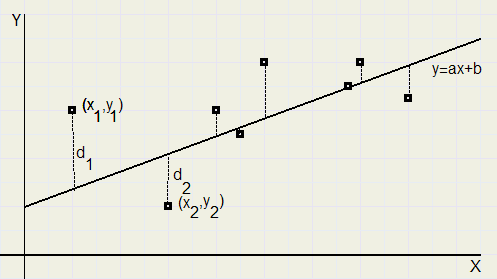



```{r}
#| eval: true
#| echo: false
#| output: false

library(ggplot2)

opvulkleur <- "darkorange"
lijnkleur1 <- "darkorchid"
lijnkleur2 <- "red"
lijnkleur3 <- "blue"

```

# Lineaire relaties



```{r}
#| code-fold: true
#| warning: false
#| fig.cap: "Lineaire regressie."
#| label: fig-lineair-reg
#| fig.width: 5
#| fig.height: 5

set.seed(885)

a <- 2
b <- 1
x <- runif(10, 0, 4)
y <- a*x + b + rnorm(10)
data <- data.frame(x = x, y = y)

# Doe een lineaire regressie met de gegenereerde data
lin_reg <- lm(y ~ x, data)
# Reken uit wat de geschatte y-waarden zijn volgens de lineaire regressie
y_pred <- predict(lin_reg)

ggplot(data, aes(x = x, y = y)) +
  # Verticale lijnen naar het gemiddelde
  geom_segment(
    aes(
      x = x, xend = x, 
      y = y, yend = y_pred
    ),
    color = "SlateGray",
    linetype = "solid",
    size = 1
  ) +
  # Punten
  geom_point(
    shape = 21, 
    fill = "SlateGray", 
    size = 5
  ) +
  geom_abline(
    intercept = lin_reg$coefficients[1],
    slope = lin_reg$coefficients[2],
    color = opvulkleur,
    size = 1
  ) +
  # y-as labels instellen
  scale_y_continuous(
    breaks = y, 
    limits = c(min(y, y_pred), max(y, y_pred)),
    labels = function(i) parse(text = paste0("y[", seq_along(i), "]"))
  ) +
  # x-as labels instellen
  scale_x_continuous(
    breaks = x,
    labels = function(i) parse(text = paste0("x[", seq_along(i), "]"))
  ) +
  # Geen x-as, geen gridlijnen
  theme_classic() +
  theme(
    axis.title = element_blank(),
    panel.grid.major.x = element_blank(),
    panel.grid.minor.x = element_blank()
  )
```

## Dataset lineaire relaties

To install the dataset used here:
```{r}
#| echo: false
#| eval: false
install.packages("palmerpenguins")
```
[Dataset source](https://github.com/allisonhorst/palmerpenguins)

::: {#exr-covid}
Regressieopgave terugverwijzen naar Brams opgave over covid.
    
:::

## Interpolatie

## Extrapolatie en zijn gevaren

## Simpsons paradox

## Samenvatting

## Terminologie
