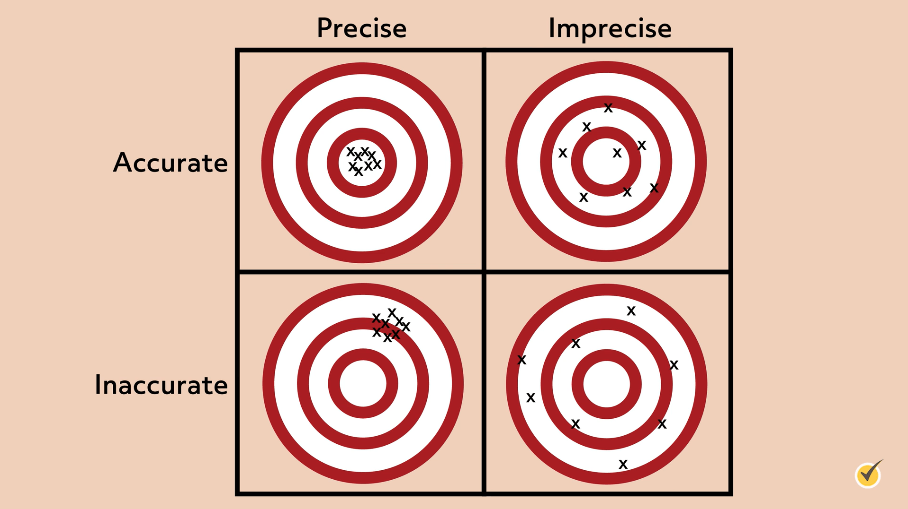



# Onzekerheid in schattingen op basis van steekproeven en experimenten {#sec-onzekerheid}

In de inleiding hebben we benadrukt
dat biologische gegevens onzeker zijn.
Dat komt doordat gegevens vaak het resultaat zijn van **steekproeven**, 
en daarnaast geplaagd worden door **meetfouten**.
Beide situaties gaan we apart bekijken.
We beginnen bij steekproeven.

## Belangrijke begrippen over populaties en steekproeven

Na iedere cursus word je gevraagd 
om een Caracal-enquête in te vullen.
Een belangrijk doel van die enquête is om te bepalen
hoe studenten de cursus 
gemiddeld beoordelen.
In de praktijk vult maar een deel van de studenten de enquête in,
en dus rijst de vraag: 
  wat kunnen we leren over het gemiddelde oordeel van de deelnemers van een cursus
op basis van een beperkt aantal respondenten?

Laten we wat begrippen doornemen
die we nodig hebben 
om over dit probleem na te denken.

In veel onderzoeken 
zijn we geïnteresseerd in een bepaalde **populatie**.
Dat kan bijvoorbeeld de studentenpopulatie zijn,
of de populatie van Euraziatische eksters,
of alle Nederlandse diabetespatiënten.
Een populatie is een verzameling van **eenheden**.
De eenheden hoeven geen personen of organismen te zijn;
  we kunnen ook onderzoek doen naar de "populatie" van zakken chips.
(Zit er gemiddeld wel echt 200g chips in, zoals de fabrikant beweert?)

Het onderzoek gaat vervolgens over één of meerdere
**variabelen**.
In deze context is een variabele
een eigenschap van de eenheden in de populatie,
zoals bloedgroep,
bloedsuikerwaarde na tenminste 8 uur vasten,
of het gewicht van de inhoud van een zak chips.

De waarde van een variabele verschilt meestal
per eenheid in de populatie.
We kunnen ons daarom afvragen wat de **verdeling** is
van de variabele in de populatie.

Zoals je in @sec-variabelen-verdelingen hebt gezien, 
kunnen je je de verdeling van de variabele in de populatie
voorstellen als een staafdiagram
(als variabele categorisch is)
of als een histogram
(als de variabele numeriek is).
We kunnen die verdeling ook karakteriseren met kengetallen,
zoals gemiddelde en standaardafwijking.
Dit soort kenmerken van de verdeling van een populatie
worden ook wel **populatieparameters** genoemd.

Het doel van heel veel onderzoeken
is om een populatieparameter te bepalen.
Zo kan het doel van een onderzoek zijn 
om de gemiddelde opbrengst te bepalen 
van aardappelplanten van een bepaald ras,
of wat de standaarddeviatie is van de dikte van schroeven
die in een bepaalde fabriek worden geproduceerd.

Om een populatieparameter precies te bepalen
zouden we eigenlijk de waarde van de variabele
moeten meten bij iedere eenheid in de populatie.
In de praktijk is dat om praktische redenen meestal onmogelijk,
omdat populaties meestal groot zijn 
en de onderzoeksmiddelen (geld, menskracht, tijd, ...) beperkt.
We kunnen dus zelden álle individuen in een populatie bekijken.
Bovendien zijn metingen vaak destructief:
  planten moeten worden geoogst,
  proefdieren geofferd,
  en proefpersonen blootgesteld aan risico's.
Daarom onderzoeken we meestal slechts een aantal individuen
    uit de populatie -- een **steekproef**.

De waarden uit de steekproef gebruiken we vervolgens
    om de populatieparameter te **schatten**.
Helaas betekent dat dat het resultaat
    niet exact is:
    het resultaat hangt af van de specifieke steekproef.
Als je het onderzoek opnieuw zou uitvoeren 
  op identieke wijze,
  zou je net een andere steekproef nemen 
  en zou je schatting net anders zijn.
Dit noemt men **steekproefvariabiliteit**.
Bovendien kan het zijn dat je steekproef
  niet **representatief** is voor de populatie.
Door beide oorzaken zal een schatting op basis van een steekproef
  meestal afwijken van de ware populatieparameter.
Daarom schattingen op basis van steekproeven
  zijn onzeker.

::: {#exr-pop-var-par}

## Populatie, eenheden, variabele, populatieparameter

Benoem van de volgende onderzoeken de populatie, de eenheden van de populatie, de variabele, en de populatieparameter waarnaar onderzoek wordt gedaan. Benoem ook het type variabele: nominaal, ordinaal, continue of discreet.

::: {.todo-box}

Invullen. Laat ter illustratie de populatie ook objecten zijn,
niet alleen individuen.

**a.** a

**b.** b

**c.** c

**d.** d

:::

:::

## Meetfouten in experimenten
  
Een andere bron van onzekerheid is de **meetfout**.

::: {.todo-box}

Schrijven:

- Gebruik van meetinstrumenten om een grootheid te meten.
- Meerdere keren dezelfde meting, elke keer een andere waarde.
- Daarnaast kunnen meetinstrumenten niet perfect gekalibreerd zijn,
of om andere redenen systematisch een te hoog of lage waarde geven.
- Dit noem je **meetfouten**.
- Daarom zijn metingen ook onzeker.

- Niet alle onderzoeken gebruiken steekproeven. 
Voorbeeld: het meten van de lichtsnelheid, of een eigenschap van een individu (zoals jouw ochtendgewicht vandaag).
In dat geval zijn meetfouten de grootste bron van onzekerheid.
- Maar ook als we een schatting maken op basis van een steekproef
  moeten we vaak aan iedere eenheid een meting verrichten.
- In dat geval draagt de meetfout bij aan de onzekerheid in schattingen op basis van de steekproef.
:::

## Schattingen: precisie, nauwkeurigheid, en bias

Het is belangrijk om stil te staan bij de verschillende manieren
    waarop schattingen
    kunnen afwijken van de ware parameter.
We maken  onderscheid
    tussen **precisie** en **nauwkeurigheid**.
Deze begrippen worden in @fig-precisie-vs-nauwkeurig hieronder geïllustreerd.

::: {.todo-box}

Figuur vergelijkbaar met die hieronder maken.
In het Nederlands.

{#fig-precisie-vs-nauwkeurig}{fig-cap='Illustratie van de begrippen precies en nauwkeurig.'}
:::

Stel je voor dat je heel vaak dezelfde methode gebruikt
    om een parameter te schatten.
Het resultaat kan iedere keer net iets anders uitvallen.
De methode wordt **precies**
    genoemd als de verschillende resultaten
    weinig van elkaar verschillen.
Je kunt je dat vast voorstellen:
    als je 's ochtends herhaaldelijk op dezelfde weegschaal gaat staan
en opeenvolgende metingen meerdere kilo's van elkaar verschillen,
    dan zul je concluderen dat de weegschaal niet erg precies is.

Merk op:
    dat de verschillende schattingen dicht bij elkaar liggen
    wil niet zeggen dat ze ook dicht bij de waarheid liggen.
In beide plaatjes in de linker-kolom van @fig-precisie-vs-nauwkeurig 
    is de methode precies. 
Toch wijken in het onderste plaatje 
    de waarden sterk af van de juiste waarde
    (de *bull's-eye*). 

Een methode wordt **nauwkeurig** genoemd
als het gemiddelde van de verschillende resultaten
dicht bij de waarheid ligt.
In beide plaatjes in de eerste rij
van @fig-precisie-vs-nauwkeurig
zijn de resultaten geclusterd rond de *bull's-eye*.
In die gevallen is de methode dus nauwkeurig.
Merk op dat een nauwkeurige methode 
    niet precies hoeft te zijn,
    zoals in het plaatje rechtsboven.

Twee verschillende aspecten dragen dus bij
    aan de afwijking van schattingen
    van de juiste waarde.
De eerste is er de **toevallige fout**:
    wanneer dezelfde methode herhaaldelijk wordt toegepast,
    levert dit steeds een iets andere waarde op.
Een precieze methode geeft een kleine toevallige fout.

::: {.callout-warning #wrn-toevallig}

## Wat is "toevallig"?

Het woord "toevallig" in "toevallige fout" 
  kan gemakkelijk verkeerd begrepen worden.
In deze context bedoelen we met toeval
  dat er oorzaken zijn die de schatting wel beïnvloeden
  maar waarover we geen kennis en/of controle hebben
  zodat bij herhaling van de schatting
  de resultaten op onvoorspelbare manier variëren.
:::

Ten tweede is er een **systematische fout**:
    daar is sprake van als de methode *gemiddeld* een te hoge of te lage waarde oplevert.
Een nauwkeurige methode geeft een kleine systematische fout.

Als een methode een systematische fout heeft
    dan zegt me ook wel dat de schatting **bias** heeft.
Bias is een Engels woord;
    de beste vertalingen zijn misschien "vertekening" of "vooroordeel", 
    maar omdat die woorden de lading vaak niet goed dekken
    zullen we de Engelse term bias ook blijven gebruiken.

Gewapend met deze begrippen keren we terug 
    naar schattingen op basis van steekproeven.
Waar komen bij schattingen op basis van steekproeven
  de toevallige en de systematische fouten vandaan?
  
## Toevallige fouten in steekproeven

In de aanloop naar tweedekamerverkiezingen 
    voeren we een peiling uit.
We nemen een steekproef van 1000 Nederlandse stemgerechtigde burgers
    en vragen hen op wie ze zouden stemmen als de verkiezingen vandaag zouden plaatsvinden.
Van de 1000 burgers in de steekproef
    zeggen er 33 van plan te zijn om op het CDA te stemmen.
We schatten dus dat het CDA op dit moment 
    3,3%
    van de stemmen zou krijgen.

Stel je nu voor dat we op dezelfde dag
    op exact dezelfde manier
    nóg een steekproef zouden nemen
    van 1000 burgers.
Zouden we dan in die tweede steekproef weer precies 33 personen terugvinden
    die voor het CDA kiezen?

Dat hoeft natuurlijk niet zo te zijn.
Het is best mogelijk dat we de tweede keer
    toevallig maar 25 CDA-stemmers vinden,
    of juist 40.
In dat geval zouden we op basis van de tweede steekproef
    uitkomen op een schatting van 2,5%
    of juist 4.0%.
Schattingen op basis van steekproeven
    worden dus geplaagd door toevallige fouten,
    simpelweg omdat het resultaat afhangt van de toevallige steekproef.
Omdat het woord "toeval" op verschillende manieren geïnterpreteerd kan worden,
    hebben we het liever over **steekproefvariabiliteit**.
Steekproefvariabiliteit is het verschijnsel 
    dat verschillende identiek uitgevoerde steekproeven
    van elkaar verschillen
    en dus ook verschillende schattingen opleveren
    voor populatieparameters.

Dat steekproeven variabel zijn
    wil natuurlijk niet zeggen
    dat we helemaal geen betrouwbare schattingen kunnen maken
    op basis van een steekproef.
Als in de gehele populatie 20% van de stemgerechtigden 
    op het CDA wil stemmen,
    dan is de kans om in een steekproef van 1000 personen
    slechts 33 CDA-stemmers aan te treffen *enorm klein*.
(We verwachten er namelijk 200.)
Omgekeerd:
    als we in onze steekproef 3,3% CDA-stemmers vinden
    dan kunnen we vrijwel uitsluiten dat het in de gehele populatie
    om 20% gaat.
Later in deze cursus leer je
    hoe je kunt berekenen
    hoe groot de onzekerheid in een schatting is.

## Systematische fouten in schattingen op basis van steekproeven

Systematische fouten en bias ontstaan
    als individuen met bepaalde eigenschappen een grotere kans hebben 
    om in de steekproef terecht te komen.
Bijvoorbeeld,
    om de gezondheid van een populatie vogels te onderzoeken,
    vang je er een aantal in netten.
In dat geval zou het kunnen 
    dat zieke vogels zich gemakkelijker laten vangen
    en daarom een grotere kans hebben om te worden opgenomen in je steekproef.
Het gevolg is dat je steekproef een vertekend beeld geeft
    van de populatie als geheel.
In andere woorden,
    de steekproef is dan niet **representatief** voor de populatie.
Dat levert systematische fouten op, oftewel bias.

Bias kan op heel veel manieren ontstaan 
    en is een heel belangrijk onderwerp.
Daarom komen we er later nog uitgebreid op terug.

## Eenvoudige aselecte steekproeven

Om bias te voorkomen 
    is het dus belangrijk om ervoor te zorgen
    dat je bij het samenstellen van een steekproef
    niet bewust of onbewust
    individuen met bepaalde eigenschappen
    een grotere kans geeft geselecteerd te worden.
Als de manier van selecteren garandeert
    dat ieder individu van de populatie,
    onafhankelijk van de andere leden,
    een gelijke kans heeft om in de steekproef te worden opgenomen,
    dan noemen we dit een **eenvoudige aselecte steekproef**.

Een eenvoudige aselecte steekproef heeft verschillende voordelen.
De eerste is dat een eenvoudige aselecte steekproef 
    geen bias heeft.
Dat maakt het mogelijk om nauwkeurige schattingen te maken.
Ten tweede kun je voor een eenvoudige aselecte steekproef
    vaak uitrekenen hoe groot de toevallige fout is.
Dat wil zeggen dat je de precisie van je schattingen
    kunt kwantificeren.
(We gaan daar in hoofstuk ?? verder op in.)
Vanwege deze voordelen
    gaan veel statistische analyses ervan uit 
    dat de steekproef eenvoudig aselect is. 

In de praktijk is het vaak niet gemakkelijk
    om een eenvoudige aselecte steekproef te organiseren.
Als je een lijst hebt van de individuen in de populatie,
    dan kan dit wel, door gebruik te maken van randomgetallen.
Ieder individu wordt dan genummerd,
    en we vragen een computer om uit de lijst met nummers
    er willekeurig $n$ te kiezen.

::: {#exr-aselect}

## Een aselecte steekproef

Opgave: gebruik R om een eenvoudige aselecte steekproef te kiezen uit een lijst.
Gebruik de functie `sample()`.
:::

In veel gevallen bestaat zo'n lijst niet,
  en in dat geval is de eenvoudige aselecte steekproef vaak niet exact mogelijk.
  Wel kun je er dan bij het ontwerp van je experiment
  naar streven
  om het ideaal van een eenvoudige aselecte steekproef zoveel mogelijk te benaderen.
  
Overigens maken sommige onderzoeken gebruik
  van meer geavanceerde steekproeven,
  zoals een **gestratificeerde steekproef**.
  We gaan daar in deze cursus niet verder op in,
  maar als je er meer over wilt weten
  kun je deze bron raadplegen: ??.
  
## Oorzaken van bias in schattingen op basis van steekproeven
  
Bias in steekproeven kan op allerlei manieren ontstaan. 

::: {.todo-box}
**gelegenheidssteekproef**
:::

We noemen hieronder bovendien een paar oorzaken die zo vaak voorkomen
dat ze een naam hebben gekregen.

- **Vrijwilligers-bias**: Wanneer de steekproef bestaat uit personen die 
  daar zelf toe hebben gekozen,
  kan vrijwilligers-bias optreden. 
  Individuen die vrijwilig aan een onderzoek deelnemen 
  verschillen vaak van de algehele population
  in sommigen van hun eigenschappen.
  Dat kan bijvoorbeeld zijn omdat ze speciaal interesse hebben in het onderwerp van het onderzoek.
  ::: {.todo-box}
  Aansprekend voorbeeld.
  :::
- **Non-respons-bias**: Dit treedt op wanneer een deel van de benaderde mensen 
  niet reageert op een enquête of onderzoek. 
  Als de mensen die niet reageren verschillen in mening of kenmerken
  van degenen die wel reageren, 
  kan dit leiden tot een vertekend beeld in de resultaten.
  Het onderzoek kan bijvoorbeeld alleen de standpunten 
  van een specifieke groep vertegenwoordigen, 
  terwijl de perspectieven van de niet-reagerende groep ontbreken.
  Merk op: non-response-bias heeft veel weg van vrijwilligers-bias.
- **Extreme-respons-bias**: Dit gebeurt wanneer respondenten 
  neigen naar de uitersten van de antwoordopties, zoals "helemaal eens" of "helemaal oneens," 
  en zelden kiezen voor middenopties. 
  Dit kan het gemiddelde en de variabiliteit van de resultaten beïnvloeden, 
  omdat de gegevens een sterkere neiging naar de extremen vertonen 
  dan daadwerkelijk in de populatie aanwezig zou kunnen zijn.
- **Overlevingsbias** treedt op wanneer de focus in een analyse ligt op individuen, 
  groepen, of objecten die een bepaalde selectie of gebeurtenis hebben doorstaan, 
  terwijl degenen die het niet hebben overleefd of geselecteerd zijn buiten beschouwing worden gelaten. 
  Hierdoor ontstaat een vertekend beeld, 
  omdat alleen de kenmerken van de "overlevers" worden meegenomen, 
  wat tot onjuiste conclusies kan leiden. 
  Bijvoorbeeld, als we alleen succesvolle bedrijven bestuderen 
  en de bedrijven negeren die failliet zijn gegaan, 
  kunnen we een verkeerd beeld krijgen van de factoren die tot succes leiden.
  Een voorbeeld:
  
  Een klassiek voorbeeld van overlevingsbias komt uit de Tweede Wereldoorlog 
  en betreft de analyse van schade aan gevechtsvliegtuigen.
  
  Tijdens de oorlog wilden de geallieerden 
  de bepantsering van hun vliegtuigen verbeteren om verliezen te verminderen. 
  Onderzoekers bekeken de teruggekeerde vliegtuigen 
  en noteerden waar de meeste kogelgaten zaten. 
  Hun eerste gedachte was om extra pantser aan te brengen 
  op die beschadigde plekken, 
  omdat daar de vliegtuigen blijkbaar het vaakst werden geraakt.
  
  Maar hier speelde overlevingsbias een rol. 
  De vliegtuigen die terugkeerden waren immers alleen de toestellen 
  die ondanks hun schade in staat waren geweest om veilig terug te keren. 
  De plekken waar zij beschadigd waren, 
  waren dus eigenlijk niet de meest kwetsbare delen van het vliegtuig. 
  Uiteindelijk realiseerde de statisticus Abraham Wald 
  dat de zwakste plekken waarschijnlijk de delen waren 
  die géén kogelgaten hadden in de teruggekeerde vliegtuigen:
  daar werden de vliegtuigen die niet terugkeerden waarschijnlijk fataal geraakt.
  
  Dit inzicht leidde tot een tegenintuitieve conclusie: 
  juist die ongedeerde plekken moesten worden versterkt 
  om zo de overlevingskansen van de vliegtuigen te vergroten. 
  Dit voorbeeld illustreert hoe overlevingsbias kan leiden 
  tot een vertekend beeld en tot verkeerde beslissingen, 
  wanneer we alleen focussen op de “overlevers” in plaats van het grotere geheel.
- **Waarnemersbias** treedt op wanneer de verwachtingen, 
  overtuigingen of vooroordelen van een waarnemer onbewust invloed uitoefenen 
  op de manier waarop gegevens worden verzameld of geïnterpreteerd. 
  Dit kan bijvoorbeeld gebeuren als een onderzoeker resultaten verwacht 
  die in lijn liggen met een bepaalde hypothese en daardoor onbewust gedrag 
  of reacties waarneemt of interpreteert op een manier 
  die die hypothese bevestigt. 
  Deze bias kan de objectiviteit 
  en betrouwbaarheid van onderzoeksresultaten ondermijnen.
  
## Samenvatting

::: {.todo-box}
Schrijven
:::
  
  
## Terminologie in het Engels
  
| Nederlands    | Engels             |
|---------------|--------------------|
|               |                    |

: Woordenlijst @sec-onzekerheid. {#tab-woorden-onzekerheid .striped .hover}

## Extra informatie

*"The Flaw of Averages"* door Sam L. Savage (2009).  

*"How Not to Be Wrong: The Power of Mathematical Thinking"* door Jordan Ellenberg (2014).  

*"Thinking Fast and Slow"*, door Daniel Kahneman (2011)

*"How to Lie with Statistics"* door Darrell Huff (1954)

## Opgaven

::: {.todo-box}

Ontwerpen.

:::
  