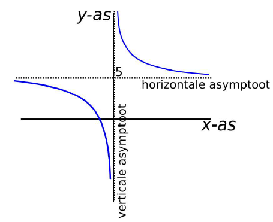

# Asymptoten & Limieten {#sec-limieten}

## Introductie

Asymptoten zijn een wiskundig concept dat belangrijk kan zijn in biologische modellen, vooral om te begrijpen hoe een functie zich gedraagt wanneer de variabele heel groot of heel klein wordt. Dit is vooral handig voor inzicht in biologische systemen op de langere termijn.

Een asymptoot is een lijn, die door een functie wordt benaderd, maar nooit precies bereikt. Bij het schetsen van een grafiek zijn asymptoten vaak een handig hulpmiddel. Dit hoofdstuk beschrijft wat verticale en horizontale asymptoten zijn en hoe je ze kunt vinden.

## Horizontale asymptoten

Een horizontale asymptoot is een lijn met de vorm $y=a$. De grafiek benadert deze horizontale lijn voor hele grote of hele kleine waarden van $x$. Wiskundig heten deze "hele grote" en "hele kleine" waarden limieten.

De notatie hiervoor is als volgt:

$$\lim_{x \rightarrow +\infty}{f(x)} = a$$

Als de functie $a$ benadert voor hele **grote** waarden van $x$, of: $$\lim_{x \rightarrow -\infty}{f(x)} = a$$

Als de functie $a$ beandert voor hele **kleine** waarden van $x$. Zoals je uit deze notatie kunt aflezen kun je horizontale asymptoten vinden door te kijken of de grafiek een waarde benadert voor $x \rightarrow \pm \infty$.

#### Voorbeeld {.unnumbered}

Een voorbeeld van een functie met een horizontale asymptoot is: $$f(x) = 5 + \frac{1}{x}$$ Als we hele grote waarden voor $x$ invullen in deze functie, dan komt de uitkomst steeds dichter in de buurt van 5. Dit geldt zowel voor grote positieve als negatieve waarden. Doordat $1\over x$ nooit gelijk aan 0 kan worden, zal $f(x)$ nooit precies 5 worden. Daarom heeft deze functie een horizontale asymptoot $y = 5$.

```{r, echo=FALSE, warning=FALSE}
#| label: fig-asymp
#| fig-cap: "De grafiek voor de functie y = 5 + 1/x. Deze functie heeft zowel een horizontale als verticale asymptoot."

library(ggplot2)
x_values_left <- seq(-4, -0.01, by = 0.001)
data_left <- data.frame(x = x_values_left, y = 5 + 1/x_values_left)

x_values_right <- seq(-0.01, 4, by = 0.001)
data_right <- data.frame(x = x_values_right, y = 5 + 1/x_values_right)

ggplot() + 
  geom_line(data = data_left, aes(x=x, y=y), colour = "seagreen", linewidth = 1.2) +
  geom_line(data = data_right, aes(x=x, y=y), colour = "seagreen", linewidth = 1.2) +
  # Verticale asymptoot
  geom_vline(xintercept = 0, colour = "darkblue", linetype = "dashed", linewidth = 1.2) +
  annotate("text", x = -0.15, y = 13, colour = "darkblue", label = "verticale asymptoot", angle = 90) +
  # Horizontale asymptoot
  geom_hline(yintercept = 5, colour = "orange", linetype = "dashed", linewidth = 1.2) +
  annotate("text", x = -3, y = 6.5, colour = "orange", label = "horizontale asymptoot") +
  ylim(-20, 20) +
  theme_minimal() +
  geom_hline(yintercept = 0) +
  geom_vline(xintercept = 0) +
  ggtitle("y = 5 + 1/x")
```

## Verticale asymptoten

Een verticale asymptoot is een lijn met de vorm $x=a$. Dit betekent dat de waarde van $f(x)$ voor $x=a$ naar oneindig gaat. Dit kan zowel plus als min oneindig zijn. In wiskundige notatie betekent dat: $$\lim_{x \uparrow x_0}{f(x)} = \pm \infty$$ als de asymptoot bereikt wordt vanaf de "linkerkant" door x te verhogen tot $x=a$. Of, als de asymptoot vanaf de "rechterkant" bereikt wordt door x te verlagen tot $x=a$. $$\lim_{x \downarrow x_0}{f(x)} = \pm \infty$$

#### Voorbeeld {.unnumbered}

De hierboven genoemde functie $f(x) = 5 + \frac{1}{x}$ heeft niet alleen een horizontale asymptoot, maar ook een verticale asymptoot. Dit is vaak het geval bij functies waarbij de variabele in de noemer van een breuk staat, omdat we niet kunnen delen door 0. Zoals je hebt geleerd is delen hetzelfde als vermenigvuldigen met het omgekeerde. Delen door een heel klein getal is dus hetzelfde als vermenigvuldigen met een heel groot getal. Delen door 0 (oneindig klein), is dus hetzelfde als vermendigvuldigen met oneindig. Omdat "oneindig" alleen als concept bestaat, wordt er meestal gezegd dat de functie niet gedefiniëerd is wanneer er door 0 gedeeld wordt.

Om de functie te kunnen schetsen, moeten we weten hoe het eruit ziet rondom het punt $x=0$. Als $x$ net iets groter is dan 0, wordt $f(x)$ heel groot. Dit komt doordat delen door een heel klein positief getal een hele grote positieve uitkomst geeft. Als we $x=0$ benaderen vanuit het negatieve domein, delen dan door een hele kleine negatieve waarde, wat een hele grote negatieve uitkomst geeft.

Als we deze informatie combineren kunnen we $f(x)$ schetsen:



## Limieten bepalen

#### 1. Limieten voor $x\to \infty$ {.unnumbered}
Wanneer $x$ naar oneindig gaat, kun je niet simpelweg $x= \infty$ invullen, omdat oneindig geen getal is. Kijk in plaats daarvan naar het gedrag van de functie voor grote waarden van $x$.

#### Voorbeeld {.unnumbered}

$$ \lim_{x \to \infty} 3 x^2 -5 = \infty$$
Dit betekent dat de functie steeds groter wordt naarmate $x$ groter wordt.
| Voor functies zoals $f(x)=ax^3-bx^2$ moet je kijken naar de termen met de hoogste macht van $x$. In dit geval is dat $ax^3$. Dit betekent dat het positieve gedeelte van de functie ($ax^3$) sneller toeneemt dan het negatieve gedeelte ($-bx^2$). De functie zal dus steeds groter worden naarmate $x$ groter wordt, dus:
$$ \lim_{x \to \infty} ax^3 - bx^2= \infty$$

#### 2. Limieten van rationale functies {.unnumbered}
Rationale functies zijn functies die een breuk bevatten, in de vorm $f(x)={p(x) \over g(x)}$. Bij het berekenen van limieten van deze functies kun je de volgende regels toepassen:

| Omschrijving | Wiskundige notatie |
|-------------------------------------------------|-----------------------------------------|
| Als je een constante deelt door $x$, gaat de uitkomst naar 0 voor grote waarden van $x$ ($x \rightarrow \infty$) | $\lim_{x \to \infty } {C \over x}  =0$ |
| Als je een constante deelt door $x$, gaat de uitkomst naar $\infty$ wanneer $x \rightarrow 0$  | $\lim_{x \to 0 } {C \over x}  =\infty$ |
| Als je $x$ deelt door een constante, gaat de uitkomst naar $\infty$ voor grote waarden van $x$ | $\lim_{x \to \infty } {x \over C}  =\infty$ |
| Als je $x$ deelt door een constante, gaat de uitkomst naar $0$ wanneer $x \rightarrow 0$ | $\lim_{x \to 0 } {x \over C}  = 0$ |


#### Snel limieten bepalen {.unnumbered}

1. Vind de hoogste macht van $x$ (of een andere variabele) in de functie. 
2. De term met de hoogste macht zal de overhand spelen
2. Gaat deze term naar oneindig? Dan is de limiet oneindig. Gaat deze term naar 0? Dan is de limiet 0. 

## Opdrachten

::: {#exr-asymp-1}
Bepaal de volgende limieten:

**a.** $\lim_{x\to\infty}3x^2-2x+5$

**b.** $\lim_{ x \to 0+} {1 \over x}$ (let op: nadert 0 vanuit het positieve domein)

**c.** $\lim_{ x \to 0-} {1 \over x}$ (let op: nadert 0 vanuit het negatieve domein)

**d.** $\lim_{x \to \infty}{x \over x+2}$

**e.** $\lim_{x \to \infty}{1 \over a+x}$

**f.** $\lim_{x \to \infty}{(ax^2+b) \over cx^3}+d$
:::

::: {#exr-asymp-2}
Bepaal de asymptoten van de volgende functies:

| 

**a.** $f(x) = {x \over x-2} + 1$

**b.** $f(x) = {ax \over bx+c} - d$ waarbij $d>a/b$
:::
