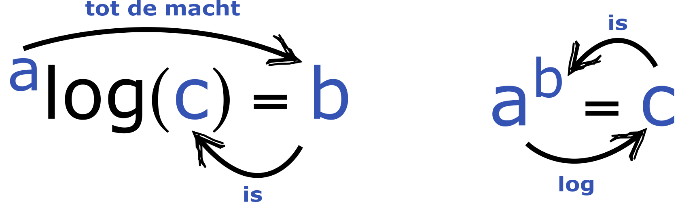

# Exponenten & Logaritmen {#sec-exponenten}

## Introductie

Stel je één enkele bacterie voor op een agarplaat. Deze bacteriesoort groeit snel en deelt zich elk uur. Na één uur zijn er $1 \cdot 2 = 2$ bacteriën. Na vijf uur zijn dat er $1 \cdot 2 \cdot 2 \cdot 2 \cdot 2 \cdot 2 = 32$. Gelukkig is er een makkelijke manier om dit op te schrijven: na $n$ delingen, zijn er $2^n$ bacteriën. Dit is een simpel voorbeeld van exponentiële groei, die we ook kunnen uitdrukken met de volgende vergelijking, waarbij $B$ het aantal bacteriën is en $n$ het aantal delingen: $$
B = B_0\cdot2^n
$$ {#eq-bact-groei} Hierbij staat $B_0$ voor het aantal bacteriën waarmee je start. Hoewel je misschien gewend bent dat wiskundige functies vaak in de vorm $y=f(x)$ geschreven worden, kun je $y$ en $x$ vervangen met letters die voor de biologie wat logischer zijn: $B$ voor **b**acteriën, en $n$ voor ***n**umber of divisions.* Exponententen en logaritmen (het omgekeerde van een exponent) komen veel voor in biologische processen, dus het is belangrijk om er mee te leren rekenen. In dit onderdeel bespreken we daarom de relevante rekenregels.

## Exponenten

| Een exponent geeft aan hoe vaak het grondtal met zichzelf vermenigvuldigd wordt.
| Bijvoorbeeld $2^4 = 2 \cdot 2 \cdot 2 \cdot 2 = 16$. Hierbij is 2 het grondtal en 4 de exponent.
| Wortels kunnen ook als exponent weergegeven worden, de exponent is dan gelijk aan $1\over2$.
| Bijvoorbeeld $\sqrt{4} = 4^{1\over2} = 2$.

| Rekenregel                                | Voorbeeld                           |
|---------------------------------------|---------------------------------|
| $a^n \cdot a^m = a^{n + m}$              | $2^2 \cdot 2^3 = 2^{2+3} = 2^5$    |
| $a^n \div a^m = a^{n - m}$ als $a \neq 0$    | $2^5 \div 2^2 = 2^{5-2} = 2^3$         |
| $(a^n)^m = a^{nm}$                        | $(2^2)^2 = 2^4$                     |
| $(a^n \cdot b^m)^q = a^{nq} \cdot b^{mq}$ | $(2^3 \cdot 3^4)^2 = 2^6 \cdot 3^8$ |
| $a^{-n} = 1 / a^n$                        | $4^{-2} = 1/4^2$                    |
| $a^0 = 1$                                 | $2^0 = 1$                           |

### Hele grote en hele kleine getallen 

In de biologie werken we vaak met grote waardes, zoals megatonnen uitgestoten CO$_{2}$ of miljoenen rode bloedcellen geproduceerd per uur. Deze grote waarden worden meestal aangegeven met een macht van tien. Zo kan $2500$ opgeschreven worden als $2.5 \cdot 1000 = 2.5\cdot10^3$ . Ook erg kleine getallen kunnen zo opgeschreven worden: $0.000015 = 1.5 \cdot 0.00001 = 1.5\cdot10^{-5}$. 

Om exponentenen als `plain text` op te schrijven (bijvoorbeeld in R-code), wordt vaak gebruik gemaakt van een `e`^[Deze `e` staat voor exponenent, en is niet het natuurlijke getal $e$ wat ongeveer gelijk is aan 2.71828]. Zo wordt $1.5 \cdot 10^{-5}$ opgeschreven als `1.5e−5`, en $2.5 \cdot 10^3$ opgeschreven als `2.5e3`. 

## Logaritmen


De logaritme is het omgekeerde van de exponent (zie @fig-logexp). Je kunt een exponent altijd herschrijven als een logaritme, en andersom: $^2\log{16} = 4$ want $2^4 = 16$. Dit is belangrijk, omdat het kan zijn dat de onbekende die je wil oplossen de exponent is, bijvoorbeeld $2^x = 18$. Hier staat dus eigenlijk de vraag: tot welke macht moeten we $2$ verheffen, om $18$ te krijgen? Om dit op te lossen, schrijven we om naar een logaritme: $x=^2\log{18}$.


{#fig-logexp width="50%" fig-align="center"}


Meer algemeen kunnen we zeggen: als $^a\log{c}=b$ dan geldt $a^b=c$. Hierbij is $a$ het grondtal en $b$ de exponent. Als het grontal van de logaritme weg is gelaten, dan is het grondtal 10 ($\log{c} = ^{10}\log{c}$). Een logaritme met grondtal $e=2.71828$ heet de natuurlijke logaritme (ln), en wordt zo geschreven: $^e\log{c} = \ln{c}$. Dit getal $e$ heeft bijzondere eigenschappen, bijvoorbeeld dat de snelheid waarmee de functie $e^x$ toeneemt altijd gelijk is aan zijn eigen waarde. Omdat rekenen aan snelheden en waarden ook in de biologie heel belangrijk kan zijn, kom je dit getal vaak tegen (hier komen we in @sec-afgeleiden nog op terug). 
<br>
De rekenregels van logaritmen zijn:

| Rekenregel                      | Voorbeeld                                 |
|--------------------------------|----------------------------------------|
| $^{b}\log{b^a} = a$             | $^{10}\log{1000} = ^{10}\log{10^3} = 3$   |
| $\log{a} + \log{b} = \log{ab}$  | $\log{100} + \log{10} = \log{1000}$       |
| $\log{a} - \log{b} = \log{a/b}$ | $\log{8} - \log{2} = \log{8/2} = \log{4}$ |
| $a \cdot \log{b} = \log{b^a}$   | $7 \cdot \log{5} = \log{5^7}$             |
| $^{a}\log{a} = 1$   | $^{2}\log{2} = 1$             |
| $^{a}\log{c} = b \quad \Rightarrow \quad a^b = c$ | $^{2}\log{8} = 3 \quad \Rightarrow \quad 2^3 = 8$ |

## Grafieken met een logaritmische schaal

In de biologie worden vaak grafieken gebruikt om de relaties tussen verschillende variabelen te visualiseren, zoals groei van organismen of concentraties van stoffen. Omdat dergelijke biologische data vaak enorm grote verschillen bevat kan een logaritmische schaal (of korter: "log-schaal") heel nuttig zijn. In plaats van een lineaire schaal, waarbij de intervallen gelijk zijn, ordent een log-schaal data op basis van machtsverhoudingen. Dit betekent dat gelijke afstanden op de grafiek overeenkomen met exponentiële verschillen in de werkelijke waarde. Hierdoor worden zowel kleine als grote waarden overzichtelijk weergegeven. Log-schalen worden veel gebruikt bij exponentiële processen zoals bacteriële groei. 

### Voorbeeld logaritmische schaal

Het nut van de logaritmische schaal wordt snel duidelijk als we teruggaan naar het voorbeeld uit de introductie. We kunnen de groei van de bacteriën in @eq-bact-groei weergeven in een grafiek, waarbij de x-as het aantal delingen is en de y-as het aantal bacteriën. Stel je voor dat we beginnen met één bacterie en de groei van de kolonie 100 delingen bijhouden. De grafiek hieronder geeft het resulterende aantal bacteriën op twee manieren weer. In @fig-logschaal-1 valt meteen op dat de laatste waarden van de grafiek zó groot zijn, dat de kleinere waarden niet goed meer af zijn te lezen. Dit is precies waarvoor de logaritmische schaal uit @fig-logschaal-2 zo handig is: hierdoor zijn zowel kleine als grote waarden duidelijk af te lezen van de grafiek.

```{r, echo=FALSE}
#| label: fig-logschaal
#| fig-cap: "Bacteriële groei over tijd."
#| fig-subcap: 
#|   - "Op lineaire schaal."
#|   - "Op logaritmische schaal."
#| layout-ncol: 2
#| fig-width: 4
#| fig-height: 3
library(ggplot2)
bact <- data.frame(t = seq(0,100,1),
                   B = 2^(seq(0,100,1)))
ggplot(data = bact, aes(x = t, y = B)) +
  geom_point(color = "seagreen") +
  geom_line(color = "seagreen") +
  theme_minimal() +
  xlab("n (aantal delingen)") +
  geom_hline(yintercept = 0) +
  geom_vline(xintercept = 0)

ggplot(data = bact, aes(x = t, y = log2(B))) +
  geom_point(color = "seagreen") +
  geom_line(color = "seagreen") +
  theme_minimal() +
  xlab("n (aantal delingen)") +
  geom_hline(yintercept = 0) +
  geom_vline(xintercept = 0)

```

## Hellingshoek van grafieken op een log-schaal

Als je de rechter grafiek van @fig-logschaal goed bekijkt, zie je dat deze een helingshoek (ook wel richtingscoëfficiënt) van 1 heeft (zie ook @sec-schetsen). Dit kunnen we ook wiskundig begrijpen. Als we @eq-bact-groei namelijk herschrijven als een logaritme met grondtal 2, zien we inderdaad dat we dit resulteert in een lineaire functie van $n$:

$$
\begin{align}
^{2}log \big( B_0 \cdot 2^n \big)\\
^{2}log \big( B_0 \big) + {^{2}log} \big( 2^n \big)\\
^{2}log \big( B_0 \big) + n \cdot  {^{2}log} \big( 2 \big)\\
^{2}log \big( B_0 \big) + n \cdot  1\\
\end{align}
$$
Dit komt doordat $^{a}log(a)$ altijd gelijk is aan 1 ("tot welke macht moet je a verheffen om a te krijgen?"). Als de populatie elke stap was verviervoudigd, zou de richtingscoëfficiënt dus niet uitkomen op 1:

$$
\begin{align}
^{2}log \big( B_0 \cdot 4^n \big)\\
^{2}log \big( B_0 \big) + {^{2}log} \big( 4^n \big)\\
^{2}log \big( B_0 \big) + n \cdot  {^{2}log} \big( 4 \big)\\
^{2}log \big( B_0 \big) + n \cdot   2\\
\end{align}
$$
Als we deze verviervoudiging echter uitdrukken op een logaritmische schaal met grondtal 4, krijgen we weer een richtingscoëfficiënt van 1:

$$
\begin{align}
^{4}log \big( B_0 \cdot 4^n \big)\\
^{4}log \big( B_0 \big) + {^{4}log} \big( 4^n \big)\\
^{4}log \big( B_0 \big) + n \cdot  {^{4}log} \big( 4 \big)\\
^{4}log \big( B_0 \big) + n \cdot  1\\
\end{align}
$$
We krijgen echter nogsteeds een lineair verband! Met andere woorden: als er sprake is van exponentiële groei, krijg je op een log-schaal altijd een rechte lijn, waarbij de richtingscoëfficiënt aangeeft wat de groeisnelheid is. 

## Opdrachten

::: {.pepexr #exr-exp-1}

<br>

Schrijf in de vorm $a^b$:

| 

**a.** $7^{345} \cdot 7^5 =$

**b.** $32^{20} \cdot 32^{18} =$

**c.** $2^5 \cdot 2^2 \cdot 2^3 =$

**d.** $3^{25} \cdot 3^{25} \cdot 3^{25} =$
:::

::: {.pepexr #exr-exp-2}

<br>

Los op:

| 

**a.** $\log{100} =$

**b.** $^2\log{64} =$

**c.** $^8\log{512} =$

**d.** $^5\log{125} =$
:::

::: {.pepexr #exr-exp-3}

<br>

| *Bacillus cereus* deelt elke 30 minuten. Je inoculeert een cultuur met precies 100 bacteriën. Hoeveel bacteriën zijn er na 3 uur?
:::

::: {.pepexr #exr-exp-4}

<br>

| Een bacteriekolonie groeit onder ideale omstandigheden in het labaratorium. Na 3 uur zijn er 10.000 bacteriën, en na 5 uur zijn het er 40.000. Met hoeveel bacteriën is de kolonie begonnen?
| Tip: bepaal eerst wat de groeisnelheid van de kolonie is.
:::

::: {.pepexr #exr-exp-5}

<br>

Los op voor x:

| 

**a.** $\log{2x} = 3$

**b.** $5e^x=11$

**c.** $^2\log{64^x}=36$
:::

::: {.pepexr #exr-exp-6}

<br>

| Simplificeer de volgende uitdrukking, neem aan dat $n\neq0$ en $p\neq0$:

$\frac{(n^{-3})^4}{(n^{4}p^{-3})^{-3}}$.
:::
