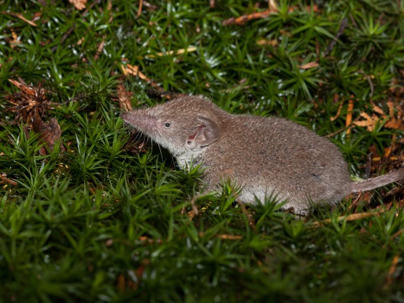

# Inleiding {#sec-inleidingwisk .unnumbered}

Wiskunde helpt ons binnen de biologie bij allerlei processen: het volgen van infectieziekten, het kwantificeren van statistische verschillen tussen groepen, het voorspellen van hoe een nieuwe predator een voedselweb zal beïnvloeden, en ga zo maar door. De noodzaak voor wiskunde komt doordat we vaak kennis hebben van hoe gegevens zich tot elkaar verhouden, maar niet alle gegevens bekend zijn. Dan hebben we dus te maken met "onbekenden".

Laten we dit punt verkennen met een voorbeeld. 

## De efficiënte spitsmuis

{width="60%" fig-align="center"}

Stel dat je het energieverbruik van een klein dier, zoals de spitsmuis, onderzoekt. In de literatuur heb je gelezen dat deze dieren tijdens hun actieve uren $0.3$ calorieën per gram lichaamsgewicht verbruiken. De spitsmuis die je onderzoekt is $20$ gram, dus zou deze $0.3 \cdot 20 = 6$ calorieën per uur moeten gebruiken. Per dag zou dit uitkomen op $6 \cdot 24 =  144$ calorieën. Maar je experiment laat steevast zien dat de spitsmuis slechts $102$ calorieën verbruikt. Je hypothetiseert dat er minder calorieën worden gebruikt tijdens het slapen, want je beestje slaapt zo'n $14$ uur per dag! Met hoeveel moet het metabolisme van deze spitsmuis tijdens de slaap verminderen, zodat je uitkomt op $102$ calorieën per dag? 

Allereerst, wat weten we? 

1. Per wakker uur verbruikt de spitsmuis $0.3 \cdot 20 = 6$ calorieën.
2. Als je hypothese klopt, verbruikt de slapende spitsmuis slechts een deel van deze calorieën: $6 \cdot x$ per uur, waarbij $x$ tussen $0$ en $1$ zou moeten liggen.
3. Het aantal uren slaap is $14$, dus het aantal wakkere uren is $24-14=10$^[ Aangenomen dat de muis op Aarde leeft, en niet op Neptunus waar een dag ongeveer 16 uur lang is.]
4. De muis verbruikt dus $6\ calorieën$ gedurende actieve (10) uur, en $6 \cdot x\ calorieën$ gedurende de slapende (14) uur.
5. Het totaalverbruik is experimenteel bepaald op $102$ calorieën per dag.

Met de bovenstaande gegevens kunnen we een simpele vergelijking opstellen. We willen namelijk weten wanneer het wakkere verbruik plus het slapende verbruik gelijk is aan 102:

$$
\begin{align}
\underbrace{10 \cdot 6}_{\text{verbruik wakker}} + \underbrace{14 \cdot 6 \cdot x}_{\text{verbruik slapend}} &= \underbrace{102}_{\text{totaal verbruik}} 
\end{align}
$$
Nu moeten we weten voor welke waarde van $x$ de vergelijking $10 \cdot 6 + 14 \cdot 6 \cdot x = 102$ klopt. Met een klein beetje algebra, zoals je op de middelbare school geleerd hebt, rekenen we eenvoudig uit wat $x$ is: 

$$
\begin{align}
60 + 84x &= 102 \quad &\hookleftarrow - \text{ 60}  \\
84x &= 42 \quad &\hookleftarrow \div \text{ 84}  \\
x &= \tfrac{42}{84} = 0.5
\end{align}
$$
Als je hypothese klopt, zou de slapende spitsmuis dus 0.5 keer minder (of anders gezegd: 2 keer zo weinig) energie verbruiken. Omdat de meeste zoogdieren hoogstens 30% energie besparen tijdens het slapen, is er wellicht toch meer aan de hand!

## Een gelijke start

Misschien is de wiskunde die je op de middelbare school hebt geleerd een beetje weggezakt. Wat waren ook alweer afgeleiden, exponenten, en logaritmen? Hoe schets je ook alweer functies als grafieken? Omdat deze begrippen en vaardigheden essentiëel zijn voor elke bioloog, gaan we deze basiswiskunde kort behandelen zodat iedereen (ongeacht achtergrond zoals wiskunde A/B) op gelijk niveau begint. 
Laten we beginnen met wat we hierboven hebben gedaan voor de spitsmuis: vergelijkingen oplossen met behulp van algebra.

