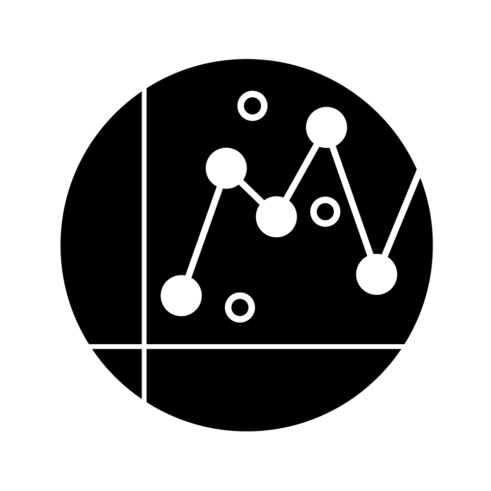
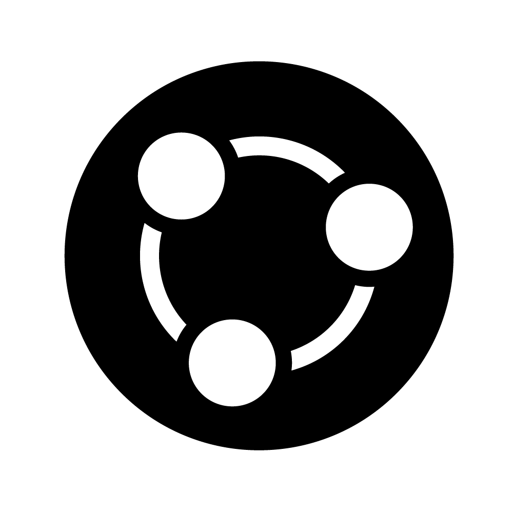

<!-- Note: you need to install webshot to render this book to PDF: -->

<!-- install.packages("webshot") -->

<!-- webshot::install_phantomjs() -->

<!-- For configurations of the auto-generated screenshots, see https://bookdown.org/yihui/bookdown/html-widgets.html -->

# Algemene cursusinformatie {.unnumbered}

Alle praktische informatie over de cursus verzamelen we hier. Als je vragen hebt, stel die dan vooral, liefst tijdens de hoor- of werkcolleges, of in Teams zodat anderen er ook van kunnen profiteren. Je kunt de docenten ook bereiken via het e-mailadres [BioMS\@uu.nl](mailto:BioMS@uu.nl){.email}.

## Docenten

**Cursuscoördinator**

dr. Bram van Dijk, [b.vandijk\@uu.nl](mailto:b.vandijk@uu.nl){.email}  Onderzoeksgroep Theoretische Biologie  H.R. Kruytgebouw, Padualaan 8, kamer N605 

**Eerstejaarscoördinator**

Christa Eekhuis MSc., [c.a.eekhuis\@uu.nl](mailto:c.a.eekhuis@uu.nl){.email} (organisatie, Brightspace en niet-inhoudelijke vragen)

**Docenten**

-   dr. Bram van Dijk, [b.vandijk\@uu.nl](mailto:b.vandijk@uu.nl){.email}   Basisprincipes van R, Basiswiskunde, en Biologische Modellen
-   dr. Rutger Hermsen, [r.hermsen\@uu.nl](mailto:r.hermsen@uu.nl){.email}   Statistiek

## Cursusonderdelen {#sec-onderdelen}

De cursus bestaat uit vier onderdelen:

-   **Basisprincipes van R** (twee lesdagen): Gedurende de cursus leer je programmeren met 'R'. Je leert hoe je R kan gebruiken om berekeningen uit te voeren, grafieken te plotten, data te analyseren, en daar statistiek op toe te passen. Omdat je met R een enorme reeks statistische procedures kan uitvoeren, is het uitgegroeid tot een standaard binnen de biologie. Tijdens de eerste week leer je alleen de basiskennis, en gedurende de cursus kom je in aanraking met concrete voorbeelden van hoe je R kunt gebruiken voor biologisch onderzoek. Later kom je R bovendien weer tegen in vele andere cursussen binnen de opleiding.
-   **Basiswiskunde** (twee lesdagen): Iedere bioloog heeft wiskunde nodig. Tijdens het eerste deel van de cursus frissen we deze basiskennis op. Net als bij het onderdeel 'R', bouwen we in kleine stapjes door op de kennis die je in deze week opdoet.
-   **Biologische Modellen** (vier weken): Dit deel van de cursus gaat over het modelleren van biologische systemen. Je leert waarom biologie modellen nodig heeft, wat een model is, en hoe je met simpele wiskunde of computersimulaties inzicht kan krijgen in biologische processen. Tijdens dit onderdeel van de cursus voer je in een groepje een kort project uit, en schrijf je hierover een kort verslag.
-   **Statistiek** (vier weken): In dit onderdeel leer je methoden en technieken voor het verzamelen, bewerken, interpreteren, en presenteren van gegevens.

## Leerdoelen

**Algemene leerdoelen**:

-   De student kent de grondbeginselen van programmeren met R
-   De student kan creatief, kritisch, en procesmatig denken en werken
-   De student is in staat om goede afspraken te maken bij het starten van een samenwerking
-   De student kan wiskunde en computersimulaties gebruiken om biologische vragen te beantwoorden
-   De student kan data kritisch analyseren en betrouwbare conclusies trekken

**Basisprincipes van R**:

-   Voorbeelden van verschillende variabelen in R benoemen
-   Voorbeelden van verschillende datastructuren in R benoemen
-   R-scripts kunnen lezen en de uitkomst interpreteren
-   Zelf scripts schrijven om eenvoudige berekeningen uit te voeren

**Basiswiskunde**:

-   Vergelijkingen oplossen (algebra)
-   Rekenen met breuken
-   Rekenen met exponenten en logaritmen
-   Afgeleiden bepalen van eenvoudige functies
-   Asymptoten en limieten bepalen
-   Functies schetsen

**Biologische modellen**:

-   Uitleggen waarom modellen essentieel zijn binnen de biologie
-   Voorbeelden geven van verschillende typen modellen
-   Aannames benoemen die bij een bepaald model komen kijken
-   Biologische vraagstukken koppelen aan een geschikt type model
-   Wiskundige modellen van biologische systemen lezen, begrijpen, en interpreteren in termen van biologische inzichten
-   Begrijpen waarom voorspellingen van wiskundige modellen kunnen verschillen van voorspellingen in computersimulaties
-   Uitleggen hoe een verandering van parameters kan leiden tot fundamenteel ander gedrag van een systeem
-   Uitleggen wat emergente eigenschappen zijn, en voorbeelden geven van modellen met emergente eigenschappen

**Statistiek**:

-   Gegevens over verschillende typen variabelen correct samenvatten en visualiseren.
-   De basisregels van het kansrekenen toepassen om kansen te berekenen.
-   Kansen bepalen voor normale verdelingen en $t$-verdelingen.
-   Kritisch beoordelen wat de gevaren zijn op verschillende soorten bias in schattingen.
-   De onzekerheid in schattingen kwantificeren d.m.v. betrouwbaarheidsintervallen.
-   Verschillende statistische toetsen uitvoeren (o.a. $t$-toetsen) en de resultaten, waaronder de $P$-waarde, correct interpreteren.
-   Controleren of het statistische model van een toets geschikt is voor de toepassing.
-   Aan de hand van causale diagrammen evalueren of confounders of colliders een rol kunnen spelen bij het ontstaan van associaties tussen variabelen.
-   Het belang van controlegroepen uitleggen en bepalen of regression to the mean resultaten kan beïnvloeden.
-   Lineaire relaties tussen variabelen aantonen en interpreteren (correlatie en regressie).
-   Eenvoudige statistische analyses uitvoeren in R de uitvoer correct interpreteren.

## Vaardigheden

Je werkt in deze cursus aan de volgende vaardigheden:

-   Creatief, kritisch, en probleemoplossend denken en werken
-   Programmeren met R in de programmeeromgeving Rstudio
-   Data analyseren en beschrijven
-   Samenwerken aan een kort (theoretisch) onderzoeksproject
-   Inzichten uit een model kort en bondig omschrijven in een verslag

::: figure-caption
{width="20%"} {width="20%"} {width="20%"} {width="20%"}

Symbolen voor (van links naar rechts) de vaardigheden "kritisch denken", "omgaan met data", "samenwerken" en "schrijven" zoals vastgesteld door de Bachelor opleiding Biologie aan de Universiteit Utrecht.
:::

## De belangrijkste tip

Het is van groot belang dat je dit vak vanaf het begin bijhoudt. De eerste twee weken zijn zo voorbij, en dan is al de eerste deeltoets. Daarna bouwen we voort op deze kennis in 'Biologische Modellen', en is er geen tijd voor een inhaalslag! Ieder hoorcollege bouwt voort op het vorige, dus als je deze niet bijhoudt is het al snel lastig te volgen. Het is onze ervaring dat studenten die de stof goed bijhouden deze cursus goed af kunnen ronden, zelfs als de stof door hen als pittig wordt ervaren.

Mocht je problemen ondervinden, neem dan vooral contact op met Christa en/of de studieadviseurs.

## Toetsing

Zoals bovengenoemd bestaat deze cursus uit vier onderdelen (zie @sec-onderdelen). De beoordeling is verdeeld over drie toetsen en een verslag:

| Evaluatie     | Beschrijving                                | Weging |
|---------------|---------------------------------------------|--------|
| Deeltoets I   | Basisprincipes van R en Basiswiskunde       | 20%    |
| Deeltoets II  | Biologische Modellen                        | 35%    |
| Verslag       | Mini-project tijdens 'Biologische Modellen' | 10%    |
| Deeltoets III | Statistiek                                  | 35%    |

### Cijfersberekening en herkansingen:

-   Alle (deel)cijfers worden afgerond op twee decimalen.
-   Voor deeltoets 1, 2 en 3 moet je minimaal een 5,0 halen.
-   Haal je dat niet, dan mag je elke toets één keer herkansen: 
    -   Deeltoets 1 kan tijdens deeltoets 2 worden herkanst.
    -   Deeltoets 2 en 3 kun je herkansen in de herkansingsweek in de zomer.
-   Voor herkansing van deeltoets 2 en 3 geldt een inspanningsverplichting: je mag hooguit 25% van de werkcolleges missen.
-   Het verslag kan niet worden herkanst. Niet inleveren = 1,0.
Cijfers van onderdelen die niet herkanst hoeven of kunnen worden, blijven alleen in het huidige studiejaar geldig; daarna vervallen ze.
-   Alle cijfers behaald in eerdere jaren dat je dit vak hebt gevolgd, vervallen.

### Eindcijfer op Osiris:

-   Als je voor alle onderdelen een cijfer hebt, wordt er een eindcijfer berekend:
    -   5,5 of hoger (en alle deeltoetsen gehaald) = vak gehaald.
    -   Tussen 4,0 en 5,5 = herkansing mogelijk
    -   Lager dan 4,0 = geen herkansing mogelijk
-   Heb je nog niet voor alles een cijfer, een deeltoets niet gehaald, of geen recht op herkansing, dan zie je op Osiris:
    -   AANV = één of meerdere onderdelen nog niet gehaald.
    -   NVD = geen recht (meer) op herkansing.

::: {style="border: 2px dashed red; padding: 1%; padding-bottom: 0%;"}
**Let op: ook als er geen AANV op Osiris staat, kun je gewoon het recht hebben op herkansing. AANV geeft aan dat er (nog) geen cijfer bepaald kan worden door ontbrekende cijfers, of dat ondanks een voldoende eindcijfer één van de deeltoetsen niet voldoet aan de minimumeis van een 5,0.**
:::

## Werkvormen

### Hoorcolleges

Iedere week zijn er meerdere fysieke hoorcolleges. Hoorcolleges worden zoveel mogelijk opgenomen, maar technische storingen zijn altijd mogelijk. Als je zeker wilt weten dat je niets mist, kun je het best ervoor zorgen dat je er bent!

### Werkcolleges

Werkcolleges vinden plaats na de hoorcolleges. Tijdens deze werkcolleges werk je met de computer en met pen en papier om te oefenen met de stof. De werkcolleges gaan over de stof van het hoorcollege; we gaan ervan uit dat je de hoorcolleges hebt bijgewoond.

### Groepsopdracht

Tijdens het onderdeel 'Biologische Modellen' voer je in groepen van 3 of 4 studenten een mini-project uit met behulp van het Rscript `Grind.R` en een online computer-simulatie. Omdat deze groepsopdracht onderdeel is van de eindterm 'samenwerken', worden deze groepen willekeurig samengesteld binnen je werkgroep. Je zult dus misschien samenwerken met mensen die je nog niet zo goed kent. Daarom is het belangrijk dat je vanaf het begin goede afspraken maakt over de samenwerking, wat bij de bijbehorende tutoraatbijeenkomst ook besproken zal worden. Denk bijvoorbeeld aan de volgende vragen:

-   Voor welk cijfer gaan we eigenlijk?
-   Wie doet wat (figuren maken, onderschriften, antwoorden formuleren op de vragen), en wanneer?
-   Hoe houden we elkaar op de hoogte van onze voortgang?
-   Wat doen we als iemand niet meedoet?

Over dit mini-project schrijf je gezamenlijk een kort verslag. De werkcolleges gaan tijdens deze opdracht door, en je kunt naast het reguliere werkcollege ook vragen stellen over deze opdracht. Daarnaast is het handig om met je groepsgenoten tijdens de zelfstudietijd samen te komen zodat jullie aan het verslag kunnen werken. Aan het eind van week 5 lever je dit verslag via Brightspace in.

### Zelfstudie

Tot slot is er een aanzienlijk deel zelfstudie. Afhankelijk van in welke werkgroep je zit, heb je op sommige dagen voor óf na het werkcollege zelfstudietijd. Gebruik deze tijd om de stof bij te houden en om aan de groepsopdracht te werken. Je kunt deze tijd ook gebruiken om extra oefeningen te maken, of om de stof nog eens door te nemen. Maar: zorg er ook voor dat je genoeg rust neemt. Het is een lange cursus met veel nieuwe informatie. Soms is een middag rust nemen juist heel nuttig om de stof beter te verwerken!

Je vindt [hier](planning.qmd) een studieplanning.

## Groepsindeling

De deelnemers aan deze cursus zijn onderverdeeld in groepen. In MyTimetable zie je in welke groep jij bent ingedeeld en wanneer en waar jouw werkcolleges plaatsvinden.

## Teams

Voor Biologische Modellen en Statistiek (BMS) is een team aangemaakt in Microsoft Teams. Je kunt je als volgt aanmelden:

1.  Open MS. Teams

2.  Kies in het menu aan de linkerkant het icoon "Teams"

3.  Klik linksonder op het scherm (of, afhankelijk van de versie van Teams, rechtsboven), op de knop "Join or create a team"

4.  Zoek de tegel met de tekst "Join a team with a code"

5.  Vul in dit veld de volgende code in: i14vyxp

6.  Kies "Join team"

Teams wordt **niet** gebruikt om de hoorcolleges te live-streamen. Als je echter vragen hebt aan de docenten, student-assistenten, of aan je mede-studenten, dan is het zeer nuttig om dit op Teams te delen, zodat iedereen ervan kan profiteren. Er zijn verschillende kanalen gemaakt om vragen te stellen over praktische zaken, R, wiskunde, modellen, en statistiek. Probeer je vraag in het juiste kanaal te plaatsen, dan wordt deze sneller beantwoord.

## Brightspace

Naast Microsoft Teams maken we gebruik van Brightspace. Vooral de (deel)cijfers en aankondigen worden via Brightspace gedaan. De aankondigingen krijgen jullie zoals jullie gewend zijn, ook per email. Omdat dit het eerste jaar is dat Brightspace wordt gebruikt in deze cursus, kunnen er wat kinderziektes zijn. Mochten er problemen zijn, neem dan contact op met ons.

## Studiematerialen

Tijdens de cursus gebruiken we alleen de inhoud van dit (online) cursusboek[^cursusinformatie-1]. Dankzij dit nieuwe cursusboek kunnen we meer interactief materiaal gebruiken en eenvoudiger R-code met jullie delen. Er wordt ook een fysiek cursusboek aangeboden, waarin alle inhoud van de onderdelen "Biologische modellen" en "Statistiek" staat. Dit is zeer nuttig om overzicht te houden: je kunt markeren, post-its plakken, en andere aantekeningen maken. Echter kunnen sommige afbeeldingen klein uitpakken, en kun je vanuit het fysieke boek natuurlijk geen code copy/pasten. Het fysieke cursusboek kun je op de eerste dag van de cursus bestellen, zodat het op tijd geleverd kan worden voor het onderdeel "Biologische Modellen". 

:::{.screen-only}

De PDF van dit boek is [hier](https://tbb.bio.uu.nl/bvd/bms/slides/BMS_Cursusboek_2026.pdf) beschikbaar, als je het digitaal wil doorlezen of zelf wil afdrukken.

:::

[^cursusinformatie-1]: Deze website is voortgekomen met ondersteuning van het **Facultair Utrechts Stimuleringsfonds Onderwijs** (fUSO, 2e call 2024)

### Gebruik pen en papier!

We raden jullie aan het boek ook fysiek te gebruiken, zodat je overzicht kan houden van je aantekeningen. Daarnaast raden we in het algemeen aan om **altijd pen en papier bij de hand te hebben** bij deze cursus. Het is namelijk onze ervaring dat, als studenten meeschrijven en overzichten van het materiaal schetsen voor henzelf, dit hun cijfer zeker ten goede komt. Bovendien mag je naar **iedere toets** één volgeschreven A4tje meenemen (voor en achterkant, maar niet geprint!). Als je dus goed meedoet, kun je alvast nadenken wat je op je eigen spiekbriefje gaat zetten ;)

## Aanwezigheidsplicht

De docenten uit het eerste jaar Biologie weten uit ervaring dat het bijwonen van werkcolleges essentiëel is om de vakken te halen. Deze cursus is geen uitzondering: het volgen van de werkcolleges is onontbeerlijk voor voldoende begrip van de stof. Daarom is er een *aanwezigheidsplicht* voor de werkcolleges.

We begrijpen tegelijkertijd dat er situaties zijn waardoor je een werkcollege moet missen (ziekte of andere overmacht). Conform de afgesproken norm voor de eerstejaars Biologie vakken, mag je (indien afgemeld) 25% van de werkcolleges missen, wat met de huidige studieplanning neerkomt op hoogstens 6 werkcolleges. Er is voor het missen van een enkel werkcollege geen vervangende opdracht: het is veel belangrijker dat je de stof zo snel mogelijk inhaalt!

Als je meer dan 25% van de werkcolleges mist, mag je niet herkansen. Als je dan één van de toetsen niet haalt, of niet gemiddeld hoger dan een 5,5 hebt, zul je het volledige vak volgend jaar opnieuw moeten volgen. Als je gedurende de cursus merkt dat je om een **goede reden** wellicht teveel werkcolleges gaat missen, neem dan contact op met de studieadviseurs (als het bijvoorbeeld door ziekteverzuim komt) of met ons (als je denkt een andere geldige reden hebt om een uitzondering te verdienen).

## Feedback en evaluatie

De docenten en student-assistenten doen natuurlijk hun uiterste best om een uitstekende cursus voor je te verzorgen. Heb je toch opmerkingen, aanmerkingen, kritiek of suggesties, dan horen we die heel graag. Als iedereen een kritische maar constructieve houding aanneemt, dan kunnen we de cursus jaar op jaar in goede sfeer verbeteren. Daarom stellen we het zeer op prijs als je na afloop van de cursus de Caracal-enquête invult.
