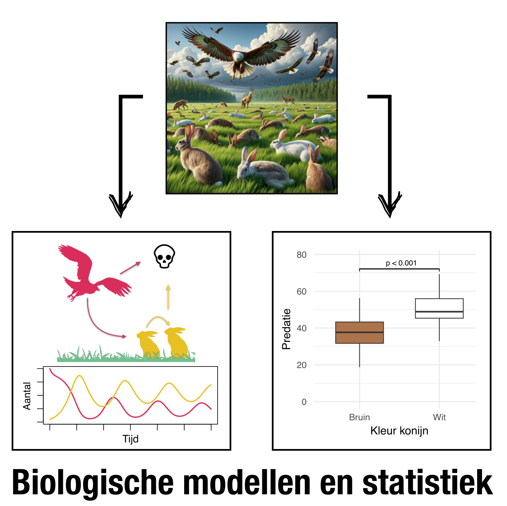

<!-- Note: you need to install webshot to render this book to PDF: -->

<!-- install.packages("webshot") -->

<!-- webshot::install_phantomjs() -->

<!-- For configurations of the auto-generated screenshots, see https://bookdown.org/yihui/bookdown/html-widgets.html -->

# Inleiding

Biologie is een complexe wetenschap. Elk biologisch systeem bestaat uit vele onderdelen, die ieder op verschillende schalen hun eigen regeltjes volgen. We bestuderen nucleotiden, eiwitten, organellen, cellen, weefsels, organen, organismen, en ecosystemen, wat samengenomen een schaalvergroting is van meerdere biljoenen. Misschien is het dus ook geen wonder dat er zoveel variatie zit in biologische metingen! Wat kunnen we doen om deze complexe systemen toch te begrijpen?

In deze cursus leer je over twee strategiën om complexe biologische systemen te bestuderen. De eerste strategie is het vereenvoudigen van complexe systemen met **simpele modellen** (links in @fig-cover) . Bijvoorbeeld, met een eenvoudige computersimulatie van een ziekte-uitbraak kun je zelf aan de knoppen draaien om te zien wanneer de uitbraak erger of milder wordt. Op een vergelijkbare manier wordt in alle vakgebieden binnen de biologie – van microbiologie tot gedrag – onderzoek gedaan. Dit vakgebied wordt vaak Theoretische Biologie of Systeembiologie genoemd. De tweede strategie is om te leren omgaan met de enorme variatie in biologische data (rechts in @fig-cover) door deze zorgvuldig te organiseren, omschrijven en te onderzoeken. Op deze manier kunnen we onderscheid maken tussen verschillen die berusten op toeval en daadwerkelijk biologisch relevante inzichten. Dit vakgebied wordt **statistiek** genoemd, en is ook voor álle biologische gebieden relevant; een goede bioloog kan betrouwbare conclusies trekken. 

{#fig-cover width="80%" fig-align="center"}

Voor zowel modellen als statistiek is het van belang dat je een beetje comfortabel word met wiskunde en computers. Beide onderdelen zul je later in de opleiding en tijdens je carrière nog regelmatig tegenkomen. Daarom begint deze cursus met deze basisvaardigheden. Maar vergis je niet: deze cursus is door en voor biologen, en we gaan dus meer doen dan alleen maar rekenen. Van foeragerende mieren tot de vacht van een zebra; er zullen een groot aantal hele interessante biologische systemen voorbij komen!
