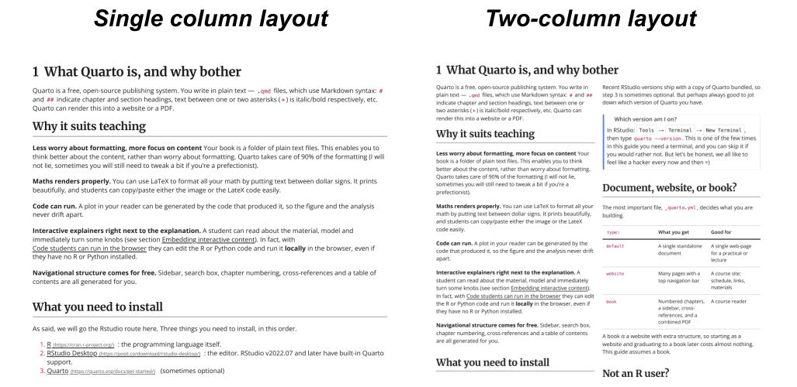

# Print boek 🖨️ {#sec-print .unnumbered}

::: {.print-intro}
Op deze pagina staat het hele boek in één document, zodat je met één keer
'printen' alles hebt in plaats van één hoofdstuk tegelijk. Het boek wordt
samengesteld uit dezelfde hoofdstukken als de website, dus het loopt nooit
achter. Interactieve simulaties en video's kunnen niet op papier; daarvoor
komt een afbeelding of het webadres in de plaats. Antwoorden die online
ingeklapt zijn, staan op papier uitgeklapt.

Kies een opmaak, dan opent het printvenster (kies daar "Opslaan als PDF" als
je een PDF wilt):

```{=html}
<div class="print-choices">
  <button type="button" disabled onclick="printBook('print-1col')">🖨️ Eén kolom</button>
  <button type="button" disabled onclick="printBook('print-2col')">🖨️ Twee kolommen, kleinere letter</button>
</div>
<div id="print-status"></div>
```

**Eén kolom** leest het prettigst: de tekst over de volle breedte, en figuren
naast elkaar blijven naast elkaar staan.

**Twee kolommen** past flink meer tekst op een vel, en scheelt dus geld als je
het laat printen. De letter is iets kleiner en figuren naast elkaar komen
onder elkaar te staan.

::: {.print-preview}
{.nolightbox fig-alt="Opmaak met één en met twee kolommen vergeleken"}
:::

Het boek begint met een titelpagina, en elk hoofdstuk begint op een nieuw vel.
Druk je zonder knop op <kbd>Cmd</kbd>/<kbd>Ctrl</kbd>+<kbd>P</kbd>, dan krijg
je de versie met één kolom. Hieronder zie je alvast hoe het boek op papier
komt te staan.
:::

[$\,$]{style="display:none"}

::: {.cover-page}
{.cover-logo .nolightbox fig-alt="Logo"}

[]{.cover-title}

[]{.cover-author}

[]{.cover-date}
:::

::: {.cover-verso}
:::

::: {#print-book}
:::
