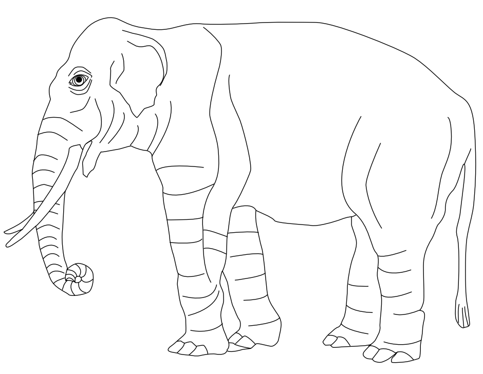



# Voorbeelden van wat mogelijk is met Quarto

## Hoofdstuk

### Paragraaf binnen hoofdstukje

### Plotjes maken in R

```{r}
#| label: fig-normal
#| fig-cap: "Standard normal distribution with critical value for $\\alpha = 0.05$."
#| warning: false
#| code-fold: true
#| code-summary: "Show the code"
#| 
library(ggplot2)
library(tidyverse)

z_values <- seq(-3, 3, by = 0.01)
probabilities <- dnorm(z_values)

df <- data.frame(Z = z_values, probability = probabilities)

arrows <- tibble(
  x1 = c(2.2), 
  x2 = c(3.3),
  y1 = c(.02),
  y2 = c(0.15)
)

p <- ggplot(df, aes(x = Z, y = probability)) +
  geom_line(
    size = 1.2,
    color = "#e8601d"
    ) +
  geom_ribbon(
    data = subset(df, Z >= 1.96), 
    aes(ymax = probability, ymin = 0), 
    fill = "goldenrod", 
    alpha = 0.5) +
  geom_vline(
    xintercept = 1.96, 
    linetype = "dashed", 
    color = "black"
    ) +
  geom_text(
    x = 0.6, y = 0.04, 
    label = expression(italic(Z)[0.05] == 1.96), 
    color = "black", 
    size = 5,
    parse = TRUE, 
    hjust = -0.2) +
  geom_label(
    x = 2.4, y = 0.17, 
    label = expression(alpha == 0.05), 
    color = "black", 
    fill = "goldenrod",
    alpha = 0.1,
    label.size = 0,
    size = 5,
    parse = TRUE, 
    hjust = -0.2) +
  labs(
       x = expression(italic(Z)),
       y = "probability density",
       ) +
  geom_curve(
    data = arrows, 
    aes(x = x1, y = y1, xend = x2, yend = y2),
    arrow = arrow(
      length = unit(0.1, "inch"), angle = 30), 
    size = 1,
    color = "gray30", 
    curvature = 0.4
    )
p

#library(plotly)
#ggplotly(p)
```

```{r}
#| label: fig-tdistributions
#| fig-cap: "Various $t$-distributions and a normal distribution"
#| warning: false
#| code-fold: true
#| code-summary: "Show the code"
#| 
library(ggplot2)

t_values <- seq(-3, 3, by = 0.1)
z_values <- seq(-3, 3, by = 0.1)

dataframe <- data.frame(
  t = c(z_values, rep(t_values, 3)),
  prob = c(
    dnorm(z_values),
    dt(t_values, df = 1),
    dt(t_values, df = 5),
    dt(t_values, df = 20)
  ),
  df = factor(
    c(
      rep("standard normal", length(z_values)),
      rep("df = 1", length(t_values)),
      rep("df = 5", length(t_values)),
      rep("df = 20", length(t_values))
      ),
    levels = c(
      "df = 1", "df = 5", "df = 20", "standard normal"
      )
    ) 
  )

ggplot(
  dataframe, 
  aes(
    x = t, y = prob, 
    group = df, color = df, linewidth = df, linetype = df)
  ) +
  geom_line(
  ) +
  scale_color_manual(
    values = c( rep("black", 3), "#e8601d")
    ) + 
  scale_linewidth_manual(
    values = c(1, 1, 1, 1.2)
  ) +
  scale_linetype_manual(
    values = c(
      "df = 1"="longdash", 
      "df = 5"="dashed", 
      "df = 20"="dotted",
      "standard normal"="solid" 
    )
  ) +
  labs(
    x = expression(italic(t)),
    y = "probability density"
  )
```

::: {.content-visible when-format="html"}
```{r}
#| label: fig-plotly
#| fig-cap: "test"
#| warning: false
#| code-fold: true
#| code-summary: "Show the code"

library(plotly)
library(ggplot2)
p <- qplot(c(1, 2, 3), c(4, 2, 4))
ggplotly(p)
```
:::

### Inladen van een simulatie in Javascript die elders gehost is


::: {.content-visible when-format="html"}
In de html-versie wordt dit getoond:

```{=html}
<iframe width="780" height="550" src="https://tbb.bio.uu.nl/bvd/simulations/australia/" title="Simulation"></iframe>
```
:::
  
  
::: {.content-visible when-format="pdf"}
In de PDF-versie wordt dit getoond:
  
{width="4in"}
:::

### LaTeX-macros

In het bestand \_macros.tex kunnen macros worden gedefinieerd. Dat
bestand moet bovenaan ieder document worden ingeladen (zie eerste regel van dit bestand).

### Voorbeelden:

Voor kansverdelingen heb ik de macro \\pr{} gedefineerd:
  $$\pr{A \cap B} = \pr{A} \pr{B | A}.$$
  
  $$\pr{A \cup B} = \pr{A} + \pr{B} - \pr{A \cap B}.$$
  
  Voor de verwachtingswaarde de macro \\ev{}: 
  $$\ev{X} = \sum_x  x\, \pr{X = x}.$$ 
  De differentiaaloperator is \\diff: 
  $$ \ev{X} = \int_{-\infty}^\infty  x\, \pr{X = x}  \diff x. $$ 
  Voor varianties \\var{}:
  
  $$
  \var{X}  = \sum_x  \left(x - \ev{X}\right)^2 \, \pr{X = x}
$$ 
  
  $$
  \var{X} = \int_{-\infty}^\infty  \left(x - \ev{X}\right)^2 \, \pr{X = x} \diff x.
$$
  
Voor standaarddeviaties \\sd{}: 
  
$$
  \sd{X} = \sqrt{\var{X}}.
$$
  
  
### Mermaid
  
Met Mermaid kun je heel gemakkelijk diagrammen maken:
  
```{mermaid}
%%| label: fig-variables
%%| caption: "Typen variabelen"
flowchart TB
A(Variabelen) --> C("Categoriaal (Kwalitatief)")
A --> B("Numeriek (Kwantitatief)")
B --> F(Discreet)
B --> G(Continu)
C --> E(Nominaal)
C --> D(Ordinaal)
```

### Callouts

There are a few special callouts:
  
::: {.callout-note}
Note that there are five types of callouts, including: `note`,
`warning`, `important`, `tip`, and `caution`.
:::
  
::: {.callout-tip}
## Tip with Title

This is an example of a callout with a title.
:::
  
::: {.callout-caution collapse="true"}
## Expand To Learn About Collapse

This is an example of a 'folded' caution callout that can be expanded by
the user. You can use `collapse="true"` to collapse it by default or
`collapse="false"` to make a collapsible callout that is expanded by
default.
:::
  
::: {#tip-example .callout-tip}
## Cross-Referencing a Tip
    
Add an ID starting with `#tip-` to reference a tip.
:::
      
And these can also be cross-referenced, see @tip-example for example.
    
### How to format questions/problem sets
    
::: {#exr-test1}
## Test 1
      
The equation of any straight line, called a linear equation, can be written as:
        
$$ 
y = mx + b
$$ {#eq-line}
        
We can refer to the line (@eq-line), or [Vergelijking @eq-line].
        
**a.** Blabla?
          
**b.** Of blablabla?
:::
          
### Data Tables
          
::: {.content-visible when-format="html"}
```{r}
#| label: tab-anscombe
#| warning: false
#| code-fold: true
#| code-summary: "Show the code"
#| 

library(DT)
library(datasets)
datatable(anscombe, options = list(pageLength = 5))
```
:::
          

